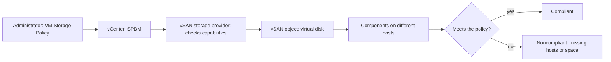
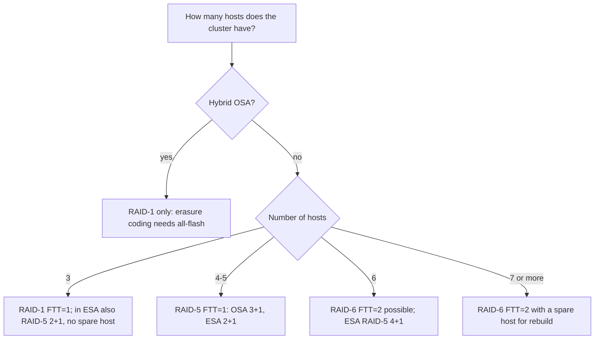

:::analogy
**The data center pain.** A vSAN cluster has 5 hosts and every important VM (VM, Virtual Machine) uses a RAID-6 (RAID, Redundant Array of Independent Disks) policy. One host fails and the objects move to *reduced-availability-with-no-rebuild*: vSAN can no longer rebuild them, because RAID-6 needs 6 active hosts. [S385] On another cluster, 4 hosts with RAID-5, a host will not enter maintenance mode with full evacuation. [S386] Both problems have the same cause: the storage policy does not fit the number of hosts. For the exam, the VVF (VMware vSphere Foundation, 2V0-16.25) and VCF (VMware Cloud Foundation, 2V0-17.25) exam guides ask you to explain vSAN storage policies and failure tolerance methods. [S02] [S03]

**The analogy: how you keep important documents.**

- **RAID-1 (mirroring)** means making full photocopies and keeping them in different houses. Simple and fast, but it takes double or triple the space.
- **RAID-5/6 (erasure coding)** means tearing the document into pieces, giving them to different friends and adding one or two "calculation pieces" (parity). From them you can rebuild any lost piece. It takes less space, but you need more friends.
- **FTT (Failures To Tolerate)** says how many friends can disappear at once without losing the document.
- **The storage policy** is the card where you write the rules for each document, not for the whole cabinet.
:::

:::architecture
### 1. What SPBM is and why it is "per object"

SPBM (Storage Policy-Based Management) is the mechanism through which vSAN works with vCenter to validate, change and apply storage policies to vSAN objects, for example a VM's disks. [S379] The policy is attached to **each object** (virtual disk, VM files), not to the whole datastore. Two VMs on the same vSAN datastore can have different protection. [S374]

A policy has three rule groups in the vSphere Client: **Availability**, **Storage Rules** and **Advanced Policy Rules**, plus a **Tags** tab. [S377]

### 2. Failures to tolerate: n+1 and 2n+1

To tolerate **n** failures, vSAN keeps the data in **n+1** places (full copies or data plus parity). [S374] If you use fault domains you need **2n+1** fault domains with hosts that contribute storage; a host that is not in any fault domain counts as a separate fault domain. [S374] If you create a policy without choosing FTT, vSAN makes a single mirror copy by default, which tolerates one failure. [S374]

The FTT options and how much space a 100 GB object takes, from the VCF 9.0 documentation, with the differences between OSA (Original Storage Architecture) and ESA (Express Storage Architecture) where they exist [S374]:

| Option | Tolerates | Space for 100 GB | Notes |
|---|---|---|---|
| No data redundancy | 0 failures | 100 GB | Data is at risk on any device failure |
| 1 failure, RAID-1 (Mirroring) | 1 | 200 GB | The performance-oriented option |
| 1 failure, RAID-5 (Erasure Coding) | 1 | 133.33 GB (OSA 3+1) | In ESA: 2+1 (150%) or 4+1 (125%) [S387] |
| 2 failures, RAID-1 (Mirroring) | 2 | 300 GB | |
| 2 failures, RAID-6 (Erasure Coding) | 2 | 150 GB | The 4+2 scheme [S390] |
| 3 failures, RAID-1 (Mirroring) | 3 | 400 GB | FTT=3 is the single-site maximum [S380] |

Note: the official page says RAID-6 tolerates "up to one" failure, which contradicts FTT=2. The vSAN glossary KB, Knowledge Base article, 326549 and the other sources clearly put RAID-6 at FTT=2. [S379] [S390] `⚠ to verify` whether the page gets corrected.

### 3. How many hosts each option needs

This is where OSA and ESA differ most:

| Method | OSA: minimum hosts | ESA: minimum hosts | Source |
|---|---|---|---|
| RAID-1, FTT=1 | 3 | 3 | [S390] [S361] |
| RAID-1, FTT=2 | 5 | 5 | [S379] [S390] |
| RAID-1, FTT=3 | 7 | 7 | [S379] [S390] |
| RAID-5, FTT=1 | 4 (3+1 scheme) | 3 (2+1 scheme); 4+1 from 6 hosts | [S383] [S386] [S374] [S390] |
| RAID-6, FTT=2 | 6 (4+2) | 6 (4+2) | [S379] [S385] [S390] |

The minimum is only the starting threshold. The VMware blog on adaptive RAID-5 recommends at least **one more host** than the minimum, so vSAN has somewhere to rebuild data after a failure. [S387]

**Adaptive RAID-5 in ESA.** ESA picks the RAID-5 scheme by cluster size: 2+1 below 6 hosts, 4+1 from 6 hosts. When the cluster size changes it re-adjusts the scheme after **24 hours**. [S374] [S387] For example, a 6-host cluster that drops to 5 moves from 4+1 to 2+1 after 24 hours, so it has a spare host again. [S387] The adaptive behaviour is only for RAID-5; a RAID-6 policy does not drop to RAID-5 by itself when you lose a host (the author says on the Yellow Bricks blog). [S391]

### 4. Erasure coding needs all-flash

RAID-5/6 works **only on all-flash**. On a hybrid cluster (SSD, Solid-State Drive, for cache and HDD, Hard Disk Drive, for capacity) you get the error *RAID-5/6 (Erasure Coding) - Capacity requires an All flash configuration* and stay on RAID-1. [S381] [S382] If you leave *Storage tier* at *No Preference* when creating the policy, an erasure coding policy can fail; set it to *All flash*. [S384] If the method does not appear in the policy at all, KB 326540 says to check the license, the cluster type, the on-disk format (3.0 or later in OSA) and that at least 4 hosts contribute storage (OSA context). [S383]

In OSA, the vSAN glossary says erasure coding has lower performance than mirroring. [S379] In ESA, the default policies offered are RAID-5 and RAID-6 (see section 6). [S375]

### 5. The other policy rules

| Rule | Default | What it does | Source |
|---|---|---|---|
| Site disaster tolerance | None (standard cluster) | Host mirroring (2-node), site mirroring (stretched) or data kept on one site | [S374] |
| Number of disk stripes per object | 1 (maximum 12) | How many capacity devices each replica is striped across; the docs recommend keeping 1 | [S374] [S379] |
| Object Space Reservation (OSR) | Thin provisioning | 25%, 50%, 75% or thick; thick cancels deduplication and compression savings | [S374] |
| Flash read cache reservation | 0% | Hybrid only; not supported on OSA all-flash or on ESA | [S374] |
| Disable object checksum | No | In ESA checksum is always on and cannot be disabled | [S374] |
| Force provisioning | No | With Yes, the object is created even if the policy cannot be met; for bootstrapping or outages | [S374] [S379] |
| IOPS limit for object | 0 = no limit | Limits IOPS (Input/Output Operations Per Second) per object, with a 32 KiB base unit | [S374] |
| Space efficiency | No preference | In ESA compression is chosen per object, in the policy; in OSA it is a cluster setting | [S374] [S377] |
| Encryption services | No preference | Matches only encrypted or unencrypted datastores | [S374] |

Two ESA details from the default policies page: RAID-0 and RAID-1 objects get 3 stripes even if the policy says 1, and VM swap and memory objects use Force provisioning = Yes. [S375]

### 6. The default policies

| Policy | Where | Rules |
|---|---|---|
| vSAN Default Storage Policy | Any vSAN cluster | FTT=1, 1 stripe, thin, no force provisioning [S375] |
| The ESA RAID-5 and RAID-6 policies | ESA clusters | FTT=1 RAID-5 and FTT=2 RAID-6, thin [S375] |
| "ClusterName - Optimal Default Datastore Policy" | ESA with auto-policy management on | Generated from the host count [S375] |

The *vSAN Default Storage Policy* **cannot be deleted**, and its name, description and storage provider cannot be changed; you clone it to make your own. [S375] A vSAN datastore has **one** default policy, used when you create a VM without choosing a policy. [S375] [S378]

**Auto-policy management (ESA only).** You turn it on from the cluster, at *vSAN > Services > Storage > Edit*; vSAN creates the optimal policy and makes it the datastore default. [S375] It does not work on clusters with fault domains. [S388] From the vSAN 8 U2 table (without HRR, Host Rebuild Reserve): 3 hosts get RAID-1 FTT=1, 4–5 hosts RAID-5 2+1, and from 6 hosts RAID-6 4+2. [S388] When you add or remove hosts a health finding appears (after 24 hours when adding) and you click *Update Cluster DS Policy*; vSAN does not change the policy by itself. [S388]

**What changes in 9.1.** VCF 9.1 brings **Auto-RAID**: a single system-managed policy, the default on new clusters, that picks resilience from cluster type and size (3–5 hosts RAID-5 2+1, 6+ hosts RAID-6). Upgraded clusters keep their policies and get a health alert. [S389] The 9.0 exams ask about auto-policy management, not Auto-RAID.

### 7. What happens when you change a policy

vSAN accepts the change right away but applies it **later, in batches, asynchronously**. During reconfiguration it uses temporary space (*transient capacity*), visible in the Capacity monitor under *System usage*. [S376] An impossible change is rejected immediately; the official example is moving from RAID-5 to RAID-6 on a 5-host cluster. [S376] KB 326540 recommends applying a new policy to small groups of VMs so you do not start a huge resync. [S383]

`[IMAGE SEARCH / PROMPT]` "vSAN RAID-5 2+1 vs 4+1 component placement ESA" and "VM Storage Policy vSAN availability tab failures to tolerate".
:::

:::exam-alert
### Memorize

| What | Value / rule | Source |
|---|---|---|
| FTT = n | n+1 places for data; 2n+1 fault domains | Docs [S374] |
| RAID-1 FTT=1 / 2 / 3 | 3 / 5 / 7 hosts; 200 / 300 / 400 GB for 100 GB | [S374] [S379] [S390] |
| RAID-5 FTT=1 | OSA 4 hosts (3+1); ESA 3 hosts (2+1), 4+1 from 6 | [S383] [S374] [S390] |
| RAID-6 FTT=2 | 6 hosts (4+2), 150 GB for 100 GB | [S374] [S385] |
| ESA adaptive RAID-5 | Re-adjusts 24 hours after a cluster size change | Docs [S374] |
| Erasure coding | All-flash only | KB 383978 [S381] |
| Disk stripes | Default 1, maximum 12 | Docs [S374] |
| OSR | Thin by default | Docs [S374] |
| Checksum in ESA | Always on | Docs [S374] |
| vSAN Default Storage Policy | FTT=1; cannot be deleted | Docs [S375] |

### 3 exam traps

1. **"I put RAID-5 on a hybrid OSA cluster to save space."** False. Erasure coding needs all-flash; on hybrid you stay on RAID-1. [S381] [S382]
2. **"I can apply RAID-6 on a 5-host cluster and it will adapt."** False. RAID-6 needs 6 hosts; the change is rejected, and RAID-6 objects left below 6 hosts are not rebuilt. [S376] [S385]
3. **"The policy applies to the datastore, so every VM has the same protection."** False. The policy applies to each object; the datastore only has a default policy for new VMs created without one. [S374] [S378]
:::

:::trenches
### Mistake 1: RAID-6 on exactly 6 hosts

A 6-host cluster uses RAID-6 everywhere. A host fails and Skyline Health shows *Reduced Availability*; the objects are noncompliant, in *reduced-availability-with-no-rebuild*, which you also see with `esxcli vsan debug object health summary get`. [S385]
**Fix (KB 431247):** bring the cluster back to 6 hosts and let the resync finish. If you cannot, change the objects' policy to RAID-5 or RAID-1 FTT=1 and apply it. [S385] The design lesson: keep one host more than the minimum. [S387]

### Mistake 2: maintenance mode blocked on a small cluster

On a 4-host OSA cluster with RAID-5, entering maintenance mode with *Full data evacuation* fails with *Resource check failed*, and `clomd.log` says there are not enough fault domains. [S386]
**Fix (KB 397437):** with one host out, 3 remain, below the OSA RAID-5 minimum. Find RAID-5/6 objects with `esxcli vsan debug object list --all`, move the affected VMs to a RAID-1 policy, wait for the resync and retry. Also check leftover objects without an owner, but delete only what you have confirmed is no longer needed. [S386]
:::

:::interview
**Junior/Mid question: "What is the difference between RAID-1 and RAID-5/6 in vSAN and when do you pick each?"**

*Ideal answer:* RAID-1 keeps full copies (FTT=1 doubles the space) and works on hybrid and all-flash, from 3 hosts. RAID-5/6 uses parity and takes less space (RAID-6 is 150% versus 300% for RAID-1 FTT=2), but needs all-flash and more hosts: RAID-5 4 hosts in OSA and 3 in ESA, RAID-6 6 hosts. [S374] [S381] [S390] A good candidate adds that in ESA the default policies are RAID-5 and RAID-6, and that you keep one host more than the minimum. [S375] [S387]

**Troubleshooting scenario: "A VM shows Noncompliant with its policy. What do you do?"**

*The answer a Team Lead expects:*
1. **See what the policy asks for**: FTT, RAID method, stripes. [S374]
2. **Count the active hosts** that contribute storage and compare with the method's minimum; look at the cluster's *Fault domain failures to tolerate* value, which shows the maximum possible FTT. [S380]
3. **Check object state** with `esxcli vsan debug object health summary get` (for example *reduced-availability-with-no-rebuild*). [S385]
4. **Check free space**: a reconfiguration needs temporary space. [S376]
5. **Fix the cause** (bring the host back) or, if that is impossible, apply a compatible policy, to small groups of VMs. [S385] [S383]
:::

:::lab
**Scenario.** You create three policies (RAID-1 FTT=1, RAID-5 FTT=1 and one with RAID-6 FTT=2), apply them to a test disk, watch the space used, change the datastore default policy and see what happens when a policy asks for more hosts than you have.

**What you need.** A working vSAN cluster (at least 3 hosts, ideally 4 or more, all-flash for RAID-5), a test VM with a disk of a few GB and the *Profile-driven storage view* and *update* privileges. [S377]

The steps below can be ticked off and your progress is saved in the browser. Exact menu names can differ slightly between versions 8 and 9 (`⚠ to verify`).

**Home lab only / not supported.** A nested vSAN cluster, with virtual disks marked as flash, is for the lab only. Force provisioning = Yes and "No data redundancy" are for tests only; do not leave them on real VMs. [S374]

**Failure test and validation.** In step 6 you apply RAID-6 on a cluster with fewer than 6 hosts: the change must be rejected or the policy shows as *Incompatible* under *Storage compatibility*. [S376] [S377] In step 4, the space used by the disk must be lower with RAID-5 than with RAID-1.
:::

:::quiz
Five original questions in the style of the VCP (VMware Certified Professional) exams. You get the explanation for every option right after you answer.
:::

:::references
- The VCP-VVF 2V0-16.25 and VCP-VCF 2V0-17.25 exam guides, objective 2.3 [S02] [S03]
- VCF 9.0 documentation: vSAN policy rules [S374], default policies and auto-policy management [S375], policy changes [S376], creating a policy [S377], the datastore default policy [S378]
- KB 326549 (vSAN glossary) and KB 421094 (FTT shown under fault domains) [S379] [S380]
- KB 383978, KB 424165, KB 326540 and KB 371806: erasure coding, all-flash and requirements [S381] [S382] [S383] [S384]
- KB 431247 and KB 397437: hosts below the policy minimum [S385] [S386]
- VMware blogs: adaptive RAID-5 [S387], auto-policy in 8 U2 [S388], Auto-RAID in 9.1 [S389]
- Yellow Bricks: minimum hosts in ESA [S390] and adaptive RAID-5 [S391]
- vSAN Design Guide [S361] and host planning [S355]
:::
