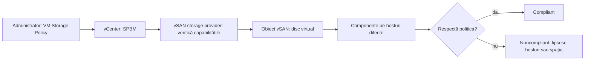
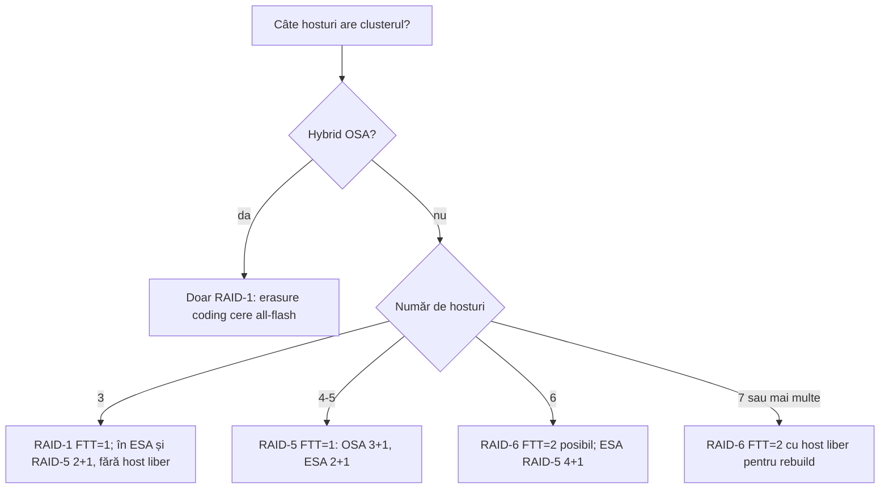

:::analogy
**Durerea din data center.** Un cluster vSAN are 5 hosturi și toate VM-urile (VM, Virtual Machine) importante folosesc o politică RAID-6 (RAID, Redundant Array of Independent Disks). Un host cade, iar obiectele trec în starea *reduced-availability-with-no-rebuild*: vSAN nu le mai poate reconstrui, pentru că RAID-6 cere 6 hosturi active. [S385] Pe alt cluster, de 4 hosturi cu RAID-5, un host nu mai intră în maintenance mode cu evacuare completă. [S386] Ambele probleme vin din aceeași cauză: politica de stocare nu se potrivește cu numărul de hosturi. Pentru examen, exam guide-urile VVF (VMware vSphere Foundation, 2V0-16.25) și VCF (VMware Cloud Foundation, 2V0-17.25) cer să explici politicile de stocare vSAN și metodele de toleranță la defecte. [S02] [S03]

**Analogia: cum îți păstrezi documentele importante.**

- **RAID-1 (oglindire)** înseamnă să faci fotocopii complete și să le ții în case diferite. E simplu și rapid, dar ocupă dublu sau triplu spațiu.
- **RAID-5/6 (erasure coding)** înseamnă să rupi documentul în bucăți, să le dai unor prieteni diferiți și să mai adaugi una sau două „bucăți de calcul” (paritate). Din ele poți reface orice bucată pierdută. Ocupă mai puțin, dar ai nevoie de mai mulți prieteni.
- **FTT (Failures To Tolerate)** spune câți prieteni pot dispărea deodată fără să pierzi documentul.
- **Politica de stocare** e fișa pe care scrii regulile pentru fiecare document în parte, nu pentru tot dulapul.
:::

:::architecture
### 1. Ce e SPBM și de ce e „pe obiect”

SPBM (Storage Policy-Based Management) e mecanismul prin care vSAN lucrează cu vCenter ca să valideze, să schimbe și să aplice politici de stocare pe obiectele vSAN, de exemplu pe discurile unei VM. [S379] Politica se atașează **fiecărui obiect** (disc virtual, fișierele VM-ului), nu întregului datastore. Două VM-uri de pe același datastore vSAN pot avea protecții diferite. [S374]

O politică are trei grupuri de reguli în vSphere Client: **Availability**, **Storage Rules** și **Advanced Policy Rules**, plus un tab de **Tags**. [S377]

### 2. Failures to tolerate: n+1 și 2n+1

Pentru a tolera **n** defecte, vSAN păstrează datele în **n+1** locuri (copii întregi sau date plus paritate). [S374] Dacă folosești fault domains, ai nevoie de **2n+1** fault domains cu hosturi care contribuie cu stocare; un host care nu e în niciun fault domain contează ca un fault domain separat. [S374] Dacă creezi o politică fără să alegi FTT, vSAN face implicit o singură copie oglindită, care tolerează un defect. [S374]

Variantele de FTT și cât ocupă un obiect de 100 GB, după documentația VCF 9.0, cu diferențele dintre OSA (Original Storage Architecture) și ESA (Express Storage Architecture) acolo unde există [S374]:

| Opțiune | Tolerează | Spațiu pentru 100 GB | Observații |
|---|---|---|---|
| No data redundancy | 0 defecte | 100 GB | Datele sunt în pericol la orice defect de dispozitiv |
| 1 failure, RAID-1 (Mirroring) | 1 | 200 GB | Varianta orientată pe performanță |
| 1 failure, RAID-5 (Erasure Coding) | 1 | 133,33 GB (OSA 3+1) | În ESA: 2+1 (150%) sau 4+1 (125%) [S387] |
| 2 failures, RAID-1 (Mirroring) | 2 | 300 GB | |
| 2 failures, RAID-6 (Erasure Coding) | 2 | 150 GB | Schema 4+2 [S390] |
| 3 failures, RAID-1 (Mirroring) | 3 | 400 GB | FTT=3 e maximul pe un singur site [S380] |

Notă: pagina oficială descrie la RAID-6 că tolerează „up to one” defect, ceea ce contrazice FTT=2. Glosarul KB, Knowledge Base article, 326549 și restul surselor spun clar că RAID-6 e pentru FTT=2. [S379] [S390] `⚠ de verificat` dacă pagina se corectează.

### 3. Câte hosturi cere fiecare variantă

Aici OSA și ESA diferă cel mai mult:

| Metodă | OSA: hosturi minime | ESA: hosturi minime | Sursă |
|---|---|---|---|
| RAID-1, FTT=1 | 3 | 3 | [S390] [S361] |
| RAID-1, FTT=2 | 5 | 5 | [S379] [S390] |
| RAID-1, FTT=3 | 7 | 7 | [S379] [S390] |
| RAID-5, FTT=1 | 4 (schema 3+1) | 3 (schema 2+1); 4+1 de la 6 hosturi | [S383] [S386] [S374] [S390] |
| RAID-6, FTT=2 | 6 (4+2) | 6 (4+2) | [S379] [S385] [S390] |

Minimul e doar pragul de pornire. Blogul VMware despre adaptive RAID-5 recomandă cel puțin **un host în plus** față de minim, ca vSAN să aibă unde reconstrui datele după o cădere. [S387]

**Adaptive RAID-5 în ESA.** ESA alege singur schema RAID-5 după mărimea clusterului: 2+1 sub 6 hosturi, 4+1 de la 6 hosturi. Când mărimea clusterului se schimbă, reajustează schema după **24 de ore**. [S374] [S387] De exemplu, un cluster de 6 hosturi care rămâne cu 5 trece de la 4+1 la 2+1 după 24 de ore, ca să aibă din nou un host liber. [S387] Comportamentul adaptiv e doar pentru RAID-5; o politică RAID-6 nu coboară singură la RAID-5 când pierzi un host (spune autorul pe blogul Yellow Bricks). [S391]

### 4. Erasure coding cere all-flash

RAID-5/6 merge **doar pe all-flash**. Pe un cluster hybrid (SSD, Solid-State Drive, pentru cache și HDD, Hard Disk Drive, pentru capacitate) primești eroarea *RAID-5/6 (Erasure Coding) - Capacity requires an All flash configuration* și rămâi la RAID-1. [S381] [S382] Dacă la crearea politicii lași *Storage tier* pe *No Preference*, politica cu erasure coding poate eșua; o setezi pe *All flash*. [S384] Dacă metoda nu apare deloc în politică, KB 326540 cere să verifici licența, tipul clusterului, formatul pe disc (minim 3.0 în OSA) și dacă ai cel puțin 4 hosturi care contribuie cu stocare (context OSA). [S383]

În OSA, glosarul vSAN spune că erasure coding are performanță mai mică decât oglindirea. [S379] În ESA, politicile implicite oferite sunt chiar RAID-5 și RAID-6 (vezi secțiunea 6). [S375]

### 5. Celelalte reguli ale politicii

| Regulă | Implicit | Ce face | Sursă |
|---|---|---|---|
| Site disaster tolerance | None (cluster standard) | Host mirroring (2 noduri), site mirroring (stretched) sau date ținute pe un singur site | [S374] |
| Number of disk stripes per object | 1 (maximum 12) | Pe câte dispozitive de capacitate se împarte fiecare replică; documentația recomandă să lași 1 | [S374] [S379] |
| Object Space Reservation (OSR) | Thin provisioning | 25%, 50%, 75% sau thick; thick anulează economiile de deduplicare și compresie | [S374] |
| Flash read cache reservation | 0% | Doar hybrid; nu e suportat pe OSA all-flash și nici pe ESA | [S374] |
| Disable object checksum | No | În ESA checksum-ul e mereu pornit și nu se poate dezactiva | [S374] |
| Force provisioning | No | Cu Yes, obiectul se creează chiar dacă politica nu poate fi respectată; pentru bootstrap sau avarii | [S374] [S379] |
| IOPS limit for object | 0 = fără limită | Limitează IOPS (Input/Output Operations Per Second) pe obiect, cu unitatea de bază de 32 KiB | [S374] |
| Space efficiency | No preference | În ESA compresia se alege pe obiect, din politică; în OSA e setare de cluster | [S374] [S377] |
| Encryption services | No preference | Potrivește doar datastore-uri criptate sau necriptate | [S374] |

Două detalii ESA din documentația politicilor implicite: obiectele RAID-0 și RAID-1 primesc 3 stripes chiar dacă politica spune 1, iar obiectele de swap și memorie ale VM-ului folosesc Force provisioning = Yes. [S375]

### 6. Politicile implicite

| Politică | Unde | Reguli |
|---|---|---|
| vSAN Default Storage Policy | Orice cluster vSAN | FTT=1, 1 stripe, thin, fără force provisioning [S375] |
| Politicile ESA RAID-5 și RAID-6 | Clustere ESA | FTT=1 RAID-5, respectiv FTT=2 RAID-6, thin [S375] |
| „ClusterName - Optimal Default Datastore Policy” | ESA cu auto-policy management pornit | Generată după numărul de hosturi [S375] |

Politica *vSAN Default Storage Policy* **nu se poate șterge**, iar numele, descrierea și storage provider-ul nu se pot schimba; o clonezi ca să faci una proprie. [S375] Un datastore vSAN are **o singură** politică implicită, folosită când creezi o VM fără să alegi politica. [S375] [S378]

**Auto-policy management (doar ESA).** Îl pornești din cluster, la *vSAN > Services > Storage > Edit*; vSAN creează politica optimă și o face implicită pe datastore. [S375] Nu funcționează pe clustere cu fault domains. [S388] După tabelul din vSAN 8 U2 (fără HRR, Host Rebuild Reserve): 3 hosturi primesc RAID-1 FTT=1, 4–5 hosturi RAID-5 2+1, iar de la 6 hosturi RAID-6 4+2. [S388] Când adaugi sau scoți hosturi, apare un health finding (după 24 de ore la adăugare) și apeși *Update Cluster DS Policy*; vSAN nu schimbă politica singur. [S388]

**Ce se schimbă în 9.1.** VCF 9.1 aduce **Auto-RAID**: o singură politică gestionată de sistem, implicită pe clusterele noi, care alege reziliența după tipul și mărimea clusterului (3–5 hosturi RAID-5 2+1, 6+ hosturi RAID-6). Clusterele upgradate își păstrează politicile și primesc o alertă de health. [S389] Examenele 9.0 întreabă de auto-policy management, nu de Auto-RAID.

### 7. Ce se întâmplă când schimbi o politică

vSAN acceptă schimbarea imediat, dar o aplică **mai târziu, în loturi, asincron**. Pe durata reconfigurării folosește spațiu temporar (*transient capacity*), vizibil în Capacity monitor la *System usage*. [S376] O schimbare imposibilă e refuzată pe loc; exemplul oficial e trecerea de la RAID-5 la RAID-6 pe un cluster cu 5 hosturi. [S376] KB 326540 recomandă să aplici o politică nouă pe grupuri mici de VM-uri, ca să nu pornești un resync uriaș. [S383]

`[IMAGE SEARCH / PROMPT]` „vSAN RAID-5 2+1 vs 4+1 component placement ESA” și „VM Storage Policy vSAN availability tab failures to tolerate”.
:::

:::exam-alert
### De memorat

| Ce | Valoare / regulă | Sursă |
|---|---|---|
| FTT = n | n+1 locuri pentru date; 2n+1 fault domains | Docs [S374] |
| RAID-1 FTT=1 / 2 / 3 | 3 / 5 / 7 hosturi; 200 / 300 / 400 GB pentru 100 GB | [S374] [S379] [S390] |
| RAID-5 FTT=1 | OSA 4 hosturi (3+1); ESA 3 hosturi (2+1), 4+1 de la 6 | [S383] [S374] [S390] |
| RAID-6 FTT=2 | 6 hosturi (4+2), 150 GB pentru 100 GB | [S374] [S385] |
| ESA adaptive RAID-5 | Reajustare la 24 de ore după schimbarea mărimii clusterului | Docs [S374] |
| Erasure coding | Doar all-flash | KB 383978 [S381] |
| Disk stripes | Implicit 1, maximum 12 | Docs [S374] |
| OSR | Implicit thin | Docs [S374] |
| Checksum în ESA | Mereu pornit | Docs [S374] |
| vSAN Default Storage Policy | FTT=1; nu se șterge | Docs [S375] |

### 3 capcane de examen

1. **„Pun RAID-5 pe un cluster OSA hybrid ca să economisesc spațiu.”** Fals. Erasure coding cere all-flash; pe hybrid rămâi la RAID-1. [S381] [S382]
2. **„Pot aplica RAID-6 pe un cluster cu 5 hosturi și o să se adapteze.”** Fals. RAID-6 cere 6 hosturi; schimbarea e refuzată, iar obiectele RAID-6 rămase sub 6 hosturi nu se mai reconstruiesc. [S376] [S385]
3. **„Politica se aplică pe datastore, deci toate VM-urile au aceeași protecție.”** Fals. Politica se aplică pe fiecare obiect; datastore-ul are doar o politică implicită pentru VM-urile noi fără politică aleasă. [S374] [S378]
:::

:::trenches
### Greșeala 1: RAID-6 pe exact 6 hosturi

Un cluster de 6 hosturi folosește RAID-6 peste tot. Un host cade, iar Skyline Health arată *Reduced Availability*; obiectele sunt noncompliant, în starea *reduced-availability-with-no-rebuild*, pe care o vezi și cu `esxcli vsan debug object health summary get`. [S385]
**Remediere (KB 431247):** readuci clusterul la 6 hosturi și lași resync-ul să termine. Dacă nu poți, schimbi politica obiectelor pe RAID-5 sau RAID-1 FTT=1 și o aplici. [S385] Lecția de design: lasă un host în plus față de minim. [S387]

### Greșeala 2: maintenance mode blocat pe un cluster mic

Pe un cluster OSA de 4 hosturi cu RAID-5, intrarea în maintenance mode cu *Full data evacuation* eșuează cu *Resource check failed*, iar în `clomd.log` apare că nu sunt destule fault domains. [S386]
**Remediere (KB 397437):** cu un host scos rămân 3, sub minimul RAID-5 din OSA. Găsești obiectele RAID-5/6 cu `esxcli vsan debug object list --all`, muți VM-urile afectate pe o politică RAID-1, aștepți resync-ul și reîncerci. Verifici și obiectele vechi rămase fără proprietar, dar ștergi doar ce ai confirmat că nu mai trebuie. [S386]
:::

:::interview
**Întrebare Junior/Mid: „Care e diferența dintre RAID-1 și RAID-5/6 în vSAN și când alegi fiecare?”**

*Răspunsul ideal:* RAID-1 păstrează copii întregi (FTT=1 dublează spațiul) și merge pe hybrid și all-flash, de la 3 hosturi. RAID-5/6 folosește paritate, ocupă mai puțin (RAID-6 e 150% față de 300% la RAID-1 FTT=2), dar cere all-flash și mai multe hosturi: RAID-5 4 hosturi în OSA și 3 în ESA, RAID-6 6 hosturi. [S374] [S381] [S390] Un candidat bun adaugă că în ESA politicile implicite sunt RAID-5 și RAID-6 și că lași un host în plus față de minim. [S375] [S387]

**Scenariu de troubleshooting: „O VM apare Noncompliant cu politica ei. Ce faci?”**

*Răspunsul pe care îl așteaptă un Team Lead:*
1. **Vezi ce cere politica**: FTT, metoda RAID, stripes. [S374]
2. **Numeri hosturile active** care contribuie cu stocare și compari cu minimul metodei; uiți-te la valoarea *Fault domain failures to tolerate* din cluster, care arată FTT-ul maxim posibil. [S380]
3. **Verifici starea obiectelor** cu `esxcli vsan debug object health summary get` (de exemplu *reduced-availability-with-no-rebuild*). [S385]
4. **Verifici spațiul liber**: o reconfigurare are nevoie de spațiu temporar. [S376]
5. **Repari cauza** (readuci hostul) sau, dacă nu se poate, aplici o politică compatibilă, pe grupuri mici de VM-uri. [S385] [S383]
:::

:::lab
**Scenariu.** Creezi trei politici (RAID-1 FTT=1, RAID-5 FTT=1 și una cu RAID-6 FTT=2), le aplici pe un disc de test, observi spațiul consumat, schimbi politica implicită a datastore-ului și vezi ce se întâmplă când politica cere mai multe hosturi decât ai.

**Ce ai nevoie.** Un cluster vSAN funcțional (cel puțin 3 hosturi, ideal 4 sau mai multe, all-flash pentru RAID-5), o VM de test cu un disc de câțiva GB și drepturile *Profile-driven storage view* și *update*. [S377]

Pașii de mai jos sunt bifabili, iar progresul se salvează în browser. Numele exacte ale meniurilor pot diferi puțin între versiunile 8 și 9 (`⚠ de verificat`).

**Home lab only / not supported.** Un cluster vSAN nested, cu discuri virtuale marcate ca flash, e doar pentru lab. Force provisioning = Yes și „No data redundancy” sunt doar pentru teste; nu le lăsa pe VM-uri reale. [S374]

**Test de avarie și validare.** La pasul 6 aplici RAID-6 pe un cluster cu mai puțin de 6 hosturi: schimbarea trebuie refuzată sau politica apare *Incompatible* la *Storage compatibility*. [S376] [S377] La pasul 4, spațiul folosit de disc trebuie să fie mai mic la RAID-5 decât la RAID-1.
:::

:::quiz
Cinci întrebări originale, în stilul examenelor VCP (VMware Certified Professional). Primești explicația pentru fiecare variantă imediat după ce răspunzi.
:::

:::references
- Exam guide-urile VCP-VVF 2V0-16.25 și VCP-VCF 2V0-17.25, obiectivul 2.3 [S02] [S03]
- Documentația VCF 9.0: regulile politicilor vSAN [S374], politicile implicite și auto-policy management [S375], schimbarea politicilor [S376], crearea unei politici [S377], politica implicită a datastore-ului [S378]
- KB 326549 (glosarul vSAN) și KB 421094 (FTT afișat la fault domains) [S379] [S380]
- KB 383978, KB 424165, KB 326540 și KB 371806: erasure coding, all-flash și cerințe [S381] [S382] [S383] [S384]
- KB 431247 și KB 397437: hosturi sub minimul politicii [S385] [S386]
- Bloguri VMware: adaptive RAID-5 [S387], auto-policy în 8 U2 [S388], Auto-RAID în 9.1 [S389]
- Yellow Bricks: hosturi minime în ESA [S390] și adaptive RAID-5 [S391]
- vSAN Design Guide [S361] și planificarea hosturilor [S355]
:::
