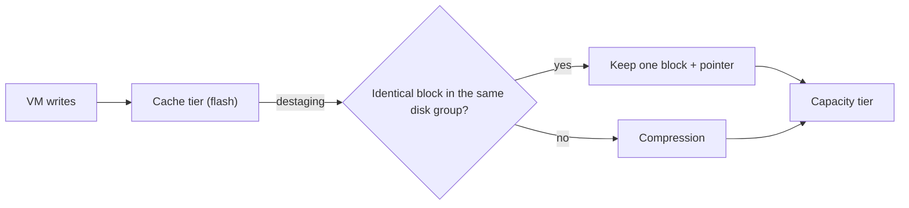
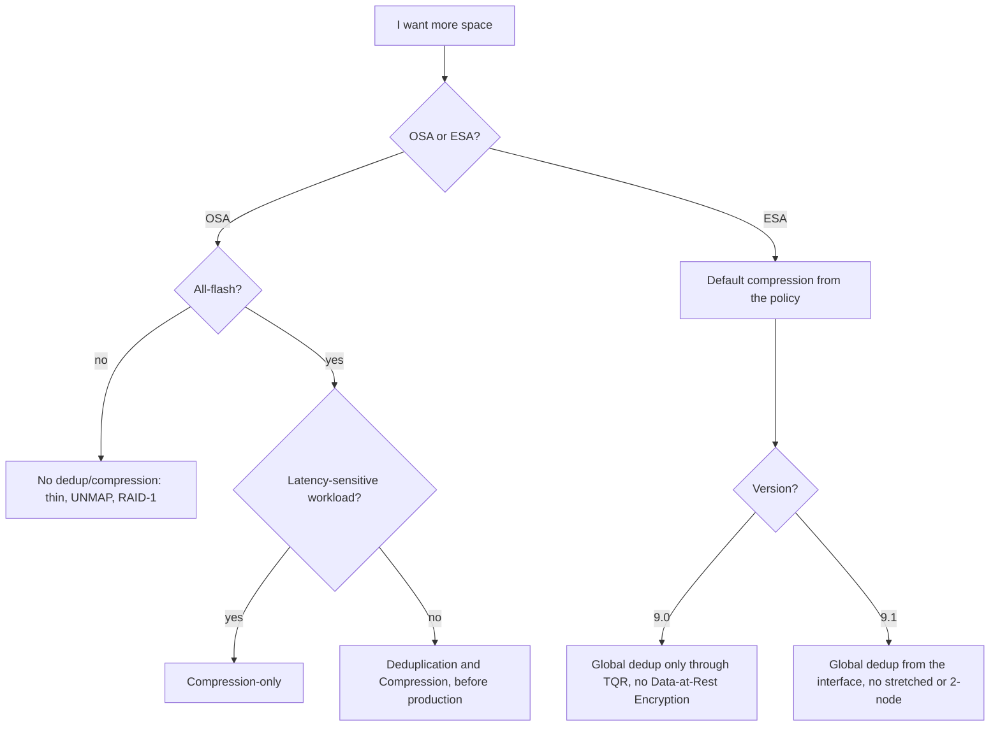

:::analogy
**The data center pain.** An administrator wants to gain space on a 4-host vSAN OSA (Original Storage Architecture) cluster, with VMs (VM, Virtual Machine) on RAID-5 (RAID, Redundant Array of Independent Disks). They turn on *Deduplication and Compression* in the middle of a production day and the task fails with *General vSAN error. Resource check failed*: the cluster has nowhere to evacuate each disk group's data. [S398] On another cluster, with deduplication on, a single capacity disk breaks and the whole disk group goes offline. [S399] For the exam, the VVF (VMware vSphere Foundation, 2V0-16.25) and VCF (VMware Cloud Foundation, 2V0-17.25) exam guides ask you to know the vSAN space efficiency techniques. [S02] [S03]

**The analogy: packing for a long holiday.**

- **Thin provisioning**: at the airport you pay only for the kilograms you carry, not for the maximum size of the suitcase.
- **Compression**: you put clothes in vacuum bags; each item takes less room.
- **Deduplication**: if the whole family has the same charger, you take just one and share it.
- **TRIM/UNMAP**: once you have used the supplies, you throw away the empty packaging so it no longer takes space.
- **Erasure coding**: instead of taking two identical spare suitcases, you take a small kit from which you can rebuild whatever is missing.
:::

:::architecture
### 1. The toolbox

The table compares OSA with ESA (Express Storage Architecture), the newer vSAN architecture:

| Technique | What you gain | Where it is set | Source |
|---|---|---|---|
| Thin provisioning | Space is allocated only when written | Policy: OSR (Object Space Reservation) thin, the default | [S374] |
| SCSI UNMAP (TRIM/UNMAP) | You reclaim the space of files deleted inside the VM | vSAN services, advanced options | [S394] |
| Compression | Each block takes less space | OSA: cluster; ESA: policy (9.0) | [S392] [S374] |
| Deduplication | Identical blocks are kept once | OSA: cluster, per disk group; ESA: global deduplication | [S392] [S401] |
| RAID-5/6 (erasure coding) | Protection with less space than RAID-1 | Policy: failure tolerance method (lesson 3.3) | [S393] |

The documentation says deduplication and compression can be combined with RAID-5/6 and the savings add up. [S393] Watch out for thick policies: with OSR thick, deduplication and compression savings become ineffective. [S374]

### 2. OSA: deduplication and compression per disk group

For OSA, the rules in the VCF 9.0 documentation are [S392]:

- It works **only on all-flash clusters**.
- It is a **cluster-wide** setting, but it works **per disk group**: identical copies within the same disk group become one.
- Deduplication, then compression, happen when data moves down from the **cache tier** to the **capacity tier** (destaging).
- Compression cannot be enabled only for specific workloads through policies.
- **Compression-only** works per disk, not per disk group, and suits workloads that gain nothing from deduplication, such as OLTP (Online Transaction Processing).

**Operational consequences** with deduplication and compression on [S392] [S399]:

- add capacity disks **together**, not one at a time;
- you cannot remove a single disk from a disk group: you remove the whole disk group;
- **one failed disk takes the whole disk group down**, and the interface does not show which disk is at fault (KB, Knowledge Base article, 327008).

These rules do not apply to compression-only. [S392]

**Turning it on or off means a reformat.** vSAN takes one host at a time and, on it, one disk group at a time: it evacuates the data, deletes the disk group and recreates it in the new format. [S397] [S392] So:

- you need **free space** for the evacuation; otherwise the datastore can fill up and VMs suffer [S397];
- on clusters with exactly the minimum number of fault domains for the policy, the **Allow Reduced Redundancy** option lets the task finish, but objects are at risk meanwhile [S397] [S398];
- best practice is to turn the feature on **before** the cluster goes into production [S397];
- before you turn it off, check that you have enough physical capacity for the uncompressed data. [S392]

KB 426751 adds that the write overhead can hurt latency-sensitive workloads such as databases, and recommends compression-only for them. [S397]

### 3. ESA: compression comes from the policy

In ESA, compression is **on by default**. If you want some VMs not to be compressed, you apply a custom storage policy to them. [S392] [S374] Compression applies **only to new writes**: existing blocks stay uncompressed even after you turn compression on for an object. [S392]

How it works, according to the *vSAN Space Efficiency Technologies* paper: compression is done inline, high in the storage stack, so network traffic is smaller too; each 4 KiB block is evaluated in eight 512-byte sectors, so a block can end up between 7/8 and 1/8 of its size (best case 8:1). [S400] [S405] VCF 9.0 uses the LZ4 algorithm; 9.1 moves to a ZSTD variant and makes compression permanently on for the cluster. [S402] [S400]

### 4. ESA: global deduplication

Global deduplication is ESA deduplication at **cluster** level, not disk group level. [S401] [S403]

- It works **post-process**: after the data has been written and has "cooled", using only spare processor resources; colder data is deduplicated first. [S401]
- It works on **4 KiB** blocks, each with a cryptographic hash. [S401]
- It does not change the failure boundary of a storage device. [S401]
- If you turn it off, processing stops but already deduplicated data stays that way. [S400] [S402]

**Availability differs a lot between versions:**

| | VCF 9.0 | VCF 9.1 |
|---|---|---|
| Status | Limited release, from 9.0 P01, through Broadcom's TQR (Technical Qualification Request) program [S401] [S404] | Generally available, enabled from the interface [S402] [S396] |
| Clusters | Single-site, HCI (Hyper-Converged Infrastructure) or storage cluster, 3–16 hosts, 25 GbE network [S401] | HCI 3–64 hosts and storage clusters [S402] [S400] |
| Stretched and 2-node | No [S401] [S403] | No [S402] [S400] |
| vSAN Data-at-Rest Encryption | Mutually exclusive [S405] [S401] | Work together [S402] [S396] |

The 9.0 capacity monitoring page still says ESA does not support deduplication, which reflects the general 9.0 position outside the restricted program. [S395] For the 9.0 exam, remember that "classic" deduplication is an OSA feature and ESA relies on compression. `⚠ to verify` how exam questions phrase global deduplication exactly.

### 5. Thin provisioning and TRIM/UNMAP

With thin provisioning you can allocate more than you physically have (overcommit). Without UNMAP, a VMDK stays at the largest size it reached, even if you delete files inside the VM. [S400]

UNMAP reclaims the space of files deleted in the guest file system, and also when you delete or migrate a VM or consolidate a snapshot. [S394] According to the 9.0 documentation [S394]:

- it is **not on by default**: you turn it on from the vSAN services, advanced options, *Guest Trim/Unmap*;
- after turning it on, all VMs must be **powered off and on**;
- VMs need **virtual hardware 13** or later;
- in Linux you run `fstrim` or mount with `mount -o discard`; in Windows, NTFS (New Technology File System) does inline unmap by default.

The 9.1 efficiency paper says UNMAP is on by default in recent editions and asks for hardware 11 for Windows and 13 for Linux. [S400] `⚠ to verify` the setting on your cluster, under advanced options. Snapshots and Storage vMotion can stop UNMAP from reaching the base disk. [S400]

### 6. Encryption and efficiency

VM encryption (vSphere VM Encryption) happens on the host, **before** data reaches storage, so deduplication and compression become ineffective for encrypted VMs. [S392] The efficiency paper recommends vSAN encryption instead of VM encryption to keep the savings. [S400] Separately, in VCF 9.0, global deduplication and vSAN Data-at-Rest Encryption do not go together; there you use compression only. [S405]

### 7. How to read the savings

In the vSphere Client: cluster, **Monitor > vSAN > Capacity**. [S395]

| Field | Meaning | Source |
|---|---|---|
| Used Before | Logical space before reduction | [S392] |
| Used After | Physical space after reduction | [S392] |
| Ratio | Used Before / Used After; 3 to 1 means 3x | [S392] |
| What-if analysis | Effective free space for a policy, calculated with a deduplication ratio of 1 | [S395] |
| Operations threshold | The space vSAN needs for internal operations | [S395] |
| Host rebuild threshold | The space to tolerate one host failure; shown only with HRR (Host Rebuild Reserve) on | [S395] |

With HRR on, the chart turns yellow at 80% of the host rebuild threshold; it turns red above the operations threshold if you have no reserved capacity, and then rebalancing and resync are blocked. [S395] Capacity figures can take minutes or hours to update with deduplication and compression, and larger disk groups tend to get better ratios. [S395] [S392]

`[IMAGE SEARCH / PROMPT]` "vSAN capacity monitor deduplication and compression savings ratio" and "vSAN OSA deduplication disk group destaging diagram".
:::

:::exam-alert
### Memorize

| What | Value / rule | Source |
|---|---|---|
| OSA deduplication and compression | All-flash only; cluster setting, works per disk group | Docs [S392] |
| When it happens in OSA | At destaging from cache to capacity: deduplication first, then compression | Docs [S392] |
| Compression-only | Per disk; suits OLTP and latency-sensitive databases | [S392] [S397] |
| Turning OSA on/off | Rolling reformat of every disk group | [S392] [S397] |
| Failed disk with deduplication | The whole disk group fails | [S392] [S399] |
| ESA compression | On by default; excluded through a policy; new writes only | Docs [S392] |
| Global dedup | Cluster, post-process, 4 KiB; 9.0 restricted, 9.1 general | [S401] [S402] |
| UNMAP in 9.0 | Guest Trim/Unmap, power cycle, hardware 13+ | Docs [S394] |
| OSR thick | Cancels the savings | Docs [S374] |

### 3 exam traps

1. **"I turn on deduplication on a hybrid OSA cluster."** False. OSA deduplication and compression need all-flash. [S392]
2. **"Turning on deduplication in OSA is instant and moves no data."** False. Every disk group is evacuated, deleted and recreated; you need free space and time. [S397] [S392]
3. **"I turn on ESA compression on an object and the old data is compressed right away."** False. Compression applies only to new writes. [S392]
:::

:::trenches
### Mistake 1: deduplication turned on in a full cluster

On a 4-host OSA cluster with RAID-5, turning on *Deduplication and Compression* fails with *Resource check failed - Cluster doesn't have enough resources*. [S398]
**Fix (KB 445850):** the reformat needs room to evacuate each disk group. Either add capacity (disks on the existing hosts or new hosts with storage; compute-only hosts do not help), or tick *Allow Reduced Redundancy* under *Configure > vSAN > Services*, accepting the temporary risk. [S398] Next time, turn the feature on before production. [S397]

### Mistake 2: one failed disk takes the whole disk group out

With deduplication on, a capacity disk dies and the disk group shows offline, without telling you which disk it is. [S399]
**Fix (KB 327008):** identify the disk with `esxcli vsan storage list` (it shows as *Unknown*) or with `vdq -iH`, look for the UUID (Universally Unique Identifier) in `vmkernel.log` to find the `naa.` name, remove the disk group with `esxcli vsan storage remove -u <UUID> -m noAction` after checking the UUID, replace the disk and recreate the disk group from Disk Management. [S399] The KB warns that a wrong UUID can lead to data loss. [S399]
:::

:::interview
**Junior/Mid question: "How do deduplication and compression differ between OSA and ESA?"**

*Ideal answer:* in OSA they are a cluster setting, all-flash only, that works per disk group at destaging; turning them on means reformatting the disk groups, and one failed disk takes the whole disk group out (compression-only avoids that). [S392] [S397] In ESA compression is the default and is controlled from the policy, and global deduplication works post-process across the whole cluster, restricted in 9.0 and generally available in 9.1. [S392] [S401] [S402]

**Troubleshooting scenario: "Users deleted 2 TB of files inside VMs, but the vSAN datastore has no more free space. Why?"**

*The answer a Team Lead expects:*
1. **UNMAP**: is *Guest Trim/Unmap* on? Were the VMs powered off and on afterwards? Do they have hardware 13 or later? [S394]
2. **The operating system**: in Linux, does `fstrim` run or is it mounted with `discard`? [S394]
3. **Snapshots**: an active snapshot can stop UNMAP from reaching the base disk. [S400]
4. **The policy**: do the disks have OSR thick? Then the space stays reserved. [S374]
5. **Patience**: with deduplication and compression, capacity can take minutes or hours to update. [S395]
:::

:::lab
**Scenario.** You check which efficiency techniques are on in the cluster, read the savings in Capacity, create (in ESA) a policy without compression, test UNMAP with a Linux VM and watch the space before and after.

**What you need.** A working vSAN cluster (ESA or OSA all-flash), a Linux test VM with a thin disk of a few GB and access to its console.

The steps below can be ticked off and your progress is saved in the browser. Exact menu names can differ slightly between versions 8 and 9 (`⚠ to verify`).

**Home lab only / not supported.** Nested vSAN is for the lab only. **Do not turn on or off** *Deduplication and Compression* on an OSA cluster with important data: it triggers a reformat of every disk group. [S397] Global deduplication in 9.0 needs the Broadcom program, so you do not test it in the lab. [S401]

**Failure test and validation.** In step 5, after `fstrim`, the space used by the VM in Capacity must drop (it can take a few minutes). If it does not, check UNMAP, the VM hardware and snapshots, as in the interview scenario. [S394] [S400]
:::

:::quiz
Five original questions in the style of the VCP (VMware Certified Professional) exams. You get the explanation for every option right after you answer.
:::

:::references
- The VCP-VVF 2V0-16.25 and VCP-VCF 2V0-17.25 exam guides, objective 2.3 [S02] [S03]
- VCF 9.0 documentation: deduplication and compression [S392], efficiency features [S393], SCSI UNMAP [S394], capacity monitoring [S395]
- VCF 9.1 Release Notes, what is new in vSAN [S396]
- KB 426751, KB 445850 and KB 327008: turning deduplication on and failed disks [S397] [S398] [S399]
- KB 437757: policies and encryption in ESA 9.0 [S405]
- The VMware paper *vSAN Space Efficiency Technologies* [S400]
- Blogs: global deduplication in 9.0 [S401], compression and deduplication in 9.1 [S402], vSAN 9.0 [S403], deduplication in 9.0.1 [S404]
- vSAN policies [S374] [S375], OSA and ESA comparison [S356], vSAN Design Guide [S361]
:::
