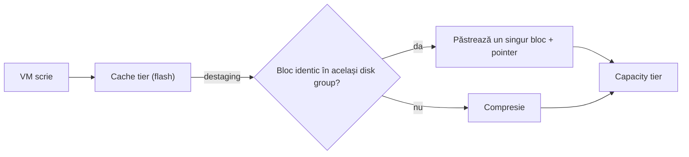
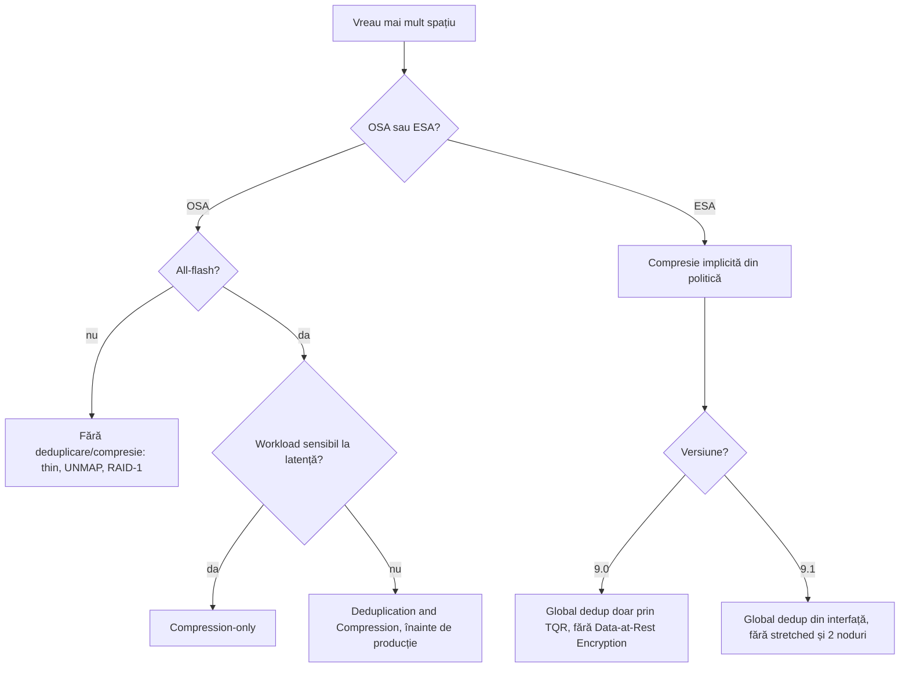

:::analogy
**Durerea din data center.** Un administrator vrea să câștige spațiu pe un cluster vSAN OSA (Original Storage Architecture) de 4 hosturi, cu VM-uri (VM, Virtual Machine) pe RAID-5 (RAID, Redundant Array of Independent Disks). Pornește *Deduplication and Compression* în plină zi de producție, iar task-ul pică cu *General vSAN error. Resource check failed*: clusterul nu are unde să evacueze datele fiecărui disk group. [S398] Pe alt cluster, cu deduplicarea pornită, un singur disc de capacitate se strică și tot disk group-ul trece offline. [S399] Pentru examen, exam guide-urile VVF (VMware vSphere Foundation, 2V0-16.25) și VCF (VMware Cloud Foundation, 2V0-17.25) cer să știi tehnicile de eficiență a spațiului din vSAN. [S02] [S03]

**Analogia: faci bagajul pentru o vacanță lungă.**

- **Thin provisioning**: plătești la aeroport doar pentru kilogramele pe care le duci, nu pentru mărimea maximă a valizei.
- **Compresia**: pui hainele în pungi vidate; fiecare obiect ocupă mai puțin.
- **Deduplicarea**: dacă toată familia are același încărcător, iei unul singur și îl folosiți toți.
- **TRIM/UNMAP**: când ai consumat proviziile, arunci ambalajele goale ca să nu mai ocupe loc.
- **Erasure coding**: în loc să iei două valize identice de rezervă, iei o trusă mică din care poți reface orice lipsește.
:::

:::architecture
### 1. Trusa de unelte

Tabelul compară OSA cu ESA (Express Storage Architecture), arhitectura nouă de vSAN:

| Tehnică | Ce câștigi | Unde se setează | Sursă |
|---|---|---|---|
| Thin provisioning | Spațiul se alocă doar când se scrie | Politica: OSR (Object Space Reservation) thin, implicit | [S374] |
| SCSI UNMAP (TRIM/UNMAP) | Recuperezi spațiul fișierelor șterse în VM | Serviciile vSAN, opțiuni avansate | [S394] |
| Compresie | Fiecare bloc ocupă mai puțin | OSA: cluster; ESA: politică (9.0) | [S392] [S374] |
| Deduplicare | Blocurile identice se păstrează o dată | OSA: cluster, pe disk group; ESA: global deduplication | [S392] [S401] |
| RAID-5/6 (erasure coding) | Protecție cu mai puțin spațiu decât RAID-1 | Politica: failure tolerance method (lecția 3.3) | [S393] |

Documentația spune că deduplicarea și compresia se pot combina cu RAID-5/6, iar economiile se adună. [S393] Atenție la politica thick: cu OSR thick, economiile de deduplicare și compresie devin ineficiente. [S374]

### 2. OSA: deduplicare și compresie pe disk group

Pentru OSA, regulile din documentația VCF 9.0 sunt [S392]:

- Merge **doar pe clustere all-flash**.
- E o setare **pe tot clusterul**, dar lucrează **pe fiecare disk group**: copiile identice din același disk group devin una singură.
- Deduplicarea, apoi compresia, se fac când datele coboară din **cache tier** în **capacity tier** (destaging).
- Compresia nu se poate activa doar pentru anumite workload-uri prin politici.
- **Compression-only** lucrează pe disc, nu pe disk group, și e potrivită pentru workload-uri care nu câștigă din deduplicare, cum e OLTP (Online Transaction Processing).

**Consecințele operaționale** cu deduplicare și compresie pornite [S392] [S399]:

- adaugi discurile de capacitate **împreună**, nu unul câte unul;
- nu poți scoate un singur disc dintr-un disk group: scoți tot disk group-ul;
- **un disc defect face să pice tot disk group-ul**, iar interfața nu arată care disc e de vină (KB, Knowledge Base article, 327008).

Aceste reguli nu se aplică la compression-only. [S392]

**Pornirea sau oprirea înseamnă reformatare.** vSAN ia pe rând câte un host și, pe el, câte un disk group: evacuează datele, șterge disk group-ul și îl recreează în noul format. [S397] [S392] De aceea:

- ai nevoie de **spațiu liber** pentru evacuare; altfel datastore-ul se poate umple și VM-urile au de suferit [S397];
- pe clustere cu exact numărul minim de fault domains pentru politică, opțiunea **Allow Reduced Redundancy** lasă task-ul să termine, dar obiectele sunt în pericol cât durează [S397] [S398];
- bunele practici spun să pornești funcția **înainte** ca clusterul să intre în producție [S397];
- înainte să o oprești, verifici că ai destulă capacitate fizică pentru datele decomprimate. [S392]

KB 426751 adaugă că overhead-ul de scriere poate afecta workload-urile sensibile la latență, cum sunt bazele de date, și recomandă pentru ele compression-only. [S397]

### 3. ESA: compresia vine din politică

În ESA, compresia e **pornită implicit**. Dacă vrei ca anumite VM-uri să nu fie comprimate, le aplici o politică de stocare personalizată. [S392] [S374] Compresia se aplică **doar scrierilor noi**: blocurile existente rămân necomprimate chiar după ce pornești compresia pe un obiect. [S392]

Cum lucrează, după documentul *vSAN Space Efficiency Technologies*: compresia se face în-line, sus în stiva de stocare, deci și traficul de rețea e mai mic; fiecare bloc de 4 KiB se evaluează în opt sectoare de 512 bytes, așa că un bloc poate ajunge între 7/8 și 1/8 din mărime (cel mai bun caz 8:1). [S400] [S405] VCF 9.0 folosește algoritmul LZ4; 9.1 trece la o variantă de ZSTD și face compresia permanent pornită pe cluster. [S402] [S400]

### 4. ESA: global deduplication

Global deduplication e deduplicarea ESA la nivel de **cluster**, nu de disk group. [S401] [S403]

- Lucrează **post-process**: după ce datele s-au scris și s-au „răcit”, folosind doar resursele de procesor libere; datele reci se deduplică primele. [S401]
- Lucrează pe blocuri de **4 KiB**, fiecare cu un hash criptografic. [S401]
- Nu schimbă granița de defect a unui dispozitiv de stocare. [S401]
- Dacă o oprești, procesarea se oprește, dar datele deja deduplicate rămân așa. [S400] [S402]

**Disponibilitatea diferă mult între versiuni:**

| | VCF 9.0 | VCF 9.1 |
|---|---|---|
| Statut | Lansare limitată, din 9.0 P01, prin programul TQR (Technical Qualification Request) al Broadcom [S401] [S404] | General disponibilă, se pornește din interfață [S402] [S396] |
| Clustere | Single-site, HCI (Hyper-Converged Infrastructure) sau storage cluster, 3–16 hosturi, rețea de 25 GbE [S401] | HCI 3–64 hosturi și storage clusters [S402] [S400] |
| Stretched și 2 noduri | Nu [S401] [S403] | Nu [S402] [S400] |
| vSAN Data-at-Rest Encryption | Se exclud reciproc [S405] [S401] | Funcționează împreună [S402] [S396] |

Pagina 9.0 de monitorizare a capacității spune încă că ESA nu suportă deduplicare, ceea ce reflectă situația generală din 9.0, în afara programului restrâns. [S395] Pentru examenul 9.0, reține că deduplicarea „clasică” e o funcție OSA, iar ESA se bazează pe compresie. `⚠ de verificat` cum formulează exact întrebările de examen global deduplication.

### 5. Thin provisioning și TRIM/UNMAP

Cu thin provisioning poți aloca mai mult decât ai fizic (overcommit). Fără UNMAP, un VMDK rămâne la mărimea maximă la care a ajuns, chiar dacă ștergi fișiere în VM. [S400]

UNMAP recuperează spațiul fișierelor șterse în sistemul de fișiere din VM, dar și la ștergerea sau mutarea unei VM sau la consolidarea unui snapshot. [S394] După documentația 9.0 [S394]:

- **nu e pornit implicit**: îl pornești din serviciile vSAN, la opțiunile avansate, *Guest Trim/Unmap*;
- după pornire, toate VM-urile trebuie **oprite și pornite** (power off, apoi power on);
- VM-urile au nevoie de **virtual hardware 13** sau mai nou;
- în Linux rulezi `fstrim` sau montezi cu `mount -o discard`; în Windows, NTFS (New Technology File System) face unmap în-line implicit.

Documentul de eficiență pentru 9.1 spune că UNMAP e pornit implicit în edițiile recente și cere hardware 11 pentru Windows și 13 pentru Linux. [S400] `⚠ de verificat` setarea pe clusterul tău, la opțiunile avansate. Snapshot-urile și Storage vMotion pot împiedica UNMAP să ajungă la discul de bază. [S400]

### 6. Criptarea și eficiența

Criptarea VM-ului (vSphere VM Encryption) se face pe host, **înainte** ca datele să ajungă la stocare, deci deduplicarea și compresia devin ineficiente pentru VM-urile criptate. [S392] Documentul de eficiență recomandă criptarea vSAN în locul criptării VM-ului, ca să păstrezi economiile. [S400] Separat, în VCF 9.0, global deduplication și vSAN Data-at-Rest Encryption nu merg împreună; acolo folosești doar compresie. [S405]

### 7. Cum citești economiile

În vSphere Client: cluster, **Monitor > vSAN > Capacity**. [S395]

| Câmp | Ce înseamnă | Sursă |
|---|---|---|
| Used Before | Spațiul logic de dinainte de reducere | [S392] |
| Used After | Spațiul fizic de după reducere | [S392] |
| Ratio | Used Before / Used After; 3 la 1 înseamnă 3x | [S392] |
| What-if analysis | Spațiul liber efectiv pentru o politică, calculat cu raport de deduplicare 1 | [S395] |
| Operations threshold | Spațiul de care vSAN are nevoie pentru operațiile interne | [S395] |
| Host rebuild threshold | Spațiul pentru a tolera căderea unui host; apare doar cu HRR (Host Rebuild Reserve) pornit | [S395] |

Cu HRR pornit, graficul se face galben la 80% din host rebuild threshold; se face roșu peste operations threshold dacă nu ai capacitate rezervată, iar atunci rebalance-ul și resync-ul se blochează. [S395] Cifrele de capacitate se pot actualiza abia după minute sau ore la deduplicare și compresie, iar disk group-urile mai mari tind să aibă rapoarte mai bune. [S395] [S392]

`[IMAGE SEARCH / PROMPT]` „vSAN capacity monitor deduplication and compression savings ratio” și „vSAN OSA deduplication disk group destaging diagram”.
:::

:::exam-alert
### De memorat

| Ce | Valoare / regulă | Sursă |
|---|---|---|
| Deduplicare și compresie OSA | Doar all-flash; setare de cluster, lucrează pe disk group | Docs [S392] |
| Momentul în OSA | La destaging din cache în capacity: întâi deduplicare, apoi compresie | Docs [S392] |
| Compression-only | Pe disc; potrivit pentru OLTP și baze de date sensibile la latență | [S392] [S397] |
| Pornire/oprire OSA | Reformatare rolling a fiecărui disk group | [S392] [S397] |
| Disc defect cu deduplicare | Pică tot disk group-ul | [S392] [S399] |
| Compresie ESA | Implicit pornită; excludere prin politică; doar scrieri noi | Docs [S392] |
| Global dedup | Cluster, post-process, 4 KiB; 9.0 restrâns, 9.1 general | [S401] [S402] |
| UNMAP în 9.0 | Guest Trim/Unmap, power cycle, hardware 13+ | Docs [S394] |
| OSR thick | Anulează economiile | Docs [S374] |

### 3 capcane de examen

1. **„Pornesc deduplicarea pe un cluster OSA hybrid.”** Fals. Deduplicarea și compresia OSA cer all-flash. [S392]
2. **„Pornirea deduplicării pe OSA e instantanee și nu mută date.”** Fals. Fiecare disk group e evacuat, șters și recreat; ai nevoie de spațiu liber și timp. [S397] [S392]
3. **„Pornesc compresia ESA pe un obiect și datele vechi se comprimă imediat.”** Fals. Compresia se aplică doar scrierilor noi. [S392]
:::

:::trenches
### Greșeala 1: deduplicarea pornită pe un cluster plin

Pe un cluster OSA de 4 hosturi cu RAID-5, pornirea *Deduplication and Compression* pică cu *Resource check failed - Cluster doesn't have enough resources*. [S398]
**Remediere (KB 445850):** reformatarea are nevoie de loc ca să evacueze fiecare disk group. Fie adaugi capacitate (discuri pe hosturile existente sau hosturi noi cu stocare; hosturile doar de calcul nu ajută), fie bifezi *Allow Reduced Redundancy* la *Configure > vSAN > Services*, acceptând riscul temporar. [S398] Data viitoare pornești funcția înainte de producție. [S397]

### Greșeala 2: un disc defect scoate tot disk group-ul

Cu deduplicarea pornită, un disc de capacitate moare și disk group-ul apare offline, fără să știi care disc e. [S399]
**Remediere (KB 327008):** identifici discul cu `esxcli vsan storage list` (apare ca *Unknown*) sau cu `vdq -iH`, cauți UUID-ul (Universally Unique Identifier) în `vmkernel.log` ca să afli numele `naa.`, scoți disk group-ul cu `esxcli vsan storage remove -u <UUID> -m noAction` după ce ai verificat UUID-ul, schimbi discul și recreezi disk group-ul din Disk Management. [S399] KB-ul avertizează că un UUID greșit poate duce la pierdere de date. [S399]
:::

:::interview
**Întrebare Junior/Mid: „Cum diferă deduplicarea și compresia între OSA și ESA?”**

*Răspunsul ideal:* în OSA sunt o setare de cluster, doar pe all-flash, care lucrează pe disk group la destaging; pornirea înseamnă reformatarea disk group-urilor, iar un disc defect scoate tot disk group-ul (compression-only evită asta). [S392] [S397] În ESA compresia e implicită și se controlează din politică, iar global deduplication lucrează post-process pe tot clusterul, restrâns în 9.0 și general disponibilă în 9.1. [S392] [S401] [S402]

**Scenariu de troubleshooting: „Utilizatorii au șters 2 TB de fișiere în VM-uri, dar datastore-ul vSAN nu are mai mult loc liber. De ce?”**

*Răspunsul pe care îl așteaptă un Team Lead:*
1. **UNMAP**: e pornit *Guest Trim/Unmap*? VM-urile au fost oprite și pornite după? Au hardware 13 sau mai nou? [S394]
2. **Sistemul de operare**: în Linux, rulează `fstrim` sau e montat cu `discard`? [S394]
3. **Snapshot-uri**: un snapshot activ poate opri UNMAP să ajungă la discul de bază. [S400]
4. **Politica**: discurile au OSR thick? Atunci spațiul rămâne rezervat. [S374]
5. **Răbdare**: cu deduplicare și compresie, capacitatea se poate actualiza după minute sau ore. [S395]
:::

:::lab
**Scenariu.** Verifici ce tehnici de eficiență sunt pornite pe cluster, citești economiile în Capacity, creezi (în ESA) o politică fără compresie, testezi UNMAP cu o VM Linux și observi spațiul înainte și după.

**Ce ai nevoie.** Un cluster vSAN funcțional (ESA sau OSA all-flash), o VM Linux de test cu un disc thin de câțiva GB și acces la consola ei.

Pașii de mai jos sunt bifabili, iar progresul se salvează în browser. Numele exacte ale meniurilor pot diferi puțin între versiunile 8 și 9 (`⚠ de verificat`).

**Home lab only / not supported.** vSAN nested e doar pentru lab. **Nu porni și nu opri** *Deduplication and Compression* pe un cluster OSA cu date importante: declanșează reformatarea tuturor disk group-urilor. [S397] Global deduplication în 9.0 cere programul Broadcom, deci nu o testezi în lab. [S401]

**Test de avarie și validare.** La pasul 5, după `fstrim`, spațiul folosit de VM în Capacity trebuie să scadă (poate dura câteva minute). Dacă nu scade, verifici UNMAP, hardware-ul VM-ului și snapshot-urile, ca în scenariul de interviu. [S394] [S400]
:::

:::quiz
Cinci întrebări originale, în stilul examenelor VCP (VMware Certified Professional). Primești explicația pentru fiecare variantă imediat după ce răspunzi.
:::

:::references
- Exam guide-urile VCP-VVF 2V0-16.25 și VCP-VCF 2V0-17.25, obiectivul 2.3 [S02] [S03]
- Documentația VCF 9.0: deduplicare și compresie [S392], funcțiile de eficiență [S393], SCSI UNMAP [S394], monitorizarea capacității [S395]
- VCF 9.1 Release Notes, noutăți vSAN [S396]
- KB 426751, KB 445850 și KB 327008: pornirea deduplicării și discurile defecte [S397] [S398] [S399]
- KB 437757: politici și criptare în ESA 9.0 [S405]
- Documentul VMware *vSAN Space Efficiency Technologies* [S400]
- Bloguri: global deduplication în 9.0 [S401], compresie și deduplicare în 9.1 [S402], vSAN 9.0 [S403], deduplicarea în 9.0.1 [S404]
- Politicile vSAN [S374] [S375], comparația OSA și ESA [S356], vSAN Design Guide [S361]
:::
