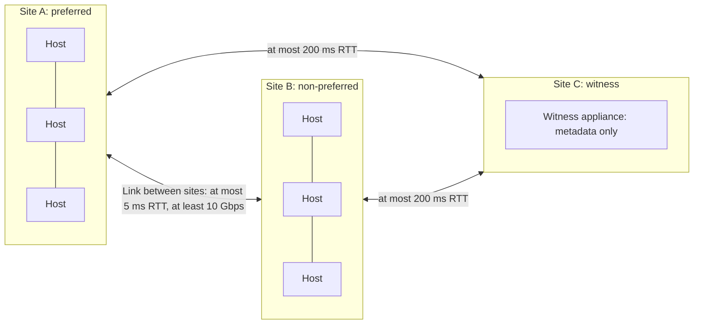
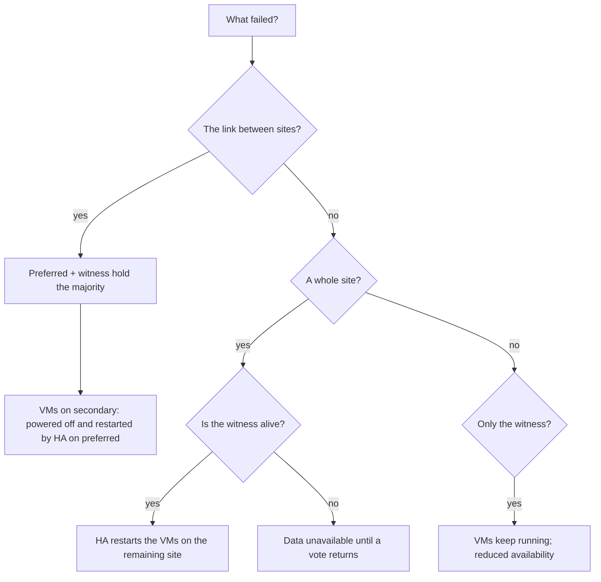

:::analogy
**The data center pain.** A company has two server rooms in two buildings in the same city and a single vSAN cluster stretched across them. One night the link between the buildings goes down. By morning half of the VMs (VM, Virtual Machine) have been powered off and restarted in the other building, and the team does not understand why. [S406] [S407] In another case, the network to the witness drops packets, the witness joins and leaves the cluster in a loop, and VMs hang with stuck I/O. [S410] For the exam, the VVF (VMware vSphere Foundation, 2V0-16.25) and VCF (VMware Cloud Foundation, 2V0-17.25) exam guides ask you to explain the stretched cluster, the 2-node cluster and the witness role. [S02] [S03]

**The analogy: two parents and grandma.**

- **The two sites** are two parents who each keep a copy of the family diary.
- **The witness** is grandma: she does not keep the diary, she only knows who has the latest version and casts the deciding vote.
- If the parents stop talking (**the link between sites breaks**), the parent grandma knows as "preferred" wins (**preferred site**); the other one stops, so there are never two different diaries.
- If one parent leaves for good (**a site fails**), the other carries on with grandma.
- If one parent and grandma disappear at the same time, the remaining parent no longer has a majority and stops.
:::

:::architecture
### 1. Three topologies

| Topology | Data hosts | Witness | Typical use | Source |
|---|---|---|---|---|
| Standard | One site, at least 3 hosts | No | A normal data center | [S361] |
| Stretched cluster | Two data sites, typically 3+3, at most 20+20 | At a third site | Survive the loss of a whole site | [S406] |
| 2-node cluster | Two hosts in the same location | Remote, usually at headquarters | ROBO (Remote Office / Branch Office): branches with few VMs | [S417] |

The cluster type shows up in the storage policy, in the **Site disaster tolerance** rule. [S374]

### 2. The roles and the witness

- **Preferred site**: the primary owner of objects; it wins when the sites can no longer see each other. [S406]
- **Non-preferred (secondary) site**: the second data fault domain. [S406]
- **Witness**: holds only witness components (metadata) and is the quorum tiebreaker. [S406] [S416]

Rules for the witness appliance:

| Rule | Source |
|---|---|
| It is a preconfigured ESXi, shipped as an OVA (Open Virtual Appliance); it does not run normal VMs | [S416] [S406] |
| It sits at a third site, on a datastore different from the cluster it serves | [S406] [S411] [S416] |
| It is **never** placed in the cluster it serves: that creates an unsupported circular dependency | [S412] |
| Each stretched cluster has its own dedicated witness; several can sit at the same tertiary site | [S406] |
| You download the OVA matching the architecture (ESA, Express Storage Architecture, or OSA, Original Storage Architecture) and the host build | [S411] [S412] |
| You add it to vCenter as a standalone host | [S411] |

Witness appliance sizes, from the vSphere 8 documentation [S416]:

| Size | Components | Roughly |
|---|---|---|
| Tiny | 750 | 10 VMs or fewer |
| Medium | 21,833 | 500 VMs; as a shared witness, 21 two-node clusters |
| Large | 45,000 | as a shared witness, 24 two-node clusters |
| Extra Large | 64,000 | as a shared witness, 64 two-node clusters |

**Shared witness** (from vSAN 7 U1): a single witness for up to 64 two-node clusters, each cluster limited to 1,000 components. [S418] [S417] You change it by right-clicking the cluster, *vSAN > Assign Shared Witness*. [S417]

### 3. The network

| Link | Requirement | Source |
|---|---|---|
| Data site to data site | At most 5 ms RTT (Round-Trip Time); at least 10 Gbps | [S406] [S408] |
| Data site to witness (stretched) | At most 200 ms RTT | [S406] [S408] |
| Data site to witness, 11 or more hosts per site | Under 100 ms RTT, according to the vSphere 8 page (`⚠ to verify`: the 8 U3 guide only gives 200 ms) | [S416] [S406] |
| 2-node to witness | Under 500 ms RTT | [S416] |
| Bandwidth to witness | 2 Mbps per 1,000 components | [S406] [S415] [S416] |
| Between the 2 nodes | 10 Gbps, including a direct connection (direct connect) | [S416] |

Other rules: between sites and to the witness use Layer 3 routing, no NAT (Network Address Translation), no firewalls or WAN optimizers on VMkernel traffic; MTU (Maximum Transmission Unit) is the same everywhere, unless you use witness traffic separation. [S406] [S416] Ports from the guide: UDP (User Datagram Protocol) 12345 and 23451 for clustering, TCP (Transmission Control Protocol) 2233 for transport, TCP 8080 for VASA (vSphere APIs for Storage Awareness) and UDP 12321 for unicast to the witness. [S406]

**Witness traffic separation.** Data traffic needs low latency and high bandwidth; witness traffic tolerates high latency and low bandwidth. You can dedicate a VMkernel to witness traffic with `esxcli vsan network ip add -i vmkX -T witness`, run on each data host, **not** on the witness. [S416] This lets you have jumbo frames between sites and standard MTU to the witness. [S406] For 2-node clusters, it allows the two hosts to be connected directly, while witness traffic goes over management. [S416]

**Sizing the link between sites.** The sizing paper gives the formula B = Wb × md × mr × CR: write bandwidth, times a data multiplier (1.4 in the examples), a resync multiplier (1.25) and the compression ratio. For example, 10,000 writes per second of 8 KiB, with 2x compression, give roughly 560 Mbps. [S415]

### 4. Policies for stretched and 2-node

The **Site disaster tolerance** rule has the options [S374] [S406]:

| Option | What it does |
|---|---|
| None - standard cluster | Single-site cluster |
| Site mirroring (dual site mirroring) | One copy on each data site: survives the loss of a site |
| None - keep data on Preferred / Secondary | Data stays on one site only, without site protection |
| Host mirroring | For 2-node: mirroring inside the host, needs at least 3 disk groups or 3 disks in the storage pool on each host |

Besides mirroring between sites you can also have protection **inside each site** (secondary failures to tolerate). Minimum hosts per site [S406]:

| Local protection | Hosts per site |
|---|---|
| None (site mirroring only) | 1 |
| RAID-1 (RAID, Redundant Array of Independent Disks), FTT (Failures To Tolerate) 1 | 3 |
| RAID-5 | 4 in OSA; in ESA 3 (6 from 12 hosts in total) |
| RAID-6, FTT=2 | 6 |

**Site read locality** (a cluster setting) makes reads come from the VM's local site, so they do not load the link between sites; the guide recommends checking that it is on. [S406] The KB (Knowledge Base article) 394978 recommends avoiding policies that can spread components across both sites without a site rule. [S407]

In VCF 9.1, Auto-RAID picks by itself site mirroring plus local RAID-5 or RAID-6 for stretched, and site mirroring with FTT=0 for 2-node. [S389] Global deduplication is not supported on stretched and 2-node. [S401]

### 5. What happens on each failure

| Failure | Result | Source |
|---|---|---|
| One host | Its components are missing; reads and rebuild stay local if you have local protection; HA (High Availability) restarts only that host's VMs | [S407] |
| A whole site | Its VMs are restarted by HA on the remaining site; quorum is held by the witness and the remaining site | [S406] [S407] |
| The link between sites | The preferred site carries on; vSAN powers off the VMs on the secondary site and HA restarts them on the preferred site | [S406] [S407] |
| The witness | VMs keep running; objects are in reduced availability until the witness returns | [S406] [S407] |
| A site and the witness at the same time | Data becomes unavailable: there is no majority left | [S406] [S407] |
| A site, then the witness a few minutes later | From vSAN 7 U3, Adaptive Quorum Control recounts the votes and the remaining site survives | [S407] [S406] |

vSAN marks an object degraded or absent within about 5–7 seconds, and rebuild starts by default after **60 minutes**. [S406]

### 6. Recommended HA and DRS (Distributed Resource Scheduler) settings

From the *vSAN Stretched Cluster Guide* [S406]:

| Setting | Recommended value |
|---|---|
| HA and host monitoring | On |
| Response for Host Isolation | Power off and restart VMs |
| Admission control | 50% CPU (Central Processing Unit) and 50% memory, so each site can take over the other |
| Heartbeat datastores | Disabled (the vSAN datastore is not used for heartbeats) |
| `das.isolationaddress0` / `das.isolationaddress1` | One vSAN IP (Internet Protocol) address from each site |
| `das.usedefaultisolationaddress` | false |
| DRS | Host groups per site, VM groups, **should** rules so VMs stay on their site |
| **Must** rules | Only for VMs with policies without site protection |

The guide also recommends keeping average load around 50% CPU and memory in normal operation, so the VMs of a failed site fit. [S406]

### 7. What is specific to VCF 9

- In VCF 9.0, a Site High Availability topology with a vSAN stretched cluster needs **at least 8 hosts**; with fewer, the upgrade precheck fails. [S414]
- Broadcom presents the vSAN stretched cluster as the preferred option over vMSC (vSphere Metro Storage Cluster, with synchronously replicated external storage); for vMSC, VCF is unaware of the topology and you set HA and DRS by hand. [S413]
- There is a known issue in vSAN 8.0 U3 and 9.0: with separate physical networking for vSAN, when the preferred site's vSAN switch fails all VMs can become inaccessible (KB 402974). [S409]
- Replacing the witness: *Configure > vSAN > Fault Domains*, the **Change Witness Host** wizard. [S412] At creation, Quickstart lets you pick the witness for stretched and 2-node. [S366] [S417]

`[IMAGE SEARCH / PROMPT]` "vSAN stretched cluster preferred secondary witness site diagram" and "vSAN two-node direct connect witness traffic separation diagram".
:::

:::exam-alert
### Memorize

| What | Value / rule | Source |
|---|---|---|
| Between data sites | 5 ms RTT, at least 10 Gbps | [S406] [S408] |
| To the witness (stretched) | 200 ms RTT | [S406] [S408] |
| To the witness (2-node) | 500 ms RTT | [S416] |
| Bandwidth to witness | 2 Mbps per 1,000 components | [S416] [S415] |
| Stretched maximum | 20+20+1 | [S406] |
| Shared witness | Up to 64 two-node clusters (7 U1+) | [S417] [S418] |
| Witness traffic | `esxcli vsan network ip add -i vmkX -T witness`, on data hosts only | [S416] |
| Link between sites breaks | The preferred site wins | [S406] [S407] |
| Admission control | 50% CPU and memory | [S406] |
| Rebuild | Starts after 60 minutes | [S406] |

### 3 exam traps

1. **"I put the witness appliance inside the stretched cluster to save a host."** False. The witness sits outside the cluster, at a third site; otherwise you get an unsupported circular dependency. [S412] [S406]
2. **"If the link between sites breaks, both sites keep running their VMs."** False. The preferred site keeps quorum with the witness; VMs on the secondary site are powered off and restarted on the preferred site. [S406] [S407]
3. **"One witness can serve several stretched clusters."** False. Each stretched cluster has its own witness; a shared witness exists only for 2-node clusters. [S406] [S418]
:::

:::trenches
### Mistake 1: the witness that joins and leaves the cluster

Hosts *Not Responding*, huge write latency, hung VMs, and in the logs the witness joins and leaves the cluster in a loop. [S410]
**Fix (KB 438087):** the link to the witness drops packets. Bring the witness path to under 200 ms RTT, 0% loss and bandwidth matching the component count; check that UDP 12321 and TCP 2233 are not cut intermittently by a firewall. As a temporary measure you can isolate the witness to stop the loop. [S410] The *Site latency health* check warns you early (yellow above 200 ms to the witness or above 5 ms between sites). [S408]

### Mistake 2: the failover that makes every VM inaccessible

With separate physical networking for vSAN, the preferred site's vSAN switch fails, but the VMkernel tagged for witness stays active on the hosts there. The witness stays with the old leader on the preferred site, quorum is lost and every VM becomes inaccessible. [S409]
**Fix (KB 402974):** in vSAN 8.0 U3 and 9.0 there is no fix yet; the workaround is to remove the witness tag from the preferred site hosts, so the witness talks only to the secondary site. Test failure scenarios before production. [S409]
:::

:::interview
**Junior/Mid question: "What is the witness in a stretched cluster and why does it sit at a third site?"**

*Ideal answer:* the witness holds only metadata (witness components) and casts the deciding vote for quorum. If it sat at one of the data sites, losing that site would take two votes at once and the remaining site would no longer have a majority. That is why it is at a third site, runs no VMs, is not part of the cluster and each stretched cluster has its own witness. [S406] [S412] [S407]

**Troubleshooting scenario: "The Site latency health check is yellow and users complain about write latency. What do you check?"**

*The answer a Team Lead expects:*
1. **The thresholds**: does latency between sites exceed 5 ms or to the witness 200 ms? [S408]
2. **The network path**: switches, routers, cables, network cards dropping packets. [S408]
3. **Bandwidth between sites**: compare real writes with the sizing formula (B = Wb × md × mr × CR). [S415]
4. **The witness**: is it dropping packets or joining and leaving the cluster? Check ports UDP 12321 and TCP 2233. [S410]
5. **Site read locality** on and correct DRS *should* rules, so VMs read locally. [S406]
:::

:::lab
**Scenario.** In the lab you build a small stretched cluster or a 2-node cluster with a witness appliance, apply a site mirroring policy, set HA as in the guide and test what happens when you power off the witness.

**What you need.** A lab vSAN cluster with 2 hosts (for 2-node) or 2+2 (for stretched), a separate host or another cluster for the witness, the witness OVA matching your architecture (ESA or OSA) and build. [S411] [S412]

The steps below can be ticked off and your progress is saved in the browser. Exact menu names can differ slightly between versions 8 and 9 (`⚠ to verify`).

**Home lab only / not supported.** A nested stretched cluster, with "simulated" sites on the same network and no real latency, is for the lab only. 1+1+1 is possible but atypical. [S406] Do not power off the witness of a production cluster.

**Failure test and validation.** In step 6 you power off the witness appliance: VMs must keep running, and Skyline Health must show the objects in reduced availability. [S406] [S407] After you power it on, the objects must return to compliant.
:::

:::quiz
Five original questions in the style of the VCP (VMware Certified Professional) exams. You get the explanation for every option right after you answer.
:::

:::references
- The VCP-VVF 2V0-16.25 and VCP-VCF 2V0-17.25 exam guides, objective 2.3 [S02] [S03]
- *vSAN Stretched Cluster Guide* [S406] and *vSAN Stretched Cluster Bandwidth Sizing* [S415]
- KB 394978: failure scenarios [S407]; KB 412056: site latency health [S408]
- KB 402974 and KB 438087: failover and witness issues [S409] [S410]
- KB 447251 and KB 384420: deploying and replacing the witness [S411] [S412]
- KB 417356 (vMSC in VCF 9) and KB 429477 (stretched topology in VCF 9) [S413] [S414]
- vSphere 8 documentation: witness and network [S416], 2-node clusters [S417], Quickstart for stretched [S366]; the shared witness blog [S418]
- vSAN policies [S374], Auto-RAID in 9.1 [S389], vSAN Design Guide [S361]
:::
