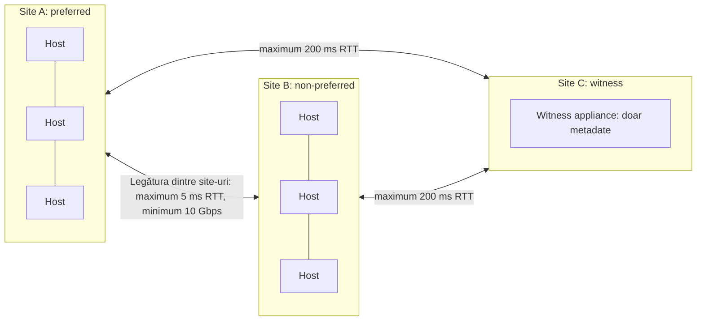
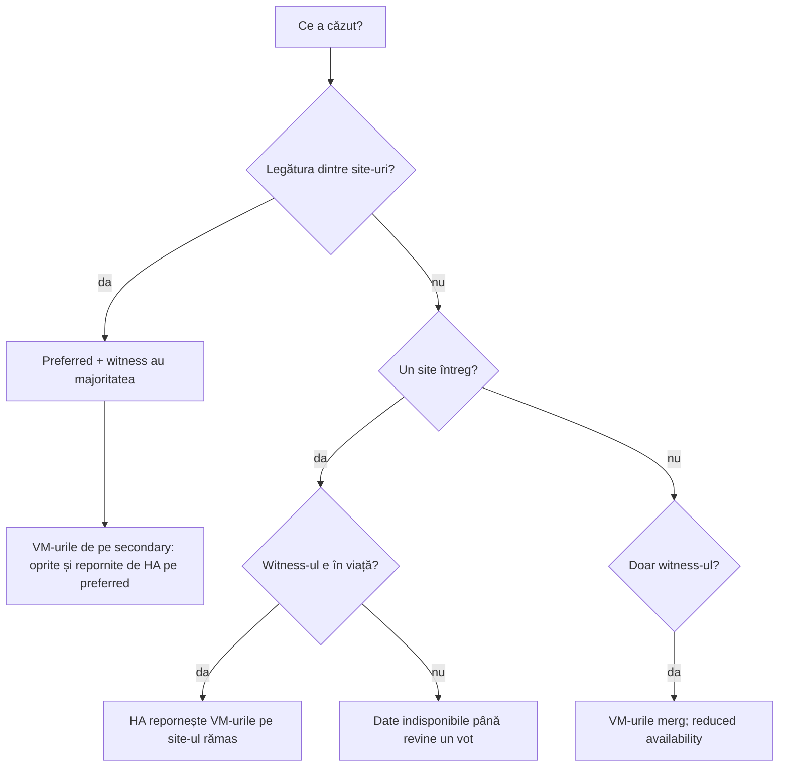

:::analogy
**Durerea din data center.** O firmă are două săli de servere în două clădiri din același oraș și un singur cluster vSAN întins peste ele. Într-o noapte, legătura dintre clădiri cade. Pe dimineață, jumătate din VM-uri (VM, Virtual Machine) au fost oprite și repornite în cealaltă clădire, iar echipa nu înțelege de ce. [S406] [S407] În alt caz, rețeaua spre witness pierde pachete, witness-ul intră și iese din cluster în buclă, iar VM-urile rămân blocate cu I/O suspendat. [S410] Pentru examen, exam guide-urile VVF (VMware vSphere Foundation, 2V0-16.25) și VCF (VMware Cloud Foundation, 2V0-17.25) cer să explici stretched cluster-ul, clusterul cu 2 noduri și rolul witness-ului. [S02] [S03]

**Analogia: doi părinți și bunica.**

- **Cele două site-uri** sunt doi părinți care țin fiecare o copie a agendei familiei.
- **Witness-ul** e bunica: nu ține agenda, doar știe cine are ultima versiune și dă votul decisiv.
- Dacă părinții nu mai vorbesc între ei (**legătura dintre site-uri cade**), câștigă părintele pe care bunica îl știe ca „preferat” (**preferred site**); celălalt se oprește, ca să nu existe două agende diferite.
- Dacă un părinte pleacă de tot (**cade un site**), celălalt continuă cu bunica alături.
- Dacă dispar în același timp un părinte și bunica, cel rămas nu mai are majoritatea și se oprește.
:::

:::architecture
### 1. Trei topologii

| Topologie | Hosturi de date | Witness | Folosire tipică | Sursă |
|---|---|---|---|---|
| Standard | Un singur site, minimum 3 hosturi | Nu | Data center obișnuit | [S361] |
| Stretched cluster | Două site-uri de date, tipic 3+3, maximum 20+20 | Pe un al treilea site | Rezistență la pierderea unui site întreg | [S406] |
| Cluster cu 2 noduri | Două hosturi în aceeași locație | La distanță, de obicei la sediul central | ROBO (Remote Office / Branch Office): sucursale cu puține VM-uri | [S417] |

Tipul clusterului se reflectă în politica de stocare, în regula **Site disaster tolerance**. [S374]

### 2. Rolurile și witness-ul

- **Preferred site**: proprietarul principal al obiectelor; câștigă când site-urile nu se mai văd. [S406]
- **Non-preferred (secondary) site**: al doilea fault domain de date. [S406]
- **Witness**: ține doar componente witness (metadate) și e arbitrul de quorum. [S406] [S416]

Reguli pentru witness appliance:

| Regulă | Sursă |
|---|---|
| E un ESXi preconfigurat, livrat ca OVA (Open Virtual Appliance); nu rulează VM-uri obișnuite | [S416] [S406] |
| Stă pe un al treilea site, pe un datastore diferit de cel al clusterului pe care îl servește | [S406] [S411] [S416] |
| Nu se pune **niciodată** în clusterul pe care îl servește: ar crea o dependență circulară, nesuportată | [S412] |
| Fiecare stretched cluster are witness-ul lui dedicat; pe același site terțiar pot sta mai multe | [S406] |
| Descarci OVA-ul potrivit arhitecturii (ESA, Express Storage Architecture, sau OSA, Original Storage Architecture) și build-ului hosturilor | [S411] [S412] |
| Îl adaugi în vCenter ca host standalone | [S411] |

Mărimile witness appliance-ului, din documentația vSphere 8 [S416]:

| Mărime | Componente | Aproximativ |
|---|---|---|
| Tiny | 750 | 10 VM-uri sau mai puține |
| Medium | 21.833 | 500 VM-uri; ca shared witness, 21 de clustere cu 2 noduri |
| Large | 45.000 | ca shared witness, 24 de clustere cu 2 noduri |
| Extra Large | 64.000 | ca shared witness, 64 de clustere cu 2 noduri |

**Shared witness** (din vSAN 7 U1): un singur witness pentru până la 64 de clustere cu 2 noduri, fiecare cluster limitat la 1.000 de componente. [S418] [S417] Îl schimbi din clic dreapta pe cluster, *vSAN > Assign Shared Witness*. [S417]

### 3. Rețeaua

| Legătură | Cerință | Sursă |
|---|---|---|
| Site de date la site de date | Maximum 5 ms RTT (Round-Trip Time); minimum 10 Gbps | [S406] [S408] |
| Site de date la witness (stretched) | Maximum 200 ms RTT | [S406] [S408] |
| Site de date la witness, 11 sau mai multe hosturi pe site | Sub 100 ms RTT, după pagina vSphere 8 (`⚠ de verificat`: ghidul pentru 8 U3 dă doar 200 ms) | [S416] [S406] |
| 2 noduri la witness | Sub 500 ms RTT | [S416] |
| Bandă spre witness | 2 Mbps la 1.000 de componente | [S406] [S415] [S416] |
| 2 noduri între ele | 10 Gbps, inclusiv conexiune directă (direct connect) | [S416] |

Alte reguli: între site-uri și witness folosești rutare Layer 3, fără NAT (Network Address Translation), fără firewall-uri sau optimizatoare WAN pe traficul VMkernel; MTU (Maximum Transmission Unit) e același peste tot, cu excepția cazului în care folosești witness traffic separation. [S406] [S416] Porturile din ghid: UDP (User Datagram Protocol) 12345 și 23451 pentru clustering, TCP (Transmission Control Protocol) 2233 pentru transport, TCP 8080 pentru VASA (vSphere APIs for Storage Awareness) și UDP 12321 pentru unicast spre witness. [S406]

**Witness traffic separation.** Traficul de date cere latență mică și bandă mare; traficul witness suportă latență mare și bandă mică. Poți dedica un VMkernel traficului witness cu `esxcli vsan network ip add -i vmkX -T witness`, rulat pe fiecare host de date, **nu** pe witness. [S416] Așa poți avea jumbo frames între site-uri și MTU standard spre witness. [S406] Pentru clusterele cu 2 noduri, asta permite conectarea directă a celor două hosturi, iar traficul witness merge prin management. [S416]

**Dimensionarea legăturii dintre site-uri.** Documentul de dimensionare dă formula B = Wb × md × mr × CR: banda de scriere, înmulțită cu un multiplicator de date (1,4 în exemple), unul de resync (1,25) și raportul de compresie. De exemplu, 10.000 de scrieri pe secundă de 8 KiB, cu compresie 2x, dau aproximativ 560 Mbps. [S415]

### 4. Politicile pentru stretched și 2 noduri

Regula **Site disaster tolerance** are opțiunile [S374] [S406]:

| Opțiune | Ce face |
|---|---|
| None - standard cluster | Cluster pe un singur site |
| Site mirroring (dual site mirroring) | O copie pe fiecare site de date: rezistă la pierderea unui site |
| None - keep data on Preferred / Secondary | Datele stau doar pe un site, fără protecție de site |
| Host mirroring | Pentru 2 noduri: oglindire în interiorul hostului, cere cel puțin 3 disk groups sau 3 discuri în storage pool pe fiecare host |

Pe lângă oglindirea între site-uri poți avea și protecție **în interiorul fiecărui site** (secondary failures to tolerate). Hosturi minime pe fiecare site [S406]:

| Protecție locală | Hosturi pe site |
|---|---|
| Fără (doar site mirroring) | 1 |
| RAID-1 (RAID, Redundant Array of Independent Disks), FTT (Failures To Tolerate) 1 | 3 |
| RAID-5 | 4 în OSA; în ESA 3 (6 de la 12 hosturi în total) |
| RAID-6, FTT=2 | 6 |

**Site read locality** (setare de cluster) face ca citirile să vină de pe site-ul local al VM-ului, ca să nu încarce legătura dintre site-uri; ghidul recomandă să verifici că e pornită. [S406] Articolul KB (Knowledge Base article) 394978 recomandă să eviți politicile care pot împrăștia componentele pe ambele site-uri fără regulă de site. [S407]

În VCF 9.1, Auto-RAID alege singur pentru stretched site mirroring plus RAID-5 sau RAID-6 local, iar pentru 2 noduri site mirroring cu FTT=0. [S389] Global deduplication nu e suportată pe stretched și 2 noduri. [S401]

### 5. Ce se întâmplă la fiecare avarie

| Avarie | Rezultat | Sursă |
|---|---|---|
| Un host | Componentele lui lipsesc; citirile și reconstrucția rămân locale dacă ai protecție locală; HA (High Availability) repornește doar VM-urile hostului | [S407] |
| Un site întreg | VM-urile lui sunt repornite de HA pe site-ul rămas; quorum-ul îl țin witness-ul și site-ul rămas | [S406] [S407] |
| Legătura dintre site-uri | Preferred site continuă; vSAN oprește VM-urile de pe secondary, iar HA le repornește pe preferred | [S406] [S407] |
| Witness-ul | VM-urile merg mai departe; obiectele sunt în reduced availability până revine witness-ul | [S406] [S407] |
| Un site și witness-ul în același timp | Datele devin indisponibile: nu mai există majoritate | [S406] [S407] |
| Un site, apoi witness-ul după câteva minute | Din vSAN 7 U3, Adaptive Quorum Control recalculează voturile și site-ul rămas supraviețuiește | [S407] [S406] |

vSAN marchează în circa 5–7 secunde un obiect ca degradat sau absent, iar reconstrucția pornește implicit după **60 de minute**. [S406]

### 6. Setările HA și DRS (Distributed Resource Scheduler) recomandate

Din *vSAN Stretched Cluster Guide* [S406]:

| Setare | Valoare recomandată |
|---|---|
| HA și host monitoring | Pornite |
| Response for Host Isolation | Power off and restart VMs |
| Admission control | 50% CPU (Central Processing Unit) și 50% memorie, ca fiecare site să poată prelua celălalt |
| Heartbeat datastores | Dezactivate (datastore-ul vSAN nu e folosit pentru heartbeat) |
| `das.isolationaddress0` / `das.isolationaddress1` | Câte o adresă IP (Internet Protocol) vSAN din fiecare site |
| `das.usedefaultisolationaddress` | false |
| DRS | Host groups per site, VM groups, reguli **should** ca VM-urile să stea pe site-ul lor |
| Reguli **must** | Doar pentru VM-uri cu politici fără protecție de site |

Ghidul recomandă și ca, în funcționare normală, încărcarea medie să fie în jur de 50% CPU și memorie, ca să încapă VM-urile site-ului căzut. [S406]

### 7. Ce e specific VCF 9

- În VCF 9.0, topologia de tip Site High Availability cu stretched cluster vSAN cere **cel puțin 8 hosturi**; cu mai puține, precheck-ul de upgrade dă eroare. [S414]
- Broadcom prezintă stretched cluster-ul vSAN ca varianta preferată față de vMSC (vSphere Metro Storage Cluster cu storage extern replicat sincron); pentru vMSC, VCF nu știe de topologie și setezi manual HA și DRS. [S413]
- Există o problemă cunoscută în vSAN 8.0 U3 și 9.0: cu rețea fizică separată pentru vSAN, la căderea switch-ului vSAN de pe preferred site toate VM-urile pot deveni inaccesibile (KB 402974). [S409]
- Înlocuirea witness-ului: *Configure > vSAN > Fault Domains*, asistentul **Change Witness Host**. [S412] La creare, Quickstart te lasă să alegi witness-ul pentru stretched și 2 noduri. [S366] [S417]

`[IMAGE SEARCH / PROMPT]` „vSAN stretched cluster preferred secondary witness site diagram” și „vSAN two-node direct connect witness traffic separation diagram”.
:::

:::exam-alert
### De memorat

| Ce | Valoare / regulă | Sursă |
|---|---|---|
| Între site-urile de date | 5 ms RTT, minimum 10 Gbps | [S406] [S408] |
| Spre witness (stretched) | 200 ms RTT | [S406] [S408] |
| Spre witness (2 noduri) | 500 ms RTT | [S416] |
| Bandă spre witness | 2 Mbps la 1.000 de componente | [S416] [S415] |
| Maximum stretched | 20+20+1 | [S406] |
| Shared witness | Până la 64 de clustere cu 2 noduri (7 U1+) | [S417] [S418] |
| Witness traffic | `esxcli vsan network ip add -i vmkX -T witness`, doar pe hosturile de date | [S416] |
| Rupere legătură între site-uri | Câștigă preferred site | [S406] [S407] |
| Admission control | 50% CPU și memorie | [S406] |
| Reconstrucție | Pornește după 60 de minute | [S406] |

### 3 capcane de examen

1. **„Pun witness appliance-ul în clusterul stretched ca să economisesc un host.”** Fals. Witness-ul stă în afara clusterului, pe un al treilea site; altfel apare o dependență circulară nesuportată. [S412] [S406]
2. **„Dacă se rupe legătura dintre site-uri, ambele site-uri continuă să ruleze VM-urile.”** Fals. Preferred site-ul păstrează quorum-ul cu witness-ul; VM-urile de pe secondary sunt oprite și repornite pe preferred. [S406] [S407]
3. **„Un singur witness poate servi mai multe stretched clusters.”** Fals. Fiecare stretched cluster are witness-ul lui; shared witness există doar pentru clusterele cu 2 noduri. [S406] [S418]
:::

:::trenches
### Greșeala 1: witness-ul care intră și iese din cluster

Hosturi *Not Responding*, latență de scriere uriașă, VM-uri blocate, iar în loguri witness-ul se alătură și pleacă din cluster în buclă. [S410]
**Remediere (KB 438087):** legătura spre witness pierde pachete. Aduci drumul spre witness la sub 200 ms RTT, 0% pierderi și bandă pe măsura numărului de componente; verifici că UDP 12321 și TCP 2233 nu sunt tăiate intermitent de firewall. Ca măsură temporară poți izola witness-ul ca să oprești bucla. [S410] Health check-ul *Site latency health* te avertizează din timp (galben peste 200 ms spre witness sau peste 5 ms între site-uri). [S408]

### Greșeala 2: failover-ul care face toate VM-urile inaccesibile

Cu o rețea fizică separată pentru vSAN, switch-ul vSAN de pe preferred site cade, dar VMkernel-ul etichetat pentru witness rămâne activ pe hosturile de acolo. Witness-ul rămâne cu vechiul lider de pe preferred, quorum-ul se pierde și toate VM-urile devin inaccesibile. [S409]
**Remediere (KB 402974):** în vSAN 8.0 U3 și 9.0 nu există încă fix; soluția temporară e să scoți eticheta de witness de pe hosturile preferred site-ului, ca witness-ul să comunice doar cu secondary. Testezi scenariile de avarie înainte de producție. [S409]
:::

:::interview
**Întrebare Junior/Mid: „Ce e witness-ul într-un stretched cluster și de ce stă pe un al treilea site?”**

*Răspunsul ideal:* witness-ul ține doar metadate (componente witness) și dă votul decisiv pentru quorum. Dacă ar sta pe unul dintre site-urile de date, pierderea acelui site ar lua două voturi deodată și site-ul rămas n-ar mai avea majoritate. De aceea e pe un al treilea site, nu rulează VM-uri, nu face parte din cluster și fiecare stretched cluster are witness-ul lui. [S406] [S412] [S407]

**Scenariu de troubleshooting: „Health check-ul Site latency e galben, iar utilizatorii se plâng de latență la scriere. Ce verifici?”**

*Răspunsul pe care îl așteaptă un Team Lead:*
1. **Pragurile**: latența dintre site-uri trece de 5 ms sau cea spre witness de 200 ms? [S408]
2. **Drumul de rețea**: switch-uri, routere, cabluri, plăci de rețea cu pachete pierdute. [S408]
3. **Banda dintre site-uri**: compari scrierile reale cu formula de dimensionare (B = Wb × md × mr × CR). [S415]
4. **Witness-ul**: pierde pachete sau intră și iese din cluster? Verifici porturile UDP 12321 și TCP 2233. [S410]
5. **Site read locality** pornită și reguli DRS *should* corecte, ca VM-urile să citească local. [S406]
:::

:::lab
**Scenariu.** Construiești în lab un stretched cluster mic sau un cluster cu 2 noduri cu un witness appliance, aplici o politică cu site mirroring, setezi HA ca în ghid și testezi ce se întâmplă când oprești witness-ul.

**Ce ai nevoie.** Un cluster vSAN de lab cu 2 hosturi (pentru 2 noduri) sau 2+2 (pentru stretched), un host separat sau alt cluster pentru witness, OVA-ul witness potrivit arhitecturii (ESA sau OSA) și build-ului tău. [S411] [S412]

Pașii de mai jos sunt bifabili, iar progresul se salvează în browser. Numele exacte ale meniurilor pot diferi puțin între versiunile 8 și 9 (`⚠ de verificat`).

**Home lab only / not supported.** Un stretched cluster nested, cu site-uri „simulate” pe aceeași rețea și fără latență reală, e doar pentru lab. 1+1+1 e posibil, dar atipic. [S406] Nu opri witness-ul unui cluster de producție.

**Test de avarie și validare.** La pasul 6 oprești witness appliance-ul: VM-urile trebuie să meargă mai departe, iar Skyline Health să arate obiectele în reduced availability. [S406] [S407] După ce îl pornești, obiectele trebuie să revină la compliant.
:::

:::quiz
Cinci întrebări originale, în stilul examenelor VCP (VMware Certified Professional). Primești explicația pentru fiecare variantă imediat după ce răspunzi.
:::

:::references
- Exam guide-urile VCP-VVF 2V0-16.25 și VCP-VCF 2V0-17.25, obiectivul 2.3 [S02] [S03]
- *vSAN Stretched Cluster Guide* [S406] și *vSAN Stretched Cluster Bandwidth Sizing* [S415]
- KB 394978: scenariile de avarie [S407]; KB 412056: site latency health [S408]
- KB 402974 și KB 438087: probleme de failover și witness [S409] [S410]
- KB 447251 și KB 384420: instalarea și înlocuirea witness-ului [S411] [S412]
- KB 417356 (vMSC în VCF 9) și KB 429477 (topologia stretched în VCF 9) [S413] [S414]
- Documentația vSphere 8: witness și rețea [S416], clustere cu 2 noduri [S417], Quickstart pentru stretched [S366]; blogul despre shared witness [S418]
- Politicile vSAN [S374], Auto-RAID în 9.1 [S389], vSAN Design Guide [S361]
:::
