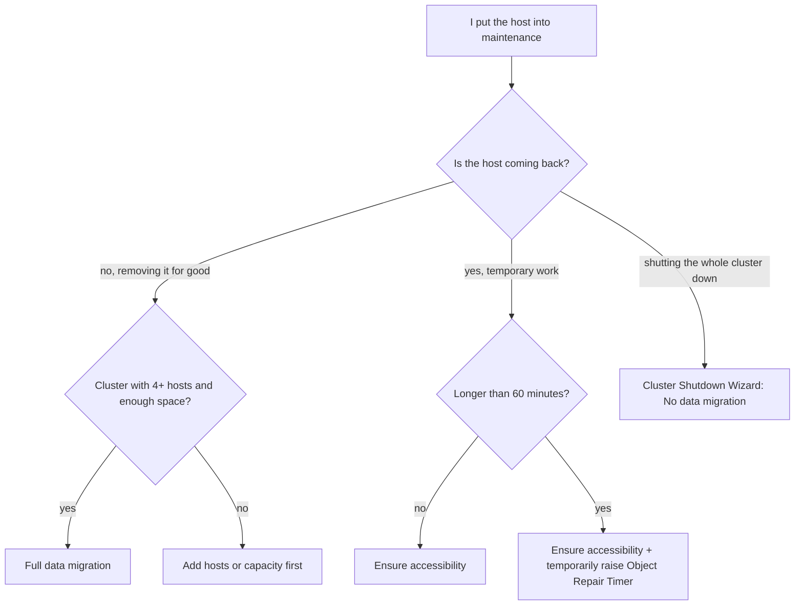
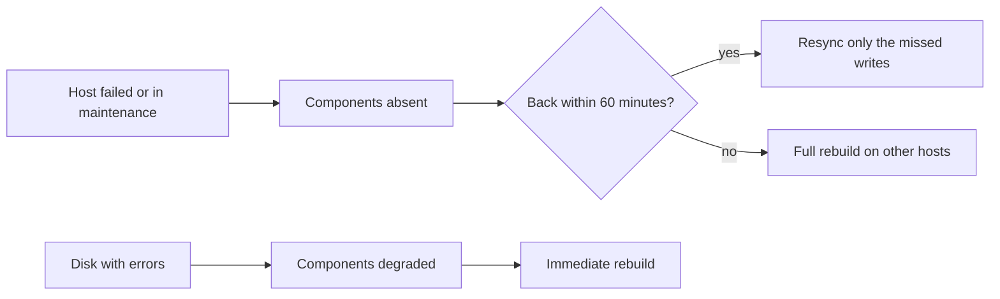

:::analogy
**The data center pain.** An administrator puts a vSAN host into maintenance mode with the default option, *Ensure accessibility*, to upgrade its firmware. The upgrade takes three hours. After one hour, vSAN decides the host is not coming back and starts rebuilding its data on the other hosts: a huge resync that loads the whole cluster. [S427] On another cluster, with 6 hosts and RAID-6 (RAID, Redundant Array of Independent Disks), *Full data migration* fails the pre-check and the team loses its maintenance window. [S422] For the exam, the VVF (VMware vSphere Foundation, 2V0-16.25) and VCF (VMware Cloud Foundation, 2V0-17.25) exam guides ask you to operate and troubleshoot a vSAN cluster. [S02] [S03]

**The analogy: a doctor's leave in a hospital.**

- **Ensure accessibility** means leaving for a day and handing colleagues only the urgent files; patients are covered, but with no backup.
- **Full data migration** means leaving for good and handing over every patient.
- **No data migration** means leaving without handing over anything.
- **Object Repair Timer** is how long the hospital waits before redistributing the patients, assuming the doctor is not coming back.
- **Rebalance** is the head of department moving patients from overloaded doctors to free ones.
- **Skyline Health** is the department's daily check sheet.
:::

:::architecture
### 1. Maintenance mode: three evacuation modes

Before you shut down, reboot or disconnect a vSAN host, you put it into maintenance mode and pick the evacuation mode. [S420]

| Mode | What it does | When you use it | Limits | Source |
|---|---|---|---|---|
| **Ensure accessibility** (default) | Moves only what is needed so every object stays accessible | Temporary work, for example upgrades | Objects run with reduced redundancy; with FTT (Failures To Tolerate) 1, a failure during maintenance can lose data | [S420] [S419] |
| **Full data migration** | Moves all data to other hosts and keeps compliance | Permanently removing the host | The most transfer and time; not possible on clusters with 3 hosts or 3 fault domains; inaccessible objects with data on the host block it | [S420] [S419] |
| **No data migration** | Moves nothing | Special cases, for example an orderly shutdown of the whole cluster | If you power off the host, some VMs (VM, Virtual Machine) may become inaccessible | [S420] [S429] |

On a cluster with 3 hosts (or 3 fault domains) the only possible mode is Ensure accessibility; the documentation recommends 4 or more hosts for maximum availability. [S419] [S420]

From the command line [S420]:

```bash
esxcli system maintenanceMode set --enable 1 --vsanmode=ensureObjectAccessibility   # or evacuateAllData, noAction
esxcli system maintenanceMode get
esxcli system maintenanceMode set --enable 0
```

**Data migration pre-check.** Run it before evacuating: it shows usage per host and whether removing the host would exhaust space or components. The confirmation dialog also shows how much space is available, how much data will move and how many objects become noncompliant or inaccessible. [S419] While the host is in maintenance, cluster capacity drops, because the host no longer contributes storage. [S420]

**On return.** After Ensure accessibility, the host's components have fallen behind; vSAN copies only the missed writes, and the resync is normal and should be left to finish. [S423]



### 2. Object Repair Timer: the 60 minutes

When a host fails or enters maintenance, vSAN waits **60 minutes** by default before rebuilding its components on other hosts, because it does not know whether the problem is transient (a reboot) or permanent. [S427] [S434] If a device reports errors, its components become *degraded* and the rebuild starts **immediately**. [S434] [S427]

| What | Value / how | Source |
|---|---|---|
| Default value | 60 minutes | [S427] [S428] |
| Where to change it | Cluster > Configure > vSAN > Services > Advanced Options > Object Repair Timer | [S427] |
| After changing it | Wait at least 180 seconds before maintenance, a reboot or disk work | [S427] [S428] |
| Check on a host | `esxcli system settings advanced list -o /VSAN/ClomRepairDelay` | [S428] |
| Immediate repair | The *Repair objects immediately* button in Skyline Health | [S427] |

Two rules: after the work you go back to 60 minutes, and lowering the timer does **not** speed up a resync that is already running. [S428] If a maintenance window approaches the limit, you can raise the timer to avoid a needless resync. [S427]



### 3. Resync: how to follow it

Resync appears after failures, maintenance, policy changes and rebalance. You see it in *Cluster > Monitor > vSAN > Resyncing Objects*. [S426] From the command line [S428]:

| Command | What it shows |
|---|---|
| `esxcli vsan debug resync summary get` | Resync summary |
| `esxcli vsan debug resync list` | Objects being resynced |
| `esxcli vsan resync bandwidth get` | Bandwidth used by resync |
| `esxcli vsan debug object health summary get` | Object state (healthy, reduced availability and so on) |

Resync stops automatically when disk usage reaches critical thresholds and resumes once space is freed. [S434] The temporary space used shows up in Capacity as *operations usage*. [S395]

### 4. Rebalance

| Type | When it starts | Configuration | Source |
|---|---|---|---|
| Reactive | A device reaches 80% usage or more | Always automatic, not configurable | [S425] |
| Automatic Rebalance (vSAN 6.7 U3 and later) | The usage difference between disks exceeds the threshold | *Configure > vSAN > Services > Advanced options*; default threshold 30%, between 20% and 75% | [S425] |

Automatic Rebalance works until the difference drops to half the threshold (15% by default). The KB (Knowledge Base article) 319926 recommends keeping it on with the default threshold; with it on, the *vSAN Disk Balance* health check stays green. [S425] If disk groups or storage pools have different sizes or you have failed disks, rebalance can run forever; the fix is to repair the disks and bring disk groups to the same size. [S426]

### 5. Skyline Health

The vSAN health checks are in *Cluster > Monitor > vSAN > Skyline Health*. [S430] The cluster gets a **percentage score**, and every open issue lowers it. [S430] Practical rules:

- **Silence** only hides the alert; the score does not come back, because the problem is still there. [S430]
- After the fix, click **Retest** so the score is recalculated. [S430]
- Health data can also be seen from the VMware Host Client when vCenter is down. [S434]

### 6. VCF Operations: Storage Operations

In VCF Operations, *Infrastructure Operations > Storage Operations* shows every storage type in a VCF instance (vSAN, VMFS, Virtual Machine File System, and NFS, Network File System). [S433]

| Element | What it shows | Source |
|---|---|---|
| Alerts and changes | Storage alerts and a timeline of changes | [S433] |
| Cluster health | Skyline Health scores: 81–100 green, 61–80 yellow, 0–60 red | [S433] |
| View Dashboard | Performance comparison across vSAN clusters | [S433] |
| View Diagnostics | vSAN Performance Diagnostics for ESA (Express Storage Architecture): Troubleshooting or Benchmarking goal | [S433] |

VCF Health alerts and Storage Operations alerts do not match **by design**: VCF Health also includes VM-level conditions (disk space), while Storage Operations shows only vSAN cluster health alerts. [S432] For vSAN logs you use VCF Operations for Logs. [S433]

### 7. Orderly shutdown and restart of the cluster

To shut down a whole cluster you use the **Cluster Shutdown Wizard**: right-click the cluster, *vSAN > Shutdown cluster*. [S429] The wizard:

1. runs a pre-check (for example it warns you that the VCSA, vCenter Server Appliance, sits on this cluster);
2. powers off the system VMs, then turns off HA (High Availability) and pauses vSAN object state changes;
3. powers off the VCSA;
4. puts each host into maintenance mode with **No data migration** and powers it off. [S429]

Write down the orchestration host beforehand: once vCenter is down you follow it from the ESXi Host Client. At power-on, start the hosts, wait for vCenter, then *Restart cluster* and check Skyline Health. [S429]

### 8. Maintenance of one site in a stretched cluster

In 9.0, maintenance of a whole site is manual: check the witness and VM compliance, set DRS (Distributed Resource Scheduler) to manual or partially automated, vMotion the VMs to the other site, put the site's hosts into maintenance mode with *No data migration* and power them off. [S435] Rebuild after a site failure still starts after 60 minutes. [S406] vSAN 9.1 adds fault domain level maintenance, with the *vSAN fault domain maintenance state* health check. [S431]

`[IMAGE SEARCH / PROMPT]` "vSAN enter maintenance mode ensure accessibility full data migration dialog" and "VCF Operations Storage Operations vSAN Skyline Health score".
:::

:::exam-alert
### Memorize

| What | Value / rule | Source |
|---|---|---|
| Default mode | Ensure accessibility | [S420] |
| Permanent removal | Full data migration | [S420] |
| 3-host cluster | Ensure accessibility only | [S419] [S420] |
| esxcli | `--vsanmode=ensureObjectAccessibility / evacuateAllData / noAction` | [S420] |
| Object Repair Timer | 60 minutes; after changing it wait 180 seconds | [S427] |
| Disk with errors | Immediate rebuild | [S434] |
| Reactive rebalance | At 80% device usage | [S425] |
| Automatic Rebalance | Default threshold 30% (20–75%) | [S425] |
| Storage Operations | Infrastructure Operations > Storage Operations | [S433] |
| Shutdown cluster | Right-click the cluster > vSAN > Shutdown cluster | [S429] |

### 3 exam traps

1. **"I use Full data migration on a 3-host cluster."** False. On 3 hosts or 3 fault domains only Ensure accessibility works. [S419] [S420]
2. **"Ensure accessibility keeps full protection while the host is in maintenance."** False. Objects run with reduced redundancy; with FTT=1 a second failure can lose data. [S420] [S419]
3. **"I lower Object Repair Timer so the running resync finishes faster."** False. The timer only decides when the rebuild starts, not the speed of a resync already running. [S428]
:::

:::trenches
### Mistake 1: Full data migration on 6 hosts with RAID-6

On a 6-host cluster with RAID-6, the *Full data migration* pre-check fails: 5 usable fault domains remain and one more is needed. [S422]
**Fix (KB 415685):** RAID-6 needs 6 hosts, so a full migration is impossible with one out. For temporary work choose *Ensure accessibility*. [S422] If you remove the host for good, first add a host or change the policy, with free space checked, because a RAID change creates new components first (KB 326857). [S421]

### Mistake 2: a resync that never ends

*Resyncing Objects* always shows rebalance activity on the same hosts; the byte count drops, but new work keeps appearing. [S426]
**Fix (KB 403351):** the disk groups have different sizes or you have failed disks. As a workaround turn off Automatic Rebalance; for the final fix, replace the failed disks and rebuild the disk groups to the same size on every host. [S426] [S425]
:::

:::interview
**Junior/Mid question: "What are the maintenance mode options in vSAN and when do you pick each?"**

*Ideal answer:* Ensure accessibility, the default, for temporary work: it moves only enough to keep objects accessible, but with reduced redundancy. Full data migration for permanent removal: it moves everything and keeps compliance, but needs extra hosts and space and does not work on 3 hosts. No data migration moves nothing and is used in special cases, such as shutting down the whole cluster. [S420] [S419] [S429] A good candidate adds that they run the data migration pre-check first. [S419]

**Troubleshooting scenario: "You must upgrade firmware on 8 hosts, and each takes about 2 hours. How do you proceed without causing needless resyncs?"**

*The answer a Team Lead expects:*
1. **Skyline Health green** and no resync running before you start. [S430] [S428]
2. **Temporarily raise Object Repair Timer** above the work duration and wait 180 seconds. [S427]
3. **One host at a time**, with *Ensure accessibility* and the migration pre-check. [S420] [S419]
4. **Wait for the resync of missed writes to finish** before the next host. [S423] [S428]
5. **At the end set the timer back to 60 minutes** and run Retest in Skyline Health. [S428] [S430]
:::

:::lab
**Scenario.** You check cluster health, compare the three maintenance modes in the pre-check, put a host into Ensure accessibility, follow the resync on return and look at the rebalance and Object Repair Timer settings.

**What you need.** A working vSAN cluster (ideally 4 hosts; on 3 hosts you only see Ensure accessibility), a test VM on vSAN and, if you have it, VCF Operations connected to vCenter.

The steps below can be ticked off and your progress is saved in the browser. Exact menu names can differ slightly between versions 8 and 9 (`⚠ to verify`).

**Home lab only / not supported.** The Cluster Shutdown Wizard and tests with powered-off hosts belong in the lab only, where you can lose the cluster without consequences. [S429] In production, Object Repair Timer is changed only for a maintenance window and set back to 60 minutes. [S428]

**Failure test and validation.** In step 4 you keep the host in maintenance with Ensure accessibility for a few minutes and write data in the test VM; on exit you must see a small resync in *Resyncing Objects* that finishes by itself. [S423] In step 2, the Full data migration pre-check must show exactly how much data would move. [S419]
:::

:::quiz
Five original questions in the style of the VCP (VMware Certified Professional) exams. You get the explanation for every option right after you answer.
:::

:::references
- The VCP-VVF 2V0-16.25 and VCP-VCF 2V0-17.25 exam guides [S02] [S03]
- vSAN documentation: maintenance mode in VCF 9.0 [S419] and evacuation modes with esxcli [S420]
- KB 326857, KB 415685, KB 435985 and KB 416539: maintenance issues [S421] [S422] [S423] [S424]
- KB 319926 and KB 403351: rebalance [S425] [S426]
- KB 327031 and KB 445909: Object Repair Timer and resync commands [S427] [S428]
- KB 420087: Cluster Shutdown Wizard [S429]; KB 447177: the Skyline Health score [S430]
- KB 424487 and KB 447339: VCF Health [S431] [S432]; the Storage Operations blog [S433]
- vSAN FAQ [S434], stretched site maintenance [S435], capacity monitoring [S395]
:::
