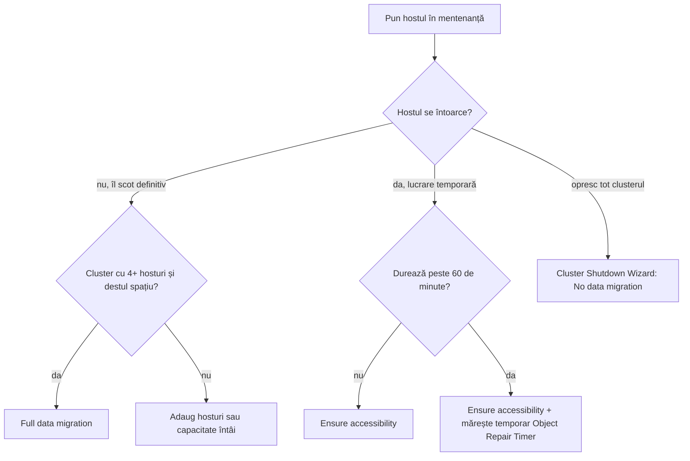
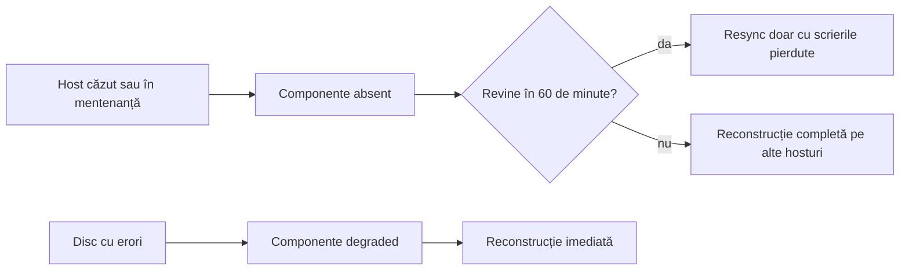

:::analogy
**Durerea din data center.** Un administrator pune un host vSAN în maintenance mode cu opțiunea implicită, *Ensure accessibility*, ca să-i facă upgrade de firmware. Upgrade-ul durează trei ore. După o oră, vSAN decide că hostul nu se mai întoarce și începe să-i reconstruiască datele pe celelalte hosturi: un resync uriaș, care încarcă tot clusterul. [S427] Pe alt cluster, cu 6 hosturi și RAID-6 (RAID, Redundant Array of Independent Disks), *Full data migration* pică la pre-check, iar echipa pierde fereastra de mentenanță. [S422] Pentru examen, exam guide-urile VVF (VMware vSphere Foundation, 2V0-16.25) și VCF (VMware Cloud Foundation, 2V0-17.25) cer să știi să operezi și să depanezi un cluster vSAN. [S02] [S03]

**Analogia: concediul unui medic într-un spital.**

- **Ensure accessibility** înseamnă că pleacă pentru o zi și lasă doar dosarele urgente colegilor; pacienții sunt acoperiți, dar fără rezervă.
- **Full data migration** înseamnă că pleacă definitiv și predă toți pacienții.
- **No data migration** înseamnă că pleacă fără să predea nimic.
- **Object Repair Timer** e cât așteaptă spitalul înainte să redistribuie pacienții, presupunând că medicul nu se mai întoarce.
- **Rebalance-ul** e șeful de secție care mută pacienți de la medicii supraîncărcați la cei liberi.
- **Skyline Health** e fișa de control zilnică a secției.
:::

:::architecture
### 1. Maintenance mode: trei moduri de evacuare

Înainte să oprești, să repornești sau să deconectezi un host vSAN, îl pui în maintenance mode și alegi modul de evacuare. [S420]

| Mod | Ce face | Când îl folosești | Limite | Sursă |
|---|---|---|---|---|
| **Ensure accessibility** (implicit) | Mută doar cât e nevoie ca toate obiectele să rămână accesibile | Lucrări temporare, de exemplu upgrade-uri | Obiectele rulează cu redundanță redusă; cu FTT (Failures To Tolerate) 1, o avarie în timpul mentenanței poate duce la pierdere de date | [S420] [S419] |
| **Full data migration** | Mută toate datele pe alte hosturi și păstrează conformitatea | Scoaterea definitivă a hostului | Cel mai mult transfer și timp; nu merge pe clustere cu 3 hosturi sau 3 fault domains; obiectele inaccesibile cu date pe host o blochează | [S420] [S419] |
| **No data migration** | Nu mută nimic | Cazuri speciale, de exemplu oprirea controlată a întregului cluster | Dacă oprești hostul, unele VM-uri (VM, Virtual Machine) pot deveni inaccesibile | [S420] [S429] |

Pe un cluster cu 3 hosturi (sau 3 fault domains) singurul mod posibil e Ensure accessibility; documentația recomandă 4 sau mai multe hosturi pentru disponibilitate maximă. [S419] [S420]

Din linia de comandă [S420]:

```bash
esxcli system maintenanceMode set --enable 1 --vsanmode=ensureObjectAccessibility   # sau evacuateAllData, noAction
esxcli system maintenanceMode get
esxcli system maintenanceMode set --enable 0
```

**Data migration pre-check.** Rulează-l înainte de evacuare: arată ocuparea pe fiecare host și dacă scoaterea hostului ar epuiza spațiul sau componentele. Dialogul de confirmare arată și cât spațiu e disponibil, câte date se mută și câte obiecte devin noncompliant sau inaccesibile. [S419] Cât timp hostul e în mentenanță, capacitatea clusterului scade, pentru că hostul nu mai contribuie cu stocare. [S420]

**La întoarcere.** După Ensure accessibility, componentele hostului au rămas în urmă; vSAN copiază doar scrierile pierdute, iar resync-ul e normal și se lasă să termine. [S423]



### 2. Object Repair Timer: cele 60 de minute

Când un host cade sau intră în mentenanță, vSAN așteaptă implicit **60 de minute** înainte să reconstruiască componentele lui pe alte hosturi, pentru că nu știe dacă problema e trecătoare (un reboot) sau permanentă. [S427] [S434] Dacă un dispozitiv raportează erori, componentele lui devin *degraded* și reconstrucția pornește **imediat**. [S434] [S427]

| Ce | Valoare / cum | Sursă |
|---|---|---|
| Valoare implicită | 60 de minute | [S427] [S428] |
| Unde se schimbă | Cluster > Configure > vSAN > Services > Advanced Options > Object Repair Timer | [S427] |
| După schimbare | Aștepți cel puțin 180 de secunde înainte de mentenanță, reboot sau lucru pe discuri | [S427] [S428] |
| Verificare pe host | `esxcli system settings advanced list -o /VSAN/ClomRepairDelay` | [S428] |
| Reparare imediată | Butonul *Repair objects immediately* din Skyline Health | [S427] |

Două reguli: după lucrare revii la 60 de minute, iar scăderea timer-ului **nu** accelerează un resync care rulează deja. [S428] Dacă fereastra de mentenanță se apropie de limită, poți mări timer-ul ca să eviți un resync inutil. [S427]



### 3. Resync: cum îl urmărești

Resync-ul apare după avarii, mentenanță, schimbări de politică și rebalance. Îl vezi în *Cluster > Monitor > vSAN > Resyncing Objects*. [S426] Din linia de comandă [S428]:

| Comandă | Ce arată |
|---|---|
| `esxcli vsan debug resync summary get` | Rezumatul resync-ului |
| `esxcli vsan debug resync list` | Obiectele în resync |
| `esxcli vsan resync bandwidth get` | Banda folosită de resync |
| `esxcli vsan debug object health summary get` | Starea obiectelor (healthy, reduced availability etc.) |

Resync-ul se oprește automat când ocuparea discurilor atinge pragurile critice și continuă după ce se eliberează spațiu. [S434] Spațiul temporar folosit apare în Capacity la *operations usage*. [S395]

### 4. Rebalance

| Tip | Când pornește | Configurare | Sursă |
|---|---|---|---|
| Reactive | Un dispozitiv ajunge la 80% ocupare sau mai mult | Mereu automat, nu se configurează | [S425] |
| Automatic Rebalance (vSAN 6.7 U3 și mai nou) | Diferența de ocupare dintre discuri trece de prag | *Configure > vSAN > Services > Advanced options*; prag implicit 30%, între 20% și 75% | [S425] |

Automatic Rebalance lucrează până când diferența scade la jumătate din prag (15% implicit). Articolul KB (Knowledge Base article) 319926 recomandă să-l ții pornit și să lași pragul implicit; cu el pornit, health check-ul *vSAN Disk Balance* rămâne verde. [S425] Dacă disk group-urile sau storage pool-urile au mărimi diferite ori ai discuri căzute, rebalance-ul poate rula la nesfârșit; soluția e să repari discurile și să aduci disk group-urile la aceeași mărime. [S426]

### 5. Skyline Health

Health check-urile vSAN sunt în *Cluster > Monitor > vSAN > Skyline Health*. [S430] Clusterul primește un **scor procentual**, iar fiecare problemă deschisă scade scorul. [S430] Reguli practice:

- **Silence** ascunde doar alerta; scorul nu revine, pentru că problema e încă acolo. [S430]
- După remediere, apeși **Retest** ca scorul să se recalculeze. [S430]
- Datele de health se pot vedea și din VMware Host Client când vCenter e oprit. [S434]

### 6. VCF Operations: Storage Operations

În VCF Operations, *Infrastructure Operations > Storage Operations* arată toate tipurile de stocare dintr-o instanță VCF (vSAN, VMFS, Virtual Machine File System, și NFS, Network File System). [S433]

| Element | Ce arată | Sursă |
|---|---|---|
| Alerte și schimbări | Alertele de stocare și o cronologie a schimbărilor | [S433] |
| Sănătatea clusterelor | Scorurile Skyline Health: 81–100 verde, 61–80 galben, 0–60 roșu | [S433] |
| View Dashboard | Comparația performanței între clustere vSAN | [S433] |
| View Diagnostics | vSAN Performance Diagnostics pentru ESA (Express Storage Architecture): obiectiv Troubleshooting sau Benchmarking | [S433] |

Alertele din VCF Health și cele din Storage Operations nu coincid **intenționat**: VCF Health include și condiții la nivel de VM (spațiu pe discuri), iar Storage Operations doar alertele de sănătate ale clusterului vSAN. [S432] Pentru loguri vSAN folosești VCF Operations for Logs. [S433]

### 7. Oprirea și repornirea controlată a clusterului

Pentru oprirea unui cluster întreg folosești **Cluster Shutdown Wizard**: clic dreapta pe cluster, *vSAN > Shutdown cluster*. [S429] Asistentul:

1. rulează un pre-check (de exemplu te avertizează că VCSA, vCenter Server Appliance, stă pe acest cluster);
2. oprește VM-urile de sistem, apoi oprește HA (High Availability) și pune pe pauză schimbările de stare ale obiectelor vSAN;
3. oprește VCSA;
4. pune fiecare host în maintenance mode cu **No data migration** și îl oprește. [S429]

Notezi dinainte hostul de orchestrare: după oprirea vCenter îl urmărești din ESXi Host Client. La pornire, pornești hosturile, aștepți vCenter, apoi *Restart cluster* și verifici Skyline Health. [S429]

### 8. Mentenanța unui site într-un stretched cluster

În 9.0, mentenanța unui site întreg e manuală: verifici witness-ul și conformitatea VM-urilor, pui DRS (Distributed Resource Scheduler) pe manual sau parțial automat, muți VM-urile cu vMotion pe celălalt site, pui hosturile site-ului în maintenance mode cu *No data migration* și le oprești. [S435] Reconstrucția după căderea unui site pornește tot după 60 de minute. [S406] În vSAN 9.1 apare mentenanța la nivel de fault domain, cu health check-ul *vSAN fault domain maintenance state*. [S431]

`[IMAGE SEARCH / PROMPT]` „vSAN enter maintenance mode ensure accessibility full data migration dialog” și „VCF Operations Storage Operations vSAN Skyline Health score”.
:::

:::exam-alert
### De memorat

| Ce | Valoare / regulă | Sursă |
|---|---|---|
| Modul implicit | Ensure accessibility | [S420] |
| Scoatere definitivă | Full data migration | [S420] |
| Cluster cu 3 hosturi | Doar Ensure accessibility | [S419] [S420] |
| esxcli | `--vsanmode=ensureObjectAccessibility / evacuateAllData / noAction` | [S420] |
| Object Repair Timer | 60 de minute; după schimbare aștepți 180 de secunde | [S427] |
| Disc cu erori | Reconstrucție imediată | [S434] |
| Reactive rebalance | La 80% ocupare pe dispozitiv | [S425] |
| Automatic Rebalance | Prag implicit 30% (20–75%) | [S425] |
| Storage Operations | Infrastructure Operations > Storage Operations | [S433] |
| Shutdown cluster | Clic dreapta pe cluster > vSAN > Shutdown cluster | [S429] |

### 3 capcane de examen

1. **„Folosesc Full data migration pe un cluster cu 3 hosturi.”** Fals. Pe 3 hosturi sau 3 fault domains merge doar Ensure accessibility. [S419] [S420]
2. **„Ensure accessibility păstrează protecția completă cât hostul e în mentenanță.”** Fals. Obiectele rulează cu redundanță redusă; cu FTT=1 o a doua avarie poate pierde date. [S420] [S419]
3. **„Scad Object Repair Timer ca să termine mai repede resync-ul care rulează.”** Fals. Timer-ul decide doar când începe reconstrucția, nu viteza unui resync deja pornit. [S428]
:::

:::trenches
### Greșeala 1: Full data migration pe 6 hosturi cu RAID-6

Pe un cluster de 6 hosturi cu RAID-6, pre-check-ul pentru *Full data migration* pică: rămân 5 fault domains utilizabile și mai trebuie unul. [S422]
**Remediere (KB 415685):** RAID-6 cere 6 hosturi, deci migrarea completă e imposibilă cu unul scos. Pentru o lucrare temporară alegi *Ensure accessibility*. [S422] Dacă scoți hostul definitiv, întâi adaugi un host sau schimbi politica, cu spațiu liber verificat, pentru că schimbarea de RAID creează mai întâi componente noi (KB 326857). [S421]

### Greșeala 2: resync care nu se termină niciodată

În *Resyncing Objects* apare mereu activitate de rebalance pe aceleași hosturi; numărul de bytes scade, dar apar mereu lucruri noi. [S426]
**Remediere (KB 403351):** disk group-urile au mărimi diferite sau ai discuri căzute. Ca soluție temporară oprești Automatic Rebalance; definitiv, schimbi discurile căzute și refaci disk group-urile la aceeași mărime pe toate hosturile. [S426] [S425]
:::

:::interview
**Întrebare Junior/Mid: „Care sunt modurile de maintenance mode în vSAN și când îl alegi pe fiecare?”**

*Răspunsul ideal:* Ensure accessibility, implicit, pentru lucrări temporare: mută doar cât să rămână obiectele accesibile, dar cu redundanță redusă. Full data migration pentru scoaterea definitivă: mută tot și păstrează conformitatea, dar cere hosturi și spațiu în plus și nu merge pe 3 hosturi. No data migration nu mută nimic și se folosește în cazuri speciale, cum e oprirea întregului cluster. [S420] [S419] [S429] Un candidat bun adaugă că rulează întâi data migration pre-check. [S419]

**Scenariu de troubleshooting: „Trebuie să faci upgrade de firmware pe 8 hosturi, iar fiecare durează aproximativ 2 ore. Cum procedezi fără să provoci resync-uri inutile?”**

*Răspunsul pe care îl așteaptă un Team Lead:*
1. **Skyline Health verde** și niciun resync în curs înainte să începi. [S430] [S428]
2. **Mărești temporar Object Repair Timer** peste durata lucrării și aștepți 180 de secunde. [S427]
3. **Un host pe rând**, cu *Ensure accessibility* și pre-check-ul de migrare. [S420] [S419]
4. **Aștepți să se termine resync-ul** cu scrierile pierdute înainte de hostul următor. [S423] [S428]
5. **La final readuci timer-ul la 60 de minute** și rulezi Retest în Skyline Health. [S428] [S430]
:::

:::lab
**Scenariu.** Verifici sănătatea clusterului, compari în pre-check cele trei moduri de mentenanță, pui un host în Ensure accessibility, urmărești resync-ul la întoarcere și te uiți la setările de rebalance și Object Repair Timer.

**Ce ai nevoie.** Un cluster vSAN funcțional (ideal 4 hosturi; pe 3 hosturi vezi doar Ensure accessibility), o VM de test pe vSAN și, dacă ai, VCF Operations conectat la vCenter.

Pașii de mai jos sunt bifabili, iar progresul se salvează în browser. Numele exacte ale meniurilor pot diferi puțin între versiunile 8 și 9 (`⚠ de verificat`).

**Home lab only / not supported.** Cluster Shutdown Wizard și testele cu opriri de hosturi le faci doar în lab, unde poți pierde clusterul fără consecințe. [S429] În producție, schimbarea Object Repair Timer se face doar pentru o fereastră de mentenanță și se readuce la 60 de minute. [S428]

**Test de avarie și validare.** La pasul 4 ții hostul câteva minute în mentenanță cu Ensure accessibility și scrii date în VM-ul de test; la ieșire trebuie să vezi un resync mic în *Resyncing Objects*, care se termină singur. [S423] La pasul 2, pre-check-ul pentru Full data migration trebuie să arate exact câte date s-ar muta. [S419]
:::

:::quiz
Cinci întrebări originale, în stilul examenelor VCP (VMware Certified Professional). Primești explicația pentru fiecare variantă imediat după ce răspunzi.
:::

:::references
- Exam guide-urile VCP-VVF 2V0-16.25 și VCP-VCF 2V0-17.25 [S02] [S03]
- Documentația vSAN: maintenance mode în VCF 9.0 [S419] și modurile de evacuare cu esxcli [S420]
- KB 326857, KB 415685, KB 435985 și KB 416539: probleme de mentenanță [S421] [S422] [S423] [S424]
- KB 319926 și KB 403351: rebalance [S425] [S426]
- KB 327031 și KB 445909: Object Repair Timer și comenzile de resync [S427] [S428]
- KB 420087: Cluster Shutdown Wizard [S429]; KB 447177: scorul Skyline Health [S430]
- KB 424487 și KB 447339: VCF Health [S431] [S432]; blogul despre Storage Operations [S433]
- vSAN FAQ [S434], mentenanța unui site stretched [S435], monitorizarea capacității [S395]
:::
