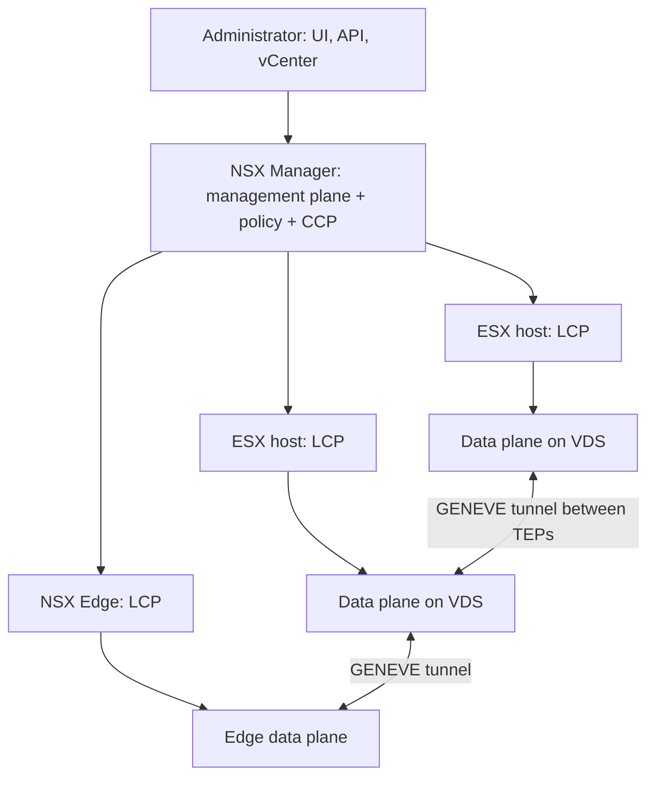
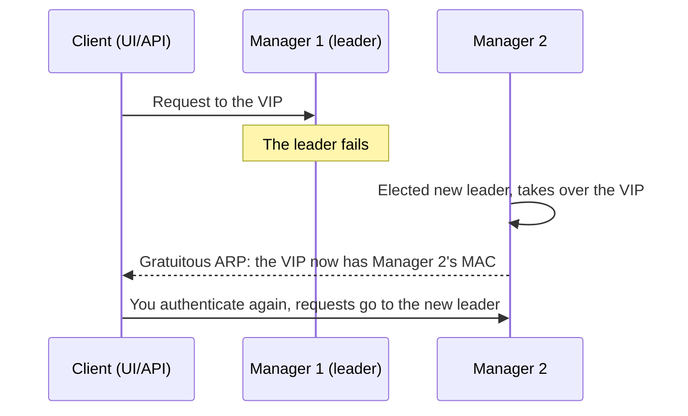

:::analogy
**The data center pain.** A development team needs a new network for an application. The request goes to the network team: a new VLAN (VLAN, Virtual Local Area Network) on the switches, routes on the router, rules on the physical firewall. It takes weeks. With NSX, the same network is created in software, on top of the existing physical network, in minutes. [S439] [S445] But if you do not understand the architecture you make basic mistakes: for example you add NSX Manager nodes straight from the NSX interface, and SDDC Manager (SDDC, Software-Defined Data Center) no longer sees them at all. [S444] For the exam, the VCF (VMware Cloud Foundation, 2V0-17.25) exam guide asks you to describe the VCF network architecture, and the former VCP-NV (VMware Certified Professional - Network Virtualization, 2V0-41.24) had a whole objective on NSX architecture. [S03] [S48]

**The analogy: traffic in a city.**

- **The management plane** is city hall: that is where plans are made and new streets are approved (the configuration).
- **The central control plane** is the traffic control center: it computes how cars should move and sends out instructions.
- **The local control plane** is the controller box at each intersection, which receives the instructions and sets the lights.
- **The data plane** is the cars actually driving on the streets.
- **The overlay** is a network of tunnels under the city: cars enter a tunnel at one intersection (TEP, Tunnel Endpoint) and exit at another, without caring about the streets above.
:::

:::architecture
### 1. What SDN is

SDN (Software-Defined Networking) means that the network VMs (VM, Virtual Machine) see is defined in software, separately from the physical network. NSX builds **overlay networks** with GENEVE (Generic Network Virtualization Encapsulation): the topology VMs see does not depend on the physical cables and switches, which become just the transport (underlay). [S439] Each transport node has a TEP, which encapsulates VM traffic and sends it to the destination TEP. [S439]

### 2. The three planes

| Plane | What it does | Where it runs | Source |
|---|---|---|---|
| Management plane | Takes the configuration, offers the REST API (programming interface) and the web interface | On NSX Manager | [S438] |
| CCP (Central Control Plane) | Computes network state and distributes it | On the NSX Manager nodes, as cluster daemons | [S438] |
| LCP (Local Control Plane) | Receives the state and programs local forwarding | As daemons on every transport node | [S438] |
| Data plane | Actually moves packets | The forwarding engines on transport nodes | [S438] |

Since NSX 2.4 the policy, management and control roles all live in the **same appliance**, NSX Manager. The manager cluster uses a distributed data platform called Corfu, which keeps the interface and the API available. [S438]

### 3. NSX Manager: one or three

| Model | Nodes | When | Source |
|---|---|---|---|
| High Availability | 3 NSX Manager nodes | Recommended for production | [S446] [S437] |
| Simple | 1 NSX Manager node | Supported from VCF 9.0 for small or edge sites | [S445] [S447] |

In the High Availability model each node sits on a different ESX host through anti-affinity rules, so NSX stays available during ESX upgrades. That is why the 3-node model needs at least **4 ESX hosts**. [S447]

**Form factors**, according to KB (Knowledge Base article) 403604 [S440]:

| Size | Resources | Note |
|---|---|---|
| Small | not stated in the KB | Lab and proof of concept only, **not** for production |
| Medium | 6 vCPU (virtual CPU, Central Processing Unit), 24 GB memory | |
| Large | 12 vCPU, 48 GB memory | |
| Extra Large | not stated in the KB | Changed only by redeploying, not by editing the VM |

Each NSX Manager needs a static IP (Internet Protocol) address, a valid hostname (no underscores or dots), plus NTP (Network Time Protocol) and DNS (Domain Name System) servers. [S437] In a VCF environment, nodes are added (scale out) **only through SDDC Manager**; nodes added from the NSX interface are not registered in SDDC Manager. [S444]

### 4. The cluster virtual address

The NSX Manager cluster can have a VIP (Virtual IP), a shared address through which you reach the interface and the API. [S436]

| Rule | Source |
|---|---|
| The VIP is owned by the **leader node**, which receives API and UI requests | [S436] |
| All NSX Manager nodes must be in the **same subnet**; with an external load balancer they can be in different subnets | [S436] [S437] |
| When the leader fails a new leader is elected, takes over the VIP and sends a gratuitous ARP (Address Resolution Protocol) with the new VIP-to-MAC (MAC, Media Access Control) mapping | [S436] |
| Failover can take **a few minutes**, and then you must authenticate again | [S436] |
| The VIP **is not a load balancer** | [S436] |
| With certificates signed by an authority or dual stack, the VIP needs forward and reverse DNS records | [S436] |

You set it in NSX Manager under *System > Appliances > Set Virtual IP* and check the cluster from the CLI (Command-Line Interface) with `get cluster status verbose`. [S436]

### 5. The core objects (you will use them across the module)

| Object | In short | Source |
|---|---|---|
| Transport node | ESX host or Edge prepared for NSX; the ESX host needs a VDS (vSphere Distributed Switch) | [S439] |
| Transport zone | The group of transport nodes that sets how far a segment reaches | [S439] |
| TEP | The tunnel endpoint of each transport node | [S439] |
| Segment | The former *logical switch*: virtual Layer 2 switching across several hosts | [S439] |
| Tier-0 Gateway | The north-south link to the physical routers, with BGP (Border Gateway Protocol) | [S439] |
| Tier-1 Gateway | Connects up to one Tier-0 and down to segments | [S439] |
| NSX Edge and Edge cluster | Appliance for services that cannot run on the hypervisor; the cluster provides failover | [S439] |
| Uplink profile | Teaming, transport VLAN and MTU (Maximum Transmission Unit) for transport node links | [S439] |
| Compute manager | The inventory source for hosts and VMs; NSX supports vCenter | [S439] |

On ESX hosts NSX uses the VDS: N-VDS support on ESX was removed in NSX 4.0.0.1 (N-VDS remains on Edges). [S449]

### 6. What is specific to VCF 9

| Change | Source |
|---|---|
| NSX 9.x is installed and upgraded **only as part of VCF 9.x**; a standalone NSX 4.x is imported into VCF first | [S441] |
| NSX VIBs (vSphere Installation Bundle) ship in the ESX image and upgrade together with ESX; hosts no longer enter maintenance during an NSX upgrade | [S442] [S445] |
| Networks are VPC-ready (VPC, Virtual Private Cloud), and the Transit Gateway connects VPCs, with centralized or distributed connectivity | [S445] |
| The NSX load balancer is entitled only for VCF components and for the Supervisor (Layer 4); for everything else Broadcom recommends Avi Load Balancer | [S443] |
| The VCF 9 licence covers NSX; advanced services (Avi, vDefend Firewall) are licensed separately | [S448] |
| NSX 9.0 no longer supports KVM (Kernel-based Virtual Machine) or third-party OpenStack distributions; NSX-V is fully retired | [S449] |

The VCF 9 networking technical reference replaces the old *NSX Design Guide* starting with VCF 9.0. [S450] VPCs and the Transit Gateway get their own lessons later in the module.

`[IMAGE SEARCH / PROMPT]` "NSX management plane control plane data plane architecture diagram" and "NSX Manager cluster three nodes virtual IP leader".
:::

:::exam-alert
### Memorize

| What | Value / rule | Source |
|---|---|---|
| Overlay encapsulation | GENEVE, between TEPs | [S439] |
| CCP | On the NSX Manager nodes | [S438] |
| LCP | On every transport node | [S438] |
| Production cluster | 3 NSX Manager nodes, at least 4 ESX hosts | [S446] [S447] |
| A single node | Supported from VCF 9.0 (Simple) | [S445] [S447] |
| Small | Lab only | [S440] |
| Medium / Large | 6 vCPU 24 GB / 12 vCPU 48 GB | [S440] |
| VIP | On the leader, same subnet, not a load balancer | [S436] |
| Scale out in VCF | Only through SDDC Manager | [S444] |
| NSX 9.x | Only inside VCF 9.x | [S441] |

### 3 exam traps

1. **"The NSX cluster VIP spreads requests across the three nodes."** False. The VIP is owned by the leader and is not a load balancer. [S436]
2. **"In a VCF environment I add the second and third NSX Manager from the NSX interface."** False. In VCF scale out is done only through SDDC Manager, otherwise the nodes are not registered. [S444]
3. **"I can upgrade a standalone NSX 4.x straight to NSX 9."** False. NSX 9.x is supported only as part of VCF 9.x; you import the instance into VCF first. [S441]
:::

:::trenches
### Mistake 1: NSX Manager nodes added behind SDDC Manager's back

SDDC Manager shows a single NSX Manager, although the NSX interface shows a healthy three-node cluster; certificate replacement in Fleet Management cannot find the other two nodes. [S444]
**Fix (KB 421778):** back up SDDC Manager and NSX, power off the two extra nodes, run `deactivate cluster` on the primary node, delete the VMs from inventory and add them again through the SDDC Manager API (`POST /v1/nsxt-clusters/{id}/scale-out`). Synchronization can take up to an hour. [S444]

### Mistake 2: an NSX upgrade done outside VCF

Someone upgrades straight from NSX 4.x to 9.x, outside a VCF 9 upgrade. The result is unsupported. [S441]
**Fix (KB 401775):** the environment must be brought back to NSX 4.x: power off the managers, deploy a new manager and restore the pre-upgrade backup; Edges and hosts show as disconnected and are replaced or re-prepared one by one. That is why you take the NSX backup to an external server before any upgrade. [S441]
:::

:::interview
**Junior/Mid question: "Explain the management plane, control plane and data plane in NSX."**

*Ideal answer:* the management plane takes configuration through the interface and the API and runs on NSX Manager. The control plane has two parts: the CCP on the NSX Manager nodes, which computes network state, and the LCP on each transport node, which receives it and programs local forwarding. The data plane is the forwarding engines on hosts and Edges, which move packets through GENEVE tunnels between TEPs. [S438] [S439] A good candidate adds that since NSX 2.4 the manager and controller live in the same appliance, in a three-node cluster for production. [S438] [S446]

**Troubleshooting scenario: "After an NSX Manager failure you can no longer reach the interface through the VIP. What do you do?"**

*The answer a Team Lead expects:*
1. **Wait a few minutes**: VIP failover to the new leader is not instant. [S436]
2. **Authenticate again**: old sessions went to the failed leader. [S436]
3. **Check the cluster** on a remaining node with `get cluster status verbose`: who is the API leader, which groups are stable. [S436]
4. **Check the network**: are all nodes in the same subnet as the VIP? If not, you need an external load balancer. [S436] [S437]
5. **Check DNS** if you use authority-signed certificates: does the VIP have forward and reverse records? [S436]
:::

:::lab
**Scenario.** You explore an NSX Manager in the lab: you look at cluster state, the VIP, the compute manager and transport nodes, check from the CLI who the leader is and identify the three planes in what you see.

**What you need.** A VCF 9 lab with NSX installed (Simple or High Availability) and administrator access to NSX Manager. The lab already exists; you do not install NSX from scratch here.

The steps below can be ticked off and your progress is saved in the browser. Exact menu names can differ slightly between versions (`⚠ to verify`).

**Home lab only / not supported.** A single Small NSX Manager is fine for a lab but not for production. [S440] Do not edit an NSX Manager's CPU or memory except to the values of a standard size. [S440]

**Failure test and validation.** If you have three nodes, power off the leader node and time how long it takes until you get back in through the VIP; you must authenticate again. [S436] With a single node, just note what its failure would mean: the interface and the API are no longer available.
:::

:::quiz
Five original questions in the style of the VCP exams. You get the explanation for every option right after you answer.
:::

:::references
- The VCP-VCF 2V0-17.25 exam guide [S03] and the former VCP-NV 2V0-41.24 exam guide [S48]
- NSX documentation: the cluster VIP in VCF 9.0 [S436], NSX Manager requirements [S437], the planes [S438], the core concepts [S439]
- KB 403604: NSX Manager form factors [S440]; KB 421778: scale out through SDDC Manager [S444]
- KB 401775, KB 436389 and KB 401492: NSX in VCF 9 [S441] [S442] [S443]
- VMware blogs: networking in VCF 9.0 [S445] and planning VCF 9.0 [S446]; William Lam on host counts [S447]
- VCF 9.0 General FAQs [S448]; features removed in VCF 9 [S449]; VCF Virtual Networking Technical Reference [S450]
:::
