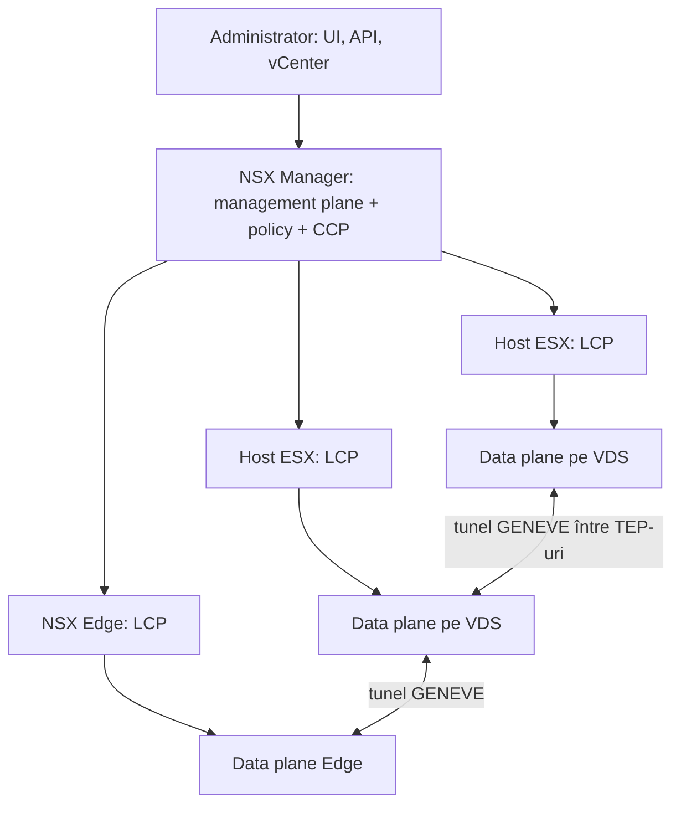
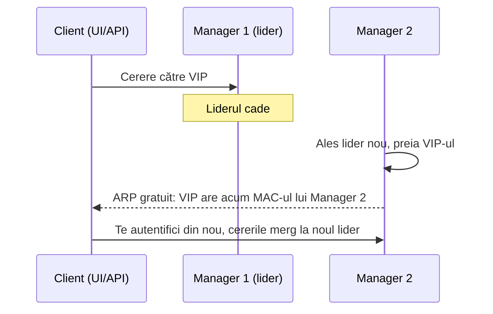

:::analogy
**Durerea din data center.** O echipă de dezvoltare are nevoie de o rețea nouă pentru o aplicație. Cererea pleacă la echipa de rețea: un VLAN (VLAN, Virtual Local Area Network) nou pe switch-uri, rute pe router, reguli pe firewall-ul fizic. Durează săptămâni. Cu NSX, aceeași rețea se creează în software, peste rețeaua fizică existentă, în câteva minute. [S439] [S445] Dar dacă nu înțelegi arhitectura, greșești la bază: de exemplu adaugi noduri NSX Manager direct din interfața NSX, iar SDDC Manager (SDDC, Software-Defined Data Center) nu le mai vede deloc. [S444] Pentru examen, exam guide-ul VCF (VMware Cloud Foundation, 2V0-17.25) cere să descrii arhitectura rețelei din VCF, iar fostul VCP-NV (VMware Certified Professional - Network Virtualization, 2V0-41.24) avea un obiectiv întreg despre arhitectura NSX. [S03] [S48]

**Analogia: traficul dintr-un oraș.**

- **Management plane** e primăria: acolo se fac planurile și se aprobă străzile noi (configurația).
- **Central control plane** e dispeceratul de trafic: calculează cum trebuie să meargă mașinile și trimite instrucțiunile.
- **Local control plane** e automatul din fiecare intersecție, care primește instrucțiunile și pune semafoarele.
- **Data plane** sunt mașinile care chiar circulă pe străzi.
- **Overlay-ul** e o rețea de tuneluri pe sub oraș: mașinile intră într-un tunel la o intersecție (TEP, Tunnel Endpoint) și ies la alta, fără să le pese de străzile de deasupra.
:::

:::architecture
### 1. Ce e SDN

SDN (Software-Defined Networking) înseamnă că rețeaua pe care o văd VM-urile (VM, Virtual Machine) e definită în software, separat de rețeaua fizică. NSX construiește **rețele overlay** prin încapsulare GENEVE (Generic Network Virtualization Encapsulation): topologia văzută de VM-uri nu depinde de cablurile și switch-urile fizice, care devin doar transportul (underlay). [S439] Fiecare transport node are un TEP, care încapsulează traficul VM-urilor și îl trimite la TEP-ul destinație. [S439]

### 2. Cele trei planuri

| Plan | Ce face | Unde rulează | Sursă |
|---|---|---|---|
| Management plane | Primește configurația, oferă API-ul (interfața de programare) REST și interfața web | Pe NSX Manager | [S438] |
| CCP (Central Control Plane) | Calculează starea rețelei și o distribuie | Pe nodurile NSX Manager, ca daemoni de cluster | [S438] |
| LCP (Local Control Plane) | Primește starea și programează forwarding-ul local | Ca daemoni pe fiecare transport node | [S438] |
| Data plane | Mută efectiv pachetele | Motoarele de forwarding de pe transport nodes | [S438] |

Din NSX 2.4, rolurile de policy, management și control stau toate în **același appliance**, NSX Manager. Clusterul de manageri folosește o platformă de date distribuită numită Corfu, care asigură disponibilitatea interfeței și a API-ului. [S438]

### 3. NSX Manager: unul sau trei

| Model | Câte noduri | Când | Sursă |
|---|---|---|---|
| High Availability | 3 noduri NSX Manager | Recomandat pentru producție | [S446] [S437] |
| Simple | 1 nod NSX Manager | Suportat din VCF 9.0 pentru site-uri mici sau edge | [S445] [S447] |

În modelul High Availability, fiecare nod stă pe alt host ESX prin reguli de anti-afinitate, ca NSX să rămână disponibil în timpul upgrade-urilor de ESX. De aceea modelul cu 3 noduri cere cel puțin **4 hosturi ESX**. [S447]

**Mărimile (form factors)**, după KB (Knowledge Base article) 403604 [S440]:

| Mărime | Resurse | Observație |
|---|---|---|
| Small | nespecificat în KB | Doar pentru lab și proof of concept, **nu** pentru producție |
| Medium | 6 vCPU (virtual CPU, Central Processing Unit virtual), 24 GB memorie | |
| Large | 12 vCPU, 48 GB memorie | |
| Extra Large | nespecificat în KB | Se schimbă doar prin redeploy, nu prin editarea VM-ului |

Fiecare NSX Manager are nevoie de o adresă IP (Internet Protocol) statică, un hostname valid (fără underscore sau puncte), plus servere NTP (Network Time Protocol) și DNS (Domain Name System). [S437] Într-un mediu VCF, nodurile se adaugă (scale out) **doar prin SDDC Manager**; nodurile adăugate din interfața NSX nu sunt înregistrate în SDDC Manager. [S444]

### 4. Adresa virtuală a clusterului

Clusterul NSX Manager poate avea o VIP (Virtual IP), o adresă comună prin care intri în interfață și în API. [S436]

| Regulă | Sursă |
|---|---|
| VIP-ul e deținut de **nodul lider**, care primește cererile de API și UI | [S436] |
| Toate nodurile NSX Manager trebuie să fie în **aceeași subrețea**; cu un load balancer extern pot fi în subrețele diferite | [S436] [S437] |
| La căderea liderului se alege alt lider, care preia VIP-ul și trimite un ARP (Address Resolution Protocol) gratuit cu noua asociere VIP–MAC (MAC, Media Access Control) | [S436] |
| Failover-ul poate dura **câteva minute**, iar apoi trebuie să te autentifici din nou | [S436] |
| VIP-ul **nu e un load balancer** | [S436] |
| Cu certificate semnate de o autoritate sau dual stack, VIP-ul are nevoie de înregistrări DNS directe și inverse | [S436] |

Îl setezi în NSX Manager la *System > Appliances > Set Virtual IP* și verifici clusterul din CLI (Command-Line Interface) cu `get cluster status verbose`. [S436]

### 5. Obiectele de bază (le vei folosi în tot modulul)

| Obiect | Pe scurt | Sursă |
|---|---|---|
| Transport node | Host ESX sau Edge pregătit pentru NSX; hostul ESX are nevoie de un VDS (vSphere Distributed Switch) | [S439] |
| Transport zone | Grupul de transport nodes care stabilește cât de departe se întinde un segment | [S439] |
| TEP | Capătul de tunel al fiecărui transport node | [S439] |
| Segment | Fostul *logical switch*: switching Layer 2 virtual peste mai multe hosturi | [S439] |
| Tier-0 Gateway | Legătura nord-sud cu routerele fizice, cu BGP (Border Gateway Protocol) | [S439] |
| Tier-1 Gateway | Se leagă în sus de un Tier-0 și în jos de segmente | [S439] |
| NSX Edge și Edge cluster | Appliance pentru serviciile care nu pot rula pe hypervisor; clusterul dă failover | [S439] |
| Uplink profile | Teaming, VLAN-ul de transport și MTU (Maximum Transmission Unit) pentru legăturile transport nodes | [S439] |
| Compute manager | Sursa de inventar pentru hosturi și VM-uri; NSX suportă vCenter | [S439] |

Pe hosturile ESX, NSX folosește VDS: suportul pentru N-VDS pe ESX a fost scos din NSX 4.0.0.1 (N-VDS rămâne pe Edge-uri). [S449]

### 6. Ce e specific VCF 9

| Schimbare | Sursă |
|---|---|
| NSX 9.x se instalează și se upgradează **doar ca parte din VCF 9.x**; un NSX 4.x standalone se importă întâi în VCF | [S441] |
| VIB-urile (vSphere Installation Bundle) NSX vin în imaginea ESX și se upgradează odată cu ESX; hosturile nu mai intră în mentenanță la upgrade-ul NSX | [S442] [S445] |
| Rețelele sunt gata pentru VPC (Virtual Private Cloud), iar Transit Gateway leagă VPC-urile, cu conectivitate centralizată sau distribuită | [S445] |
| Load balancer-ul NSX e inclus în licență doar pentru componentele VCF și pentru Supervisor (Layer 4); pentru restul, Broadcom recomandă Avi Load Balancer | [S443] |
| Licența VCF 9 acoperă NSX; serviciile avansate (Avi, vDefend Firewall) se licențiază separat | [S448] |
| NSX 9.0 nu mai suportă KVM (Kernel-based Virtual Machine) și distribuțiile OpenStack terțe; NSX-V e retras complet | [S449] |

Ghidul tehnic de rețea pentru VCF 9 înlocuiește vechiul *NSX Design Guide* începând cu VCF 9.0. [S450] VPC-urile și Transit Gateway au lecții proprii mai încolo în modul.

`[IMAGE SEARCH / PROMPT]` „NSX management plane control plane data plane architecture diagram” și „NSX Manager cluster three nodes virtual IP leader”.
:::

:::exam-alert
### De memorat

| Ce | Valoare / regulă | Sursă |
|---|---|---|
| Încapsularea overlay | GENEVE, între TEP-uri | [S439] |
| CCP | Pe nodurile NSX Manager | [S438] |
| LCP | Pe fiecare transport node | [S438] |
| Cluster de producție | 3 noduri NSX Manager, minimum 4 hosturi ESX | [S446] [S447] |
| Un singur nod | Suportat din VCF 9.0 (Simple) | [S445] [S447] |
| Small | Doar lab | [S440] |
| Medium / Large | 6 vCPU 24 GB / 12 vCPU 48 GB | [S440] |
| VIP | Pe lider, aceeași subrețea, nu e load balancer | [S436] |
| Scale out în VCF | Doar prin SDDC Manager | [S444] |
| NSX 9.x | Doar în VCF 9.x | [S441] |

### 3 capcane de examen

1. **„VIP-ul clusterului NSX distribuie cererile între cele trei noduri.”** Fals. VIP-ul e deținut de lider și nu e un load balancer. [S436]
2. **„Într-un mediu VCF adaug al doilea și al treilea NSX Manager din interfața NSX.”** Fals. În VCF scale out-ul se face doar prin SDDC Manager, altfel nodurile nu sunt înregistrate. [S444]
3. **„Pot face upgrade de la un NSX 4.x standalone direct la NSX 9.”** Fals. NSX 9.x e suportat doar ca parte din VCF 9.x; întâi imporți instanța în VCF. [S441]
:::

:::trenches
### Greșeala 1: noduri NSX Manager adăugate pe lângă SDDC Manager

SDDC Manager arată un singur NSX Manager, deși interfața NSX arată un cluster sănătos de trei noduri; înlocuirea certificatelor din Fleet Management nu găsește celelalte două noduri. [S444]
**Remediere (KB 421778):** faci backup la SDDC Manager și NSX, oprești cele două noduri în plus, rulezi `deactivate cluster` pe nodul primar, ștergi VM-urile din inventar și le adaugi din nou prin API-ul SDDC Manager (`POST /v1/nsxt-clusters/{id}/scale-out`). Sincronizarea poate dura până la o oră. [S444]

### Greșeala 2: upgrade NSX făcut în afara VCF

Cineva face upgrade direct de la NSX 4.x la 9.x, în afara unui upgrade VCF 9. Rezultatul nu e suportat. [S441]
**Remediere (KB 401775):** mediul trebuie readus la NSX 4.x: oprești managerii, instalezi un manager nou și restaurezi backup-ul de dinainte de upgrade; Edge-urile și hosturile apar deconectate și se înlocuiesc sau se repregătesc unul câte unul. De aceea faci backup-ul NSX pe un server extern înainte de orice upgrade. [S441]
:::

:::interview
**Întrebare Junior/Mid: „Explică management plane, control plane și data plane în NSX.”**

*Răspunsul ideal:* management plane-ul primește configurația prin interfață și API și rulează pe NSX Manager. Control plane-ul are două părți: CCP pe nodurile NSX Manager, care calculează starea rețelei, și LCP pe fiecare transport node, care o primește și programează forwarding-ul local. Data plane-ul sunt motoarele de forwarding de pe hosturi și Edge-uri, care mută pachetele prin tuneluri GENEVE între TEP-uri. [S438] [S439] Un candidat bun adaugă că din NSX 2.4 managerul și controllerul sunt în același appliance, în cluster de trei noduri pentru producție. [S438] [S446]

**Scenariu de troubleshooting: „După căderea unui NSX Manager, nu mai poți intra în interfață prin VIP. Ce faci?”**

*Răspunsul pe care îl așteaptă un Team Lead:*
1. **Aștepți câteva minute**: failover-ul VIP-ului pe noul lider nu e instantaneu. [S436]
2. **Te autentifici din nou**: sesiunile vechi mergeau la liderul căzut. [S436]
3. **Verifici clusterul** pe un nod rămas cu `get cluster status verbose`: cine e liderul de API, ce grupuri sunt stabile. [S436]
4. **Verifici rețeaua**: toate nodurile sunt în aceeași subrețea cu VIP-ul? Dacă nu, ai nevoie de un load balancer extern. [S436] [S437]
5. **Verifici DNS-ul** dacă folosești certificate semnate de o autoritate: VIP-ul are înregistrări directe și inverse? [S436]
:::

:::lab
**Scenariu.** Explorezi un NSX Manager din lab: vezi starea clusterului, adresa VIP, compute manager-ul și transport nodes, verifici din CLI cine e liderul și identifici cele trei planuri în ce vezi.

**Ce ai nevoie.** Un lab VCF 9 cu NSX instalat (Simple sau High Availability) și acces de administrator la NSX Manager. Lab-ul există deja; nu instalezi NSX de la zero aici.

Pașii de mai jos sunt bifabili, iar progresul se salvează în browser. Numele exacte ale meniurilor pot diferi puțin între versiuni (`⚠ de verificat`).

**Home lab only / not supported.** Un singur NSX Manager de mărime Small e bun pentru lab, dar nu pentru producție. [S440] Nu edita CPU-ul sau memoria unui NSX Manager decât la valorile unei mărimi standard. [S440]

**Test de avarie și validare.** Dacă ai trei noduri, oprește nodul lider și cronometrează cât durează până intri din nou prin VIP; trebuie să te autentifici din nou. [S436] Cu un singur nod, notează doar ce ar însemna căderea lui: interfața și API-ul nu mai sunt disponibile.
:::

:::quiz
Cinci întrebări originale, în stilul examenelor VCP. Primești explicația pentru fiecare variantă imediat după ce răspunzi.
:::

:::references
- Exam guide-ul VCP-VCF 2V0-17.25 [S03] și fostul exam guide VCP-NV 2V0-41.24 [S48]
- Documentația NSX: VIP-ul clusterului în VCF 9.0 [S436], cerințele NSX Manager [S437], planurile [S438], conceptele de bază [S439]
- KB 403604: mărimile NSX Manager [S440]; KB 421778: scale out prin SDDC Manager [S444]
- KB 401775, KB 436389 și KB 401492: NSX în VCF 9 [S441] [S442] [S443]
- Bloguri VMware: rețeaua în VCF 9.0 [S445] și planificarea VCF 9.0 [S446]; William Lam despre numărul de hosturi [S447]
- VCF 9.0 General FAQs [S448]; funcțiile scoase în VCF 9 [S449]; VCF Virtual Networking Technical Reference [S450]
:::
