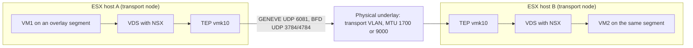
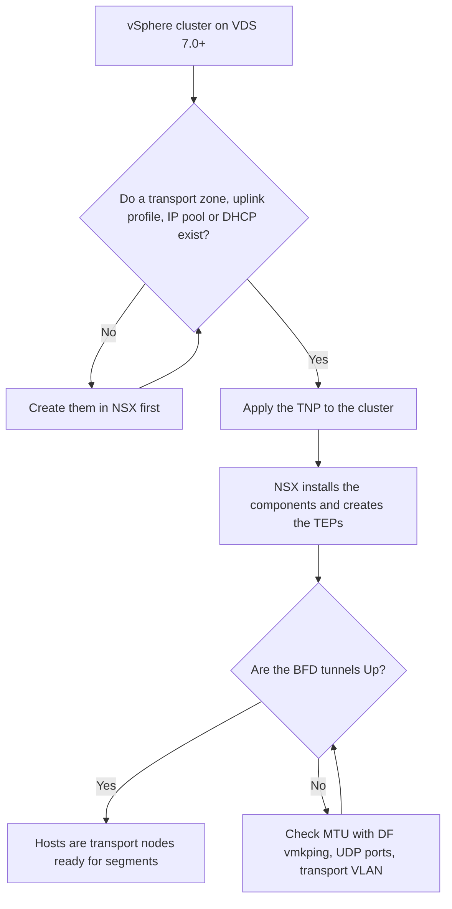

:::analogy
**The data center pain.** You installed NSX, created a segment, put two VMs (VM, Virtual Machine) on it on different hosts, and they cannot see each other. Ping between the hosts' TEP (TEP, Tunnel Endpoint) addresses works, so the network "looks fine". The real problem is elsewhere: a physical firewall blocks the tunnel ports, or the MTU (MTU, Maximum Transmission Unit) of the physical network is too small for encapsulated packets. [S455] [S453] For the exam, the VCF (VMware Cloud Foundation, 2V0-17.25) exam guide asks you to know the virtual networking components of VCF, and the former VCP-NV (VMware Certified Professional - Network Virtualization, 2V0-41.24) exam guide placed transport zones and host preparation under NSX architecture. [S03] [S48]

**The analogy: container shipping.**

- **The segment** is a virtual warehouse: everyone in it can exchange parcels directly.
- **The transport zone** is the map that says which cities (hosts) may have a branch of the warehouse.
- **The TEP** is each city's loading dock: there the parcel (the VM's frame) is put into a container (GENEVE, Generic Network Virtualization Encapsulation) addressed to the destination dock.
- **The underlay** is the highway: it does not know what is inside the containers, but it must be tall enough (MTU) for the container plus the parcel.
- **The uplink profile** says which highway lanes the containers leave on, and the **Transport Node Profile** is the manual applied identically in every city of a county (cluster).
:::

:::architecture
### 1. Transport zone: how far a segment reaches

A **transport zone** groups the transport nodes that can see the same segments; it defines the span of a segment. [S439] There are two types:

| Type | What it carries | Example | Source |
|---|---|---|---|
| Overlay | GENEVE-encapsulated segments between TEPs | Application networks, VPCs (VPC, Virtual Private Cloud) | [S439] |
| VLAN | Segments tied directly to a physical VLAN (VLAN, Virtual Local Area Network), without encapsulation | Edge uplinks to the physical routers | [S439] |

VCF 9 requires **one default Overlay transport zone**. You set it in NSX under System > Fabric > Transport Zones with the *Set as Default* action; in the API it shows as the `is_default` field. [S451]

### 2. TEP and GENEVE

Each transport node has at least one TEP: a VMkernel interface (on ESX usually `vmk10`, and the second TEP `vmk11`) that NSX creates automatically and dedicates to overlay traffic. [S462] The names can differ if the host already had other VMkernel interfaces. [S462] The TEP wraps the VM's frame in a GENEVE packet and sends it to the destination TEP across the physical network. [S439]

Encapsulation adds about **50 bytes** to every frame. [S464] That is where the MTU rule comes from:

| Where | Value | Source |
|---|---|---|
| Underlay, minimum | 1600 | [S454] [S453] |
| Underlay, recommended | 1700 | [S454] [S452] |
| Underlay, for maximum throughput | 9000 (jumbo frames) | [S454] |
| Global TEP MTU in NSX | default 1700 | [S454] |
| VDS (VDS, vSphere Distributed Switch) with NSX | recommended minimum 1700 | [S452] |
| MTU inside VMs | at least 100 bytes below the TEP MTU (200 preferred) | [S454] |

On a VDS, the MTU is set **on the VDS, in vCenter**; the MTU field of the uplink profile is not used for hosts on VDS. [S454] [S460]

**Tunnel ports.** Between all host and Edge TEP subnets, in both directions, allow: [S455]

| Port | What it is | Source |
|---|---|---|
| UDP (UDP, User Datagram Protocol) 6081 | GENEVE | [S455] |
| UDP 3784 | BFD (BFD, Bidirectional Forwarding Detection) control | [S455] |
| UDP 4784 | BFD echo | [S455] |

BFD runs between TEPs and tells whether a tunnel is up. If ICMP (ICMP, Internet Control Message Protocol) passes but the UDP ports are blocked, ping works and the tunnels stay **Down**. [S455] Another troubleshooting article also lists port 9785 for BFD on the Edge (`⚠ to verify`: it does not appear in The KB (Knowledge Base article) 455157). [S463]

### 3. Uplink profile and teaming

An **uplink profile** defines the teaming policy, active and standby uplinks, the transport VLAN and the MTU for a transport node's links. [S460] The **transport VLAN** tags overlay (TEP) traffic only. [S460]

| Teaming policy | How it works | ESX hosts | Edge | Source |
|---|---|---|---|---|
| Failover Order | One active uplink, the rest standby, no load balancing | Yes | Yes (Edge VM without standby) | [S460] |
| Load Balance Source | Each virtual interface is pinned to one active uplink; several active uplinks | Yes | Yes | [S460] |
| Load Balance Source MAC Address | Picks the uplink from a hash of the source MAC (MAC, Media Access Control) address | Yes | No | [S460] |
| LAG (LAG, Link Aggregation Group) with LACP (LACP, Link Aggregation Control Protocol) | Aggregation; on VDS 7.0+ it is configured in vCenter, not in NSX | Yes | Yes (with limits) | [S460] |

**How many TEPs a host gets** depends on the uplink profile: Failover Order (active/standby) or a single uplink mapped to overlay gives **one TEP**; two TEPs need a source-based policy with **two active uplinks**. [S462] [S461] A **named teaming policy** applies to VLAN segments only; segments without one use the default policy. [S460]

**Multi-TEP HA (HA, High Availability).** Since NSX 4.1, a TEP that stops passing traffic while its physical link stays up can be declared failed: BFD to its peers runs at one packet per second, and the VMs move to a healthy TEP. The feature is optional, ESX hosts only, and in 4.1 it is enabled only through the API. [S461]

### 4. Preparing hosts: the Transport Node Profile

A **TNP (Transport Node Profile)** is a template applied to a vSphere cluster: transport zones, VDS, uplink profile, TEP IP (IP, Internet Protocol) assignment and the mapping of physical NICs to uplinks. It does not prepare standalone hosts. [S457]

Prerequisites before applying it: [S457]

- the hosts are in a vCenter cluster and on a VDS 7.0 or later, with at least one uplink;
- a transport zone, an uplink profile and a configured compute manager exist;
- there is an IP pool for the TEPs or a DHCP (DHCP, Dynamic Host Configuration Protocol) server;
- the NSX Manager nodes are up.

A host moved into a prepared cluster is prepared automatically from the TNP; a host taken out of the cluster loses its NSX configuration. [S457] N-VDS on ESX is gone (lesson 4.1), so here you work only with VDS.

### 5. What is specific to VCF 9

| Situation | What happens | Source |
|---|---|---|
| Brownfield import with an existing vCenter | Hosts show only in the VLAN transport zone, without TEPs; this is by design, you edit the TNP for overlay | [S458] |
| vCenter import and NSX configuration | TEPs are missing; in the default cluster's TNP change IPv4 Assignment from *Use VMkernel Adapter* to *Use IP Pool* | [S456] |
| Cluster with vSphere Configuration Profiles but no applied configuration | Host preparation gets stuck (error 26248) | [S459] |

`[IMAGE SEARCH / PROMPT]` "NSX transport node TEP GENEVE overlay underlay diagram" and "NSX uplink profile load balance source multi TEP vmk10 vmk11".
:::

:::exam-alert
### Memorize

| What | Value / rule | Source |
|---|---|---|
| GENEVE | UDP 6081 | [S455] |
| BFD | UDP 3784 control, UDP 4784 echo | [S455] |
| GENEVE overhead | about 50 bytes | [S464] |
| Underlay MTU | minimum 1600, recommended 1700, 9000 for throughput | [S454] |
| Global TEP MTU | default 1700 | [S454] |
| MTU with VDS | set on the VDS in vCenter | [S454] |
| Transport VLAN | tags TEP traffic only | [S460] |
| VCF 9 | one default Overlay transport zone | [S451] |
| TNP | vSphere cluster only, needs VDS 7.0+ | [S457] |
| Two TEPs | source-based teaming, two active uplinks | [S462] |

### 3 exam traps

1. **"Ping between TEPs works, so the tunnels are fine."** False. ICMP can pass while GENEVE and BFD over UDP are blocked, so the tunnels stay Down. [S455]
2. **"On a host with VDS I change the MTU in the uplink profile."** False. For VDS the MTU is set on the VDS in vCenter; the uplink profile field is not used. [S454] [S460]
3. **"With Failover Order I get two TEPs per host."** False. Active/standby gives one TEP; two need source-based teaming with two active uplinks. [S462]
:::

:::trenches
### Mistake 1: tunnels Down after a new firewall

The security team puts a firewall between racks. Ping between TEPs works, but the tunnels between hosts and Edges are Down. [S455]
**Fix (KB 455157):** the network team explicitly allows UDP 6081, 3784 and 4784 in both directions between all host and Edge TEP subnets. [S455] To rule out the host firewall, KB 379112 shows how to stop it briefly with `esxcli network firewall set -e 0` and turn it back on with `esxcli network firewall set -e 1`; do not leave it off. [S463]

### Mistake 2: applications hang on large packets

Overlay VMs answer a simple ping, but large transfers hang; a ping with DF (Don't Fragment) set returns "frag needed and DF set (mtu = 1500)". [S464]
**Fix (KB 454346 and KB 440775):** test the path from the host with `vmkping ++netstack=vxlan -I vmkX -d -s 1572 <destination IP>` [S464], then raise the MTU on every physical port and routed interface along the path, to at least 1600, recommended 1700 or 9000. [S453] [S464] If the culprit is the global gateway interface left at 1500, change it under Networking > Global Networking Config. [S464]
:::

:::interview
**Junior/Mid question: "What is a transport zone and what is a TEP?"**

*Ideal answer:* a transport zone is the group of transport nodes that can see a segment, so it defines the segment's span; it can be Overlay or VLAN. [S439] A TEP is the VMkernel interface of a transport node that encapsulates VM traffic in GENEVE and sends it to the destination TEP. [S439] [S462] A good candidate adds the ports (UDP 6081 for GENEVE, 3784 and 4784 for BFD) and the MTU minimum of 1600, recommended 1700. [S455] [S454]

**Troubleshooting scenario: "After expanding a cluster, the new hosts have a single TEP and creating an Edge cluster fails the overlay checks. What do you do?"**

*The answer a Team Lead expects:*
1. **Check the uplink profile in the TNP**: if it is Failover Order active/standby or has a single uplink for overlay, the host gets only `vmk10`. [S462]
2. **Change the teaming** under System > Fabric > Profiles > Uplink Profiles to a source-based policy with exactly two active uplinks for overlay. [S462]
3. **Confirm with the network team** that the top-of-rack switches accept active/active and the overlay VLAN is trunked to both uplinks. [S462]
4. **Wait for the TNP sync** and check that `vmk11` appears. [S462]
5. **Test the tunnels** with `nsxdp-cli bfd sessions list` on the host, then retry creating the Edge cluster. [S463] [S462]
:::

:::lab
**Scenario.** You inspect how the lab hosts are prepared for NSX: transport zones, uplink profile, TNP, the TEPs on each host, then you test the MTU and the state of the BFD tunnels.

**What you need.** A VCF 9 lab with NSX and at least two hosts prepared for overlay, access to NSX Manager, vCenter and SSH (Secure Shell) on the hosts. The lab already exists.

The steps below can be ticked off, and progress is saved in the browser. Exact menu names may differ slightly between versions (`⚠ to verify`).

**Home lab only / not supported.** An underlay with MTU 1600 works in a lab, but the recommendation is 1700 or 9000. [S454] Turning off the ESX firewall is only a short diagnostic test; turn it back on right away. [S463]

**Failure test and validation.** Run `vmkping` with DF and a size larger than the underlay MTU allows: it must fail, while `-s 1572` on a 1600 path must pass. [S463] Work out the maximum size for other MTUs as MTU minus 28 bytes (the IP and ICMP headers), for example 1672 for 1700 (`⚠ to verify`: my own calculation, not from a source).
:::

:::quiz
Five original questions in VCP exam style. You get the explanation for every option right after you answer.
:::

:::references
- The VCP-VCF 2V0-17.25 exam guide [S03] and the former VCP-NV 2V0-41.24 exam guide [S48]
- NSX 4.1 documentation: key concepts [S439], MTU [S454], TNP [S457], uplink profile [S460]
- NSX TechZone: Multi-TEP High Availability [S461]
- KB 439410 (default transport zone) [S451], KB 440927 and KB 440775 (MTU) [S452] [S453], KB 455157 (ports) [S455]
- KB 436531, KB 444225 and KB 414651 (host preparation in VCF 9) [S456] [S458] [S459]
- KB 431712 (missing vmk11) [S462], KB 379112 (TEP/BFD troubleshooting) [S463], KB 454346 (ping with DF) [S464]
:::
