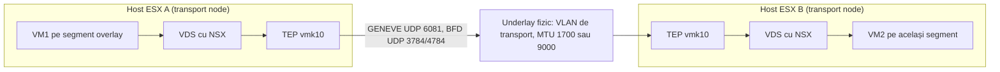
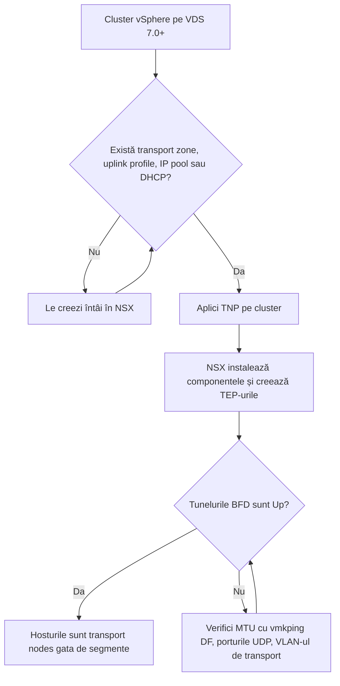

:::analogy
**Durerea din data center.** Ai instalat NSX, ai creat un segment, ai pus două VM-uri (VM, Virtual Machine) pe el, pe hosturi diferite, și nu se văd. Ping-ul între adresele TEP (TEP, Tunnel Endpoint) ale hosturilor merge, deci rețeaua „pare bună”. Problema reală e alta: un firewall fizic blochează porturile tunelurilor sau MTU-ul (MTU, Maximum Transmission Unit) din rețeaua fizică e prea mic pentru pachetele încapsulate. [S455] [S453] Pentru examen, exam guide-ul VCF (VMware Cloud Foundation, 2V0-17.25) cere să știi componentele rețelei virtuale din VCF, iar fostul exam guide VCP-NV (VMware Certified Professional - Network Virtualization, 2V0-41.24) punea transport zones și pregătirea hosturilor la arhitectura NSX. [S03] [S48]

**Analogia: curieratul cu containere.**

- **Segmentul** e un depozit virtual: toți cei din el pot schimba colete direct.
- **Transport zone** e harta pe care scrie ce orașe (hosturi) au voie să aibă o filială a depozitului.
- **TEP-ul** e rampa de încărcare a fiecărui oraș: acolo coletul (cadrul VM-ului) e pus într-un container (GENEVE, Generic Network Virtualization Encapsulation) cu adresa rampei de destinație.
- **Underlay-ul** e autostrada: nu știe ce e în containere, dar trebuie să fie destul de înaltă (MTU) ca să treacă containerul cu tot cu colet.
- **Uplink profile** spune pe ce benzi ale autostrăzii pleacă containerele, iar **Transport Node Profile** e manualul aplicat identic în toate orașele unui județ (cluster).
:::

:::architecture
### 1. Transport zone: până unde ajunge un segment

O **transport zone** grupează transport nodes care pot vedea aceleași segmente; ea definește întinderea (span) unui segment. [S439] Există două tipuri:

| Tip | Ce transportă | Exemplu | Sursă |
|---|---|---|---|
| Overlay | Segmente încapsulate GENEVE între TEP-uri | Rețelele aplicațiilor, VPC-uri (VPC, Virtual Private Cloud) | [S439] |
| VLAN | Segmente legate direct de un VLAN (VLAN, Virtual Local Area Network) fizic, fără încapsulare | Uplink-urile Edge spre routerele fizice | [S439] |

În VCF 9 trebuie să existe **o transport zone Overlay implicită**. O setezi în NSX din System > Fabric > Transport Zones, cu acțiunea *Set as Default*; în API apare câmpul `is_default`. [S451]

### 2. TEP și GENEVE

Fiecare transport node are cel puțin un TEP: o interfață VMkernel (pe ESX de obicei `vmk10`, iar al doilea TEP `vmk11`) creată automat de NSX și dedicată traficului overlay. [S462] Numele pot fi altele dacă pe host existau deja alte interfețe VMkernel. [S462] TEP-ul pune cadrul VM-ului într-un pachet GENEVE și îl trimite TEP-ului destinație peste rețeaua fizică. [S439]

Încapsularea adaugă aproximativ **50 de octeți** la fiecare cadru. [S464] De aici vine regula de MTU:

| Unde | Valoare | Sursă |
|---|---|---|
| Underlay, minim | 1600 | [S454] [S453] |
| Underlay, recomandat | 1700 | [S454] [S452] |
| Underlay, pentru throughput maxim | 9000 (jumbo frames) | [S454] |
| MTU-ul global al TEP-urilor în NSX | implicit 1700 | [S454] |
| VDS-ul (VDS, vSphere Distributed Switch) cu NSX | minim recomandat 1700 | [S452] |
| MTU-ul din VM-uri | cu cel puțin 100 de octeți sub MTU-ul TEP (de preferat 200) | [S454] |

Pe un VDS, MTU-ul se setează **pe VDS, în vCenter**; câmpul MTU din uplink profile nu se folosește pentru hosturile cu VDS. [S454] [S460]

**Porturile tunelurilor.** Între toate subrețelele TEP ale hosturilor și Edge-urilor, în ambele sensuri, trebuie permise: [S455]

| Port | Ce e | Sursă |
|---|---|---|
| UDP (UDP, User Datagram Protocol) 6081 | GENEVE | [S455] |
| UDP 3784 | BFD (BFD, Bidirectional Forwarding Detection) control | [S455] |
| UDP 4784 | BFD echo | [S455] |

BFD rulează între TEP-uri și spune dacă un tunel e sus. Dacă ICMP-ul (ICMP, Internet Control Message Protocol) trece, dar porturile UDP sunt blocate, ping-ul merge și tunelurile rămân **Down**. [S455] Un alt articol de troubleshooting mai menționează și portul 9785 pentru BFD pe Edge (`⚠ de verificat`: nu apare în Articolul KB (Knowledge Base article) 455157). [S463]

### 3. Uplink profile și teaming

**Uplink profile** definește politica de teaming, uplink-urile active și standby, VLAN-ul de transport și MTU-ul pentru legăturile unui transport node. [S460] **VLAN-ul de transport** etichetează doar traficul overlay (al TEP-urilor). [S460]

| Politică de teaming | Cum lucrează | Hosturi ESX | Edge | Sursă |
|---|---|---|---|---|
| Failover Order | Un uplink activ, restul standby, fără load balancing | Da | Da (Edge VM fără standby) | [S460] |
| Load Balance Source | Fiecare interfață virtuală e legată de un uplink activ; mai multe uplink-uri active | Da | Da | [S460] |
| Load Balance Source MAC Address | Alege uplink-ul după hash-ul adresei MAC (MAC, Media Access Control) sursă | Da | Nu | [S460] |
| LAG (LAG, Link Aggregation Group) cu LACP (LACP, Link Aggregation Control Protocol) | Agregare; pe VDS 7.0+ se configurează în vCenter, nu în NSX | Da | Da (cu limite) | [S460] |

**Câte TEP-uri primește hostul** depinde de uplink profile: Failover Order (activ/standby) sau un singur uplink mapat la overlay dă **un TEP**; două TEP-uri cer o politică bazată pe sursă cu **două uplink-uri active**. [S462] [S461] O **named teaming policy** se aplică doar segmentelor VLAN; segmentele fără ea folosesc politica implicită. [S460]

**Multi-TEP HA (HA, High Availability).** Din NSX 4.1, un TEP care nu mai trimite trafic deși legătura fizică e sus poate fi declarat căzut: BFD-ul către peer-i rulează la un pachet pe secundă, iar VM-urile se mută pe un TEP sănătos. Funcția e opțională, doar pentru hosturi ESX, iar în 4.1 se activează doar din API. [S461]

### 4. Pregătirea hosturilor: Transport Node Profile

Un **TNP (Transport Node Profile)** e un șablon aplicat unui cluster vSphere: transport zones, VDS, uplink profile, alocarea IP (IP, Internet Protocol) a TEP-urilor și maparea plăcilor fizice la uplink-uri. Nu pregătește hosturi standalone. [S457]

Condiții înainte de aplicare: [S457]

- hosturile sunt într-un cluster vCenter și pe un VDS 7.0 sau mai nou, cu cel puțin un uplink;
- există o transport zone, un uplink profile și un compute manager configurat;
- există un IP pool pentru TEP-uri sau un server DHCP (DHCP, Dynamic Host Configuration Protocol);
- nodurile NSX Manager sunt pornite.

Un host mutat într-un cluster pregătit e pregătit automat după TNP; un host scos din cluster își pierde configurația NSX. [S457] N-VDS-ul pe ESX a dispărut (lecția 4.1), deci aici lucrezi doar cu VDS.

### 5. Ce e specific în VCF 9

| Situație | Ce se întâmplă | Sursă |
|---|---|---|
| Import brownfield cu vCenter existent | Hosturile apar doar în transport zone VLAN, fără TEP; e comportament prin design, editezi TNP-ul pentru overlay | [S458] |
| Import vCenter și configurare NSX | Lipsesc TEP-urile; în TNP-ul clusterului implicit schimbi IPv4 Assignment din *Use VMkernel Adapter* în *Use IP Pool* | [S456] |
| Cluster cu vSphere Configuration Profiles fără configurație aplicată | Pregătirea hosturilor se blochează (eroarea 26248) | [S459] |

`[IMAGE SEARCH / PROMPT]` „NSX transport node TEP GENEVE overlay underlay diagram” și „NSX uplink profile load balance source multi TEP vmk10 vmk11”.
:::

:::exam-alert
### De memorat

| Ce | Valoare / regulă | Sursă |
|---|---|---|
| GENEVE | UDP 6081 | [S455] |
| BFD | UDP 3784 control, UDP 4784 echo | [S455] |
| Overhead GENEVE | aproximativ 50 de octeți | [S464] |
| MTU underlay | minim 1600, recomandat 1700, 9000 pentru throughput | [S454] |
| MTU global TEP | implicit 1700 | [S454] |
| MTU cu VDS | se setează pe VDS în vCenter | [S454] |
| Transport VLAN | etichetează doar traficul TEP | [S460] |
| VCF 9 | o transport zone Overlay implicită | [S451] |
| TNP | doar pe cluster vSphere, cere VDS 7.0+ | [S457] |
| Două TEP-uri | teaming bazat pe sursă, două uplink-uri active | [S462] |

### 3 capcane de examen

1. **„Ping-ul între TEP-uri merge, deci tunelurile sunt bune.”** Fals. ICMP poate trece, iar GENEVE și BFD pe UDP pot fi blocate, așa că tunelurile rămân Down. [S455]
2. **„Pe un host cu VDS schimb MTU-ul din uplink profile.”** Fals. Pentru VDS, MTU-ul se setează pe VDS în vCenter; câmpul din uplink profile nu se folosește. [S454] [S460]
3. **„Cu Failover Order primesc două TEP-uri pe host.”** Fals. Activ/standby dă un singur TEP; două cer un teaming bazat pe sursă cu două uplink-uri active. [S462]
:::

:::trenches
### Greșeala 1: tuneluri Down după un firewall nou

Echipa de securitate pune un firewall între rack-uri. Ping-ul dintre TEP-uri merge, dar tunelurile dintre hosturi și Edge-uri sunt Down. [S455]
**Remediere (KB 455157):** echipa de rețea permite explicit UDP 6081, 3784 și 4784 în ambele sensuri, între toate subrețelele TEP ale hosturilor și Edge-urilor. [S455] Ca să excluzi firewall-ul hostului, KB 379112 arată cum îl oprești temporar cu `esxcli network firewall set -e 0` și îl repornești cu `esxcli network firewall set -e 1`; nu-l lăsa oprit. [S463]

### Greșeala 2: aplicațiile se blochează la pachete mari

VM-urile de pe overlay merg la ping simplu, dar transferurile mari se blochează; ping-ul cu DF (Don't Fragment) setat dă „frag needed and DF set (mtu = 1500)”. [S464]
**Remediere (KB 454346 și KB 440775):** testezi drumul de la host cu `vmkping ++netstack=vxlan -I vmkX -d -s 1572 <IP destinație>` [S464], apoi ridici MTU-ul pe toate porturile fizice și interfețele rutate din drum, la minim 1600, recomandat 1700 sau 9000. [S453] [S464] Dacă problema e la interfața gateway-ului global rămasă la 1500, o schimbi din Networking > Global Networking Config. [S464]
:::

:::interview
**Întrebare Junior/Mid: „Ce e o transport zone și ce e un TEP?”**

*Răspunsul ideal:* transport zone e grupul de transport nodes care pot vedea un segment, deci definește întinderea lui; poate fi Overlay sau VLAN. [S439] TEP-ul e interfața VMkernel a unui transport node care încapsulează traficul VM-urilor în GENEVE și îl trimite la TEP-ul destinație. [S439] [S462] Un candidat bun adaugă porturile (UDP 6081 pentru GENEVE, 3784 și 4784 pentru BFD) și MTU-ul minim de 1600, recomandat 1700. [S455] [S454]

**Scenariu de troubleshooting: „După expansiunea unui cluster, hosturile noi au un singur TEP, iar crearea unui Edge cluster eșuează la verificările de overlay. Ce faci?”**

*Răspunsul pe care îl așteaptă un Team Lead:*
1. **Verifici uplink profile-ul din TNP**: dacă e Failover Order activ/standby sau are un singur uplink pentru overlay, hostul primește doar `vmk10`. [S462]
2. **Schimbi teaming-ul** în System > Fabric > Profiles > Uplink Profiles pe o politică bazată pe sursă, cu exact două uplink-uri active pentru overlay. [S462]
3. **Confirmi cu echipa de rețea** că switch-urile top-of-rack acceptă activ/activ și că VLAN-ul de overlay e pe ambele uplink-uri. [S462]
4. **Aștepți sincronizarea TNP** și verifici că apare `vmk11`. [S462]
5. **Testezi tunelurile** cu `nsxdp-cli bfd sessions list` pe host, apoi reîncerci crearea Edge clusterului. [S463] [S462]
:::

:::lab
**Scenariu.** Inspectezi cum sunt pregătite hosturile din lab pentru NSX: transport zones, uplink profile, TNP, TEP-urile de pe fiecare host, apoi testezi MTU-ul și starea tunelurilor BFD.

**Ce ai nevoie.** Un lab VCF 9 cu NSX și cel puțin două hosturi pregătite pentru overlay, acces la NSX Manager, vCenter și SSH (Secure Shell) pe hosturi. Lab-ul există deja.

Pașii de mai jos sunt bifabili, iar progresul se salvează în browser. Numele exacte ale meniurilor pot diferi puțin între versiuni (`⚠ de verificat`).

**Home lab only / not supported.** Un underlay cu MTU 1600 merge în lab, dar recomandarea e 1700 sau 9000. [S454] Oprirea firewall-ului ESX e doar un test scurt de diagnostic; îl repornești imediat. [S463]

**Test de avarie și validare.** Rulează `vmkping` cu DF și o mărime care depășește MTU-ul underlay-ului: trebuie să eșueze, iar cu `-s 1572` pe un drum de 1600 trebuie să treacă. [S463] Mărimea maximă pentru alte MTU-uri o calculezi ca MTU minus 28 de octeți (antetul IP și ICMP), de exemplu 1672 pentru 1700 (`⚠ de verificat`: calcul propriu, nu din sursă).
:::

:::quiz
Cinci întrebări originale, în stilul examenelor VCP. Primești explicația pentru fiecare variantă imediat după ce răspunzi.
:::

:::references
- Exam guide-ul VCP-VCF 2V0-17.25 [S03] și fostul exam guide VCP-NV 2V0-41.24 [S48]
- Documentația NSX 4.1: conceptele de bază [S439], MTU [S454], TNP [S457], uplink profile [S460]
- NSX TechZone: Multi-TEP High Availability [S461]
- KB 439410 (transport zone implicită) [S451], KB 440927 și KB 440775 (MTU) [S452] [S453], KB 455157 (porturi) [S455]
- KB 436531, KB 444225 și KB 414651 (pregătirea hosturilor în VCF 9) [S456] [S458] [S459]
- KB 431712 (vmk11 lipsă) [S462], KB 379112 (troubleshooting TEP/BFD) [S463], KB 454346 (ping cu DF) [S464]
:::
