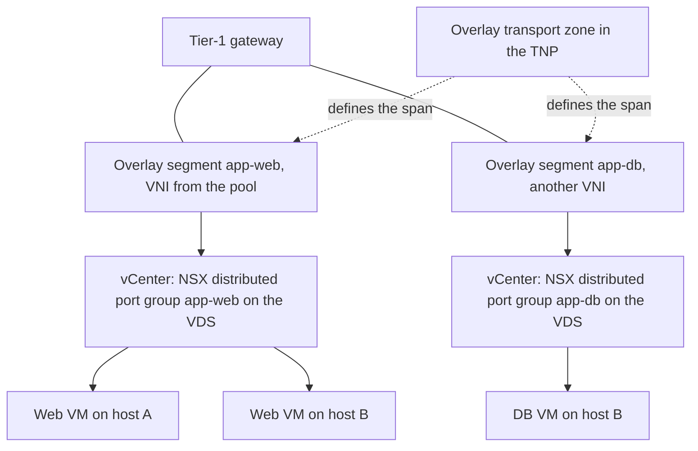
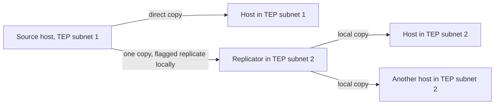

:::analogy
**The data center pain.** You created a new segment in NSX, you look for it in vCenter to attach a VM (VM, Virtual Machine) and it is not there. Or it is there, the VM boots, but the second IP (IP, Internet Protocol) of an application cluster does not answer, because NSX learns only one address per port by default. [S479] [S471] For the exam, the VCF (VMware Cloud Foundation, 2V0-17.25) exam guide asks you to know the virtual networking components, and the former VCP-NV (VMware Certified Professional - Network Virtualization, 2V0-41.24) exam guide had a separate objective for logical switching. [S03] [S48]

**The analogy: floors of an office building.**

- **The segment** is a floor: people on the same floor talk directly, without going through reception (the router).
- **The transport zone** is the list of buildings where that floor exists.
- **Overlay** means the floor is "virtual": people in different buildings seem to be on the same floor because a tunnel lift links them (GENEVE, Generic Network Virtualization Encapsulation). **VLAN** (Virtual Local Area Network) means the floor is actually built in the physical building.
- **BUM replication** (BUM, Broadcast, Unknown unicast and Multicast) is the loudspeaker announcement: someone has to carry it to every building. Either the speaker carries it to each one (Head), or one person per neighborhood carries it and repeats it locally (Hierarchical Two-Tier).
- **Segment profiles** are the floor rules: who may change their badge (MAC, Media Access Control), how many names one person may have (learned IPs), who is checked at the door (SpoofGuard).
:::

:::architecture
### 1. What a segment is

A **segment** is a virtual layer 2 domain (formerly a *logical switch*). Its type comes from the transport zone: [S466]

| Type | How it works | What the physical network needs | Source |
|---|---|---|---|
| VLAN-backed | Traffic goes straight onto a physical VLAN | The VLAN must exist on the switches | [S466] |
| Overlay-backed | Traffic goes through GENEVE tunnels between TEPs (TEP, Tunnel Endpoint) | Nothing beyond the underlay | [S466] |

Each overlay segment gets a VNI (VNI, Virtual Network Identifier) from a default pool. [S466] By default there is one pool with two ranges, 5000–65535 and 65536–75000; system-created pools cannot be updated or deleted through the API, and new ranges must not overlap. [S468] An overlay segment learns at most 2048 remote MAC addresses by default; the limit can be changed through the API. [S466]

### 2. Creating a segment

In NSX Manager: Networking > Segments > Add Segment. [S465] [S480]

| Field | What you choose | Rule | Source |
|---|---|---|---|
| Connectivity | None, Tier-1 or Tier-0 | You change the gateway only within the same transport zone | [S465] |
| Subnet | The gateway IP in CIDR (CIDR, Classless Inter-Domain Routing) format | Required when attached to a gateway; must not overlap other segments | [S465] |
| Transport zone | Overlay or VLAN | Decides the segment type | [S465] |
| VLAN | One ID (VLAN segment) or a range | A range enables guest VLAN tagging | [S465] |
| Uplink teaming policy | A named teaming policy | VLAN segments only; overlay always uses the default policy | [S465] [S460] |
| DHCP (DHCP, Dynamic Host Configuration Protocol) | Set DHCP Config | Unattached and VLAN segments support only the Segment DHCP server; one DHCPv4 relay or service per segment | [S465] |

A segment with Connectivity *None* is good for local tests or isolated workloads in the same subnet. [S465]

### 3. How the segment appears in vCenter

On a VDS (VDS, vSphere Distributed Switch), each segment appears as an **NSX distributed port group** with NSX backing and ports that are always *ephemeral*; for VMs there is no functional difference. [S477] If the transport zone spans several VDS switches, there is one port group per VDS, with the same name. [S477] vCenter cannot create a port group with the name of an existing NSX port group. [S477]

A segment **appears in vCenter only if its transport zone is in the cluster's TNP (TNP, Transport Node Profile)**; a VDS can have only one overlay transport zone. [S479] [S457] In a VDS backup from vCenter, NSX port groups are not exported: after a restore, inventory sync with NSX recreates them. [S478]

### 4. BUM traffic replication

BUM traffic on an overlay segment must be copied to every TEP that has that VNI. NSX has two modes: [S467]

| Mode | How it works | Source |
|---|---|---|
| Hierarchical Two-Tier (also called MTEP) | The source host sends copies directly to TEPs in its own subnet; for each remote TEP subnet it sends one copy to a replicator, which repeats it locally. **The default mode.** | [S467] |
| Head (also called source or headend) | The source host sends a copy to every TEP that has the VNI | [S467] |

If all TEPs are in the same subnet, both modes behave the same. [S467] Broadcom recommends Hierarchical Two-Tier as best practice. [S476]

### 5. Segment profiles

Segment profiles hold layer 2 settings for segments and ports. Types: QoS (Quality of Service), IP Discovery, SpoofGuard, Segment Security and MAC Discovery. [S469] A segment or port has at most one profile of each type. [S469] **Default profiles cannot be edited or deleted**: you create your own profile and bind it to the segment, from Networking > Segments > Segment Profiles. [S469] [S470]

| Profile | What it does | Values to remember | Source |
|---|---|---|---|
| IP Discovery | Learns VM IPs and MACs through ARP (ARP, Address Resolution Protocol) or ND (Neighbor Discovery) snooping, DHCP snooping and VM Tools; feeds them to SpoofGuard and the firewall | ARP snooping in *trust on first use* mode by default; ARP Binding Limit default 1, from 1 to 256 | [S472] [S471] |
| MAC Discovery | MAC change and MAC learning (for nested hypervisors) | MAC Limit 4096; limit policy Drop or Allow; aging 600 (not configurable) | [S473] [S474] |
| SpoofGuard | Blocks traffic from unauthorized IP or MAC addresses | Recommended when you enable MAC learning or MAC change | [S473] |
| Segment Security | Layer 2 protections on the segment (details in the security lesson) | `⚠ to verify`: the settings are not in the sources read here | [S469] |
| QoS | Traffic prioritization | | [S469] |

On MAC Discovery defaults the pages differ: the page for creating a profile shows MAC Change and MAC Learning disabled, while the overview page says MAC Change is enabled in the default profile (`⚠ to verify` in your lab). [S474] [S473]

`[IMAGE SEARCH / PROMPT]` "NSX segment overlay VLAN backed diagram" and "NSX hierarchical two-tier replication BUM MTEP".
:::

:::exam-alert
### Memorize

| What | Value / rule | Source |
|---|---|---|
| Segment type | Comes from the transport zone (Overlay or VLAN) | [S465] |
| Subnet | Required with Tier-0 or Tier-1, in CIDR | [S465] |
| Named teaming | VLAN segments only | [S465] |
| Default VNI pool | 5000–65535 and 65536–75000 | [S468] |
| Default replication | Hierarchical Two-Tier | [S467] |
| In vCenter | NSX distributed port group, ephemeral | [S477] |
| Segment missing in vCenter | The transport zone is not in the TNP | [S479] |
| Default profiles | Read-only, create your own profile | [S470] |
| ARP Binding Limit | Default 1 (1–256) | [S471] |
| MAC Limit | 4096 | [S473] |

### 3 exam traps

1. **"I put a named teaming policy on an overlay segment to choose its uplink."** False. Named teaming is for VLAN segments only; overlay uses the default policy. [S465]
2. **"Head replication is the default mode."** False. The default is Hierarchical Two-Tier. [S467]
3. **"I edit the default IP Discovery profile to raise the ARP Binding Limit."** False. Default profiles are read-only; you create a new one and apply it to the segment or port. [S470] [S471]
:::

:::trenches
### Mistake 1: an application cluster's virtual IP does not answer

Two VMs in an application cluster share a virtual IP that moves between them. After moving to an NSX segment, the virtual IP stops answering, because NSX learns only one address per port by default, and SpoofGuard may drop traffic from the second. [S471]
**Fix (The KB (Knowledge Base article) 431548):** create a new IP Discovery profile with an ARP Binding Limit of at least 2 and apply it to the segment or port. [S471]

### Mistake 2: segment created but invisible in vCenter

The segment is realized in NSX but does not appear in the vCenter network inventory. Cause: the segment's transport zone is not in the TNP applied to the cluster. [S479]
**Fix (KB 374217):** find the cluster's TNP, add the missing transport zone on the host switch (a VDS accepts only one overlay transport zone, so remove the old one if you replace it) and apply; then check the vCenter inventory. [S479]
:::

:::interview
**Junior/Mid question: "What is the difference between an overlay segment and a VLAN segment?"**

*Ideal answer:* the type comes from the transport zone. A VLAN segment puts traffic straight onto a physical VLAN, which must exist on the switches. An overlay segment sends traffic through GENEVE tunnels between TEPs and needs nothing new in the physical network; it gets a VNI from the pool. [S466] [S465] A good candidate adds that VLAN segments can use named teaming while overlay segments cannot. [S465]

**Troubleshooting scenario: "On a nested ESX on an NSX segment, the inner VMs have no network. What do you do?"**

*The answer a Team Lead expects:*
1. **Understand the cause**: the inner VMs send frames with MACs the segment port does not expect. [S473]
2. **Create a MAC Discovery profile** with MAC Learning on, because the default one cannot be edited. [S473] [S470]
3. **Also enable SpoofGuard**, as the documentation recommends when you turn on MAC learning. [S473]
4. **Apply the profile** to the segment or only to the nested VM's port. [S469]
5. **If it still fails**, check that the profile is really realized on the port; NSX 3.2.x has a known issue fixed by re-applying the profile binding (KB 390855). [S475]
:::

:::lab
**Scenario.** You create two overlay segments attached to an existing Tier-1, see them in vCenter, check their VNIs and replication mode, then create your own IP Discovery profile and apply it to a segment.

**What you need.** A VCF 9 lab with NSX, hosts prepared for overlay (lesson 4.2), a Tier-1 gateway and two test VMs. The lab already exists; if you do not have a Tier-1 yet, use Connectivity *None* and test only within the same subnet.

The steps below can be ticked off, and progress is saved in the browser. Exact menu names may differ slightly between versions (`⚠ to verify`).

**Home lab only / not supported.** MAC learning for nested ESX is a lab solution; in production you do not run nested hypervisors on NSX segments without a clear reason. [S473]

**Failure test and validation.** Give a VM a second IP on the same network adapter and check whether it answers before and after applying the profile with ARP Binding Limit 2. [S471]
:::

:::quiz
Five original questions in VCP exam style. You get the explanation for every option right after you answer.
:::

:::references
- The VCP-VCF 2V0-17.25 exam guide [S03] and the former VCP-NV 2V0-41.24 exam guide [S48]
- NSX documentation: segments [S466], Add a Segment [S465], BUM replication [S467], segment profiles [S469], IP Discovery [S472], MAC Discovery [S473] [S474]
- NSX API 9.1.0: VNI pools [S468]
- KB 441325 (default profiles) [S470], KB 431548 (ARP Binding Limit) [S471], KB 390855 (MAC learning) [S475]
- KB 320145 (NSX on VDS) [S477], KB 392325 (VDS backup) [S478], KB 374217 (segments missing in vCenter) [S479]
- KB 386030 (replication mode) [S476] and KB 447371 (creating a segment in VCF 9.0) [S480]
:::
