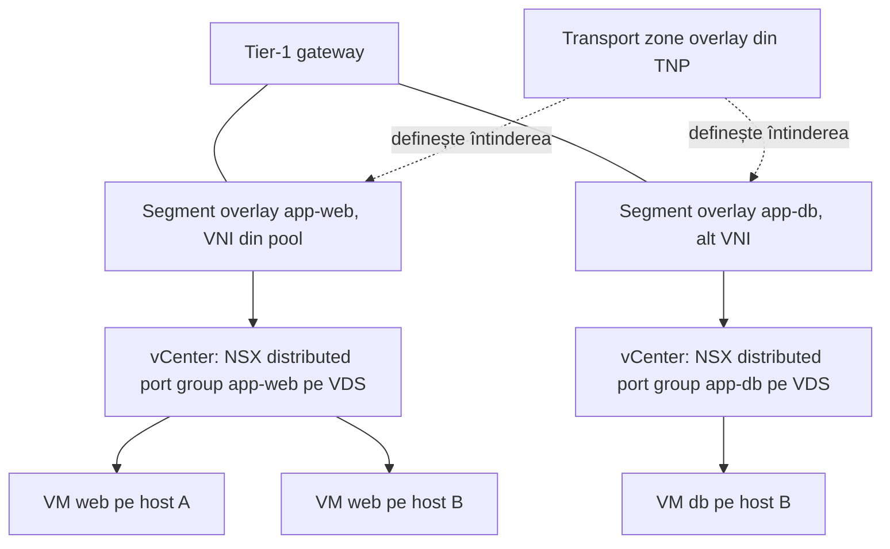
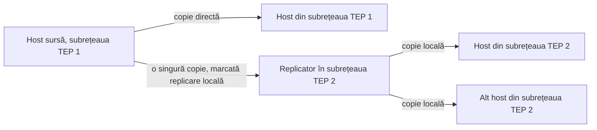

:::analogy
**Durerea din data center.** Ai creat un segment nou în NSX, îl cauți în vCenter ca să legi o VM (VM, Virtual Machine) de el și nu apare. Sau apare, VM-ul pornește, dar al doilea IP (IP, Internet Protocol) al unui cluster de aplicații nu răspunde, pentru că NSX învață implicit o singură adresă pe port. [S479] [S471] Pentru examen, exam guide-ul VCF (VMware Cloud Foundation, 2V0-17.25) cere să știi componentele rețelei virtuale, iar fostul exam guide VCP-NV (VMware Certified Professional - Network Virtualization, 2V0-41.24) avea un obiectiv separat pentru switching-ul logic. [S03] [S48]

**Analogia: etajele unei clădiri de birouri.**

- **Segmentul** e un etaj: cine e pe același etaj vorbește direct, fără să treacă pe la recepție (router).
- **Transport zone** e lista clădirilor în care există acel etaj.
- **Overlay** înseamnă că etajul e „virtual”: oamenii din clădiri diferite par pe același etaj, pentru că un lift-tunel îi leagă (GENEVE, Generic Network Virtualization Encapsulation). **VLAN** (Virtual Local Area Network) înseamnă că etajul e chiar construit în clădirea fizică.
- **Replicarea BUM** (BUM, Broadcast, Unknown unicast and Multicast) e anunțul la megafon: cineva trebuie să-l ducă în toate clădirile. Fie îl duce chiar vorbitorul în fiecare (Head), fie îl duce câte un om în fiecare cartier, care îl repetă local (Hierarchical Two-Tier).
- **Segment profiles** sunt regulile etajului: cine are voie să-și schimbe ecusonul (MAC, Media Access Control), câte nume poate avea un om (IP-uri învățate), cine e verificat la intrare (SpoofGuard).
:::

:::architecture
### 1. Ce e un segment

Un **segment** e un domeniu virtual de nivel 2 (fostul *logical switch*). Tipul lui vine din transport zone: [S466]

| Tip | Cum funcționează | Ce cere rețeaua fizică | Sursă |
|---|---|---|---|
| VLAN-backed | Traficul iese direct pe un VLAN fizic | VLAN-ul trebuie să existe pe switch-uri | [S466] |
| Overlay-backed | Traficul trece prin tuneluri GENEVE între TEP-uri (TEP, Tunnel Endpoint) | Nimic în plus față de underlay | [S466] |

Fiecare segment overlay primește un VNI (VNI, Virtual Network Identifier) dintr-un pool implicit. [S466] Implicit există un pool cu două intervale, 5000–65535 și 65536–75000; pool-urile create de sistem nu se pot modifica sau șterge din API, iar intervalele noi nu au voie să se suprapună. [S468] Un segment overlay învață implicit cel mult 2048 de adrese MAC de la distanță; limita se schimbă din API. [S466]

### 2. Crearea unui segment

În NSX Manager: Networking > Segments > Add Segment. [S465] [S480]

| Câmp | Ce alegi | Regulă | Sursă |
|---|---|---|---|
| Connectivity | None, Tier-1 sau Tier-0 | Schimbi gateway-ul doar dacă e în aceeași transport zone | [S465] |
| Subnet | IP-ul gateway-ului în format CIDR (CIDR, Classless Inter-Domain Routing) | Obligatoriu dacă e legat de un gateway; nu se suprapune cu alte segmente | [S465] |
| Transport zone | Overlay sau VLAN | Decide tipul segmentului | [S465] |
| VLAN | Un ID (segment VLAN) sau un interval | Intervalul activează guest VLAN tagging | [S465] |
| Uplink teaming policy | O named teaming policy | Doar pe segmente VLAN; overlay folosește mereu politica implicită | [S465] [S460] |
| DHCP (DHCP, Dynamic Host Configuration Protocol) | Set DHCP Config | Segmentele neconectate și cele VLAN suportă doar Segment DHCP server; un singur relay sau serviciu DHCPv4 pe segment | [S465] |

Un segment cu Connectivity *None* e bun pentru teste locale sau workload-uri izolate în aceeași subrețea. [S465]

### 3. Cum apare segmentul în vCenter

Pe un VDS (VDS, vSphere Distributed Switch), fiecare segment apare ca un **NSX distributed port group**, cu backing NSX și porturi mereu *ephemeral*; pentru VM-uri nu e nicio diferență funcțională. [S477] Dacă transport zone-ul se întinde pe mai multe VDS-uri, apare câte un port group pe fiecare VDS, cu același nume. [S477] vCenter nu poate crea un port group cu numele unui port group NSX existent. [S477]

Segmentul **apare în vCenter doar dacă transport zone-ul lui e în TNP-ul (TNP, Transport Node Profile) clusterului**; un VDS poate avea o singură transport zone overlay. [S479] [S457] La un backup de VDS din vCenter, port group-urile NSX nu se exportă: după restaurare le recreează sincronizarea inventarului cu NSX. [S478]

### 4. Replicarea traficului BUM

Traficul BUM de pe un segment overlay trebuie copiat la toți TEP-urii care au acel VNI. NSX are două moduri: [S467]

| Mod | Cum lucrează | Sursă |
|---|---|---|
| Hierarchical Two-Tier (numit și MTEP) | Hostul sursă trimite copii direct TEP-urilor din subrețeaua lui; pentru fiecare subrețea TEP la distanță trimite o singură copie unui replicator, care o repetă local. **Modul implicit.** | [S467] |
| Head (numit și source sau headend) | Hostul sursă trimite câte o copie fiecărui TEP care are VNI-ul | [S467] |

Dacă toți TEP-urii sunt în aceeași subrețea, cele două moduri se comportă la fel. [S467] Broadcom recomandă Hierarchical Two-Tier ca bună practică. [S476]

### 5. Segment profiles

Segment profiles țin setările de nivel 2 pentru segmente și porturi. Tipuri: QoS (Quality of Service), IP Discovery, SpoofGuard, Segment Security și MAC Discovery. [S469] Un segment sau port are cel mult un profil din fiecare tip. [S469] **Profilele implicite nu se pot edita sau șterge**: creezi un profil propriu și îl legi de segment, din Networking > Segments > Segment Profiles. [S469] [S470]

| Profil | Ce face | Valori de reținut | Sursă |
|---|---|---|---|
| IP Discovery | Învață IP-urile și MAC-urile VM-urilor prin ARP (ARP, Address Resolution Protocol) sau ND (Neighbor Discovery) snooping, DHCP snooping și VM Tools; le dă la SpoofGuard și la firewall | ARP snooping în mod *trust on first use* implicit; ARP Binding Limit implicit 1, între 1 și 256 | [S472] [S471] |
| MAC Discovery | MAC change și MAC learning (pentru hypervisoare nested) | MAC Limit 4096; politică la limită Drop sau Allow; aging 600 (necontrolabil) | [S473] [S474] |
| SpoofGuard | Blochează traficul de pe adrese IP sau MAC neautorizate | Recomandat când activezi MAC learning sau MAC change | [S473] |
| Segment Security | Protecții de nivel 2 pe segment (detalii în lecția de securitate) | `⚠ de verificat`: setările nu sunt în sursele citite aici | [S469] |
| QoS | Prioritizarea traficului | | [S469] |

Despre valorile implicite MAC Discovery, paginile diferă: pagina de creare a unui profil arată MAC Change și MAC Learning dezactivate, iar pagina de prezentare spune că MAC Change e activat în profilul implicit (`⚠ de verificat` în lab-ul tău). [S474] [S473]

`[IMAGE SEARCH / PROMPT]` „NSX segment overlay VLAN backed diagram” și „NSX hierarchical two-tier replication BUM MTEP”.
:::

:::exam-alert
### De memorat

| Ce | Valoare / regulă | Sursă |
|---|---|---|
| Tipul segmentului | Vine din transport zone (Overlay sau VLAN) | [S465] |
| Subnet | Obligatoriu la Tier-0 sau Tier-1, în CIDR | [S465] |
| Named teaming | Doar segmente VLAN | [S465] |
| VNI pool implicit | 5000–65535 și 65536–75000 | [S468] |
| Replicare implicită | Hierarchical Two-Tier | [S467] |
| În vCenter | NSX distributed port group, ephemeral | [S477] |
| Segment lipsă în vCenter | Transport zone-ul nu e în TNP | [S479] |
| Profile implicite | Read-only, creezi profil propriu | [S470] |
| ARP Binding Limit | Implicit 1 (1–256) | [S471] |
| MAC Limit | 4096 | [S473] |

### 3 capcane de examen

1. **„Pun o named teaming policy pe un segment overlay ca să-i aleg uplink-ul.”** Fals. Named teaming e doar pentru segmente VLAN; overlay folosește politica implicită. [S465]
2. **„Head replication e modul implicit.”** Fals. Implicit e Hierarchical Two-Tier. [S467]
3. **„Modific profilul IP Discovery implicit ca să cresc ARP Binding Limit.”** Fals. Profilele implicite sunt read-only; creezi unul nou și îl aplici segmentului sau portului. [S470] [S471]
:::

:::trenches
### Greșeala 1: IP-ul virtual al unui cluster de aplicații nu răspunde

Două VM-uri dintr-un cluster de aplicații folosesc un IP virtual care trece de la una la alta. După mutarea pe un segment NSX, IP-ul virtual nu mai răspunde, pentru că NSX învață implicit o singură adresă pe port, iar SpoofGuard poate arunca traficul de pe a doua. [S471]
**Remediere (Articolul KB (Knowledge Base article) 431548):** creezi un profil IP Discovery nou, cu ARP Binding Limit de cel puțin 2, și îl aplici segmentului sau portului. [S471]

### Greșeala 2: segment creat, dar invizibil în vCenter

Segmentul e realizat în NSX, dar nu apare în inventarul de rețea din vCenter. Cauza: transport zone-ul segmentului nu e în TNP-ul aplicat clusterului. [S479]
**Remediere (KB 374217):** găsești TNP-ul clusterului, adaugi transport zone-ul lipsă pe host switch (un VDS acceptă o singură transport zone overlay, deci o scoți pe cea veche dacă o înlocuiești) și aplici; apoi verifici inventarul vCenter. [S479]
:::

:::interview
**Întrebare Junior/Mid: „Care e diferența dintre un segment overlay și unul VLAN?”**

*Răspunsul ideal:* tipul vine din transport zone. Segmentul VLAN pune traficul direct pe un VLAN fizic, care trebuie să existe pe switch-uri. Segmentul overlay trimite traficul prin tuneluri GENEVE între TEP-uri și nu cere nimic nou în rețeaua fizică; primește un VNI din pool. [S466] [S465] Un candidat bun adaugă că pe segmente VLAN poți folosi named teaming, iar pe overlay nu. [S465]

**Scenariu de troubleshooting: „Pe un ESX nested dintr-un segment NSX, VM-urile interioare nu au rețea. Ce faci?”**

*Răspunsul pe care îl așteaptă un Team Lead:*
1. **Înțelegi cauza**: VM-urile interioare trimit cadre cu MAC-uri pe care portul segmentului nu le așteaptă. [S473]
2. **Creezi un profil MAC Discovery** cu MAC Learning activat, pentru că cel implicit nu se editează. [S473] [S470]
3. **Activezi și SpoofGuard**, cum recomandă documentația când pornești MAC learning. [S473]
4. **Aplici profilul** pe segment sau doar pe portul VM-ului nested. [S469]
5. **Dacă tot nu merge**, verifici că profilul e chiar realizat pe port; pe NSX 3.2.x există o problemă cunoscută rezolvată prin reaplicarea legăturii profilului (KB 390855). [S475]
:::

:::lab
**Scenariu.** Creezi două segmente overlay legate de un Tier-1 existent, le vezi în vCenter, verifici VNI-urile și modul de replicare, apoi creezi un profil IP Discovery propriu și îl aplici unui segment.

**Ce ai nevoie.** Un lab VCF 9 cu NSX, hosturi pregătite pentru overlay (lecția 4.2), un Tier-1 gateway și două VM-uri de test. Lab-ul există deja; dacă nu ai încă un Tier-1, folosești Connectivity *None* și testezi doar în aceeași subrețea.

Pașii de mai jos sunt bifabili, iar progresul se salvează în browser. Numele exacte ale meniurilor pot diferi puțin între versiuni (`⚠ de verificat`).

**Home lab only / not supported.** MAC learning pentru ESX nested e o soluție de lab; în producție nu rulezi hypervisoare nested pe segmente NSX fără motiv clar. [S473]

**Test de avarie și validare.** Pune pe o VM un al doilea IP pe aceeași placă de rețea și verifică dacă răspunde înainte și după aplicarea profilului cu ARP Binding Limit 2. [S471]
:::

:::quiz
Cinci întrebări originale, în stilul examenelor VCP. Primești explicația pentru fiecare variantă imediat după ce răspunzi.
:::

:::references
- Exam guide-ul VCP-VCF 2V0-17.25 [S03] și fostul exam guide VCP-NV 2V0-41.24 [S48]
- Documentația NSX: segmente [S466], Add a Segment [S465], replicarea BUM [S467], segment profiles [S469], IP Discovery [S472], MAC Discovery [S473] [S474]
- API NSX 9.1.0: VNI pools [S468]
- KB 441325 (profile implicite) [S470], KB 431548 (ARP Binding Limit) [S471], KB 390855 (MAC learning) [S475]
- KB 320145 (NSX pe VDS) [S477], KB 392325 (backup VDS) [S478], KB 374217 (segmente lipsă în vCenter) [S479]
- KB 386030 (mod de replicare) [S476] și KB 447371 (crearea unui segment în VCF 9.0) [S480]
:::
