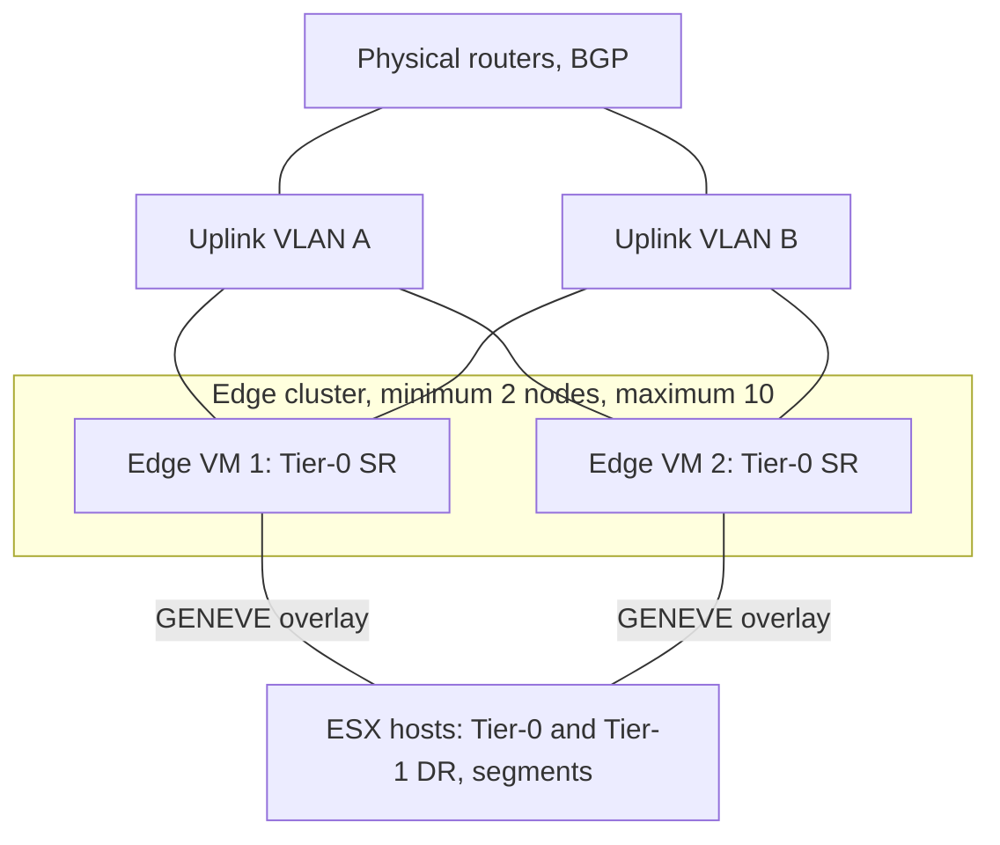
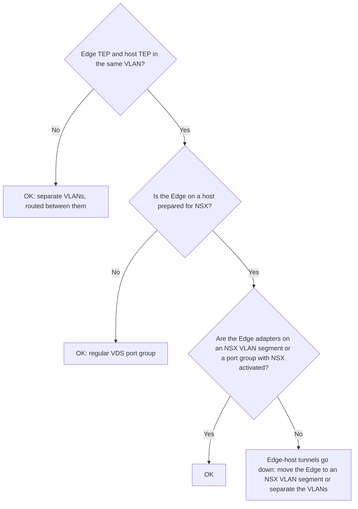

:::analogy
**The data center pain.** Your overlay segments work perfectly with each other, but no VM (VM, Virtual Machine) reaches the internet or the company's classic network. East-west traffic (between VMs) is handled on the hosts, but the way out to the physical world (north-south) needs a "door": NSX Edge. [S439] [S482] For the exam, the former VCP-NV (VMware Certified Professional - Network Virtualization, 2V0-41.24) exam guide had a whole objective on NSX Edge, and the VCF (VMware Cloud Foundation, 2V0-17.25) exam guide talks about the "VCF Network Gateway"; the sources read do not explicitly confirm that it is the same thing as NSX Edge (`⚠ to verify`). [S48] [S03]

**The analogy: a country's border customs.**

- **The hosts** are the cities: people move freely between them on internal roads (distributed routing).
- **The Edge** is the border crossing: everything leaving or entering the country goes through it, and the checks happen there: NAT (Network Address Translation), gateway firewall, VPN (Virtual Private Network).
- **An Edge cluster** means several crossings, so that not everything stops if one closes.
- **Failure domains** mean not putting all crossings on the same bridge: if the bridge falls, you have no customs left.
:::

:::architecture
### 1. What an Edge does

An NSX gateway (Tier-0 or Tier-1) has two parts: [S439] [S482]

| Component | Where it runs | What it does | Source |
|---|---|---|---|
| DR (Distributed Router) | On every transport node | Routes east-west traffic locally | [S439] |
| SR (Service Router) | On Edge nodes | The uplinks to the physical network and the centralized services | [S439] [S482] |

A gateway with stateful services, for example NAT or a load balancer, must be attached to an Edge cluster, even if it has a single Edge. [S483] Other typical centralized services are VPN and the gateway firewall. [S439]

### 2. Edge VM sizes

Sizes are given in vCPU (virtual CPU; CPU, Central Processing Unit), memory and disk.

| Size | vCPU | Memory | Disk | For what | Source |
|---|---|---|---|---|---|
| Small | 2 | 4 GB | 200 GB | Proof of concept only | [S481] |
| Medium | 4 | 8 GB | 200 GB | L2–L4 features (routing, NAT, L4 firewall, L4 load balancer) under 2 Gbps | [S481] |
| Large | 8 | 32 GB | 200 GB | L2–L4 between 2 and 10 Gbps, or L7 load balancing | [S481] |
| Extra Large | 16 | 64 GB | 200 GB | L7 load balancing and VPN at multiple Gbps | [S481] |

The Edge data plane uses DPDK (DPDK, Data Plane Development Kit), so the CPU must have AES-NI (the hardware instructions for AES encryption) and 1 GB huge pages. [S481] If the host uses EVC (EVC, Enhanced vMotion Compatibility), the baseline must be Haswell or later; an Edge VM supports only the VMXNET3 virtual adapter. [S481] A Large or Extra Large Edge supports at most 100 service routers (Tier-0, Tier-1, bridges), and the limit cannot be raised. [S486]

### 3. Edge cluster

| Rule | Source |
|---|---|
| An Edge belongs to only one Edge cluster; a cluster can serve several gateways | [S483] |
| All nodes in a cluster are the same type (VM or bare metal); VM sizes may technically differ | [S483] |
| Still, do not leave a cluster with Edges of different sizes | [S490] |
| At most 10 Edge nodes in a cluster | [S486] |
| VCF 9 needs at least two Edge VMs per cluster | [S482] |
| The *Unreachable* state means all BFD (BFD, Bidirectional Forwarding Detection) sessions to that Edge are down | [S483] |

**Deployment in VCF 9.0.** A wizard in vCenter (Networks > Network Connectivity) or in NSX Manager creates the Edge cluster and the Tier-0 gateway. You choose the size, the overlay MTU (MTU, Maximum Transmission Unit), read from the global NSX settings, and the teaming policy; you can clone the first Edge for the second. [S482] Each Edge VM has one management adapter and two data path adapters, `fp-eth0` and `fp-eth1`. [S482]

| Tier-0 mode | How many SRs | Note | Source |
|---|---|---|---|
| Active/Active | Up to 8 | More north-south throughput | [S482] |
| Active/Standby | 2 | Required by VCF Automation All Apps and by Supervisor (centralized connectivity) | [S482] |

With the **distributed connectivity** of the VCF 9 Transit Gateway, VPCs (VPC, Virtual Private Cloud) go straight out on a VLAN (VLAN, Virtual Local Area Network) shared by all hosts and you need no Edges. [S482]

### 4. Edge networking

An Edge uplink profile has stricter rules than a host one: an Edge VM supports no standby uplinks, multi-TEP on an Edge works only with Load Balance Source, and named teaming on an Edge supports only Failover Order. [S460]

**The Edge TEP (TEP, Tunnel Endpoint) and the host VLAN.** In a *collapsed* cluster (Edges run on hosts prepared for NSX), if the Edge TEP and host TEP are in the same VLAN, the Edge must be attached to an NSX VLAN segment (with a VLAN range, trunked) or NSX must be activated on the VDS (VDS, vSphere Distributed Switch) port groups; otherwise the Edge-to-host tunnels go down. [S487] [S488] [S489] The alternative is a separate VLAN for the Edge TEPs. [S488]

### 5. Edge cluster profile and failure domains

The **Edge cluster profile** (System > Fabric > Profiles > Edge Cluster Profiles) sets BFD Probe Interval, BFD Allowed Hops and BFD Declare Dead Multiple (the documentation says to keep the defaults) and the **Stand By Relocation** threshold: minimum 10 minutes, recommended 30. [S484]

**Failure domains** group Edges (for example per rack) so that the active and standby instances of a Tier-1 land in different groups. They are configured through the API: you create the failure domains, assign them to the Edges and enable the `AllocationBasedOnFailureDomain` allocation rule on the cluster. [S485]

### 6. Resizing and what is new

| Situation | How you proceed | Source |
|---|---|---|
| Edge cluster created by VCF (4.x, 5.x, 9.x) | The resizing tool run on SDDC Manager: one redeploy at a time, 10–15 minutes per Edge, the node's Tier-0 interfaces go down while it runs | [S490] |
| NSX outside VCF, from 4.2.2 | The *Redeploy Edge* action in the UI, which keeps the FQDN (FQDN, Fully Qualified Domain Name) and IP (IP, Internet Protocol) addresses | [S491] |
| VCF 9.1.1 and later | Core allocation profiles (L4Forwarding, Security) on the Edge cluster, with a node reboot | [S495] |

`[IMAGE SEARCH / PROMPT]` "NSX Edge cluster Tier-0 active active diagram" and "NSX Edge VM fp-eth0 fp-eth1 management vNIC".
:::

:::exam-alert
### Memorize

| What | Value / rule | Source |
|---|---|---|
| Small | 2 vCPU, 4 GB, proof of concept only | [S481] |
| Medium / Large / Extra Large | 4/8 GB, 8/32 GB, 16/64 GB | [S481] |
| Edge CPU | AES-NI and 1 GB huge pages | [S481] |
| Edges per cluster | maximum 10 | [S486] |
| VCF 9 | minimum 2 Edge VMs per cluster | [S482] |
| Tier-0 | Active/Active up to 8 SRs, Active/Standby 2 | [S482] |
| Stateful services | need an Edge cluster | [S483] |
| Edge VM | no standby uplinks | [S460] |
| Stand By Relocation | minimum 10, recommended 30 minutes | [S484] |
| Resize in VCF | the tool on SDDC Manager | [S490] |

### 3 exam traps

1. **"I put an Edge VM and a bare metal Edge in the same Edge cluster."** False. All nodes in a cluster are the same type. [S483]
2. **"For Supervisor I choose Tier-0 Active/Active."** False. VCF Automation All Apps and Supervisor need centralized Active/Standby connectivity. [S482]
3. **"A Small Edge is enough for a small production environment."** False. Small is for proof of concept only. [S481]
:::

:::trenches
### Mistake 1: an Edge with HA (High Availability) state Down only on some hosts

An Edge shows HA Down on the Tier-0, cannot ping its BGP (BGP, Border Gateway Protocol) neighbors, but recovers when moved to a particular host. Cause: the top-of-rack switch ports connected to some hosts lack the Edge uplink VLANs. [S492]
**Fix (The KB (Knowledge Base article) 434339):** check every switch port of the hosts in the Edge cluster and allow all Edge VLANs as tagged; then `get bgp neighbor summary` on the Edge must show Established. [S492]

### Mistake 2: Edge-to-host tunnels Down in a collapsed cluster

The Edges run on hosts prepared for NSX, attached to regular VDS port groups, and Edge TEP and host TEP share the same VLAN. Ping works, BFD does not. [S489] [S488]
**Fix (KB 440094 and KB 388345):** move the Edge TEP adapters to NSX VLAN segments or use separate VLANs for Edge and host TEPs. [S489] [S488]
:::

:::interview
**Junior/Mid question: "Why do you need NSX Edge if NSX already routes in a distributed way on the hosts?"**

*Ideal answer:* distributed routing (DR) handles east-west traffic on each host. For north-south, meaning the way out to the physical routers over BGP, and for stateful services such as NAT, load balancer or VPN, you need the centralized part of the gateway (SR), which runs on Edge nodes in an Edge cluster. [S439] [S483] A good candidate adds that in VCF 9 the distributed connectivity of the Transit Gateway can work without Edges. [S482]

**Troubleshooting scenario: "Creating an Edge cluster from SDDC Manager stops with the error «Failed to validate the BGP Route Distribution result». What do you do?"**

*The answer a Team Lead expects:*
1. **Understand the cause**: the Tier-0 has learned no routes from the physical neighbors. [S493]
2. **Check on the Edge** with `get route bgp`: if you see only inter-SR routes and no external BGP routes, the problem is on the neighbor. [S493]
3. **Check the BGP configuration on the physical routers**: every Edge uplink IP is declared as a neighbor, with matching settings. [S493] [S494]
4. **If you deliberately advertise no routes** (new environment or static routes), temporarily advertise a route from the top-of-rack so validation passes, then remove it. [S493]
5. **Resume the task** in SDDC Manager. [S493]
:::

:::lab
**Scenario.** You inspect the lab Edge cluster: the Edge size, their adapters, the uplink profile, the Edge cluster profile, HA and BGP state, then you simulate an Edge failure.

**What you need.** A VCF 9 lab with NSX and an Edge cluster with two Edge VMs and a Tier-0 (created with the vCenter wizard). The lab already exists; if you only use distributed connectivity, do just the inspection steps.

The steps below can be ticked off, and progress is saved in the browser. Exact menu names may differ slightly between versions (`⚠ to verify`).

**Home lab only / not supported.** Small Edges are for proof of concept only. [S481] Do not resize VCF-created Edges from NSX Manager; use the tool on SDDC Manager. [S490] [S491]

**Failure test and validation.** Power off the active Edge of an Active/Standby Tier-0 and watch the other one take over; then power it back on and note whether the roles switch back (it depends on the failover mode). The *Unreachable* state appears when all BFD sessions to it are down. [S483]
:::

:::quiz
Five original questions in VCP exam style. You get the explanation for every option right after you answer.
:::

:::references
- The VCP-VCF 2V0-17.25 exam guide [S03] and the former VCP-NV 2V0-41.24 exam guide [S48]
- NSX documentation: key concepts [S439], uplink profile [S460], Edge VM requirements [S481], Edge cluster [S483], Edge cluster profile [S484], failure domains [S485]
- VCF blog: Edges and Tier-0 from the vCenter wizard, VCF 9.0 [S482]
- KB 411593 (Edge limits) [S486], KB 317168, KB 388345 and KB 440094 (Edge TEPs) [S487] [S488] [S489]
- KB 312196 and KB 383091 (resizing) [S490] [S491], KB 441953 (core allocation, 9.1.1) [S495]
- KB 434339, KB 444931 and KB 443802 (HA and BGP on the Edge) [S492] [S493] [S494]
:::
