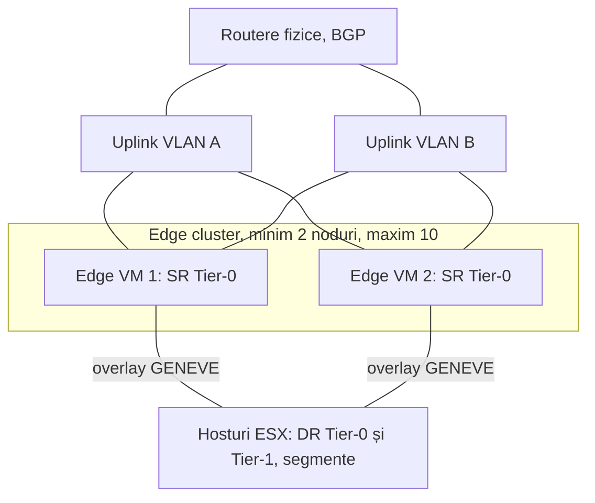
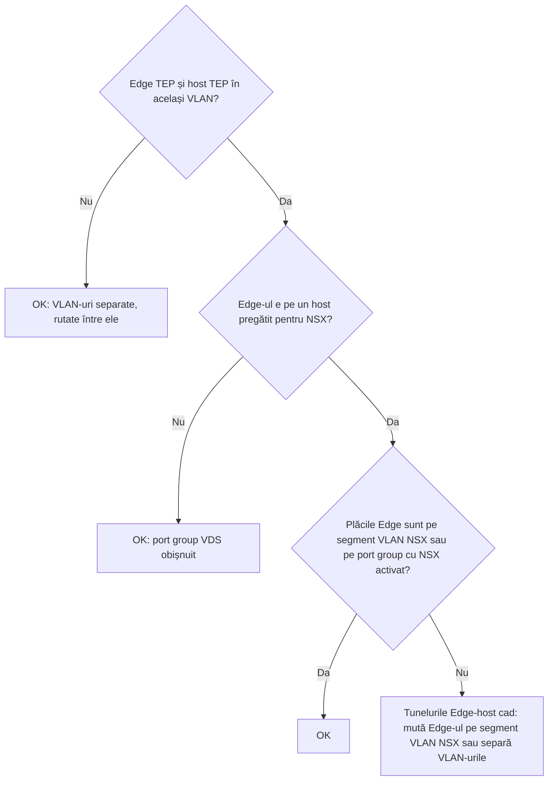

:::analogy
**Durerea din data center.** Segmentele tale overlay merg perfect între ele, dar nicio VM (VM, Virtual Machine) nu ajunge pe internet sau în rețeaua clasică a firmei. Traficul est-vest (între VM-uri) e rezolvat pe hosturi, dar ieșirea spre lumea fizică (nord-sud) are nevoie de o „ușă”: NSX Edge. [S439] [S482] Pentru examen, fostul exam guide VCP-NV (VMware Certified Professional - Network Virtualization, 2V0-41.24) avea un obiectiv întreg despre NSX Edge, iar exam guide-ul VCF (VMware Cloud Foundation, 2V0-17.25) vorbește de „VCF Network Gateway”; sursele citite nu confirmă explicit că e același lucru cu NSX Edge (`⚠ de verificat`). [S48] [S03]

**Analogia: vama unei țări.**

- **Hosturile** sunt orașele: oamenii circulă liber între ele pe drumuri interne (rutare distribuită).
- **Edge-ul** e punctul de trecere a frontierei: tot ce iese sau intră în țară trece pe acolo, iar acolo se fac controalele: NAT (Network Address Translation), firewall de gateway, VPN (Virtual Private Network).
- **Edge cluster** înseamnă mai multe puncte de trecere, ca să nu se blocheze totul dacă unul se închide.
- **Failure domains** înseamnă să nu pui toate punctele de trecere pe același pod: dacă podul cade, rămâi fără vamă.
:::

:::architecture
### 1. Ce face un Edge

Un gateway NSX (Tier-0 sau Tier-1) are două părți: [S439] [S482]

| Componentă | Unde rulează | Ce face | Sursă |
|---|---|---|---|
| DR (Distributed Router) | Pe fiecare transport node | Rutează local traficul est-vest | [S439] |
| SR (Service Router) | Pe Edge nodes | Uplink-urile spre rețeaua fizică și serviciile centralizate | [S439] [S482] |

Un gateway care are servicii stateful, de exemplu NAT sau load balancer, trebuie legat de un Edge cluster, chiar dacă are un singur Edge. [S483] Celelalte servicii centralizate tipice sunt VPN și firewall-ul de gateway. [S439]

### 2. Mărimile Edge VM

Mărimile se dau în vCPU (virtual CPU; CPU, Central Processing Unit), memorie și disc.

| Mărime | vCPU | Memorie | Disc | Pentru ce | Sursă |
|---|---|---|---|---|---|
| Small | 2 | 4 GB | 200 GB | Doar proof of concept | [S481] |
| Medium | 4 | 8 GB | 200 GB | Funcții L2–L4 (rutare, NAT, firewall L4, load balancer L4) sub 2 Gbps | [S481] |
| Large | 8 | 32 GB | 200 GB | L2–L4 între 2 și 10 Gbps, sau load balancing L7 | [S481] |
| Extra Large | 16 | 64 GB | 200 GB | Load balancing L7 și VPN la mai mulți Gbps | [S481] |

Data plane-ul Edge folosește DPDK (DPDK, Data Plane Development Kit), deci CPU-ul trebuie să aibă AES-NI (instrucțiunile hardware pentru criptare AES) și pagini mari de 1 GB. [S481] Dacă hostul are EVC (EVC, Enhanced vMotion Compatibility), nivelul trebuie să fie Haswell sau mai nou; Edge VM suportă doar placa virtuală VMXNET3. [S481] Un Edge Large sau Extra Large suportă cel mult 100 de service routers (Tier-0, Tier-1, bridge-uri), iar limita nu se poate ridica. [S486]

### 3. Edge cluster

| Regulă | Sursă |
|---|---|
| Un Edge aparține unui singur Edge cluster; un cluster poate servi mai multe gateway-uri | [S483] |
| Toate nodurile dintr-un cluster sunt de același tip (VM sau bare metal); mărimile VM pot diferi tehnic | [S483] |
| Nu lăsa totuși un cluster cu Edge-uri de mărimi diferite | [S490] |
| Cel mult 10 Edge nodes într-un cluster | [S486] |
| În VCF 9 sunt necesare cel puțin două Edge VM pe cluster | [S482] |
| Starea *Unreachable* înseamnă că toate sesiunile BFD (BFD, Bidirectional Forwarding Detection) spre acel Edge sunt căzute | [S483] |

**Instalarea în VCF 9.0.** Un asistent din vCenter (Networks > Network Connectivity) sau din NSX Manager creează Edge clusterul și gateway-ul Tier-0. Alegi mărimea, MTU-ul (MTU, Maximum Transmission Unit) pentru overlay (citit din setările globale NSX) și politica de teaming; poți clona primul Edge pentru al doilea. [S482] Fiecare Edge VM are o placă de management și două plăci de data path, `fp-eth0` și `fp-eth1`. [S482]

| Mod Tier-0 | Câte SR-uri | Observație | Sursă |
|---|---|---|---|
| Active/Active | Până la 8 | Mai mult throughput nord-sud | [S482] |
| Active/Standby | 2 | Cerut de VCF Automation All Apps și de Supervisor (conectivitate centralizată) | [S482] |

Cu **conectivitatea distribuită** a Transit Gateway-ului din VCF 9, VPC-urile (VPC, Virtual Private Cloud) ies direct pe un VLAN (VLAN, Virtual Local Area Network) comun tuturor hosturilor și nu ai nevoie de Edge-uri. [S482]

### 4. Rețeaua Edge-ului

Uplink profile-ul unui Edge are reguli mai stricte decât al unui host: Edge VM nu suportă uplink-uri standby, multi-TEP pe Edge merge doar cu Load Balance Source, iar named teaming pe Edge suportă doar Failover Order. [S460]

**TEP-ul (TEP, Tunnel Endpoint) Edge-ului și VLAN-ul hosturilor.** Într-un cluster *collapsed* (Edge-urile stau pe hosturi pregătite pentru NSX), dacă Edge TEP și host TEP sunt în același VLAN, Edge-ul trebuie conectat la un segment VLAN NSX (cu interval de VLAN-uri, trunk) sau trebuie activat NSX pe port group-urile VDS (VDS, vSphere Distributed Switch); altfel tunelurile Edge–host cad. [S487] [S488] [S489] Soluția alternativă e un VLAN separat pentru TEP-urile Edge. [S488]

### 5. Edge cluster profile și failure domains

**Edge cluster profile** (System > Fabric > Profiles > Edge Cluster Profiles) setează BFD Probe Interval, BFD Allowed Hops și BFD Declare Dead Multiple (documentația cere să păstrezi valorile implicite) și pragul **Stand By Relocation**: minim 10 minute, recomandat 30. [S484]

**Failure domains** grupează Edge-urile (de exemplu pe rack) astfel încât instanța activă și cea standby ale unui Tier-1 să ajungă în grupuri diferite. Se configurează din API: creezi failure domain-urile, le atribui Edge-urilor și activezi regula de alocare `AllocationBasedOnFailureDomain` pe cluster. [S485]

### 6. Redimensionare și noutăți

| Situație | Cum procedezi | Sursă |
|---|---|---|
| Edge cluster creat de VCF (4.x, 5.x, 9.x) | Unealta de redimensionare rulată pe SDDC Manager: redeploy pe rând, 10–15 minute per Edge, interfețele Tier-0 ale nodului cad pe durata lui | [S490] |
| NSX în afara VCF, de la 4.2.2 | Acțiunea *Redeploy Edge* din UI, care păstrează FQDN-ul (FQDN, Fully Qualified Domain Name) și adresele IP (IP, Internet Protocol) | [S491] |
| VCF 9.1.1 și mai nou | Profile de alocare a nucleelor (L4Forwarding, Security) pe Edge cluster, cu restart al nodurilor | [S495] |

`[IMAGE SEARCH / PROMPT]` „NSX Edge cluster Tier-0 active active ECMP diagram” și „NSX Edge VM fp-eth0 fp-eth1 management vNIC”.
:::

:::exam-alert
### De memorat

| Ce | Valoare / regulă | Sursă |
|---|---|---|
| Small | 2 vCPU, 4 GB, doar proof of concept | [S481] |
| Medium / Large / Extra Large | 4/8 GB, 8/32 GB, 16/64 GB | [S481] |
| CPU Edge | AES-NI și pagini mari de 1 GB | [S481] |
| Edge-uri per cluster | maxim 10 | [S486] |
| VCF 9 | minim 2 Edge VM per cluster | [S482] |
| Tier-0 | Active/Active până la 8 SR, Active/Standby 2 | [S482] |
| Servicii stateful | cer Edge cluster | [S483] |
| Edge VM | fără uplink-uri standby | [S460] |
| Stand By Relocation | minim 10, recomandat 30 minute | [S484] |
| Resize în VCF | unealta de pe SDDC Manager | [S490] |

### 3 capcane de examen

1. **„Pun în același Edge cluster un Edge VM și un Edge bare metal.”** Fals. Toate nodurile unui cluster sunt de același tip. [S483]
2. **„Pentru Supervisor aleg Tier-0 Active/Active.”** Fals. VCF Automation All Apps și Supervisor cer conectivitate centralizată Active/Standby. [S482]
3. **„Edge-ul Small e suficient pentru un mediu mic de producție.”** Fals. Small e doar pentru proof of concept. [S481]
:::

:::trenches
### Greșeala 1: Edge cu starea HA (High Availability) Down doar pe unele hosturi

Un Edge arată starea HA Down pe Tier-0, nu ajunge la vecinii BGP (BGP, Border Gateway Protocol) prin ping, dar își revine când e mutat pe un anumit host. Cauza: porturile switch-urilor top-of-rack conectate la unele hosturi nu au VLAN-urile uplink-urilor Edge. [S492]
**Remediere (Articolul KB (Knowledge Base article) 434339):** verifici fiecare port de switch al hosturilor din Edge cluster și permiți tagged toate VLAN-urile Edge; apoi `get bgp neighbor summary` pe Edge trebuie să arate Established. [S492]

### Greșeala 2: tuneluri Edge–host Down într-un cluster collapsed

Edge-urile stau pe hosturi pregătite pentru NSX, conectate la port group-uri VDS obișnuite, iar Edge TEP și host TEP sunt în același VLAN. Ping-ul merge, dar BFD nu. [S489] [S488]
**Remediere (KB 440094 și KB 388345):** muți plăcile TEP ale Edge-ului pe segmente VLAN NSX sau folosești VLAN-uri separate pentru TEP-urile Edge și ale hosturilor. [S489] [S488]
:::

:::interview
**Întrebare Junior/Mid: „De ce ai nevoie de NSX Edge dacă NSX rutează deja distribuit pe hosturi?”**

*Răspunsul ideal:* rutarea distribuită (DR) rezolvă traficul est-vest pe fiecare host. Pentru nord-sud, adică ieșirea spre routerele fizice prin BGP, și pentru servicii stateful precum NAT, load balancer sau VPN, ai nevoie de partea centralizată a gateway-ului (SR), care rulează pe Edge nodes, într-un Edge cluster. [S439] [S483] Un candidat bun adaugă că în VCF 9 conectivitatea distribuită a Transit Gateway-ului poate funcționa fără Edge-uri. [S482]

**Scenariu de troubleshooting: „Crearea unui Edge cluster din SDDC Manager se oprește cu eroarea «Failed to validate the BGP Route Distribution result». Ce faci?”**

*Răspunsul pe care îl așteaptă un Team Lead:*
1. **Înțelegi cauza**: Tier-0 n-a învățat nicio rută de la vecinii fizici. [S493]
2. **Verifici pe Edge** cu `get route bgp`: dacă vezi doar rute inter-SR și nicio rută BGP externă, problema e la vecin. [S493]
3. **Verifici configurația BGP pe routerele fizice**: toate IP-urile uplink ale Edge-urilor sunt declarate ca vecini, cu aceleași setări. [S493] [S494]
4. **Dacă intenționat nu anunți rute** (mediu nou sau rute statice), anunți temporar o rută din top-of-rack ca să treacă validarea, apoi o scoți. [S493]
5. **Reiei task-ul** în SDDC Manager. [S493]
:::

:::lab
**Scenariu.** Inspectezi Edge clusterul din lab: mărimea Edge-urilor, plăcile lor, uplink profile-ul, Edge cluster profile-ul, starea HA și BGP, apoi simulezi căderea unui Edge.

**Ce ai nevoie.** Un lab VCF 9 cu NSX și un Edge cluster cu două Edge VM și un Tier-0 (creat cu asistentul din vCenter). Lab-ul există deja; dacă folosești doar conectivitate distribuită, faci doar pașii de inspecție.

Pașii de mai jos sunt bifabili, iar progresul se salvează în browser. Numele exacte ale meniurilor pot diferi puțin între versiuni (`⚠ de verificat`).

**Home lab only / not supported.** Edge-urile Small sunt bune doar pentru proof of concept. [S481] Nu redimensiona Edge-urile create de VCF din NSX Manager; folosește unealta de pe SDDC Manager. [S490] [S491]

**Test de avarie și validare.** Oprește Edge-ul activ al unui Tier-0 Active/Standby și urmărește cum preia celălalt; apoi repornește-l și notează dacă rolurile revin sau nu (depinde de modul de failover). Starea *Unreachable* apare când toate sesiunile BFD spre el sunt căzute. [S483]
:::

:::quiz
Cinci întrebări originale, în stilul examenelor VCP. Primești explicația pentru fiecare variantă imediat după ce răspunzi.
:::

:::references
- Exam guide-ul VCP-VCF 2V0-17.25 [S03] și fostul exam guide VCP-NV 2V0-41.24 [S48]
- Documentația NSX: conceptele de bază [S439], uplink profile [S460], cerințele Edge VM [S481], Edge cluster [S483], Edge cluster profile [S484], failure domains [S485]
- Blogul VCF: Edge-uri și Tier-0 din asistentul din vCenter, VCF 9.0 [S482]
- KB 411593 (limite Edge) [S486], KB 317168, KB 388345 și KB 440094 (TEP-urile Edge) [S487] [S488] [S489]
- KB 312196 și KB 383091 (redimensionare) [S490] [S491], KB 441953 (alocarea nucleelor, 9.1.1) [S495]
- KB 434339, KB 444931 și KB 443802 (HA și BGP pe Edge) [S492] [S493] [S494]
:::
