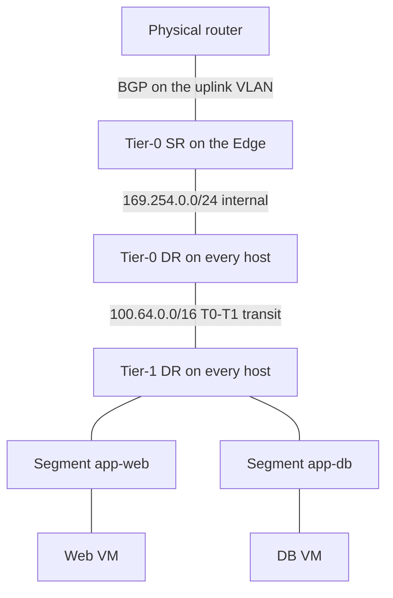
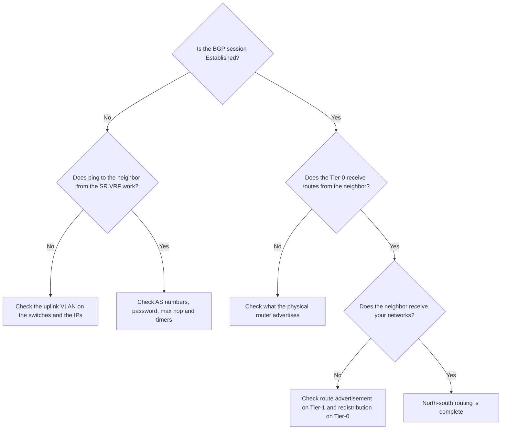

:::analogy
**The data center pain.** You have two applications, each on its own Tier-1. Each works, but there is no connection between them, and the physical routers never learn about their networks. The cause is a single checkbox: the Tier-1 does not announce its segments to the Tier-0. [S506] For the exam, the VCF (VMware Cloud Foundation, 2V0-17.25) exam guide asks you to know routing in the VCF virtual network, and the former VCP-NV (VMware Certified Professional - Network Virtualization, 2V0-41.24) exam guide had three separate objectives on gateways and routing. [S03] [S48]

**The analogy: the postal service.**

- **DR (Distributed Router)** is the mailbox in every building: letters between neighbors in the same city are sorted on the spot. [S501]
- **SR (Service Router)** is the central post office: everything going abroad passes through it, and the special services happen there: NAT (Network Address Translation) and VPN (Virtual Private Network). [S501]
- **Tier-1** is the neighborhood office, **Tier-0** is the central office that talks to other countries' postal services.
- **BGP** (BGP, Border Gateway Protocol) is the agreement between national postal services: each tells the other which addresses it can deliver to. If the neighborhood office does not tell the central office which streets it has (route advertisement), nobody outside can write to it.
:::

:::architecture
### 1. DR, SR and topologies

Every gateway has a DR, which runs on all transport nodes (hosts and Edges) and does first-hop routing for VMs (VM, Virtual Machine), and optionally an SR on Edges, for north-south and centralized services such as NAT. [S501] [S439]

| Topology | What it looks like | Source |
|---|---|---|
| Single-tier | Segments attach directly to the Tier-0 | [S501] |
| Multi-tier | Segments attach to a Tier-1, and the Tier-1 attaches to the Tier-0 | [S501] |

**Transit subnets** (NSX creates them automatically): [S496]

| Default subnet | Between what | Source |
|---|---|---|
| 169.254.0.0/24 | Components of the same gateway (DR and SR) | [S496] |
| 100.64.0.0/16 | The Tier-0 and its linked Tier-1s; you can change it, but traffic is briefly interrupted | [S496] |

**A north-south packet walk (multi-tier).** The VM sends to its gateway, the Tier-1 DR on the same host. The Tier-1 DR hands it to the Tier-0 DR, also on the host, through the transit subnet. The Tier-0 DR sends it to the Tier-0 SR on the Edge, GENEVE-encapsulated (GENEVE, Generic Network Virtualization Encapsulation) across the overlay, and the SR sends it out of the uplink to the physical router. [S501] East-west traffic between segments is routed directly on the host by the DR. [S501]

### 2. Tier-0

| Setting | Values | Source |
|---|---|---|
| HA (HA, High Availability) mode | Active-Active (default) or Active-Standby | [S496] |
| Stateful services (firewall, NAT, load balancer, VPN) | Active-Standby only | [S496] |
| Failover mode (Active-Standby only) | Preemptive or Non-preemptive | [S496] |
| SRs | Up to 8 in Active-Active, 2 in Active-Standby | [S482] |
| Forwarding Up Timer | Default 5 seconds; 0 if you have no redundant Edges | [S496] |
| Interfaces | External, Service (Active-Standby only), Loopback | [S496] |
| URPF (Unicast Reverse Path Forwarding) on External interfaces | Default Strict; set None for asymmetric routing | [S496] |
| HA VIP (Virtual IP; IP, Internet Protocol) | Active-Standby only, for static routes, not for BGP | [S496] |

**Route redistribution** on the Tier-0 chooses which routes go into BGP or OSPF (OSPF, Open Shortest Path First): Tier-0 networks (static routes, NAT IPs, connected interfaces and segments, Router Link and so on) and networks advertised by Tier-1s (connected segments, static routes, load balancer VIPs and SNAT, NAT IPs and so on). [S496]

### 3. Tier-1

| Setting | What it means | Source |
|---|---|---|
| Linked Tier-0 | The Tier-0 above it (multi-tier topology) | [S500] |
| Edge cluster | Chosen for stateful services; selecting it **always** creates an SR, which changes the north-south path | [S500] |
| Failover mode | Preemptive or Non-preemptive; **default Non-preemptive** | [S500] |
| Enable StandBy Relocation | Recreates the standby on another Edge when an Edge fails | [S500] |
| Edges Pool Allocation Size | Default Routing; LB sizes for a load balancer | [S500] |
| Route Advertisement | All Connected Segments and Service Ports, All Static Routes, All NAT IPs, All LB VIP Routes, All LB SNAT IP Routes, All DNS (Domain Name System) Forwarder Routes, All IPSec Local Endpoints | [S500] |

Without **All Connected Segments and Service Ports**, the Tier-0 has no route to that Tier-1's segments, so neither another Tier-1 nor the physical routers can reach them. [S506]

### 4. BGP on the Tier-0

| Setting | Value / rule | Source |
|---|---|---|
| Types | eBGP and iBGP (external and internal BGP); no route reflector and no confederations | [S497] |
| Local AS (Autonomous System) | Pre-filled 65000 in Active-Active, empty in Active-Standby | [S498] |
| BGP | On by default in Active-Active, off in Active-Standby | [S498] |
| Inter-SR iBGP | On by default (Active-Active only); needed when an Active-Active Tier-0 has an Active-Standby Tier-1 below it | [S498] [S497] |
| Max hop limit | Default 1; multi-hop if the neighbor is not in the uplink subnet | [S497] |
| Graceful restart | Default Helper Only; not supported with a single BGP neighbor | [S498] [S497] |
| Graceful restart timers | 180 (restart) and 600 (stale) | [S504] |
| Keep Alive / Hold Down | Default 60 and 180 seconds; Hold Down at least 3 times Keep Alive | [S502] [S498] |
| BFD (BFD, Bidirectional Forwarding Detection) | Per neighbor; minimum interval 500 ms on an Edge VM, 50 ms on bare metal | [S498] |
| Router ID | Chosen automatically from uplink IPs; changing it can make sessions drop | [S497] |

With BGP (or BFD), an SR **goes down by itself** when all of its neighbors are down; with static routes only, it stays up as long as the node is healthy. [S497] In VCF 9, the vCenter wizard asks for the ASNs (ASN, Autonomous System Number) of the Tier-0 and the physical router, the VLANs (VLAN, Virtual Local Area Network), local IPs and neighbor IPs for each uplink; BFD and BGP passwords are optional. [S482]

### 5. OSPF on the Tier-0

| Rule | Source |
|---|---|
| Available since NSX 3.1.1; OSPFv2 only | [S499] |
| One area per Tier-0: backbone, normal or NSSA (Not-So-Stubby Area) | [S499] |
| Broadcast or numbered point-to-point (/31) interfaces | [S499] |
| Active-Active or Active-Standby | [S499] |
| Graceful restart helper only; ECMP (ECMP, Equal-Cost Multi-Path) up to 8 paths | [S499] |
| At most two Tier-0 uplinks per Edge | [S499] |
| MD5 (Message Digest 5) or plain password authentication; BFD supported | [S499] |
| No redistribution between BGP and OSPF; default VRF (VRF, Virtual Routing and Forwarding) only; no NAT and no Tier-0 VIP with OSPF | [S499] |

Broadcom recommends BGP as the default choice for any new NSX design; OSPF with static routes remains a minority case, and moving to BGP later needs a redesign. [S507]

`[IMAGE SEARCH / PROMPT]` "NSX multi-tier routing Tier-0 Tier-1 DR SR packet walk" and "NSX Tier-0 active active BGP edge uplinks".
:::

:::exam-alert
### Memorize

| What | Value / rule | Source |
|---|---|---|
| T0–T1 transit | 100.64.0.0/16 | [S496] |
| Internal transit | 169.254.0.0/24 | [S496] |
| Default Tier-0 HA | Active-Active | [S496] |
| Stateful services on Tier-0 | Active-Standby only | [S496] |
| Default Tier-1 failover | Non-preemptive | [S500] |
| Edge cluster on Tier-1 | always creates an SR | [S500] |
| Default BGP timers | 60 / 180 seconds | [S502] |
| Hold Down | at least 3 × Keep Alive | [S498] |
| BGP max hop | 1 | [S497] |
| OSPF | v2 only, one area, ECMP 8 | [S499] |

### 3 exam traps

1. **"I put stateful NAT on an Active-Active Tier-0."** False. Stateful services (NAT, firewall, load balancer, VPN) need Active-Standby. [S496]
2. **"On the Tier-0 I configure OSPF and redistribute it into BGP."** False. NSX does not redistribute between BGP and OSPF. [S499]
3. **"I attach an Edge cluster to a Tier-1 just to have it ready, with no impact."** False. Selecting the Edge cluster always creates an SR, which changes the north-south path. [S500]
:::

:::trenches
### Mistake 1: the Tier-0 Edges fail over in a loop after BGP configuration

Right after you add a BGP neighbor, the active and standby Edges of the Tier-0 keep swapping roles. Cause: Keep Alive is larger than one third of Hold Down. [S503]
**Fix (The KB (Knowledge Base article) 319569):** set the timers so Keep Alive is at most one third of Hold Down (for example 100 and 300). [S503] Do not overdo it the other way either: 1 and 3 second timers make sessions drop at any delay; KB 424033 recommends going back to the defaults of 60 and 180. [S502]

### Mistake 2: routing between two Tier-1s does not work

VMs on segments attached to different Tier-1s cannot see each other. On the Edge, in the Tier-0 SR VRF, the route flagged `t1c` to the destination network is missing. [S506]
**Fix (KB 408951):** enable route advertisement for All Connected Segments and Service Ports on the Tier-1, or write route advertisement rules for only the subnets you want. Check with `get logical-routers`, `vrf <id>` and `get route` on the Edge. [S506]
:::

:::interview
**Junior/Mid question: "What is the difference between DR and SR in an NSX gateway?"**

*Ideal answer:* the DR runs distributed on all transport nodes and routes east-west traffic locally, as the first hop for VMs. The SR runs on Edge nodes and handles north-south, meaning the uplinks to the physical network, and centralized services such as NAT or load balancer. Between the DR and SR of the same gateway NSX uses the internal subnet 169.254.0.0/24. [S501] [S496]

**Troubleshooting scenario: "You created a new segment on a Tier-1, but the physical router does not see it. What do you check?"**

*The answer a Team Lead expects:*
1. **Is the Tier-1 linked to the Tier-0?** Without a Linked Tier-0 there is no path up. [S500]
2. **Route advertisement on the Tier-1**: is All Connected Segments and Service Ports on? [S506]
3. **Route redistribution on the Tier-0**: are connected networks advertised by Tier-1s included in the redistribution into BGP? [S496]
4. **The BGP session**: is it Established on every Edge? `get bgp neighbor summary` on the Edge. [S493] [S497]
5. **Special case**: if the Tier-1 was created as Distributed Only on NSX 3.0 or 3.1 and then upgraded, KB 425908 asks you to disconnect and reconnect it to the Tier-0. [S505]
:::

:::lab
**Scenario.** You build a small multi-tier topology: a Tier-1 linked to the existing Tier-0, two segments on it, you check east-west and north-south routing, then deliberately break route advertisement and fix it.

**What you need.** A VCF 9 lab with NSX, a Tier-0 with BGP to a router (physical or virtual) and the segments from lesson 4.3. The lab already exists; if you have no BGP router, test only the east-west part and read the BGP configuration.

The steps below can be ticked off, and progress is saved in the browser. Exact menu names may differ slightly between versions (`⚠ to verify`).

**Home lab only / not supported.** A virtual router as BGP neighbor is fine for a lab, not for production. Very aggressive BGP timers can destabilize sessions. [S502]

**Failure test and validation.** Turn off All Connected Segments and Service Ports on the Tier-1: the route to the segment disappears from the Tier-0 table and from the physical router. Turn it back on and check that it returns. [S506]
:::

:::quiz
Five original questions in VCP exam style. You get the explanation for every option right after you answer.
:::

:::references
- The VCP-VCF 2V0-17.25 exam guide [S03] and the former VCP-NV 2V0-41.24 exam guide [S48]
- NSX documentation: Tier-0 [S496], Tier-1 [S500], BGP [S497] [S498], OSPF [S499], key concepts [S439]
- VMware: Demystifying Multi-Tier Gateways in NSX [S501]; the VCF blog on the Edge/Tier-0 wizard [S482]
- KB 424033, KB 319569 and KB 317909 (BGP timers) [S502] [S503] [S504]
- KB 408951 and KB 425908 (route advertisement on Tier-1) [S506] [S505], KB 444931 (BGP route validation) [S493]
- KB 412422 (choosing the routing protocol) [S507]
:::
