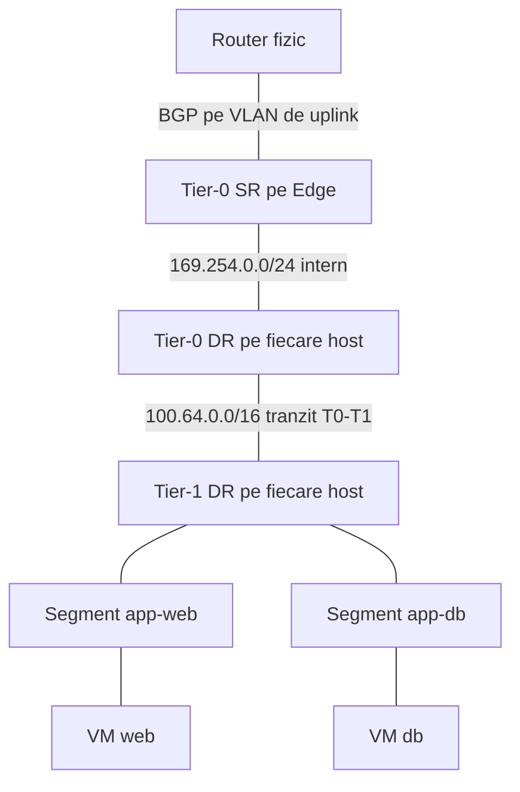
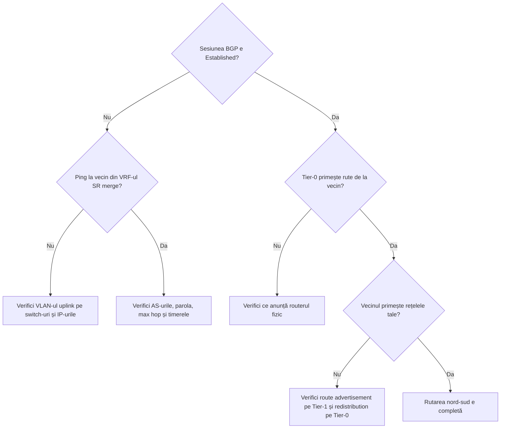

:::analogy
**Durerea din data center.** Ai două aplicații, fiecare pe un Tier-1 propriu. Fiecare merge, dar între ele nu e nicio legătură, iar routerele fizice nu află niciodată de rețelele lor. Cauza e o singură bifă: Tier-1 nu își anunță segmentele către Tier-0. [S506] Pentru examen, exam guide-ul VCF (VMware Cloud Foundation, 2V0-17.25) cere să știi rutarea din rețeaua virtuală VCF, iar fostul exam guide VCP-NV (VMware Certified Professional - Network Virtualization, 2V0-41.24) avea trei obiective separate despre gateway-uri și rutare. [S03] [S48]

**Analogia: poșta.**

- **DR (Distributed Router)** e cutia poștală din fiecare clădire: scrisorile între vecini din același oraș se sortează pe loc. [S501]
- **SR (Service Router)** e oficiul poștal central: tot ce pleacă în străinătate trece pe acolo, iar acolo se fac și serviciile speciale: NAT (Network Address Translation) și VPN (Virtual Private Network). [S501]
- **Tier-1** e oficiul de cartier, **Tier-0** e oficiul central care vorbește cu poșta altor țări.
- **BGP** (BGP, Border Gateway Protocol) e acordul dintre poștele naționale: fiecare îi spune celeilalte ce adrese poate livra. Dacă oficiul de cartier nu-i spune oficiului central ce străzi are (route advertisement), nimeni din afară nu-i poate scrie.
:::

:::architecture
### 1. DR, SR și topologiile

Fiecare gateway are un DR, care rulează pe toate transport nodes (hosturi și Edge-uri) și face rutarea la primul hop pentru VM-uri (VM, Virtual Machine), și opțional un SR pe Edge-uri, pentru nord-sud și servicii centralizate precum NAT. [S501] [S439]

| Topologie | Cum arată | Sursă |
|---|---|---|
| Single-tier | Segmentele se leagă direct de Tier-0 | [S501] |
| Multi-tier | Segmentele se leagă de Tier-1, iar Tier-1 se leagă de Tier-0 | [S501] |

**Subrețelele de tranzit** (le creează NSX automat): [S496]

| Subrețea implicită | Între ce | Sursă |
|---|---|---|
| 169.254.0.0/24 | Componentele aceluiași gateway (DR și SR) | [S496] |
| 100.64.0.0/16 | Tier-0 și Tier-1-urile legate de el; o poți schimba, dar traficul se întrerupe scurt | [S496] |

**Drumul unui pachet nord-sud (multi-tier).** VM-ul trimite la gateway-ul lui, adică la Tier-1 DR de pe același host. Tier-1 DR îl dă la Tier-0 DR tot pe host, prin subrețeaua de tranzit. Tier-0 DR îl trimite la Tier-0 SR de pe Edge, încapsulat GENEVE (GENEVE, Generic Network Virtualization Encapsulation) prin overlay, iar SR-ul îl scoate pe uplink spre routerul fizic. [S501] Traficul est-vest între segmente se rutează direct pe host, de DR. [S501]

### 2. Tier-0

| Setare | Valori | Sursă |
|---|---|---|
| HA (HA, High Availability) mode | Active-Active (implicit) sau Active-Standby | [S496] |
| Servicii stateful (firewall, NAT, load balancer, VPN) | Doar în Active-Standby | [S496] |
| Failover mode (doar Active-Standby) | Preemptive sau Non-preemptive | [S496] |
| SR-uri | Până la 8 în Active-Active, 2 în Active-Standby | [S482] |
| Forwarding Up Timer | Implicit 5 secunde; 0 dacă nu ai Edge-uri redundante | [S496] |
| Interfețe | External, Service (doar Active-Standby), Loopback | [S496] |
| URPF (Unicast Reverse Path Forwarding) pe interfețele External | Implicit Strict; pentru rutare asimetrică pui None | [S496] |
| HA VIP (Virtual IP; IP, Internet Protocol) | Doar Active-Standby, pentru rute statice, nu pentru BGP | [S496] |

**Route redistribution** pe Tier-0 alege ce rute ajung în BGP sau OSPF (OSPF, Open Shortest Path First): rețelele Tier-0 (rute statice, IP-uri NAT, interfețe și segmente conectate, Router Link etc.) și rețelele anunțate de Tier-1 (segmente conectate, rute statice, VIP-uri și SNAT de load balancer, IP-uri NAT etc.). [S496]

### 3. Tier-1

| Setare | Ce înseamnă | Sursă |
|---|---|---|
| Linked Tier-0 | Tier-0-ul de deasupra (topologie multi-tier) | [S500] |
| Edge cluster | Îl alegi pentru servicii stateful; alegerea lui creează **mereu** un SR, ceea ce schimbă drumul nord-sud | [S500] |
| Failover mode | Preemptive sau Non-preemptive; **implicit Non-preemptive** | [S500] |
| Enable StandBy Relocation | Recreează standby-ul pe alt Edge când cade un Edge | [S500] |
| Edges Pool Allocation Size | Implicit Routing; mărimi LB pentru load balancer | [S500] |
| Route Advertisement | All Connected Segments and Service Ports, All Static Routes, All NAT IPs, All LB VIP Routes, All LB SNAT IP Routes, All DNS (Domain Name System) Forwarder Routes, All IPSec Local Endpoints | [S500] |

Fără **All Connected Segments and Service Ports**, Tier-0 nu are ruta spre segmentele acelui Tier-1, deci nici alt Tier-1, nici routerele fizice nu ajung la ele. [S506]

### 4. BGP pe Tier-0

| Setare | Valoare / regulă | Sursă |
|---|---|---|
| Tipuri | eBGP și iBGP (BGP extern și intern); fără route reflector și fără confederații | [S497] |
| Local AS (Autonomous System) | Precompletat 65000 în Active-Active, gol în Active-Standby | [S498] |
| BGP | Activat implicit în Active-Active, dezactivat în Active-Standby | [S498] |
| Inter-SR iBGP | Activat implicit (doar Active-Active); necesar când un Tier-0 Active-Active are sub el un Tier-1 Active-Standby | [S498] [S497] |
| Max hop limit | Implicit 1; multi-hop dacă vecinul nu e în subrețeaua uplink-ului | [S497] |
| Graceful restart | Implicit Helper Only; nu e suportat cu un singur vecin BGP | [S498] [S497] |
| Timere graceful restart | 180 (restart) și 600 (stale) | [S504] |
| Keep Alive / Hold Down | Implicit 60 și 180 secunde; Hold Down cel puțin de 3 ori Keep Alive | [S502] [S498] |
| BFD (BFD, Bidirectional Forwarding Detection) | Per vecin; interval minim 500 ms pe Edge VM, 50 ms pe bare metal | [S498] |
| Router ID | Ales automat din IP-urile uplink; schimbarea lui poate face sesiunile să cadă | [S497] |

Cu BGP (sau BFD), un SR **se oprește singur** când toți vecinii lui sunt căzuți; cu doar rute statice, rămâne pornit cât timp nodul e sănătos. [S497] În VCF 9, asistentul din vCenter îți cere ASN-urile (ASN, Autonomous System Number) pentru Tier-0 și routerul fizic, VLAN-urile (VLAN, Virtual Local Area Network), IP-urile locale și IP-urile vecinilor pentru fiecare uplink; BFD și parolele BGP sunt opționale. [S482]

### 5. OSPF pe Tier-0

| Regulă | Sursă |
|---|---|
| Disponibil din NSX 3.1.1; doar OSPFv2 | [S499] |
| O singură arie pe Tier-0: backbone, normală sau NSSA (Not-So-Stubby Area) | [S499] |
| Interfețe broadcast sau point-to-point numerotate (/31) | [S499] |
| Active-Active sau Active-Standby | [S499] |
| Graceful restart doar helper; ECMP (ECMP, Equal-Cost Multi-Path) până la 8 căi | [S499] |
| Cel mult două uplink-uri Tier-0 per Edge | [S499] |
| Autentificare MD5 (Message Digest 5) sau parolă simplă; BFD suportat | [S499] |
| Fără redistribuire între BGP și OSPF; doar VRF-ul (VRF, Virtual Routing and Forwarding) implicit; fără NAT și fără VIP Tier-0 cu OSPF | [S499] |

Broadcom recomandă BGP ca alegere implicită la orice design NSX nou; OSPF cu rute statice rămâne un caz minoritar, iar trecerea ulterioară la BGP cere reproiectare. [S507]

`[IMAGE SEARCH / PROMPT]` „NSX multi-tier routing Tier-0 Tier-1 DR SR packet walk” și „NSX Tier-0 active active BGP edge uplinks”.
:::

:::exam-alert
### De memorat

| Ce | Valoare / regulă | Sursă |
|---|---|---|
| Tranzit T0–T1 | 100.64.0.0/16 | [S496] |
| Tranzit intern | 169.254.0.0/24 | [S496] |
| HA Tier-0 implicit | Active-Active | [S496] |
| Servicii stateful pe Tier-0 | doar Active-Standby | [S496] |
| Failover Tier-1 implicit | Non-preemptive | [S500] |
| Edge cluster pe Tier-1 | creează mereu SR | [S500] |
| Timere BGP implicite | 60 / 180 secunde | [S502] |
| Hold Down | cel puțin 3 × Keep Alive | [S498] |
| Max hop BGP | 1 | [S497] |
| OSPF | doar v2, o arie, ECMP 8 | [S499] |

### 3 capcane de examen

1. **„Pun NAT stateful pe un Tier-0 Active-Active.”** Fals. Serviciile stateful (NAT, firewall, load balancer, VPN) cer Active-Standby. [S496]
2. **„Pe Tier-0 configurez OSPF și îl redistribui în BGP.”** Fals. NSX nu redistribuie între BGP și OSPF. [S499]
3. **„Leg un Edge cluster de Tier-1 doar ca să fie pregătit, fără impact.”** Fals. Alegerea Edge clusterului creează mereu un SR, ceea ce schimbă drumul nord-sud. [S500]
:::

:::trenches
### Greșeala 1: Edge-urile Tier-0 fac failover în buclă după configurarea BGP

Imediat după ce adaugi un vecin BGP, Edge-urile activ și standby ale Tier-0 își schimbă rolurile continuu. Cauza: Keep Alive e mai mare decât o treime din Hold Down. [S503]
**Remediere (Articolul KB (Knowledge Base article) 319569):** setezi timerele astfel încât Keep Alive să fie cel mult o treime din Hold Down (de exemplu 100 și 300). [S503] Nici în sens invers nu exagera: timere de 1 și 3 secunde fac sesiunile să cadă la orice întârziere; KB 424033 recomandă revenirea la valorile implicite de 60 și 180. [S502]

### Greșeala 2: rutarea între două Tier-1 nu merge

VM-urile de pe segmente legate de Tier-1 diferite nu se văd. Pe Edge, în VRF-ul SR-ului Tier-0, lipsește ruta marcată `t1c` spre rețeaua destinație. [S506]
**Remediere (KB 408951):** activezi pe Tier-1 route advertisement pentru All Connected Segments and Service Ports sau scrii reguli de route advertisement doar pentru subrețelele dorite. Verifici cu `get logical-routers`, `vrf <id>` și `get route` pe Edge. [S506]
:::

:::interview
**Întrebare Junior/Mid: „Care e diferența dintre DR și SR într-un gateway NSX?”**

*Răspunsul ideal:* DR rulează distribuit pe toate transport nodes și rutează local traficul est-vest, ca prim hop pentru VM-uri. SR rulează pe Edge nodes și se ocupă de nord-sud, adică de uplink-urile spre rețeaua fizică, și de serviciile centralizate precum NAT sau load balancer. Între DR și SR-ul aceluiași gateway NSX folosește subrețeaua internă 169.254.0.0/24. [S501] [S496]

**Scenariu de troubleshooting: „Ai creat un segment nou pe un Tier-1, dar routerul fizic nu-l vede. Ce verifici?”**

*Răspunsul pe care îl așteaptă un Team Lead:*
1. **Tier-1 e legat de Tier-0?** Fără Linked Tier-0 nu există drum în sus. [S500]
2. **Route advertisement pe Tier-1**: All Connected Segments and Service Ports e activ? [S506]
3. **Route redistribution pe Tier-0**: rețelele conectate anunțate de Tier-1 sunt incluse în redistribuirea spre BGP? [S496]
4. **Sesiunea BGP**: e Established pe toate Edge-urile? `get bgp neighbor summary` pe Edge. [S493] [S497]
5. **Caz special**: dacă Tier-1 a fost creat ca Distributed Only pe NSX 3.0 sau 3.1 și apoi upgradat, KB 425908 cere deconectarea și reconectarea lui la Tier-0. [S505]
:::

:::lab
**Scenariu.** Construiești o topologie multi-tier mică: un Tier-1 legat de Tier-0-ul existent, două segmente pe el, verifici rutarea est-vest și nord-sud, apoi strici intenționat route advertisement și repari.

**Ce ai nevoie.** Un lab VCF 9 cu NSX, un Tier-0 cu BGP spre un router (fizic sau virtual) și segmentele din lecția 4.3. Lab-ul există deja; dacă nu ai un router BGP, testezi doar partea est-vest și citești configurația BGP.

Pașii de mai jos sunt bifabili, iar progresul se salvează în browser. Numele exacte ale meniurilor pot diferi puțin între versiuni (`⚠ de verificat`).

**Home lab only / not supported.** Un router virtual pe post de vecin BGP e bun pentru lab, nu pentru producție. Timerele BGP foarte agresive pot destabiliza sesiunile. [S502]

**Test de avarie și validare.** Dezactivează pe Tier-1 All Connected Segments and Service Ports: ruta spre segment dispare din tabela Tier-0 și din routerul fizic. Reactivează și verifică revenirea. [S506]
:::

:::quiz
Cinci întrebări originale, în stilul examenelor VCP. Primești explicația pentru fiecare variantă imediat după ce răspunzi.
:::

:::references
- Exam guide-ul VCP-VCF 2V0-17.25 [S03] și fostul exam guide VCP-NV 2V0-41.24 [S48]
- Documentația NSX: Tier-0 [S496], Tier-1 [S500], BGP [S497] [S498], OSPF [S499], conceptele de bază [S439]
- VMware: Demystifying Multi-Tier Gateways in NSX [S501]; blogul VCF despre asistentul Edge/Tier-0 [S482]
- KB 424033, KB 319569 și KB 317909 (timere BGP) [S502] [S503] [S504]
- KB 408951 și KB 425908 (route advertisement pe Tier-1) [S506] [S505], KB 444931 (validarea rutelor BGP) [S493]
- KB 412422 (alegerea protocolului de rutare) [S507]
:::
