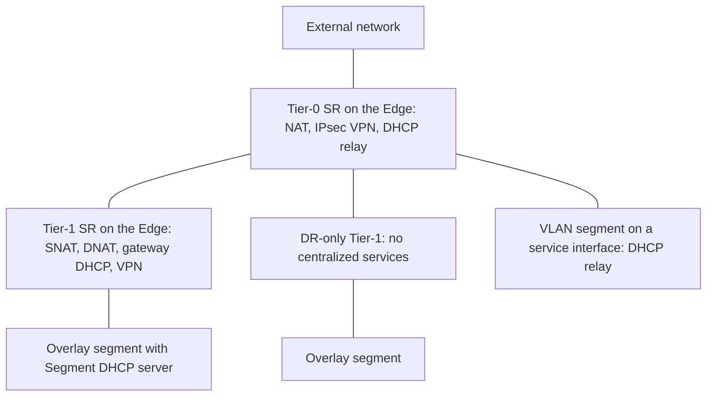
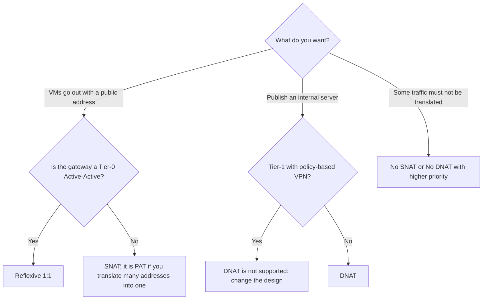

:::analogy
**The data center pain.** You put an SNAT (Source NAT; NAT, Network Address Translation) rule on a Tier-1, but the physical firewall still sees the VMs' (VM, Virtual Machine) internal addresses. The rule is correct; the traffic simply leaves through another Tier-1 that does not have the rule. [S514] For the exam, the VCF (VMware Cloud Foundation, 2V0-17.25) exam guide covers the services of the VCF virtual network, and the former VCP-NV (VMware Certified Professional - Network Virtualization, 2V0-41.24) exam guide had separate objectives for NAT, DHCP (Dynamic Host Configuration Protocol) and VPN (Virtual Private Network). [S03] [S48]

**The analogy: a hotel front desk.**

- **NAT** is the receptionist who answers the hotel phone: from outside you call one number and they connect you to the right room (DNAT, Destination NAT); when a guest calls the city, the hotel's number shows up, not the room's (SNAT).
- **DHCP** is the desk handing out keys: each new guest gets a room (an IP address; IP, Internet Protocol) for a while.
- **VPN** is the armored van between the hotel and headquarters: what is inside cannot be seen on the road.
- All these services live **at the front desk**, meaning on the SR (Service Router), not in every room.
:::

:::architecture
### 1. Where the services run

NAT, gateway DHCP and VPN are centralized services: they run on the SR, so on Edge nodes. A Tier-1 gets an SR when you select an Edge cluster for it, and on a Tier-0 stateful services need HA (HA, High Availability) Active-Standby. [S500] [S496]

### 2. NAT

**Which NAT actions each gateway has:** [S508]

| Gateway | NAT actions | Source |
|---|---|---|
| Tier-1 | SNAT, DNAT, Reflexive, No SNAT, No DNAT | [S508] |
| Tier-0 Active-Standby | SNAT, DNAT, No SNAT, No DNAT | [S508] |
| Tier-0 Active-Active | Reflexive (stateless NAT) only | [S508] |

The NAT overview page also mentions stateful NAT with an HA mode called *Stateful Active-Active* on Tier-0 or Tier-1; the configuration page of the same version does not list it (`⚠ to verify` for your version). [S509]

| Type | What it does | Source |
|---|---|---|
| SNAT | Rewrites the source of outgoing traffic; if the translated range is smaller than the matched one, it works as PAT (PAT, Port Address Translation) | [S509] [S508] |
| DNAT | Rewrites the destination of incoming traffic (publishing an internal server) | [S509] |
| Reflexive | Stateless 1:1 NAT: translates the source outbound and the destination inbound | [S509] |
| No SNAT / No DNAT | Exempts an address or range from SNAT or DNAT | [S509] |

**Rules to remember:**

- **Priority:** the lower number wins, default 0; No SNAT and No DNAT rules must have a higher priority than the others. [S508]
- **Rule firewall:** Match External Address, Match Internal Address or Bypass. [S508]
- **Direction:** SNAT applies from downlink to uplink, DNAT from uplink to downlink. Tier-0 NAT does not apply between two Tier-1s attached to the same Tier-0. [S509]
- **With VPN:** DNAT is not supported on a Tier-1 with policy-based IPsec VPN. [S509]
- **No PAT:** SNAT always translates ports; for 1:1 without PAT use Reflexive. [S515]
- **The gateway firewall:** if you disable it, NAT rules drop traffic unless you have an ANY/ANY ALLOW rule. [S509] The KB (Knowledge Base article) 389357 recommends disabling it if you do not use it, but warns that return traffic to a VM with SNAT then needs a No SNAT rule. [S516]

### 3. DHCP

| Type | Where | Rules | Source |
|---|---|---|---|
| Segment DHCP server | On the segment | Default when the segment is attached to a gateway; the only option for isolated and VLAN (VLAN, Virtual Local Area Network) segments; the DHCP profile must have an Edge cluster | [S510] [S465] |
| Gateway DHCP server | The DHCP profile on the gateway | Not for IPv6 and not for VLAN segments; the gateway or the profile needs an Edge cluster | [S510] |
| DHCP relay | Forwards requests to an external DHCP server | DHCPv4 on VLAN segments, through a service interface on Tier-0 or Tier-1; one relay per segment; no static bindings | [S510] |

Values: default lease **86400 seconds** (between 60 and 4294967295); a DHCP range has at most 65,536 addresses and sits inside the segment subnet. [S510] On VLAN segments with DHCP, *Forged Transmits* must be Accept or MAC (MAC, Media Access Control) learning must be on; since vSphere 7.0 Forged Transmits defaults to Reject. [S510]

### 4. VPN

**IPsec VPN** on NSX Edge works only in tunnel mode, with ESP (ESP, Encapsulating Security Payload, IP protocol 50); IKE (IKE, Internet Key Exchange) negotiates on UDP (UDP, User Datagram Protocol) 500, and switches to UDP 4500 if it detects NAT. [S512]

| Rule | Source |
|---|---|
| Policy-based (local and remote subnet in the session) or route-based (VTI, Virtual Tunnel Interface, with static routes or BGP, Border Gateway Protocol) | [S511] [S512] |
| On Tier-0, Tier-0 VRF (Virtual Routing and Forwarding) or Tier-1, **Active-Standby** only | [S512] |
| Pre-shared key or certificate authentication; IP unicast traffic only | [S512] |
| No session between a parent Tier-0 and a VRF attached to it | [S512] |
| Configure NAT before the VPN; a NAT rule added after the session leaves the tunnel Down until you restart the VPN | [S513] |
| The VPN service is created before the sessions: Networking > VPN > VPN Services > Add Service > IPSec | [S513] |

**L2 VPN** stretches a segment between sites over a route-based IPsec tunnel: you configure a server service and a client service, and the server session generates a *peer code* that you import into the client. [S511]

`[IMAGE SEARCH / PROMPT]` "NSX Tier-1 SNAT DNAT diagram" and "NSX route based IPsec VPN VTI BGP Tier-0".
:::

:::exam-alert
### Memorize

| What | Value / rule | Source |
|---|---|---|
| NAT on Tier-0 Active-Active | Reflexive only | [S508] |
| NAT priority | lower wins, default 0 | [S508] |
| 1:1 without PAT | Reflexive | [S515] |
| Tier-0 NAT between two Tier-1s | does not apply | [S509] |
| DHCP on a VLAN segment | Segment DHCP server or relay | [S510] |
| Default lease | 86400 seconds | [S510] |
| IKE | UDP 500, UDP 4500 with NAT | [S512] |
| ESP | IP protocol 50 | [S512] |
| HA for IPsec | Active-Standby | [S512] |
| Order | NAT before VPN | [S513] |

### 3 exam traps

1. **"I put DNAT on an Active-Active Tier-0."** False. An Active-Active Tier-0 supports only Reflexive. [S508]
2. **"I use a Gateway DHCP server on a VLAN segment."** False. VLAN segments support only the Segment DHCP server or DHCP relay. [S510]
3. **"IPsec VPN works on an Active-Active Tier-0."** False. The gateway must be Active-Standby. [S512]
:::

:::trenches
### Mistake 1: the SNAT rule is never hit

The SNAT rule exists on the Tier-1, but the physical firewall sees the original addresses. Traceflow shows that the traffic goes through another Tier-1, without the rule. [S514]
**Fix (KB 436852):** use Traceflow to check which gateway the traffic actually leaves through and put the rule on that Tier-1, or move the segment to the right gateway. [S514]

### Mistake 2: VMs on a VLAN get no IP through DHCP relay

Clients on a VLAN segment attached to a service interface receive no offers from the external DHCP server; the Edge does not forward them to the host. [S518]
**Fix (KB 413085):** create your own Segment Security profile with DHCP blocking off and apply it to the VLAN segment on the Edge. [S518] [S469] The KB says both that the default profile blocks DHCP and that Server Block and Client Block are off by default; check what you see in your lab (`⚠ to verify`). [S518]
:::

:::interview
**Junior/Mid question: "What is the difference between SNAT, DNAT and Reflexive NAT in NSX?"**

*Ideal answer:* SNAT rewrites the source of outgoing traffic, usually so VMs appear with a public address, and it translates ports. DNAT rewrites the destination of incoming traffic, to publish a server. Reflexive is stateless 1:1 NAT that translates in both directions, the only type supported on an Active-Active Tier-0. [S509] [S508] [S515]

**Troubleshooting scenario: "An IPsec tunnel to a branch office is Down. What do you do?"**

*The answer a Team Lead expects:*
1. **Is the gateway Active-Standby?** Active-Active is not supported for IPsec. [S517]
2. **Ports**: are UDP 500, UDP 4500 and IP protocol 50 allowed along the path and on the gateway firewall? [S517]
3. **Session state**: Down means phase 1 (IKE) failed; on the active Edge run `get ipsecvpn session` and `get ipsecvpn ikesa`. [S517]
4. **Parameters**: IKE version, encryption, digest and DH (Diffie-Hellman) group must be identical; the pre-shared key too; for policy-based, the subnets must mirror each other. *Download Config* gives you what the other side must match. [S517]
5. **Order with NAT**: if you added a NAT rule after the session, restart the VPN configuration. [S513]
:::

:::lab
**Scenario.** On the Tier-1 from lesson 4.5 you add an Edge cluster, configure an SNAT rule for the app-web segment and a DNAT rule for a server, start a Segment DHCP server on app-db, then read the configuration of an IPsec VPN service.

**What you need.** A VCF 9 lab with NSX, an Edge cluster (lesson 4.4), Tier-0 and Tier-1 (lesson 4.5), the app-web and app-db segments. The lab already exists; for VPN you do not need a real branch office, you only read the steps and commands.

The steps below can be ticked off, and progress is saved in the browser. Exact menu names may differ slightly between versions (`⚠ to verify`).

**Home lab only / not supported.** The lab's "public" addresses can be a private subnet of your home network; in production you use the addresses allocated by the network team. Do not disable the gateway firewall without reading its effect on NAT. [S509] [S516]

**Failure test and validation.** Add a No SNAT rule with higher priority for a single VM and check that this VM goes out with its internal address while the others use the translated address. [S508]
:::

:::quiz
Five original questions in VCP exam style. You get the explanation for every option right after you answer.
:::

:::references
- The VCP-VCF 2V0-17.25 exam guide [S03] and the former VCP-NV 2V0-41.24 exam guide [S48]
- NSX documentation: NAT [S508] [S509], DHCP [S510], VPN [S511] [S512] [S513], Tier-0 and Tier-1 [S496] [S500], segments [S465], segment profiles [S469]
- KB 436852, KB 425199 and KB 400763 (NAT) [S514] [S515] [S519]
- KB 389357 (gateway firewall and NAT) [S516]
- KB 413085 (DHCP relay) [S518] and KB 379731 (IPsec troubleshooting) [S517]
:::
