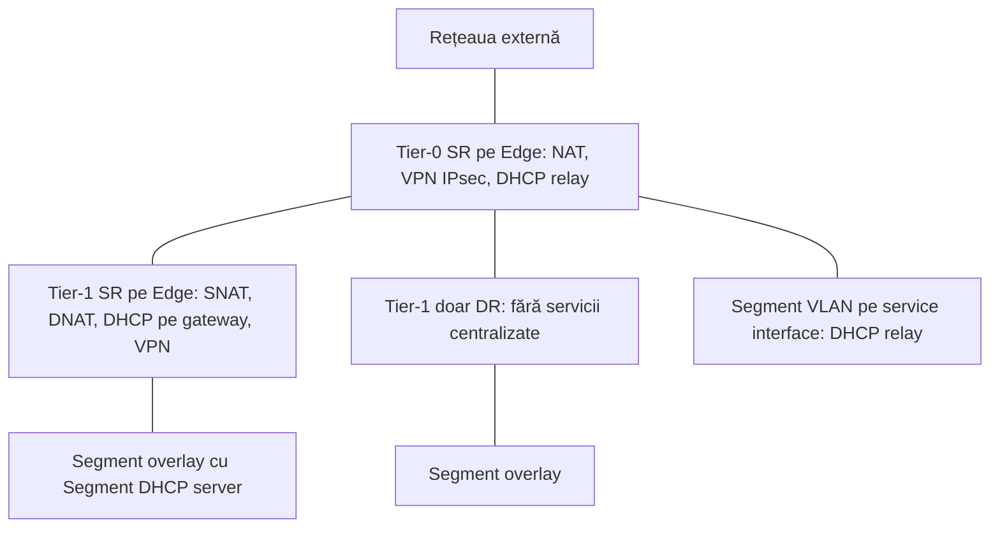
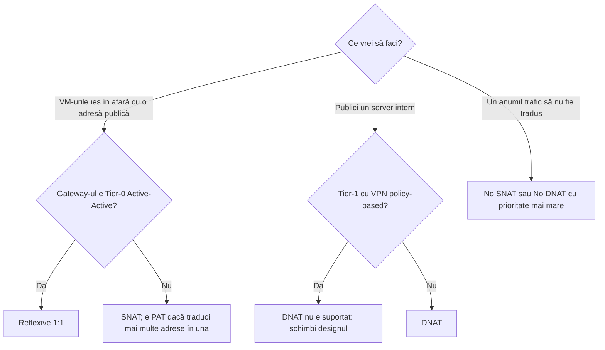

:::analogy
**Durerea din data center.** Ai pus o regulă SNAT (Source NAT; NAT, Network Address Translation, adică traducerea adreselor) pe un Tier-1, dar firewall-ul fizic vede tot adresele interne ale VM-urilor (VM, Virtual Machine). Regula e corectă; doar că traficul iese pe alt Tier-1, care nu are regula. [S514] Pentru examen, exam guide-ul VCF (VMware Cloud Foundation, 2V0-17.25) cere serviciile din rețeaua virtuală VCF, iar fostul exam guide VCP-NV (VMware Certified Professional - Network Virtualization, 2V0-41.24) avea obiective separate pentru NAT, DHCP (Dynamic Host Configuration Protocol) și VPN (Virtual Private Network). [S03] [S48]

**Analogia: recepția unui hotel.**

- **NAT** e recepționerul care răspunde la telefonul hotelului: din afară suni la un singur număr, iar el te pune în legătură cu camera potrivită (DNAT, Destination NAT); când un oaspete sună în oraș, apare numărul hotelului, nu al camerei (SNAT).
- **DHCP** e recepția care dă cheile: fiecare oaspete nou primește o cameră (adresă IP, Internet Protocol) pentru un timp.
- **VPN** e duba blindată între hotel și sediul central: ce e înăuntru nu se vede pe drum.
- Toate serviciile astea stau **la recepție**, adică pe SR (Service Router), nu în fiecare cameră.
:::

:::architecture
### 1. Unde rulează serviciile

NAT, DHCP pe gateway și VPN sunt servicii centralizate: rulează pe SR, deci pe Edge nodes. Un Tier-1 primește SR când îi alegi un Edge cluster, iar pe Tier-0 serviciile stateful cer HA (HA, High Availability) Active-Standby. [S500] [S496]

### 2. NAT

**Ce acțiuni NAT ai pe fiecare gateway:** [S508]

| Gateway | Acțiuni NAT | Sursă |
|---|---|---|
| Tier-1 | SNAT, DNAT, Reflexive, No SNAT, No DNAT | [S508] |
| Tier-0 Active-Standby | SNAT, DNAT, No SNAT, No DNAT | [S508] |
| Tier-0 Active-Active | Doar Reflexive (NAT fără stare) | [S508] |

Pagina de prezentare NAT mai menționează NAT stateful cu un mod HA numit *Stateful Active-Active* pe Tier-0 sau Tier-1; pagina de configurare din aceeași versiune nu îl listează (`⚠ de verificat` pentru versiunea ta). [S509]

| Tip | Ce face | Sursă |
|---|---|---|
| SNAT | Schimbă sursa traficului care iese; dacă intervalul tradus e mai mic decât cel potrivit, lucrează ca PAT (PAT, Port Address Translation) | [S509] [S508] |
| DNAT | Schimbă destinația traficului care intră (publici un server intern) | [S509] |
| Reflexive | NAT fără stare, 1:1: traduce sursa la ieșire și destinația la intrare | [S509] |
| No SNAT / No DNAT | Scutește o adresă sau un interval de SNAT sau DNAT | [S509] |

**Reguli de reținut:**

- **Prioritatea:** numărul mai mic câștigă, implicit 0; regulile No SNAT și No DNAT trebuie să aibă prioritate mai mare decât celelalte. [S508]
- **Firewall-ul regulii:** Match External Address, Match Internal Address sau Bypass. [S508]
- **Direcția:** SNAT se aplică de la downlink spre uplink, DNAT de la uplink spre downlink. NAT-ul de pe Tier-0 nu se aplică între două Tier-1 legate de același Tier-0. [S509]
- **Cu VPN:** DNAT nu e suportat pe un Tier-1 cu VPN IPsec policy-based. [S509]
- **Fără PAT:** SNAT face mereu traducere de porturi; pentru 1:1 fără PAT folosești Reflexive. [S515]
- **Firewall-ul de gateway:** dacă îl dezactivezi, regulile NAT aruncă traficul, cu excepția cazului în care ai o regulă ANY/ANY ALLOW. [S509] Articolul KB (Knowledge Base article) 389357 recomandă dezactivarea lui dacă nu-l folosești, dar atrage atenția că traficul de răspuns spre un VM cu SNAT are nevoie atunci de o regulă No SNAT. [S516]

### 3. DHCP

| Tip | Unde | Reguli | Sursă |
|---|---|---|---|
| Segment DHCP server | Pe segment | Implicit când segmentul e legat de gateway; singura opțiune pentru segmente izolate și VLAN (VLAN, Virtual Local Area Network); profilul DHCP trebuie să aibă un Edge cluster | [S510] [S465] |
| Gateway DHCP server | Profilul DHCP de pe gateway | Nu pentru IPv6 și nici pentru segmente VLAN; gateway-ul sau profilul are nevoie de Edge cluster | [S510] |
| DHCP relay | Trimite cererile la un server DHCP extern | DHCPv4 pe segmente VLAN, prin service interface pe Tier-0 sau Tier-1; un relay pe segment; fără static bindings | [S510] |

Valori: lease implicit **86400 de secunde** (între 60 și 4294967295); un interval DHCP are cel mult 65.536 de adrese și stă în subrețeaua segmentului. [S510] Pe segmentele VLAN cu DHCP, *Forged Transmits* trebuie să fie Accept sau MAC (MAC, Media Access Control) learning activat; din vSphere 7.0 Forged Transmits e implicit Reject. [S510]

### 4. VPN

**IPsec VPN** pe NSX Edge funcționează doar în tunnel mode, cu ESP (ESP, Encapsulating Security Payload, protocolul IP 50); IKE (IKE, Internet Key Exchange) negociază pe UDP (UDP, User Datagram Protocol) 500, iar dacă detectează NAT trece pe UDP 4500. [S512]

| Regulă | Sursă |
|---|---|
| Policy-based (subrețea locală și de la distanță în sesiune) sau route-based (VTI, Virtual Tunnel Interface, cu rute statice sau BGP, Border Gateway Protocol) | [S511] [S512] |
| Pe Tier-0, Tier-0 VRF (Virtual Routing and Forwarding) sau Tier-1, doar în **Active-Standby** | [S512] |
| Autentificare cu pre-shared key sau certificat; doar trafic IP unicast | [S512] |
| Fără sesiune între un Tier-0 părinte și un VRF atașat lui | [S512] |
| Configurezi NAT înainte de VPN; o regulă NAT adăugată după sesiune lasă tunelul Down până repornești VPN-ul | [S513] |
| Serviciul VPN se creează înainte de sesiuni: Networking > VPN > VPN Services > Add Service > IPSec | [S513] |

**L2 VPN** extinde un segment între site-uri peste un tunel IPsec route-based: configurezi un serviciu server și unul client, iar sesiunea server generează un *peer code* pe care îl imporți în client. [S511]

`[IMAGE SEARCH / PROMPT]` „NSX Tier-1 SNAT DNAT diagram” și „NSX route based IPsec VPN VTI BGP Tier-0”.
:::

:::exam-alert
### De memorat

| Ce | Valoare / regulă | Sursă |
|---|---|---|
| NAT pe Tier-0 Active-Active | doar Reflexive | [S508] |
| Prioritate NAT | mai mic câștigă, implicit 0 | [S508] |
| 1:1 fără PAT | Reflexive | [S515] |
| Tier-0 NAT între două Tier-1 | nu se aplică | [S509] |
| DHCP pe segment VLAN | Segment DHCP server sau relay | [S510] |
| Lease implicit | 86400 secunde | [S510] |
| IKE | UDP 500, UDP 4500 cu NAT | [S512] |
| ESP | protocolul IP 50 | [S512] |
| HA pentru IPsec | Active-Standby | [S512] |
| Ordinea | NAT înainte de VPN | [S513] |

### 3 capcane de examen

1. **„Pun DNAT pe un Tier-0 Active-Active.”** Fals. Tier-0 Active-Active suportă doar Reflexive. [S508]
2. **„Folosesc Gateway DHCP server pe un segment VLAN.”** Fals. Segmentele VLAN suportă doar Segment DHCP server sau DHCP relay. [S510]
3. **„IPsec VPN funcționează pe un Tier-0 Active-Active.”** Fals. Gateway-ul trebuie să fie Active-Standby. [S512]
:::

:::trenches
### Greșeala 1: regula SNAT nu e lovită niciodată

Pe Tier-1 există regula SNAT, dar firewall-ul fizic vede adresele originale. Traceflow arată că traficul trece prin alt Tier-1, fără regulă. [S514]
**Remediere (KB 436852):** verifici cu Traceflow pe ce gateway iese de fapt traficul și pui regula pe acel Tier-1 sau muți segmentul pe gateway-ul corect. [S514]

### Greșeala 2: VM-urile de pe un VLAN nu primesc IP prin DHCP relay

Clienții de pe un segment VLAN conectat la service interface nu primesc oferte de la serverul DHCP extern; Edge-ul nu le trimite mai departe spre host. [S518]
**Remediere (KB 413085):** creezi un profil Segment Security propriu, cu blocarea DHCP dezactivată, și îl aplici segmentului VLAN de pe Edge. [S518] [S469] KB-ul spune și că profilul implicit blochează DHCP, și că Server Block și Client Block sunt implicit oprite; verifică în lab ce vezi (`⚠ de verificat`). [S518]
:::

:::interview
**Întrebare Junior/Mid: „Care e diferența dintre SNAT, DNAT și Reflexive NAT în NSX?”**

*Răspunsul ideal:* SNAT schimbă sursa traficului care iese, de obicei ca VM-urile să apară cu o adresă publică, și face traducere de porturi. DNAT schimbă destinația traficului care intră, ca să publici un server. Reflexive e NAT fără stare 1:1 care traduce în ambele sensuri, singurul tip suportat pe un Tier-0 Active-Active. [S509] [S508] [S515]

**Scenariu de troubleshooting: „Un tunel IPsec spre o filială e Down. Ce faci?”**

*Răspunsul pe care îl așteaptă un Team Lead:*
1. **Gateway-ul e Active-Standby?** Active-Active nu e suportat pentru IPsec. [S517]
2. **Porturile**: UDP 500, UDP 4500 și protocolul IP 50 sunt permise pe drum și pe firewall-ul de gateway? [S517]
3. **Starea sesiunii**: Down înseamnă că faza 1 (IKE) a eșuat; pe Edge-ul activ rulezi `get ipsecvpn session` și `get ipsecvpn ikesa`. [S517]
4. **Parametrii**: versiunea IKE, criptarea, digest-ul și grupul DH (Diffie-Hellman) trebuie să fie identici; cheia pre-shared la fel; la policy-based, subrețelele trebuie să fie oglindite. *Download Config* îți dă ce trebuie să potrivească partea cealaltă. [S517]
5. **Ordinea cu NAT**: dacă ai adăugat o regulă NAT după sesiune, repornești configurația VPN. [S513]
:::

:::lab
**Scenariu.** Pe Tier-1-ul din lecția 4.5 adaugi un Edge cluster, configurezi o regulă SNAT pentru segmentul app-web și o regulă DNAT pentru un server, pornești un Segment DHCP server pe app-db, apoi citești configurația unui serviciu IPsec VPN.

**Ce ai nevoie.** Un lab VCF 9 cu NSX, Edge cluster (lecția 4.4), Tier-0 și Tier-1 (lecția 4.5), segmentele app-web și app-db. Lab-ul există deja; pentru VPN nu ai nevoie de o filială reală, doar citești pașii și comenzile.

Pașii de mai jos sunt bifabili, iar progresul se salvează în browser. Numele exacte ale meniurilor pot diferi puțin între versiuni (`⚠ de verificat`).

**Home lab only / not supported.** Adresele „publice” din lab pot fi o subrețea privată din rețeaua ta de acasă; în producție folosești adresele alocate de echipa de rețea. Nu dezactiva firewall-ul de gateway fără să citești efectul asupra NAT. [S509] [S516]

**Test de avarie și validare.** Pune o regulă No SNAT cu prioritate mai mare pentru o singură VM și verifică faptul că acea VM iese cu adresa ei internă, iar celelalte cu adresa tradusă. [S508]
:::

:::quiz
Cinci întrebări originale, în stilul examenelor VCP. Primești explicația pentru fiecare variantă imediat după ce răspunzi.
:::

:::references
- Exam guide-ul VCP-VCF 2V0-17.25 [S03] și fostul exam guide VCP-NV 2V0-41.24 [S48]
- Documentația NSX: NAT [S508] [S509], DHCP [S510], VPN [S511] [S512] [S513], Tier-0 și Tier-1 [S496] [S500], segmente [S465], segment profiles [S469]
- KB 436852, KB 425199 și KB 400763 (NAT) [S514] [S515] [S519]
- KB 389357 (firewall-ul de gateway și NAT) [S516]
- KB 413085 (DHCP relay) [S518] și KB 379731 (troubleshooting IPsec) [S517]
:::
