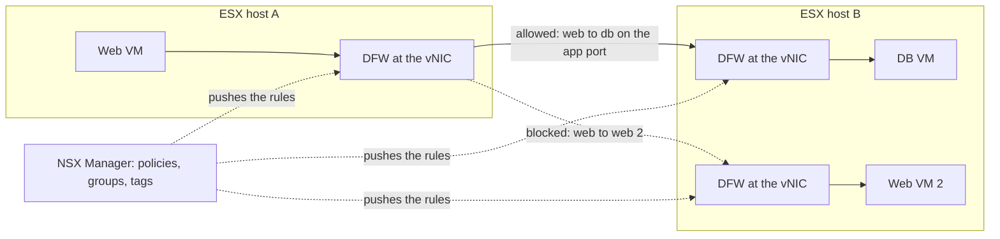
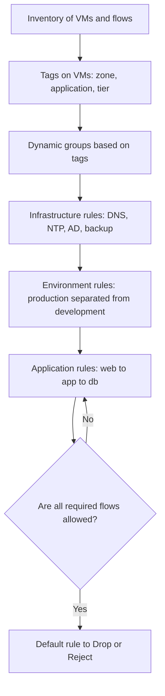

:::analogy
**The data center pain.** An attacker gets into a vulnerable web server. The physical firewall at the network edge sees none of what follows, because the web server and the database are in the same VLAN (VLAN, Virtual Local Area Network): the attacker moves laterally from VM (VM, Virtual Machine) to VM without ever passing the firewall. The DFW (DFW, Distributed Firewall) places a rule at every virtual network adapter, so even traffic between two neighboring VMs is checked. [S523] For the exam, the VCF (VMware Cloud Foundation, 2V0-17.25) exam guide includes VCF virtual network security, and in the former VCP-NV (VMware Certified Professional - Network Virtualization) DFW appears explicitly in the 2V0-41.23 guide, not separately in 2V0-41.24. [S03] [S48]

**The analogy: a building with badges.**

- A classic firewall is **the guard at the building gate**: it only checks who enters or leaves the building.
- DFW is **the badge reader at every office door**: even if you are already inside, you do not get into accounting unless you are allowed.
- **Tags and groups** are the badge colors ("web", "database", "production"), and the rules say which color may open which door.
- **The default rule** is what the door does when the badge is on no list: at first you leave it open (so you block nobody), then, once all the rules are written, you close it.
:::

:::architecture
### 1. Where DFW runs

DFW runs in the ESX hypervisor kernel and is logically attached to every vNIC (virtual network adapter) of every VM, independent of the OS (OS, Operating System) inside the VM. That is why rules stay with the VM when DRS (DRS, Distributed Resource Scheduler) moves it or a host fails. [S523] The firewall is stateful: when an Allow rule matches the first packet, an entry is created in the connection table, and the following packets of that connection pass based on it. [S520] [S525]

### 2. Categories and evaluation order

DFW categories are evaluated **left to right**, and the rules in a category **top to bottom**; the first matching rule applies, and Allow, Drop or Reject end the search for that packet. [S520] [S521]

| Order | Category | What goes there | Source |
|---|---|---|---|
| 1 | Ethernet | Layer 2 rules | [S521] |
| 2 | Emergency | Quarantine and emergency rules | [S521] |
| 3 | Infrastructure | Shared services: AD (AD, Active Directory), DNS (DNS, Domain Name System), NTP (NTP, Network Time Protocol), DHCP (DHCP, Dynamic Host Configuration Protocol), backup, management servers | [S521] |
| 4 | Environment | Rules between zones (production and development, compliance zones); has the *Jump to Application* action | [S521] [S520] |
| 5 | Application | Rules between applications, application tiers and microservices | [S521] |
| 6 | Default | The default rule, permissive at first | [S520] |

**The default rule** is configured as permissive. The documentation recommends adding allowlist rules and only then changing the default rule to Drop or Reject; whether the firewall "fails open" or "fails closed" depends on the last rule. [S520]

### 3. Groups, tags and Applied To

| Element | Rule | Source |
|---|---|---|
| Generic group | Dynamic criteria (for example tags), static members, IP (IP, Internet Protocol) or MAC (MAC, Media Access Control) addresses, AD groups | [S521] |
| IP Addresses Only group | IP addresses only | [S521] |
| Restriction | IP-only, MAC-only or AD-only groups cannot be used in Applied To | [S521] |
| Tag | On VMs, segments and ports; names up to 256 characters, scope up to 128 | [S521] |
| Applied To | Default DFW (all workloads); a policy-level Applied To takes precedence over the rule-level one | [S521] |
| Best practice | Narrow Applied To to save host resources, but include both source and destination | [S523] |
| Publishing | Up to 1,000 rules per section published together | [S521] |

**Micro-segmentation** is done in stages: first zones, then applications, then micro-segmentation between application tiers, with an allowlist model where everything not explicitly allowed is blocked. [S523]

### 4. Exclusion list

| What | Details | Source |
|---|---|---|
| Automatically excluded by the system | NSX Managers and Edges deployed through a compute manager, plus service VMs (Malware Prevention, Service Insertion); read-only | [S522] |
| What you add | Your own groups, at most 100; no IP sets, MAC sets or AD groups as members | [S522] |
| To add manually | Load balancers, firewalls, virtual network functions, VMs that need promiscuous mode, the first NSX Manager node | [S522] |
| VCF/NSX 9.0.x | NSX Manager VMs are marked as system-excluded and cannot get DFW rules; the KB (Knowledge Base article) has a workaround procedure | [S529] |

### 5. Licensing in VCF 9

| Fact | Source |
|---|---|
| vDefend Firewall is licensed separately from VCF 9 | [S448] |
| NSX 9.0 accepts only the vDefend Firewall and vDefend Firewall with ATP (Advanced Threat Prevention) solution keys; non-expiring keys work from 9.0.2 | [S527] |
| Without the vDefend license, after the grace period, new rules do not reach the hosts and only the default rule 99999999 applies | [S531] |
| In NSX 9.1, the vDefend key can be added only if a valid VCF key exists | [S528] |

`[IMAGE SEARCH / PROMPT]` "NSX distributed firewall vNIC hypervisor kernel diagram" and "NSX DFW categories ethernet emergency infrastructure environment application".
:::

:::exam-alert
### Memorize

| What | Value / rule | Source |
|---|---|---|
| Where DFW is enforced | In the kernel, at every vNIC | [S523] |
| Category order | Ethernet, Emergency, Infrastructure, Environment, Application, Default | [S520] |
| Evaluation | Left to right, then top to bottom, first match | [S520] |
| Default rule | Permissive at first; then Drop or Reject | [S520] |
| Default Applied To | DFW (all) | [S521] |
| Policy vs rule Applied To | The policy takes precedence | [S521] |
| Exclusion list | At most 100 groups | [S522] |
| Automatically excluded | NSX Managers and Edges | [S522] |
| License | vDefend Firewall, separate from VCF | [S448] [S527] |
| Host log | `/var/log/dfwpktlogs.log` | [S521] |

### 3 exam traps

1. **"I put an IP Addresses Only group in Applied To."** False. IP-only, MAC-only or AD-only groups cannot be used in Applied To. [S521]
2. **"Application rules are evaluated before Infrastructure rules."** False. Categories go left to right: Infrastructure comes before Environment and Application. [S520]
3. **"The VCF 9 license automatically covers DFW."** False. vDefend Firewall is licensed separately; without it, after the grace period, rules no longer reach the hosts. [S448] [S531]
:::

:::trenches
### Mistake 1: new rules do not apply, everything hits rule 99999999

In an NSX 9.0 environment, rules created in the UI do not reach the ESX hosts, and VM traffic hits the default rule 99999999. The VCF license is active, but the vDefend license is missing. [S531]
**Fix (KB 451106):** get the vDefend Distributed Firewall key from the Broadcom portal, add it to NSX Manager and check with Traceflow or on the host that the rules arrived. [S531] If the key is rejected with code 3045 on 9.0.0 or 9.0.1, KB 424676 says the problem is fixed in 9.0.2. [S527]

### Mistake 2: VMs lose traffic for 5 seconds at every publish

On a cluster where DFW on VDS (VDS, vSphere Distributed Switch) port groups was turned on and then off, VMs that should have no rules lose traffic for about 5 seconds at every rule publish (NSX 4.2.0–4.2.1). [S530]
**Fix (KB 389594):** temporarily put an Allow rule at the top for the affected workloads, restart `nsx-cfgagent` on the cluster hosts (`/etc/init.d/nsx-cfgagent restart`), then remove the temporary rule. [S530]
:::

:::interview
**Junior/Mid question: "What is micro-segmentation and how does NSX do it?"**

*Ideal answer:* micro-segmentation allows only the strictly necessary communication between workloads. NSX does it with DFW, which runs in the ESX kernel at every vNIC, so it also checks traffic between two VMs on the same segment. Rules use dynamic groups based on tags, are organized in categories and are built as an allowlist, with the default rule moved to Drop at the end. [S523] [S521] [S520]

**Troubleshooting scenario: "A VM cannot reach the database even though an Allow rule exists. What do you do?"**

*The answer a Team Lead expects:*
1. **Check the rule**: source, destination, service, Applied To and whether it is enabled. [S524]
2. **Check the order**: a broader rule above it, or in a category evaluated earlier, can block the traffic. [S524] [S520]
3. **Run Traceflow** between the two VMs to see where the packet is dropped. [S524]
4. **Check on the host** that the rules are really there: `summarize-dvfilter` for the VM filter name, then `vsipioctl getrules -f <filter>`; see active connections with `vsipioctl getflows -f <filter>`. [S524] [S525]
5. **Isolation test**: temporarily put the VM in a group on the exclusion list; if it works, the problem is in the rules. [S524]
:::

:::lab
**Scenario.** You micro-segment the application from the previous lessons: tag the web and db VMs, create dynamic groups, write Infrastructure and Application rules, check the rules on the host and only at the end tighten the default rule.

**What you need.** A VCF 9 lab with NSX, the app-web and app-db segments with one VM each, and a vDefend license applied (or the grace period active). The lab already exists.

The steps below can be ticked off, and progress is saved in the browser. Exact menu names may differ slightly between versions (`⚠ to verify`).

**Home lab only / not supported.** Do not move the default rule to Drop before you have rules for DNS, NTP and management: you can lose access to your own VMs. [S520] [S521] Turning the firewall off is not a production solution; use the exclusion list only for short tests. [S524]

**Failure test and validation.** Once the default rule is Drop, try a connection that is not allowed (for example SSH, Secure Shell, from web to db) and check in `/var/log/dfwpktlogs.log` on the host that it hit the default rule (if you enabled logging). [S521]
:::

:::quiz
Five original questions in VCP exam style. You get the explanation for every option right after you answer.
:::

:::references
- The VCP-VCF 2V0-17.25 exam guide [S03] and the former VCP-NV exam guide [S48]
- NSX documentation: policies and categories [S520], Security Quick Start [S521], exclusion list [S522]
- VMware TechZone: DFW use cases and scope [S523]
- KB 379438 (DFW troubleshooting) [S524], KB 343357 (packets on the default rule) [S525], KB 330455 and KB 389594 (DFW on VDS port groups) [S526] [S530]
- VCF 9.0 General FAQs [S448]; KB 424676, KB 404112 and KB 451106 (vDefend license) [S527] [S528] [S531]
- KB 426123 (NSX Manager excluded in 9.0.x) [S529]
:::
