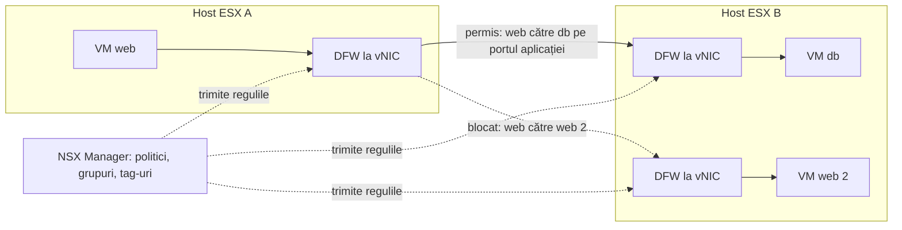
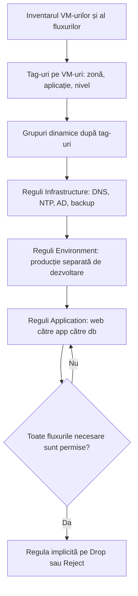

:::analogy
**Durerea din data center.** Un atacator intră pe un server web vulnerabil. Firewall-ul fizic de la marginea rețelei nu vede nimic din ce urmează, pentru că serverul web și baza de date sunt în același VLAN (VLAN, Virtual Local Area Network): atacatorul se mută lateral, de la VM (VM, Virtual Machine) la VM, fără să treacă vreodată pe la firewall. DFW (DFW, Distributed Firewall) pune o regulă la fiecare placă de rețea virtuală, deci și traficul dintre două VM-uri vecine e verificat. [S523] Pentru examen, exam guide-ul VCF (VMware Cloud Foundation, 2V0-17.25) include securitatea rețelei virtuale VCF, iar în fostul VCP-NV (VMware Certified Professional - Network Virtualization) DFW apare explicit în ghidul 2V0-41.23, nu separat în 2V0-41.24. [S03] [S48]

**Analogia: clădirea cu ecusoane.**

- Firewall-ul clasic e **paznicul de la poarta clădirii**: verifică doar cine intră sau iese din clădire.
- DFW e **cititorul de ecusoane de la fiecare ușă de birou**: chiar dacă ești deja înăuntru, nu intri în contabilitate dacă nu ai voie.
- **Tag-urile și grupurile** sunt culorile ecusoanelor („web”, „bază de date”, „producție”), iar regulile spun ce culoare are voie la ce ușă.
- **Regula implicită** e ce face ușa când ecusonul nu e pe nicio listă: la început o lași deschisă (ca să nu blochezi pe nimeni), apoi, după ce ai scris toate regulile, o închizi.
:::

:::architecture
### 1. Unde rulează DFW

DFW rulează în kernelul hypervisorului ESX și e atașat logic la fiecare vNIC (placa de rețea virtuală) a fiecărui VM, independent de OS-ul (OS, Operating System) din VM. De aceea regulile rămân pe VM când DRS (DRS, Distributed Resource Scheduler) îl mută sau când un host cade. [S523] Firewall-ul e stateful: când o regulă Allow se potrivește primului pachet, se creează o intrare în tabela de conexiuni, iar pachetele următoare ale conexiunii trec pe baza ei. [S520] [S525]

### 2. Categorii și ordinea de evaluare

Categoriile DFW se evaluează **de la stânga la dreapta**, iar regulile dintr-o categorie **de sus în jos**; prima regulă potrivită se aplică, iar Allow, Drop sau Reject opresc căutarea pentru acel pachet. [S520] [S521]

| Ordine | Categorie | Ce pui acolo | Sursă |
|---|---|---|---|
| 1 | Ethernet | Reguli de nivel 2 | [S521] |
| 2 | Emergency | Carantină și reguli de urgență | [S521] |
| 3 | Infrastructure | Servicii comune: AD (AD, Active Directory), DNS (DNS, Domain Name System), NTP (NTP, Network Time Protocol), DHCP (DHCP, Dynamic Host Configuration Protocol), backup, servere de management | [S521] |
| 4 | Environment | Reguli între zone (producție și dezvoltare, zone cu cerințe de conformitate); are acțiunea *Jump to Application* | [S521] [S520] |
| 5 | Application | Reguli între aplicații, niveluri de aplicație și microservicii | [S521] |
| 6 | Default | Regula implicită, permisivă la început | [S520] |

**Regula implicită** e configurată permisiv. Documentația recomandă să adaugi reguli de tip allowlist și abia apoi să schimbi regula implicită pe Drop sau Reject; dacă firewall-ul „cade deschis” sau „închis” depinde de ultima regulă. [S520]

### 3. Grupuri, tag-uri și Applied To

| Element | Regulă | Sursă |
|---|---|---|
| Grup Generic | Criterii dinamice (de exemplu tag-uri), membri statici, adrese IP (IP, Internet Protocol) sau MAC (MAC, Media Access Control), grupuri AD | [S521] |
| Grup IP Addresses Only | Doar adrese IP | [S521] |
| Restricție | Grupurile doar cu IP, doar cu MAC sau doar AD nu se pot folosi în Applied To | [S521] |
| Tag | Pe VM-uri, segmente și porturi; nume de până la 256 de caractere, scope de până la 128 | [S521] |
| Applied To | Implicit DFW (toate workload-urile); Applied To la nivel de politică are prioritate față de cel al regulii | [S521] |
| Bună practică | Restrângi Applied To ca să economisești resurse pe hosturi, dar incluzi și sursa, și destinația | [S523] |
| Publicare | Până la 1.000 de reguli pe secțiune publicate împreună | [S521] |

**Microsegmentarea** se face în etape: întâi zone, apoi aplicații, apoi microsegmentare între nivelurile aplicației, cu un model allowlist în care tot ce nu e permis explicit e blocat. [S523]

### 4. Exclusion list

| Ce | Detalii | Sursă |
|---|---|---|
| Excluse automat de sistem | NSX Manager și Edge-urile instalate prin compute manager, plus VM-urile de serviciu (Malware Prevention, Service Insertion); read-only | [S522] |
| Ce adaugi tu | Grupuri proprii, maxim 100; fără IP sets, MAC sets sau grupuri AD ca membri | [S522] |
| De adăugat manual | Load balancere, firewall-uri, funcții de rețea virtuale, VM-uri care cer promiscuous mode, primul nod NSX Manager | [S522] |
| VCF/NSX 9.0.x | VM-urile NSX Manager sunt marcate de sistem ca excluse și nu pot primi reguli DFW; articolul KB (Knowledge Base article) are o procedură de ocolire | [S529] |

### 5. Licența în VCF 9

| Fapt | Sursă |
|---|---|
| vDefend Firewall se licențiază separat de VCF 9 | [S448] |
| NSX 9.0 acceptă doar cheile de soluție vDefend Firewall și vDefend Firewall with ATP (Advanced Threat Prevention); cheile fără expirare merg din 9.0.2 | [S527] |
| Fără licența vDefend, după perioada de grație, regulile noi nu ajung pe hosturi și se aplică doar regula implicită 99999999 | [S531] |
| În NSX 9.1, cheia vDefend se poate adăuga doar dacă există o cheie VCF validă | [S528] |

`[IMAGE SEARCH / PROMPT]` „NSX distributed firewall vNIC hypervisor kernel diagram” și „NSX DFW categories ethernet emergency infrastructure environment application”.
:::

:::exam-alert
### De memorat

| Ce | Valoare / regulă | Sursă |
|---|---|---|
| Unde se aplică DFW | În kernel, la fiecare vNIC | [S523] |
| Ordinea categoriilor | Ethernet, Emergency, Infrastructure, Environment, Application, Default | [S520] |
| Evaluarea | Stânga la dreapta, apoi sus în jos, prima potrivire | [S520] |
| Regula implicită | Permisivă la început; apoi Drop sau Reject | [S520] |
| Applied To implicit | DFW (toate) | [S521] |
| Applied To politică vs regulă | Politica are prioritate | [S521] |
| Exclusion list | Maxim 100 de grupuri | [S522] |
| Excluse automat | NSX Manager și Edge-uri | [S522] |
| Licență | vDefend Firewall, separat de VCF | [S448] [S527] |
| Jurnal pe host | `/var/log/dfwpktlogs.log` | [S521] |

### 3 capcane de examen

1. **„Pun un grup IP Addresses Only în Applied To.”** Fals. Grupurile doar cu IP, MAC sau AD nu se pot folosi în Applied To. [S521]
2. **„Regulile din Application se evaluează înaintea celor din Infrastructure.”** Fals. Categoriile merg de la stânga la dreapta: Infrastructure vine înaintea Environment și Application. [S520]
3. **„Licența VCF 9 acoperă automat DFW.”** Fals. vDefend Firewall se licențiază separat; fără ea, după perioada de grație, regulile nu mai ajung pe hosturi. [S448] [S531]
:::

:::trenches
### Greșeala 1: regulile noi nu se aplică, totul lovește regula 99999999

Într-un mediu NSX 9.0, regulile create în interfață nu ajung pe hosturile ESX, iar traficul VM-urilor lovește regula implicită 99999999. Licența VCF e activă, dar lipsește licența vDefend. [S531]
**Remediere (KB 451106):** iei cheia vDefend Distributed Firewall din portalul Broadcom, o adaugi în NSX Manager și verifici cu Traceflow sau pe host că regulile au ajuns. [S531] Dacă cheia e refuzată cu codul 3045 pe 9.0.0 sau 9.0.1, KB 424676 spune că problema e rezolvată în 9.0.2. [S527]

### Greșeala 2: VM-urile pierd trafic câte 5 secunde la fiecare publicare

Pe un cluster unde funcția DFW pe port group-uri VDS (VDS, vSphere Distributed Switch) a fost pornită și apoi oprită, VM-urile care nu ar trebui să aibă reguli pierd trafic aproximativ 5 secunde la fiecare publicare de reguli (NSX 4.2.0–4.2.1). [S530]
**Remediere (KB 389594):** pui temporar o regulă Allow sus pentru workload-urile afectate, repornești `nsx-cfgagent` pe hosturile clusterului (`/etc/init.d/nsx-cfgagent restart`) și apoi scoți regula temporară. [S530]
:::

:::interview
**Întrebare Junior/Mid: „Ce e microsegmentarea și cum o face NSX?”**

*Răspunsul ideal:* microsegmentarea permite între workload-uri doar comunicația strict necesară. NSX o face cu DFW, care rulează în kernelul ESX la fiecare vNIC, deci verifică și traficul dintre două VM-uri din același segment. Regulile folosesc grupuri dinamice bazate pe tag-uri, se organizează pe categorii și se construiesc ca allowlist, cu regula implicită trecută la final pe Drop. [S523] [S521] [S520]

**Scenariu de troubleshooting: „Un VM nu ajunge la baza de date, deși există o regulă Allow. Ce faci?”**

*Răspunsul pe care îl așteaptă un Team Lead:*
1. **Verifici regula**: sursa, destinația, serviciul, Applied To și dacă e activată. [S524]
2. **Verifici ordinea**: o regulă mai largă deasupra, sau într-o categorie evaluată mai devreme, poate bloca traficul. [S524] [S520]
3. **Rulezi Traceflow** între cele două VM-uri ca să vezi unde e aruncat pachetul. [S524]
4. **Verifici pe host** că regulile chiar sunt acolo: `summarize-dvfilter` pentru numele filtrului VM-ului, apoi `vsipioctl getrules -f <filtru>`; conexiunile active le vezi cu `vsipioctl getflows -f <filtru>`. [S524] [S525]
5. **Test de izolare**: pui temporar VM-ul într-un grup din exclusion list; dacă merge, problema e în reguli. [S524]
:::

:::lab
**Scenariu.** Faci microsegmentare pentru aplicația din lecțiile anterioare: pui tag-uri pe VM-urile web și db, creezi grupuri dinamice, scrii reguli în Infrastructure și Application, verifici regulile pe host și abia la final strângi regula implicită.

**Ce ai nevoie.** Un lab VCF 9 cu NSX, segmentele app-web și app-db cu câte un VM și o licență vDefend aplicată (sau perioada de grație activă). Lab-ul există deja.

Pașii de mai jos sunt bifabili, iar progresul se salvează în browser. Numele exacte ale meniurilor pot diferi puțin între versiuni (`⚠ de verificat`).

**Home lab only / not supported.** Nu trece regula implicită pe Drop înainte să ai reguli pentru DNS, NTP și management: poți pierde accesul la propriile VM-uri. [S520] [S521] Oprirea firewall-ului nu e o soluție de producție; folosește exclusion list doar pentru teste scurte. [S524]

**Test de avarie și validare.** După ce regula implicită e Drop, încearcă o conexiune nepermisă (de exemplu SSH, Secure Shell, de la web la db) și vezi în `/var/log/dfwpktlogs.log` pe host că a lovit regula implicită (dacă ai activat logging-ul). [S521]
:::

:::quiz
Cinci întrebări originale, în stilul examenelor VCP. Primești explicația pentru fiecare variantă imediat după ce răspunzi.
:::

:::references
- Exam guide-ul VCP-VCF 2V0-17.25 [S03] și fostul exam guide VCP-NV [S48]
- Documentația NSX: politici și categorii [S520], Security Quick Start [S521], exclusion list [S522]
- VMware TechZone: cazuri de utilizare și scope pentru DFW [S523]
- KB 379438 (troubleshooting DFW) [S524], KB 343357 (pachete pe regula implicită) [S525], KB 330455 și KB 389594 (DFW pe port group-uri VDS) [S526] [S530]
- VCF 9.0 General FAQs [S448]; KB 424676, KB 404112 și KB 451106 (licența vDefend) [S527] [S528] [S531]
- KB 426123 (NSX Manager exclus în 9.0.x) [S529]
:::
