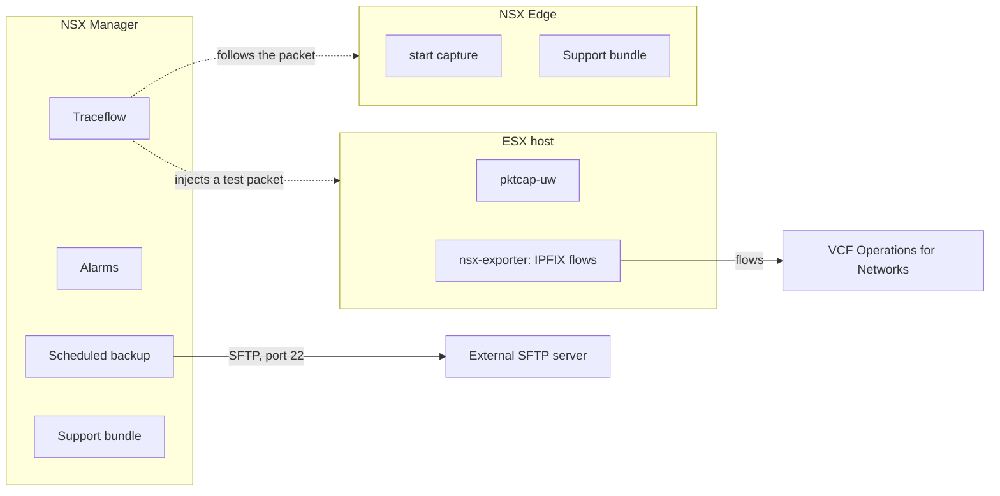
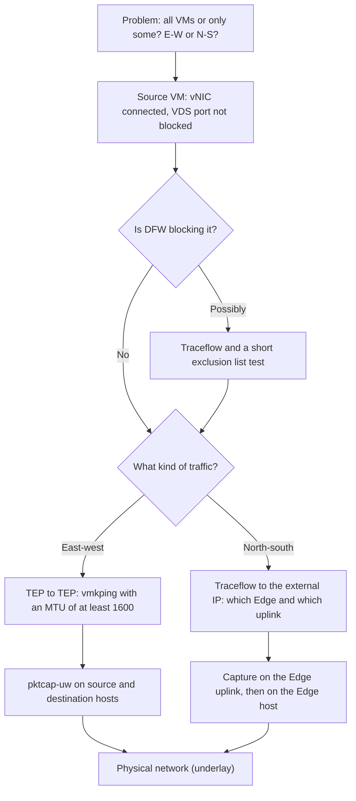

:::analogy
**The data center pain.** Monday morning an application stops responding, and the application team says "it's the network". You have NSX (VMware NSX, the virtual networking platform), dozens of segments with VMs (VM, Virtual Machine), two Edges and a distributed firewall (DFW, Distributed Firewall). Without an orderly way to search, you lose hours. And if NSX Manager fails the same week and you have no good backup, you lose the whole network and security configuration. This lesson covers the operations and troubleshooting objectives in the curriculum (VCF, VMware Cloud Foundation, 4.3.9; NV, Network Virtualization, 4.11 and 4.12). [S03] [S48]

**The analogy: the car service shop.**

- **The backup** is the car's service book, kept somewhere other than the car: if the car burns, you rebuild it from the book.
- **The passphrase** is the key to the safe holding the service book: lose it and the book is useless.
- **Alarms** are the dashboard warning lights: they tell you something is wrong, not exactly what.
- **Traceflow** is a test car sent along the route: it shows you which street it stopped on.
- **A packet capture** is the camera on the pole: you see exactly what went past.
- **The support bundle** is the file you take to the dealer when you cannot fix it yourself.
:::

:::architecture
### 1. Backup and restore

NSX Manager does not keep its backups locally: it sends them to an external SFTP (SFTP, SSH File Transfer Protocol; SSH, Secure Shell) server, by default on port 22, reachable from the management network. [S533]

| Element | Rule | Source |
|---|---|---|
| Data types in a manual backup | Cluster, Node, Inventory | [S533] |
| Scheduling | Recurring Backup, Weekly or Interval frequency, plus a backup when a configuration change is detected | [S533] |
| Passphrase | Encrypts the backup; cannot be recovered; without it there is no restore, and the backup does not start without it | [S533] [S534] |
| Who configures it | An Enterprise Admin or Admin account; you accept the server's SSH fingerprint | [S533] |
| Restore | Only on a newly deployed NSX Manager appliance, with the same version and build, the same IP (IP, Internet Protocol) or FQDN (FQDN, Fully Qualified Domain Name) | [S534] [S535] |
| During the restore | The manager may reboot several times; do not interrupt unless the UI shows an error | [S534] |
| After the restore | The UI and API (API, Application Programming Interface) can be slow while indexes rebuild | [S534] |
| VM snapshot | Not supported for NSX Manager and Edge; can corrupt the cluster database | [S536] |

The menu path differs between versions: one source gives it as System > Lifecycle Management > Backup & Restore, another says this is the path in older versions (`⚠ to verify` in NSX 9.0). [S533] [S536]

### 2. The operations tools

| Tool | What it is for | What you need to know | Source |
|---|---|---|---|
| Alarms | Signal a health problem; each has an event ID, for example `manager_health.manager_cpu_usage_very_high` | For high CPU (CPU, Central Processing Unit) on the Manager, review the services and the appliance size | [S542] |
| Traceflow | Injects a crafted packet and shows the path or where it is dropped | The OS (OS, Operating System) in the VM never sees the packet; on VLAN (VLAN, Virtual Local Area Network) segments it needs INT (In-band Network Telemetry) and accepts only TCP (TCP, Transmission Control Protocol), UDP (UDP, User Datagram Protocol) and ICMP (ICMP, Internet Control Message Protocol); it does not work over HCX (HCX, Hybrid Cloud Extension) extended networks | [S532] |
| Live Traffic Analysis | Traces real traffic on a source port | Do not disable or change the port while the session runs; an old NSX-T issue led to a PSOD (PSOD, Purple Screen of Death) | [S543] |
| `pktcap-uw` on the host | Packet capture at points on the data path | Points: VnicTx, VnicRx, UplinkSndKernel, UplinkRcvKernel; always stop the capture | [S541] |
| Capture on the Edge | Capture on the Tier-0 uplink | First enter the VRF (VRF, Virtual Routing and Forwarding) of the SR (SR, Service Router) | [S541] |
| Port mirroring | Copies traffic to an analysis VM | For Remote L3 SPAN (SPAN, Switched Port Analyzer), Ingress means traffic entering the VDS (VDS, vSphere Distributed Switch), that is, leaving the VM | [S538] |
| Support bundle | Logs for Broadcom support | From the UI or the CLI (CLI, Command Line Interface) | [S540] |
| VCF Operations for Networks | Flow analysis from IPFIX (IPFIX, IP Flow Information Export) | Formerly Aria Operations for Networks, before that vRealize Network Insight | [S539] |

### 3. The troubleshooting order

The official connectivity troubleshooting article starts by scoping the problem and moves from the VM toward the physical network. [S537]

E-W (East-West) is traffic between workloads inside the data center, and N-S (North-South) is traffic leaving toward the physical network. For east-west you check the tunnel between TEPs (TEP, Tunnel Endpoint) with an MTU (MTU, Maximum Transmission Unit) of at least 1600, for example by moving both VMs to the same host to rule out the physical network. For north-south, Traceflow to the destination IP shows which Edge and which uplink carry the traffic, even if the destination is outside NSX. [S537]

### 4. The verified commands

| Where | Command | What it is for | Source |
|---|---|---|---|
| ESX host | `vmkping ++netstack=vxlan -I vmkX <remote TEP IP> -d -s <size>` | Tests the TEP to TEP tunnel without fragmentation | [S537] |
| ESX host | `nsxdp-cli vswitch instance list` | Finds the switchport and uplinks on an NSX-prepared host | [S541] |
| ESX host | `pktcap-uw --switchport <id> --capture VnicTx,VnicRx -o - \| tcpdump-uw -r - -nne` | Live capture on the VM port | [S541] |
| ESX host | `pktcap-uw -A` | Lists all capture points | [S541] |
| ESX host | `lsof \|grep pktcap-uw \|awk '{print $1}'\| sort -u` | Checks whether captures are still running | [S541] |
| Edge | `get logical-router`, `vrf <number>`, `get interface` | Finds the uplink interface of the Tier-0 SR | [S541] |
| Edge | `start capture interface <uuid> direction dual expression <expression>` | Live capture on the uplink | [S541] |
| Manager or Edge | `get support-bundle file <name>.tar` | Creates the support bundle in `/image/vmware/nsx/file-store/` | [S540] |
| Manager or Edge | `copy file <name>.tar url scp://...` | Copies the file over SCP (SCP, Secure Copy Protocol) | [S540] |

Useful logs for Traceflow: on the Manager `/var/log/proton/nsxapi.log` and `/var/log/policy/policy.log`, on the host `/var/run/log/nsx-syslog.log`, on the Edge `/var/log/syslog`. [S532]

`[IMAGE SEARCH / PROMPT]` "NSX Traceflow result topology view" and "NSX Manager backup and restore SFTP configuration screen".
:::

:::exam-alert
### Memorize

| What | Value / rule | Source |
|---|---|---|
| Where the backup goes | External SFTP server, port 22 by default | [S533] |
| Data in a manual backup | Cluster, Node, Inventory | [S533] |
| Lost passphrase | The backup can no longer be restored | [S533] |
| Restore conditions | New appliance, same version and build, same IP or FQDN | [S534] [S535] |
| NSX Manager or Edge snapshot | Not supported | [S536] |
| Traceflow on VLAN | Needs INT; then only TCP, UDP, ICMP | [S532] |
| Minimum MTU between TEPs | 1600 | [S537] |
| `pktcap-uw` points | VnicTx, VnicRx, UplinkSndKernel, UplinkRcvKernel | [S541] |
| Support bundle from the CLI | `get support-bundle file <name>` | [S540] |
| VCF Operations for Networks | Formerly Aria Operations for Networks / vRealize Network Insight | [S539] |

### 3 exam traps

1. **"I snapshot NSX Manager before the upgrade so I can roll back."** False. VM snapshots are not supported for NSX Manager and Edge; use the file-based backup and, if needed, restore to a new appliance. [S536]
2. **"I can restore the backup to an existing Manager with a different IP."** False. Restore is done only on a newly deployed appliance with the same version and the same IP or FQDN. [S535]
3. **"Traceflow sends a real ping that the destination VM sees."** False. The packet is crafted and injected by NSX, and the OS in the VM never sees it. [S532]
:::

:::trenches
### Mistake 1: rollback with a snapshot after a failed upgrade

The team snapshots the NSX Manager VMs before an upgrade and reverts to them when the upgrade goes wrong. After the revert, the UI and API stop responding, database sync fails and the Managers' CPU is high. [S536]
**Fix (The KB (Knowledge Base article) 433822):** do not use snapshots for NSX Manager or Edge. Before any upgrade, run a manual backup, check that the status is Success and that the files are on the server, and to roll back, deploy a new OVA (OVA, Open Virtual Appliance) of the same version and run a restore. [S536] If the restore fails, check the version and build (shown in the backup folder path), the SSH fingerprint and the space on the SFTP server. [S534]

### Mistake 2: flows disappear from VCF Operations for Networks after migration

In NSX 9.0.x, after you move VMs from a distributed port group (DVPG, Distributed Virtual Port Group) to NSX segments, their flows no longer appear in VCF Operations for Networks, and the collector drops them with the reason `NON_DOMAIN_NSXT_FLOWS`. The cause: the IPFIX filters on the host keep the old port group IDs instead of the VIF (VIF, Virtual Interface) IDs. [S539]
**Fix (KB 448198):** the problem is fixed in NSX 9.1. On 9.0.x, restart the exporter on the host with `/etc/init.d/nsx-exporter restart` (no traffic impact, according to the article), check with `nsxcli -c get firewall ipfix-filters` that VIF IDs appear, and wait about 30 minutes. [S539]
:::

:::interview
**Junior/Mid question: "How do you protect the NSX configuration and how do you rebuild it after a failure?"**

*Ideal answer:* I configure a scheduled backup to an external SFTP server, with a passphrase kept safe, and I run a manual backup before every major change. I do not snapshot NSX Manager or Edge, because that is not supported. After a failure I deploy a new appliance with the same version, the same build and the same IP or FQDN, then run a restore from Backup History. [S533] [S534] [S535] [S536]

**Troubleshooting scenario: "Two VMs on different segments cannot communicate. What do you do?"**

*The answer a Team Lead expects:*
1. **Scope the problem**: all VMs or only some, all traffic or one port, east-west or north-south. [S537]
2. **Check the source VM**: vNIC connected, VDS port not blocked, host state in NSX. [S537]
3. **Rule out DFW**: Traceflow between the two VMs and, briefly, the VM in the exclusion list. [S537] [S524]
4. **Check the overlay**: `vmkping ++netstack=vxlan` between TEPs with an MTU of at least 1600. [S537]
5. **Capture**: `pktcap-uw` on both hosts, at the vNIC and at the uplink, and stop the captures at the end. [S541]
6. **Escalate properly**: support bundles from the nodes involved and the exact reproduction steps. [S540] [S534]
:::

:::lab
**Scenario.** You do basic operations on the lab NSX: configure the backup, run a manual backup, check the alarms, follow a packet with Traceflow, capture on the host and on the Edge and generate a support bundle.

**What you need.** The VCF 9 lab with NSX from the previous lessons, the web and db VMs and an SFTP server on the management network. The lab already exists.

The steps below can be ticked off, and progress is saved in the browser. Exact menu names may differ slightly between versions (`⚠ to verify`).

**Supported vs home lab only.** SFTP backup and restore to a new appliance are the supported procedure. A VM snapshot of NSX Manager is not supported, not even in the lab if you want to practice what happens in production. [S536] `pktcap-uw` captures left running can exhaust host resources, so always stop them. [S541]

**Failure test and validation.** Run Traceflow from the web VM to the db VM on a port blocked by DFW and check that the result shows the rule that dropped the packet; then check on the SFTP server that the files from the manual backup exist. [S532] [S536]
:::

:::quiz
Five original questions in VCP (VMware Certified Professional) exam style. You get the explanation for every option right after you answer.
:::

:::references
- The VCP-VCF 2V0-17.25 [S03] and VCP-NV 2V0-41.24 [S48] exam guides
- KB 372865 (backup configuration) [S533], KB 373896 (backup and restore problems) [S534], KB 373068 (restore) [S535], KB 433822 (no snapshots) [S536]
- KB 387914 (Traceflow) [S532], KB 381235 (connectivity troubleshooting) [S537], KB 345925 (packet captures) [S541]
- KB 383034 (support bundle from the CLI) [S540], KB 375209 (Manager CPU alarm) [S542]
- KB 416675 (Remote L3 SPAN) [S538], KB 322521 (Live Traffic Analysis) [S543], KB 448198 (VCF Operations for Networks) [S539]
- KB 379438 (DFW troubleshooting) [S524]
:::
