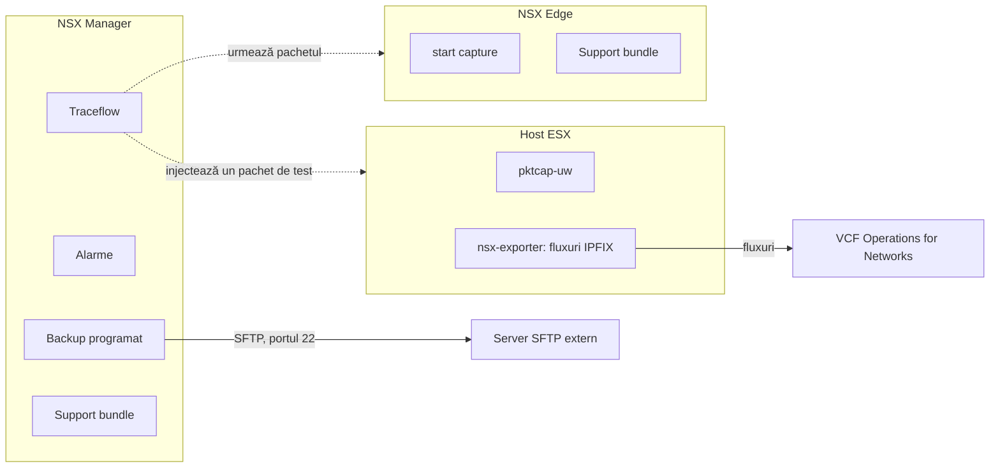
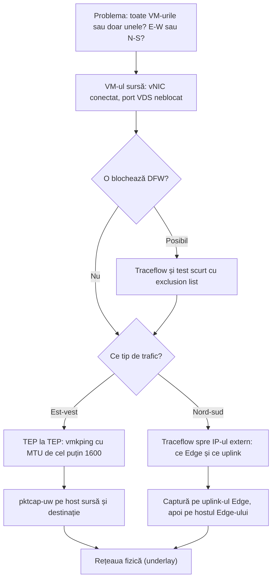

:::analogy
**Durerea din data center.** Luni dimineață, o aplicație nu mai răspunde, iar echipa de aplicații spune „e rețeaua”. Ai NSX (VMware NSX, platforma de rețea virtuală), zeci de segmente cu VM-uri (VM, Virtual Machine), două Edge-uri și un firewall distribuit (DFW, Distributed Firewall). Fără un mod ordonat de a căuta, pierzi ore. Iar dacă în aceeași săptămână cade NSX Manager și nu ai un backup bun, pierzi toată configurația de rețea și securitate. Lecția acoperă obiectivele de operare și troubleshooting din curriculum (VCF, VMware Cloud Foundation, 4.3.9; NV, Network Virtualization, 4.11 și 4.12). [S03] [S48]

**Analogia: service-ul auto.**

- **Backup-ul** e cartea tehnică a mașinii, ținută în altă parte decât mașina: dacă mașina arde, o reconstruiești după ea.
- **Passphrase-ul** e cheia seifului în care stă cartea tehnică: dacă o pierzi, cartea nu-ți mai folosește.
- **Alarmele** sunt martorii din bord: îți spun că ceva e în neregulă, nu exact ce.
- **Traceflow** e mașina de test trimisă pe traseu: îți arată pe ce stradă s-a oprit.
- **Captura de pachete** e camera de pe stâlp: vezi exact ce a trecut pe acolo.
- **Support bundle-ul** e dosarul pe care îl duci la reprezentanță când nu te mai descurci singur.
:::

:::architecture
### 1. Backup și restore

NSX Manager nu își păstrează backup-urile local: le trimite pe un server SFTP (SFTP, SSH File Transfer Protocol; SSH, Secure Shell) extern, implicit pe portul 22, accesibil din rețeaua de management. [S533]

| Element | Regula | Sursa |
|---|---|---|
| Tipuri de date la un backup manual | Cluster, Node, Inventory | [S533] |
| Programare | Recurring Backup, frecvență Weekly sau Interval, plus backup la detectarea unei schimbări de configurație | [S533] |
| Passphrase | Criptează backup-ul; nu se poate recupera; fără el nu există restore, iar backup-ul nu pornește fără el | [S533] [S534] |
| Cine îl configurează | Un cont Enterprise Admin sau Admin; accepți amprenta SSH a serverului | [S533] |
| Restore | Doar pe un appliance NSX Manager nou instalat, cu aceeași versiune și același build, același IP (IP, Internet Protocol) sau FQDN (FQDN, Fully Qualified Domain Name) | [S534] [S535] |
| În timpul restore-ului | Managerul poate reporni de mai multe ori; nu întrerupe procesul decât dacă interfața arată o eroare | [S534] |
| După restore | Interfața și API-ul (API, Application Programming Interface) pot fi lente cât se reconstruiesc indecșii | [S534] |
| Snapshot de VM | Nu e suportat pentru NSX Manager și Edge; poate corupe baza de date a clusterului | [S536] |

Calea din meniu diferă între versiuni: o sursă o dă ca System > Lifecycle Management > Backup & Restore, alta spune că aceasta e calea din versiunile vechi (`⚠ de verificat` în NSX 9.0). [S533] [S536]

### 2. Uneltele de operare

| Unealta | La ce folosește | Ce trebuie să știi | Sursa |
|---|---|---|---|
| Alarme | Semnalează o problemă de sănătate; fiecare are un event ID, de exemplu `manager_health.manager_cpu_usage_very_high` | La CPU (CPU, Central Processing Unit) mare pe Manager, verifici serviciile și dimensiunea appliance-ului | [S542] |
| Traceflow | Injectează un pachet construit și arată calea sau locul unde e aruncat | Sistemul de operare din VM nu vede pachetul; pe segmente VLAN (VLAN, Virtual Local Area Network) cere INT (In-band Network Telemetry) și acceptă doar TCP (TCP, Transmission Control Protocol), UDP (UDP, User Datagram Protocol) și ICMP (ICMP, Internet Control Message Protocol); nu merge pe rețele extinse cu HCX (HCX, Hybrid Cloud Extension) | [S532] |
| Live Traffic Analysis | Urmărește trafic real pe un port sursă | Nu dezactiva și nu modifica portul cât timp sesiunea rulează; o problemă veche din NSX-T ducea la PSOD (PSOD, Purple Screen of Death) | [S543] |
| `pktcap-uw` pe host | Captură de pachete în punctele căii de date | Puncte: VnicTx, VnicRx, UplinkSndKernel, UplinkRcvKernel; oprești mereu captura | [S541] |
| Captură pe Edge | Captură pe uplink-ul Tier-0 | Intri întâi în VRF-ul (VRF, Virtual Routing and Forwarding) SR-ului (SR, Service Router) | [S541] |
| Port mirroring | Copiază traficul spre un VM de analiză | La Remote L3 SPAN (SPAN, Switched Port Analyzer), Ingress înseamnă trafic care intră în VDS (VDS, vSphere Distributed Switch), adică iese din VM | [S538] |
| Support bundle | Logurile pentru suportul Broadcom | Din interfață sau din CLI (CLI, Command Line Interface) | [S540] |
| VCF Operations for Networks | Analiza fluxurilor din IPFIX (IPFIX, IP Flow Information Export) | Fost Aria Operations for Networks, înainte vRealize Network Insight | [S539] |

### 3. Ordinea de troubleshooting

Articolul oficial de troubleshooting pentru conectivitate pornește de la delimitarea problemei și merge de la VM spre rețeaua fizică. [S537]

E-W (East-West) e traficul dintre workload-uri din data center, iar N-S (North-South) e traficul care iese spre rețeaua fizică. Pentru est-vest verifici tunelul dintre TEP-uri (TEP, Tunnel Endpoint) cu MTU-ul (MTU, Maximum Transmission Unit) de cel puțin 1600, de exemplu mutând cele două VM-uri pe același host ca să elimini rețeaua fizică. Pentru nord-sud, Traceflow spre IP-ul de destinație îți arată ce Edge și ce uplink duc traficul, chiar dacă destinația e în afara NSX. [S537]

### 4. Comenzile verificate

| Unde | Comanda | La ce folosește | Sursa |
|---|---|---|---|
| Host ESX | `vmkping ++netstack=vxlan -I vmkX <IP TEP remote> -d -s <mărime>` | Testează tunelul TEP la TEP fără fragmentare | [S537] |
| Host ESX | `nsxdp-cli vswitch instance list` | Găsește switchport-ul și uplink-urile pe un host pregătit pentru NSX | [S541] |
| Host ESX | `pktcap-uw --switchport <id> --capture VnicTx,VnicRx -o - \| tcpdump-uw -r - -nne` | Captură live pe portul VM-ului | [S541] |
| Host ESX | `pktcap-uw -A` | Listează toate punctele de captură | [S541] |
| Host ESX | `lsof \|grep pktcap-uw \|awk '{print $1}'\| sort -u` | Verifică dacă au rămas capturi pornite | [S541] |
| Edge | `get logical-router`, `vrf <număr>`, `get interface` | Găsește interfața uplink a SR-ului Tier-0 | [S541] |
| Edge | `start capture interface <uuid> direction dual expression <expresie>` | Captură live pe uplink | [S541] |
| Manager sau Edge | `get support-bundle file <nume>.tar` | Creează support bundle-ul în `/image/vmware/nsx/file-store/` | [S540] |
| Manager sau Edge | `copy file <nume>.tar url scp://...` | Copiază fișierul prin SCP (SCP, Secure Copy Protocol) | [S540] |

Logurile utile pentru Traceflow: pe Manager `/var/log/proton/nsxapi.log` și `/var/log/policy/policy.log`, pe host `/var/run/log/nsx-syslog.log`, pe Edge `/var/log/syslog`. [S532]

`[IMAGE SEARCH / PROMPT]` "NSX Traceflow result topology view" și "NSX Manager backup and restore SFTP configuration screen".
:::

:::exam-alert
### De memorat

| Ce | Valoare / regulă | Sursa |
|---|---|---|
| Unde merge backup-ul | Server SFTP extern, implicit portul 22 | [S533] |
| Ce date are un backup manual | Cluster, Node, Inventory | [S533] |
| Passphrase pierdut | Backup-ul nu mai poate fi restaurat | [S533] |
| Condiții de restore | Appliance nou, aceeași versiune și build, același IP sau FQDN | [S534] [S535] |
| Snapshot NSX Manager sau Edge | Nesuportat | [S536] |
| Traceflow pe VLAN | Cere INT; apoi doar TCP, UDP, ICMP | [S532] |
| MTU minim între TEP-uri | 1600 | [S537] |
| Puncte `pktcap-uw` | VnicTx, VnicRx, UplinkSndKernel, UplinkRcvKernel | [S541] |
| Support bundle din CLI | `get support-bundle file <nume>` | [S540] |
| VCF Operations for Networks | Fost Aria Operations for Networks / vRealize Network Insight | [S539] |

### 3 capcane de examen

1. **„Fac snapshot la NSX Manager înainte de upgrade, ca să pot reveni.”** Fals. Snapshot-urile de VM nu sunt suportate pentru NSX Manager și Edge; folosești backup-ul pe fișiere și, la nevoie, restore pe un appliance nou. [S536]
2. **„Pot restaura backup-ul pe un Manager existent, cu alt IP.”** Fals. Restore-ul se face doar pe un appliance nou instalat, cu aceeași versiune și același IP sau FQDN. [S535]
3. **„Traceflow trimite un ping real pe care îl vede VM-ul destinație.”** Fals. Pachetul e construit și injectat de NSX, iar sistemul de operare din VM nu îl vede. [S532]
:::

:::trenches
### Greșeala 1: rollback cu snapshot după un upgrade eșuat

Echipa face snapshot la VM-urile NSX Manager înainte de upgrade și revine la el când upgrade-ul merge prost. După revenire, interfața și API-ul nu mai răspund, sincronizarea bazei de date eșuează, iar CPU-ul Managerilor e mare. [S536]
**Remediere (articolul KB (Knowledge Base article) 433822):** nu folosi snapshot-uri pentru NSX Manager sau Edge. Înainte de orice upgrade rulezi un backup manual, verifici că statusul e Success și că fișierele sunt pe server, iar pentru revenire instalezi un OVA (OVA, Open Virtual Appliance) nou de aceeași versiune și rulezi restore. [S536] Dacă restore-ul eșuează, verifică versiunea și build-ul (apare în calea folderului de backup), amprenta SSH și spațiul pe serverul SFTP. [S534]

### Greșeala 2: fluxurile dispar din VCF Operations for Networks după migrare

În NSX 9.0.x, după ce muți VM-uri de pe un port group distribuit (DVPG, Distributed Virtual Port Group) pe segmente NSX, fluxurile lor nu mai apar în VCF Operations for Networks, iar colectorul le aruncă cu motivul `NON_DOMAIN_NSXT_FLOWS`. Cauza: filtrele IPFIX de pe host păstrează vechile id-uri de port group în loc de id-urile VIF (VIF, Virtual Interface). [S539]
**Remediere (KB 448198):** problema e rezolvată în NSX 9.1. Pe 9.0.x repornești exporterul pe host cu `/etc/init.d/nsx-exporter restart` (fără impact pe trafic, după articol), verifici cu `nsxcli -c get firewall ipfix-filters` că apar id-urile VIF și aștepți circa 30 de minute. [S539]
:::

:::interview
**Întrebare Junior/Mid: „Cum protejezi configurația NSX și cum o refaci după o avarie?”**

*Răspunsul ideal:* configurez backup programat spre un server SFTP extern, cu un passphrase păstrat în siguranță, și rulez un backup manual înainte de fiecare schimbare mare. Nu fac snapshot-uri la NSX Manager sau Edge, pentru că nu sunt suportate. La o avarie instalez un appliance nou, cu aceeași versiune, același build și același IP sau FQDN, apoi rulez restore din Backup History. [S533] [S534] [S535] [S536]

**Scenariu de troubleshooting: „Două VM-uri pe segmente diferite nu comunică. Ce faci?”**

*Răspunsul pe care îl așteaptă un Team Lead:*
1. **Delimitezi problema**: toate VM-urile sau doar unele, tot traficul sau un singur port, est-vest sau nord-sud. [S537]
2. **Verifici VM-ul sursă**: vNIC conectat, port VDS neblocat, starea hostului în NSX. [S537]
3. **Excluzi DFW**: Traceflow între cele două VM-uri și, pe scurt, VM-ul în exclusion list. [S537] [S524]
4. **Verifici overlay-ul**: `vmkping ++netstack=vxlan` între TEP-uri cu MTU de cel puțin 1600. [S537]
5. **Capturezi**: `pktcap-uw` pe ambele hosturi, la vNIC și la uplink, și oprești capturile la final. [S541]
6. **Escaladezi corect**: support bundle de pe nodurile implicate și pașii exacți de reproducere. [S540] [S534]
:::

:::lab
**Scenariu.** Faci operarea de bază pe NSX-ul din lab: configurezi backup-ul, rulezi un backup manual, verifici alarmele, urmărești un pachet cu Traceflow, capturezi pe host și pe Edge și generezi un support bundle.

**Ce ai nevoie.** Lab-ul VCF 9 cu NSX din lecțiile anterioare, VM-urile web și db și un server SFTP în rețeaua de management. Lab-ul există deja.

Pașii de mai jos sunt bifabili, iar progresul se salvează în browser. Numele exacte ale meniurilor pot diferi puțin între versiuni (`⚠ de verificat`).

**Supported vs home lab only.** Backup-ul pe SFTP și restore-ul pe un appliance nou sunt procedura suportată. Snapshot-ul de VM la NSX Manager nu e suportat nici în lab, dacă vrei să exersezi ce se întâmplă în producție. [S536] Capturile `pktcap-uw` lăsate pornite pot epuiza resursele hostului, deci le oprești mereu. [S541]

**Test de avarie și validare.** Rulează Traceflow de la VM-ul web la VM-ul db pe un port blocat de DFW și verifică faptul că rezultatul arată regula care a aruncat pachetul; apoi verifică pe serverul SFTP că există fișierele backup-ului manual. [S532] [S536]
:::

:::quiz
Cinci întrebări originale în stil VCP (VMware Certified Professional). Primești explicația pentru fiecare variantă imediat după răspuns.
:::

:::references
- Exam guide-urile VCP-VCF 2V0-17.25 [S03] și VCP-NV 2V0-41.24 [S48]
- KB 372865 (configurarea backup-ului) [S533], KB 373896 (probleme de backup și restore) [S534], KB 373068 (restore) [S535], KB 433822 (fără snapshot-uri) [S536]
- KB 387914 (Traceflow) [S532], KB 381235 (troubleshooting de conectivitate) [S537], KB 345925 (capturi de pachete) [S541]
- KB 383034 (support bundle din CLI) [S540], KB 375209 (alarma de CPU pe Manager) [S542]
- KB 416675 (Remote L3 SPAN) [S538], KB 322521 (Live Traffic Analysis) [S543], KB 448198 (VCF Operations for Networks) [S539]
- KB 379438 (troubleshooting DFW) [S524]
:::
