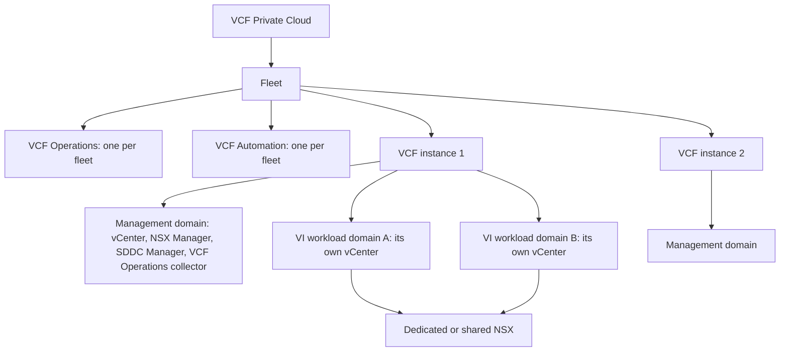
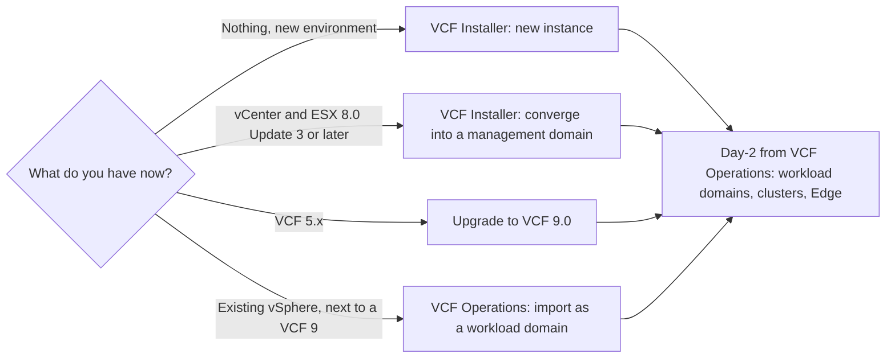

:::analogy
**The data center pain.** You have learned vSphere, vSAN and NSX (VMware NSX, the virtual networking platform) separately. At work, though, you do not install each product by hand: you install VCF (VMware Cloud Foundation), which puts them all together, with strict rules about where each component lives. If you do not understand the fleet, instance, domain hierarchy, you do not know where to look for an upgrade, where to create a new cluster or why a deployment stops at validation. This lesson covers the VCF components, deployment and lifecycle objectives in the curriculum (4.1.1, 4.1.2, 4.1.7 and 4.2.1). [S03]

**The analogy: a hotel chain.**

- **The fleet** is the hotel chain: a single head office (VCF Operations and VCF Automation) sees every hotel.
- **The instance** is one hotel: it has its own front desk (SDDC Manager) that handles building renovations.
- **The management domain** is the hotel's technical floor: the boiler, the servers and the control room live there, not the guests.
- **VI workload domains** are the guest floors: each has its own floor manager (its own vCenter).
- **VCF Installer** is the construction crew: it builds the first hotel and leaves.
:::

:::architecture
### 1. The hierarchy: fleet, instance, domain

| Level | What it contains | Source |
|---|---|---|
| Fleet | All of a customer's VCF instances, with a single VCF Operations and a single VCF Automation; one or two regions | [S448] [S446] |
| Instance | One management domain and, optionally, one or more VI workload domains | [S545] [S446] |
| Management domain | The first cluster: vCenter, ESX hosts, vSAN or other principal storage, NSX Manager, a single SDDC Manager, a VCF Operations collector | [S545] |
| VI workload domain | Its own vCenter and a dedicated or shared NSX; clusters sized for applications | [S446] |
| Instances per fleet | No fixed number; what matters is VCF Operations size (objects, metrics), latency and bandwidth | [S545] |

VI stands for Virtual Infrastructure. The documentation calls the management domain a "special purpose workload domain", used for the components that deploy, manage and monitor the platform. [S448]

### 2. Who does what

| Component | Role | Level | Source |
|---|---|---|---|
| VCF Installer | Day-0 deployment of a new instance; replaces Cloud Builder; can also converge an existing vCenter into a management domain | New instance | [S448] [S544] |
| SDDC Manager | Lifecycle for the core components in its instance; SDDC stands for Software-Defined Data Center | Instance | [S545] |
| VCF Operations | The central console; license manager for all of VCF; day-2 operations (workload domains, clusters, Edges) | Fleet | [S552] [S446] |
| Fleet Management | Lifecycle, certificates, passwords, configuration, tags, licensing and SSO (SSO, Single Sign-On) at fleet level; an appliance registered with VCF Operations | Fleet | [S446] [S549] |
| VCF Automation | Self-service catalog and infrastructure as code, with an open API (API, Application Programming Interface) | Fleet | [S544] [S545] |
| NSX | The network of each domain; NSX 9.x is supported only as part of VCF 9.x | Domain | [S441] [S446] |

**Licensing.** VCF Operations is required to license VCF 9.0, and subscription license files replace the 25-character keys. Some add-ons still use traditional keys. [S448] [S552]

**A contradiction to flag.** The official FAQ says in one place that VCF Installer completely replaces Cloud Builder, and in another that the management domain is created by Cloud Builder at initial setup. In VCF 9 treat VCF Installer as the Day-0 tool (`⚠ to verify` the FAQ wording, which is now labeled 9.1). [S448]

### 3. The deployment paths

| Element | Rule | Source |
|---|---|---|
| Simple model | Single-node appliances | [S446] |
| High Availability model | 3 NSX Manager, 3 VCF Operations, 3 VCF Automation nodes; recommended for production | [S446] |
| Planning | VCF Planning and Preparation Workbook, Broadcom Compatibility Guide, configuration maximums, Ports and Protocols | [S446] |
| Import | The whole vCenter inventory is added, not selected clusters; NSX is installed automatically if missing | [S448] |
| Minimum version for import | The FAQ gives two different values in two places (8.0 Update 1 and 8.0 Update 3), so `⚠ to verify` in the current documentation | [S448] |
| Update order | There is an official sequence for VCF 9.0 and compatible products; follow it, do not guess it | [S340] |

### 4. Network rules that stop a deployment

| Rule | What happens if you break it | Source |
|---|---|---|
| Workload domain vCenters go on the VM (VM, Virtual Machine) management network of the management domain (design decision VCF-VCS-REQD-NET-001) | IP (IP, Internet Protocol), mask and gateway validation fails when creating the VI domain | [S548] |
| Between the fleet management subnet and the vCenter subnet: TCP (TCP, Transmission Control Protocol) 22, 443, 5480 and ICMP (ICMP, Internet Control Message Protocol) in both directions | vCenter installation fails in VCF Installer | [S551] |
| Switch ports toward the hosts trunk the vCenter VLAN (VLAN, Virtual Local Area Network) | The same failure at the vCenter phase | [S551] |
| NSX Manager nodes are added through the VCF workflow, not out of band | SDDC Manager 9.0.x does not sync them | [S444] |
| Bringup with LACP (LACP, Link Aggregation Control Protocol) on 9.0.x: `failover_explicit` in `networkSpecs`, `FAILOVER_ORDER` with `lag` in `activeUplinks` under `nsxTeamings` | The bringup spec does not match the physical network | [S550] |

Port 5480 is the VAMI (VAMI, vCenter Server Appliance Management Interface). [S551]

`[IMAGE SEARCH / PROMPT]` "VCF 9 fleet instance management domain workload domain diagram" and "VCF Operations Fleet Management lifecycle VCF instances".
:::

:::exam-alert
### Memorize

| What | Value / rule | Source |
|---|---|---|
| Fleet | VCF instances + one VCF Operations + one VCF Automation | [S448] |
| Instance | One management domain + zero or more VI workload domains | [S545] |
| SDDC Manager | One per instance, lifecycle for the core components | [S545] |
| Day-0 | VCF Installer (replaces Cloud Builder) | [S448] |
| Day-2 | VCF Operations: workload domains, clusters, Edges | [S446] |
| High Availability model | 3 NSX Manager, 3 VCF Operations, 3 VCF Automation | [S446] |
| Licenses | VCF Operations is the license manager; license files instead of keys | [S448] [S552] |
| Fleet Management not registered | "Management Lifecycle is Not Ready" | [S549] |
| Workload domain vCenter | On the VM management network of the management domain | [S548] |
| NSX 9.x | Supported only in VCF 9.x | [S441] |

### 3 exam traps

1. **"Each VI workload domain has its own SDDC Manager."** False. The instance has a single SDDC Manager, in the management domain, which handles lifecycle for all its domains. [S545]
2. **"Each VCF instance has its own VCF Operations."** False. VCF Operations and VCF Automation are fleet-level; the instance holds only a VCF Operations collector. [S545] [S448]
3. **"I create a new workload domain from VCF Installer."** False. VCF Installer does the initial deployment or the converge; new workload domains are created from VCF Operations. [S446] [S548]
:::

:::trenches
### Mistake 1: the VI domain does not pass vCenter validation

The team wants to put the new workload domain's vCenter in the application subnet. During creation, validation in VCF Operations stops with errors saying the IP and gateway must be on the same subnet. The cause: in VCF 9 the management components, including the VI domain vCenters, must be on the same management network as VCF Operations. [S548]
**Fix (The KB (Knowledge Base article) 429719):** deploy the workload domain vCenter on the VM management network of the management domain, following design decision VCF-VCS-REQD-NET-001. [S548]

### Mistake 2: "Management Lifecycle is Not Ready" in Fleet Management

After deployment, the Lifecycle menu under Fleet Management shows "Management Lifecycle is Not Ready" or "VCF Operations Fleet Management is Not Ready". The cause: the Fleet Management appliance is not registered with VCF Operations. [S549]
**Fix (KB 413792):** register the Fleet Management appliance with VCF Operations following the documented procedure. [S549] If you come from Aria Suite Lifecycle 8.18, you first need Patch 2, otherwise the upgrade path to VCF Fleet Manager 9.0 does not appear (KB 433436). [S547] If the VCF Instances page stays blank after an upgrade, KB 428433 describes restarting VCF Operations, the Fleet Manager appliance and SDDC Manager in order. [S546]
:::

:::interview
**Junior/Mid question: "Explain the difference between a fleet, an instance and a workload domain in VCF 9."**

*Ideal answer:* the fleet is everything managed by a single VCF Operations and a single VCF Automation. A fleet has one or more instances. An instance has exactly one management domain, with vCenter, NSX Manager and SDDC Manager, plus VI workload domains for applications, each with its own vCenter and a dedicated or shared NSX. SDDC Manager handles lifecycle within the instance, and VCF Operations is the console for the whole fleet. [S448] [S545] [S446]

**Troubleshooting scenario: "A new instance deployment stops at the vCenter phase. What do you do?"**

*The answer a Team Lead expects:*
1. **Read the error and the log** the installer points to, under `/var/log/vmware/vcf/domainmanager/`. [S551]
2. **Check routing** between the fleet management subnet and the vCenter subnet, in both directions. [S551]
3. **Check the firewall and ACLs** (ACL, Access Control List): TCP 22, 443, 5480 and ICMP must be allowed. [S551]
4. **Check the physical switch**: the vCenter VLAN is trunked on the ports toward the hosts. [S551]
5. **Retry** the vCenter phase from the VCF Installer UI once connectivity is confirmed. [S551]
:::

:::lab
**Scenario.** You tour the VCF 9 architecture in the lab: identify the fleet, the instance and the domains, check where each component lives and prepare the data for a VI workload domain, without creating it if the lab has no free hosts.

**What you need.** The VCF 9 lab with the management domain deployed. The lab already exists.

The steps below can be ticked off, and progress is saved in the browser. Exact menu names may differ slightly between versions (`⚠ to verify`).

**Supported vs home lab only.** The High Availability model is the one recommended for production; the Simple model, with single-node appliances, suits a lab. [S446] Hardware must be on the Broadcom Compatibility Guide for a supported environment. [S446] VCF installed on a single ESX host is a home lab technique, not a supported configuration. [S32]

**Failure test and validation.** In the workbook, plan a workload domain vCenter on a subnet other than the management network and explain, based on KB 429719, why validation would fail; then correct the address to the VM management network. [S548]
:::

:::quiz
Five original questions in VCP (VMware Certified Professional) exam style. You get the explanation for every option right after you answer.
:::

:::references
- The VCP-VCF 2V0-17.25 exam guide [S03]
- VCF 9.0 General FAQs [S448] and the VCF 9.0 deployment planning blog [S446]
- VMware blogs on what is new in VCF 9.0 [S544] and on operations in VCF Operations [S552]
- William Lam: how many instances a fleet supports [S545]
- KB 429719 (vCenter on another subnet) [S548], KB 443149 (vCenter phase) [S551], KB 419362 (LACP in the bringup spec) [S550]
- KB 413792 [S549], KB 428433 [S546], KB 433436 [S547] (Fleet Management)
- KB 401775 (NSX 9.x only in VCF 9.x) [S441], KB 421778 (NSX nodes added out of band) [S444], KB 390634 (update order) [S340]
:::
