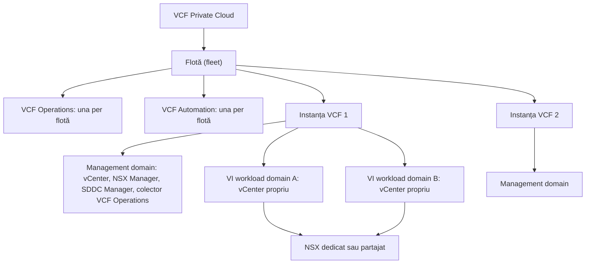
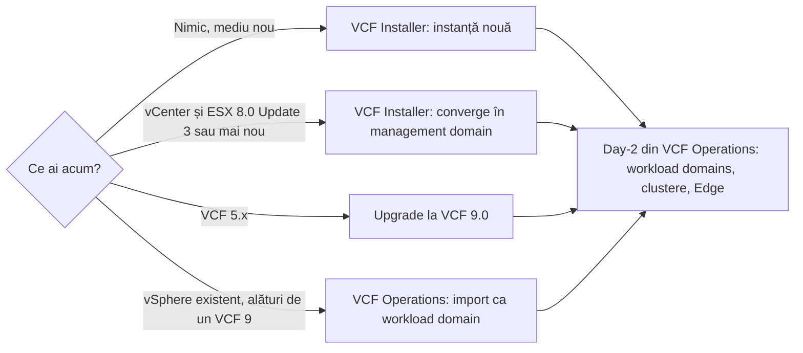

:::analogy
**Durerea din data center.** Ai învățat separat vSphere, vSAN și NSX (VMware NSX, platforma de rețea virtuală). În firmă însă nu instalezi fiecare produs de mână: instalezi VCF (VMware Cloud Foundation), care le pune pe toate împreună, cu reguli stricte despre unde stă fiecare componentă. Dacă nu înțelegi ierarhia flotă, instanță, domeniu, nu știi unde cauți un upgrade, unde creezi un cluster nou sau de ce un deployment se oprește la validare. Lecția acoperă obiectivele de componente, deploy și lifecycle VCF din curriculum (4.1.1, 4.1.2, 4.1.7 și 4.2.1). [S03]

**Analogia: un lanț de hoteluri.**

- **Flota** e lanțul de hoteluri: un singur sediu central (VCF Operations și VCF Automation) vede toate hotelurile.
- **Instanța** e un hotel: are o recepție proprie (SDDC Manager) care se ocupă de renovările clădirii.
- **Management domain** e etajul tehnic al hotelului: acolo stau centrala, serverele și camera de control, nu clienții.
- **VI workload domains** sunt etajele cu camere pentru clienți: fiecare are șeful lui de etaj (propriul vCenter).
- **VCF Installer** e echipa de construcții: ridică primul hotel și pleacă.
:::

:::architecture
### 1. Ierarhia: flotă, instanță, domeniu

| Nivel | Ce conține | Sursa |
|---|---|---|
| Flotă | Toate instanțele VCF ale unui client, cu o singură VCF Operations și o singură VCF Automation; una sau două regiuni | [S448] [S446] |
| Instanță | Un management domain și, opțional, unul sau mai multe VI workload domains | [S545] [S446] |
| Management domain | Primul cluster: vCenter, hosturi ESX, vSAN sau alt principal storage, NSX Manager, un singur SDDC Manager, un colector VCF Operations | [S545] |
| VI workload domain | Propriul vCenter și un NSX dedicat sau partajat; clustere dimensionate pentru aplicații | [S446] |
| Câte instanțe per flotă | Nu există un număr fix; contează dimensiunea VCF Operations (obiecte, metrici), latența și lățimea de bandă | [S545] |

VI vine de la Virtual Infrastructure. Documentația numește management domain un „workload domain special”, folosit pentru componentele care instalează, administrează și monitorizează platforma. [S448]

### 2. Cine face ce

| Componentă | Rol | Nivel | Sursa |
|---|---|---|---|
| VCF Installer | Instalarea Day-0 a unei instanțe noi; înlocuiește Cloud Builder; poate și converge un vCenter existent într-un management domain | Instanță nouă | [S448] [S544] |
| SDDC Manager | Lifecycle pentru componentele de bază din instanța sa; SDDC vine de la Software-Defined Data Center | Instanță | [S545] |
| VCF Operations | Consola centrală; license manager pentru tot VCF; operațiile de day-2 (workload domains, clustere, Edge-uri) | Flotă | [S552] [S446] |
| Fleet Management | Lifecycle, certificate, parole, configurație, tag-uri, licențe și SSO (SSO, Single Sign-On) la nivel de flotă; appliance înregistrat în VCF Operations | Flotă | [S446] [S549] |
| VCF Automation | Catalog self-service și infrastructure-as-code, cu API (API, Application Programming Interface) deschis | Flotă | [S544] [S545] |
| NSX | Rețeaua fiecărui domeniu; NSX 9.x e suportat doar ca parte din VCF 9.x | Domeniu | [S441] [S446] |

**Licențiere.** VCF Operations e necesar pentru licențierea VCF 9.0, iar fișierele de licență pe abonament înlocuiesc cheile de 25 de caractere. Unele add-on-uri folosesc încă chei clasice. [S448] [S552]

**O contradicție de semnalat.** FAQ-ul oficial spune într-un loc că VCF Installer înlocuiește complet Cloud Builder, iar în altul că management domain e creat de Cloud Builder la instalarea inițială. În VCF 9 tratezi VCF Installer ca unealta de Day-0 (`⚠ de verificat` formularea din FAQ, care acum e etichetat 9.1). [S448]

### 3. Căile de deployment

| Element | Regula | Sursa |
|---|---|---|
| Modelul Simple | Appliance-uri cu un singur nod | [S446] |
| Modelul High Availability | 3 noduri NSX Manager, 3 VCF Operations, 3 VCF Automation; recomandat pentru producție | [S446] |
| Planificare | VCF Planning and Preparation Workbook, Broadcom Compatibility Guide, configuration maximums, Ports and Protocols | [S446] |
| Import | Se adaugă tot inventarul vCenter, nu clustere alese; NSX se instalează automat dacă lipsește | [S448] |
| Versiunea minimă pentru import | FAQ-ul dă în două locuri valori diferite (8.0 Update 1 și 8.0 Update 3), deci `⚠ de verificat` în documentația curentă | [S448] |
| Ordinea de update | Există o secvență oficială pentru VCF 9.0 și produsele compatibile; o urmezi, nu o ghicești | [S340] |

### 4. Reguli de rețea care opresc un deployment

| Regula | Ce se întâmplă dacă o încalci | Sursa |
|---|---|---|
| vCenter-ele workload domain stau pe rețeaua de management VM (VM, Virtual Machine) din management domain (decizia de design VCF-VCS-REQD-NET-001) | Validarea IP (IP, Internet Protocol), mască și gateway eșuează la crearea VI domain-ului | [S548] |
| Între subrețeaua de management a flotei și subrețeaua vCenter: TCP (TCP, Transmission Control Protocol) 22, 443, 5480 și ICMP (ICMP, Internet Control Message Protocol) în ambele sensuri | Instalarea vCenter eșuează în VCF Installer | [S551] |
| Porturile de switch spre hosturi au VLAN-ul (VLAN, Virtual Local Area Network) vCenter în trunk | Același eșec la faza vCenter | [S551] |
| Nodurile NSX Manager se adaugă prin fluxul VCF, nu pe lângă el | SDDC Manager 9.0.x nu le sincronizează | [S444] |
| Bringup cu LACP (LACP, Link Aggregation Control Protocol) în 9.0.x: `failover_explicit` în `networkSpecs`, `FAILOVER_ORDER` cu `lag` în `activeUplinks` la `nsxTeamings` | Specificația de bringup nu se potrivește cu rețeaua fizică | [S550] |

Portul 5480 e interfața VAMI (VAMI, vCenter Server Appliance Management Interface). [S551]

`[IMAGE SEARCH / PROMPT]` "VCF 9 fleet instance management domain workload domain diagram" și "VCF Operations Fleet Management lifecycle VCF instances".
:::

:::exam-alert
### De memorat

| Ce | Valoare / regulă | Sursa |
|---|---|---|
| Flotă | Instanțe VCF + o VCF Operations + o VCF Automation | [S448] |
| Instanță | Un management domain + zero sau mai multe VI workload domains | [S545] |
| SDDC Manager | Unul per instanță, lifecycle pentru componentele de bază | [S545] |
| Day-0 | VCF Installer (înlocuiește Cloud Builder) | [S448] |
| Day-2 | VCF Operations: workload domains, clustere, Edge-uri | [S446] |
| Modelul High Availability | 3 NSX Manager, 3 VCF Operations, 3 VCF Automation | [S446] |
| Licențe | VCF Operations e license manager; fișiere de licență în loc de chei | [S448] [S552] |
| Fleet Management neînregistrat | „Management Lifecycle is Not Ready” | [S549] |
| vCenter-ul unui workload domain | Pe rețeaua de management VM a management domain | [S548] |
| NSX 9.x | Suportat doar în VCF 9.x | [S441] |

### 3 capcane de examen

1. **„Fiecare VI workload domain are propriul SDDC Manager.”** Fals. Instanța are un singur SDDC Manager, în management domain, care face lifecycle pentru toate domeniile ei. [S545]
2. **„Fiecare instanță VCF are propria VCF Operations.”** Fals. VCF Operations și VCF Automation sunt la nivel de flotă; în instanță stă doar un colector VCF Operations. [S545] [S448]
3. **„Creez un workload domain nou din VCF Installer.”** Fals. VCF Installer face instalarea inițială sau converge; workload domains noi se creează din VCF Operations. [S446] [S548]
:::

:::trenches
### Greșeala 1: VI domain-ul nu trece de validarea vCenter

Echipa vrea să pună vCenter-ul noului workload domain în subrețeaua aplicațiilor. La creare, validarea din VCF Operations se oprește cu erori că IP-ul și gateway-ul trebuie să fie în aceeași subrețea. Cauza: în VCF 9 componentele de management, inclusiv vCenter-ele VI domain-urilor, trebuie să fie pe aceeași rețea de management ca VCF Operations. [S548]
**Remediere (articolul KB (Knowledge Base article) 429719):** instalezi vCenter-ul workload domain-ului pe rețeaua de management VM a management domain, conform deciziei de design VCF-VCS-REQD-NET-001. [S548]

### Greșeala 2: „Management Lifecycle is Not Ready” în Fleet Management

După instalare, meniul Lifecycle din Fleet Management afișează „Management Lifecycle is Not Ready” sau „VCF Operations Fleet Management is Not Ready”. Cauza: appliance-ul Fleet Management nu e înregistrat în VCF Operations. [S549]
**Remediere (KB 413792):** înregistrezi appliance-ul Fleet Management în VCF Operations după procedura din documentație. [S549] Dacă vii din Aria Suite Lifecycle 8.18, ai nevoie întâi de Patch 2, altfel nu apare calea de upgrade spre VCF Fleet Manager 9.0 (KB 433436). [S547] Dacă după un upgrade pagina VCF Instances rămâne goală, KB 428433 descrie repornirea în ordine a VCF Operations, a appliance-ului Fleet Manager și a SDDC Manager. [S546]
:::

:::interview
**Întrebare Junior/Mid: „Explică diferența dintre flotă, instanță și workload domain în VCF 9.”**

*Răspunsul ideal:* flota e tot ce administrează o singură VCF Operations și o singură VCF Automation. O flotă are una sau mai multe instanțe. O instanță are exact un management domain, cu vCenter, NSX Manager și SDDC Manager, plus VI workload domains pentru aplicații, fiecare cu vCenter propriu și NSX dedicat sau partajat. SDDC Manager face lifecycle în instanță, iar VCF Operations e consola pentru toată flota. [S448] [S545] [S446]

**Scenariu de troubleshooting: „Deployment-ul unei instanțe noi se oprește la faza vCenter. Ce faci?”**

*Răspunsul pe care îl așteaptă un Team Lead:*
1. **Citești eroarea și logul** indicat de installer, sub `/var/log/vmware/vcf/domainmanager/`. [S551]
2. **Verifici rutarea** între subrețeaua de management a flotei și subrețeaua vCenter, în ambele sensuri. [S551]
3. **Verifici firewall-ul și ACL-urile** (ACL, Access Control List): TCP 22, 443, 5480 și ICMP trebuie permise. [S551]
4. **Verifici switch-ul fizic**: VLAN-ul vCenter e în trunk pe porturile spre hosturi. [S551]
5. **Reiei** faza vCenter din interfața VCF Installer după ce conectivitatea e confirmată. [S551]
:::

:::lab
**Scenariu.** Faci turul arhitecturii VCF 9 din lab: identifici flota, instanța și domeniile, verifici unde stă fiecare componentă și pregătești datele pentru un VI workload domain, fără să-l creezi dacă lab-ul nu are hosturi libere.

**Ce ai nevoie.** Lab-ul VCF 9 cu management domain instalat. Lab-ul există deja.

Pașii de mai jos sunt bifabili, iar progresul se salvează în browser. Numele exacte ale meniurilor pot diferi puțin între versiuni (`⚠ de verificat`).

**Supported vs home lab only.** Modelul High Availability e cel recomandat pentru producție; modelul Simple, cu appliance-uri pe un singur nod, e potrivit pentru lab. [S446] Hardware-ul trebuie să fie în Broadcom Compatibility Guide pentru un mediu suportat. [S446] Un VCF instalat pe un singur host ESX e o tehnică de home lab, nu o configurație suportată. [S32]

**Test de avarie și validare.** Pregătește în workbook un vCenter de workload domain într-o altă subrețea decât rețeaua de management și explică, pe baza KB 429719, de ce validarea ar eșua; apoi corectează adresa pe rețeaua de management VM. [S548]
:::

:::quiz
Cinci întrebări originale în stil VCP (VMware Certified Professional). Primești explicația pentru fiecare variantă imediat după răspuns.
:::

:::references
- Exam guide-ul VCP-VCF 2V0-17.25 [S03]
- VCF 9.0 General FAQs [S448] și blogul de planificare a deployment-ului VCF 9.0 [S446]
- Blogurile VMware despre noutățile VCF 9.0 [S544] și operațiile din VCF Operations [S552]
- William Lam: câte instanțe suportă o flotă [S545]
- KB 429719 (vCenter în alt subnet) [S548], KB 443149 (faza vCenter) [S551], KB 419362 (LACP în bringup spec) [S550]
- KB 413792 [S549], KB 428433 [S546], KB 433436 [S547] (Fleet Management)
- KB 401775 (NSX 9.x doar în VCF 9.x) [S441], KB 421778 (noduri NSX adăugate pe lângă VCF) [S444], KB 390634 (ordinea de update) [S340]
:::
