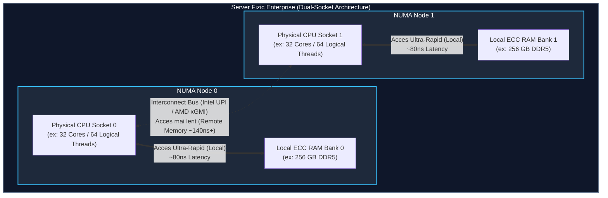
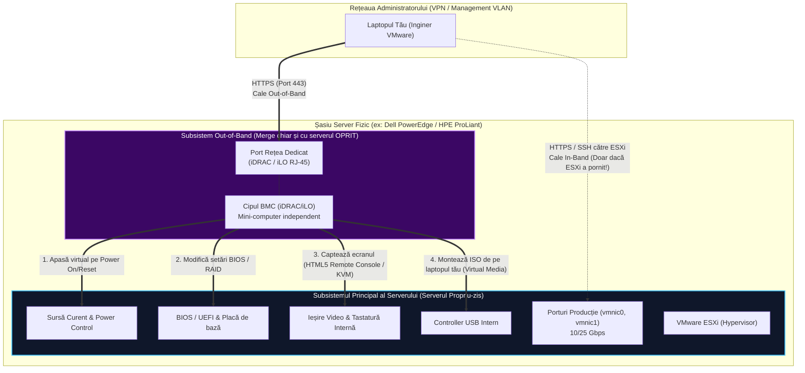
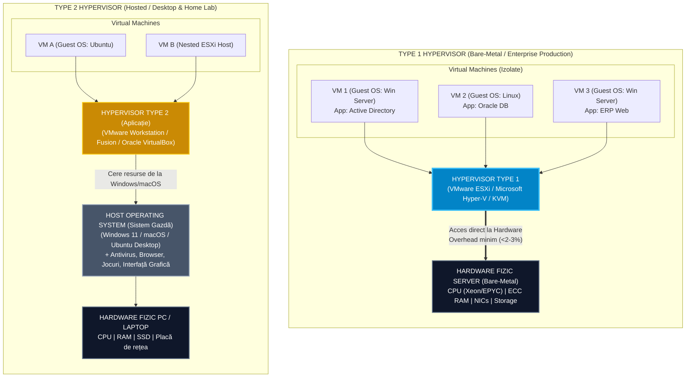

> **Obiectivul Capitolului:** Înțelegerea profundă a arhitecturii fizice pe care se instalează VMware ESXi, diferențierea componentelor enterprise față de cele consumer, stăpânirea managementului la distanță (Out-of-Band) și înțelegerea mecanismelor de bază ale unui Hypervisor.
> 
> **Competențe dobândite pentru CV / Interviu:** Citirea și proiectarea specificațiilor hardware pentru noduri ESXi (NUMA, ECC, NICs), operarea consolelor iDRAC/iLO, diferențierea arhitecturală Type 1 vs. Type 2 Hypervisor și calcularea ratei de consolidare.

:::analogy
### De ce începem cu fierul (Hardware-ul) într-un curs de Virtualizare?
Cea mai mare greșeală pe care o fac administratorii începători este să creadă că „virtualizarea înseamnă că hardware-ul nu mai contează, totul e în cloud/software”. **Fals!** În producție, când o bază de date critică dintr-o mașină virtuală îngheață la ora 02:00 dimineața, în 70% din cazuri cauza se află în modul în care hypervisorul VMware ESXi interacționează cu procesoarele fizice (topologia NUMA), cu memoria RAM sau cu plăcile de rețea fizice. Nu poți stăpâni VMware fără să știi exact pe ce calcă el.

### Analogia Profesorului: Casa de la curte vs. Zgârie-norul Corporatist
Gândește-te la diferența dintre **PC-ul tău de acasă** și un **Server Fizic Enterprise (Bare-Metal)**:
* **PC-ul tău de acasă (Desktop/Gaming)** este ca o **casă individuală**: are o singură ușă de intrare, o singură sursă de curent de la stradă și e construită pentru confortul unei singure familii. Dacă sare siguranța electrică sau se arde centrala, toată casa rămâne în beznă și frig. În plus, la ora 23:00 toată lumea doarme, deci casa stă nefolosită 8 ore pe noapte.
* **Serverul Fizic dintr-un Data Center** este ca un **zgârie-nori sau un spital de urgență**: nu are voie să se oprească niciodată (24/7/365). Are două racorduri electrice independente, generatoare proprii, uși duble, pază permanentă și un „administrator invizibil” (numit iLO sau iDRAC) care locuiește în subsol și poate reporni clădirea chiar și atunci când toată lumea a fost evacuată.
* **Virtualizarea (VMware ESXi)** este procesul prin care nu mai construim câte o casă întreagă pentru fiecare chiriaș (câte un server fizic pentru fiecare aplicație), ci împărțim acel zgârie-nori în 50 de apartamente complet izolate fonic și securizate (**Virtual Machines - VMs**), fiecare având impresia că deține întreaga clădire.
:::

:::architecture
### 0.1.1. Serverul Fizic (Bare-Metal) vs. PC-ul Normal
În terminologia VMware, un server fizic gol, pe care urmează să instalăm direct sistemul de operare de virtualizare, se numește **Bare-Metal Server** (literalmente „fier gol”) sau, după instalare, **ESXi Host** (Gazdă).

Spre deosebire de un PC de birou (Tower), serverele din Data Center au o formă plată, standardizată, măsurată în **Rack Units (U)** (1U = $44.45\text{ mm}$ înălțime), pentru a intra în dulapuri metalice numite **Racks** (de obicei de 42U înălțime).

* `[IMAGE SEARCH / PROMPT]:` *Caută pe Google Images: `"Dell PowerEdge R760 internal components labeled"` și `"1U vs 2U rack server comparison vs blade chassis"` pentru a vizualiza densitatea componentelor și fluxul de aer.*

#### Cele 6 diferențe critice de arhitectură:

1. **Multi-Socket CPU & Arhitectura NUMA (Non-Uniform Memory Access):**
   * Un PC are un singur **Socket** (locaș fizic pentru procesor). Un server enterprise are de obicei **2 sau 4 Sockets** (procesoare Intel Xeon Scalable sau AMD EPYC).
   * Fiecare procesor fizic (**pCPU / Socket**) conține între 16 și 128 de nuclee fizice (**Physical Cores**). Dacă activăm **Hyper-Threading** (Intel) sau **SMT** (AMD), fiecare nucleu fizic apare în ESXi ca **2 Logical Processors (vCPUs / Threads)**.
   * **Ce este NUMA?** Fiecare procesor fizic are propriul său set de sloturi de memorie RAM lipite direct de el (**Local Memory**). Dacă Procesorul 1 are nevoie de date din memoria RAM a Procesorului 2 (**Remote Memory**), trebuie să ceară datele printr-o magistrală internă (Intel UPI / AMD Infinity Fabric), ceea ce introduce întârziere (**Latency**). Un **NUMA Node** = `1 Socket CPU + Memoria RAM locală atașată lui`.

2. **Memoria ECC RAM (Error-Correcting Code):**
   * Într-un PC normal, dacă o rază cosmică sau o fluctuație magnetică schimbă un bit din RAM din `0` în `1` (**Bit Flip / Single-Bit Error**), primești un ecran albastru (BSOD) și dai restart.
   * Într-un server VMware care găzduiește 50 de mașini virtuale, un crash al serverului înseamnă că **pică 50 de servere simultan**! Memoria **ECC RAM** are cipuri suplimentare pe plăcuță care detectează și corectează din mers erorile de 1 bit fără ca ESXi să se blocheze, și oprește controlat sistemul la erori de 2 biți pentru a nu scrie date corupte pe disc.

3. **Plăcile de Rețea (NICs - Network Interface Cards):**
   * Un PC are un singur port RJ-45 de $1\text{ Gbps}$.
   * Un server ESXi are minimum **4 până la 8 porturi de rețea** de mare viteză ($10\text{ Gbps}$, $25\text{ Gbps}$ sau $100\text{ Gbps}$), folosind cabluri de fibră optică sau cupru **SFP+ / SFP28 / QSFP**, distribuite pe cel puțin două plăci fizice diferite (pentru redundanță dacă se arde o placă). În ESXi, aceste porturi fizice se vor numi **`vmnic0`, `vmnic1`, `vmnic2`...**

4. **Redundanța Electrică și Mecanică (Hot-Swap):**
   * Serverele au două surse de alimentare (**Dual Redundant PSUs**) conectate la două circuite electrice separate (**A-Side și B-Side PDU/UPS**).
   * Sursă arsă? Ventilator gripat? Disc stricat? Toate sunt **Hot-Swappable** (le scoți cu mâna din server și bagi altele noi **în timp ce serverul merge la 100% capacitate**, fără să-l oprești).

#### Tabel Comparativ: PC Desktop vs. Server Enterprise pentru VMware ESXi

| Caracteristică | PC Desktop / Workstation | Server Fizic Enterprise (ESXi Host) | De ce contează în VMware? |
| :--- | :--- | :--- | :--- |
| **Procesoare (CPU)** | 1 Socket (Intel Core / AMD Ryzen) | 1 - 4 Sockets (Intel Xeon / AMD EPYC) | Permite rularea a zeci de VMs fără contention și suportă arhitectura NUMA. |
| **Memorie RAM** | Non-ECC, max 128-192 GB | **ECC Registered (RDIMM)**, până la 4 TB - 16 TB | Previne **PSOD** (Purple Screen of Death) cauzat de coruperea memoriei. |
| **Stocare & Boot** | 1-2 SSD-uri M.2 / SATA direct pe placa de bază | **Hardware RAID Controller (BOSS Card)** pt. Boot + Bay-uri Hot-Swap SAS/NVMe | ESXi 8 cere disc de boot dedicat și fiabil (M.2 în RAID-1) separat de discurile de date. |
| **Rețelistică (NIC)** | 1 port Onboard ($1\text{ Gbps}$ / $2.5\text{ Gbps}$ Realtek) | 4-8 porturi ($10/25/100\text{ Gbps}$ Intel/Mellanox/Broadcom) | ESXi **NU are drivere** pentru plăci consumer (Realtek)! Cere cipuri aflate pe VMware HCL. |
| **Management** | Trebuie să fii fizic în fața monitorului dacă nu pornește OS-ul | **Out-of-Band (iDRAC / iLO)** cu placă de rețea și procesor propriu | Poți instala ESXi și apăsa "Power On" de la 5.000 km distanță. |

---

### 0.1.2. Managementul Out-of-Band (OOBM): iLO, iDRAC, IPMI
Imaginează-ți că serverul tău fizic se află într-un Data Center din Frankfurt, iar tu ești acasă în București. Serverul este **oprit (Powered Off)** sau s-a blocat în BIOS. Nu poți folosi Remote Desktop sau SSH pentru că sistemul de operare nu rulează. Cum îl pornești? Cum intri în BIOS? Cum bagi un stick USB cu ESXi în el?

Răspunsul este **Out-of-Band Management (Management în afara benzii de producție)**.

Fiecare server enterprise are pe placa de bază un **al doilea mini-calculator complet independent** (numit **BMC - Baseboard Management Controller**), care are propriul său procesor ARM, propria memorie, propriul sistem de operare Linux embedded și **propriul port de rețea fizic dedicat** pe spatele serverului!
Cât timp serverul are cablul de curent băgat în priză (chiar dacă serverul propriu-zis este **OPRIT**), acest cip BMC este pornit și îți oferă o interfață web securizată.

#### Denumirile comerciale pe care TREBUIE să le știi pe de rost:
* **HPE (Hewlett Packard Enterprise):** **iLO** (*Integrated Lights-Out*) – cel mai răspândit în Europa.
* **Dell Technologies:** **iDRAC** (*Integrated Dell Remote Access Controller*).
* **Cisco UCS:** **CIMC** (*Cisco Integrated Management Controller*) / UCS Manager.
* **Lenovo:** **XCC** (*XClarity Controller* - fostul IMM).
* **Supermicro / Standardul General:** **IPMI** (*Intelligent Platform Management Interface*) / **Redfish API**.

* `[IMAGE SEARCH / PROMPT]:` *Caută pe Google Images: `"Dell iDRAC9 dashboard virtual console screenshot"` și `"HPE iLO 6 rear port dedicated"`.*

**Cele 4 super-puteri pe care ți le dă iLO/iDRAC:**
1. **Power Control:** Poți da *Power On*, *Graceful Shutdown* sau *Cold Reboot* (echivalentul smulgerii cablului din priză) de la distanță.
2. **Remote Console (KVM over IP / HTML5 Console):** Vezi în browserul tău exact ce ar apărea pe un monitor conectat fizic la server, încă din prima secundă când apare sigla Dell/HPE și textul de BIOS.
3. **Virtual Media:** Ai imaginea `.iso` cu VMware ESXi 8 descărcată pe laptopul tău în România. Apeși pe *Virtual Media -> Mount Local ISO* în iDRAC, iar serverul din Frankfurt crede că cineva a băgat fizic un DVD sau un stick USB în el și bootează de pe laptopul tău!
4. **Hardware Health & Sensor Telemetry:** Monitorizează temperaturile, turația ventilatoarelor, starea discurilor și erorile de memorie ECC independent de sistemul de operare.

---

### 0.1.3. Problema Istorică: Era „Un Server Fizic = O Aplicație” (Pre-Virtualizare)
Înainte ca VMware să revoluționeze industria (anii 1998–2005), arhitectura IT avea o regulă nescrisă: **nu instalezi două aplicații critice pe același sistem de operare Windows sau Linux**. De ce?
Dacă instalai pe același Windows Server și *Serverul de Mail (Exchange)*, și *Baza de Date (SQL)*, și *Aplicația de Contabilitate*, un update de librării `.dll` cerut de Contabilitate putea să strice Serverul de Mail. Iar când dădeai restart pentru Contabilitate, pica și Mail-ul, și Baza de Date!

Prin urmare, companiile cumpărau **câte un server fizic separat pentru fiecare rol**:
* 1 Server Fizic pentru Domain Controller (Active Directory).
* 1 Server Fizic pentru Print Server.
* 1 Server Fizic pentru Web Server.
* 1 Server Fizic pentru Database Server.

#### De ce era acest model un dezastru (Conceptul de „Server Sprawl”):
1. **Subutilizare masivă a resurselor:** Un Print Server sau un Domain Controller folosea în medie doar **5% – 10% din CPU și RAM**. Restul de **90% din puterea de calcul plătită stătea degeaba (Idle)**!
2. **Costuri uriașe (CapEx & OpEx):** Cumpărai 100 de servere fizice (CapEx), dar plăteai curent electric și aer condiționat industrial (OpEx) pentru 100 de servere care consumau energie chiar și când stăteau la 5% încărcare.
3. **Timp de livrare lent (Time-to-Market):** Dacă un departament cerea un server nou pentru un proiect, dura între **4 și 8 săptămâni** (comandă furnizor, livrare, montare în rack, cablare, instalare OS).
4. **Recuperare din dezastru (Disaster Recovery) aproape imposibilă:** Dacă se ardea placa de bază a unui server Dell din 2003, nu puteai muta pur și simplu hard-disk-ul într-un server HP din 2006, deoarece Windows-ul crăpa instantaneu în ecran albastru din cauza driverelor diferite de controller (**Hardware Lock-in**).

---

### 0.1.4. Apariția Virtualizării: Hypervisor (Type 1 vs. Type 2), Host și Guest
VMware a rezolvat această problemă prin **Abstractizarea Hardware-ului**.
În loc să instalăm Windows sau Linux direct pe fierul serverului, instalăm un strat subțire de software numit **Hypervisor** (sau **VMM - Virtual Machine Monitor**).

#### Terminologia Oficială VMware (Obligatorie pentru examen):
* **Host (Gazdă):** Serverul fizic împreună cu Hypervisorul (ESXi) care rulează pe el și deține resursele fizice (CPU, RAM, NIC, Disk).
* **Hypervisor (VMM):** Stratul software care interceptează cererile mașinilor virtuale și împarte (schedulează) resursele fizice ale Host-ului între mai multe mașini virtuale, garantând **izolarea completă** între ele.
* **Virtual Machine (VM):** Un computer definit 100% prin software (în realitate, un folder cu câteva fișiere pe disc) care conține componente hardware virtuale standardizate (vCPU, vRAM, vNIC, Virtual Disk).
* **Guest OS (Sistem de Operare Oaspete):** Sistemul de operare (Windows Server, Ubuntu, Red Hat etc.) instalat în interiorul unei Mașini Virtuale. El habar nu are că nu rulează pe un server fizic real!

#### Cele două arhitecturi de Hypervisor: Type 1 vs. Type 2

#### Tabel Comparativ: Type 1 vs. Type 2 Hypervisor

| Criteriu | Type 1 Hypervisor (Bare-Metal / Native) | Type 2 Hypervisor (Hosted) |
| :--- | :--- | :--- |
| **Unde se instalează?** | Direct pe hardware-ul gol al serverului (fără niciun sistem de operare intermediar). | Ca un program obișnuit (`.exe` / `.dmg`) peste un Windows, macOS sau Linux existent. |
| **Exemple consacrate** | **VMware ESXi**, Microsoft Hyper-V, Citrix XenServer, Proxmox (KVM). | **VMware Workstation Pro**, VMware Fusion (Mac), Oracle VirtualBox. |
| **Performanță & Overhead** | **Maximă** (aproape de performanța nativă; ESXi ocupă doar ~300 MB pe disc și ~2-3 GB RAM pentru el însuși). | **Redusă** (depinde de stabilitatea și consumul sistemului Windows/Mac de dedesubt; Windows-ul singur îți mănâncă 4-8 GB RAM). |
| **Toleranță la erori & Securitate** | Suprafață de atac minusculă (fără interfață grafică greoaie, fără browser). | Dacă Windows-ul gazdă își ia Blue Screen de la un joc sau driver audio, **toate mașinile virtuale mor instantaneu**. |
| **Scopul utilizării** | **Producție Enterprise** (Data Centere, Cloud Privat VCF). | **Studii, testare locală și Home Lab (Nested Virtualization)** pe PC-ul personal. |
:::

:::exam-alert
### De Memorat (Hard Limits, Standarde & Detalii Tehnice)
* **Consolidation Ratio (Rata de Consolidare):** Raportul dintre numărul de mașini virtuale și un singur server fizic. Dacă pui 30 de VMs pe 1 Host ESXi, ai o rată de consolidare de **30:1**.
* **Intel VT-x și AMD-V:** Sunt extensiile hardware de virtualizare din procesor (**Hardware-Assisted Virtualization**). **ATENȚIE:** Din fabrică, multe plăci de bază și servere vin cu această setare **Disabled** în BIOS/UEFI! Dacă nu o activezi în BIOS, ESXi fie nu se instalează, fie nu poate porni nicio mașină virtuală pe 64-bit.
* **Porturi de rețea pentru Managementul Out-of-Band (iLO/iDRAC):**
  * **TCP 443 (HTTPS):** Acces la interfața web iLO/iDRAC și HTML5 Remote Console.
  * **TCP 22 (SSH):** Acces CLI la iLO/iDRAC (util când interfața web a înghețat și vrei să dai `racadm racreset` pe Dell).
  * **UDP 623:** Portul standard pentru protocolul **IPMI** (folosit de vSphere DPM - Distributed Power Management pentru a porni/opri automat serverele fizice noaptea când nu e trafic!).

### Capcane de Examen (VCP Exam Traps)
1. **Capcana #1 (Type 1 vs. Type 2 și Linux-ul din ESXi):**
   * *Mitul:* Mulți candidați cred că VMware ESXi este construit pe un sistem de operare Linux (pentru că are comenzi asemănătoare în consolă, precum `ls`, `cd`, `ps`).
   * *Realitatea de Examen:* **VMware ESXi NU ESTE BAZAT PE LINUX!** Primul produs VMware din 2001 (numit *ESX Server*, fără „i”) avea o mașină virtuală Red Hat Linux numită *Service Console* pentru bootare. Începând cu ESXi 4.1/5.0, VMware a eliminat complet Linux-ul. Nucleul ESXi se numește **VMkernel** și este un sistem de operare proprietar creat de la zero de VMware.
2. **Capcana #2 (Dependența de Hardware în Mașinile Virtuale):**
   * La examen ți se poate da un scenariu în care o companie vrea să mute un VM de pe un server fizic HPE pe un server fizic Dell și te întreabă dacă trebuie reinstalate driverele plăcii de bază în Windows-ul din VM. Răspunsul este **NU**, deoarece VM-ul vede doar hardware-ul virtual abstractizat de ESXi (indiferent că dedesubt e server Dell, HPE sau Cisco).
3. **Capcana #3 (Activarea Hyper-Threading dublează puterea procesorului?):**
   * Dacă un server are 16 nuclee fizice și activezi Hyper-Threading în BIOS, ESXi îți va afișa **32 Logical Processors**. La examen (și în dimensionarea reală), activarea Hyper-Threading **NU dublează performanța (+100%)**, ci aduce un câștig real de doar **15% – 30%** prin folosirea mai eficientă a timpilor morți din pipeline-ul nucleului fizic.
:::

:::trenches
### Din Tranșee (Reddit `r/vmware`, VMTN & KB Issues)
* **Problema 1 (r/homelab & r/vmware): *„No Network Adapters were detected. Either no network adapters are physically connected to the system, or a suitable driver could not be located”* la instalarea ESXi.**
  * *Cauza reală:* Începătorii încearcă să instaleze ESXi 7 sau 8 direct pe un PC de gaming sau mini-PC care are placă de rețea **Realtek** sau **Intel I225-V/I219-V (consumer)**. VMware a eliminat începând cu ESXi 7.0 suportul pentru driverele vechi (`vmklinux`) și acceptă doar plăci de rețea de server aflate pe lista oficială **VMware Compatibility Guide (HCL)** (ex: Intel X520/X710, Broadcom, Mellanox).
  * *Soluția din teren:* Fie adaugi o placă de rețea PCIe Intel Server (costă ~100 RON pe piața SH), fie folosești pachetul comunitar *USB Network Native Driver Fling* (de la William Lam), fie rulezi ESXi ca mașină virtuală (Nested) în VMware Workstation (care îi emulează automat o placă Intel/VMXNET3 compatibilă 100%!).
* **Problema 2 (Producție): *„Am conectat cablul de rețea în server, dar nu îmi răspunde iDRAC/iLO, iar când dau restart la ESXi îmi cade și consola iDRAC!”***
  * *Cauza reală:* Administratorul a setat în BIOS placa iDRAC în modul **Shared LOM (LAN on Motherboard)** în loc de **Dedicated NIC**, sau a băgat cablul de iDRAC într-un switch cu VLAN de producție în loc de VLAN-ul izolat de Out-of-Band Management.
  * *Regula de Aur în Producție:* Portul de iLO/iDRAC se conectează **ÎNTOTDEAUNA pe portul fizic dedicat** și într-un switch separat de management, cu acces strict restricționat prin Firewall/Jump Host (niciodată expus în internet sau în rețeaua utilizatorilor!).
:::

:::interview
### Întrebarea 1 (Nivel Junior / Entry-Level System Admin)
> **Intervievator:** *„Poți să-mi explici care este diferența dintre un Hypervisor de Tip 1 și unul de Tip 2, și de ce în infrastructura noastră nu rulăm mașinile de producție pe VMware Workstation instalat pe Windows Server?”*

**Răspunsul Ideal (care arată că gândești ca un inginer):**
„Diferența fundamentală stă în modul în care hypervisorul accesează hardware-ul fizic și în suprafața de risc. Un Hypervisor de Tip 1, cum este **VMware ESXi**, este de tip *Bare-Metal* — se instalează direct pe hardware-ul serverului, iar propriul său nucleu (**VMkernel**) gestionează direct programarea procesorului (CPU scheduling), alocarea memoriei RAM și I/O-ul de rețea/stocare, având un overhead extrem de mic (sub 2-3%) și o amprentă de doar câteva sute de MB.

În schimb, un Hypervisor de Tip 2, precum **VMware Workstation**, rulează ca o aplicație peste un sistem de operare gazdă (Host OS), cum ar fi Windows. Nu îl folosim în producție din trei motive critice:
1. **Punct unic de eșec și Patching:** Windows-ul gazdă are nevoie de reboot-uri lunare pentru Patch Tuesday, are sute de servicii și drivere care pot crăpa în BSOD, trântind toate mașinile virtuale.
2. **Performanță (Double Scheduling):** Orice cerere de I/O sau CPU a unei mașini virtuale trebuie să treacă mai întâi prin VMware Workstation, apoi prin scheduler-ul de Windows și abia apoi la hardware.
3. **Lipsa funcțiilor de Clustering Enterprise:** Doar pe ESXi (Type 1) avem acces nativ la integrarea cu vCenter pentru **vMotion** (migrare live fără downtime), **vSphere HA**, **DRS** și **vSAN**.”

---

### Întrebarea 2 (Nivel Mid / Scenariu de Arhitectură & Troubleshooting)
> **Intervievator:** *„Avem un server fizic cu 2 procesoare (Dual-Socket), fiecare procesor având 16 nuclee fizice și câte 128 GB RAM local (în total 32 cores și 256 GB RAM). Un dezvoltator îți cere să-i creezi o singură mașină virtuală cu 24 vCPU și 160 GB RAM pentru o aplicație critică. Ce se va întâmpla din punct de vedere hardware și de ce s-ar putea să meargă mai prost decât dacă i-ai da 16 vCPU și 120 GB RAM?”*

**Răspunsul Ideal (Impresionează orice Senior Team Lead – Bazat pe studiile lui Frank Denneman):**
„Aceasta este o problemă clasică de **arhitectură NUMA (Non-Uniform Memory Access)**. Serverul nostru este împărțit fizic în două noduri NUMA, fiecare având **16 nuclee fizice** și **128 GB RAM local**.

Dacă îi configurez mașina virtuală cu **16 vCPU și 120 GB RAM**, ea încape perfect în interiorul unui singur **NUMA Node**. Toate cele 16 nuclee vor citi și scrie exclusiv în memoria RAM lipită direct de acel procesor (**Local Memory Access**), cu latență minimă și viteză maximă.

Dar dacă îi dau **24 vCPU și 160 GB RAM**, mașina virtuală depășește dimensiunea fizică a unui singur procesor (devine o mașină **Wide-VM**, împărțită de ESXi prin **vNUMA** pe ambele socket-uri). În acel moment, procesorul 0 va fi forțat frecvent să acceseze memoria RAM atașată procesorului 1 prin magistrala de interconectare (**Remote Memory Access**), ceea ce crește semnificativ latența la memorie. Prin urmare, îi voi recomanda dezvoltatorului fie să dimensioneze mașina ca să încapă într-un singur nod NUMA (16 vCPU / <128 GB RAM), fie să scalăm aplicația pe orizontală în două mașini virtuale de câte 12-16 vCPU.”
:::

:::lab
> **Scenariul Laboratorului:** Înainte să instalăm primul nostru server VMware ESXi, trebuie să inspectăm „Data Centerul” nostru personal (PC-ul sau laptopul tău) și să ne asigurăm că suportă **Virtualizarea Hardware (VT-x / AMD-V)** și **Nested Virtualization** (adică abilitatea de a rula un Hypervisor Type 1 *în interiorul* unui Hypervisor Type 2 pentru studiu).
:::

:::quiz

:::

:::references
1. **VMware Official Docs:** *vSphere 8.0 Hardware and System Requirements* (docs.vmware.com / techdocs.broadcom.com) – Cerințele minime oficiale de CPU, RAM și Boot Media pentru ESXi.
2. **Broadcom / VMware Compatibility Guide (HCL):** `compatibilityguide.broadcom.com` – Baza de date oficială unde verifici dacă un server sau o placă de rețea este suportată.
3. **Frank Denneman & Niels Hagoort:** *vSphere Clustering Technical Deep Dive & NUMA Architecture* (frankdenneman.nl) – Referința supremă în industrie pentru modul în care ESXi mapează vCPU și vRAM pe arhitectura NUMA fizică.
4. **William Lam (vExpert):** *Building an ESXi Home Lab & Overcoming Consumer NIC Limitations* (williamlam.com) – Soluții pentru rularea ESXi pe hardware non-HCL și Nested ESXi.
5. **VMware Knowledge Base (KB 1003694 & KB 2145518):** *Determining if Intel VT-x or AMD-V virtualization technology is enabled in BIOS*.
6. **Nick Marshall (Sybex):** *Mastering VMware vSphere 8* – Capitolul 1: *Introducing VMware vSphere and the Software-Defined Data Center*.
:::
