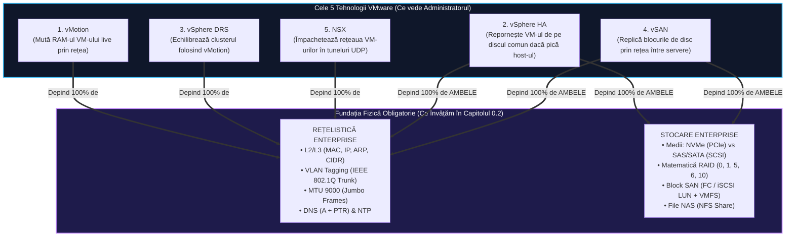
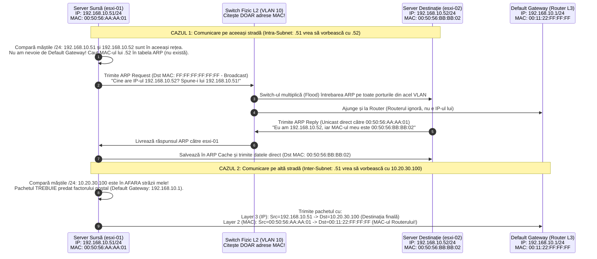
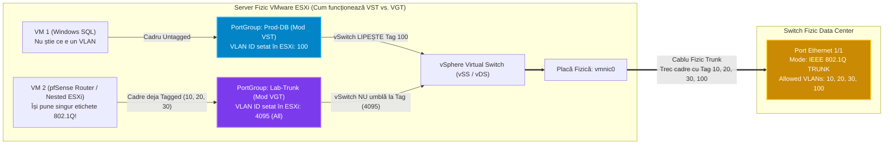
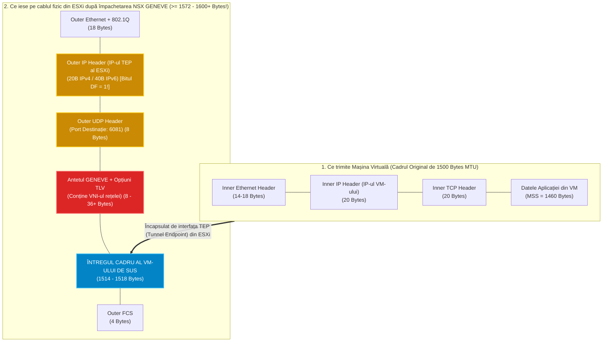
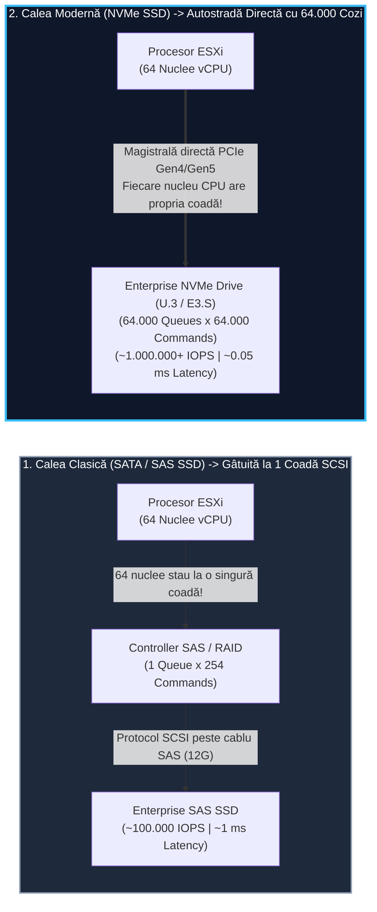
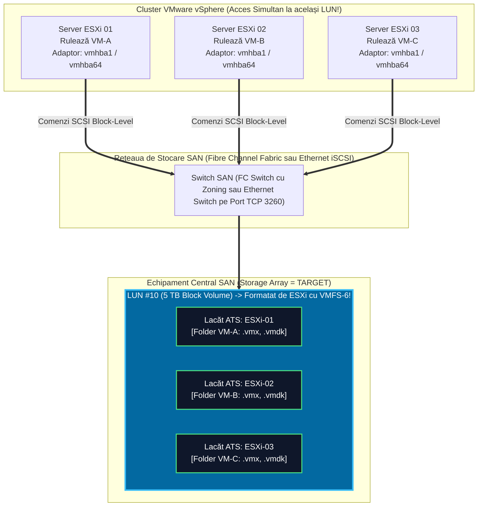
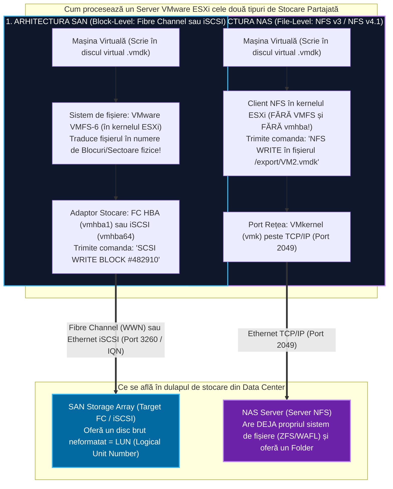

> **Obiectivul Capitolului:** Stăpânirea completă, de la zero absolut până la nivel de pachet și bloc de date, a tuturor protocoalelor și acronimelor de rețelistică (`OSI`, `MAC`, `IP`, `CIDR`, `ARP`, `DNS`, `FQDN`, `NTP`, `VLAN`, `IEEE 802.1Q`, `MTU`, `MSS`, `GENEVE`) și a arhitecturilor de stocare enterprise (`HDD`, `SSD`, `SATA`, `SAS`, `SCSI`, `NVMe`, `PCIe`, `RAID`, `DAS`, `SAN`, `NAS`, `LUN`, `HBA`, `WWN`, `iSCSI`, `IQN`, `NFS`, `VMFS`), plus înțelegerea tehnologiilor VMware care depind de ele (`vMotion`, `vSphere HA`, `DRS`, `vSAN`, `NSX`).
>
> **Regula de Aur a acestui Capitol:** Niciun acronim și nicio tehnologie nu sunt lăsate neexplicate. Pentru fiecare termen vei găsi: **(1) Numele complet**, **(2) Ce reprezintă în lumea reală** și **(3) Cum funcționează tehnic în spate**.

:::analogy
### De ce 90% din problemele „de VMware” sunt de fapt probleme de Rețea sau Stocare?

Ca viitor inginer sau arhitect VMware, trebuie să știi un adevăr fundamental din Data Centere: **Hypervisorul VMware ESXi este aproape indestructibil de unul singur, dar este 100% dependent de rețeaua și stocarea fizică de sub el.**

Până să ajungem la Pilonii 2, 3 și 4, în acest capitol ne vom întâlni frecvent cu **5 tehnologii-cheie din ecosistemul VMware** care depind vital de rețea și stocare. Ca să nu fie doar niște cuvinte străine, hai să le disecăm chiar acum, înainte de a începe:

#### Cele 5 Tehnologii VMware pe care le hrănesc Rețeaua și Stocarea:

1. **VMware vSphere vMotion (Live Migration / Migrare în Timp Real):**
   * **Ce înseamnă numele:** **`v`** vine de la *Virtual*, iar **`Motion`** înseamnă *Mișcare*.
   * **Ce reprezintă:** Este tehnologia emblematică inventată de VMware care îți permite să muți o mașină virtuală **în timp ce este pornită (Live)** de pe un server fizic ESXi pe alt server fizic ESXi, fără ca utilizatorii sau aplicațiile să simtă vreo întrerupere (*Zero Downtime* – nu se pierde nici măcar un singur pachet de `ping`!).
   * **Cum funcționează în spate:** Discul mașinii virtuale rămâne pe loc (pe stocarea comună partajată de ambele servere). Serverul ESXi 1 deschide o conexiune de rețea de mare viteză către Serverul ESXi 2 și copiază prin cablul de rețea toată **memoria RAM activă** a mașinii virtuale, pagină cu pagină. În ultima fracțiune de secundă (sub $0.5\text{ secunde}$), îngheață scurt mașina pe Serverul 1, copiază ultimele modificări din RAM și starea procesorului către Serverul 2, iar Serverul 2 preia execuția instantaneu.

2. **VMware vSphere HA (`HA` = High Availability / Înaltă Disponibilitate):**
   * **Ce reprezintă:** Este „plasa de siguranță” împotriva arderii unui server fizic.
   * **Cum funcționează în spate:** Mai multe servere ESXi sunt grupate într-o echipă numită **Cluster**. Ele își trimit constant bătăi de inimă (*Heartbeats*) prin rețea și prin stocarea comună. Dacă Serverul 1 rămâne fără curent la ora 03:00 noaptea, mașinile virtuale de pe el mor brusc. Serverul 2 observă că Serverul 1 nu mai răspunde la *Heartbeats*, merge pe stocarea comună (unde se află fișierele mașinilor virtuale căzute) și **le pornește automat (Restart) pe propriul său procesor și RAM** în câteva zeci de secunde.

3. **VMware vSphere DRS (`DRS` = Distributed Resource Scheduler / Planificator Distribuit de Resurse):**
   * **Ce reprezintă:** Este „pilotul automat de echilibrare a încărcării” dintr-un cluster de servere ESXi.
   * **Cum funcționează în spate:** La fiecare 5 minute, DRS verifică cât procesor (CPU) și câtă memorie (RAM) consumă fiecare server fizic din cluster. Dacă vede că Serverul 1 gâfâie la $95\%$ CPU, iar Serverul 3 stă relaxat la $15\%$ CPU, DRS declanșează automat un **vMotion** și mută singur câteva mașini virtuale de pe Serverul 1 pe Serverul 3, echilibrând balanța fără intervenție umană.

4. **VMware vSAN (`vSAN` = Virtual Storage Area Network / Rețea de Stocare Virtualizată):**
   * **Ce reprezintă:** Soluția **SDS (`Software-Defined Storage` / Stocare Definită prin Software)** de la VMware.
   * **Cum funcționează în spate:** În loc să cumperi un dulap extern de stocare (SAN) care costă $100.000\text{ EUR}$, bagi SSD-uri direct în fiecare server ESXi. Un modul din interiorul ESXi (numit vSAN) unește prin rețeaua Ethernet toate aceste SSD-uri locale din 3, 4 sau 16 servere și le prezintă ca pe un singur disc comun gigantic și ultra-rapid. Când o mașină virtuală scrie o informație pe disc, ESXi-ul trimite o copie a blocului de date prin cablul de rețea către SSD-ul altui server ESXi (pentru siguranță în caz că un server ia foc).

5. **VMware NSX (`NSX` = Network Virtualization and Security Platform):**
   * **Ce înseamnă numele:** Numele provine istoric din fuziunea dintre arhitectura VMware **N**etwork și compania **N**icira (achiziționată de VMware în 2012), plus **S**ecurity și e**X**tensibility.
   * **Ce reprezintă:** Soluția **SDN (`Software-Defined Networking` / Rețelistică Definită prin Software)**.
   * **Cum funcționează în spate:** Îți permite să creezi switch-uri, routere și firewall-uri 100% în software (în memoria serverelor ESXi), creând o rețea virtuală (**Overlay**) care plutește peste cablurile și switch-urile fizice (**Underlay**), împachetând pachetele mașinilor virtuale în „plicuri” speciale numite tuneluri **GENEVE**.


:::

:::architecture
### ARHITECTURĂ, TEORIE & ELEMENTE VIZUALE (PARTEA I: NETWORKING DE LA ZERO)

### 0.2.1. Cum comunică două echipamente în rețea: Modelul OSI, MAC, IP, CIDR și ARP

Pentru a înțelege cum circulă datele între două mașini virtuale sau două servere ESXi, rețelistica folosește un model de referință numit **OSI (`Open Systems Interconnection` / Interconectarea Sistemelor Deschise)**, care împarte comunicarea în 7 straturi (Layers). În administrarea VMware, vei lucra zilnic cu **primele 4 straturi**:

* **Layer 1 – Physical (Nivelul Fizic):** Cablul de cupru (`RJ-45`), fibra optică (`SFP+`), impulsurile electrice sau luminoase (**Biți: `0` și `1`**) și portul fizic din serverul ESXi (numit în VMware **`vmnic0`, `vmnic1`**).
* **Layer 2 – Data Link (Nivelul Legăturii de Date):** Se ocupă de livrarea locală, în interiorul aceluiași switch sau **VLAN**, folosind **Adresele MAC**. Unitatea de date aici se numește **Frame (Cadru Ethernet)**.
* **Layer 3 – Network (Nivelul Rețea):** Se ocupă de rutarea pachetelor între rețele/orașe diferite prin **Routere**, folosind **Adresele IP**. Unitatea de date aici se numește **Packet (Pachet IP)**.
* **Layer 4 – Transport (Nivelul Transport):** Se ocupă de modul în care aplicațiile își împart conexiunea prin **Porturi numerice (`1 - 65535`)**, folosind două protocoale principale:
  * **`TCP` (`Transmission Control Protocol` / Protocol de Control al Transmisiei):** Un protocol „sigur” (*Connection-Oriented*). Înainte să trimită date, face o strângere deână în 3 pași (**3-Way Handshake: `SYN` $\rightarrow$ `SYN-ACK` $\rightarrow$ `ACK`**) și așteaptă confirmare pentru fiecare pachet ajuns. Dacă un pachet se pierde pe cablu, TCP îl retrimițe automat. *(Folosit de VMware pentru: vMotion, iSCSI, HTTPS, SSH).*
  * **`UDP` (`User Datagram Protocol`):** Un protocol „rapid, fără confirmare” (*Connectionless / Fire-and-forget*). Aruncă pachetele pe cablu cu viteză maximă fără să aștepte confirmări de primire, lăsând aplicația de deasupra să se ocupe de eventualele pierderi. *(Folosit de VMware pentru: NTP, DNS, tunelurile NSX GENEVE).*

#### 1. Disecția Adresei MAC (`Media Access Control`)
* **Ce înseamnă:** Controlul Accesului la Mediu. Este „CNP-ul” sau „seria de șasiu” unică a unei plăci de rețea (fizice sau virtuale), operând la **Layer 2**.
* **Cum arată și cum funcționează:** Are o lungime de **48 de biți (6 Bytes / Octeți)**, scrisă sub formă de 6 perechi hexazecimale (cifre `0-9` și litere `A-F`), de exemplu: **`00:50:56:A1:B2:C3`**.
  * Primele 3 perechi (`00:50:56` – 24 biți) se numesc **`OUI` (`Organizationally Unique Identifier` / Identificator Unic de Organizație)** și sunt alocate oficial fiecărui producător de către institutul IEEE.
  * **De ce îți pasă în VMware?** Când creezi o mașină virtuală în ESXi sau vCenter, hypervisorul îi fabrică o placă de rețea virtuală (`vNIC`) și îi generează automat o adresă MAC care începe **întotdeauna cu `00:50:56`** (dacă e alocată de vCenter/ESXi) sau **`00:0C:29`** (dacă e generată automat în VMware Workstation). Ultimele 3 perechi (`A1:B2:C3`) reprezintă numărul unic al plăcii respective.

#### 2. Disecția Adresei IP (`Internet Protocol`), a Măștii de Subrețea (`Subnet Mask`) și a notației `CIDR`
* **Ce înseamnă `IP` (`Internet Protocol` - versiunea IPv4):** Este „adresa poștală” logică a unui server (Strada + Numărul casei), operând la **Layer 3**. Are o lungime de **32 de biți (4 Bytes)**, împărțită în 4 numere zecimale între `0` și `255` separate prin punct (fiecare număr reprezintă $8\text{ biți}$), ex: **`192.168.10.51`**.
* **Ce este `Subnet Mask` (Masca de Subrețea) și `CIDR` (`Classless Inter-Domain Routing`)?**
  * O adresă IP singură (`192.168.10.51`) nu îi spune serverului ESXi unde se termină „numele străzii” și unde începe „numărul casei”.
  * Pentru asta există **Subnet Mask** (ex: `255.255.255.0`), sau forma ei scurtă modernă numită **notație `CIDR`** (scrisă ca **`/24`** la coada IP-ului: `192.168.10.51/24`).
  * **Cum funcționează matematic `/24`?** În baza 2 (binar), `255` înseamnă opt biți de `1` (`11111111`). Prin urmare, `255.255.255.0` înseamnă că **primii 24 de biți** (`8 + 8 + 8 = 24`) sunt blocați pentru **Identificatorul Rețelei (Strada = `192.168.10.x`)**, iar **ultimii 8 biți** ($32 - 24 = 8$, adică $2^8 = 256$ combinații, de la `.0` la `.255`) reprezintă **Host ID (Numărul casei pe acea stradă)**.
    * *Notă:* Prima adresă (`.0` $\rightarrow$ `192.168.10.0`) este rezervată ca **Network Address** (numele străzii), iar ultima adresă (`.255` $\rightarrow$ `192.168.10.255`) este rezervată ca **Broadcast Address** (adresa de megafon prin care strigi către toate calculatoarele de pe acea stradă simultan). Rămân astfel **$256 - 2 = 254$ adrese IP utilizabile** (`.1` până la `.254`).

#### 3. Ce este `Default Gateway` și cum funcționează protocolul `ARP` (`Address Resolution Protocol`)?
* **`Default Gateway` (Poarta de Ieșire Implicită):** Este adresa IP a **Routerului** (sau a switch-ului Layer 3) care stă la capătul străzii tale (de obicei are IP-ul `.1` sau `.254`, ex: `192.168.10.1`). Un server ESXi apelează la Default Gateway **DOAR atunci când vrea să trimită pachete către un IP care se află pe ALTĂ stradă (alt subnet)**!
* **`ARP` (`Address Resolution Protocol` / Protocolul de Rezoluție a Adresei):**
  * **Problema pe care o rezolvă:** Oamenii și aplicațiile lucrează cu adrese IP (`192.168.10.52`), dar cablurile Ethernet și Switch-urile de Layer 2 **nu știu să citească adrese IP**! Un switch L2 știe să livreze cadre doar pe baza **Adresei MAC (`00:50:56:...`)**.
  * **Cum funcționează ARP pas cu pas:** Când `esxi-01` (`192.168.10.51/24`) vrea să îi trimită un pachet lui `esxi-02` (`192.168.10.52/24`), el cunoaște IP-ul destinație, dar **nu îi cunoaște adresa MAC**. Atunci `esxi-01` strigă în toată rețeaua locală (folosind adresa MAC de Broadcast `FF:FF:FF:FF:FF:FF`) printr-un pachet **ARP Request**: *„Atenție toată lumea de pe strada 192.168.10.0! Cine deține IP-ul 192.168.10.52 să îmi trimită adresa lui MAC!”*. Serverul `esxi-02` își aude IP-ul și răspunde direct printr-un **ARP Reply**: *„Eu sunt 192.168.10.52, iar MAC-ul meu este `00:50:56:BB:BB:02`”*. `esxi-01` își salvează această pereche în memoria sa (**ARP Cache Table**) și trimite pachetul.



#### 4. `DNS`, `FQDN` și `NTP` – De ce fără ele se prăbușește instalarea vCenter și VCF?

* **`DNS` (`Domain Name System` / Sistemul de Nume de Domenii – Port 53 UDP/TCP):**
  * **Ce reprezintă:** Este „Cartea de Telefon” a rețelei. Traduce nume ușor de reținut de oameni în adrese IP și invers.
  * **Ce este un `FQDN` (`Fully Qualified Domain Name` / Nume de Domeniu Complet Calificat)?** Este numele complet, neambiguu, al unui server, format din `Hostname` (numele serverului) + `Domain Suffix` (numele domeniului companiei).
    * *Exemplu:* `esxi01` este doar un *Hostname*. **`esxi01.lab.local`** este un **FQDN**!
  * **Cum funcționează cele două zone DNS obligatorii în VMware:**
    1. **Forward Lookup Zone (Înregistrarea de tip `A` - Host Address):** Traduce din **FQDN în IP** (`vcsa01.lab.local` $\rightarrow$ `192.168.10.10`).
    2. **Reverse Lookup Zone (Înregistrarea de tip `PTR` - Pointer Record):** Traduce exact invers, din **IP înapoi în FQDN** (`192.168.10.10` $\rightarrow$ `vcsa01.lab.local`).
  * **De ce crapă vCenter Server Appliance (`VCSA`) dacă uiți să faci înregistrarea `PTR`?** Când instalezi vCenter-ul, în etapa a doua (*Stage 2 Firstboot*), el își generează certificatele de securitate **`SSL/TLS` (`Secure Sockets Layer / Transport Layer Security`)** și își pornește serviciul de autentificare **`SSO` (`Single Sign-On`)**. Pentru a verifica că nu există un conflict de identitate în rețea, scriptul intern al vCenter-ului întreabă serverul DNS: *„Hei DNS, cine deține IP-ul meu 192.168.10.10?”*. Dacă DNS-ul nu are o înregistrare `PTR` și răspunde *„Nu știu (Non-existent domain)”*, vCenter-ul oprește instalarea la $80\%$ și afișează eroare fatală!

* **`NTP` (`Network Time Protocol` / Protocolul de Timp în Rețea – Port 123 UDP):**
  * **Ce reprezintă și cum funcționează:** Este protocolul prin care toate serverele ESXi, vCenter, vSAN și NSX își reglează ceasul intern la nivel de milisecundă după un server central de timp (care la rândul lui își ia ora de la un ceas atomic / satelit GPS, organizate pe niveluri ierarhice numite **Stratum 0, Stratum 1, Stratum 2...**).
  * **De ce este letală lipsa NTP-ului în VMware?**
    * Autentificarea între vCenter, ESXi și Active Directory folosește tichete criptografice bazate pe timp (**SAML tokens** și **Kerberos tickets**). Aceste protocoale au o limită maximă de toleranță a decalajului de ceas (**Maximum Clock Skew**) de **exact 5 minute**.
    * Dacă ceasul din BIOS-ul unui server ESXi o ia razna și rămâne în urmă cu 5 minute și 2 secunde față de vCenter, vCenter-ul va respinge toate pachetele venite de la acel ESXi (crezând că sunt pachete vechi interceptate și retrimise de un hacker – atac numit *Replay Attack*) și va deconecta serverul din cluster!

---

### 0.2.2. Switch-uri Fizice, `VLAN` (`IEEE 802.1Q`), `Access Port` vs. `Trunk Port` și `VST`

#### 1. Ce este un `VLAN` (`Virtual Local Area Network` / Rețea Locală Virtuală)?
* **Problema fără VLAN-uri:** Dacă bagi 48 de cabluri de la 48 de servere diferite într-un switch fizic simplu (fără VLAN-uri), toate cele 48 de servere se află în aceeași „cameră mare” (același **Broadcast Domain**). Când un singur calculator trimite un pachet de Broadcast (cum am văzut la ARP), switch-ul îl multiplică către toate celelalte 47 de porturi. Mai grav: traficul ultrasecret de **vMotion** (care copiază memoria RAM necriptată a mașinilor virtuale de pe un server pe altul) ar circula la comun cu traficul unei mașini virtuale conectate la Internet!
* **Ce face un VLAN:** Împarte logic un singur switch fizic în mai multe „camere izolate fonic” (switch-uri virtuale independente). Fiecare cameră primește un număr de identificare (**`VLAN ID`**) de la **`1` la `4094`**. Un server aflat în `VLAN 10` (Management) nu poate vedea și nu poate intercepta sub nicio formă pachetele din `VLAN 20` (vMotion), chiar dacă cablurile lor sunt înfipte unul lângă altul în același switch fizic! Pentru ca `VLAN 10` să vorbească cu `VLAN 20`, pachetul trebuie să iasă din switch (sau să urce la funcția de Layer 3 a switch-ului, numită **`SVI` – `Switched Virtual Interface`**) și să treacă printr-un **Router / Firewall**.

#### 2. Cum circulă mai multe VLAN-uri pe un singur cablu fizic? Standardul `IEEE 802.1Q` (`Dot1q`)

Un server fizic ESXi găzduiește zeci de mașini virtuale (unele în VLAN 100, altele în VLAN 101, altele în VLAN 102), plus propriile sale rețele interne: Management (VLAN 10), vMotion (VLAN 20), vSAN (VLAN 30) și NSX Overlay (VLAN 40). Cum transportăm toate aceste 7-10 rețele separate când serverul are doar **2 cabluri fizice de rețea**?

Prin configurarea porturilor switch-ului fizic în modul **Trunk (`IEEE 802.1Q`)**! Pe un switch fizic enterprise există două moduri fundamentale de configurare a unui port:

1. **`Access Port` (Port de Acces / Untagged Port):**
   * Este configurat să aparțină unui **singur VLAN** (ex: doar `VLAN 10`).
   * Cadrele Ethernet care circulă pe acest cablu sunt **Untagged (Neetichetate)** – adică sunt cadre Ethernet normale, fără nicio modificare.
   * *Când se folosește în VMware?* Pentru portul fizic dedicat **iLO / iDRAC** (care are nevoie doar de o singură rețea) sau în laboratoare foarte mici unde nu există switch-uri cu management.

2. **`Trunk Port` (Port Magistrală / Tagged Port cu protocolul `IEEE 802.1Q`):**
   * Este configurat să lase să treacă **mai multe VLAN-uri simultan** pe același cablu fizic (ex: `switchport mode trunk`, `switchport trunk allowed vlan 10,20,30,40,100-105`).
   * **Cum funcționează protocolul `IEEE 802.1Q` (numit scurt `Dot1q`)?** Pentru ca switch-ul fizic și serverul ESXi să știe din ce VLAN face parte fiecare pachet care vine pe cablul comun, înainte ca pachetul să fie pus pe fir, i se despică antetul Ethernet și i se lipește la mijloc o **etichetă digitală de 4 Bytes (`32 de biți`) numită `802.1Q VLAN Tag`**!
   * **Ce conțin cei 4 Bytes (32 biți) ai etichetei `802.1Q`?**
     * **`TPID` (`Tag Protocol Identifier` – 16 biți):** Are întotdeauna valoarea fixă `0x8100`, care îi spune plăcii de rețea: *„Atenție, urmează o etichetă VLAN!”*.
     * **`PCP` (`Priority Code Point` – 3 biți, cunoscut ca `802.1p CoS` - Class of Service):** Permite prioritizarea traficului de la `0` la `7` (de exemplu, dăm prioritate maximă traficului de voce sau vSAN față de un backup).
     * **`DEI` (`Drop Eligible Indicator` – 1 bit):** Indică dacă pachetul poate fi aruncat primul în caz de congestie.
     * **`VID` (`VLAN Identifier` – 12 biți):** Numărul efectiv al VLAN-ului! Pentru că are $12\text{ biți}$, matematic există $2^{12} = 4096$ valori posibile (`0` până la `4095`). Numerele **`1` – `4094`** sunt VLAN-uri normale utilizabile.
   * **Ce este `Native VLAN` pe un port Trunk?** Este singurul VLAN de pe un port Trunk (implicit `VLAN 1`) ale cărui pachete circulă **fără etichetă (`Untagged`)**. Dacă pe un port Trunk sosește un pachet care nu are eticheta de 4 Bytes, switch-ul îl plasează automat în *Native VLAN*.

```mermaid
graph TD
    subgraph Frame_Untagged ["1. Cadru Ethernet Standard (Untagged - pe Access Port) -> Total: 1518 Bytes"]
        direction LR
        U_DMAC["Destination MAC<br/>(6 Bytes)"] --- U_SMAC["Source MAC<br/>(6 Bytes)"] --- U_TYPE["EtherType (0x0800 = IPv4)<br/>(2 Bytes)"] --- U_PAY["Payload Layer 3 (IP + TCP + Date)<br/>(46 până la 1500 Bytes = MTU)"] --- U_FCS["FCS / CRC (Verificare Erori)<br/>(4 Bytes)"]
    end

    subgraph Frame_Tagged ["2. Cadru Ethernet Etichetat IEEE 802.1Q (Tagged - pe Trunk Port către ESXi) -> Total: 1522 Bytes"]
        direction LR
        T_DMAC["Destination MAC<br/>(6 Bytes)"] --- T_SMAC["Source MAC<br/>(6 Bytes)"] --- T_TAG["Eticheta 802.1Q (4 Bytes)<br/>TPID: 0x8100 (16b) | PCP (3b)<br/>DEI (1b) | VLAN ID: 1..4094 (12b)"] --- T_TYPE["EtherType<br/>(2 Bytes)"] --- T_PAY["Payload Layer 3 (IP + TCP + Date)<br/>(46 până la 1500 Bytes = MTU)"] --- T_FCS["FCS / CRC<br/>(4 Bytes)"]
    end

    style T_TAG fill:#dc2626,stroke:#f87171,stroke-width:3px,color:#fff
    style U_PAY fill:#0284c7,stroke:#38bdf8,stroke-width:2px,color:#fff
    style T_PAY fill:#0284c7,stroke:#38bdf8,stroke-width:2px,color:#fff
```



#### 3. Cele 3 Moduri în care VMware ESXi gestionează etichetele VLAN (`EST`, `VST`, `VGT`)
*(Subiect clasic de examen VCP-DCV!)* Când un pachet trebuie etichetat cu un VLAN, cine lipește și cine dezlipește eticheta `802.1Q` de 4 Bytes? În VMware există exact 3 metode:

1. **`EST` (`External Switch Tagging` / Etichetare pe Switch-ul Extern):**
   * **Cum se configurează:** În ESXi, pe Port Group, setezi **`VLAN ID: 0` (None)**. Pe switch-ul fizic extern, setezi portul ca **`Access Port`** într-un anumit VLAN.
   * **Cum funcționează:** ESXi-ul habar nu are de VLAN-uri. El trimite cadre neetichetate, iar switch-ul fizic se ocupă de tot. Dezavantaj major: ai nevoie de câte o placă de rețea fizică separată pentru fiecare VLAN!

2. **`VST` (`Virtual Switch Tagging` / Etichetare în Switch-ul Virtual din ESXi) – *Standardul în 99% din Data Centere!***
   * **Cum se configurează:** În ESXi, pe fiecare Port Group, scrii numărul VLAN-ului dorit (**`VLAN ID: între 1 și 4094`**). Pe switch-ul fizic extern, configurezi portul ca **`Trunk Port (802.1Q)`**.
   * **Cum funcționează:** Mașina virtuală din ESXi trimite un pachet normal (fără etichetă). Când pachetul intră în **Switch-ul Virtual (`vSwitch`)** din kernelul ESXi, `vSwitch`-ul îi lipește eticheta `802.1Q` (ex: `VLAN 100`) și îl trimite pe cablul fizic Trunk. Când vine un pachet de pe cablul fizic, `vSwitch`-ul citește eticheta, **o dezlipește** și livrează pachetul curat către mașina virtuală!

3. **`VGT` (`Virtual Guest Tagging` / Etichetare în interiorul Mașinii Virtuale):**
   * **Cum se configurează:** În ESXi, pe Port Group, setezi numărul special **`VLAN ID: 4095`** (sau un Trunk Range în vDS). Pe switch-ul fizic extern, portul este **`Trunk Port`**.
   * **Cum funcționează:** Numărul `4095` îi spune switch-ului virtual din ESXi: *„Nu te atinge de etichetele 802.1Q! Lasă toate cadrele să treacă cu tot cu eticheta lor direct până în sistemul de operare al mașinii virtuale!”*.
   * *Când se folosește?* Când mașina virtuală este un Firewall virtual (Palo Alto, FortiGate, pfSense) sau când rulăm **Nested ESXi / NSX Edge** în laboratorul nostru și vrem ca acea mașină virtuală să primească mai multe VLAN-uri pe o singură placă virtuală!



---

### 0.2.3. Disecția `MTU` (`1500 Bytes`) vs. `Jumbo Frames` (`9000 Bytes`), `MSS` și `GENEVE`

#### 1. Ce înseamnă `MTU` (`Maximum Transmission Unit`) și `MSS` (`Maximum Segment Size`)?
* **`MTU` (`Maximum Transmission Unit` / Unitatea Maximă de Transmisie):** Reprezintă dimensiunea maximă (măsurată în **Bytes / Octeți**) a unui pachet de **Layer 3 (IP Header + TCP/UDP Header + Datele Aplicației)** care poate fi transmis pe o interfață de rețea într-un singur cadru Ethernet, fără a fi tăiat în bucăți mai mici (**IP Fragmentation**).
  * Valoarea standard pe orice placă de rețea și switch din lume este **`MTU = 1500 Bytes`**.
* **`MSS` (`Maximum Segment Size` / Dimensiunea Maximă a Segmentului TCP):** Reprezintă strict cantitatea de **date utile ale aplicației** dintr-un pachet TCP.
  * *Matematica pe care trebuie să o știi:* Într-un $\text{MTU}$ de $1500\text{ Bytes}$, scădem **$20\text{ Bytes}$ pentru antetul IPv4 (`IP Header`)** și scădem **$20\text{ Bytes}$ pentru antetul TCP (`TCP Header`)**. Rămâne un **$\text{MSS} = 1460\text{ Bytes}$** de date efective ($1500 - 20 - 20 = 1460$).
  * Dacă facem un test cu comanda `ping` (care folosește protocolul **`ICMP` – `Internet Control Message Protocol`**, al cărui antet are doar **$8\text{ Bytes}$** în loc de $20$), dimensiunea maximă a datelor dintr-un ping nefragmentat pe $\text{MTU } 1500$ este: $1500 - 20\text{ (IP)} - 8\text{ (ICMP)} = \mathbf{1472\text{ Bytes}}$!

#### 2. Ce sunt `Jumbo Frames` (`MTU = 9000 Bytes`) și de ce le folosim în VMware?
* **Definiție:** Orice cadru Ethernet al cărui $\text{MTU}$ este configurat la o valoare mai mare de $1500\text{ Bytes}$ (standardul în VMware vSphere, vSAN și NSX fiind **`MTU = 9000 Bytes`**) se numește **Jumbo Frame** (Cadru Gigant).
* **Există două motive complet diferite pentru care activăm Jumbo Frames în VMware:**

  1. **Motivul 1: Performanță pentru Stocare (`iSCSI`, `NFS`, `vSAN`) și `vMotion`:**
     * Când copiezi o mașină virtuală de $100\text{ GB}$ prin rețea cu $\text{MTU } 1500$, procesorul serverului ESXi trebuie să împacheteze și să verifice $\sim 73\text{ de milioane}$ de pachete mici. Cu **$\text{MTU } 9000$**, încap **$8960\text{ Bytes}$ de date utile într-un singur pachet** (de $6\times$ mai mult!), reducând numărul de pachete la doar $\sim 12\text{ milioane}$. Asta eliberează procesorul (CPU) și permite saturarea cablurilor de $10/25/100\text{ Gbps}$.
  2. **Motivul 2: Supraviețuirea Tunelurilor `GENEVE` în `VMware NSX` (Obligatoriu!):**
     * **Ce este `GENEVE` (`Generic Network Virtualization Encapsulation` / Încapsulare Generică pentru Virtualizarea Rețelei)?** Este protocolul modern de tunelare folosit de **VMware NSX** (care a înlocuit vechiul protocol **`VXLAN` – `Virtual Extensible LAN`**).
     * **Cum funcționează încapsularea GENEVE?** Când o mașină virtuală conectată la o rețea virtuală NSX trimite un cadru Ethernet de $1500\text{ Bytes}$, ea nu știe că este virtualizată. Pachetul ei ajunge în kernelul serverului ESXi. Acolo, modulul NSX ia **întregul cadru al mașinii virtuale ($1514 - 1518\text{ Bytes}$)**, îl bagă într-un plic **GENEVE Header** (care conține numărul rețelei virtuale numit **`VNI` – `Virtual Network Identifier`**), îl pune într-un pachet **UDP (pe portul `6081`)** și îi lipește deasupra un nou antet IP (numit **Outer IP Header**) aparținând interfeței speciale a ESXi-ului numite **`TEP` (`Tunnel Endpoint` / Capăt de Tunel)**.
     * **Problema matematică:**
       $$\text{Pachet VM } (1500\text{ B}) + \text{Inner Eth } (18\text{ B}) + \text{GENEVE } (8\dots36\text{ B}) + \text{UDP } (8\text{ B}) + \text{Outer IP } (20\dots40\text{ B}) = \mathbf{1572\dots1600+\text{ Bytes!}}$$
     * Pentru că pachetele de tunel NSX au bitul **`DF` (`Don't Fragment` / Interzisă Fragmentarea)** setat pe `1` (deoarece spargerea și reasamblarea pachetelor de tunel în mers ar distruge performanța procesorului), **dacă switch-ul fizic din Data Center are $\text{MTU } 1500$, el va bloca și va arunca la gunoi toate pachetele NSX de peste $1500\text{ Bytes}$!** De aceea, NSX cere obligatoriu minimum **$\text{MTU } 1600$** (recomandat **$1700$** sau **$9000\text{ Bytes}$**) pe toată rețeaua fizică!



### ARHITECTURĂ, TEORIE & ELEMENTE VIZUALE (PARTEA II: STORAGE DE LA ZERO)

### 0.2.4. Mediile de Stocare (`HDD`, `SSD`, `NVMe`), Protocoalele (`SATA`, `SAS`, `SCSI`, `PCIe`) și Matematica `RAID`

#### 1. Dicționarul Mediilor Fizice și al Magistralelor de Stocare

Pentru a înțelege de ce un disc este lent sau rapid în VMware, trebuie să separăm **mediul fizic pe care se scriu biții** de **cablul/magistrala** și **limba (protocolul)** prin care discul vorbește cu procesorul:

* **`HDD` (`Hard Disk Drive` / Disc Mecanic cu Platane Magnetice):**
  * **Cum funcționează:** Conține discuri metalice rotative (**Platters**) care se învârt la $7.200$, $10.000$ sau $15.000\text{ RPM}$ (*Rotations Per Minute*) și un braț mecanic cu cap de citire/scriere.
  * **De ce este lent în virtualizare?** Când 20 de mașini virtuale cer simultan date din locuri diferite ale discului (**Random I/O**), brațul mecanic trebuie să se plimbe fizic de colo-colo (**Seek Time**), ceea ce produce o întârziere (**Latency**) de $5 - 15\text{ milisecunde}$ și poate oferi doar **$75 - 200\text{ IOPS}$** (*Input/Output Operations Per Second*).

* **`SSD` (`Solid-State Drive` / Unitate cu Stare Solidă bazată pe memorie NAND Flash):**
  * **Cum funcționează:** Nu are nicio piesă în mișcare! Datele sunt stocate electric în microcipuri de memorie non-volatilă **NAND Flash** (nu se șterg când iei curentul, spre deosebire de memoria RAM). Accesul la orice celulă este instantaneu (sub $1\text{ milisecundă}$).

* **Diferența dintre `SATA`, `SAS`, `SCSI` și `NVMe` (Esențial pentru vSphere 8 și vSAN!):**
  * **`SCSI` (`Small Computer System Interface`):** Este „limba” (protocolul de comenzi) inventată în anii '80 prin care un sistem de operare cere blocuri de date de la un disc (*SCSI Read*, *SCSI Write*, *SCSI Reserve*).
  * **`SATA` (`Serial Advanced Technology Attachment`):** Cablu și interfață creată pentru PC-uri consumer și discuri ieftine de arhivă ($6\text{ Gbps}$, funcționează în regim **Half-Duplex**: la un moment dat poate doar să citească *sau* doar să scrie pe fir, nu ambele simultan!).
  * **`SAS` (`Serial Attached SCSI`):** Interfața standard pentru discuri de server enterprise ($12\text{ Gbps}$ sau $24\text{ Gbps}$). Vorbește nativ limba **SCSI**, este **Full-Duplex** (citește și scrie simultan la viteză maximă) și are **două căi fizice (Dual-Port)** pe conector, astfel încât dacă se arde un controller, discul rămâne accesibil pe al doilea canal.
  * **`NVMe` (`Non-Volatile Memory Express`) peste magistrala `PCIe` (`Peripheral Component Interconnect Express`):**
    * **De ce a apărut?** Când inginerii au pus cipuri Flash ultra-rapide (SSD) pe cabluri vechi SATA și SAS, au descoperit că **protocolul SCSI și controllerul RAID deveniseră gâtuirea (bottleneck-ul)**! SCSI fusese gândit pentru discuri mecanice și avea o singură coadă de așteptare (**1 Queue** cu 32–254 comenzi).
    * **Cum funcționează NVMe?** Renunță complet la cablurile SATA/SAS și la vechiul protocol SCSI! Discul NVMe (în format `U.2`, `U.3`, `E3.S` sau `M.2`) se conectează direct la autostrăzile **PCIe Gen 4 / Gen 5** ale procesorului și folosește un set de comenzi nou-nouț care suportă **64.000 de cozi paralele**, fiecare cu câte **64.000 de comenzi**! Astfel, latența scade de la milisecunde ($1\text{ ms}$) la **microsecunde ($20 - 100\text{ }\mu\text{s}$)**, iar viteza sare la peste **$1.000.000\text{ IOPS}$ per disc**! *(Acesta este motivul pentru care VMware a creat noua arhitectură **vSAN ESA – Express Storage Architecture** în vSphere 8, proiectată 100% exclusiv pentru discuri NVMe!).*



#### 2. Ce este `RAID` (`Redundant Array of Independent Disks`) și cum funcționează fiecare nivel?

* **Ce înseamnă numele:** Matrice Redundantă de Discuri Independente.
* **Ce reprezintă:** Este o tehnologie (realizată fie de o placă fizică din server numită **Hardware RAID Controller**, fie prin software de către **VMware vSAN**) care grupează mai multe discuri fizice într-un singur disc logic („Virtual Drive”), având două scopuri:
  1. **Redundanță (Toleranță la defecte):** Dacă se arde un disc fizic marți la prânz, mașinile virtuale nu simt nimic și nu se pierde niciun bit de date.
  2. **Performanță (`Striping`):** Citirea și scrierea datelor în paralel pe mai multe discuri simultan pentru a aduna vitezele lor.

Hai să disecăm mecanismul intern al fiecărui nivel RAID folosit în Data Centere:

* **`RAID 0` (`Striping` / Împărțire în benzi fără protecție):**
  * **Cum funcționează:** Dacă ai 2 discuri și scrii un fișier format din blocurile `A1` și `A2`, controllerul scrie `A1` pe Discul 1 și `A2` pe Discul 2 simultan.
  * **Avantaj:** Viteză dublă, folosești $100\%$ din capacitatea discurilor.
  * **De ce este interzis în producție:** Nu are nicio copie de siguranță! Dacă se arde **un singur disc**, jumătate din blocurile fiecărui fișier dispar și **pierzi 100% din toate mașinile virtuale**!

* **`RAID 1` (`Mirroring` / Oglindire 1-la-1):**
  * **Cum funcționează:** Necesită 2 discuri. Orice bloc de date `A1` este scris identic, în același timp, și pe Discul 1, și pe Discul 2.
  * **Avantaj:** Siguranță excelentă și citire rapidă. Dacă Discul 1 ia foc, serverul citește mai departe de pe Discul 2 fără nicio întrerupere. *(Este metoda standard pentru cele două SSD-uri M.2 de pe placa **Dell BOSS – Boot Optimized Storage Solution** pe care se instalează sistemul de operare ESXi, și este politica implicită în **VMware vSAN** numită `FTT=1 RAID-1 Mirroring`)*.
  * **Costul (Overhead-ul):** Pierzi **$50\%$ din capacitatea plătită** (din 2 discuri de $1\text{ TB}$, ai doar $1\text{ TB}$ utilizabil).

* **`RAID 5` (`Block-Level Striping with Single Distributed Parity` / Împărțire cu Paritate Simplă Distribuită):**
  * **Cum funcționează:** Necesită **minimum 3 discuri** (în vSAN OSA necesită minim 4 servere ESXi). În loc să dubleze fiecare disc ca în RAID 1 (unde pierzi $50\%$ din spațiu), RAID 5 folosește o operație matematică numită **`XOR` (`Exclusive OR`)** pentru a calcula un bloc de control numit **Parity (Paritate)**.
  * *Exemplu simplu ca să înțelegi magia Parității:* Să zicem că avem 4 discuri. Pe Discul 1 scriem numărul `3`, pe Discul 2 scriem numărul `5`, pe Discul 3 scriem numărul `2`. Pe Discul 4 (blocul de Paritate), controllerul scrie **suma lor: `3 + 5 + 2 = 10`**.
    * Mâine se arde complet Discul 2! Cum știe serverul ce număr era pe Discul 2 fără să aibă o oglindă a lui? Simplu! Face scăderea matematică din blocul de Paritate: **`10 - 3 (Discul 1) - 2 (Discul 3) = 5`**! Datele sunt reconstruite matematic pe loc, pierzând capacitatea unui **singur disc** din grup (pe 4 discuri ai **$75\%$ spațiu util**!).
  * **Punctul slab (`Write Penalty = 4`):** De fiecare dată când modifici un bloc existent în RAID 5, controllerul trebuie să citească vechiul bloc de date (1), să citească vechea paritate (2), să calculeze noua sumă și să scrie noul bloc de date (3) + noua paritate (4) = **4 operații pe disc pentru o singură scriere**!

* **`RAID 6` (`Striping with Double Distributed Parity` / Paritate Dublă Distribuită):**
  * **Cum funcționează:** Funcționează ca RAID 5, dar calculează **două blocuri matematice de paritate independente ($P$ și $Q$)** pentru fiecare rând de date, folosind minimum 4 discuri (în vSAN: minim 6 servere ESXi).
  * **Avantaj major:** Poți pierde **2 discuri fizice simultan** fără să pierzi nicio dată! Pe 6 discuri de $2\text{ TB}$ ($12\text{ TB}$ brut), 4 discuri țin datele ($8\text{ TB}$ utili = $66.7\%$), iar 2 discuri țin paritatea. Are o penalizare la scriere de **6 operații I/O (`Write Penalty = 6`)**.

* **`RAID 10` (`RAID 1+0: Stripe of Mirrors`):**
  * **Cum funcționează:** Necesită minimum 4 discuri. Mai întâi împerechează discurile două câte două în oglinzi **RAID 1** (pentru siguranță și viteză mare de scriere, având `Write Penalty = 2`), iar apoi unește perechile prin **RAID 0** (pentru viteză extremă). Oferă $50\%$ capacitate utilă și este standardul de aur pentru baze de date grele.

---

### 0.2.5. Arhitecturile de Stocare în VMware: `DAS` vs. `SAN` (`FC` / `iSCSI`) vs. `NAS` (`NFS`) și Sistemul `VMFS`

Aici lămurim definitiv toate acronimele de stocare din VMware vSphere.

#### 1. `DAS` (`Direct-Attached Storage` / Stocare Atașată Direct)
* **Ce reprezintă:** Discurile (HDD/SSD/NVMe) care sunt înșurubate fizic **în interiorul șasiului unui singur server ESXi** (conectate direct la placa de bază sau la controllerul RAID al acelui server).
* **Limitarea în VMware:** Celelalte servere ESXi din cameră nu pot vedea acest disc (decât dacă folosim **VMware vSAN**, care îl transformă prin software într-o stocare partajată). Fără vSAN, pe un disc DAS nu poți face **vSphere HA** (dacă moare serverul, mașinile virtuale de pe discul lui intern rămân blocate înăuntru!).

#### 2. `SAN` (`Storage Area Network` / Rețea Dedicată pentru Stocare) – Acces la nivel de BLOC (`Block-Level`)
* **Ce reprezintă un `SAN`?** Este o arhitectură în care un echipament centralizat specializat de stocare (numit **Storage Array**, ex: *Dell EMC PowerStore/PowerMax, Pure Storage FlashArray, HPE Alletra, NetApp*) este conectat prin rețea la toate serverele ESXi dintr-un cluster, oferindu-le acces la **blocuri brute de disc**.
* **Cum funcționează „Block-Level Storage” și ce sunt `LUN`, `Target`, `Initiator` și `VMFS`?**
  1. **`Target` (Ținta / Serverul de Stocare):** Este echipamentul SAN care deține discurile fizice.
  2. **`Initiator` (Inițiatorul / Clientul ESXi):** Este adaptorul (fizic sau software) din serverul ESXi care se conectează la SAN și cere blocuri de date. În consola ESXi, orice adaptor de stocare este botezat cu numele **`vmhba0`, `vmhba1`, `vmhba64`** (*VMware Host Bus Adapter*).
  3. **`LUN` (`Logical Unit Number` / Număr de Unitate Logică):** Administratorul de stocare taie din matricea RAID a SAN-ului o „felie” de exemplu de $5\text{ TB}$ și o expune către serverele ESXi. Această felie brută, neformatată, se numește **LUN**. Fiecare LUN are un număr de serie global unic de 64/128 biți numit **`NAA ID` (`Name Address Authority Identifier`)**, ex: `naa.6000...`.
  4. **`VMFS` (`Virtual Machine File System` / Sistemul de Fișiere pentru Mașini Virtuale – versiunea actuală `VMFS-6`):**
     * Când Windows-ul tău vede un disc nou gol, îl formatează cu `NTFS`. Când Linux vede un disc gol, îl formatează cu `EXT4` sau `XFS`.
     * Dar nici `NTFS`, nici `EXT4` nu permit ca **10 servere fizice diferite să fie conectate și să scrie simultan pe același disc** (l-ar corupe în 3 secunde!).
     * De aceea, VMware a inventat **`VMFS` (`VMFS-6`)**: un **Clustered File System (Sistem de fișiere de cluster)**! Când serverul ESXi 1 vede un **LUN** gol venit din SAN, îl formatează cu **VMFS-6**, transformându-l într-un **VMFS Datastore**. Apoi, toate celelalte servere ESXi din cluster deschid simultan acel volum VMFS-6.
     * **Cum evită VMFS-6 ca două servere ESXi să scrie unul peste altul pe același LUN?** Folosește un mecanism hardware din protocolul SCSI numit **`ATS` (`Atomic Test and Set` / Verificare și Blocare Atomică, parte din standardul `VAAI` – `vSphere APIs for Array Integration`)**, prin care un server ESXi pune un „lacăt microscopic” (**On-Disk Lock**) doar pe metadatele mașinii virtuale pe care o rulează el, lăsând restul discului liber pentru celelalte servere ESXi!



#### Cele 2 Protocoale prin care construim un SAN în VMware: `Fibre Channel (FC)` vs. `iSCSI`

1. **`Fibre Channel` (`FC`):**
   * **Ce reprezintă:** Este „Formula 1” a rețelelor de stocare enterprise. Este o rețea optică **100% separată de rețeaua Ethernet/IP**, care folosește propriile cabluri de fibră optică ($16\text{ Gbps}$, $32\text{ Gbps}$ sau $64\text{ Gbps}$), propriile switch-uri speciale numite **FC SAN Switches** (ex: Brocade, Cisco MDS) și plăci speciale înfipte în serverul ESXi numite **`FC HBA` (`Fibre Channel Host Bus Adapter`)**.
   * **Cum funcționează adresarea în Fibre Channel (`WWN` și `Zoning`)?**
     * În Fibre Channel **NU există adrese IP și nici adrese MAC**!
     * Fiecare placă `FC HBA` din serverul ESXi și fiecare port din SAN are o adresă unică pe 64 de biți (16 caractere hexazecimale, ex: `20:00:00:25:B5:11:22:33`) numită **`WWN` (`World Wide Name`)**, care se împarte în:
       * **`WWNN` (`World Wide Node Name`):** Identifică placa fizică HBA în sine.
       * **`WWPN` (`World Wide Port Name`):** Identifică portul optic individual de pe acea placă (echivalentul adresei MAC din Ethernet).
     * Pe switch-ul Fibre Channel, izolarea (echivalentul VLAN-ului din Ethernet) se numește **`Zoning` (Zonare)**: creezi o regulă pe switch care spune că `WWPN-ul serverului ESXi 1` are voie să comunice cu `WWPN-ul SAN-ului`.

2. **`iSCSI` (`Internet Small Computer System Interface` / Interfață SCSI peste Internet/IP):**
   * **De ce a fost inventat `iSCSI`?** Pentru că echipamentele Fibre Channel (switch-uri dedicate + plăci HBA) sunt foarte scumpe! Inginerii s-au întrebat: *„De ce să nu luăm comenzile de blocuri `SCSI` și să le împachetăm în pachete normale `TCP/IP`, ca să le trimitem pe cablurile și switch-urile Ethernet pe care le avem deja în Data Center?”*. Așa s-a născut **iSCSI**!
   * **Cum funcționează tehnic `iSCSI` în VMware ESXi (Pas cu Pas):**
     1. În ESXi, activezi din interfață adaptorul gratuit numit **`Software iSCSI Adapter`** (care primește numele `vmhba64`).
     2. Îi creezi un port de rețea **`VMkernel` (`vmk`)** cu o adresă IP normală (ex: `192.168.30.51`).
     3. Fiecare Inițiator iSCSI (serverul ESXi) și fiecare Target iSCSI (SAN-ul) este identificat printr-un nume unic standardizat numit **`IQN` (`iSCSI Qualified Name` / Nume Calificat iSCSI)**, care are formatul obligatoriu:
        $$\text{\texttt{iqn.AAAA-LL.com.domeniu:nume-echipament}}$$
        *(Exemplu oficial VMware: `iqn.1998-01.com.vmware:esxi01-4a8b9c1d`, unde `1998-01` este anul și luna în care a fost înregistrat domeniul `vmware.com`)*.
     4. Serverul ESXi deschide o conexiune TCP către adresa IP a SAN-ului pe **Portul `TCP 3260`** (opțional autentificându-se cu o parolă prin protocolul **`CHAP` – `Challenge-Handshake Authentication Protocol`**).
     5. SAN-ul îi prezintă LUN-ul prin cablul Ethernet, iar ESXi-ul îl formatează cu **VMFS-6**, exact ca pe Fibre Channel!

#### 3. `NAS` (`Network-Attached Storage`) și Protocolul `NFS` (`Network File System`) – Acces la nivel de FIȘIER (`File-Level`)

* **Ce reprezintă un `NAS` și protocolul `NFS`?**
  * **`NAS` (`Network-Attached Storage` / Stocare Atașată în Rețea):** Este un server de stocare conectat la rețeaua Ethernet TCP/IP care **și-a formatat deja singur discurile** cu propriul său sistem de fișiere intern (cum ar fi `WAFL` pe echipamentele NetApp sau `ZFS` pe TrueNAS).
  * **`NFS` (`Network File System` / Sistem de Fișiere în Rețea – versiunile `NFS v3` și `NFS v4.1`):** Este protocolul prin care acel server NAS partajează în rețea un simplu **Folder (Director / Export)** către serverele ESXi, comunicând pe **Portul `TCP/UDP 2049`** (și portul `111` pentru serviciul *Portmapper/rpcbind* în NFS v3).
* **Cum funcționează tehnic `NFS` în ESXi și care este diferența uriașă față de `iSCSI`?**
  * În **iSCSI (Block)**, ESXi primește un disc „orb” (neformatat) și pune el sistemul de fișiere **VMFS-6** pe el; când o mașină virtuală vrea să scrie în fișierul ei `.vmdk`, ESXi calculează la ce sector/bloc de pe disc trebuie să scrie și trimite comanda `SCSI Write Block #94812`.
  * În **NFS (File)**, ESXi **NU vede niciun LUN**, **NU folosește adaptorul `vmhba`** și **NU formatează discul cu VMFS**! Tu doar îi dai lui ESXi adresa IP a serverului NAS și calea folderului (ex: `192.168.30.10:/vol/datastore_nfs01`). ESXi trimite comenzi la nivel de fișier prin rețea (*„Hei server NAS, scrie acești 4 KB în fișierul `/vol/datastore_nfs01/VM1/VM1.vmdk`!”*), iar serverul NAS este cel care decide pe ce bloc fizic de pe discurile sale așază datele!


:::

:::exam-alert
### Tabelul Suprem de Memorat (Acronime, Porturi & Valori de Examen VCP)

| Acronim / Tehnologie | Numele Complet (Engleză) | Port / Valoare Critică | Rolul exact în VMware vSphere / vSAN / NSX |
| :--- | :--- | :--- | :--- |
| **`DNS` & `FQDN`** | *Domain Name System* & *Fully Qualified Domain Name* | **`UDP/TCP 53`** | Rezoluția dublă `A` (Forward) și `PTR` (Reverse) este obligatorie pentru instalarea vCenter (`VCSA`) și `VCF`. |
| **`NTP`** | *Network Time Protocol* | **`UDP 123`** | Sincronizează ceasurile; un decalaj $>5\text{ minute}$ blochează autentificarea `SSO` (SAML/Kerberos). |
| **`IEEE 802.1Q`** | *Standardul de VLAN Tagging (`Dot1q`)* | **Tag de `4 Bytes`** (`VLAN 1–4094`) | Permite transportul mai multor VLAN-uri izolate pe un singur cablu fizic (`Trunk Port`). |
| **`EST` / `VST` / `VGT`** | *External / Virtual Switch / Virtual Guest Tagging* | `VLAN 0` / `1-4094` / **`4095`** | Cine pune eticheta VLAN: Switch-ul fizic (`0`), vSwitch-ul din ESXi (`1-4094`), sau VM-ul (`4095`). |
| **`MTU` & `MSS`** | *Maximum Transmission Unit* & *Maximum Segment Size* | Standard: **`1500 B`** (`1460 B` MSS)<br/>Jumbo: **`9000 B`** | Dimensiunea maximă a pachetului IP nefragmentat. Vitală pentru performanța stocării și tunelurile NSX. |
| **`GENEVE` & `TEP`** | *Generic Network Virtualization Encapsulation* & *Tunnel Endpoint* | **`UDP 6081`**<br/>**`MTU >= 1600 B`** (Rec: `1700/9000`) | Protocolul prin care `NSX` împachetează cadrele mașinilor virtuale în tuneluri între serverele ESXi. |
| **`iSCSI` & `IQN`** | *Internet SCSI* & *iSCSI Qualified Name* | **`TCP 3260`** | Transportă stocare la nivel de bloc (`LUN`) peste Ethernet; formatat de ESXi cu `VMFS-6`. |
| **`FC`, `HBA`, `WWN`** | *Fibre Channel*, *Host Bus Adapter*, *World Wide Name* | $16/32/64\text{ Gbps}$ (Fără IP/MAC!) | Stocare SAN dedicată pe fibră optică; folosește adresare `WWNN`/`WWPN` și izolare prin `Zoning`. |
| **`NFS` (`NAS`)** | *Network File System* (*Network-Attached Storage*) | **`TCP/UDP 2049`** (+ **`111`**) | Stocare la nivel de fișier (Shared Folder); **NU folosește `VMFS`** și nici adaptor `vmhba`! |

### Capcane de Examen (VCP Exam Traps)

1. **Capcana #1 (NFS și VMFS):**
   * *Întrebare capcană la VCP:* „Un administrator conectează 4 servere ESXi la un export `NFS v4.1`. Ce versiune de `VMFS` (`VMFS-5` sau `VMFS-6`) va folosi ESXi pentru a formata acel datastore?”
   * *Răspunsul Corect:* **Niciuna!** `NFS` este stocare la nivel de fișier (*File-level*). Sistemul de fișiere se află deja pe serverul `NAS`, iar ESXi doar montează folderul prin rețea fără să folosească `VMFS`.

2. **Capcana #2 (Amestecarea `NFS v3` și `NFS v4.1` către același folder):**
   * `NFS v3` folosește un mecanism proprietar VMware de fișiere lacăt (`.lck-xxxx`) pentru a preveni ca două servere ESXi să deschidă același VM simultan, în timp ce `NFS v4.1` folosește un mecanism nativ de *Server-side Locking*. Dacă montezi același folder de pe NAS cu `NFS v3` pe `esxi-01` și cu `NFS v4.1` pe `esxi-02`, cele două servere nu își vor vedea lacătele reciproc și **vor corupe discurile mașinilor virtuale**!

3. **Capcana #3 (Testarea Jumbo Frames cu `vmkping` – Matematica celor `28 Bytes`):**
   * În ESXi, comanda prin care dai ping de pe o interfață `VMkernel` (`vmk`) se numește **`vmkping`**.
   * La examen ți se cere comanda exactă care validează că un cadru Jumbo de **`9000 Bytes MTU`** trece prin switch fără să fie spart în bucăți.
   * Dacă alegi varianta cu `-s 9000`, **pică testul**! De ce? Pentru că parametrul `-s` setează doar datele din interiorul ping-ului (`ICMP Payload`), la care ESXi adaugă obligatoriu **`8 Bytes` (antetul ICMP)** + **`20 Bytes` (antetul IPv4)** = **`28 Bytes`**. Prin urmare, pentru a testa un pachet total de $9000\text{ Bytes}$ cu interdicție de fragmentare (`-d`), comanda matematică exactă este:
     ```bash
     vmkping -I vmk2 -d -s 8972 192.168.30.52
     ```
     *($8972 + 8 + 20 = 9000\text{ Bytes}$!).*
:::

:::trenches
### Din Tranșee (Reddit `r/vmware`, VMTN & KB Issues)

* **Problema 1 (`r/vmware` & `KB 1003967`): *„Am montat folderul NFS din TrueNAS/Linux în ESXi, apare în listă, dar când dau Create VM primesc eroarea: `Cannot create file / Permission Denied`!”***
  * *Ce se întâmplă în spate (`Root Squash`):* Când ESXi scrie pe un server NFS, el se conectează folosind utilizatorul suprem de sistem numit **`root` (`UID 0`)**. Din motive de securitate, orice server NFS are activată din fabrică o protecție numită **`root_squash`** (strivirea utilizatorului root), care îl transformă automat pe `root`-ul venit din rețea în utilizatorul anonim fără drepturi **`nobody` (`UID 65534`)**!
  * *Rezolvare:* Pe serverul NAS (în setările exportului NFS), trebuie activată opțiunea **`no_root_squash`** (sau în TrueNAS: *Maproot User = root*) strict pentru adresele IP ale serverelor tale ESXi.

* **Problema 2 (Producție): *„Când pornesc serverul ESXi sau când cade o placă de rețea și traficul sare pe a doua placă, mașinile virtuale rămân fără rețea timp de 30–50 de secunde!”***
  * *Ce se întâmplă în spate (`STP` – `Spanning Tree Protocol`):* Switch-urile fizice rulează un protocol numit **`STP` (`Spanning Tree Protocol`)** care previne buclele de cabluri în rețea. Când o placă de rețea a serverului ESXi se aprinde, un port normal de switch fizic blochează traficul timp de $30 - 50\text{ de secunde}$ (*Listening $\rightarrow$ Learning $\rightarrow$ Forwarding*) ca să verifice că nu ai conectat din greșeală un alt switch care face buclă!
  * *Rezolvare (`KB 1003804`):* Cum un switch virtual din ESXi (`vSwitch`) nu poate crea bucle Spanning Tree, inginerul de rețea trebuie să activeze pe toate porturile fizice conectate la servere ESXi opțiunea **`Spanning Tree PortFast Trunk` (sau `Edge Trunk`)**, care trece portul în starea *Forwarding* în $0\text{ secunde}$!
:::

:::interview
### Întrebarea 1 (Nivel Junior / Mid System Engineer)

> **Intervievator:** *„Explică-mi, te rog, ce este iSCSI, cum diferă față de Fibre Channel și NFS, și de ce ce componente ai nevoie în ESXi pentru a te conecta la un sistem de stocare iSCSI?”*

**Răspunsul Ideal:**
„**iSCSI (`Internet Small Computer System Interface`)** este un protocol de stocare de tip **SAN (`Storage Area Network`)** care transportă comenzi la nivel de bloc (**Block-level SCSI**) încapsulate în pachete **TCP/IP** peste rețeaua Ethernet standard, folosind portul **`TCP 3260`**.

Diferența față de **Fibre Channel (`FC`)** este că FC necesită o infrastructură fizică complet separată (cabluri optice dedicate, switch-uri SAN cu configurare de *Zoning* și plăci fizice *FC HBA* adresate prin *WWN*), în timp ce iSCSI folosește plăcile de rețea Ethernet (`vmnic`) și switch-urile IP existente, identificând nodurile prin nume **`IQN` (`iSCSI Qualified Name`)**. În ambele cazuri însă (atât pe FC, cât și pe iSCSI), serverul ESXi vede un volum brut neformatat numit **`LUN` (`Logical Unit Number`)**, pe care ESXi-ul îl formatează cu propriul său sistem de fișiere de cluster numit **`VMFS-6`**.

În schimb, **NFS (`Network File System`, port `2049`)** este o stocare de tip **NAS (`Network-Attached Storage`)** la nivel de **fișier (File-level)**: serverul NAS își formatează singur discurile, iar ESXi doar montează un folder partajat peste TCP/IP, **fără să folosească VMFS**.

Pentru a configura iSCSI în ESXi, am nevoie de:
1. O rețea dedicată (un VLAN izolat, ideal cu `MTU 9000` Jumbo Frames).
2. Un port **`VMkernel` (`vmk`)** cu adresă IP în acel subnet.
3. Activarea adaptorului **`Software iSCSI Adapter` (`vmhba64`)** în ESXi, unde configurez adresa IP a *iSCSI Target*-ului (în tab-ul *Dynamic Discovery*), după care dau *Rescan Storage* și formatez LUN-ul cu `VMFS-6`.”

### Întrebarea 2 (Nivel Mid / Senior – Scenariu de Arhitectură VLAN & NSX)

> **Intervievator:** *„Vrem să rulăm în interiorul unui host fizic ESXi o mașină virtuală care este un router/firewall (sau un alt host Nested ESXi pentru laborator) și această mașină virtuală trebuie să primească pe o singură placă de rețea virtuală (`vNIC`) pachete din 5 VLAN-uri diferite, cu tot cu eticheta lor `802.1Q`. Cum configurezi switch-ul virtual din ESXi și ce problemă de `MTU` poate apărea dacă în acel mediu rulăm și VMware NSX?”*

**Răspunsul Ideal:**
„În mod normal, în producție folosim **`VST` (`Virtual Switch Tagging`)**, unde setăm pe fiecare Port Group un VLAN ID specific (`1–4094`), iar switch-ul virtual din ESXi dezlipește eticheta `802.1Q` înainte de a livra pachetul către mașina virtuală.

Pentru ca o mașină virtuală (cum este un firewall sau un host Nested ESXi) să primească cadrele cu tot cu eticheta `802.1Q` intactă și să facă ea însăși procesarea VLAN-urilor, trebuie să folosim modul **`VGT` (`Virtual Guest Tagging`)**. Pe un *vSphere Standard Switch (`vSS`)*, asta se face setând pe Port Group-ul respectiv **`VLAN ID: 4095`**, iar pe un *vSphere Distributed Switch (`vDS`)* se setează tipul de VLAN pe **`VLAN Trunking`** specificând intervalul exact de VLAN-uri permise.

Dacă în acel mediu rulăm și **VMware NSX**, mașinile virtuale conectate pe segmentele Overlay vor avea cadrele încapsulate în protocolul **`GENEVE` (`UDP port 6081`)** de către interfețele **`TEP` (`Tunnel Endpoint`)**. Încapsularea GENEVE adaugă între $50$ și $72+\text{ Bytes}$ de antete peste cadrul original de $1500\text{ Bytes}$ al mașinii virtuale. De aceea, trebuie să ne asigurăm că atât pe switch-ul virtual din ESXi, cât și pe porturile switch-ului fizic din Data Center, **MTU-ul este ridicat de la `1500` la minimum `1600` (recomandat `1700` sau `9000 Bytes` Jumbo Frames)**, altfel pachetele GENEVE (care au bitul *Don't Fragment* activat) vor fi aruncate (*Dropped*).”
:::

:::lab
> **Scenariul Laboratorului:** În acest laborator practic (pe care îl executăm direct în linia de comandă a PC-ului tău actual, înainte de a instala ESXi în Capitolul 0.3), vei vedea în timp real cum funcționează protocoalele pe care le-am studiat azi: vom demonstra matematic blocajul de **MTU + Don't Fragment (`DF`)**, vom inspecta tabela **ARP (`IP` $\leftrightarrow$ `MAC`)** și vom verifica rezoluția dublă **DNS (`A` și `PTR`)**.
:::

:::quiz

:::

:::references
1. **VMware vSphere 8.0 Official Documentation:** *vSphere Networking & vSphere Storage Guides* (techdocs.broadcom.com) – Specificațiile oficiale pentru EST/VST/VGT, Jumbo Frames, iSCSI, Fibre Channel și NFS.
2. **VMware Knowledge Base (KB 1003728):** *Sample configuration of virtual switch VLAN tagging (VST Mode) on ESXi*.
3. **VMware Knowledge Base (KB 1003804):** *STP (Spanning Tree Protocol) may cause temporary loss of network connectivity when a failover or failback event occurs (PortFast / Edge Trunk requirement)*.
4. **VMware Knowledge Base (KB 1003727):** *Testing VMkernel network connectivity with the vmkping command (Jumbo Frames 8972 payload calculation)*.
5. **VMware Knowledge Base (KB 1003967):** *Cannot create a virtual machine on an NFS datastore (Understanding Root Squash and no_root_squash)*.
6. **Cormac Hogan (VMware Chief Technologist):** *Storage Fundamentals for vSphere Admins – Block vs. File, ATS Locking in VMFS-6, and NVMe Architecture* (cormachogan.com).
7. **VMware NSX 4.x Reference Design Guide:** *GENEVE Encapsulation Header Structure, TEP Architecture, and Underlay MTU Requirements*.
:::
