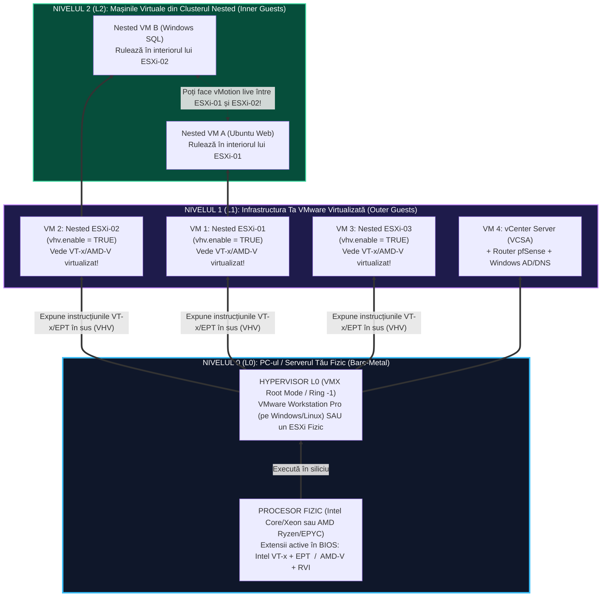
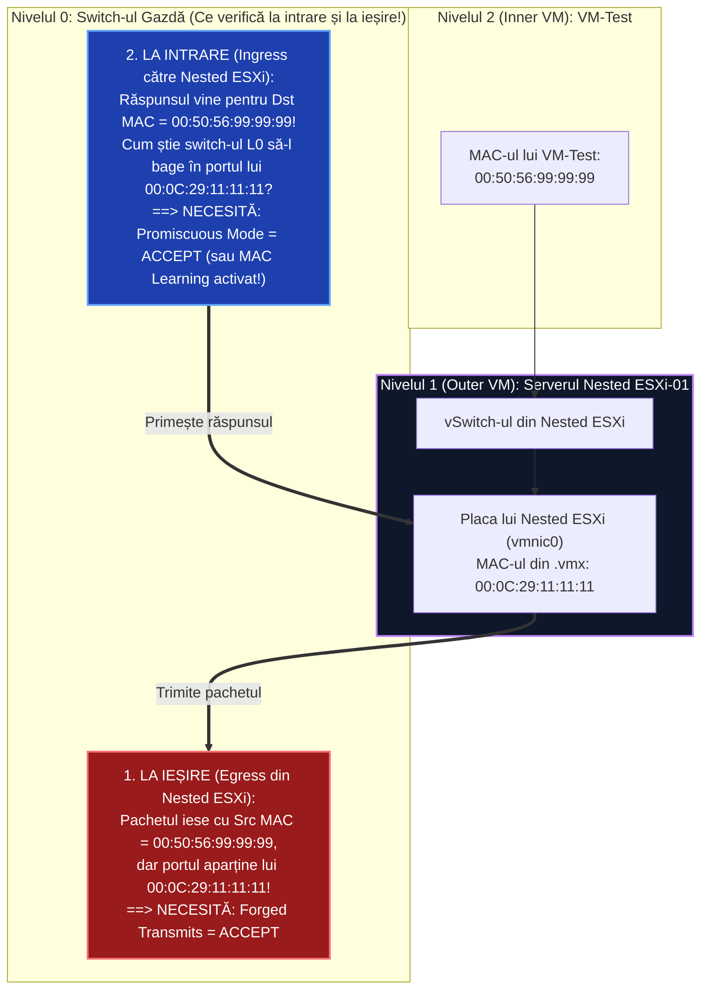
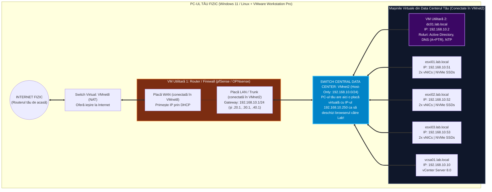

> **Obiectivul Capitolului:** Înțelegerea mecanicii interne a virtualizării imbricate (`Nested Virtualization`), dimensionarea și optimizarea resurselor hardware pe un PC/Server personal (folosind tehnicile consacrate de William Lam), proiectarea topologiei de rețea virtuală și construirea fundației infrastructurii de laborator (Router/Firewall + Server de Infrastructură `AD` / `DNS` / `NTP`).
>
> **Regula de Aur a acestui Capitol:** Fiecare acronim sau concept tehnic (`Nested Virtualization`, `CPU Rings 0-3`, `VT-x`, `AMD-V`, `EPT`, `RVI`, `VHVI`, `VMnet`, `NAT`, `Promiscuous Mode`, `Forged Transmits`, `MAC Learning`, `AD DS`, `DC`, `VCSA`) este explicat integral: **(1) Numele complet**, **(2) Ce reprezintă** și **(3) Cum funcționează tehnic în spate**.

:::analogy
### Cum poți construi un Data Center de $250.000\text{ EUR}$ pe un singur PC în sufragerie?

Pentru a învăța cu adevărat VMware `vSphere`, `vSAN`, `NSX` și `VCF` (VMware Cloud Foundation), nu este suficient să citești teorie sau să instalezi un singur server `ESXi`. Ai nevoie de **cel puțin 3 sau 4 servere `ESXi` interconectate**, un server central de management (`vCenter Server`), o rețea de stocare partajată (`SAN`/`NAS` sau `vSAN`) și routere/switch-uri configurate cu `VLAN`-uri.

Dacă ai cumpăra fizic 4 servere enterprise Dell PowerEdge sau HPE ProLiant, un switch de $10\text{ Gbps}$ și un echipament SAN, ai plăti zeci de mii de euro, ai avea nevoie de o cameră izolată fonic (serverele 1U fac un zgomot de aproximativ $75 - 85\text{ dB}$, echivalentul unui aspirator industrial pornit non-stop) și ai plăti o factură uriașă la energie electrică.

Soluția folosită de toți arhitecții VMware (`VCDX`), instructorii oficiali (`VCI`) și chiar de VMware în platforma lor oficială **VMware Hands-on Labs (`HOL`)** se numește **`Nested Virtualization` (Virtualizare Imbricată / În Cuib)**.

### Analogia Profesorului: Păpușile Matrioșka și Filmul „Inception” (Vis în interiorul unui vis)

Gândește-te la **Nested Virtualization** exact ca la filmul *Inception* sau la păpușile rusești **Matrioșka**:
* **Nivelul 0 (`L0` – Realitatea Fizică):** Este PC-ul tău de acasă (sau un singur mini-server fizic) pe care rulează Windows 11 + **VMware Workstation Pro** (sau un singur `ESXi` fizic).
* **Nivelul 1 (`L1` – Primul nivel de vis / Outer Guest):** În interiorul VMware Workstation creezi 4 mașini virtuale. Dar în aceste 4 mașini virtuale nu instalezi Windows, ci instalezi **4 servere `VMware ESXi`**! Aceste 4 mașini virtuale se numesc **Nested ESXi Hosts**. Ele cred că sunt 4 servere fizice reale Dell/HPE, dar în realitate sunt doar 4 foldere pe SSD-ul PC-ului tău!
* **Nivelul 2 (`L2` – Visul din interiorul visului / Inner Guest):** Te conectezi la cele 4 servere Nested ESXi și, în interiorul lor, creezi mașini virtuale cu Windows sau Linux pe care le muți live cu `vMotion` între cele 4 servere virtuale `ESXi`!
:::

:::architecture
### 0.3.1. Ce este „Nested Virtualization” și cum funcționează sub capotă (`CPU Rings`, `VT-x/AMD-V`, `EPT/RVI`)

Pentru a înțelege cum poate un Hypervisor să ruleze în interiorul altui Hypervisor, trebuie să coborâm la nivelul arhitecturii procesoarelor **x86-64 (Intel și AMD)**.

#### 1. Cum protejează procesorul sistemul de operare: Inelele de Privilegiu (`CPU Privilege Rings`)
Procesoarele moderne sunt împărțite în niveluri concentrice de securitate numite **Inele de Privilegiu (`Ring 0`, `Ring 1`, `Ring 2`, `Ring 3`)**:
* **`Ring 3` (User Space – Nivelul Neprivilegiat):** Aici rulează aplicațiile obișnuite (Chrome, Word, jocuri). Ele nu au voie să vorbească direct cu memoria RAM fizică sau cu placa de rețea; dacă încearcă, procesorul le blochează instantaneu.
* **`Ring 0` (Kernel Space / Supervisor Mode – Nivelul de Privilegiu Maxim):** Aici rulează nucleul sistemului de operare (Windows Kernel, Linux Kernel) sau **Hypervisorul (`VMkernel`)**. Doar codul aflat în `Ring 0` are dreptul să execute instrucțiuni critice de control al hardware-ului.

#### 2. De ce au fost inventate extensiile `Intel VT-x` și `AMD-V` (`Ring -1` / Root Mode)?
Când instalezi un sistem de operare Windows într-o mașină virtuală (`Guest OS`), acel Windows a fost programat să creadă că el este stăpânul calculatoarelor și cere să ruleze în **`Ring 0`**. Dar în **`Ring 0`** stă deja **Hypervisorul ESXi**! Nu pot exista doi șefi supremi în același inel fără să se calce pe picioare.

Pentru a rezolva acest conflict, Intel și AMD au modificat fizic procesoarele și au introdus **Virtualizarea Asistată de Hardware (`Hardware-Assisted Virtualization`)**:
* **`Intel VT-x` (`Intel Virtualization Technology for x86`)** – pe procesoarele Intel.
* **`AMD-V` (`AMD Virtualization`, nume de cod `Pacifica`)** – pe procesoarele AMD.

**Cum funcționează `VT-x` și `AMD-V`?**
Aceste tehnologii au creat un nivel nou, invizibil, situat **sub `Ring 0`**, numit neoficial **`Ring -1`** (sau oficial în documentația Intel: **`VMX Root Mode`** pentru Hypervisor și **`VMX Non-Root Mode`** pentru Mașinile Virtuale):
1. **Hypervisorul fizic (`L0`)** stă în **`VMX Root Mode` (`Ring -1`)** și controlează totul.
2. **Mașina Virtuală (`Guest OS`)** este lăsată să stea în propriul ei **`Ring 0` (`VMX Non-Root Mode`)**, fiind păcălită că are acces direct la procesor, în timp ce Hypervisorul din `Ring -1` o supraveghează.

#### 3. Ce sunt `EPT` (Intel) și `RVI` (AMD) – Virtualizarea Memoriei (`SLAT`)?
Pe lângă procesor, și memoria RAM trebuie tradusă de două ori (din adresa văzută de aplicația din VM $\rightarrow$ în adresa „fizică” văzută de VM $\rightarrow$ în adresa fizică reală de pe plăcuța RAM a PC-ului tău).
Pentru ca această dublă traducere să nu încetinească procesorul, procesoarele au un modul hardware dedicat numit **`SLAT` (`Second Level Address Translation` / Traducerea Adreselor de Nivelul Doi)**:
* La **Intel**, tehnologia se numește **`EPT` (`Extended Page Tables` / Tabele de Pagini Extinse)**.
* La **AMD**, tehnologia se numește **`RVI` (`Rapid Virtualization Indexing`)** sau **`NPT` (`Nested Page Tables`)**.

#### 4. Magia din Nested Virtualization: `VHVI` (`Virtual Hardware-Assisted Virtualization`)
Când pornești un server **Nested ESXi (`L1`)** în interiorul lui VMware Workstation (`L0`), acel Nested ESXi verifică la bootare dacă procesorul are instrucțiunile `VT-x / EPT` sau `AMD-V / RVI`. Dacă VMware Workstation nu i le arată, Nested ESXi refuză să pornească mașini virtuale în interiorul său (`L2`)!

Când bifezi în VMware Workstation opțiunea **`Virtualize Intel VT-x/EPT or AMD-V/RVI`** (sau în fișierul `.vmx` linia **`vhv.enable = "TRUE"`**, unde `VHV` = *Virtual Hardware-Assisted Virtualization*), Hypervisorul de la Nivelul 0 (`L0`) **expune instrucțiunile hardware de virtualizare în sus către Mașina Virtuală de la Nivelul 1 (`L1`)**! Astfel, când Mașina Virtuală de la Nivelul 2 (`L2`) vrea să execute o instrucțiune privilegiată, Hypervisorul `L0` interceptează cererea (`VM Exit`), o pasează Hypervisorului `L1` (Nested ESXi) pentru decizie și apoi o execută pe procesorul fizic (`VM Entry`)!



---

### 0.3.2. Cerințe Hardware pe PC-ul Tău și Optimizările lui William Lam (Cum reduci consumul de RAM la jumătate!)

Înainte să construim laboratorul, trebuie să știi exact de cât `CPU`, `RAM` și spațiu pe `SSD` ai nevoie pentru fiecare pilon al cursului nostru și cum poți „păcăli” produsele VMware să consume de două ori mai puțină memorie RAM decât cer ele oficial în documentație (folosind trucurile descoperite de **William Lam**, *Senior Staff Solution Architect la VMware by Broadcom* și creatorul conceptului modern de Nested Homelab).

#### 1. De ce nu contează atât de mult Procesorul (`CPU`), cât contează Memoria (`RAM`) și `SSD`-ul `NVMe`?
* **Procesorul (`CPU`):** VMware permite **suprascrierea procesorului (`CPU Overcommitment`)** fără probleme în homelab! Chiar dacă PC-ul tău are doar **8 nuclee fizice (16 fire logice)**, poți porni mașini virtuale care însumează în total **40 sau 60 de `vCPU`**, deoarece în laborator mașinile nu stau toate la $100\%$ încărcare simultan. Hypervisorul împarte timpul procesorului în felii de milisecunde între ele.
* **Memoria (`RAM`):** Este resursa numărul 1 care te limitează! Mașinile grele precum `vCenter Server Appliance (VCSA)` și `NSX Manager` își alocă memoria la pornire pentru bazele lor de date interne.
* **Stocarea (`NVMe SSD`):** Este **interzis** să rulezi un Nested Lab pe un hard-disk mecanic (`HDD`)! Când pornești 3 servere `ESXi` și un `vCenter` simultan, se generează mii de operații de citire/scriere pe secundă (`IOPS`). Pe un `SSD NVMe`, vCenter-ul pornește în 4 minute; pe un `HDD`, pornește în 45 de minute sau dă eroare de *Timeout*!

#### 2. Tabelul de Dimensionare a Resurselor pe Etape (De la Pilonul 1 la Pilonul 6)

| Etapa din Curs | Ce rulează simultan în Laborator | Consum Oficial (Din Documentația VMware) | Consum Optim în Home Lab (Cu trucurile lui William Lam) | RAM Minim necesar pe PC-ul tău |
| :--- | :--- | :--- | :--- | :--- |
| **Pilonul 1 (ESXi Singur)** | 1x Router + 1x AD/DNS + **1x Nested ESXi** + 2x Test VMs | ~12 GB RAM | **~8 GB RAM** (ESXi rulează cu 4-6 GB RAM) | **16 GB RAM** pe PC |
| **Pilonul 2 (vSphere & vCenter)** | Infrastructură + **3x Nested ESXi** + **1x vCenter (VCSA)** | ~38 GB RAM (VCSA cere oficial 14 GB RAM) | **~22 - 26 GB RAM** (3x ESXi @ 6 GB + VCSA redus la 8-10 GB) | **32 GB RAM** pe PC |
| **Pilonul 3 (Cluster vSAN)** | Infrastructură + **3x Nested ESXi (cu discuri vSAN)** + **1x VCSA** | ~62 GB RAM | **~28 - 32 GB RAM** (3x ESXi @ 8 GB + VCSA @ 8 GB) | **32 GB - 64 GB RAM** pe PC |
| **Pilonul 4 (VMware NSX)** | Cluster vSphere + **1x NSX Manager** + **1x NSX Edge Node** | ~96+ GB RAM (NSX Manager cere oficial 48 GB RAM!) | **~44 - 52 GB RAM** (NSX Manager redus la 16 GB + Edge @ 4-8 GB) | **64 GB RAM** pe PC (sau oprirea vSAN când testezi NSX) |
| **Pilonul 6 (Full VCF Stack)** | Cloud Builder + SDDC Manager + VCSA + NSX + 4x ESXi | ~256 GB RAM | **~80 - 96 GB RAM** (folosind scriptul automatizat VCF Lab) | **96 GB - 128 GB RAM** (sau rulare secvențială) |

> **Sfatul Profesorului dacă ai doar 16 GB sau 32 GB RAM pe PC:** Nu trebuie să îți cumperi alt calculator acum! Cu **16 GB RAM** poți face integral **Pilonul 0 și Pilonul 1** (și chiar părți din Pilonul 2). Cu **32 GB RAM** poți face lejer **Pilonii 0, 1, 2 și 3 complet**, iar la **Pilonul 4 (NSX)** îți voi arăta cum să rulezi doar 2 host-uri ESXi fără vSAN pentru a încăpea în cei 32 GB RAM!

#### 3. Cele 5 Trucuri de Aur ale lui William Lam pentru Economisirea Resurselor în Home Lab

1. **Reducerea Memoriei RAM pentru `VCSA` (`vCenter Server Appliance`):**
   * *Oficial:* Instalatorul pentru `VCSA 8.0` (dimensiunea *Tiny*) alocă automat **14 GB RAM** (12 GB în vSphere 7).
   * *Trucul:* După ce instalarea `VCSA` s-a terminat cu succes și toate serviciile au pornit prima dată, poți opri mașina virtuală `VCSA`, îi poți modifica memoria RAM la **8 GB (sau 10 GB)** și poți dezactiva scripturile neesențiale de telemetrie (*VMware Customer Experience Improvement Program - CEIP* și *vSphere Lifecycle Manager depot sync* automat). `VCSA`-ul va consuma cu 35% mai puțin RAM!
2. **Reducerea Memoriei RAM și a Numărului de Noduri pentru `NSX Manager`:**
   * *Oficial:* În producție, `NSX Manager` se instalează în cluster de **3 mașini virtuale (*Medium*)**, fiecare având **16 vCPU și 48 GB RAM** (total: $144\text{ GB RAM}$ doar pentru managementul NSX!).
   * *Trucul:* În Home Lab, instalezi **un singur nod `NSX Manager`** în dimensiunea **`Small`** (sau modifici fișierul `.ovf` înainte de instalare), îi setezi **4 vCPU și 16 GB RAM** (fără rezervare de memorie!) și dezactivezi verificarea de memorie. Merge impecabil pentru toate laboratoarele `VCP-NV`!
3. **Folosirea `Thin Provisioning` peste tot (Supra-alocarea spațiului pe SSD):**
   * **Ce înseamnă `Thin Provisioning` (Aprovizionare Subțire)?** Când creezi un disc virtual de $500\text{ GB}$ în mod *Thin*, VMware **NU îți ocupă $500\text{ GB}$ pe SSD-ul tău fizic**, ci îți ocupă **$0\text{ MB}$ la început**, crescând fișierul doar pe măsură ce scrii date reale în el! Astfel, pe un singur SSD fizic de $1\text{ TB}$ poți crea 20 de discuri virtuale de câte $200\text{ GB}$ fiecare!
4. **Partajarea Memoriei și Dezactivarea Fișierelor `.vmem` în VMware Workstation:**
   * Când pornești o mașină virtuală cu $16\text{ GB RAM}$ în VMware Workstation pe Windows, Workstation creează pe SSD-ul tău un fișier de paginare uriaș de $16\text{ GB}$ (numit `.vmem`), ceea ce uzează SSD-ul și încetinește pornirea.
   * Dacă adaugi în fișierul de configurare al VMware Workstation (`C:\ProgramData\VMware\VMware Workstation\settings.ini`) linia:
     ```ini
     mainMem.useNamedFile = "FALSE"
     ```
     Workstation va ține mașinile virtuale direct în memoria RAM fizică ultrarapidă a PC-ului, fără să mai scrie zeci de GB pe SSD la fiecare pornire!
5. **Crearea Mașinilor Virtuale de Test („Nested VMs” de Nivel 2) cu sisteme Linux Ultra-Ușoare:**
   * Când vrem să testăm `vMotion`, `HA`, `DRS`, `vSAN` sau firewall-ul din `NSX`, avem nevoie de 4-6 mașini virtuale pornite în interiorul clusterului nostru.
   * În loc să instalezi 6 mașini cu *Windows Server 2022* (care mănâncă fiecare câte $2 - 4\text{ GB RAM}$), vom folosi distribuții Linux create special pentru laboratoare de virtualizare: **Alpine Linux**, **Tiny Core Linux** sau **Photon OS** (sistemul oficial creat de VMware), care pornesc în **3 secunde** și consumă doar **`128 MB` – `256 MB RAM`** per mașină virtuală!

---

### 0.3.3. Arhitectura Rețelelor în Home Lab și Cele 3 Reguli de Securitate (`Promiscuous Mode`, `MAC Changes`, `Forged Transmits`)

#### 1. Cum funcționează Switch-urile Virtuale din VMware Workstation (`VMnet0`, `VMnet1`, `VMnet8`)
Când instalezi **VMware Workstation Pro** pe PC-ul tău, acesta deschide o unealtă numită **Virtual Network Editor**, care îți oferă până la 20 de switch-uri virtuale interne (`VMnet0` până la `VMnet19`), împărțite în 3 tipuri fundamentale:

1. **`VMnet0` (`Bridged Mode` / Mod Punte):**
   * **Cum funcționează:** Conectează mașina virtuală direct la placa de rețea fizică a PC-ului tău, ca și cum ai fi băgat un cablu separat în routerul tău Wi-Fi de acasă (Digi / Orange).
   * **De ce NU îl folosim pentru rețelele interne ale laboratorului?** Pentru că depinzi de routerul de acasă, nu poți face `VLAN`-uri sau `Jumbo Frames` pe un router casnic, iar dacă pleci cu laptopul la o cafenea, ți se schimbă clasa de IP-uri și îți crapă tot laboratorul!
2. **`VMnet8` (`NAT Mode` – `Network Address Translation` / Traducerea Adreselor de Rețea):**
   * **Cum funcționează:** Creează o rețea privată între PC-ul tău și mașinile virtuale, dar include un „mini-router invizibil” care le dă mașinilor virtuale acces la **Internet** folosind conexiunea la internet a PC-ului tău!
   * **La ce îl folosim în Lab?** Vom conecta interfața **`WAN` (`Wide Area Network` / Internet)** a routerului nostru virtual `pfSense` la `VMnet8`, astfel încât tot Data Centerul nostru virtual să aibă acces la Internet pentru update-uri și sincronizare de oră (`NTP`)!
3. **`VMnet1`...`VMnet19` (`Host-Only` / `Custom Isolated Virtual Switch`):**
   * **Cum funcționează:** Este un switch virtual pur, complet izolat de routerul de acasă și de Internet.
   * **La ce îl folosim în Lab?** Vom folosi un switch `Host-Only` (de exemplu `VMnet2`) ca „Switch Fizic Central (Trunk)” al Data Centerului nostru, în care vom înfige interfața **`LAN` (`Local Area Network`)** a routerului `pfSense`, serverul de Active Directory/DNS, toate serverele `Nested ESXi` și `vCenter`-ul!

#### 2. DE CE nu funcționează Rețeaua într-un Nested Lab dacă nu înțelegi `Promiscuous Mode`, `Forged Transmits` și `MAC Learning`?
*(Atenție maximă: Acesta este subiect atât de **Examen VCP-DCV**, cât și cauza #1 pentru care 90% dintre cursanți se blochează când își fac primul laborator Nested ESXi!)*

Să urmărim ce se întâmplă când creezi un server **Nested ESXi (`L1`)** care are o placă de rețea virtuală cu adresa MAC **`00:0C:29:11:11:11`**.
Apoi, în interiorul acestui Nested ESXi, creezi o mașină virtuală de test (`L2` – să-i zicem `VM-Test`) care primește de la Nested ESXi propria ei adresă MAC: **`00:50:56:99:99:99`**.

Când `VM-Test` trimite un pachet în rețea, pachetul iese prin placa de rețea a lui Nested ESXi având ca **Source MAC adresa `00:50:56:99:99:99`**.
Dacă acest Nested ESXi rulează pe un alt vSwitch VMware, switch-ul de la Nivelul 0 (`L0`) se uită la pachet și spune:
* **La trimitere (Egress):** *„Stai puțin! Eu știu că pe acest port este conectat serverul Nested ESXi cu MAC-ul `00:0C:29:11:11:11`. De ce văd un pachet care pretinde că vine de la MAC-ul `00:50:56:99:99:99`?! Acesta este un atac de falsificare a identității (**MAC Spoofing**)! **BLOCHEZ PACHETUL!**”*
* **La primire (Ingress):** Când vine răspunsul din rețea adresat către MAC-ul `00:50:56:99:99:99`, switch-ul de la Nivelul 0 se uită în lista lui și spune: *„Pe portul lui Nested ESXi locuiește doar MAC-ul `00:0C:29:11:11:11`. Nu livrez pachetul destinat lui `00:50:56:99:99:99` pe acest port!”*

Pentru a rezolva această blocare de securitate într-un mediu Nested, în VMware există **3 politici de securitate pe vSwitch** (și noul mecanism modern din vSphere 8 numit **MAC Learning**):

1. **`Promiscuous Mode` (Modul Promiscuu – la nivel de Receivere / Ingress):**
   * **Setare implicită în ESXi:** `Reject` (Respins).
   * **Ce face când îl pui pe `Accept`:** Dezactivează filtrarea după adresa MAC la intrare! Switch-ul virtual trimite către placa de rețea a lui Nested ESXi **toate cadrele care circulă în acel VLAN/PortGroup**, chiar dacă adresa MAC de destinație aparține unei mașini virtuale de Nivel 2 (`00:50:56:99:99:99`) ascunse în interiorul acelui Nested ESXi!
2. **`Forged Transmits` (Transmisii Falsificate – la nivel de Trimitere / Egress):**
   * **Setare implicită în ESXi:** `Reject` (pe vDS în vSphere 8) / `Accept` (pe vSS clasic).
   * **Ce face când îl pui pe `Accept`:** Îi dă voie serverului Nested ESXi să scoată pe placa lui de rețea pachete care au la *Source MAC* adresele MAC ale mașinilor virtuale găzduite în interiorul său!
3. **`MAC Address Changes` (Schimbări ale Adresei MAC):**
   * **Ce face când îl pui pe `Accept`:** Permite ca sistemul de operare din interiorul unei mașini virtuale să își modifice propria adresă MAC efectivă față de cea scrisă în fișierul de configurare `.vmx`.
4. **Soluția Modernă (vSphere Distributed Switch 6.7 / 7.0 / 8.0): `MAC Learning` (Învățarea Adreselor MAC):**
   * Dezavantajul activării *Promiscuous Mode* este că inundă toate host-urile cu trafic inutil. În vSphere 7 și 8, pe un **Distributed Switch (`vDS`)**, poți lăsa *Promiscuous Mode* pe **Disabled** și activezi în schimb **`MAC Learning` + `Forged Transmits: Accept`**! Astfel, switch-ul învață dinamic că în spatele portului lui Nested ESXi locuiesc 10 adrese MAC diferite și livrează pachetele chirurgical, fără să inunde rețeaua!



---

### 0.3.4. Planul de Adresare IP și Arhitectura Completă a Laboratorului Nostru (`lab.local`)

Ca să lucrăm ca într-o bancă sau corporație reală, de azi înainte vom folosi o schemă de adresare standardizată pe care o vom păstra neschimbată din **Pilonul 1 până în Pilonul 6**.

* **Numele Domeniului DNS (`Domain Name`):** **`lab.local`**
* **Rețeaua Fizică Virtuală de Bază (`VMnet2` în VMware Workstation):** **`192.168.10.0/24`** (Masca `255.255.255.0`).

#### Tabelul Oficial de Echipamente și IP-uri din Data Centerul Tău Personal:

| Echipament (Mașină Virtuală L1) | Rolul în Infrastructură | Hostname & FQDN (`lab.local`) | Adresa IP Statică (`/24`) | VLAN / Rețea |
| :--- | :--- | :--- | :--- | :--- |
| **Router / Firewall (`pfSense` sau `OPNsense`)** | Default Gateway pentru toate rețelele, acces la Internet (prin `VMnet8`) și rutare între VLAN-uri. | `gw01.lab.local` | **`192.168.10.1`** | `VLAN 10` (Mng) + Gateways pt. VLAN 20, 30, 40 |
| **Windows Server (`DC01`)** *(sau Linux `dnsmasq`/`bind`)* | **Active Directory (`AD DS`)**, Server **`DNS`** (cu zone `A` și `PTR`), Server **`NTP`** și Target **`iSCSI`** pt. Pilonul 2. | `dc01.lab.local` | **`192.168.10.2`** | `VLAN 10` (Management) |
| **vCenter Server (`VCSA`)** | Creierul central al clusterului vSphere (se instalează în Pilonul 2). | `vcsa01.lab.local` | **`192.168.10.10`** | `VLAN 10` (Management) |
| **NSX Unified Appliance** | Creierul SDN al rețelei NSX (se instalează în Pilonul 4). | `nsxmgr01.lab.local` | **`192.168.10.15`** | `VLAN 10` (Management) |
| **Nested ESXi Host #1** | Primul nostru hypervisor ESXi (îl instalăm în Capitolul 1.1!). | `esxi01.lab.local` | **`192.168.10.51`** | `VLAN 10` (Management) |
| **Nested ESXi Host #2** | Al doilea hypervisor ESXi pentru cluster vMotion/HA/vSAN. | `esxi02.lab.local` | **`192.168.10.52`** | `VLAN 10` (Management) |
| **Nested ESXi Host #3** | Al treilea hypervisor ESXi pentru quorum vSAN și HA. | `esxi03.lab.local` | **`192.168.10.53`** | `VLAN 10` (Management) |

#### Subrețelele Specializate (pe care le vom activa pe parcurs în Pilonii 2, 3 și 4):
* **`VLAN 10` – Management Network:** `192.168.10.0/24` (Gateway: `192.168.10.1`)
* **`VLAN 20` – vMotion Network:** `192.168.20.0/24` (`esxi01` = `.51`, `esxi02` = `.52`, `esxi03` = `.53`)
* **`VLAN 30` – Storage Network (iSCSI / NFS / vSAN):** `192.168.30.0/24` (`esxi01` = `.51`, `esxi02` = `.52`, `esxi03` = `.53`)
* **`VLAN 40` – NSX Host Overlay (`TEP` Network):** `192.168.40.0/24` (Pool: `.101` – `.120`, Gateway: `192.168.40.1`, `MTU = 9000`)


:::

:::exam-alert
### De Memorat (Parametri `.vmx`, Comenzi și Setări Critice)

* **`vhv.enable = "TRUE"`:** Linia obligatorie în fișierul `.vmx` al oricărei mașini virtuale pe care vrei să instalezi un Nested Hypervisor (`ESXi`, `Hyper-V`, `KVM`). Activează `Virtual Hardware-Assisted Virtualization`.
* **Conflictul dintre `Windows Hyper-V / VBS` și `VMware Workstation` pe Windows 11:**
  * **Ce este `VBS` (`Virtualization-Based Security` / Securitate Bazată pe Virtualizare) și `Core Isolation / Memory Integrity` din Windows 11?** Este o funcție din Windows 11 care pornește în fundal hypervisorul Microsoft `Hyper-V` (la Nivelul 0) pentru a proteja memoria Windows-ului.
  * **De ce este o problemă uriașă pentru Nested ESXi?** Dacă `Hyper-V` și `Memory Integrity` sunt pornite în Windows 11, ele confiscă exclusiv instrucțiunile hardware `Intel VT-x / AMD-V` ale procesorului! Când deschizi VMware Workstation și încerci să pornești un `Nested ESXi`, fie primești eroarea *„Virtualized Intel VT-x/EPT is not supported on this platform”*, fie serverul `ESXi` se mișcă de 10 ori mai încet (în mod emulat numit * CPL0 / ULMs*)!
  * **Cum o rezolvi în 30 de secunde:** Dezactivezi *Memory Integrity* din *Windows Security $\rightarrow$ Device Security $\rightarrow$ Core Isolation* și rulezi în Command Prompt (ca Administrator): `bcdedit /set hypervisorlaunchtype off` urmat de un restart!

### Capcane de Examen & Realitate Tehnică

1. **Capcana #1 (Este Nested Virtualization suportată oficial de Broadcom/VMware în Producție?):**
   * *Întrebare frecventă:* „Pot rula în producție un ESXi în interiorul altui ESXi și să deschid tichet de suport la Broadcom dacă am o problemă?”
   * *Răspunsul Oficial (VMware KB 2009916):* **NU!** Rulare unui hypervisor `ESXi` în interiorul altui hypervisor (Nested ESXi) nu este suportată oficial pentru medii de producție ale clienților (cu excepția mediilor oficiale de training VMware Hands-on Labs). Este însă metoda numărul 1 în lume pentru studiu, certificare și testarea arhitecturilor înainte de implementare.
2. **Capcana #2 (De ce nu îmi răspunde la `ping` o mașină virtuală creată pe un Nested ESXi?):**
   * Dacă poți da `ping` din laptopul tău în IP-ul serverului `Nested ESXi` (`192.168.10.51`), dar **NU poți da `ping` în mașina virtuală care rulează în interiorul acelui Nested ESXi (`192.168.10.100`)**, în $99.9\%$ din cazuri ai uitat să pui **`Promiscuous Mode: Accept`** și **`Forged Transmits: Accept`** pe switch-ul gazdă!
:::

:::interview
### Întrebarea 1 (Cum îți prezinți Home Lab-ul la Interviu ca să înlocuiești lipsa de experiență comercială)

> **Intervievator:** *„Văd în CV că nu ai lucrat încă într-o echipă de Enterprise Infrastructure cu 100 de servere. Cum îmi poți demonstra că nu ai învățat doar teorie pe de rost și că știi ce să faci când îți dau acces de Administrator pe vCenter?”*

**Răspunsul Ideal (Care transformă un candidat Junior într-un favorit la angajare):**
„Chiar dacă nu am administrat încă un cluster comercial, mi-am construit de la zero propriul mediu enterprise prin **Nested Virtualization**, respectând arhitectura din *VMware Validated Designs*.
Am configurat o topologie completă pe domeniul `lab.local`, cu un router/firewall dedicat (`pfSense`) pentru rutare inter-VLAN, un server Windows Server cu **Active Directory, DNS (cu zone Forward A și Reverse PTR validate) și NTP**, peste care am instalat un cluster de **3 noduri VMware ESXi 8.0** administrate de un **vCenter Server Appliance (VCSA)**.
În acest laborator am configurat de la cap la coadă `vSphere Distributed Switches (vDS)`, stocare partajată `iSCSI`, `NFS` și un cluster hiperconvergent **`vSAN`**, am testat scenarii reale de avarie cu `vSphere HA`, echilibrare cu `DRS`, iar la nivel de `SDN` am ridicat **`VMware NSX`** cu tuneluri `GENEVE` și microsegmentare prin `Distributed Firewall`. Pot să vă deschid oricând laboratorul în timpul interviului sau să vă explic pe tablă fiecare pas de configurare și depanare.”

### Întrebarea 2 (Nivel Mid / Securitate vSwitch: Promiscuous Mode vs. Forged Transmits)

> **Intervievator:** *„Spune-mi ce fac politicile de securitate `Promiscuous Mode`, `MAC Address Changes` și `Forged Transmits` de pe un vSphere Switch. Care este valoarea lor recomandată în producție din punct de vedere al securității (Hardening Guide) și în ce situație reală ești obligat să le pui pe `Accept`?”*

**Răspunsul Ideal:**
„Aceste trei politici controlează securitatea la **Layer 2 (Data Link)** pe porturile unui switch virtual (`vSS` sau `vDS`):
1. **`Promiscuous Mode`** controlează traficul de **intrare (Ingress)** către o mașină virtuală. Când este pe **`Reject`** (valoarea recomandată în *VMware Security Hardening Guide*), placa de rețea a unei mașini virtuale primește doar cadrele adresate propriului său MAC și cele de Broadcast. Dacă îl punem pe **`Accept`**, acea mașină virtuală poate intercepta toate cadrele care circulă în acel Port Group / VLAN. Îl activăm în producție doar pe portul unei mașini virtuale de tip **IDS/IPS (Intrusion Detection System)**, un sniffer de pachete (Wireshark appliance) sau pentru **Nested ESXi** (dacă nu folosim *MAC Learning*).
2. **`MAC Address Changes`** controlează dacă acceptăm ca sistemul de operare Guest să își schimbe adresa MAC activă din OS într-una diferită de cea alocată în fișierul `.vmx`.
3. **`Forged Transmits`** controlează traficul de **ieșire (Egress)** din mașina virtuală. Pe **`Reject`**, ESXi blochează orice cadru trimis de VM dacă adresa *Source MAC* din antetul Ethernet nu corespunde cu MAC-ul oficial al plăcii virtuale (prevenind atacurile de *MAC Spoofing*). În producție, suntem obligați să îl punem pe **`Accept`** atunci când rulăm **Load Balancere sau Firewall-uri în cluster Active/Standby cu o adresă MAC virtuală flotantă (VIP)** (cum ar fi *Microsoft NLB în mod Unicast* sau *Keepalived/VRRP*), precum și pentru noduri **Nested ESXi**.”
:::

:::lab
> **Scenariul Laboratorului:** Azi turnăm fundația fizică și logică a Data Centerului nostru: instalăm și optimizăm **VMware Workstation Pro**, dezactivăm interferența `Hyper-V` din Windows, creăm switch-ul central **`VMnet2` (`192.168.10.0/24`)** și punem în picioare serverul de infrastructură (`DNS` + `NTP` + `Router`) astfel încât în Capitolul următor (1.1) să putem instala direct primul nostru server **VMware ESXi**!
:::

:::quiz

:::

:::references
1. **William Lam (vExpert #1 în Homelabs):** *Nested Virtualization & Automated Home Lab Deployment Guides* (`williamlam.com`) – Sursa numărul 1 mondială pentru optimizarea RAM-ului și configurarea Nested ESXi, vSAN, NSX și VCF.
2. **VMware Official Documentation (vSphere Security):** *vSwitch and Distributed Switch Security Policies: Promiscuous Mode, MAC Address Changes, and Forged Transmits* (`techdocs.broadcom.com`).
3. **VMware Blog / Technical Marketing:** *Understanding MAC Learning on vSphere Distributed Switches for Nested ESXi and NFV Workloads*.
4. **Broadcom / VMware Knowledge Base (KB 2146361 & KB 1009428):** *Running Nested VMs and resolving conflicts with Windows Hyper-V / Device Guard / Credential Guard*.
5. **Intel® 64 and IA-32 Architectures Software Developer’s Manual (Volume 3C):** *System Programming Guide – Virtual Machine Extensions (VMX) & Extended Page Tables (EPT)*.
:::
