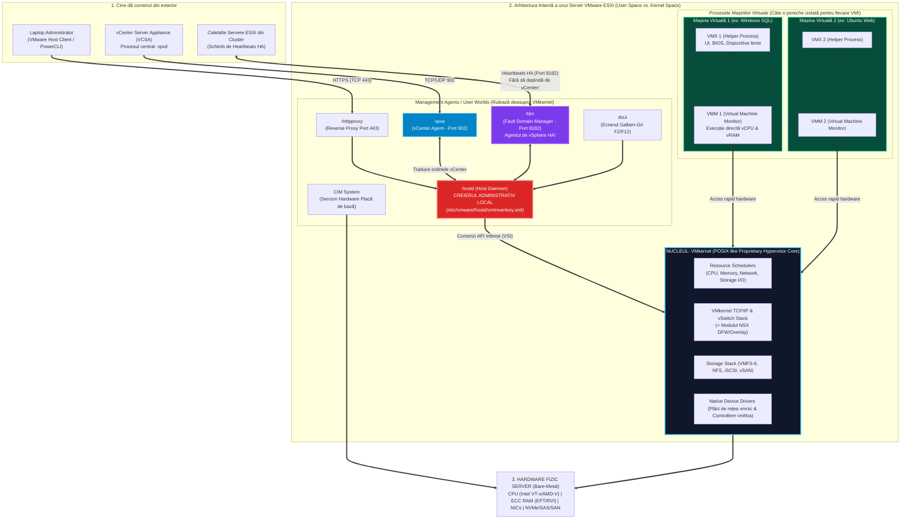
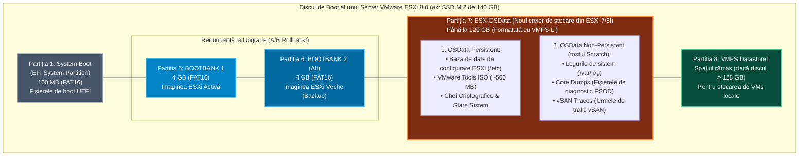

> **Obiectivul Capitolului:** Înțelegerea completă a modului în care funcționează nucleul `VMware ESXi` (`VMkernel`), disecția tuturor proceselor și agenților interni (`Worlds`, `VMM`, `VMX`, `hostd`, `vpxa`, `fdm`, `dcui`), verificarea compatibilității hardware prin codurile `PCI ID` pe lista `HCL`, înțelegerea noii arhitecturi de partiționare a discului de boot în ESXi 7/8 (`ESX-OSData` și motivul interzicerii cardurilor SD/USB) și instalarea pas-cu-pas a primului server `ESXi` în laborator.
>
> **Regula de Aur a acestui Capitol:** Niciun acronim și niciun proces nu sunt lăsate neexplicate. Pentru fiecare termen vei găsi: **(1) Numele complet**, **(2) Ce reprezintă** și **(3) Cum funcționează tehnic sub capotă**.

:::analogy
### De ce trebuie să știi ce se întâmplă în „măruntaiele” lui ESXi?

Orice începător poate apăsa *Next -> Next -> Finish* ca să instaleze un `ESXi`. Dar ce faci în ziua în care încerci să te conectezi din browser la un server `ESXi` din producție sau din `vCenter`, iar interfața îți afișează că serverul este **`Disconnected / Not Responding`**, deși mașinile virtuale de pe el încă merg și răspund la `ping`?!

Dacă nu cunoști arhitectura internă a lui `ESXi`, vei intra în panică și vei apăsa butonul fizic de *Reset* al serverului, omorând pe loc 50 de mașini virtuale de producție!
În schimb, dacă știi cum funcționează procesele interne din `ESXi` (pe care le învățăm chiar acum), vei ști că mașinile virtuale rulează în procese independente numite `VMM` și `VMX`, în timp ce interfața web și comunicarea cu `vCenter` sunt gestionate de doi „secretari” software numiți **`hostd`** și **`vpxa`**. Te vei conecta prin `SSH` (sau la consola locală `DCUI`), vei rula o singură comandă care repornește doar acești doi „secretari” în 3 secunde (`/etc/init.d/hostd restart && /etc/init.d/vpxa restart`), iar serverul va reveni online în `vCenter` **fără ca nicio mașină virtuală să fi clipit măcar!**

### Analogia Profesorului: Turnul de Control al unui Aeroport Internațional

Gândește-te la un server **VMware ESXi** ca la un **Aeroport Internațional ultra-securizat**:

* **Pista de aterizare, radarele și combustibilul** reprezintă **Hardware-ul Fizic** (`CPU`, `RAM`, `NICs`, `Storage`).
* **`VMkernel`-ul (Nucleul ESXi)** este **Turnul de Control al Traficului Aerian**: niciun avion nu are voie să atingă pista din proprie inițiativă; Turnul de Control decide la milisecundă cine decolează, pe ce culoar zboară și cât combustibil primește.
* **Avioanele** sunt **Mașinile Virtuale (`VMs`)**. Fiecare avion are în cabină un **Pilot Automat dedicat** numit **`VMM` (`Virtual Machine Monitor`)** și un **Inginer de Bord** numit **`VMX`**. Dacă un avion are o defecțiune internă, el nu prăbușește nici Turnul de Control, nici celelalte avioane!
* **Recepția VIP a Aeroportului (`hostd`)** și **Ofițerul de Legătură cu Ministerul Transporturilor (`vpxa`)** sunt cei care răspund la telefon când suni tu (din browser) sau când sună șeful cel mare (`vCenter Server`). Chiar dacă recepționerul (`hostd`) leșină de oboseală și nu mai răspunde la telefon, **Turnul de Control (`VMkernel`) și avioanele (`VMs`) continuă să zboare în siguranță maximă!**
:::

:::architecture
### 1.1.1. Ce este `VMkernel`-ul, ce este un `World` și cum funcționează Procesele Cheie din ESXi

#### 1. Evoluția Istorică: `VMware ESX` (cu Linux) vs. `VMware ESXi` (fără Linux)

* **Ce înseamnă acronimul `ESXi`?**
  * Istoric (în anul 2001), numele **`ESX`** a venit de la ***Elastic Sky X***. Acea primă versiune (`ESX` fără „i”) folosea o mașină virtuală specială bazată pe *Red Hat Linux* numită **`COS` (`Console Operating System` / `Service Console`)** doar pentru a porni sistemul și a rula scripturi de administrare.
  * Litera **`i`** din **`ESXi`** vine de la ***Integrated*** (*VMkernel Integrat*). Începând cu versiunea 5.0 (și până azi în ESXi 8.0/9.0), VMware a șters complet acel Linux (`Service Console`), reducând dimensiunea hypervisorului de la $2\text{ GB}$ la sub $300 - 400\text{ MB}$!
* **Ce este `VMkernel`?**
  * Este un sistem de operare proprietar cu arhitectură de tip microkernel/monolitic hibrid, dezvoltat de VMware conform standardului **`POSIX` (`Portable Operating System Interface`)**.
  * Deși când intri în linia de comandă a unui `ESXi` (numită **`ESXi Shell`**) folosești comenzi care arată ca în Linux (`ls`, `ps`, `vi`, `kill`), tu nu ești într-un Linux, ci într-un mic shell de tip **`BusyBox` / `ash`** care vorbește direct cu `VMkernel`-ul!
  * În lumea Linux/Windows, un program care rulează se numește *Process* (Proces). În terminologia internă **`VMkernel`**, orice proces sau fir de execuție programat pe procesor se numește un **`World` (o „Lume”)** și are un număr unic de identificare numit **`World ID`**.

#### 2. Cum trăiește o Mașină Virtuală în `VMkernel`: Perechea `VMM` + `VMX`

De fiecare dată când apeși *Power On* pe o mașină virtuală, `VMkernel`-ul nu pornește un singur proces pentru ea, ci creează **o pereche de două procese (`Worlds`) gemene**, cu responsabilități strict separate:

1. **`VMM` (`Virtual Machine Monitor` / Monitorul Mașinii Virtuale):**
   * **Ce reprezintă și ce face:** Este procesul critic de înaltă performanță care se ocupă direct de **virtualizarea Procesorului (`vCPU`) și a Memoriei (`vRAM`)** pentru acea mașină virtuală, comunicând direct cu instrucțiunile hardware `Intel VT-x / AMD-V` și `EPT / RVI`.
   * Fiecare mașină virtuală pornită are **propriul său proces `VMM` izolat**! Dacă ai 20 de mașini virtuale pornite pe un host ESXi, în `VMkernel` există 20 de procese `VMM` complet separate.
2. **`VMX` (`Virtual Machine Executable` / Executabilul Mașinii Virtuale):**
   * **Ce reprezintă și ce face:** Este procesul „ajutător” din *User Space* pereche cu `VMM`-ul. El se ocupă de toate operațiile care nu țin de viteza pură a procesorului: controlează dispozitivele virtuale mai lente (tastatura, mouse-ul, ecranul video din consolă, `BIOS/UEFI`-ul virtual), citește și scrie în fișierul de configurare `.vmx` și gestionează comunicarea cu interfața grafică.

#### 3. Cei 6 Agenți de Management din ESXi (`User Worlds`) pe care TREBUIE să îi știi la Examen și Interviu

În afară de mașinile virtuale, în `ESXi` rulează în permanență câțiva „agenți” (numiți în engleză **Daemons** – servicii de fundal). Iată anatomia lor completă:

1. **`hostd` (`Host Daemon` / Agentul Principal al Host-ului ESXi):**
   * **Rolul său:** Este „creierul administrativ local” al serverului ESXi. Când nu ai `vCenter` și te conectezi direct cu browserul pe IP-ul serverului ESXi (`https://192.168.10.51/ui` – interfața numită **`VMware Host Client`**), tu vorbești direct cu procesul **`hostd`**!
   * **Cum funcționează în spate:** `hostd` ține evidența tuturor mașinilor virtuale înregistrate pe acel server (în fișierul `/etc/vmware/hostd/vmInventory.xml`), gestionează stocarea locală, switch-urile virtuale și traduce comenzile tale în instrucțiuni pentru `VMkernel`.
2. **`vpxa` (`vCenter Agent` / fostul *VirtualCenter Proxy Agent*):**
   * **Rolul său:** Este „ambasadorul” trimis de **`vCenter Server`** pe fiecare server ESXi!
   * **Cum funcționează în spate:** Un server ESXi proaspăt instalat nu are `vpxa` activ. În secunda în care adaugi serverul ESXi într-un `vCenter Server`, `vCenter`-ul instalează și pornește pe acel ESXi procesul **`vpxa`**. De atunci înainte, `vCenter` (al cărui proces central se numește **`vpxd` – `vCenter Server Daemon`**) nu mai vorbește direct cu `hostd`, ci vorbește cu **`vpxa`** (folosind portul **`UDP/TCP 902`**), iar **`vpxa` îi transmite ordinele lui `hostd`**!
   * **De ce a pus VMware acest intermediar (`vpxa`) între `vCenter` și `hostd`?** Ca să îl protejeze pe `hostd` să nu fie sufocat cu cereri de statistici și pentru a păstra o copie locală a configurației din `vCenter`!
3. **`fdm` (`Fault Domain Manager` / Agentul pentru `vSphere HA`):**
   * **Rolul său:** Este agentul responsabil 100% de funcționarea **`vSphere HA` (`High Availability`)**!
   * **Cum funcționează în spate:** Este instalat automat pe ESXi în momentul în care bifezi căsuța *Turn ON vSphere HA* pe un cluster. De ce este genial? Pentru că **`fdm` comunică direct cu `hostd` și cu agenții `fdm` de pe celelalte servere ESXi (pe portul `TCP/UDP 8182`), FĂRĂ să treacă prin `vpxa` și FĂRĂ să aibă nevoie de `vCenter`!** Astfel, chiar dacă serverul `vCenter` este oprit sau șters, dacă un host ESXi ia foc la miezul nopții, agenții `fdm` rămași în viață detectează avaria și repornesc singuri mașinile virtuale!
4. **`dcui` (`Direct Console User Interface`):**
   * **Rolul său:** Este procesul care afișează acel ecran celebru **Galben-Gri cu Negru** pe monitorul fizic al serverului (sau în consola `iDRAC`/`iLO`), de unde poți seta IP-ul de management și parola de `root` folosind tasta `F2`.
5. **`rhttpproxy` (`Reverse HTTP Proxy`):**
   * **Rolul său:** Este „portarul” care stă la intrarea în serverul ESXi pe porturile standard web **`TCP 80 (HTTP)`** și **`TCP 443 (HTTPS)`** și redirecționează traficul securizat către serviciul intern potrivit (`hostd`, `vpxa`, `wsman`).
6. **`CIM Broker` (`Common Information Model` / `sfcbd-watchdog`) & `SLPD` (`Service Location Protocol Daemon`):**
   * **`CIM`** este un standard deschis prin care ESXi citește direct senzorii hardware de pe placa de bază (temperatura procesorului, turația ventilatoarelor, starea bateriei controllerului RAID, starea discurilor) și le afișează în tab-ul *Monitor -> Hardware Health* din vCenter!



---

### 1.1.2. Compatibilitatea Hardware (`VMware HCL / VCG`), Codurile `PCI ID` și Noua Arhitectură de Boot în ESXi 7/8 (`ESX-OSData`)

#### 1. Cum verifică un Inginer Senior dacă o componentă este compatibilă cu ESXi (`HCL`, `VID`, `DID`, `SVID`, `SDID`, `VIB`)

În Capitolul 0.1 am văzut că ESXi nu are drivere pentru plăci consumer (Realtek), ci doar pentru echipamente enterprise aflate pe lista oficială **`HCL` (`Hardware Compatibility List`)**, numită oficial astăzi **`VCG` (`VMware Compatibility Guide` – `compatibilityguide.broadcom.com`)**.

Dar în producție apare o capcană uriașă în care cad chiar și inginerii cu experiență:
*Cumperi două servere cu două plăci de rețea care au exact același nume comercial pe cutie: **„Intel X710 10GbE Dual-Port”**. Una este fabricată direct de Intel (Retail), iar cealaltă este branduită de Dell sau HPE (OEM). Când le cauți în VMware HCL, descoperi că există 15 intrări diferite pentru „Intel X710”, fiecare cerând o versiune diferită de driver și de **Firmware**!* Cum știi exact care dintre cele 15 intrări din HCL corespunde plăcii din serverul tău?

Prin citirea celor **4 numere hexazecimale de identificare hardware (`PCI Four-Part ID`)** gravate în cipul plăcii:
1. **`VID` (`Vendor ID` / Identificatorul Producătorului Cipului):** Un cod de 4 caractere care identifică cine a turnat siliciul (ex: **`8086`** = Intel; **`14e4`** = Broadcom; **`15b3`** = Mellanox/NVIDIA; **`1000`** = LSI/Broadcom Storage).
2. **`DID` (`Device ID` / Identificatorul Modelului de Cip):** Identifică modelul exact al cipului (ex: `1572` = Intel X710 SFP+).
3. **`SVID` (`Sub-Vendor ID` / Identificatorul Integratorului OEM):** Spune cine a lipit cipul pe placa de circuit (ex: **`1028`** = Dell; **`103c`** = HPE; **`1137`** = Cisco).
4. **`SDID` (`Sub-Device ID` / Modelul specific OEM):** Identifică revizia exactă a plăcii OEM.

* **Ce este un `VIB` (`vSphere Installation Bundle` / Pachet de Instalare vSphere)?**
  * În Windows, driverele și programele au extensia `.exe` sau `.msi`. În Linux RedHat au extensia `.rpm`, iar în Ubuntu au `.deb`.
  * În **VMware ESXi**, orice driver de placă de rețea/RAID sau agent software (cum sunt agenții `vpxa`, `fdm` sau modulele `NSX`) este împachetat într-o arhivă specială semnată digital numită **`VIB` (`vSphere Installation Bundle`)**!
  * Fiecare pachet `VIB` are un **Nivel de Acceptare (`Acceptance Level`)** care îi garantează securitatea și certificarea:
    1. **`VMwareCertified`:** Cel mai înalt nivel; creat sau testat riguros direct în laboratoarele VMware.
    2. **`VMwareAccepted`:** Creat de un partener oficial (Intel, Dell, HPE), iar testele lui au fost verificate și aprobate de VMware.
    3. **`PartnerSupported`:** Creat și garantat de un partener de încredere (ex: drivere specifice OEM), fără ca VMware să refacă testele intern.
    4. **`CommunitySupported`:** Creat de comunitate (ex: driverul pentru plăci de rețea USB sau Realtek în homelab), **nesemnat oficial și nesuportat în producție**!

#### 2. Revoluția Partițiilor de Boot în ESXi 7.0 și 8.0: De ce a fost interzisă instalarea pe Stick USB / Card SD și ce este `ESX-OSData`?

*(Acesta este unul dintre cele mai importante subiecte de arhitectură și examen pentru vSphere 7 și vSphere 8!)*

* **Cum se făcea în trecut (ESXi 5.x / 6.x):** Până în anul 2020, era o practică extrem de populară să cumperi servere fizice și să instalezi sistemul de operare ESXi pe un **Card SD (`Secure Digital`)** sau pe un **Stick USB** înfipt pe placa de bază! De ce mergea asta în ESXi 6.5? Pentru că la bootare, ESXi citea cei $300\text{ MB}$ de pe cardul SD, îi încărca integral în memoria **`RAM` (într-un `RAMdisk`)** și apoi nu mai scria aproape nimic pe cardul SD, ținând logurile în memorie sau pe SAN.
* **De ce a interzis (Deprecated) VMware cardurile SD și stick-urile USB începând cu ESXi 7.0 Update 3 și ESXi 8.0 (KB 85685)?**
  * Pe măsură ce ESXi a evoluat (adăugând suport pentru containere Kubernetes, agenți NSX complecși, baze de date interne de configurare și telemetrie avansată), ținerea fișierelor în memoria RAM era o risipă, iar scrierea lor pe carduri SD ieftine (care nu au algoritmi de **Wear-Leveling** / protecție la uzură ca un SSD) făcea ca **cardurile SD să se ardă în masă după 6–12 luni**, lăsând serverele cu erori de partiție coruptă!
* **Noua Arhitectură de Partiționare GPT din ESXi 7.0 și 8.0 (`ESX-OSData`):**
  În ESXi 7 și 8, instalatorul cere un disc de boot real (minimum **$32\text{ GB}$**, recomandat **$128\text{ GB}+$ pe SSD / NVMe / M.2 în RAID-1 pe card tip Dell BOSS**) și creează automat o tabelă de partiții **`GPT` (`GUID Partition Table`)** cu **4 zone vitale**:



Hai să înțelegem de ce această schemă de partiționare este o capodoperă de inginerie:
1. **De ce există DOUĂ partiții `Bootbank` de câte $4\text{ GB}$ (`Partiția 5` și `Partiția 6`)?**
   * Pentru **Zero-Risk Upgrade și Rollback instantaneu (`Shift + R`)**!
   * Când faci upgrade unui server de la *ESXi 8.0 Update 1* la *ESXi 8.0 Update 3*, ESXi **NU suprascrie** partiția de pe care a pornit (`Bootbank 1`), ci scrie noua versiune în a doua partiție (`Bootbank 2` / *Alternate Bootbank*) și schimbă indicatorul de boot!
   * Dacă după restart descoperi că noul update are un bug cu placa ta de rețea, dai restart la server, apeși combinația de taste **`Shift + R` (Recovery Mode)** în timpul ecranului de pornire, iar ESXi pornește în 30 de secunde înapoi de pe **`Bootbank 1`** cu vechea versiune intactă!
2. **Ce este `ESX-OSData` (`Partiția 7` – pâna la $120\text{ GB}$, formatată cu `VMFS-L` – *VMFS Local*)?**
   * A înlocuit vechile partiții mici de *Scratch* ($4\text{ GB}$), *Locker* (unde stătea `VMware Tools`) și *Core Dump*.
   * Acum, ESXi își salvează toate modificările de configurare direct într-o bază de date rapidă de pe `ESX-OSData` (în trecut, ESXi făcea o copie a memoriei RAM pe disc doar o dată la **60 de minute** sau la `sbin/auto-backup.sh`; dacă se lua curentul în minutul 50 după ce ai creat un vSwitch, la repornire modificarea dispărea!).
3. **Regula de dimensiune a discului de boot la instalarea ESXi 8 (Capcană de Examen și Homelab!):**
   * Dacă instalezi ESXi 8 pe un disc de **exact $32\text{ GB}$ – $128\text{ GB}$**, instalatorul va folosi **absolut tot discul** pentru `Bootbanks` + `ESX-OSData` și **NU îți va crea un `Datastore1` (`VMFS`) pe care să poți pune mașini virtuale locale**!
   * Pentru ca ESXi 8 să îți creeze automat și un `Datastore` local pe discul de boot (sau dacă nu ai un al doilea disc dedicat pentru VMs), discul de boot trebuie să fie **mai mare de $128\text{ GB}$ (ex: $142\text{ GB}+$)**, sau trebuie să îi pasezi la instalare parametrul de boot **`systemMediaSize=small`** (sau `min`), care obligă `ESX-OSData` să ocupe doar $24\text{ GB}$ (sau $8\text{ GB}$), lăsând restul discului liber pentru mașinile tale virtuale! *(Un alt truc de aur de la William Lam pe care îl vom folosi în laborator!).*

---

### 1.1.3. Consola Locală `DCUI`, `VMware Host Client` și Cele 3 Moduri de `Lockdown Mode`

După ce ESXi a pornit, ai două interfețe native pentru a-l administra (înainte să apară `vCenter` în Pilonul 2):

1. **`DCUI` (`Direct Console User Interface` – Consola Galben-Gri de pe monitorul serverului):**
   * Este o interfață doar cu tastatura (fără mouse), intenționat minimalistă. Din `DCUI` **NU poți crea mașini virtuale și nu poți configura discuri SAN!**
   * Rolul `DCUI` este strict **Configurarea Inițială a Rețelei de Management (`vmk0`) și Depanarea de Urgență**:
     * Tasta **`F2`**: *Customize System / View Logs* – Setezi parola de `root`, configurezi IP-ul static, masca, gateway-ul, `VLAN ID`-ul pentru rețeaua de management, serverele `DNS`, sufixul DNS (`lab.local`), testezi rețeaua (*Test Management Network*) și activezi/dezactivezi serviciile de depanare (**`ESXi Shell`** și **`SSH`**).
     * Tasta **`F12`**: *Shut Down / Restart* – Oprirea sau repornirea controlată a host-ului.
     * Combinația **`Alt + F1`**: Te comută din ecranul galben-gri direct în consola neagră de linie de comandă (**`ESXi Shell`** locală, dacă ai activat-o din *Troubleshooting Options*). Combinația **`Alt + F2`** te aduce înapoi în ecranul galben-gri `DCUI`!
     * Combinația **`Alt + F11`**: Te duce la ecranul de avertizare (*Banner screen*), iar **`Alt + F12`** îți afișează în timp real pe monitor jurnalele de sistem (**`vmkernel.log`**)!

2. **`VMware Host Client` (`https://<IP-ESXi>/ui`):**
   * Este interfața web modernă bazată pe `HTML5` livrată direct de procesul **`hostd`** al serverului ESXi. De aici poți crea mașini virtuale, switch-uri virtuale standard (`vSS`), poți monta datastore-uri și poți vedea grafice de performanță pentru acel singur server.

3. **Securizarea Accesului Direct la ESXi: `Lockdown Mode` (Subiect garantat la examenul VCP-DCV!):**
   * Când ai 50 de servere ESXi adăugate într-un **`vCenter Server`**, din motive de securitate și audit nu mai vrei ca vreun administrator să se conecteze direct pe IP-ul unui ESXi cu contul `root` și să facă modificări pe ascuns, ocolind regulile și jurnalele din `vCenter`!
   * Pentru a bloca accesul direct, activezi din `vCenter` funcția numită **`Lockdown Mode` (Modul de Carantină/Blocare)**, care are **3 niveluri**:
     * **`Disabled` (Dezactivat – Implicit):** Oricine are parola de `root` se poate conecta atât prin `vCenter`, cât și direct pe `Host Client`, `DCUI` sau `SSH`.
     * **`Normal Lockdown Mode`:** Blochează accesul direct prin browser (`Host Client`), `SSH` și `API` pentru toți utilizatorii, dar **păstrează deschisă ușa de urgență de la consola fizică `DCUI`!** Dacă îți pică `vCenter`-ul, încă poți intra pe `iDRAC`/`iLO` în ecranul galben-gri `DCUI`, te poți autentifica cu `root` (sau cu un cont aflat pe lista specială **`Exception Users`**) și poți dezactiva *Lockdown Mode*!
     * **`Strict Lockdown Mode`:** **Oprește complet serviciul `DCUI`!** Nici măcar în fața serverului fizic nu te mai poți loga în `DCUI`! Toată administrarea trece exclusiv prin `vCenter` (iar dacă ai lăsat `SSH` pornit și ai pus un cont în lista **`Exception Users`**, doar acel cont se mai poate conecta pe `SSH`). *Atenție: Dacă ești în Strict Lockdown Mode fără Exception Users și ți se strică definitiv vCenter-ul, nu mai poți debloca host-ul ESXi fără reinstalare!*
:::

:::exam-alert
### Tabelul de Memorat: Comenzi de Urgență, Procese și Combinații de Taste

| Element / Comandă / Tastă | Unde se folosește | Ce face exact (De memorat pentru Examen și Producție) |
| :--- | :--- | :--- |
| **`hostd` + `vpxa` + `fdm`** | Procese ESXi | `hostd` = management local; `vpxa` = agent vCenter (port `902`); `fdm` = agent vSphere HA (port `8182`). |
| **`/etc/init.d/hostd restart`**<br/>**`/etc/init.d/vpxa restart`** | `SSH` / `ESXi Shell` | Repornește agenții de management când host-ul apare *Not Responding* în vCenter, **fără a afecta mașinile virtuale pornite!** |
| **`services.sh restart`** | `SSH` / `ESXi Shell` | Repornește toate serviciile de management din ESXi dintr-o singură comandă (folosit doar ca ultimă soluție). |
| **`Shift + R`** | La bootarea ESXi | **Recovery Mode (Rollback):** Îți permite să pornești ESXi-ul de pe a doua partiție `Bootbank` (versiunea anterioară) dacă un update a stricat serverul! |
| **`Shift + O`** | La bootarea ESXi (sau Installer) | Îți permite să introduci parametri de kernel/boot (ex: `systemMediaSize=small` sau `allowLegacyCPU=true`). |
| **`Alt + F1` / `Alt + F2`** | La consola `DCUI` | Comută între consola neagră de comenzi (`Alt+F1`) și ecranul galben-gri `DCUI` (`Alt+F2`). |
| **`lspci -v` / `esxcli hardware pci list`** | `SSH` / `ESXi Shell` | Afișează codurile exacte **`VID:DID SVID:SDID`** ale tuturor plăcilor fizice din server pentru verificarea pe VMware HCL! |
:::

:::trenches
### Din Tranșee (Reddit `r/vmware`, VMTN & KB Issues)

* **Problema 1 (r/homelab): *„Am un procesor mai vechi (ex: Intel Xeon v1/v2 sau Core i7 mai vechi) pe serverul meu de acasă și când bootez ISO-ul de ESXi 8.0 primesc eroarea: `CPU_SUPPORT ERROR: The CPU in this host is not supported by ESXi 8.0.0`!”***
  * *Cauza:* VMware scoate la fiecare versiune majoră procesoarele mai vechi de 6–7 ani de pe lista oficială de suport din instalator, chiar dacă procesorul are fizic toate instrucțiunile necesare (`VT-x` și `EPT`)!
  * *Soluția din teren (Truc de Homelab):* În primele 5 secunde când apare ecranul de încărcare al instalatorului ESXi (*Loading ESXi installer...*), apeși **`Shift + O`**, lași un spațiu după textul existent (`cdromBoot runweasel`) și scrii:
    ```text
    allowLegacyCPU=true
    ```
    Apeși `Enter` și instalatorul va ignora blocada artificială, instalând ESXi 8 fără nicio problemă!
* **Problema 2 (Producție – KB 2149257): *„După instalarea ESXi 8 pe un disc de 64 GB, nu îmi apare niciun Datastore local în vCenter!”***
  * *Cauza:* Noua partiție `ESX-OSData` rezervă până la $120\text{ GB}$ dacă nu este limitată. Pe un disc de $64\text{ GB}$, după cei $8\text{ GB}$ pentru cele două `Bootbank`-uri, toți cei $56\text{ GB}$ rămași sunt înghițiți de `ESX-OSData`!
  * *Soluția:* Fie folosești la instalare parametrul `Shift + O` $\rightarrow$ **`systemMediaSize=small`** (care limitează `ESX-OSData` la $24\text{ GB}$) sau **`systemMediaSize=min`** ($8\text{ GB}$), fie adaugi un al doilea disc dedicat pentru Datastore-ul `VMFS-6`!
:::

:::interview
### Întrebarea 1 (Scenariu Clasic de Interviu Tehnic – Nivel Junior/Mid)
> **Intervievator:** *„Ești de gardă și primești o alertă că host-ul `esxi-prod-04` apare cu starea `Not Responding` în vCenter Server. Pe acel host rulează 30 de mașini virtuale de producție. Care sunt pașii exacți pe care îi faci pentru a diagnostica și rezolva problema fără să produci downtime aplicațiilor?”*

**Răspunsul Ideal (Structurat ca un profesionist):**
„În primul rând, **nu dau reboot host-ului ESXi**, deoarece știu din arhitectura internă a ESXi că planul de execuție al mașinilor virtuale (procesele `VMM` și `VMX` din `VMkernel`) este complet decuplat de planul de management (agenții `hostd` și `vpxa`).
Pașii mei de diagnosticare vor fi următorii:
1. **Verific starea mașinilor virtuale și a rețelei:** Dau un `ping` către una sau două mașini virtuale de pe acel host și către IP-ul de management (`vmk0`) al host-ului ESXi. Dacă mașinile virtuale răspund, înseamnă că `VMkernel`-ul este sănătos, iar problema este strict la comunicarea de management pe portul `902` / `443`.
2. **Testez unde s-a rupt lanțul (`vpxa` vs. `hostd`):** Încerc să deschid în browser direct interfața locală a host-ului (`https://<IP-ESXi>/ui`).
   * Dacă **Host Client-ul local se deschide**, înseamnă că procesul **`hostd`** funcționează, iar blocajul este doar la agentul **`vpxa`** (sau pe rețea între vCenter și ESXi pe portul `TCP/UDP 902`).
   * Dacă **nici Host Client-ul nu răspunde**, înseamnă că procesul **`hostd`** s-a blocat (adesea din cauza unui LUN de stocare care nu mai răspunde – stare *APD / All Paths Down* care a blocat firele de execuție din `hostd`).
3. **Remedierea fără downtime:** Mă conectez prin `SSH` pe host (sau prin consola `iDRAC`/`iLO` $\rightarrow$ `DCUI` $\rightarrow$ `Troubleshooting Options` $\rightarrow$ `Restart Management Agents`) și verific starea serviciilor cu `/etc/init.d/hostd status` și `/etc/init.d/vpxa status`, apoi le repornesc cu `/etc/init.d/hostd restart` și `/etc/init.d/vpxa restart`. Repornirea acestor agenți durează câteva secunde, reconectează host-ul la vCenter și nu întrerupe deloc execuția mașinilor virtuale.”

### Întrebarea 2 (Nivel Mid/Senior – Arhitectura de Boot și Lockdown Mode)
> **Intervievator:** *„Un client vrea să comande 20 de servere noi pentru vSphere 8 și, ca să economisească bani, vrea să comande serverele fără discuri interne, doar cu câte un card SD dual de 16 GB pentru bootarea ESXi, așa cum făcea pe vSphere 6.5. De ce îi vei refuza această arhitectură și ce îi vei recomanda în schimb?”*

**Răspunsul Ideal:**
„Îi voi explica clientului că, începând cu **vSphere 7.0 Update 3 și vSphere 8.0**, VMware a depreciat oficial utilizarea cardurilor SD și a mediilor USB ca dispozitive unice de boot (conform **KB 85685**).
Motivul tehnic este introducerea noii arhitecturi de partiționare cu volumul unificat **`ESX-OSData`** (formatat cu `VMFS-L`), care a înlocuit vechile partiții *Scratch*, *Locker* și *Core Dump*. În ESXi 8, starea sistemului, baza de date de configurare, urmele `vSAN` și logurile cu frecvență ridicată de scriere (`High-frequency I/O`) sunt scrise constant pe `ESX-OSData`. Cardurile SD folosesc memorie NAND ieftină fără controllere avansate de *Wear-Leveling* și rezistență la scriere (*Endurance*), ceea ce duce la defectarea lor prematură și la pierderea conexiunii cu discurile de boot în producție.
Recomandarea oficială VMware și de arhitectură pe care i-o voi propune este echiparea fiecărui server cu **două SSD-uri M.2 NVMe/SATA Enterprise de minimum 128 GB – 240 GB configurate în Hardware RAID-1** pe un controller dedicat de boot (cum este **Dell BOSS-N1** sau **HPE NS204i**).”
:::

:::lab
> **Scenariul Laboratorului:** A sosit momentul adevărului! Vom crea în **VMware Workstation Pro** prima noastră mașină virtuală de Nivel 1 (`esxi01.lab.local`), vom aplica parametrul de boot **`systemMediaSize=small`** pentru a optimiza partiția `ESX-OSData`, vom instala **VMware ESXi 8.0**, vom configura IP-ul static (`192.168.10.51`) și `DNS`-ul din consola galben-gri **`DCUI`**, și ne vom conecta atât din browser pe **`VMware Host Client`**, cât și prin **`SSH`** pentru a inspecta procesele `VMkernel`!
:::

:::quiz

:::

:::references
1. **VMware Official Documentation (vSphere 8 Installation and Setup):** *ESXi Storage Requirements & The ESX-OSData Volume Architecture* (`techdocs.broadcom.com`).
2. **Broadcom / VMware Knowledge Base (KB 85685):** *Guidance for discontinuing the use of SD cards and USB media as standalone boot devices in ESXi 7.x and 8.x*.
3. **Broadcom / VMware Knowledge Base (KB 1003490):** *Restarting the Management agents in ESXi (`hostd` and `vpxa`)*.
4. **William Lam (vExpert):** *Changing the default size of the ESX-OSData volume in ESXi 7.0 and 8.0 (`systemMediaSize` boot option)* (`williamlam.com`).
5. **Broadcom / VMware Compatibility Guide:** *How to use PCI Vendor and Device IDs (`VID`, `DID`, `SVID`, `SDID`) to verify hardware compatibility* (`KB 1027206`).
:::
