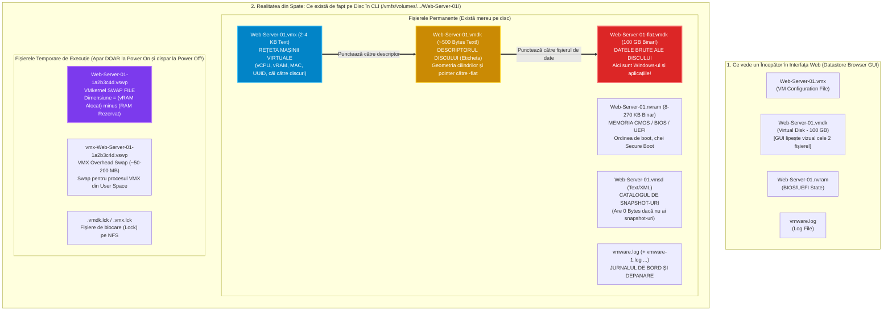

> **Obiectivul Capitolului:** Deconstrucția completă a unei mașini virtuale la nivel de fișiere stocate pe discul `VMFS`/`NFS`/`vSAN` (`.vmx`, `.vmdk`, `-flat.vmdk`, `.nvram`, `.vswp`, `vmx-*.vswp`, `.vmsd`, `.vmsn`, `vmware.log`), înțelegerea diferențelor dintre emulare și paravirtualizare (`E1000e` vs. `VMXNET3`, `LSI Logic SAS` vs. `PVSCSI`, `Virtual NVMe`), arhitectura de boot `Legacy BIOS` vs. `UEFI` (`Secure Boot`, `vTPM`) și rolul vital al pachetului `VMware Tools` (`open-vm-tools`).
>
> **Regula de Aur a acestui Capitol:** Fiecare extensie de fișier, acronim și componentă virtuală este explicată integral: **(1) Numele complet**, **(2) Ce reprezintă și ce conține** și **(3) Cum funcționează tehnic în spate (inclusiv ce se întâmplă dacă fișierul se corupe sau este șters din greșeală)**.

:::analogy
### Ce este, în realitate, o Mașină Virtuală?

Când te uiți în interfața web a lui `VMware ESXi` sau `vCenter`, o mașină virtuală (`VM` – *Virtual Machine*) arată ca o iconiță frumoasă cu un mic monitor verde pe care poți apăsa *Power On* și în interiorul căreia vezi un sistem de operare Windows Server sau Linux complet funcțional.

Dar ce este această mașină virtuală atunci când este oprită și te uiți direct pe discul serverului (`Datastore`)?
**O mașină virtuală nu este nimic altceva decât un simplu folder (director) pe disc, care conține între 6 și 12 fișiere discrete!** Această proprietate fundamentală a virtualizării se numește **`Encapsulation` (Încapsulare)**: un întreg server (placa lui de bază, setările de BIOS, hard-disk-urile, memoria RAM și jurnalele de funcționare) este „împachetat” într-un set de fișiere care pot fi copiate, mutate sau salvate ca orice alt folder.

### Analogia Profesorului: Mașina de Formula 1 din Cutia de LEGO

Gândește-te la o Mașină Virtuală exact ca la un **set complex LEGO Technic**:

* **Fișierul `.vmx` (Manualul de Instrucțiuni și Schița Tehnică):** Este o foaie de hârtie simplă pe care scrie: *„Această mașină are 4 roți, un motor cu 4 cilindri, culoarea roșie și folosește cutia de viteze numărul 2”*. Fără piese, manualul nu face nimic; fără manual, ESXi nu știe cum să asambleze piesele la pornire.
* **Fișierul `.vmdk` + `-flat.vmdk` (Motorul și Rezervorul cu Date):** Aici se află piesele grele — sistemul de operare Windows/Linux și baza de date. Dar atenție: VMware împarte discul în două fișiere! Un fișier minuscul de câțiva octeți (`.vmdk`), care este doar **eticheta de pe cutie**, și un fișier gigantic de zeci sau sute de gigabyți (`-flat.vmdk`), care este **conținutul brut efectiv**. *(În interfața grafică vSphere, VMware ascunde fișierul `-flat.vmdk` și ți le arată lipite ca un singur fișier, ca să nu ștergi eticheta din greșeală!).*
* **Driverele Emulate vs. Paravirtualizate (`E1000` vs. `VMXNET3`):**
  * **Emularea (`E1000`)** este ca și cum ai angaja un translator care stă lângă tine și traduce fiecare cuvânt din Română în Japoneză: funcționează din prima secundă fără pregătire, dar pierzi enorm de mult timp cu traducerea.
  * **Paravirtualizarea (`VMXNET3` și `PVSCSI`)** este ca și cum amândoi ați vorbi direct aceeași limbă maternă la viteză maximă, știind că vă aflați într-un mediu virtual!
:::

:::architecture
### 1.2.1. Disecția Chirurgicală a Fișierelor unei Mașini Virtuale pe Datastore

Când te conectezi prin `SSH` (protocolul **`Secure Shell`**, portul **`TCP 22`**) la un server `ESXi` și navighezi în folderul stocării (`/vmfs/volumes/Datastore01/Web-Server-01/`), vei vedea adevărata față a mașinii virtuale. În interfața web (**Datastore Browser**), VMware ascunde jumătate dintre aceste fișiere pentru a proteja începătorii. Un inginer adevărat trebuie să le cunoască pe toate din linia de comandă!

Hai să analizăm fiecare fișier în parte:

#### 1. `NumeVM.vmx` (`Virtual Machine Configuration File` / Fișierul de Configurare al Mașinii Virtuale)
* **Ce este:** Este un simplu fișier text (`ASCII`, de doar $2 - 5\text{ KB}$) care conține „ADN-ul” mașinii virtuale, scris sub formă de perechi `cheie = "valoare"`.
* **Ce conține:** Numărul de procesoare (`numvcpus = "4"`), nuclee per socket (`cpuid.coresPerSocket = "2"`), cantitatea de memorie RAM (`memSize = "8192"`), tipul de firmware (`firmware = "efi"`), modelul plăcii de rețea (`ethernet0.virtualDev = "vmxnet3"`), adresa MAC (`ethernet0.generatedAddress = "00:50:56:..."`), numărul unic de serie al mașinii (**`UUID` – `Universally Unique Identifier`**) și numele fișierului descriptor de disc (`scsi0:0.fileName = "Web-Server-01.vmdk"`).
* **Ce se întâmplă dacă ștergi din greșeală fișierul `.vmx`?** Mașina virtuală nu mai poate porni, **DAR datele tale NU sunt pierdute!** Pentru că toate datele se află în `-flat.vmdk`, poți reconstrui un fișier `.vmx` nou în 60 de secunde (fie creând o mașină nouă cu opțiunea *Use Existing Virtual Disk*, fie extrăgând întreaga configurație `.vmx` direct din primele 200 de linii ale fișierului `vmware.log`!).

#### 2. Perechea de Aur a Stocării: `NumeVM.vmdk` (Descriptor) + `NumeVM-flat.vmdk` (Data Extent)
*(Acesta este cel mai important concept de troubleshooting pe stocare din VMware!)*
* **`VMDK` (`Virtual Machine Disk`):** Când creezi un disc virtual pentru o mașină pe un datastore `VMFS` sau `NFS`, ESXi creează de fapt **două fișiere separate**:
  1. **`NumeVM.vmdk` (Fișierul Descriptor / Header – sub $1\text{ KB}$, format text):**
     * Nu conține niciun bit din sistemul tău Windows sau Linux!
     * Este o simplă fișă tehnică în format text care îi spune lui ESXi: *„Acest disc are o capacitate de 209.715.200 sectoare (100 GB), folosește un controller `pvscsi`, are geometria de $X$ cilindri / $Y$ capete / $Z$ sectoare, iar datele reale se află în fișierul numit `NumeVM-flat.vmdk`”*.
  2. **`NumeVM-flat.vmdk` (Fișierul de Date / Data Extent – de exemplu $100\text{ GB}$, format binar brut):**
     * Aici se află, octet cu octet, partițiile `C:\`, Windows-ul, baza de date și fișierele utilizatorilor!
     * *Excepție pe **VMware vSAN**:* Pe un datastore `vSAN`, nu există un fișier `-flat.vmdk` pe disc, deoarece `vSAN` este un *Object Store* (stocare bazată pe obiecte); fișierul text `.vmdk` există în continuare, dar în loc să arate spre `-flat.vmdk`, el arată către adresa unui obiect din baza de date `vSAN` (`vsan://52a1b2c3-...`)!
* **Scenariu real de dezastru în producție:** Un administrator conectat prin `SSH` vrea să șteargă un fișier mic, vede că `Web-Server-01.vmdk` are doar `520 Bytes`, crede că e un fișier gol inutil și îi dă `rm Web-Server-01.vmdk`! În secunda următoare, în vCenter dispare discul de $100\text{ GB}$ și mașina virtuală nu mai pornește cu eroarea *„File not found”*!
  * **Cum îl salvezi fără să pierzi niciun bit (VMware KB 1002511):** Fișierul `Web-Server-01-flat.vmdk` de $100\text{ GB}$ este încă intact pe disc! Te uiți la dimensiunea lui exactă în octeți cu `ls -l`, rulezi comanda `vmkfstools -c <dimensiune_in_bytes> -d thin temp.vmdk` pentru a genera o etichetă nouă, ștergi `temp-flat.vmdk`, redenumesti `temp.vmdk` în `Web-Server-01.vmdk` și editezi în interiorul lui cu editorul `vi` numele către `Web-Server-01-flat.vmdk`. În 2 minute, serverul pornește intact!

#### 3. `NumeVM.nvram` (`Non-Volatile Random-Access Memory` / Memoria BIOS sau UEFI)
* **Ce este:** Este un fișier binar mic ($8.6\text{ KB}$ pentru mașinile cu `Legacy BIOS`, respectiv până la $270\text{ KB}$ pentru mașinile cu **`UEFI` – `Unified Extensible Firmware Interface`**).
* **Ce conține:** Păstrează setările de `BIOS` sau `UEFI` ale mașinii virtuale (ordinea de bootare, data/ora hardware, variabilele de boot UEFI pentru Windows/Linux și certificatele pentru **`Secure Boot`**).
* **Ce se întâmplă dacă îl ștergi?** Data viitoare când apeși *Power On*, ESXi **îl recreează automat din fabrică** cu setările implicite! *(Atenție: La mașinile cu UEFI și Windows/Linux modern sau BitLocker, ștergerea `.nvram` poate șterge intrarea `Windows Boot Manager` din UEFI, necesitând repararea boot-ului).*

#### 4. `NumeVM-<UUID>.vswp` și `vmx-NumeVM-<UUID>.vswp` (Fișierele de Swap ale Hypervisorului)
*(Subiect clasic de examen VCP-DCV! Formula matematică a acestui fișier pică la aproape fiecare examen!)*
* **Ce este fișierul `.vswp` (`VMware Swap File`)?**
  * Nu îl confunda cu fișierul `pagefile.sys` din interiorul Windows-ului sau cu partiția `swap` din Linux!
  * Fișierul `.vswp` este „plasa de siguranță extremă” a **hypervisorului `ESXi`**. Când îi dai unei mașini virtuale $16\text{ GB RAM}$ (`Allocated Memory`), ESXi trebuie să se asigure că, în caz că serverul fizic rămâne complet fără memorie RAM liberă (din cauza supra-alocării / *Memory Overcommitment*), are unde să scrie pe disc memoria acelei mașini virtuale ca să nu o omoare.
* **Când apare și când dispare?**
  * Fișierul `.vswp` **este creat automat pe disc în secunda în care apeși `Power On`** pe mașina virtuală și **este șters automat de pe disc în secunda în care mașina virtuală ajunge în starea `Powered Off`**!
  * *Consecință critică în producție:* Dacă ai un datastore pe care mai sunt liberi doar **$10\text{ GB}$ pe disc**, și vrei să pornești o mașină virtuală oprită căreia i-ai configurat **$16\text{ GB RAM`** (fără rezervare), când apeși *Power On*, **mașina virtuală NU VA PORNI** și va da eroarea *„Insufficient disk space on datastore”*, deoarece ESXi nu are unde să creeze fișierul `.vswp` de $16\text{ GB}$!
* **Formula Matematică Oficială pentru dimensiunea fișierului `.vswp`:**
  $$\text{Dimensiune Fișier } \texttt{.vswp} = \text{Memorie RAM Configurată (Allocated)} - \text{Memorie RAM Rezervată (Reservation)}$$
  * *Exemplul 1:* VM cu $16\text{ GB RAM}$ alocat și $0\text{ GB}$ Reservation (implicit) $\Rightarrow$ Fișierul `.vswp` ocupă **$16\text{ GB}$** pe disc la Power On!
  * *Exemplul 2:* VM cu $16\text{ GB RAM}$ alocat și $6\text{ GB}$ Reservation $\Rightarrow$ Fișierul `.vswp` ocupă **$10\text{ GB}$** pe disc ($16 - 6 = 10$).
  * *Exemplul 3:* VM cu $16\text{ GB RAM}$ alocat și $16\text{ GB}$ Reservation ($100\%$ rezervat în RAM-ul fizic) $\Rightarrow$ Fișierul `.vswp` are **$0\text{ Bytes}$**!
* **Dar ce este al doilea fișier mic: `vmx-NumeVM-<UUID>.vswp`?**
  * Chiar și atunci când rezervi $100\%$ din memoria unei mașini virtuale, procesul ajutător **`VMX`** (pe care l-am învățat în Capitolul 1.1) are nevoie de câteva zeci de megabyți de memorie proprie (*VM Overhead Memory*). Fișierul `vmx-*.vswp` (de $\sim 50 - 200\text{ MB}$) este fișierul de swap dedicat strict procesului `VMX`!

#### 5. Fișierele de Snapshot, Suspendare și Jurnalizare (`.vmsd`, `-000001.vmdk`, `-delta.vmdk`, `.vmsn`, `.vmss`, `vmware.log`)
* **`NumeVM.vmsd` (`Virtual Machine Snapshot Dictionary`):** Un fișier text/XML care ține evidența arborelui de snapshot-uri (cine este părintele, cine este copilul, ce descriere și ce dată are fiecare snapshot). Când nu ai snapshot-uri, are dimensiunea de `0 Bytes`.
* **`NumeVM-000001.vmdk` (Descriptor) + `NumeVM-000001-delta.vmdk` (sau `-sesparse.vmdk` pe VMFS-6):** Discul diferențial (*Child / Delta Disk*) creat atunci când faci un Snapshot; preia toate scrierile noi după înghețarea discului de bază. *(Le vom diseca în detaliu în Capitolul 1.4!).*
* **`NumeVM.vmsn` (`Virtual Machine Snapshot State`):** Conține fotografia completă a memoriei RAM active a mașinii virtuale în momentul în care ai făcut un Snapshot cu opțiunea *Snapshot the virtual machine's memory* bifată.
* **`NumeVM.vmss` (`Virtual Machine Suspended State`):** Când pui o mașină virtuală pe **Pause / Suspend** (ca atunci când închizi capacul laptopului), ESXi copiază toată memoria ei RAM în fișierul `.vmss` pe disc, ca să o poată trezi exact de unde a rămas.
* **`vmware.log` (și arhivele `vmware-1.log` ... `vmware-6.log`):**
  * Este „Cutia Neagră (Flight Recorder)” a mașinii virtuale! De fiecare dată când mașina virtuală pornește, se oprește, migrează cu `vMotion` sau are o eroare hardware, procesul `VMX` scrie fiecare detaliu aici.
  * *De ce există mai multe fișiere numerotate?* La fiecare *Power On* sau migrare `vMotion`, ESXi rotește jurnalele (*Log Rotation*): vechiul `vmware.log` devine `vmware-1.log` și se deschide un `vmware.log` proaspăt!

#### Tabelul Sintetic al Fișierelor unei Mașini Virtuale (Referință Rapidă pentru Examen)

| Extensie Fișier | Nume Oficial & Tip | Dimensiune Tipică | Rolul Exact în Arhitectura ESXi |
| :--- | :--- | :--- | :--- |
| **`.vmx`** | *VM Configuration File* (Text) | $2 - 5\text{ KB}$ | Configurația hardware a mașinii (vCPU, vRAM, MAC, UUID, discuri). |
| **`.vmxf`** | *Supplemental Config* (XML) | $< 1\text{ KB}$ | Fișier suplimentar de compatibilitate pentru grupuri de mașini (*vApps*). |
| **`.vmdk`** | *Disk Descriptor File* (Text) | $\sim 500\text{ Bytes}$ | Eticheta discului virtual (geometrie, tip controller și pointer către `-flat`). |
| **`-flat.vmdk`** | *Virtual Disk Data Extent* (Binar) | $10\text{ GB} - 62\text{ TB}$ | Conținutul brut efectiv al hard-disk-ului virtual (OS + Date). |
| **`.nvram`** | *Non-Volatile RAM* (Binar) | $8\text{ KB} - 270\text{ KB}$ | Setările de `BIOS` sau `UEFI` (ordinea de boot, chei *Secure Boot*). |
| **`.vswp`** | *VMkernel Swap File* (Binar) | $\text{vRAM} - \text{Reservation}$ |Creat doar la *Power On*; swap la nivel de ESXi pentru memoria VM-ului. |
| **`.vmsd`** | *Snapshot Metadata* (Text) | $0\text{ B} - \text{câțiva KB}$ | Catalogul și ierarhia snapshot-urilor active ale mașinii. |
| **`-00000X.vmdk`** | *Snapshot Delta Disk* (`sesparse`) | Crește până la mărimea discului | Stochează blocurile modificate după crearea unui Snapshot. |
| **`.vmsn`** | *Snapshot Memory State* (Binar) | Egal cu $\text{vRAM}$ | Starea memoriei RAM salvată în timpul unui Snapshot cu memorie. |
| **`.vmss`** | *Suspended State File* (Binar) | Egal cu $\text{vRAM}$ | Conținutul memoriei RAM când mașina virtuală este în starea *Suspended*. |
| **`vmware.log`** | *VM Diagnostic Log* (Text) | $1 - 10\text{ MB}$ | Jurnalul de execuție al procesului `VMX`; esențial pentru troubleshooting. |

---

### 1.2.2. Virtual Hardware Versions, `BIOS` vs. `UEFI` (`vTPM`), `VMware Tools` și Driverele Paravirtualizate (`VMXNET3` & `PVSCSI`)

#### 1. Ce este `Virtual Hardware Version` (`Compatibility Level`)?
Când cumperi un PC din 2015, placa lui de bază suportă maximum $64\text{ GB RAM}$ și nu știe ce este un disc `NVMe`. Când cumperi o placă de bază din 2025, suportă $4\text{ TB RAM}$, PCIe Gen 5 și cip de securitate `TPM 2.0`.
Exact la fel, în VMware, „placa de bază virtuală” a unei mașini virtuale are o versiune numită **`Virtual Hardware Version`** (sau în interfața modernă: **`VM Compatibility Level`**).

Fiecare versiune nouă de `ESXi` introduce o nouă generație de placă de bază virtuală, cu limite maxime (`Configuration Maximums`) mult mai mari:

| Versiune Hardware | Nume în Interfață (Compatibility) | Număr Maxim `vCPU` per VM | Memorie Maximă `vRAM` per VM | Dimensiune Maximă Disc `.vmdk` | Inovații Cheie Introduse |
| :--- | :--- | :--- | :--- | :--- | :--- |
| **Version 11** | ESXi 6.0 and later | $128\text{ vCPU}$ | $4\text{ TB RAM}$ | $62\text{ TB}$ | Suport USB 3.0, SATA AHCI îmbunătățit. |
| **Version 14** | ESXi 6.7 and later | $128\text{ vCPU}$ | $6.12\text{ TB RAM}$ | $62\text{ TB}$ | Introducerea **`vTPM 2.0`** (*Virtual Trusted Platform Module*) și *Virtualization-Based Security (VBS)*. |
| **Version 19** | ESXi 7.0 U2/U3 and later | **$768\text{ vCPU}$** | **$24\text{ TB RAM}$** | $62\text{ TB}$ | Suport pentru mașini gigant (*Monster VMs*), **NVMe 1.3** virtual. |
| **Version 20 / 21**| **ESXi 8.0 / 8.0 U2 and later** | **$768\text{ vCPU}$** | **$24\text{ TB RAM}$** | $62\text{ TB}$ | Suport complet Windows 11 / Server 2025, până la **32 de dispozitive DirectPath I/O (vGPU)**, topologie vNUMA vizibilă în UI. |

> **Regulă de Aur în Producție:** O mașină virtuală cu **Hardware Version 21 (ESXi 8.0 U2)** **NU poate porni și nu poate migra cu `vMotion`** pe un server mai vechi care rulează **ESXi 7.0** (care înțelege maximum Version 19)! În schimb, o mașină cu Version 19 rulează perfect atât pe ESXi 7.0, cât și pe ESXi 8.0! De aceea, nu fă upgrade la *Virtual Hardware Version* decât după ce toate host-urile din cluster au fost actualizate la noua versiune de ESXi!

#### 2. `Legacy BIOS` vs. `UEFI` (`Unified Extensible Firmware Interface`), `Secure Boot` și `vTPM 2.0`
În tab-ul *VM Options -> Boot Options* al fiecărei mașini virtuale poți alege firmware-ul de pornire:

1. **`Legacy BIOS` (`Basic Input/Output System`):**
   * Arhitectura veche din anii '80. Caută codul de boot în primul sector al discului (**`MBR` – `Master Boot Record`**), care este **limitat matematic la discuri de boot de maximum $2\text{ TB}$**!
2. **`UEFI` (`Unified Extensible Firmware Interface`) – *Implicit și recomandat în vSphere 7/8!***
   * Folosește tabela de partiții **`GPT` (`GUID Partition Table`)**, permițând ca discul de boot (`C:\`) să fie mai mare de **$2\text{ TB}$** (până la $62\text{ TB}$!).
   * Permite activarea **`UEFI Secure Boot`**: La pornirea mașinii virtuale, firmware-ul UEFI din ESXi verifică semnătura digitală criptografică a fiecărui fișier de boot din Windows/Linux (`bootmgfw.efi` / `shimx64.efi`). Dacă un virus de tip *Rootkit/Bootkit* a modificat nucleul sistemului de operare, ESXi blochează pornirea și te alertează!
   * Este **obligatoriu** pentru adăugarea unui cip **`vTPM 2.0` (`Virtual Trusted Platform Module`)** — necesar pentru a instala **Windows 11**, pentru a folosi criptarea **BitLocker** fără parolă la boot și pentru **Windows Credential Guard (`VBS`)**.

#### 3. De ce sunt INTERZISE Driverele Emulate în Producție? Emulare (`E1000` / `LSI Logic`) vs. Paravirtualizare (`VMXNET3` / `PVSCSI`)
Când adaugi o placă de rețea virtuală (`vNIC`) sau un controller de stocare (`Virtual SCSI Controller`) într-o mașină virtuală, ESXi îți oferă două familii complet diferite de hardware virtual:

```mermaid
flowchart TB
    subgraph Emulated_Path ["1. CALEA LENTĂ: Dispozitive Emulate (ex: Placă Intel E1000e & Controller LSI Logic SAS)"]
        direction LR
        VM_OS_1["Guest OS (Windows/Linux)<br/>Crede că vorbește cu o placă fizică Intel veche din 2005!<br/>Trimite sute de întreruperi hardware false (MMIO Traps)"]
        VMX_Trap["Procesul VMX / VMM<br/>Este forțat să oprească execuția vCPU (VM Exit)<br/>și să simuleze prin software registrele plăcii fizice!"]
        VMK_1["VMkernel Network / Storage Stack"]
        
        VM_OS_1 ==>|"Overhead CPU uriaș!<br/>Limitat la 1 Gbps (E1000e)"| VMX_Trap ==> VMK_1
    end

    subgraph Paravirt_Path ["2. CALEA ULTRA-RAPIDĂ: Dispozitive Paravirtualizate (VMXNET3 & VMware Paravirtual SCSI - PVSCSI)"]
        direction LR
        VM_OS_2["Guest OS + Drivere din VMware Tools<br/>ȘTIE că este o mașină virtuală!<br/>Nu mai simulează niciun cip fizic vechi!"]
        Ring_Buffer["Shared Memory Ring Buffers<br/>(Zone de memorie partajate direct între VM și VMkernel!)"]
        VMK_2["VMkernel Network / Storage Stack<br/>Preia pachetele și blocurile în calupuri mari (Batching)"]

        VM_OS_2 ===>|"Zero Emulare! Consum CPU cu 30-50% mai mic!<br/>Viteză: 10 Gbps / 25 Gbps / 100 Gbps"| Ring_Buffer ===> VMK_2
    end

    style Emulated_Path fill:#450a0a,stroke:#f87171,stroke-width:2px,color:#fff
    style Paravirt_Path fill:#064e3b,stroke:#34d399,stroke-width:3px,color:#fff
```

##### A. Plăcile de Rețea Virtuale (`vNIC Adapters`):
1. **`E1000` și `E1000e` (Emulate):**
   * **Ce reprezintă:** Emulează 100% în software plăcile de rețea fizice *Intel 82545EM Gigabit Ethernet* (`E1000`) și *Intel 82574L Gigabit* (`E1000e`).
   * **De ce există?** Pentru că orice Windows sau Linux din lume are deja din fabrică driverul pentru această placă Intel veche! Așadar, placa funcționează chiar și **înainte să instalezi `VMware Tools`**.
   * **De ce nu o folosim în producție?** Este plafonată la **$1\text{ Gbps}$**, consumă mult procesor (`CPU`) pentru a simula registrele hardware ale cipului Intel și are cozi de recepție (`Ring Buffers`) foarte mici, pierzând pachete (`Packet Drops`) sub trafic intens!
2. **`VMXNET3` (`VMware Paravirtualized NIC` – Generația 3) – *Standardul de Aur în Producție!***
   * **Ce reprezintă:** O placă de rețea pur virtuală, care **nu are niciun echivalent fizic în lumea reală**! Este proiectată de inginerii VMware exclusiv pentru comunicarea directă între `Guest OS` și `VMkernel`.
   * **Condiție obligatorie:** Necesită instalarea **`VMware Tools`** (sau `open-vm-tools` în Linux Moderne / Windows Server 2019+ care îl includ deja în kernel) pentru ca sistemul de operare să o recunoască!
   * **Avantaje colosale:** Negociază instantaneu la **$10\text{ Gbps}$** (și transferă în realitate la $25/40/100\text{ Gbps}$ cât duce procesorul și placa fizică), suportă **`RSS` (`Receive Side Scaling` – împărțirea traficului de rețea pe mai multe nuclee vCPU simultan)**, *TCP Segmentation Offload (TSO)*, *Jumbo Frames* și consumă cu până la **$30-40\%$ mai puțin CPU**!

##### B. Controllerele de Stocare Virtuale (`Virtual Storage Controllers`):
1. **`LSI Logic Parallel` & `LSI Logic SAS` (Emulate):**
   * **Ce reprezintă:** Emulează un controller fizic *LSI MegaRAID SAS 1068E*. Este alegerea implicită când creezi un VM de Windows pentru că Windows-ul are driverul pentru el pe imaginea `.iso` de instalare. Are însă o adâncime a cozii (`Queue Depth`) mai mică și un consum mai mare de procesor la peste $5.000 - 10.000\text{ IOPS}$.
2. **`VMware Paravirtual SCSI` (`PVSCSI`):**
   * **Ce reprezintă:** Controllerul SCSI paravirtualizat de la VMware.
   * **Avantaje:** Crește adâncimea cozii de așteptare (până la $254\text{ comenzi per disc}$ și $1024\text{ per controller}$), suportă până la **$300.000+\text{ IOPS}$** și reduce consumul de procesor cu **$15 - 30\%$** pentru servere de baze de date (`Microsoft SQL`, `Oracle`, `Exchange`), servere de fișiere și `VCSA`.
3. **`Virtual NVMe Controller` (`NVMe 1.0 / 1.3`):**
   * Introdus în vSphere 6.5/7.0/8.0. Sistemele de operare moderne (Windows Server 2019/2022/2025 și Linux Kernel 4.x+) au deja un driver nativ `NVMe` ultra-eficient în cutie! Când pui discul unui VM pe un controller `Virtual NVMe`, elimini complet overhead-ul vechiului protocol SCSI și obții latențe minime pe stocarea `vSAN` sau `All-Flash SAN`!

#### 4. Ce este de fapt `VMware Tools` (și `open-vm-tools`) și cele 5 funcții vitale ale sale
Mulți începători cred că `VMware Tools` servește doar ca să se mărească automat fereastra ecranului și să poți mișca mouse-ul lin. **Greșit!** În producție, o mașină virtuală fără `VMware Tools` este o mașină „oarbă, surdă și periculoasă”.

Iată cele **5 componente arhitecturale** pe care le instalează `VMware Tools`:
1. **Driverele Paravirtualizate (`Device Drivers`):** Instalează driverele pentru placa de rețea **`VMXNET3`**, controllerul de stocare **`PVSCSI`**, placa video **`SVGA 3D`** și driverul critic de memorie **`vmmemctl` (`Memory Balloon Driver`)** — fără acest driver de *Ballooning*, când serverul ESXi rămâne fără RAM, nu poate recupera elegant memoria nefolosită din VM și este forțat să scrie brutal pe discul `.vswp`, înghețând mașina virtuală! *(Vom studia asta în Capitolul 1.3).*
2. **Serviciul de Comunicare `vmtoolsd` (`VMware Tools Daemon Service`):**
   * Permite lui ESXi și vCenter să vadă **în interfața grafică ce IP și ce Hostname are mașina virtuală**, ce versiune de OS rulează și cât spațiu liber mai are pe partiția `C:\` sau `/`.
   * Permite oprirea curată a sistemului de operare (**`Shut Down Guest OS` / `Restart Guest OS`**) în loc de smulgerea brutală a cablului (**`Power Off`**).
3. **Bătăile de Inimă ale Aplicației (`VM Heartbeats` pentru `vSphere HA VM Monitoring`):**
   * Serviciul `vmtoolsd` îi trimite la fiecare secundă un semnal lui ESXi: *„Sunt viu, Windows-ul nu a înghețat în Blue Screen!”*. Dacă Windows-ul din interiorul mașinii virtuale își ia ecran albastru (`BSOD`) sau Kernel Panic, el nu mai trimite aceste *Heartbeats*, iar `vSphere HA` poate da automat restart mașinii virtuale!
4. **Înghețarea Sistemului de Fișiere pentru Backup (`File System Quiescing` / `VSS`):**
   * Când o soluție de backup (Veeam, Nakivo) face un **Snapshot** al unei baze de date pornite, `VMware Tools` apelează serviciul **`VSS` (`Volume Shadow Copy Service`)** din Windows (sau scripturile `freeze` din Linux) pentru a obliga baza de date să își scrie toate tranzacțiile din RAM pe disc timp de o secundă, garantând un backup $100\%$ valid și necorupt!
5. **`open-vm-tools` (`OVT` – Standardul pentru Linux):**
   * Pe orice distribuție Linux modernă (Ubuntu, Debian, RHEL, Rocky, SLES), **NU mai montezi niciodată CD-ul cu VMware Tools din ESXi!** VMware a făcut codul *Open-Source* sub numele **`open-vm-tools`**, iar acesta se instalează și se actualizează direct din depozitele oficiale Linux (`sudo apt install open-vm-tools` sau `sudo dnf install open-vm-tools`)!
:::

:::exam-alert
### De Memorat (Limite Maxime și Reguli de Aur pentru Examenul VCP-DCV)
* **Numărul Maxim de Controllere SCSI per Mașină Virtuală:** Maximum **`4` controllere SCSI** (`SCSI 0`, `SCSI 1`, `SCSI 2`, `SCSI 3`).
* **Numărul Maxim de Discuri Virtuale (`.vmdk`) pe un singur Controller SCSI:** Maximum **`15` discuri per controller** (deoarece există 16 ID-uri de la `0` la `15`, dar un ID — de obicei `:7` — este rezervat de controllerul însuși! Deci $4 \text{ controllere} \times 15 \text{ discuri} = \mathbf{60\text{ discuri SCSI maximum per VM}}$!).
* **Numărul Maxim de Controllere `Virtual NVMe` per VM:** Maximum **`4` controllere NVMe**, fiecare suportând până la **`15` (în vSphere 7)** sau **`64` discuri (în vSphere 8, până la 256 discuri NVMe per VM)**.
* **Numărul Maxim de Plăci de Rețea Virtuale (`vNICs`) per VM:** Maximum **`10` plăci de rețea (`VMXNET3`)** per mașină virtuală!

### Capcane de Examen (VCP Exam Traps)
1. **Capcana #1 (Cum instalezi Windows Server de la zero pe un disc conectat la un controller `PVSCSI`?):**
   * *Problema:* Am spus că `PVSCSI` este cel mai rapid controller SCSI pentru baze de date, dar imaginea `.iso` de instalare Windows Server **NU are driverul pentru `PVSCSI` inclus din fabrică**! Dacă pui discul `C:\` pe `PVSCSI` și bootezi de pe `.iso`-ul de Windows, instalatorul îți va spune: *„We couldn't find any drives”*!
   * *Cele 2 Soluții Oficiale cerute la Examen:*
     * **Metoda 1 (În timpul instalării):** Montezi în unitatea *Virtual Floppy Drive* a mașinii virtuale imaginea de dischetă virtuală cu drivere aflată direct pe ESXi în `/vmimages/floppies/pvscsi-Windows2008.flp` (sau din ISO-ul VMware Tools) și apeși pe *Load Driver* în instalatorul Windows!
     * **Metoda 2 (Best Practice în Producție):** Lași discul de sistem `C:\` ($60\text{ GB}$, care are trafic mic) pe controllerul `LSI Logic SAS` (sau `Virtual NVMe`), instalezi Windows-ul și `VMware Tools` (care instalează automat și driverul `PVSCSI`), iar apoi adaugi **un al doilea controller `SCSI 1` de tip `VMware Paravirtual (PVSCSI)`** pe care atașezi discul `D:\` unde va sta baza de date SQL!
2. **Capcana #2 (`Remove from Inventory` vs. `Delete from Disk`):**
   * Când dai click-dreapta pe o mașină virtuală oprită în vCenter/ESXi, ai două opțiuni care par similare, dar una este letală:
     * **`Remove from Inventory` (Unregister):** Șterge mașina virtuală doar din lista vizuală a lui `hostd` / `vCenter`, dar **lasă toate fișierele (`.vmx`, `-flat.vmdk`) 100% intacte în folderul de pe Datastore**! Poți merge oricând în Datastore Browser, dai click-dreapta pe fișierul `.vmx` și alegi **`Register VM`** pentru a o aduce înapoi în 2 secunde!
     * **`Delete from Disk`:** Șterge definitiv întregul folder și fișierul `-flat.vmdk` de pe stocare!
:::

:::trenches
### Din Tranșee (Reddit `r/vmware` & Probleme Reale din Producție)
* **Problema 1: *„Am vrut să schimb placa de rețea a unui server de producție Windows din `E1000e` în `VMXNET3`. Am șters placa veche, am adăugat placa nouă și mi-au dispărut IP-ul static, DNS-ul și rutele din Windows!”***
  * *De ce se întâmplă asta:* Pentru Windows sau Linux, ștergerea plăcii `E1000e` și adăugarea unei plăci `VMXNET3` este văzută exact ca și cum ai fi smuls o placă fizică Intel din placa de bază și ai fi înfipt o placă nouă în alt slot PCIe, cu o altă adresă MAC! Windows-ul păstrează vechiul IP blocat pe „placa fantomă (Hidden Adapter)” și pune placa nouă `VMXNET3` pe DHCP!
  * *Procedura Corectă în Producție:* Înainte să ștergi placa `E1000e`, notează-ți adresa ei `MAC` din setările VM-ului, apoi intră în Windows și trece placa pe DHCP (ca să elibereze IP-ul din regiștri). Oprește VM-ul, șterge placa `E1000e`, adaugă placa `VMXNET3` (opțional setează-i în mod *Manual* același MAC vechi dacă ai aplicații licențiate pe MAC) și setează IP-ul static pe noua interfață.
* **Problema 2: *„Am redenumit o mașină virtuală în vCenter din `Test-VM` în `Prod-ERP-01`, dar când intru pe Datastore văd că folderul și discurile ei se numesc tot `Test-VM.vmdk`!”***
  * *Explicația Arhitecturală:* Când dai *Rename* unei mașini virtuale în interfața vCenter, se schimbă doar numele de afișare (`displayName` din `.vmx`), **NU și numele fișierelor de pe disc** (pentru a nu rupe căile în timp ce mașina merge)!
  * *Cum redenumesti automat și curat toate fișierele de pe disc (`.vmx`, `.vmdk`, `.nvram`):* Faci un **`Storage vMotion`** (muți mașina virtuală pe alt Datastore și înapoi)! În timpul migrării `Storage vMotion`, ESXi redenumește automat folderul și absolut toate fișierele `.vmdk` după noul nume din vCenter!
:::

:::interview
### Întrebarea 1 (Nivel Junior / Mid – Fișierele Mașinii Virtuale și Troubleshooting)
> **Intervievator:** *„Ai o mașină virtuală cu $32\text{ GB RAM}$ alocați (fără rezervare de memorie) care a fost oprită pentru mentenanță. Când încerci să îi dai Power On, primești o eroare că nu mai este spațiu suficient pe Datastore, deși în interfață vezi că mai sunt liberi $20\text{ GB}$ pe acel Datastore, iar discurile mașinii sunt Thick Provisioned. De ce nu pornește mașina și care sunt cele două metode prin care o poți porni pe loc în caz de urgență?”*

**Răspunsul Ideal:**
„Mașina virtuală nu pornește din cauza fișierului de swap al hypervisorului, **`.vswp`**. În secunda în care apăsăm *Power On*, `VMkernel`-ul încearcă să creeze pe Datastore un fișier `.vswp` a cărui dimensiune este calculată după formula: **`Memorie Alocată minus Memorie Rezervată`**.
Deoarece mașina are **$32\text{ GB RAM}$ alocați și $0\text{ GB}$ rezervați**, ESXi are nevoie de **$32\text{ GB}$ liberi pe Datastore** pentru a crea fișierul `.vswp` (plus încă $\sim 100\text{ MB}$ pentru `vmx-*.vswp`). Cum pe Datastore mai sunt liberi doar $20\text{ GB}$, operațiunea de *Power On* eșuează.

Cele două metode prin care pot porni mașina imediat în caz de urgență (până când extindem LUN-ul sau mutăm alte mașini cu Storage vMotion) sunt:
1. **Metoda prin Rezervare de Memorie RAM:** Dacă host-ul ESXi are suficientă memorie RAM fizică liberă, intru în *Edit Settings* pe mașina virtuală și îi setez o **Memory Reservation de cel puțin $16\text{ GB}$** (sau $32\text{ GB}$). Astfel, fișierul `.vswp` necesar pe disc scade la $16\text{ GB}$ (sau $0\text{ GB}$), încăpând în cei $20\text{ GB}$ liberi de pe Datastore!
2. **Metoda prin relocarea fișierului `.vswp`:** Pot configura host-ul ESXi (sau mașina virtuală din *VM Options -> Advanced -> Swap file location*) să își stocheze fișierul `.vswp` pe un alt Datastore care are spațiu liber suficient.”

### Întrebarea 2 (Nivel Mid / Senior – Design de Performanță pentru Baze de Date)
> **Intervievator:** *„Trebuie să construiești o mașină virtuală nouă pentru un server critic Microsoft SQL Server care va avea 4 discuri virtuale: Discul 1 pentru sistemul de operare Windows (`C:\`), Discul 2 pentru fișierele de date SQL (`MDF`), Discul 3 pentru jurnalele de tranzacții (`LDF`) și Discul 4 pentru `TempDB`. Cum configurezi placa de rețea și controllerele de stocare ale acestei mașini virtuale conform VMware Best Practices?”*

**Răspunsul Ideal (Demn de un Arhitect VCDX):**
„Pentru o mașină virtuală de tip *High-Performance Database* (SQL Server), voi aplica următoarele reguli de arhitectură din ghidul oficial *Architecting Microsoft SQL Server on VMware vSphere*:
1. **Firmware & Securitate:** Voi configura mașina cu **`UEFI`** și cel mai nou *Virtual Hardware Version* suportat de tot clusterul.
2. **Networking:** Voi folosi exclusiv adaptorul paravirtualizat **`VMXNET3`**, cu **`RSS` (`Receive Side Scaling`)** activat în interiorul driverului din Windows, pentru ca traficul intens de rețea să fie procesat pe mai multe nuclee `vCPU`, evitând gâtuirea pe nucleul `CPU 0`.
3. **Arhitectura Multi-Controller pentru Stocare (`PVSCSI` / `Virtual NVMe`):**
   * Cea mai mare greșeală este să pui toate cele 4 discuri pe același controller `SCSI 0`! Chiar dacă un controller `PVSCSI` e rapid, o singură coadă per controller poate deveni un punct de contenție când `TempDB`, `Logs` și `Data` fac I/O simultan.
   * Prin urmare, voi adăuga **4 controllere de stocare separate** (de tip **`VMware Paravirtual SCSI - PVSCSI`** sau **`Virtual NVMe`** dacă stocarea din spate este NVMe/vSAN ESA) și voi distribui câte un disc pe fiecare controller:
     * **`SCSI 0:0`** $\rightarrow$ Discul `C:\` (OS Windows).
     * **`SCSI 1:0` (`PVSCSI`)** $\rightarrow$ Discul de Date SQL (`MDF`).
     * **`SCSI 2:0` (`PVSCSI`)** $\rightarrow$ Discul de Jurnale Tranzacționale (`LDF`).
     * **`SCSI 3:0` (`PVSCSI`)** $\rightarrow$ Discul `TempDB`.
   * În acest mod, sistemul de operare și `VMkernel`-ul deschid **4 cozi hardware/paravirtualizate independente în paralel**, multiplicând de 4 ori capacitatea de procesare I/O a mașinii virtuale!”
:::

:::lab
> **Scenariul Laboratorului:** Ne conectăm la serverul nostru **`esxi01.lab.local` (`192.168.10.51`)**, construim de la zero o mașină virtuală configurată ca la carte (cu `UEFI`, `VMXNET3` și `PVSCSI` / `NVMe`), instalăm un sistem de operare ușor cu `VMware Tools`, iar apoi intrăm prin **`SSH`** în măruntaiele Datastore-ului pentru a inspecta cu ochii noștri diferența dintre `.vmdk` și `-flat.vmdk`, apariția fișierului `.vswp` la *Power On* și modul în care putem salva o mașină căreia i-am șters intenționat fișierul `.vmx`!
:::

:::quiz

:::

:::references
1. **VMware Official Docs:** *vSphere Virtual Machine Administration Guide – Virtual Machine Files, Hardware Versions, and Storage Controllers* (`techdocs.broadcom.com`).
2. **VMware Knowledge Base (KB 1002511):** *Recreating a missing virtual machine disk descriptor file (`.vmdk`)*.
3. **VMware Knowledge Base (KB 1023880):** *Rebuilding the virtual machine's `.vmx` file from `vmware.log`*.
4. **VMware Performance Team Study:** *Performance Evaluation of VMXNET3 Virtual Network Device & PVSCSI Storage Adapter*.
5. **Architecting Microsoft SQL Server on VMware vSphere (Best Practices Guide):** Recomandările oficiale pentru distribuirea discurilor pe 4 controllere `PVSCSI` / `NVMe`.
:::
