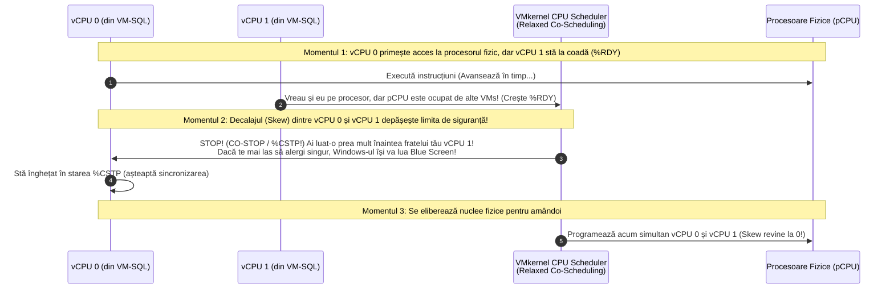
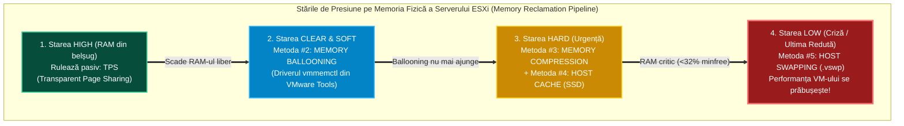
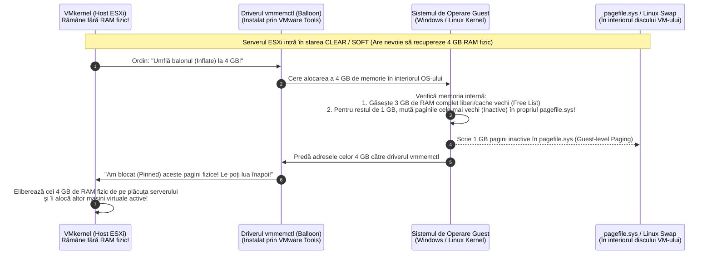
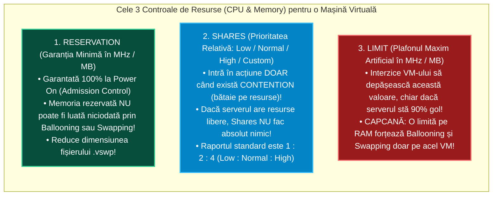

> **Obiectivul Capitolului:** Stăpânirea mecanismelor interne prin care nucleul `VMkernel` planifică execuția pe procesor (`CPU Scheduler`) și gestionează supra-alocarea memoriei RAM (`Memory Overcommitment` și cele 5 tehnici de recuperare: `TPS`, `Ballooning`, `Compression`, `Host Cache Swapping`, `Host Disk Swapping`), înțelegerea matematică a controalelor de resurse (`Shares`, `Reservations`, `Limits`) și diagnosticarea în timp real a problemelor de performanță folosind unealta supremă de linie de comandă **`esxtop`**.
>
> **Regula de Aur a acestui Capitol:** Fiecare acronim, contor din `esxtop` și mecanism intern (`pCPU`, `LCPU`, `vCPU`, `SMP`, `Relaxed Co-Scheduling`, `%USED`, `%RDY`, `%CSTP`, `%MLMTD`, `TPS`, `vmmemctl`, `MCTLSZ`, `SWCUR`, `SWR/s`, `SWW/s`, `DAVG/cmd`, `KAVG/cmd`, `GAVG/cmd`) este explicat integral: **(1) Numele complet**, **(2) Ce reprezintă** și **(3) Cum funcționează tehnic în spate (inclusiv pragurile numerice de alarmă din producție)**.

:::analogy
### De ce este acest capitol „proba de foc” la orice interviu de Senior VMware Engineer?

În primele două capitole am învățat cum instalăm `ESXi` și din ce fișiere este formată o mașină virtuală. Dar în viața reală dintr-o bancă sau companie mare, telefonul tău va suna luni dimineața la ora 09:30 cu următoarea reclamație de la echipa de aplicații:
*„Serverul nostru de baze de date se mișcă îngrozitor de greu! În Task Manager din Windows procesorul stă la doar $30\%$, dar orice click durează 10 secunde! Dați-i mai multe procesoare (`vCPU`) și mai mult RAM!”*

Un administrator începător se va speria, va opri mașina virtuală, îi va schimba numărul de procesoare din `8 vCPU` în `16 vCPU`, îi va da *Power On* și va constata cu stupoare că **acum mașina virtuală merge de două ori mai prost decât înainte!** De ce? Pentru că în virtualizare, **mai multe procesoare (`vCPU`) pot încetini dramatic o mașină virtuală** din cauza fenomenelor numite **`CPU Ready (%RDY)`** și **`Co-Stop (%CSTP)`**!

După ce parcurgi acest capitol, vei ști să deschizi consola **`esxtop`**, să citești în 10 secunde exact de ce suferă orice server (CPU, RAM, Rețea sau Stocare) și să rezolvi problema științific.

### Analogia Profesorului: Restaurantul cu 8 Ospătari și Grupul de 16 Turiști

Ca să înțelegi instantaneu de ce o mașină virtuală cu prea multe procesoare (`vCPU`) stă blocată la coadă, imaginează-ți că **Serverul Fizic ESXi** este un **Restaurant de lux care are exact 8 Ospătari (`8 Physical Cores / pCPUs`)**:

* **O Mașină Virtuală mică (`1 vCPU` – Un client singur):** Intră în restaurant o singură persoană. În secunda în care oricare dintre cei 8 ospătari se eliberează pentru 20 de milisecunde, clientul este servit instantaneu! Timpul de așteptare la ușă (**`CPU Ready`**) este aproape zero.
* **O Mașină Virtuală supradimensionată inutil (`8 vCPU` – Un grup de 8 turiști pretențioși care cer să fie serviți simultan):** Intră un grup de 8 persoane care pun o regulă strictă la intrare: *„Noi nu mâncăm decât dacă ne aduceți farfuriile la toți 8 în exact aceeași secundă (Simultaneous Execution)!”*.
  * Dacă în restaurant 6 ospătari sunt liberi, dar 2 ospătari sunt ocupați la alte mese, **cei 8 turiști nu pot fi serviți și stau blocați în picioare la ușă așteptând să se elibereze toți cei 8 ospătari în același timp (`%RDY` și `%CSTP` uriașe)!**
  * Iar când turiștii pleacă acasă și spun că de fapt doar 2 dintre ei au mâncat, iar ceilalți 6 au băut doar apă, îți dai seama că dacă ar fi intrat ca grup de 2 persoane (`2 vCPU`), ar fi fost serviți de 10 ori mai repede!
:::

:::architecture
### 1.3.1. Virtualizarea Procesorului (`CPU Scheduling`): `pCPU`, `LCPU`, `vCPU`, `Relaxed Co-Scheduling`, `%RDY` și `%CSTP`

#### 1. Dicționarul Unităților de Procesare în VMware

Pentru a nu confunda niciodată termenii din interfața vSphere și din `esxtop`, iată definițiile lor exacte:

* **`Socket` (sau `Physical Package`):** Cipul fizic de siliciu înfipt pe placa de bază a serverului (ex: un server *Dual-Socket* are 2 procesoare fizice).
* **`pCPU` (`Physical CPU Core` / Nucleu Fizic):** Un nucleu fizic real de procesare din interiorul unui Socket (ex: 2 procesoare cu câte 16 nuclee = **`32 pCPUs / Physical Cores`**).
* **`LCPU` (`Logical CPU` / Procesor Logic / Thread):** Când activăm în BIOS tehnologia **`SMT` (`Simultaneous Multithreading`)**, numită comercial la Intel **`Hyper-Threading (HT)`**, fiecare nucleu fizic (`pCPU`) expune două registre de stare hardware și apare în `VMkernel` ca **2 Procesoare Logice (`LCPUs`)**.
  * *Notă:* În consola `esxtop`, VMware folosește adesea termenul `PCPU` pentru a număra aceste fire logice (`LCPUs`).
* **`vCPU` (`Virtual CPU` / Procesor Virtual):** Un procesor virtual asignat unei mașini virtuale. Din punctul de vedere al `VMkernel`-ului, **1 `vCPU` = 1 proces `VMM World`** care trebuie programat să ruleze pe un `LCPU / pCPU` timp de câteva milisecunde (un interval numit **Time Quantum**, implicit $50\text{ ms}$).
* **`vSMP` (`Virtual Symmetric Multiprocessing` / Multiprocesare Simetrică Virtuală):** O mașină virtuală căreia i-ai alocat **2 sau mai multe `vCPU`** (ex: 4, 8, 16 vCPU).

#### 2. Cum funcționează `Relaxed Co-Scheduling` (De ce nu îngheață sistemele de operare multi-core)?

Sistemul de operare Windows sau Linux instalat într-o mașină virtuală cu `4 vCPU` (`vSMP`) a fost scris pornind de la presupunerea că cele 4 nuclee ale sale sunt 4 bucăți fizice de siliciu lipite pe placa de bază, care **merg toate 4 în exact același ritm, la fiecare secundă**.
Dacă `vCPU 0` ar avansa cu 10 secunde în viitor (pentru că a primit timp pe procesorul fizic), în timp ce `vCPU 1`, `vCPU 2` și `vCPU 3` au rămas în urmă la coadă (un fenomen numit **`CPU Skew` / Decalaj între nuclee**), Windows-ul din interiorul mașinii virtuale ar detecta că nucleele sale nu mai răspund sincron și **s-ar prăbuși în Blue Screen (`BSOD: CLOCK_WATCHDOG_TIMEOUT`)** sau în **Linux Kernel Panic (`NMI Watchdog: BUG: soft lockup`)**!

Pentru a preveni acest crash:
* **În versiunile antice (ESXi 2.x – `Strict Co-Scheduling`):** `VMkernel`-ul nu lăsa o mașină cu `4 vCPU` să ruleze decât dacă găsea **4 nuclee fizice libere în exact aceeași microsecundă**. Asta bloca serverele îngrozitor!
* **În ESXi modern (`Relaxed Co-Scheduling` / Co-planificare Relaxată):**
  * `VMkernel`-ul este mult mai inteligent! Dacă doar `vCPU 0` și `vCPU 1` au efectiv treabă de făcut, ESXi le programează **doar pe ele două** pe procesorul fizic, fără să aștepte 4 nuclee libere!
  * Însă `VMkernel`-ul măsoară în permanență decalajul de timp (**`Skew`**) dintre cel mai avansat `vCPU` și cel mai rămas în urmă `vCPU` al aceleiași mașini virtuale.
  * Dacă decalajul (`Skew`) depășește un prag critic de câteva milisecunde, `VMkernel`-ul **pune frână și oprește forțat (`Co-Stop`)** nucleul `vCPU 0` care a luat-o prea mult înainte, așteptând până când se eliberează nuclee fizice ca să poată rula și frații săi rămași în urmă (`vCPU 1, 2, 3`)!

#### 3. Cei 4 Contori Critici de CPU din `esxtop` (Tasta `c`): `%USED`, `%RDY`, `%CSTP`, `%MLMTD`

Când deschizi `esxtop` pe un server ESXi (care este, implicit, în ecranul de **CPU**), fiecare mașină virtuală are un rând cu următoarele coloane procentuale vitale:

1. **`%USED` (`CPU Used` / Procesor Utilizat):**
   * **Ce reprezintă:** Cât procesor fizic consumă efectiv mașina virtuală pentru a-și face munca utilă.
2. **`%RDY` (`CPU Ready` / Timp de Așteptare la Coadă pentru Procesor):**
   * **Definiția Oficială de Examen:** Procentul de timp în care mașina virtuală **era 100% pregătită să execute instrucțiuni (avea de lucru)**, dar a stat pe tușă așteptând în coadă deoarece **nu exista niciun procesor fizic (`pCPU`) liber pe serverul ESXi**!
   * **Pragurile de Alarmă în Producție (per `vCPU`):**
     * **Sub $5\%$:** Excelent / Normal.
     * **Între $5\%$ și $10\%$:** Atenție (începe să se simtă o ușoară latență în aplicațiile sensibile).
     * **Peste $10\%$:** **PROBLEMA CRITICĂ DE CPU CONTENTION!** Serverul fizic are prea multe `vCPU`-uri pornite față de nucleele fizice reale (`CPU Overcommitment` excesiv)!
   * *Atenție la graficele din vCenter GUI vs. `esxtop`:* În `esxtop`, `%RDY` este afișat direct în **procente ($\%$)** (iar dacă apeși tasta `e` și scrii `GID`-ul mașinii, îl vezi defalcat pe fiecare `vCPU` în parte!). În schimb, în graficele din interfața web `vCenter` (unde intervalul de eșantionare în timp real este de $20\text{ secunde} = 20.000\text{ milisecunde}$), `CPU Ready` este afișat adesea în **milisecunde (`ms`)**!
     * **Formula de conversie din `ms` în `%` (pentru intervalul Real-Time de $20.000\text{ ms}$ din vCenter):**
       $$\text{CPU Ready (\%)} = \frac{\text{Valoarea în milisecunde (ms)}}{20.000\text{ ms}} \times 100$$
       *(Exemplu rapid: $1.000\text{ ms}$ pe graficul din vCenter = $\frac{1000}{20000} \times 100 = \mathbf{5\%\text{ CPU Ready}}$; $2.000\text{ ms} = \mathbf{10\%\text{ CPU Ready}}$!).*
3. **`%CSTP` (`CPU Co-Stop` / Timp de Înghețare pentru Sincronizarea `vSMP`):**
   * **Definiția Oficială de Examen:** Procentul de timp în care un `vCPU` al unei mașini virtuale multi-procesor (`vSMP`) a fost **oprit intenționat de către `VMkernel`** pentru a aștepta ca celelalte `vCPU`-uri ale aceleiași mașini virtuale să o prindă din urmă (din cauza mecanismului *Relaxed Co-Scheduling*)!
   * **Pragul de Alarmă în Producție:** Orice valoare **`%CSTP > 3%`** înseamnă un singur lucru: **Mașina virtuală are PREA MULTE procesoare (`vCPU`) alocate degeaba!**
   * **Soluția (Right-Sizing):** Oprești mașina virtuală și îi **SCĂZI numărul de `vCPU`** (de exemplu de la `16 vCPU` la `8 vCPU` sau `4 vCPU`). Vei vedea cum `%CSTP` scade instantaneu la $0\%$ și mașina virtuală zboară!
4. **`%MLMTD` (`CPU Max Limited` / Încetinit artificial de o Limită!):**
   * **Definiția Oficială:** Procentul de timp în care mașina virtuală avea de lucru, **serverul fizic ESXi avea procesoare fizice 100% libere și disponibile**, DAR `VMkernel`-ul a refuzat să lase mașina virtuală să folosească procesorul deoarece un administrator a setat în setările VM-ului o **Limită artificială de CPU (`CPU Limit` în MHz)**!
   * **Pragul de Alarmă:** Trebuie să fie întotdeauna **`0.0%`**. Dacă vezi `%MLMTD > 0%`, intră în *Edit Settings* pe mașina virtuală și schimbă *CPU Limit* pe **`Unlimited`**!

---

### 1.3.2. Cele 5 Tehnici prin care ESXi Gestionează și Recuperează Memoria RAM (`Memory Reclamation`)

În virtualizare, este o practică standard să alocăm mașinilor virtuale, în total, mai multă memorie RAM decât are fizic serverul ESXi (de exemplu, pe un server fizic cu $128\text{ GB RAM}$ pornim 20 de mașini virtuale cărora le-am promis în total $160\text{ GB RAM}$ – concept numit **`Memory Overcommitment`**). De ce funcționează asta? Pentru că majoritatea mașinilor virtuale nu folosesc activ toți gigabyții lor în aceeași secundă!

Dar ce se întâmplă atunci când toate mașinile virtuale încep să ceară memorie simultan, iar memoria RAM fizică liberă a serverului ESXi scade periculos spre zero?
`VMkernel`-ul monitorizează memoria fizică liberă a host-ului și trece prin **5 stări de disponibilitate a memoriei (`Memory State Thresholds`)**, calculate ca procent din memoria minimă liberă necesară (`minfree`):

1. **`High` ($\ge 300\%$ din `minfree` liber):** Serverul are RAM fizic din belșug; nu se face nicio recuperare forțată (rulează doar `TPS`).
2. **`Clear` ($100\% - 300\%$ din `minfree`):** Începe să scadă memoria; `VMkernel` pornește ușa blândă (**`Memory Ballooning`**).
3. **`Soft` ($64\% - 100\%$ din `minfree`):** `Ballooning`-ul devine agresiv.
4. **`Hard` ($32\% - 64\%$ din `minfree`):** Urgență! `Ballooning`-ul nu mai face față; `VMkernel` pornește **`Memory Compression`**, **`Host Cache Swapping`** și **`Host Disk Swapping (`.vswp`)`**!
5. **`Low` ($< 32\%$ din `minfree`):** Criză critică de memorie! ESXi blochează execuția mașinilor virtuale care cer pagini noi până când reușește să mute pagini pe discul `.vswp`!

Hai să disecăm la nivel de arhitectură cele **5 tehnici de recuperare a memoriei (`Memory Reclamation Techniques`)**:

#### Tehnica #1: `TPS` (`Transparent Page Sharing` / Partajarea Transparentă a Paginilor de Memorie)
* **Cum funcționează tehnic:** Dacă ai 10 mașini virtuale care rulează toate *Windows Server 2022*, toate cele 10 au încărcat în memoria lor RAM exact aceleași fișiere de sistem (`.dll`, kernel Windows) și mii de pagini de memorie pline cu zerouri (`Zero Pages`, de $4\text{ KB}$ fiecare).
  * `VMkernel`-ul scanează paginile de memorie, le calculează o amprentă digitală (**Hash**) și, când vede că 10 pagini de câte $4\text{ KB}$ sunt 100% identice bit-cu-bit, **păstrează în memoria fizică RAM o singură copie a paginii** și redirecționează indicatorii (*Pointers*) tuturor celor 10 mașini către acea pagină unică!
  * Dacă una dintre mașinile virtuale vrea să modifice acea pagină, `VMkernel` aplică instantaneu mecanismul **`COW` (`Copy-On-Write` / Copiere la Scriere)**: îi creează pe loc o copie privată doar acelei mașini, fără să le afecteze pe celelalte 9!
* **Secretul de Securitate și Examen (`TPS Salting` – VMware KB 2080735):**
  * În trecut, `TPS` partaja pagini identice **între mașini virtuale diferite (`Inter-VM TPS`)**. Cercetătorii în securitate au descoperit însă că, în teorie, un atacator dintr-o mașină virtuală ar putea măsura timpul de acces la o pagină pentru a ghici ce date are o altă mașină virtuală de pe același host (*Side-Channel Attack*).
  * Prin urmare, în `ESXi` modern, setarea avansată **`Mem.ShareForceSalting`** este pusă implicit pe **`2` (`Salting Enabled`)**! Ce înseamnă asta la examenul VCP? Înseamnă că **implicit, `TPS` partajează pagini DOAR în interiorul aceleiași mașini virtuale (`Intra-VM TPS`, în special paginile cu zerouri)**, și **NU mai partajează pagini între mașini virtuale diferite** decât dacă administratorul setează manual același cod secret (`sched.mem.pshare.salt`) pe acele mașini sau pune `Mem.ShareForceSalting = 0`!

#### Tehnica #2: `Memory Ballooning` (Driverul `vmmemctl` din `VMware Tools`) – *Metoda Inteligentă!*
*(Acesta este cel mai genial mecanism din ingineria VMware și întrebare garantată la examen și interviu!)*

* **Problema pe care o rezolvă:** Să zicem că o mașină virtuală cu Windows a pornit acum o săptămână, a deschis un fișier mare de $8\text{ GB}$ în memorie, apoi l-a închis. Windows-ul nu șterge acei $8\text{ GB}$ din RAM, ci îi păstrează ca memorie liberă/cache intern (*Free / Standby Memory*). Din exterior, **serverul ESXi NU are de unde să știe care pagini din RAM-ul Windows-ului conțin baza de date vie și care pagini sunt goale/nefolosite (`Free Memory`)**, deoarece ESXi nu vede în interiorul sistemului de operare Windows! Dacă ESXi ar alege la întâmplare pagini ca să le mute pe disc, ar putea muta chiar pagina critică a bazei de date!
* **Cum rezolvă `Memory Ballooning` această problemă (Pas cu Pas):**
  1. Când ai instalat **`VMware Tools`** în mașina virtuală, s-a instalat în kernelul Windows/Linux un driver special invizibil numit **`vmmemctl` (`Virtual Machine Memory Control` / Driverul Balon)**.
  2. Când serverul fizic ESXi intră în starea de memorie `Clear` sau `Soft` (începe să rămână fără RAM fizic), `VMkernel`-ul îi dă ordin driverului `vmmemctl` din interiorul mașinii virtuale: *„Umflă balonul cu $4\text{ GB}$ (`Inflate Balloon`)!”*.
  3. Driverul `vmmemctl` se comportă în interiorul Windows-ului ca un program care cere memorie de la Windows: *„Hei Windows, dă-mi și mie $4\text{ GB}$ de RAM!”*.
  4. **Cine decide ce pagini îi dă balonului?** Chiar **sistemul de operare Windows (`Guest OS`)**! Pentru că Windows-ul știe exact care pagini sunt libere (*Free Memory*) sau conțin fișiere vechi nefolosite de zile întregi, el îi dă balonului `vmmemctl` acele pagini neimportante (iar dacă e nevoie, Windows-ul își mută singur paginile vechi în propriul său fișier `pagefile.sys` de pe discul `C:\`).
  5. Odată ce balonul `vmmemctl` a pus mâna pe acele adrese de memorie, el îi transmite lista cu numerele paginilor direct lui **`VMkernel`**: *„Ia aceste pagini de $4\text{ GB}$, Windows-ul nu le mai folosește, le-am blocat eu (Pinned)!”*.
  6. `VMkernel`-ul ia imediat acei $4\text{ GB}$ de RAM fizic real și îi dă unei alte mașini virtuale care chiar are nevoie de ei! Când presiunea pe server scade, ESXi dezumflă balonul (**`Deflate Balloon`**) și restituie memoria mașinii virtuale!
* **Limita Maximă a Balonului:** În mod implicit, balonul `vmmemctl` nu se poate umfla mai mult de **$65\%$ din memoria alocată mașinii virtuale** (`sched.mem.maxmemctl`).

#### Tehnica #3: `Memory Compression` (Compresia Paginilor în RAM)
* **De ce există:** Dacă `Ballooning`-ul nu este suficient (sau dacă administratorul a uitat să instaleze `VMware Tools`!), următorul pas ar fi mutarea paginilor pe discul `.vswp` (care este de $1.000\times$ mai lent decât RAM-ul).
* **Cum funcționează:** Înainte să arunce o pagină de $4\text{ KB}$ pe disc, `VMkernel`-ul încearcă să o **arhiveze (comprime) în memorie**! Dacă algoritmul reușește să micșoreze pagina de $4\text{ KB}$ la **$\le 2\text{ KB}$ (cel puțin $50\%$ rată de compresie)**, o păstrează în memoria RAM într-un mic *Compression Cache*! Când mașina virtuală are din nou nevoie de acea pagină, dezarhivarea în procesor durează doar câteva microsecunde (de sute de ori mai rapid decât citirea ei de pe un disc!).

#### Tehnica #4: `Host Cache Swapping` (`Swap to Host Cache` pe SSD Local)
* Dacă serverul ESXi are un SSD local rapid configurat ca **Host Cache**, `VMkernel` poate scrie paginile de memorie evacuate pe acest SSD local dedicat în loc să le trimită prin rețea pe LUN-ul SAN unde stă fișierul `.vswp`.

#### Tehnica #5: `Host Disk Swapping` (Scrierea forțată în fișierul `.vswp` – *Dezastrul de Performanță!*)
* **Cum funcționează și de ce este „Moartea Performanței”:**
  * Când serverul ESXi ajunge în stările **`Hard` / `Low`** și nici `Ballooning`-ul, nici `Compression`-ul nu mai pot elibera RAM fizic, `VMkernel`-ul nu mai are de ales: **ia cu forța pagini de $4\text{ KB}$ din memoria mașinilor virtuale și le scrie pe discul Datastore-ului în fișierul `.vswp`** (proces numit **`Swap Out` / `SWW/s`**)!
  * De ce este teribil? Pentru că `VMkernel`-ul **nu știe** ce se află în acele pagini! El poate lua din greșeală chiar pagina de memorie în care se află nucleul Windows-ului sau indexul activ al bazei de date SQL și o mută pe disc! În secunda următoare, când procesorul mașinii virtuale cere acea adresă de memorie, el este blocat zeci de milisecunde (**`Swap Wait / %SWPWT`**) până când ESXi citește pagina înapoi de pe discul `.vswp` în RAM (**`Swap In` / `SWR/s`**)!

#### Tabelul Contorilor de Memorie din `esxtop` (Apasă tasta **`m`** în `esxtop`):

| Contor în `esxtop` (Tasta `m`) | Numele Complet | Pragul Sănătos în Producție | Ce înseamnă dacă valoarea crește și ce faci! |
| :--- | :--- | :--- | :--- |
| **`state`** (pe primul rând sus) | *Host Memory State* | **`high`** | Dacă arată `soft`, `hard` sau `low`, serverul fizic ESXi nu mai are RAM fizic liber! |
| **`MCTLSZ` (MB)** | *Memory Control Size (Balloon Size)* | Ideal **`0 MB`** | Arată câți MB de RAM a confiscat balonul `vmmemctl` de la acea mașină virtuală. Dacă e mare și constant, host-ul are *Memory Contention* (sau VM-ul are o *Memory Limit* pusă greșit!). |
| **`ZIP/s` & `UNZIP/s`** | *Memory Compression / Decompression per sec* | **`0`** | Dacă `UNZIP/s > 0`, host-ul comprimă și decomprimă activ memoria din lipsă de RAM. |
| **`SWCUR` (MB)** | *Current Swap Usage* | Ideal **`0 MB`** | Arată câți MB ai mașinii virtuale stau aruncați în fișierul `.vswp` pe disc. *(Dacă `SWCUR > 0`, dar `SWR/s` și `SWW/s` sunt `0`, înseamnă că serverul a avut o problemă de memorie în trecut, dar acum s-a liniștit!).* |
| **`SWR/s` & `SWW/s`** | ***Swap Read / Swap Write per second*** | **STRICT `0.00`!** | **ALARME ROȘII!** Dacă `SWR/s > 0` sau `SWW/s > 0`, serverul ESXi face *Host Swapping* activ pe disc chiar în această secundă! Mută urgent mașini virtuale de pe el cu `vMotion`! |

---

### 1.3.3. Controlul Resurselor: `Shares`, `Reservations` și `Limits` (Și Capcana Mortală a `Memory Limit`)

În setările fiecărei mașini virtuale (atât la **CPU**, cât și la **Memory**), există trei pârghii prin care poți controla cum împarte `VMkernel`-ul resursele. Trebuie să le știi definițiile matematice exacte pentru examenul VCP-DCV:

#### 1. `Reservation` (Rezervarea – Garanția Minimă Absolută, exprimată în `MHz` sau `MB`)
* **Valoare implicită:** `0 MHz` (la CPU) și `0 MB` (la Memory).
* **Cum funcționează:** Este o promisiune de fier făcută de ESXi:
  * Dacă setezi o rezervare de $8\text{ GB RAM}$ pe o mașină virtuală, iar pe serverul fizic ESXi mai sunt disponibili doar $6\text{ GB RAM}$ nerezervați, **serverul ESXi va refuza să pornească mașina virtuală (`Admission Control`)**!
  * Odată ce mașina virtuală a pornit și a atins cei $8\text{ GB RAM}$ rezervați, **acei $8\text{ GB}$ sunt intangibili**: `VMkernel`-ul nu are voie **niciodată** să îi ia înapoi prin `Ballooning` sau `Host Swapping` pentru a-i da altei mașini, chiar dacă restul serverului ia foc!
  * *Diferența fină dintre CPU Reservation și Memory Reservation la Examen:* Dacă o mașină virtuală are rezervați $4.000\text{ MHz}$ de CPU, dar în acest moment stă în *Idle* și consumă doar $200\text{ MHz}$, ceilalți $3.800\text{ MHz}$ nefolosiți **pot fi împrumutați temporar** altor mașini virtuale în acea secundă! În schimb, la **Memory Reservation**, odată ce mașina virtuală a atins (touched) memoria rezervată în RAM, acea memorie rămâne blocată exclusiv pentru ea până când oprești mașina virtuală!

#### 2. `Shares` (Cote de Prioritate Relativă: `Low`, `Normal`, `High`, `Custom`)
* **Regula #1 de Examen:** **Cotele `Shares` intră în funcțiune EXCLUSIV în momentele de `Resource Contention`** (adică doar atunci când mașinile virtuale cer în total mai mult CPU sau RAM decât are fizic serverul ESXi)! Dacă serverul ESXi are resurse libere, o mașină cu `Shares: Low` primește exact aceleași resurse ca o mașină cu `Shares: High`!
* **Cum se calculează matematic `Shares` (Raportul `1 : 2 : 4`):**
  * Pentru **CPU**: `Low` = **$500\text{ shares}$ per vCPU** | `Normal` = **$1.000\text{ shares}$ per vCPU** | `High` = **$2.000\text{ shares}$ per vCPU**.
  * Pentru **Memory**: `Low` = **$5\text{ shares}$ per MB de RAM** | `Normal` = **$10\text{ shares}$ per MB de RAM** | `High` = **$20\text{ shares}$ per MB de RAM**.
  * *Exemplu de calcul la Examen:* Două mașini virtuale identice (`VM1` și `VM2`, ambele cu câte `4 vCPU`) se bat pe un procesor fizic saturat $100\%$. `VM1` este setată pe **`High`** ($4 \times 2000 = 8.000\text{ shares}$), iar `VM2` pe **`Normal`** ($4 \times 1000 = 4.000\text{ shares}$). În total există $12.000\text{ shares}$. Prin urmare, `VM1` va primi $\frac{8000}{12000} = \mathbf{66.6\%}$ din puterea procesorului, iar `VM2` va primi $\frac{4000}{12000} = \mathbf{33.3\%}$ (exact dublu pentru `High` față de `Normal`)!

#### 3. `Limit` (Plafonul Maxim Artificial, exprimat în `MHz` sau `MB`) – *De ce `Memory Limit` este o capcană mortală!*
* **Valoare implicită:** `Unlimited` (Nelimitat – adică plafonat doar de câte vCPU și câți GB de RAM i-ai configurat mașinii virtuale).
* **Ce se întâmplă dacă un administrator pune o `Memory Limit` pe o mașină virtuală (Scenariu Clasic de Coșmar din Producție):**
  * Să zicem că ai o mașină virtuală căreia i-ai configurat **`16 GB RAM`**. Windows-ul din interiorul mașinii virtuale se uită la hardware și vede că are $16\text{ GB RAM}$, deci își întinde aplicațiile pe toți cei $16\text{ GB}$.
  * Apoi, un administrator intră în setările VM-ului din vCenter și, fără să oprească mașina, îi pune la **`Memory Limit: 8192 MB (8 GB)`**!
  * **Windows-ul din interiorul mașinii virtuale NU ȘTIE că i-ai pus o limită în vCenter!** El crede în continuare că are $16\text{ GB RAM}$ și încearcă să folosească $12\text{ GB}$!
  * În acel moment, chiar dacă serverul fizic ESXi are **$500\text{ GB RAM}$ liberi**, `VMkernel`-ul vede că această mașină virtuală nu are voie să atingă mai mult de $8\text{ GB}$ de RAM fizic! Ce face `VMkernel`-ul? **Pornește forțat `Memory Ballooning` (`MCTLSZ`) și `Host Swapping` (`.vswp`) DOAR împotriva acestei mașini virtuale**, umflând balonul la $8\text{ GB}$ și scriindu-i memoria pe disc până când mașina îngheață complet!
:::

:::exam-alert
### Ghidul Rapid `esxtop` – Cele 4 Ecrane și Pragurile de Aur (Salvează acest tabel!)

Când te conectezi prin `SSH` la un host ESXi și tastezi comanda **`esxtop`**, folosești o singură literă de pe tastatură pentru a comuta între cele 4 ecrane principale (și tasta **`s` urmată de cifra `2`** pentru a schimba rata de reîmprospătare de la 5 secunde la 2 secunde):

| Tasta în `esxtop` | Ecranul Afișat | Contorii Cheie la care te uiți | Pragul de Alarmă (Când ai o problemă reală!) |
| :--- | :--- | :--- | :--- |
| **`c`** | **CPU (Procesor)** | **`%USED`**, **`%RDY`**, **`%CSTP`**, **`%MLMTD`** | • **`%RDY > 5% - 10%`** (Prea multe vCPU pe host) • **`%CSTP > 3%`** (Mașina virtuală are prea multe vCPU alocate) • **`%MLMTD > 0%`** (Scoate CPU Limit de pe VM!) |
| **`m`** | **Memory (RAM)** | **`state`**, **`MCTLSZ`**, **`SWCUR`**, **`SWR/s`**, **`SWW/s`** | • **`state` $\neq$ `high`** (Host-ul rămâne fără RAM) • **`MCTLSZ > 0`** (Ballooning activ) • **`SWR/s` sau `SWW/s > 0`** (CRITIC: Host-ul face swap pe discul `.vswp`!) |
| **`d`** (sau **`u`** / **`v`**) | **Disk / Storage** (`d`=Adapter, `u`=LUN, `v`=VM) | **`DAVG/cmd`**, **`KAVG/cmd`**, **`GAVG/cmd`** | • **`DAVG/cmd > 15-20 ms`** (SAN-ul sau discul fizic este lent/saturat!) • **`KAVG/cmd > 2 ms`** (Coada din kernelul ESXi este plină – *Queue Depth*!) • **`GAVG/cmd`** = `DAVG` + `KAVG` (Ce simte mașina virtuală!) |
| **`n`** | **Network (Rețea)** | **`%DRPTX`**, **`%DRPRX`** | • **`%DRPTX > 0%`** sau **`%DRPRX > 0%`** (Plăcile pierd pachete la transmisie/recepție – schimbă `E1000` în `VMXNET3` sau verifică buffer-ele!) |

* **Cum memorezi formula stocării din `esxtop` (`DAVG + KAVG = GAVG`) pentru Examenul VCP-DCV:**
  * **`DAVG/cmd` (`Device Average Latency`):** Latența în milisecunde măsurată de la ieșirea din adaptorul `vmhba` al serverului ESXi până în dulapul de stocare SAN și înapoi. Dacă `DAVG` e mare ($>15-20\text{ ms}$ pe discuri clasice sau $>5\text{ ms}$ pe Flash), **problema este în afara serverului ESXi (în cabluri, switch-ul SAN sau discurile din Storage Array)**!
  * **`KAVG/cmd` (`Kernel Average Latency`):** Timpul petrecut de comandă stând la coadă în interiorul `VMkernel`-ului. Trebuie să fie aproape **`0.00 ms`** (sub $2\text{ ms}$). Dacă `KAVG` e mare, se trimit prea multe IOPS și s-a umplut coada adaptorului HBA (`Queue Depth`).
  * **`GAVG/cmd` (`Guest Average Latency`):** Latența totală resimțită de sistemul de operare din mașina virtuală:
    $$\mathbf{GAVG = DAVG + KAVG}$$
:::

:::interview
### Întrebarea 1 (Nivel Mid / Senior – Diagnosticare CPU cu `esxtop`)

> **Intervievator:** *„Un client se plânge că mașina lui virtuală de raportare (căreia i-a pus `16 vCPU`) răspunde greu. Te conectezi pe host-ul ESXi, deschizi `esxtop` și vezi că această mașină virtuală are `%RDY = 14%` și `%CSTP = 8%`. Ce înseamnă aceste două cifre și ce acțiune concretă iei pentru a rezolva problema?”*

**Răspunsul Ideal:**
„Acești doi indicatori confirmă un caz clasic de **supradimensionare a mașinii virtuale (*Oversized vSMP VM*)**:
1. **`%RDY = 14%` (`CPU Ready`)** depășește pragul critic de $10\%$ și îmi arată că procesele `vCPU` ale mașinii virtuale stau $14\%$ din timp în coada scheduler-ului așteptând să se elibereze nuclee fizice (`pCPU`).
2. **`%CSTP = 8%` (`CPU Co-Stop`)** depășește cu mult pragul maxim admis de $3\%$ și este cauza principală a blocajului: deoarece mașina are `16 vCPU`, dar aplicația ei nu folosește eficient toate cele 16 fire în paralel, apare un decalaj de timp (*CPU Skew*) între nucleele ei. Mecanismul *Relaxed Co-Scheduling* din `VMkernel` este obligat să înghețe (`Co-Stop`) nucleele active $8\%$ din timp până când găsește resurse fizice pentru a le sincroniza și pe celelalte.

**Soluția pe care o aplic:** Voi verifica în graficele de performanță câte nuclee folosește real aplicația din interiorul OS-ului și voi face **Right-Sizing**: într-o fereastră de mentenanță, opresc mașina virtuală și îi **reduc numărul de procesoare de la `16 vCPU` la `8 vCPU` (sau `4 vCPU`)**. Astfel, scheduler-ul din `VMkernel` o va putea programa de două ori mai ușor pe un singur nod `NUMA`, eliminând complet `%CSTP` și scăzând drastic `%RDY`!”

### Întrebarea 2 (Nivel Mid / Senior – Cum depistezi o Limită de Memorie pusă din greșeală)

> **Intervievator:** *„Ai un host ESXi cu $512\text{ GB RAM}$ fizic, din care doar $200\text{ GB}$ sunt folosiți ($312\text{ GB RAM}$ sunt complet liberi, host-ul este în starea `high`). Cu toate acestea, o singură mașină virtuală de pe acest host merge extrem de prost, iar în `esxtop` pe ecranul de memorie (`m`) vezi că DOAR această mașină virtuală are `MCTLSZ = 4096 MB` și face `SWR/s` și `SWW/s` (swapping pe disc). Cum este posibil ca o mașină virtuală să facă Ballooning și Swapping când serverul fizic are peste $300\text{ GB RAM}$ liberi?”*

**Răspunsul Ideal:**
„Dacă starea memoriei host-ului ESXi este **`high`** (deci nu există contenție de memorie la nivel de server fizic), există **o singură explicație posibilă** în arhitectura VMware pentru care o mașină virtuală individuală intră în *Ballooning (`MCTLSZ`)* și *Host Swapping (`SWR/s`, `SWW/s`)*: **cineva a configurat o limită artificială (`Memory Limit`) în setările acelei mașini virtuale!**
De exemplu, mașina are $16\text{ GB RAM}$ alocați, dar pe rândul *Memory Limit* a fost lăsată o limită de $12\text{ GB}$ (poate moștenită dintr-un Template vechi). Pentru a o împiedica să consume mai mult de $12\text{ GB}$ de RAM fizic, `VMkernel`-ul umflă balonul `vmmemctl` cu $4\text{ GB}$ (`4096 MB`) și îi forțează excesul în fișierul `.vswp`.
**Rezolvarea este instantanee și nu necesită reboot:** intru în *Edit Settings* pe mașina virtuală, bifez căsuța **`Unlimited`** la *Memory Limit* și apăs *OK*!”
:::

:::lab
> **Scenariul Laboratorului:** Ne conectăm prin `SSH` la serverul nostru **`esxi01.lab.local` (`192.168.10.51`)**, pornim mașina virtuală `web01` creată în Capitolul 1.2 și folosim consola interactivă **`esxtop`** pentru a inspecta în timp real contorii de CPU, Memorie, Disc și Rețea. Apoi, provocăm intenționat o criză artificială de procesor și memorie (aplicând o limită pe mașina virtuală în timp real) pentru a vedea cu ochii noștri cum cresc contorii **`%MLMTD`** și **`MCTLSZ` / `SWCUR`**!
:::

:::quiz

:::

:::references
1. **VMware Official Technical Whitepaper:** *The CPU Scheduler in VMware vSphere 8* – Documentul arhitectural complet despre *Relaxed Co-Scheduling*, *NUMA* și *Hyper-Threading*.
2. **VMware Official Resource Management Guide:** *vSphere Resource Management – Understanding Memory Reclamation (`TPS`, `Ballooning`, `Compression`, `Swapping`) and Shares/Reservations/Limits* (`techdocs.broadcom.com`).
3. **Duncan Epping (Yellow-Bricks.com) & Kit Colbert:** *Interpreting `esxtop` Statistics* – Biblia comunității VMware pentru toate pragurile numerice din `esxtop`.
4. **Frank Denneman (frankdenneman.nl):** *Why Sizing VMs with Too Many vCPUs Hurts Performance (`%RDY` and `%CSTP` Deep Dive)*.
5. **VMware Knowledge Base (KB 2080735):** *Security considerations and disallowing inter-Virtual Machine Transparent Page Sharing (`TPS Salting`)*.
:::
