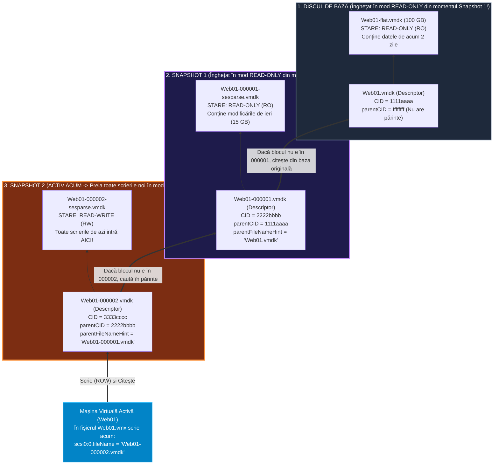
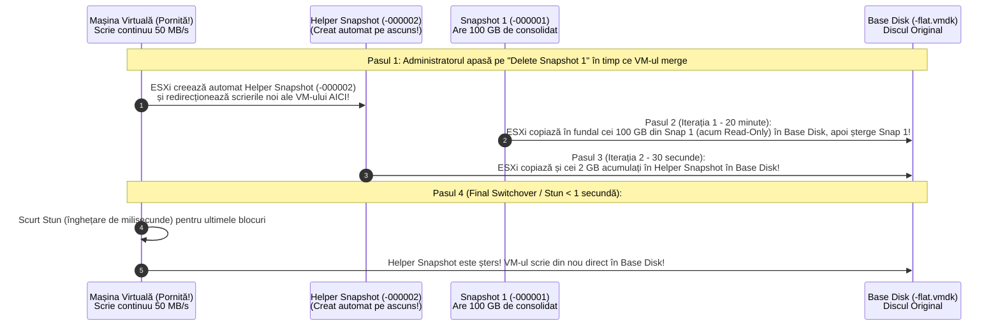

> **Obiectivul Capitolului:** Înțelegerea completă a mecanicii interne a unui Snapshot în `VMware vSphere` (înghețarea discului de bază în mod `Read-Only` și redirecționarea scrierilor prin tehnica `Redirect-on-Write` către fișierele diferențiale `-00000X-sesparse.vmdk`), disecția diferențelor dintre formatele `VMFSsparse`, `SEsparse` și `vsanSparse`, înțelegerea procesului de `Quiescing` (`VSS`), matematica spațiului pe disc în timpul operațiunilor `Delete` vs. `Delete All` (`Consolidation`), rezolvarea erorii critice *„Virtual machine disks consolidation is needed”* și înțelegerea motivului fundamental pentru care **un Snapshot NU este un Backup**.
>
> **Regula de Aur a acestui Capitol:** Fiecare acronim, fișier și mecanism (`RO`, `RW`, `ROW`, `COW`, `VMFSsparse`, `SEsparse`, `vsanSparse`, `.vmsd`, `.vmsn`, `Quiescing`, `VSS`, `CBT`, `Helper Snapshot`) este explicat integral: **(1) Numele complet**, **(2) Ce reprezintă** și **(3) Cum funcționează tehnic în spate**.

:::analogy
### De ce sunt Snapshot-urile simultan cea mai utilă unealtă și „inamicul public numărul 1” în Data Centere?

Întreabă orice inginer Senior VMware care a lucrat în producție ce i-a provocat cele mai multe nopți nedormite, și îți va răspunde fără ezitare: **„Un Snapshot uitat pe o bază de date acum 3 luni!”**.

Pentru un începător, butonul **`Take Snapshot`** pare o baghetă magică: apeși pe el înainte să faci un update riscant în Windows sau Linux, în 2 secunde s-a creat un punct de restaurare, iar dacă update-ul strică aplicația, apeși pe **`Revert to Snapshot`** și mașina virtuală se întoarce în timp exact așa cum era acum 10 minute!

Dar dacă nu înțelegi ce face `VMkernel`-ul pe disc în secunda în care apeși pe *Take Snapshot*, vei face greșeala clasică: vei lăsa acel snapshot activ săptămâni sau luni întregi, crezând că „ai făcut un backup”. În realitate, acel snapshot va crește tăcut în fiecare oră până când va umple $100\%$ din spațiul Datastore-ului, va îngheța zeci de mașini virtuale de producție simultan, va degrada viteza discurilor la jumătate, iar când vei încerca disperat să îl ștergi, mașina virtuală va îngheța în timpul consolidării!

### Analogia Profesorului: Cartea Originală și Foliile de Plastic Transparent (Calc)

Ca să înțelegi exact cum funcționează un Snapshot fără să îl mai confunzi vreodată cu o copie (Clone/Backup), imaginează-ți că **Discul de Bază al Mașinii Virtuale (`Web01-flat.vmdk`)** este o **Carte groasă de bucate scrisă cu stiloul**:

1. **Funcționarea normală (Fără Snapshot):** Când vrei să modifici o rețetă la pagina 50, ștergi cu picul direct în carte și scrii noua rețetă peste cea veche (**`Read-Write` / `RW`**).
2. **Momentul în care apeși `Take Snapshot` (Snapshot 1):**
   * ESXi **NU fotocopiază cartea** (asta ar dura o oră și ar consuma încă $100\text{ GB}$ pe loc)!
   * În schimb, ESXi pune un sigiliu pe cartea originală: **„INTERZISĂ MODIFICAREA! Doar Citire (`Read-Only` / `RO`)!”**.
   * Apoi, așază peste carte o **Folie de Plastic Transparentă goală (`Web01-000001-sesparse.vmdk` – numită *Delta Disk* sau *Child Disk*)**.
   * De acum înainte, când mașina virtuală vrea să modifice rețeta de la pagina 50, ea **scrie modificarea pe folia de plastic transparentă de deasupra**! Când vrea să citească pagina 50, se uită de sus în jos: vede scrisul nou de pe folia transparentă și îl citește pe acela; când vrea să citească pagina 12 (care nu a fost modificată), vede direct prin folia transparentă textul vechi din cartea originală de dedesubt!
3. **Ce se întâmplă când faci `Snapshot 2` și `Snapshot 3`?**
   * Prima folie transparentă devine și ea înghețată (`Read-Only`), iar ESXi pune **o a doua folie transparentă deasupra ei (`-000002`)**, apoi **o a treia folie (`-000003`)**!
   * După 10 folii suprapuse, lumina abia mai trece prin ele (fiecare citire de pe disc trebuie să caute prin 10 fișiere diferite ca să afle unde e ultima versiune a blocului de date – **performanța I/O se prăbușește!**).
4. **Ce se întâmplă când apeși `Delete Snapshot` vs. `Revert`?**
   * Dacă apeși **`Revert` (Întoarcere în timp):** ESXi pur și simplu **ia ultima folie de plastic și o aruncă la coșul de gunoi**! Instantaneu (în 1 secundă), rămâi cu cartea exact așa cum era înainte să pui folia!
   * Dacă apeși **`Delete Snapshot` (Păstrarea modificărilor în producție):** Aici e șocul pentru începători! Ca să șteargă folia transparentă **fără să piardă tot ce ai scris pe ea în ultimele 2 săptămâni**, ESXi este obligat să ia un stilou și **să transcrie cuvânt cu cuvânt toate modificările de pe folia transparentă înapoi în cartea originală de dedesubt (`Consolidation / Commit`)**, și abia la final să arunce folia! Dacă pe folie s-au strâns $500\text{ GB}$ de modificări, transcrierea poate dura ore întregi!
:::

:::architecture
### 1.4.1. Anatomia Tehnică a unui Snapshot: `ROW`, Fișierele `.vmsd`, `.vmsn` și Evoluția `VMFSsparse` vs. `SEsparse` vs. `vsanSparse`

#### 1. Mecanismul de Scriere: `COW` (`Copy-on-Write`) vs. `ROW` (`Redirect-on-Write`)
În industria de stocare există două metode de a realiza un snapshot. Este esențial să știi pe care o folosește VMware:
* **`COW` (`Copy-on-Write` / Copiere la Scriere – folosit de unele SAN-uri vechi și de VSS în Windows):** Când vrei să suprascrii un bloc pe discul original, sistemul citește mai întâi blocul vechi, îl copiază într-o zonă de păstrare și apoi scrie blocul nou în discul original. Aceasta generează **3 operații I/O** (1 citire + 2 scrieri) și încetinește masiv scrierile!
* **`ROW` (`Redirect-on-Write` / Redirecționare la Scriere – *Metoda Oficială folosită de VMware ESXi!*):**
  * În secunda în care creezi un Snapshot, ESXi transformă discul original (`-flat.vmdk`) în **`Read-Only` (`RO` – Doar Citire)**.
  * Toate scrierile noi (`Writes`) făcute de mașina virtuală sunt **redirecționate direct (`ROW`)** către un fișier nou creat numit **Delta Disk / Child Disk** (fără a mai atinge discul original!). Astfel, la scriere nu există penalizare dublă de copiere, dar **la citire (`Reads`)**, `VMkernel`-ul trebuie să consulte o tabelă de mapare pentru a ști dacă blocul căutat se află în ultimul Delta Disk sau în discul de bază!

#### 2. Cele 4 Fișiere care compun un Snapshot pe Datastore
Când faci un Snapshot al mașinii virtuale `Web01`, în folderul ei de pe Datastore apar sau se modifică următoarele 4 elemente:

1. **`Web01.vmsd` (`Virtual Machine Snapshot Dictionary`):**
   * Fișierul text de metadate care păstrează structura ierarhică a tuturor snapshot-urilor active (numele afișat în vCenter, descrierea, ora creării – `createTimeHigh/Low` – și ce fișier `-00000X.vmdk` corespunde fiecărui snapshot).
2. **`Web01-000001.vmdk` (Descriptorul Text al Delta Disk-ului):**
   * Exact ca la discul de bază, este eticheta de $\sim 500\text{ Bytes}$. Dar are o linie critică înăuntru numită **`parentFileNameHint="Web01.vmdk"`** și un număr de verificare numit **`CID` (`Content ID` – un cod hexazecimal de 8 caractere, ex: `CID=a1b2c3d4`)** plus **`parentCID`**!
   * **Cum funcționează lanțul `CID` -> `parentCID`?** De fiecare dată când un disc este deschis și modificat, codul său `CID` se schimbă. Copilul (`-000001.vmdk`) are scris în el codul `parentCID` al părintelui său (`Web01.vmdk`). Dacă cineva modifică din greșeală discul părinte în timp ce exista un snapshot, codul `CID` al părintelui se schimbă, nu mai corespunde cu `parentCID`-ul scris în copil, iar ESXi oprește imediat mașina virtuală cu eroarea: **`The parent virtual disk has been modified since the child was created`** (pentru a preveni coruperea totală a sistemului de fișiere)!
3. **`Web01-000001-sesparse.vmdk` (sau `-delta.vmdk` pe VMFS-5) – *Fișierul Binar Diferențial*:**
   * Aici se scriu efectiv toate blocurile noi modificate de mașina virtuală după secunda creării snapshot-ului.
   * Pornește de la câțiva megabyți și poate crește **până la dimensiunea maximă a discului original** (plus un mic overhead de metadate)!
4. **`Web01-Snapshot1.vmsn` (`Virtual Machine Snapshot State`):**
   * Dacă la crearea snapshot-ului ai lăsat bifată opțiunea **`Include virtual machine's memory`**, ESXi salvează în acest fișier `.vmsn` (sau într-un fișier adițional `.vmem`) întreaga memorie `RAM` activă a mașinii virtuale + starea registrelor procesorului din acea secundă! Dacă ai debifat memoria, fișierul `.vmsn` are doar câțiva kilobyți (păstrând doar configurația hardware a VM-ului din acel moment).

#### 3. Evoluția Tehnică a Discurilor Delta: `VMFSsparse` vs. `SEsparse` vs. `vsanSparse` (Subiect de Examen VCP!)
Nu toate fișierele de snapshot sunt construite la fel! În funcție de sistemul de fișiere (`VMFS-5`, `VMFS-6` sau `vSAN`), ESXi folosește 3 arhitecturi interne diferite pentru discurile delta:

| Formatul Intern al Snapshot-ului | Numele Complet & Extensia pe Disc | Unde este folosit? | Dimensiunea Blocului Intern & Avantaje Arhitecturale |
| :--- | :--- | :--- | :--- |
| **`VMFSsparse`** *(LegacyRedoLog)* | *VMFS Sparse Format* (`-000001-delta.vmdk`) | Pe vechiul **`VMFS-5`** (sau pe `VMFS-6` doar pentru discuri mai mici de $2\text{ TB}$ migrate din versiuni vechi). | Alocă blocuri minusculare de **`512 Bytes`**. **Limitare gravă:** Suportă discuri de **maximum $2\text{ TB}$** și se fragmentează sever la dimensiuni mari! |
| **`SEsparse`** | *Space-Efficient Sparse Format* (`-000001-sesparse.vmdk`) | **Implicit și obligatoriu pe `VMFS-6`** (în vSphere 6.5, 6.7, 7.0, 8.0) pentru toate discurile, indiferent de mărime! | Alocă blocuri de **`4 KB`** (aliniate perfect cu sectoarele `4Kn` ale SSD-urilor moderne), suportă discuri de până la **`62 TB`** și permite **recuperarea spațiului gol (`UNMAP / Space Reclamation`)**! |
| **`vsanSparse`** | *vSAN Sparse Snapshot Format* (Obiect în vSAN) | Exclusiv pe datastore-uri **`VMware vSAN`**. | Folosește redirecționarea în memorie și cache-ul vSAN pentru a oferi performanță apropiată de discul nativ, fără penalizările vechiului format sparse. |

---

### 1.4.2. Cele 2 Opțiuni de la Crearea unui Snapshot: `Memory Snapshot` vs. `Quiescing` (`VSS`)

Când dai click-dreapta pe o mașină virtuală pornită $\rightarrow$ *Snapshots* $\rightarrow$ *Take Snapshot*, vCenter îți afișează două bife (checkbox-uri) pe care trebuie să știi exact când să le bifezi și ce efect au asupra producției:

#### 1. Bifa 1: `Include virtual machine's memory` (Includerea Memoriei RAM – implicit *Bifată*)
* **Ce se întâmplă dacă o lași BIFATĂ:**
  * ESXi îngheață pentru câteva secunde mașina virtuală (**`Stun`**) și copiază toți gigabyții ei de memorie `RAM` pe disc în fișierul `.vmsn`.
  * **Avantaj:** Dacă mai târziu apeși pe *Revert to Snapshot*, mașina virtuală revine direct **PORNITĂ (`Powered On`)**, cu ferestrele deschise exact în secunda în care ai făcut snapshot-ul! Imaginea de pe disc este numită **`Crash-Consistent` + `Memory State`**.
  * **Dezavantaj major în Producție:** Dacă mașina are $64\text{ GB RAM}$, scrierea a $64\text{ GB}$ pe disc durează zeci de secunde sau minute, iar în ultima secundă de *Stun* mașina poate pierde câteva pachete de `ping` (ceea ce poate cauza un failover nedorit într-un cluster de baze de date SQL AlwaysOn!).
* **Ce se întâmplă dacă o DEBIFEZI:**
  * Snapshot-ul se creează **instantaneu (în mai puțin de 1 secundă)** și nu consumă spațiu pe disc pentru RAM!
  * **Atenție:** Pentru că nu ai salvat memoria RAM, dacă apeși pe *Revert to Snapshot*, mașina virtuală se va întoarce în timp în starea **OPRITĂ (`Powered Off`)** (sau va reporni de la zero, ca și cum cineva i-ar fi smuls cablul de curent din priză în secunda în care ai făcut snapshot-ul – stare numită **`Crash-Consistent`**)!

#### 2. Bifa 2: `Quiesce guest file system` (Liniștirea / Înghețarea Sistemului de Fișiere – necesită `VMware Tools`!)
* **Ce înseamnă cuvântul `Quiesce` (`Quiescing`)?** Înseamnă „a aduce într-o stare de repaus/liniște completă”.
* **Problema fără Quiescing:** Dacă faci un snapshot fără memorie (*Debifezi Bifa 1*), dar o bază de date `Microsoft SQL` sau `Oracle` era chiar în mijlocul scrierii unei plăți bancare (jumătate din tranzacție era încă în memoria RAM a Windows-ului, iar jumătate era pe disc), discul din snapshot este surprins cu tranzacția tăiată pe jumătate!
* **Cum funcționează `Quiescing` în spate:**
  1. Când bifezi **`Quiesce guest file system`** (disponibil doar când debifezi memoria), `VMkernel`-ul trimite o comandă către serviciul **`VMware Tools` (`vmtoolsd`)** din interiorul mașinii virtuale.
  2. În Windows, `VMware Tools` apelează serviciul oficial Microsoft numit **`VSS` (`Volume Shadow Copy Service` / Serviciul de Copiere în Umbră a Volumelor)**.
  3. `VSS` le ordonă tuturor bazelor de date compatibile (`SQL Server`, `Active Directory`, `Exchange`): *„Atenție! Aveți 5 secunde să vă scrieți toate tranzacțiile din memoria RAM pe disc (`Flush Buffers`) și să nu mai începeți nicio scriere nouă (`Freeze I/O`)!”*.
  4. În acea fracțiune de secundă în care toate bazele de date sunt aliniate și liniștite pe disc, ESXi creează snapshot-ul `-000001.vmdk`, iar apoi `VSS` dă ordinul **`Thaw` (Dezghețare)** și bazele de date își reiau lucrul!
  5. Un astfel de snapshot se numește **`Application-Consistent` (Consistent la nivel de Aplicație)** și este metoda exactă pe care o folosesc toate soluțiile profesionale de Backup (**Veeam**, **Nakivo**, **Commvault**, **Veritas NetBackup**)!

---

### 1.4.3. Ce se întâmplă la `Delete` vs. `Delete All` (`Consolidation`) și Misterul `Helper Snapshot`-ului

*(Aici pică 80% dintre candidații la examenul VCP-DCV! Citește cu maximă atenție mecanismul de ștergere!)*

Să presupunem că avem o mașină virtuală cu un disc de bază (`Base Disk`) și un lanț de 3 snapshot-uri luate în trei zile consecutive:
$$\text{Base Disk (Luni)} \longrightarrow \text{Snapshot 1 (Marți: } 10\text{ GB)} \longrightarrow \text{Snapshot 2 (Miercuri: } 20\text{ GB)} \longrightarrow \text{Snapshot 3 (Joi: } 30\text{ GB)} \longleftarrow \text{You are here!}$$

În meniul **`Manage Snapshots`** ai trei acțiuni posibile:

#### 1. Acțiunea `Revert to` (sau `Go to` un Snapshot anterior)
* Dacă alegi să te întorci la `Snapshot 2`, ESXi aruncă la gunoi tot ce ai lucrat după `Snapshot 2` (sau creează o ramură nouă în arbore dacă te întorci la `Snapshot 1`) și pornește un nou fișier delta gol pornind din punctul ales.

#### 2. Acțiunea `Delete` (Ștergerea unui SINGUR Snapshot din lanț)
* **Regula de Aur a direcției de comasare (`Commit / Merge Direction`):** Când ștergi un snapshot, datele din el se varsă **ÎNTOTDEAUNA ÎNAPOI CĂTRE PĂRINTELE SĂU DIRECT (`Upward Merge into Parent`)**!
  * *Cazul A:* Dacă ștergi **`Snapshot 1`** (care este primul copil al lui `Base Disk`), ESXi ia cei $10\text{ GB}$ din `Snapshot 1`, îi scrie direct în **`Base Disk`**, leagă `Snapshot 2` direct de `Base Disk` și apoi șterge fișierul `Snapshot 1` de pe disc!
  * *Cazul B:* Dacă ștergi **`Snapshot 2`** (care stă la mijloc între `Snapshot 1` și `Snapshot 3`), ESXi ia cei $20\text{ GB}$ din `Snapshot 2` și îi varsă în părintele său, adică în **`Snapshot 1`**!
    * **CAPCANA DE SPAȚIU PE DISC LA EXAMEN:** Dacă `Snapshot 1` conținea blocuri diferite față de `Snapshot 2`, în timpul cât ESXi copiază cei $20\text{ GB}$ din `Snapshot 2` în interiorul lui `Snapshot 1`, **dimensiunea lui `Snapshot 1` pe Datastore poate crește de la $10\text{ GB}$ la $30\text{ GB}$ ÎNAINTE ca fișierul `Snapshot 2` (de $20\text{ GB}$) să fie șters la finalul operațiunii!** Deci ai nevoie temporar de spațiu liber suplimentar pe Datastore chiar ca să poți *șterge* un snapshot de mijloc!

#### 3. Acțiunea `Delete All` (Ștergerea TUTUROR Snapshot-urilor simultan)
* Cum șterge ESXi moderne (vSphere 6.5 / 7.0 / 8.0) întregul lanț (`Snap 1` + `Snap 2` + `Snap 3`) când apeși pe **`Delete All`**?
  * *În versiunile foarte vechi (ESXi 4.x):* ESXi le comasa de la coadă la cap (`Snap 3` în `Snap 2`, apoi rezultatul în `Snap 1`, apoi în `Base Disk`), ceea ce necesita dublul spațiului pe disc și dura o veșnicie!
  * *În ESXi modern (Algoritmul Optimizat începând cu ESXi 5.0+):* ESXi folosește o singură trecere direct către **`Base Disk`**! Dacă un bloc de date a fost modificat și Marți (`Snap 1`), și Miercuri (`Snap 2`), și Joi (`Snap 3`), ESXi este suficient de deștept încât să ia **direct versiunea cea mai nouă de Joi (`Snap 3`)** și să o scrie o singură dată în **`Base Disk`**, ignorând versiunile suprascrise de Marți și Miercuri, apoi șterge toate cele 3 fișiere delta!

#### 4. Cum poate ESXi să scrie în `Base Disk` în timp ce Mașina Virtuală este PORNITĂ și scrie în paralel? Mecanismul `Helper Snapshot` (`Consolidate Helper`)!
*(Aceasta este întrebarea de 10 puncte la interviul de Senior VMware Engineer!)*

Imaginează-ți această problemă: Ai un singur snapshot uriaș (`-000001-sesparse.vmdk` de $100\text{ GB}$) pe o mașină virtuală de producție pornită, și apeși pe **`Delete`** la ora 12:00 la prânz.
ESXi începe să copieze cei $100\text{ GB}$ din `-000001` înapoi în `Base Disk`. Dar în timp ce ESXi copiază aceste date (operațiune care durează 20 de minute), **mașina virtuală este PORNITĂ și continuă să scrie zeci de megabyți pe secundă de date noi**! Dacă mașina virtuală ar continua să scrie în `-000001`, acel fișier nu s-ar mai goli niciodată!

**Cum rezolvă `VMkernel`-ul acest paradox?**
1. În secunda în care apeși pe `Delete Snapshot`, ESXi îngheață `Snapshot 1 (-000001)` în mod `Read-Only` și creează pe ascuns în spate un snapshot temporar invizibil în GUI numit **`Helper Snapshot` (`-000002-sesparse.vmdk`)**!
2. Cât timp ESXi copiază în liniște cei $100\text{ GB}$ din `-000001` în `Base Disk` (timp de 20 de minute), mașina virtuală își scrie toate datele noi în acest **`Helper Snapshot (-000002)`**.
3. După 20 de minute, când `-000001` a fost copiat complet în `Base Disk` și șters, ESXi se uită la `Helper Snapshot (-000002)`: vede că în acele 20 de minute s-au strâns în el încă $2\text{ GB}$, îi copiază rapid și pe aceia în `Base Disk` (în 30 de secunde), iar în ultima fracțiune de secundă face un scurt **`Stun`** mașinii virtuale, lipește ultimele câțiva megabyți, șterge `Helper Snapshot`-ul și reconectează mașina virtuală direct la `Base Disk`!

---

### 1.4.4. De ce un Snapshot NU ESTE UN BACKUP și Eroarea *„Virtual machine disks consolidation is needed”*

#### 1. Cele 4 Motive Arhitecturale pentru care un Snapshot NU este niciodată un Backup:
1. **Dependența de Discul de Bază (`Single Point of Failure`):** Un fișier de snapshot (`-000001-sesparse.vmdk`) conține **doar blocurile modificate** (*Delta*), nu întregul sistem de operare! Dacă se corupe discul de bază (`-flat.vmdk`) sau dacă îți cade LUN-ul/Datastore-ul, **toate snapshot-urile devin 100% inutile și ilizibile**, deoarece le lipsește $90\%$ din fișierele Windows-ului! Un **Backup adevărat** este o copie completă și independentă stocată pe un **alt echipament fizic de stocare**!
2. **Degradarea Progresivă a Performanței:** Cu cât păstrezi un snapshot mai mult timp și cu cât ai mai multe snapshot-uri în lanț, cu atât scade viteza de citire/scriere a discului și crește timpul necesar pentru consolidarea lor la ștergere.
3. **Explozia Spațiului pe Datastore:** Un lanț de 3 snapshot-uri pe o mașină virtuală de $500\text{ GB}$ poate ajunge să consume $500\text{ GB (Base)} + 500\text{ GB (Snap 1)} + 500\text{ GB (Snap 2)} + 500\text{ GB (Snap 3)} = \mathbf{2.000\text{ GB (2 TB)}}$ pe Datastore!
4. **Blocarea Operațiunilor Administrative:** Cât timp o mașină virtuală are un Snapshot activ, **NU poți mări dimensiunea discului ei virtual (`.vmdk`)** din *Edit Settings* (căsuța de mărire a GB-ilor este gri / dezactivată, deoarece mărirea discului copil ar rupe geometria față de discul părinte înghețat!).

#### 2. Cum apare și cum se rezolvă eroarea clasică: *„Virtual machine disks consolidation is needed”*?
În fiecare săptămână, într-un Data Center real, vei vedea în vCenter o bandă galbenă de alarmă pe o mașină virtuală: **`Configuration Issue: Virtual machine disks consolidation is needed`**. Când intri în *Manage Snapshots*, lista este **goală** (scrie *„You have no snapshots”*), dar când te uiți pe Datastore, vezi că mașina încă rulează pe `Web01-000001-sesparse.vmdk`!

* **De ce apare această stare?**
  * La ora 02:00 noaptea, softul de Backup (ex: **Veeam Backup & Replication**) a dat comandă lui vCenter să creeze un snapshot temporar (cu *Quiescing*), a copiat datele din discul de bază înghețat folosind tehnologia **`CBT` (`Changed Block Tracking` / Urmărirea Blocurilor Modificate – un fișier `-ctk.vmdk` care îi spune softului de backup exact ce blocuri s-au schimbat de ieri până azi)**, iar la ora 02:30 a dat comandă lui vCenter să șteargă snapshot-ul temporar!
  * vCenter a șters intrarea din catalogul `.vmsd` (de aceea în interfață nu mai apare niciun snapshot în Snapshot Manager!), **DAR ștergerea/consolidarea fișierelor `.vmdk` de pe disc a eșuat** (fie pentru că proxy-ul de backup Veeam nu a eliberat la timp lacătul de pe disc, fie pentru că mașina virtuală scria prea agresiv în acel moment, fie pentru că nu mai era spațiu pe Datastore)!
* **Cum o rezolvi în 3 click-uri:**
  * Dai click-dreapta pe mașina virtuală în vCenter $\rightarrow$ **Snapshots** $\rightarrow$ **`Consolidate`**!
  * vCenter pornește din nou procesul de comasare a fișierelor delta orfane în discul de bază și curăță eroarea! *(Dacă primești eroarea că fișierul este blocat – `File is locked` –, verifici pe mașina virtuală de Backup Proxy dacă nu a rămas agățat discul mașinii tale în lista ei de discuri atașate prin *HotAdd*, îl detașezi de pe Proxy și apoi rulezi `Consolidate`!).*
:::

:::exam-alert
### Regula Celor 72 de Ore și Limitele Oficiale (Din VMware KB 1025279 – Obligatorii pentru Examen!)

| Parametru / Regulă Oficială VMware | Valoarea din KB 1025279 | De ce este impusă această regulă? |
| :--- | :--- | :--- |
| **Limita Maximă Tehnică a unui Lanț de Snapshot-uri** | Maximum **`32` de snapshot-uri** în lanț | Peste 32 de fișiere delta în cascadă, latența I/O și riscul de corupere a lanțului `CID` devin inacceptabile. |
| **Recomandarea VMware Best Practice (Număr Maxim)** | Maximum **`2 – 3` snapshot-uri** | Pentru a evita degradarea performanței discurilor în producție. |
| **Durata Maximă Recomandată de Păstrare a unui Snapshot** | Maximum **`24 – 72 de ore` (1 – 3 zile)!** | Un snapshot păstrat mai mult de 72 de ore acumulează zeci/sute de GB în fișierul delta, riscând să umple Datastore-ul și să facă operațiunea de `Consolidation` extrem de lungă. |

### Capcane de Examen (VCP Exam Traps)

1. **Capcana #1 (Pot face Snapshot pe orice tip de disc atașat unei Mașini Virtuale?):**
   * *Întrebare clasică VCP:* Care sunt cele două situații în care **NU poți face Snapshot** unui disc atașat la o mașină virtuală?
   * *Răspunsul Oficial:*
     1. **Discuri configurate în `Independent Mode` (`Independent - Persistent` sau `Independent - Nonpersistent`):** În setările fiecărui disc `.vmdk` există o opțiune numită *Disk Mode*. Dacă este setată pe *Independent*, acel disc **ignoră complet snapshot-urile**! (`Independent - Persistent` scrie toate modificările direct și definitiv pe disc chiar dacă faci snapshot și dai Revert; `Independent - Nonpersistent` aruncă la gunoi absolut toate modificările făcute în disc de fiecare dată când oprești mașina virtuală – util pentru săli de clasă sau chioșcuri internet!).
     2. **Discuri de tip `RDM` în mod `Physical Compatibility Mode` (`Raw Device Mapping - Physical Mode`) sau discuri partajate prin `SCSI Bus Sharing` (ex: Windows Server Failover Clustering cu discuri partajate):** Pentru că mașina virtuală vorbește direct cu LUN-ul fizic din SAN fără ca ESXi să interpună stratul de abstractizare `VMFS`, ESXi nu poate interpune un fișier delta `-000001.vmdk`! *(Notă: Pe un `RDM` în mod `Virtual Compatibility Mode`, snapshot-urile SUNT suportate!).*
2. **Capcana #2 (De ce nu pot mări discul unei mașini virtuale de la $100\text{ GB}$ la $150\text{ GB}$?):**
   * Dacă la examen ți se dă o captură de ecran în care câmpul *Hard disk 1 size* este **gri (Greyed out / Disabled)** chiar și cu mașina oprită, primul lucru pe care îl verifici este **dacă mașina virtuală are un Snapshot activ** (sau dacă are nevoie de *Disk Consolidation*)! Cât timp există un fișier `-00000X.vmdk`, extinderea discului este blocată!
:::

:::interview
### Întrebarea 1 (Nivel Junior / Mid – Ce se întâmplă în spate la crearea și ștergerea unui Snapshot)
> **Intervievator:** *„Un coleg din echipa de dezvoltare îți cere să îi faci un Snapshot pe serverul lor de baze de date de $2\text{ TB}$ și să i-l lași acolo două săptămâni, spunându-ți: 'Ce mare lucru, am văzut că atunci când apeși pe Take Snapshot durează doar 2 secunde și ocupă 0 MB!'. Cum îi explici tehnic de ce durează doar 2 secunde la creare, ce se va întâmpla în următoarele două săptămâni și de ce ștergerea lui peste două săptămâni poate provoca un incident major?”*

**Răspunsul Ideal:**
„Îi voi explica faptul că crearea unui snapshot durează doar 2 secunde tocmai pentru că ESXi **nu face o copie a celor $2\text{ TB}$**, ci aplică tehnica **Redirect-on-Write (`ROW`)**: îngheață discul de bază (`-flat.vmdk`) în mod **Read-Only** și creează un fișier diferențial gol (`-000001-sesparse.vmdk`) în care redirecționează toate scrierile noi.

Dacă lăsăm acest snapshot activ timp de două săptămâni pe o bază de date cu trafic intens, vor apărea trei riscuri critice:
1. **Explozia spațiului pe Datastore:** Fișierul `-sesparse.vmdk` va crește continuu (putând ajunge până la încă $2\text{ TB}$), riscând să umple Datastore-ul și să blocheze toate mașinile virtuale de pe acel volum.
2. **Penalizarea performanței la citire:** Pentru fiecare interogare SQL, `VMkernel`-ul va trebui să verifice mai întâi tabela de metadate a fișierului delta înainte de a citi din discul de bază.
3. **Impactul la ștergere (`Consolidation` și `Helper Snapshot`):** Peste două săptămâni, când vom apăsa pe *Delete Snapshot*, ESXi nu va șterge pur și simplu fișierul, ci va trebui să citească și să transcrie sute de gigabyți sau terabyți din `-000001-sesparse.vmdk` înapoi în discul de bază (`-flat.vmdk`), folosind în paralel un *Helper Snapshot*. Acest proces va genera o furtună de operații I/O pe SAN timp de mai multe ore și poate provoca un scurt îngheț (*Stun*) al bazei de date în secunda comutării finale. De aceea, conform **VMware KB 1025279**, păstrăm snapshot-urile doar pe durata ferestrei de schimbare (maximum 24-72 de ore), iar pentru retenție de două săptămâni folosim soluția dedicată de Backup.”

### Întrebarea 2 (Nivel Senior – Troubleshooting Consolidare Eșuată după Backup)
> **Intervievator:** *„Intri dimineața în vCenter și vezi 5 mașini virtuale cu alerta 'Virtual machine disks consolidation is needed'. Când dai click pe Consolidate, 4 dintre ele se rezolvă, dar a 5-a eșuează imediat cu eroarea 'Unable to access file since it is locked'. Cum diagnostichezi și cum rezolvi această problemă fără să repornești serverul ESXi?”*

**Răspunsul Ideal:**
„Aceasta este o situație clasică apărută în urma unui job de backup de noapte care folosește modul de transport **Virtual Appliance (`HotAdd`)**.
Când soluția de backup (cum ar fi Veeam sau Commvault) face backup prin *HotAdd*, ea creează un snapshot pe mașina virtuală sursă (`VM-Prod`), iar apoi **atașează discul de bază (`VM-Prod.vmdk`) direct la mașina virtuală a Proxy-ului de Backup** pentru a-l citi rapid. Dacă jobul de backup s-a blocat sau a dat timeout la final, Proxy-ul de Backup a uitat să detașeze discul lui `VM-Prod`, păstrând astfel un lacăt SCSI/VMFS activ pe fișierul `.vmdk`!

Pașii mei de rezolvare fără downtime sunt:
1. Pentru a confirma exact cine ține lacătul pe fișier, mă pot conecta prin SSH pe un host ESXi și pot rula comanda `vmkfstools -D /vmfs/volumes/<Datastore>/<VM-Prod>/<VM-Prod>.vmdk` (care îmi afișează adresa MAC a host-ului care deține lacătul `RO/RW`), sau comanda `lsof | grep <VM-Prod>`.
2. Identific mașina virtuală **Backup Proxy**, intru în *Edit Settings* pe acel Backup Proxy și caut în lista lui de *Hard Disks* discul suplimentar care punctează către folderul lui `VM-Prod`.
3. Detașez acel disc de pe mașina Backup Proxy (**selectând cu maximă atenție doar detasarea discului, FĂRĂ a bifa *Delete files from datastore*!**) și salvez setările Proxy-ului.
4. În secunda în care Proxy-ul a eliberat discul, dau din nou click-dreapta pe `VM-Prod` $\rightarrow$ *Snapshots* $\rightarrow$ **`Consolidate`**, iar consolidarea se va finaliza cu succes!”
:::

:::lab
> **Scenariul Laboratorului:** Pe mașina noastră virtuală **`web01`** de pe serverul **`esxi01.lab.local` (`192.168.10.51`)**, vom crea un lanț de două snapshot-uri în timp ce avem o fereastră de **`SSH`** deschisă către folderul mașinii virtuale. Vom urmări în timp real cum se schimbă fișierele pe disc, cum se modifică `CID`-ul și `parentCID`-ul, cum este blocată mărirea discului în GUI și cum dispar fișierele delta în urma consolidării!
:::

:::quiz

:::

:::references
1. **Broadcom / VMware Knowledge Base (KB 1025279):** *Best practices for using snapshots in the vSphere environment* – Documentul oficial de referință pentru regula celor 72 de ore și limitele de snapshot-uri.
2. **Broadcom / VMware Knowledge Base (KB 1015180):** *Understanding virtual machine snapshots in VMware ESXi and ESX* – Arhitectura internă a fișierelor `.vmsd`, `.vmsn`, `-delta` și `-sesparse`.
3. **Broadcom / VMware Knowledge Base (KB 1002310):** *Committing snapshots when there is no free space on the datastore*.
4. **Broadcom / VMware Knowledge Base (KB 2003638):** *Unable to delete the virtual machine snapshot or consolidate disks: File is locked (HotAdd Backup Proxy issue)*.
5. **Cormac Hogan (vExpert & Chief Technologist):** *vSphere Storage Deep Dive: VMFSsparse vs. SEsparse vs. vsanSparse* (`cormachogan.com`).
:::
