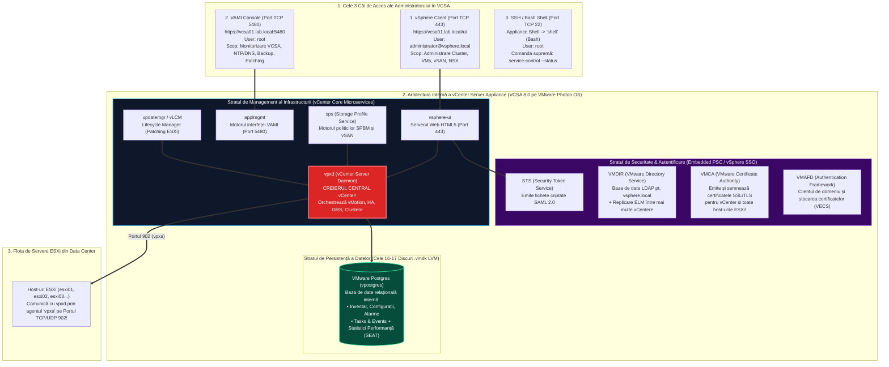
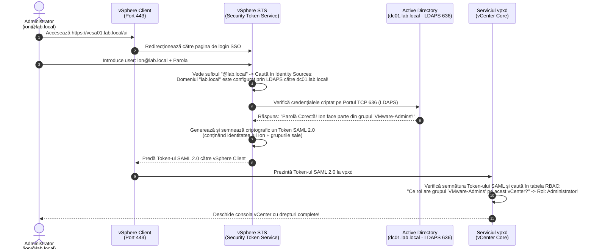
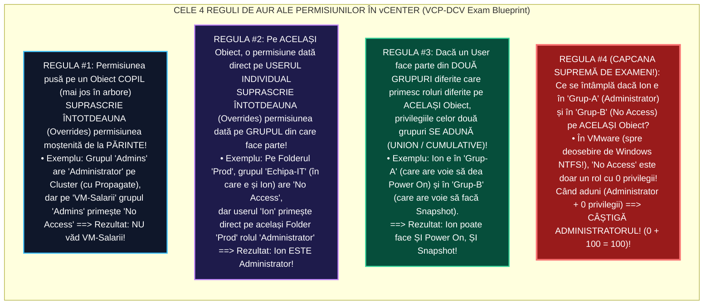

> **Obiectivul Capitolului:** Înțelegerea completă a arhitecturii centrale de management **`VMware vCenter Server Appliance` (`VCSA`)**, disecția sistemului de operare subiacent (`Photon OS`), a bazei de date interne (`PostgreSQL`) și a microserviciilor critice (`vpxd`, `vpxd-svcs`, `vami`, `sps`), stăpânirea arhitecturii de autentificare **`vSphere Single Sign-On` (`SSO`)** (`STS`, `SAML 2.0`, `VMDIR`, `VMCA`, `Enhanced Linked Mode`), integrarea cu `Active Directory` și rezolvarea oricărei probleme de moștenire și conflict a permisiunilor (`RBAC` – *Role-Based Access Control*) la examenul VCP-DCV.
>
> **Regula de Aur a acestui Capitol:** Fiecare acronim, serviciu Linux și concept de securitate (`VCSA`, `OVA`, `Photon OS`, `VAMI`, `vpxd`, `vpostgres`, `SSO`, `PSC`, `STS`, `SAML`, `VMDIR`, `VMCA`, `VMAFD`, `LDAP`, `LDAPS`, `IWA`, `RBAC`, `ELM`) este explicat integral: **(1) Numele complet**, **(2) Ce reprezintă** și **(3) Cum funcționează tehnic sub capotă**.

:::analogy
### De ce nu putem conduce un Data Center fără `vCenter Server`?

În Pilonul 1 am instalat un server `VMware ESXi` și ne-am conectat direct la el prin browser (`VMware Host Client`). A fost simplu pentru un singur server.
Dar imaginează-ți că mâine te angajezi într-o companie care are **100 de servere fizice `ESXi`** și **3.000 de mașini virtuale**! Fără `vCenter Server`:
1. Ar trebui să ții deschise în browser **100 de tab-uri separate** (câte unul pentru IP-ul fiecărui server ESXi) și să te loghezi de 100 de ori cu contul `root`!
2. **Nu ai putea face `vMotion` (migrare live):** Un server ESXi singuratic habar nu are că lângă el în rack mai există un alt server ESXi! Nu poți muta o mașină virtuală pornită de pe Serverul 1 pe Serverul 2 fără un „creier central” care să coordoneze ambele servere.
3. **Nu ai avea `vSphere HA`, `vSphere DRS`, `vSAN`, `Distributed Switches (vDS)`, `Templates` sau `Clones`:** Toate aceste funcții enterprise sunt deblocate și orchestrate **exclusiv de `vCenter Server`**!

### Analogia Profesorului: Muzicianul Solist (`ESXi`) vs. Dirijorul Orchestrei Simfonice (`vCenter Server`)

Pentru a înțelege relația exactă dintre `vCenter` și `ESXi` (și o regulă critică de arhitectură și examen!), gândește-te la o **Orchestră Filarmonică de 100 de instrumentiști**:
* **Fiecare Server `ESXi` este un Muzician Profesionist de Top:** El ține instrumentul în mână (CPU, RAM, Disk) și **el este cel care cântă efectiv notele muzicale** (el rulează mașinile virtuale!).
* **`vCenter Server` (`VCSA`) este Dirijorul Orchestrei:** Dirijorul **nu cântă la niciun instrument** (nu rulează nicio mașină virtuală în interiorul său!). Rolul Dirijorului este să împartă partiturile tuturor celor 100 de muzicieni, să le spună când să intre, să mute o partitură de la vioara 1 la vioara 2 (`vMotion` / `DRS`) și să supravegheze sala.
* **Întrebarea de 1.000 de puncte (Ce se întâmplă dacă Dirijorul leșină în mijlocul concertului?):**
  * Dacă mașina virtuală `vCenter Server` se oprește, ia foc sau își dă restart pentru update, **se opresc mașinile virtuale de producție de pe serverele ESXi?**
  * **NU! ABSOLUT DELOC!** Muzicienii (`ESXi`) au deja partiturile în față și **continuă să cânte fără nicio întrerupere**! Mașinile virtuale de producție merg mai departe, ba chiar și `vSphere HA` continuă să repornească mașinile dacă pică un server fizic (deoarece agenții `fdm` comunică direct între ei!). Singurul lucru pe care îl pierzi cât timp `vCenter`-ul este oprit este abilitatea de a da comenzi centrale noi (nu mai poți intra în interfața `vSphere Client`, nu mai poți iniția `vMotion` și nu mai calculează `DRS` mutări noi).
:::

:::architecture
### 2.1.1. Anatomia `VCSA` (`vCenter Server Appliance`): De la Windows la `Photon OS`, `PostgreSQL` și Microservicii

#### 1. Scurt Istoric (Pentru a înțelege evoluția la interviu): `vCenter for Windows` & `External PSC` vs. `VCSA` Modern
* **Cum era în trecut (vSphere 5.x / 6.0 / 6.5):** Până la vSphere 6.7, puteai instala vCenter în două moduri: fie ca un program `.exe` pe un *Windows Server* (conectat la o bază de date externă *Oracle* sau *Microsoft SQL*), fie ca o mașină virtuală Linux pre-configurată numită **`VCSA` (`vCenter Server Appliance`)**. Mai mult, componenta de autentificare numită **`PSC` (`Platform Services Controller`)** putea fi instalată pe o mașină virtuală separată (*External PSC*), ceea ce complica îngrozitor arhitectura și upgrade-urile!
* **Cum este astăzi (vSphere 7.0 și 8.0/9.0 – Singura arhitectură existentă!):**
  * VMware **a eliminat complet** atât vCenter-ul pe Windows, cât și bazele de date externe (Oracle/MSSQL), cât și *External PSC*!
  * Astăzi, vCenter există **exclusiv sub forma `VCSA` (`vCenter Server Appliance` cu `Embedded PSC`)**: o mașină virtuală gata împachetată (un **`Virtual Appliance`** în format `.ova` – *Open Virtualization Appliance*) care rulează pe sistemul de operare Linux ultra-securizat creat chiar de VMware, numit **`VMware Photon OS`**, și folosește propria bază de date internă **`VMware Postgres` (`PostgreSQL`)**!

#### 2. Ce se află în interiorul mașinii virtuale `VCSA`? (Cele 16–17 Discuri `.vmdk` și Serviciile Critice)
Când instalezi un `VCSA 8.0` și te uiți în setările lui hardware, vei avea o surpriză: mașina virtuală `VCSA` nu are un singur hard-disk virtual, ci are **16 sau 17 discuri virtuale (`.vmdk`) separate**, gestionate prin **`LVM` (`Logical Volume Manager` din Linux)**!

* **De ce a împărțit VMware discul lui `VCSA` în 16–17 discuri `.vmdk` separate?**
  * În versiunile vechi, totul era pe un singur disc. Dacă un proces scria prea multe jurnale (`Logs`) și umplea discul la $100\%$, întregul sistem de operare Linux și baza de date PostgreSQL se blocau instantaneu!
  * Împărțind funcțiile pe discuri `.vmdk` separate (ex: `Hard Disk 1` pentru boot/OS `/`, `Hard Disk 5` pentru `/storage/log`, `Hard Disk 6` pentru `/storage/db`, `Hard Disk 7` pentru `/storage/dblog`, `Hard Disk 8` pentru `/storage/seat` – statistici istorice, `Hard Disk 13` pentru `/storage/updatemgr` – patch-uri vLCM), dacă se umple discul de loguri, **baza de date și sistemul de operare rămân neafectate**, iar tu poți mări din *Edit Settings* doar discul `.vmdk` care s-a umplut, în mers (fără să oprești `VCSA`-ul!), iar `LVM`-ul din Photon OS își extinde automat partiția!

#### 3. Cele 2 Interfețe Web ale `VCSA`-ului (Portul `443` vs. Portul `5480` – *Întrebare clasică VCP!*)
Un `VCSA` îți oferă două portaluri web complet diferite, care rulează pe porturi diferite și folosesc conturi de administrator diferite:

1. **`vSphere Client` (`https://<FQDN-VCSA>/ui` – Portul `TCP 443`):**
   * **Ce este:** Consola zilnică de administrare a întregului Data Center (unde vezi Datacentere, Clustere, Host-uri ESXi, Mașini Virtuale, Datastore-uri, vSAN, NSX).
   * **Cu ce cont te loghezi aici?** Cu contul de Single Sign-On: **`administrator@vsphere.local`** (sau cu contul tău din Active Directory, ex: `ion.popescu@lab.local`).
   * **Ce serviciu intern îl ține în viață?** Serviciul **`vsphere-ui`** conectat la creierul **`vpxd`** (`vCenter Server Daemon`).

2. **`VAMI` (`vCenter Server Appliance Management Interface` – `https://<FQDN-VCSA>:5480` – Portul `TCP 5480`):**
   * **Ce este:** Este „panoul de control medical” al mașinii virtuale `VCSA` însăși! Aici **NU vezi mașinile virtuale din cluster**, ci vezi starea de sănătate a aparatului `VCSA`: cât CPU/RAM consumă `VCSA`-ul, cât spațiu mai e pe cele 16 discuri `.vmdk`, setările lui de IP/DNS/NTP, starea serviciilor, aplicarea de patch-uri/update-uri la `VCSA` și configurarea **File-Based Backup** (backup-ul nativ al bazei de date vCenter prin SFTP/HTTPS/SMB)!
   * **Cu ce cont te loghezi aici?** Cu contul de Linux al aparatului: **`root`** (și de asemenea cu `administrator@vsphere.local`).
   * **Ce serviciu intern îl ține în viață?** Serviciul **`applmgmt`** (*Appliance Management Service*). Chiar dacă serviciul principal `vpxd` sau `vsphere-ui` (pe portul 443) a crăpat, **interfața `VAMI` pe portul `5480` rămâne funcțională** ca să poți intra și să repornești serviciile!



---

### 2.1.2. Cum funcționează `vSphere Single Sign-On` (`SSO`): `STS`, `SAML 2.0`, `VMDIR`, `VMCA`, `Identity Sources` și `ELM`

Când tastezi userul și parola în pagina de login a lui `vSphere Client` și apeși *Login*, în spatele cortinei are loc o coregrafie criptografică de înaltă securitate numită **`vSphere Single Sign-On` (`SSO` – Autentificare Unică)**.

#### 1. Cele 4 Componente Interne ale `vSphere SSO` (Fostul `PSC` – *Platform Services Controller*)
1. **`STS` (`Security Token Service` / Serviciul de Jetoane de Securitate):**
   * **Ce reprezintă:** Este „Casieria de Bilete” a Data Centerului!
   * **Cum funcționează:** Niciun serviciu din VMware (`vpxd`, `vSAN`, `NSX`, `Aria`) nu îți verifică direct parola! În schimb, când te loghezi, tu îți prezinți userul și parola la ghișeul **`STS`**. `STS`-ul verifică dacă parola e corectă în baza de date de utilizatori (`Identity Source`), și dacă da, îți ștampilează și îți înmânează un „pașaport digital temporar” semnat criptografic, numit **Jeton `SAML 2.0` (`Security Assertion Markup Language`)**! De acum înainte, browserul tău arată acest pașaport `SAML` tuturor componentelor VMware fără să îți mai ceară parola!
2. **`VMDIR` (`VMware Directory Service` / Serviciul de Director VMware):**
   * **Ce reprezintă:** Este baza de date internă de tip **`LDAP` (`Lightweight Directory Access Protocol`)** a lui vCenter, care găzduiește domeniul intern de securitate creat la instalare (implicit numit **`vsphere.local`**). Aici locuiește contul suprem **`administrator@vsphere.local`**, grupurile de administratori și lista serviciilor înregistrate (*Lookup Service*).
3. **`VMCA` (`VMware Certificate Authority` / Autoritatea de Certificare VMware):**
   * **Ce reprezintă:** Este „Fabrica Internă de Certificate SSL/TLS” a lui vCenter!
   * **Cum funcționează:** Toată comunicarea între vCenter și serverele ESXi este criptată prin **`TLS` (`Transport Layer Security`)**. În momentul în care adaugi un server `esxi01.lab.local` în vCenter, **`VMCA`** îi emite și îi instalează automat acelui server ESXi un certificat digital SSL semnat de vCenter, astfel încât vCenter-ul și ESXi-ul să aibă încredere reciprocă 100% criptată!
4. **`VMAFD` (`VMware Authentication Framework Daemon`) & `VECS` (`VMware Endpoint Certificate Store`):**
   * Este seiful local de pe disc în care sunt păstrate în siguranță certificatele și cheile criptografice emise de `VMCA`.

#### 2. Cele 3 Tipuri de Surse de Identitate (`Identity Sources`) în `vSphere SSO`
De unde își poate citi serviciul `STS` utilizatorii și parolele? Poți conecta `vSphere SSO` la 3 tipuri de baze de date de utilizatori (iar una singură este marcată ca **`Default Identity Source`** – cea pentru care nu trebuie să mai scrii `@domeniu` la login):

1. **Domeniul Local Intern (`vsphere.local` – stocat în `VMDIR`):**
   * Există întotdeauna din fabrică. Este contul tău de „Break-Glass / Urgență” (`administrator@vsphere.local`) în caz că pică serverele de Active Directory ale companiei!
2. **Microsoft Active Directory (`AD`) – Conectat clasic sau prin `LDAPS`:**
   * *Atenție pentru Examen (Deprecarea `IWA` în vSphere 7/8):* În trecut, metoda preferată de conectare la Active Directory se numea **`IWA` (`Integrated Windows Authentication`)**, care băga mașina Linux `VCSA` ca membru în domeniul Active Directory folosind un agent numit *Likewise*. În vSphere 7 și 8, VMware a **deprecat `IWA`** din motive de securitate și recomandă oficial conectarea la Active Directory prin **`Active Directory over LDAPS` (`LDAP over SSL` pe portul `TCP 636`)**!
3. **Provideri Moderni de Identitate Externi (`Identity Federation` – `AD FS`, `Microsoft Entra ID / Azure AD`, `Okta`, `PingFederate`):**
   * Introdus în vSphere 7 și extins în vSphere 8 folosind protocoalele moderne **`OIDC` (`OpenID Connect`) / `OAuth 2.0`**.
   * **De ce este adorat de companiile mari și bănci?** Pentru că îți permite să pui **`MFA` (`Multi-Factor Authentication` / Autentificare în Doi Pași cu aplicația de pe telefon – Microsoft Authenticator / Duo)** la logarea în vCenter!



#### 3. Ce este `ELM` (`Enhanced Linked Mode` / Modul Conectat Îmbunătățit)?
* **Scenariu Enterprise:** Compania ta are un Data Center în **București** (`vcsa-buc.lab.local`) și un al doilea Data Center de Disaster Recovery în **Frankfurt** (`vcsa-fra.lab.local`).
* Dacă le instalezi separat, în două domenii SSO diferite, trebuie să te loghezi separat pe fiecare, să creezi rolurile și etichetele de două ori și nu poți vedea ambele Data Centere în aceeași fereastră!
* **Cum funcționează `Enhanced Linked Mode` (`ELM`):**
  * Când instalezi al doilea vCenter (`vcsa-fra`), în etapa a doua (*Stage 2*), în loc să alegi *Create a new SSO domain*, alegi **`Join an existing SSO domain`** și îi dai IP-ul primului vCenter (`vcsa-buc`)!
  * În acel moment, bazele de date `VMDIR` ale celor două vCenter-e se leagă între ele și **își replică automat, bidirecțional, la fiecare 30 de secunde**: toți utilizatorii SSO, toate Rolurile, toate Permisiunile Globale, toate Licențele, Politicile de Stocare și **Content Libraries**!
  * Când te loghezi pe **oricare** dintre cele două vCenter-e, în partea stângă a ecranului **le vezi și le administrezi pe AMÂNDOUĂ simultan într-un singur panou de sticlă (*Single Pane of Glass*)**, și poți chiar să muți mașini virtuale live cu `Cross-vCenter vMotion` între București și Frankfurt!
  * *Limita Maximă pentru Examen:* Poți lega în `Enhanced Linked Mode` până la **maximum `15` servere `VCSA`** într-un singur domeniu SSO!

---

### 2.1.3. Ierarhia Inventarului și Matematica Permisiunilor (`RBAC` – Subiect Garantat la Examenul VCP-DCV!)

#### 1. Ierarhia Obiectelor din Inventarul vCenter (`vCenter Inventory Hierarchy`)
În `vCenter Server`, obiectele nu sunt aruncate la grămadă, ci sunt organizate într-un arbore ierarhic strict (de sus în jos):

1. **`vCenter Server` (`Root Object` / Rădăcina Arborelui):** Cel mai înalt nivel.
2. **`Folders` (Dosare de organizare opționale la nivel de Datacenter)**
3. **`Datacenter` (Centrul de Date Virtual):**
   * Este **unitatea fundamentală de izolare și grupare** în vCenter! Nu poți adăuga un server ESXi direct sub rădăcina vCenter; trebuie mai întâi să creezi un obiect **`Datacenter`** (ex: `DC-Bucuresti`)!
   * Fiecare obiect `Datacenter` are în interiorul său **4 sub-arbori invizibili (cele 4 tab-uri de sus din interfață)**:
     * *Hosts and Clusters View* (Clustere, Host-uri ESXi, Resource Pools, vApps, VMs).
     * *VMs and Templates View* (Foldere logice de mașini virtuale și șabloane).
     * *Storage View* (Datastore Clusters și Datastore-uri VMFS/NFS/vSAN).
     * *Networking View* (vSphere Distributed Switches `vDS` și Distributed Port Groups).

#### 2. Formula Matematică a unei Permisiuni (`RBAC` – `Role-Based Access Control`)
În VMware vSphere, un utilizator care tocmai s-a autentificat prin Active Directory (și nu este în grupul `Administrators`) **nu vede absolut nimic în vCenter** (ecranul este complet gol!), deoarece autentificarea (`SSO`) îi dovedește doar cine este, dar nu îi dă niciun drept (`Authorization`).

Pentru a da drepturi în vSphere, se folosește întotdeauna **Triunghiul Permisiunii (`Permission = Object + User/Group + Role`)**:

$$
\text{\textbf{PERMISSION}} = \underbrace{\text{Inventory Object}}_{\text{UNDE? (ex: Folderul Web-VMs)}} + \underbrace{\text{User / Group (Principal)}}_{\text{CINE? (ex: Grupul Web-Admins)}} + \underbrace{\text{Role (Set of Privileges)}}_{\text{CE ARE VOIE SĂ FACĂ? (ex: VM Power User)}} + \underbrace{\text{Propagate to Children}}_{\text{SE MOȘTENEȘTE ÎN JOS? (Da/Nu)}}
$$

* **Cele 3 Roluri de Sistem Predefinite (care NU pot fi modificate niciodată):**
  1. **`No Access` (Fără Acces):** Blochează complet vizibilitatea și accesul la acel obiect (folosit pentru a tăia moștenirea pe un anumit folder secret!).
  2. **`Read-Only` (Doar Citire):** Utilizatorul poate vedea obiectul, starea lui și graficele de performanță, dar **nu poate apăsa pe niciun buton de acțiune** (nu poate da Power On/Off, nu poate modifica setări, nu poate deschide consola unei mașini virtuale!).
  3. **`Administrator`:** Are absolut toate cele peste 400 de privilegii individuale din vCenter.
* Pe lângă aceste 3 roluri fixe, vCenter vine cu câteva **Sample Roles** (exemple pe care le poți clona și edita, precum *Virtual Machine Power User*, *Virtual Machine User*, *Resource Pool Administrator*, *Datastore Consumer*), sau îți poți crea propriul **`Custom Role`** bifând exact privilegiile dorite!

#### 3. Cele 4 Reguli de Fier ale Moștenirii și Conflictului de Permisiuni (Salvează această diagramă pentru Examenul VCP!)
La examenul VCP-DCV vei primi garantat 2–3 întrebări de tip scenariu în care un utilizator face parte din două grupuri diferite și primește roluri contradictorii pe niveluri diferite ale arborelui. Iată cele **4 Reguli Oficiale de Precedență VMware** care îți rezolvă instantaneu orice întrebare de examen:



> **Recitește Regula #4 de două ori!** În Windows (pe foldere NTFS), `Deny` bate orice `Allow`. **În VMware vSphere, dacă un utilizator primește `Administrator` dintr-un grup și `No Access` din alt grup pe exact același nivel din ierarhie, se face reuniunea privilegiilor, deci utilizatorul RĂMÂNE `Administrator`!** Singurul mod în care `No Access` blochează un utilizator este fie dacă îl pui pe un nivel **mai jos (Copil)** în ierarhie (Regula #1), fie dacă îl pui direct pe **numele individual al utilizatorului** în timp ce `Administrator` era pus pe grup (Regula #2)!

#### 4. Diferența dintre `vCenter Permissions` și `Global Permissions`
* **`vCenter Permissions` (Setate direct pe obiectele din inventarul unui vCenter):** Se aplică doar în interiorul acelui vCenter Server și **NU se replică** prin *Enhanced Linked Mode* la celelalte vCenter-e!
* **`Global Permissions` (Setate din `Menu -> Administration -> Access Control -> Global Permissions`):**
  * Se aplică deasupra tuturor vCenter-elor, într-o rădăcină globală invizibilă!
  * **Se replică automat prin `Enhanced Linked Mode` (`ELM`)** pe toate cele până la 15 servere vCenter și acoperă inclusiv obiecte globale precum **Tags (Etichete)** și **Content Libraries**!
:::

:::exam-alert
### De Memorat (Porturi, Comenzi CLI în `VCSA` și Dimensiuni de Examen)

* **Cele 5 Dimensiuni de Deploy ale `VCSA 8.0` (*Deployment Sizes*):**
  1. **`Tiny`** (până la **10 Hosts** / **100 VMs**): `2 vCPU` | `14 GB RAM` (în lab îl reducem la 8-10 GB după instalare).
  2. **`Small`** (până la **100 Hosts** / **1.000 VMs**): `4 vCPU` | `21 GB RAM`.
  3. **`Medium`** (până la **400 Hosts** / **4.000 VMs**): `8 vCPU` | `30 GB RAM`.
  4. **`Large`** (până la **1.000 Hosts** / **10.000 VMs**): `16 vCPU` | `39 GB RAM`.
  5. **`X-Large`** (până la **2.500 Hosts** / **45.000 VMs**): `24 vCPU` | `58 GB RAM`.

* **Comenzile vitale de CLI în `VCSA` (Când te conectezi prin SSH cu `root`):**
  * Când intri pe SSH în `VCSA`, nimerești mai întâi în **`Appliance Shell`** (`Command>`). Ca să intri în linia de comandă Linux adevărată (**`Bash Shell`**), tastezi cuvântul **`shell`** și apeși Enter!
  * **Cum verifici starea tuturor serviciilor din `VCSA`:**
    ```bash
    service-control --status
    ```
  * **Cum pornești toate serviciile dacă unele sunt oprite după un reboot:**
    ```bash
    service-control --start --all
    ```
  * **Cum verifici spațiul liber pe toate cele 16–17 partiții LVM ale `VCSA`-ului (Cauza #1 pentru care nu mai pornește `vpxd` este umplerea partiției `/storage/seat` sau `/storage/log` la 100%!):**
    ```bash
    df -h
    ```
:::

:::trenches
### Din Tranșee (Reddit `r/vmware`, VMTN & Cazuistică Critică din Producție)

* **Problema #1 din Producție: *„Luni dimineața încerc să intru pe vCenter (`https://vcsa/ui`) și primesc eroarea `503 Service Unavailable (Failed to connect to endpoint: ...)` sau `[400] An error occurred while sending an authentication request to the vCenter Single Sign-On server`!”***
  * *Cele 2 Cauze Reale (în 95% din cazuri în producție):*
    1. **S-a umplut una dintre partițiile `/storage/log`, `/storage/db` sau `/storage/archive` la $100\%$:** Te conectezi prin SSH (sau în `VAMI :5480`), rulezi `df -h`, vezi care partiție este la `100%`, ștergi arhivele vechi de loguri sau mărești discul `.vmdk` aferent și rulezi `vpxd_servicecfg storage lvm autogrow` + `service-control --start --all`.
    2. **Au expirat Certificatele SSL interne emise de `VMCA` (care au o durată de viață de 2 ani!):** Rulezi comanda de verificare a datei de expirare a tuturor certificatelor din vCenter:
       ```bash
       for store in $(/usr/lib/vmware-vmafd/bin/vecs-cli store list | grep -v TRUSTED_ROOT_CRLS); do echo "[*] Store :" $store; /usr/lib/vmware-vmafd/bin/vecs-cli entry list --store $store --text | grep -ie "Alias" -ie "Not After"; done
       ```
       Dacă vezi un certificat expirat, îl regenerezi în 2 minute rulând unealta oficială din meniul text: **`/usr/lib/vmware-vmca/bin/certificate-manager`** (Opțiunea 8: *Reset all Certificates*)!
* **Problema #2 din Producție: *„Mi-a expirat parola de `root` a VCSA-ului (care expiră implicit la fiecare 90 sau 365 de zile!) și nu mă mai pot loga nici în VAMI (`:5480`), nici pe SSH!”***
  * *Sfat Preventiv de Aur:* Imediat ce ai terminat de instalat un `VCSA` în laborator sau în producție, intră în **`VAMI` (`https://<IP-VCSA>:5480`)** $\rightarrow$ meniul **`Administration`** $\rightarrow$ și la **`Password expiration settings`** pentru `root` schimbă pe **`No` (sau pune `9999` zile)**! De asemenea, în `vSphere Client` $\rightarrow$ `Administration -> Single Sign-On -> Configuration -> Local Accounts -> Password Policy`, setează **`Maximum lifetime: 0` (Never expires)** pentru ca parola lui `administrator@vsphere.local` să nu îți expire niciodată prin surprindere!
:::

:::interview
### Întrebarea 1 (Nivel Junior / Mid – Arhitectura deInstalare VCSA în 2 Etape)

> **Intervievator:** *„Explică-mi cum decurge instalarea unui `vCenter Server Appliance (VCSA 8.0)` de la zero. De ce este împărțită instalarea în două etape (Stage 1 și Stage 2), unde rulează instalatorul și care sunt cerințele obligatorii fără de care Stage 2 va eșua garantat?”*

**Răspunsul Ideal:**
„`VCSA` se instalează folosind un **GUI/CLI Installer** care rulează de pe calculatorul administratorului (Windows, macOS sau Linux), montând imaginea `.iso` a VCSA-ului. Procesul este împărțit în două etape distincte:
1. **Stage 1 (Deploy OVF Appliance):** Instalatorul se conectează la un host `ESXi` (sau la un vCenter existent) și livrează mașina virtuală `VCSA` (cu `Photon OS` și cele 16-17 discuri `.vmdk` ale sale), configurându-i dimensiunea (*Tiny, Small, Medium...*), modul *Thin Disk*, setările temporare/permanente de rețea (IP, Subnet Mask, Default Gateway, DNS) și **FQDN-ul (`System Name`)**. La finalul Stage 1, mașina virtuală `VCSA` pornește pe host-ul ESXi.
2. **Stage 2 (Set Up vCenter Server & SSO Configuration):** În această etapă, scripturile interne (*Firstboot*) configurează sincronizarea de timp (**`NTP`**), pornesc baza de date **`VMware Postgres`**, generează certificatele SSL prin **`VMCA`** și creează domeniul **`vSphere SSO`** (implicit `vsphere.local`) sau unesc aparatul într-un domeniu SSO existent prin *Enhanced Linked Mode*.

Cele două cerințe critice fără de care **Stage 2 eșuează garantat** sunt:
* **Rezoluția DNS bidirecțională (Forward `A` și Reverse `PTR`):** Când `VMCA` generează certificatele și pornește serviciile în Stage 2, el face un *Reverse Lookup* pe propriul său IP către serverul DNS. Dacă înregistrarea `PTR` nu există sau nu returnează exact FQDN-ul introdus la `System Name`, instalarea se blochează.
* **Sincronizarea de timp `NTP`:** Dacă ceasul host-ului ESXi și cel al serverului NTP au o diferență mai mare de câteva minute, tichetele SAML din `STS` devin invalide imediat după generare și serviciile nu pot porni.”

### Întrebarea 2 (Nivel Mid / Senior – Scenariu de Permisiuni și Securitate RBAC)

> **Intervievator:** *„Avem un coleg nou în echipa de suport Nivel 1. Vrem să îi dăm voie să vadă toate mașinile virtuale din folderul `Producție`, să le poată da Restart sau Power On și să deschidă consola lor, DAR avem în acel folder `Producție` două mașini virtuale cu date financiare (`ERP-DB-01` și `ERP-DB-02`) pe care acest coleg nu are voie nici măcar să le vadă în listă. Cum configurezi asta în vCenter?”*

**Răspunsul Ideal:**
„Voi folosi modelul ierarhic **RBAC** din vCenter și regula de suprascriere pe obiectele copil (*Child Override Rule*):
1. Mai întâi, creez un grup în Active Directory (ex: `AD-L1-Support`), îl adaug pe coleg în acel grup și mă asigur că domeniul AD este adăugat ca *Identity Source* (prin `LDAPS`) în `vSphere SSO`.
2. În vCenter (`Administration -> Roles`), clonez rolul predefinit *Read-Only* (sau *Virtual Machine User*) într-un rol custom numit `Custom-L1-Operator` și îi bifez strict privilegiile de *Virtual Machine -> Interaction -> Power On, Power Off, Reset, Console interaction*.
3. Merg în vizualizarea *VMs and Templates*, dau click-dreapta pe folderul părinte **`Producție`** $\rightarrow$ *Add Permission*, selectez grupul `AD-L1-Support`, îi atribui rolul `Custom-L1-Operator` și **las bifată căsuța `Propagate to children`**. În acest moment, colegul vede și poate opera toate mașinile din folderul `Producție`.
4. Pentru a-i ascunde cele două servere financiare, cobor un nivel mai jos în ierarhie: dau click-dreapta direct pe mașina **`ERP-DB-01`** (și apoi pe **`ERP-DB-02`**, sau pe un sub-folder `Financiar` în care le pun pe amândouă) $\rightarrow$ *Add Permission*, selectez același grup `AD-L1-Support` și îi atribui rolul **`No Access`**.
Deoarece o permisiune definită pe un obiect copil suprascrie întotdeauna permisiunea moștenită de la părinte, cele două mașini `ERP-DB` vor deveni complet invizibile pentru colegul din L1 Support!”
:::

:::lab
> **Scenariul Laboratorului:** Azi ridicăm „Creierul Data Centerului nostru”! Vom instala **`vCenter Server Appliance 8.0` (`vcsa01.lab.local` pe IP-ul `192.168.10.10`)** direct pe serverul nostru `esxi01.lab.local` (`192.168.10.51`), vom aplica optimizarea de memorie a lui William Lam, vom crea obiectul **`Datacenter` (`Lab-DC`)**, vom adăuga host-urile `esxi01`, `esxi02` și `esxi03` în vCenter și vom testa regulile de permisiuni `RBAC`!
:::

:::quiz

:::

:::references
1. **VMware Official Docs:** *vSphere Installation and Setup Guide (vSphere 8.0) – Deploying the vCenter Server Appliance & Enhanced Linked Mode* (`techdocs.broadcom.com`).
2. **VMware Official Docs:** *vSphere Security Guide – Understanding vSphere Single Sign-On (STS, VMDIR, VMCA) and Hierarchical Inheritance of Permissions*.
3. **Broadcom / VMware Knowledge Base (KB 2109887):** *Stopping, starting, or restarting VMware vCenter Server Appliance 6.x, 7.x and 8.x services (`service-control`)*.
4. **Broadcom / VMware Knowledge Base (KB 2097936 & KB 2112283):** *Using the `certificate-manager` tool to replace expired VMCA certificates in VCSA*.
5. **Broadcom / VMware Knowledge Base (KB 2147144):** *Increasing the disk space for the vCenter Server Appliance in vSphere 7.0 and 8.0 (`vpxd_servicecfg storage lvm autogrow`)*.
:::
