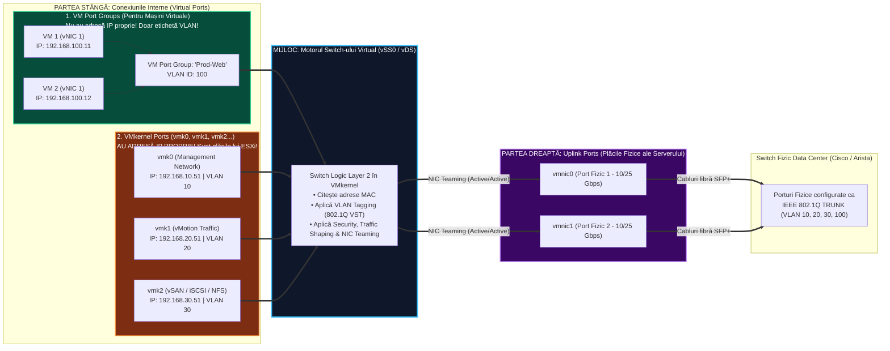
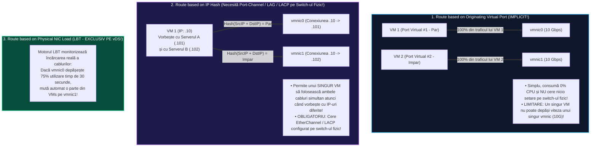
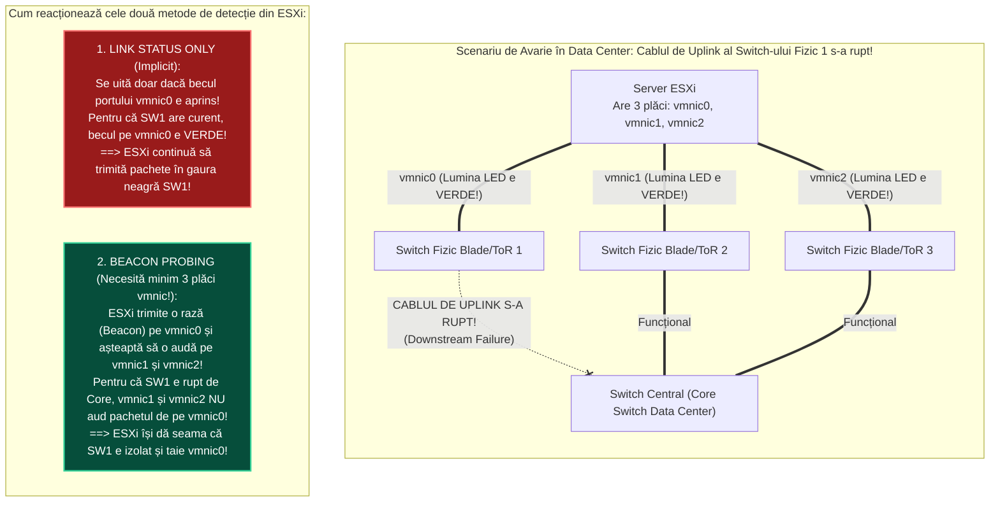

> **Obiectivul Capitolului:** Înțelegerea completă a arhitecturii rețelelor virtuale în `VMware vSphere`, diferențierea tehnică între un **`vSphere Standard Switch` (`vSS`)** și un **`vSphere Distributed Switch` (`vDS`)** (separarea `Management Plane` de `Data Plane`), stăpânirea celor 5 algoritmi de echilibrare a traficului (`NIC Teaming & Load Balancing`), a metodelor de detecție a căderii cablurilor (`Link Status Only` vs. `Beacon Probing`), înțelegerea tipurilor de alocare a porturilor pe `vDS` (`Static Binding` vs. `Ephemeral`), configurarea `LACP` (`802.3ad / 802.1AX`) și prioritizarea traficului prin `NIOC` (`Network I/O Control`).
>
> **Regula de Aur a acestui Capitol:** Fiecare acronim, algoritm și concept de rețea (`vSS`, `vDS`, `vmnic`, `vmk`, `dPG`, `dvUplink`, `LBT`, `LACP`, `LAG`, `NIOC`, `CDP`, `LLDP`, `IPFIX`, `PVLAN`) este explicat integral: **(1) Numele complet**, **(2) Ce reprezintă** și **(3) Cum funcționează tehnic sub capotă**.

:::analogy
### De ce avem switch-uri în interiorul unui server ESXi?

Când rulezi 50 de mașini virtuale pe un singur server fizic `ESXi`, acele 50 de mașini virtuale trebuie să poată comunica atât între ele, cât și cu lumea exterioară (Internet, utilizatori, stocare SAN). Dar serverul fizic `ESXi` nu are 50 de mufe fizice de rețea pe spate în care să înfigi 50 de cabluri! El are doar 2, 4 sau 8 porturi fizice de mare viteză (`10 Gbps` sau `25 Gbps`).

Pentru ca toate cele 50 de mașini virtuale (plus serviciile interne ale serverului `ESXi`, cum ar fi `vMotion` și `vSAN`) să poată ieși ordonat prin acele 2 sau 4 cabluri fizice, `VMkernel`-ul creează în propria sa memorie RAM **Switch-uri Ethernet Virtuale (`Virtual Switches`)**, care funcționează la **Layer 2 (Data Link)** exact ca un switch fizic Cisco sau Arista!

În ecosistemul `VMware vSphere` există două tipuri de astfel de switch-uri virtuale:
1. **`vSphere Standard Switch` (`vSS` – Switch-ul Standard):** Independent pe fiecare server ESXi în parte.
2. **`vSphere Distributed Switch` (`vDS` – Switch-ul Distribuit):** Un singur „super-switch” centralizat în `vCenter Server` care se întinde ca o umbrelă peste toate serverele ESXi din cluster!

### Analogia Profesorului: Cele 50 de Radiouri din Mașini (`vSS`) vs. Postul Central de Radio (`vDS`)

Ca să înțelegi de ce companiile mari folosesc întotdeauna **`vDS` (`Distributed Switch`)** în loc de **`vSS` (`Standard Switch`)**:
* **`vSphere Standard Switch` (`vSS`)** este ca și cum ai deține o flotă de **50 de taxiuri (50 de servere ESXi)**. În fiecare dimineață, dacă vrei să adaugi un post nou de radio în memorie (un nou `VLAN / Port Group`, de exemplu `VLAN 200 - Financiar`), trebuie să te urci fizic, pe rând, în fiecare dintre cele 50 de mașini și să apeși manual pe butoanele radioului de 50 de ori! Dacă în mașina numărul 37 din grabă tastezi greșit `VLAN 20` în loc de `VLAN 200` (sau scrii `Finaciar` fără „n”), în momentul în care o mașină virtuală migrează cu `vMotion` pe serverul 37, **ea rămâne pe loc fără rețea și pică în producție!**
* **`vSphere Distributed Switch` (`vDS`)** este un **Sistem Centralizat prin Satelit controlat din sediul `vCenter`**: intri într-un singur loc în `vCenter`, creezi o singură dată rețeaua `VLAN 200 - Financiar`, apeși *OK*, iar în 2 secunde toate cele 50 de servere `ESXi` primesc automat configurația identică, fără nicio șansă de greșeală umană!
:::

:::architecture
### 2.2.1. Anatomia unui Switch Virtual (`vSS`): `vmnic`, `vmk`, `TCP/IP Stacks` și `VM Port Groups`

Înainte să comparăm `vSS` cu `vDS`, trebuie să stăpânești cele **3 piese fundamentale de LEGO** care compun orice switch virtual în VMware. Un switch virtual stă la mijloc și leagă partea stângă (Virtuală) de partea dreaptă (Fizică):

#### 1. `Uplink Ports` (`vmnic0`, `vmnic1`, `vmnic2`...) – *Latura Fizică*
* **Ce reprezintă:** Sunt porturile fizice reale ale plăcilor de rețea (`NICs`) înfipte în placa de bază a serverului ESXi.
* **Rolul lor:** Fac legătura (**Uplink**) între switch-ul virtual din memoria ESXi și switch-ul fizic din dulapul Data Centerului.
* *Notă:* Poți crea un switch virtual **fără niciun `vmnic` fizic atașat** (*Internal-Only vSwitch*)! În acest caz, mașinile virtuale conectate la acel switch pot vorbi între ele cu viteza memoriei RAM pe acel host ESXi, dar nu pot ieși niciodată pe cablul fizic în exterior!

#### 2. `Virtual Machine Port Groups` (`VM Port Groups`) – *Pentru Mașinile Virtuale*
* **Ce reprezintă:** Este un grup logic de porturi virtuale (cu un nume prietenos, ex: `VLAN100-Prod-Web`) în care „înfigi” plăcile de rețea virtuale (`vNIC` / `VMXNET3`) ale mașinilor tale virtuale.
* **Regulă de Examen:** Un `VM Port Group` **NU are adresă IP și NU are Subnet Mask!** El este doar o etichetă de Layer 2 care definește `VLAN ID`-ul și politicile de securitate/teaming pentru mașinile virtuale conectate în el (adresele IP sunt configurate în interiorul Windows-ului sau Linux-ului din fiecare mașină virtuală).

#### 3. `VMkernel Ports` (`VMkernel Network Adapters`: `vmk0`, `vmk1`, `vmk2`...) – *Pentru Serverul ESXi Însuși!*
*(Aceasta este diferența pe care o confundă toți începătorii! Atenție maximă!)*
* **De ce există porturile `vmk`?** Mașinile virtuale au propriile lor plăci (`vNIC`) și propriile lor IP-uri. Dar **hypervisorul `ESXi` însuși are nevoie de propriile sale adrese IP** pentru a-și face treaba! Cum te-ai conecta la interfața de management a lui ESXi dacă ESXi nu ar avea un IP? Cum ar trimite ESXi memoria RAM a unei mașini virtuale către alt ESXi prin `vMotion` fără un IP sursă și un IP destinație?
* **Ce este un port `vmk` (`VMkernel Adapter`):** Este o interfață de rețea Layer 3 (cu **Adresă IP proprie**, **Subnet Mask** și **MTU**) care aparține direct nucleului **`VMkernel` al serverului ESXi**!
* **Cele 7 Servicii pe care le poți bifa pe un port `vmk`:**
  1. **`Management` (Implicit pe `vmk0` creat la instalarea ESXi):** Traficul către `vCenter` (`vpxa`), `Host Client`, `SSH` și `SNMP`.
  2. **`vMotion` (ex: pe `vmk1`):** Traficul de migrare live a mașinilor virtuale între host-uri.
  3. **`vSAN` (ex: pe `vmk2`):** Traficul de sincronizare a blocurilor de stocare `VMware vSAN`.
  4. **`Fault Tolerance (FT) Logging`:** Traficul de oglindire la milisecundă a procesorului pentru mașinile cu *Fault Tolerance*.
  5. **`Provisioning`:** Traficul de clonare a mașinilor virtuale la rece (*Cold Migration*, *Cloning*, *Snapshots*) și `NFC` (*Network File Copy*).
  6. **`vSphere Replication` / `vSphere Backup NFC`:** Trafic dedicat pentru replicare și backup.
  7. *(Plus traficul de stocare IP: **`iSCSI`** și **`NFS`**, care folosesc automat un port `vmk` aflat în subrețeaua SAN/NAS-ului, fără să aibă nevoie de o bifă specială!).*

#### 4. Ce sunt `VMkernel TCP/IP Stacks` (Stivele TCP/IP Separate din ESXi)?
* **Problema cu o singură stivă TCP/IP (`Default TCP/IP Stack`):** În mod normal, toate porturile `vmk` (`vmk0`, `vmk1`, `vmk2`) împart **o singură tabelă de rutare (`Routing Table`), un singur `Default Gateway` și un singur `DNS`**! Dar ce faci într-o bancă unde arhitectul de rețea îți cere ca traficul de **`vMotion`** să fie rutat printr-un **alt Default Gateway** decât traficul de **`Management`**?!
* **Soluția (`Multiple TCP/IP Stacks`):** ESXi include 3 stive TCP/IP izolate din fabrică (plus posibilitatea de a crea *Custom Stacks*):
  1. **`Default TCP/IP Stack`:** Folosit pentru Management (`vmk0`), iSCSI, NFS, vSAN.
  2. **`vMotion TCP/IP Stack`:** O stivă 100% izolată, cu propria ei tabelă de rutare și **propriul ei Default Gateway dedicat exclusiv pentru `vMotion`** (ideală pentru migrarea mașinilor între două Data Centere aflate în orașe diferite!).
  3. **`Provisioning TCP/IP Stack`:** O stivă izolată cu propriul Default Gateway pentru traficul de clonare/migrare la rece (*Cold Migration*).

---

### 2.2.2. Politicile de vSwitch: `NIC Teaming & Failover` (Cei 5 Algoritmi de Load Balancing și Detecția Căderilor)

*(Acesta este subiectul numărul 1 la examenul VCP-DCV pe partea de rețelistică! Trebuie să știi exact cum funcționează fiecare algoritm și când se folosește!)*

Când atașezi **2 sau mai multe plăci fizice (`vmnic0` și `vmnic1`)** la același switch virtual, creezi o echipă de plăci numită **`NIC Team`**. În tab-ul **Teaming and Failover**, poți împărți plăcile fizice în 3 categorii:
* **`Active Uplinks`:** Plăcile care transportă trafic chiar acum, în mod activ.
* **`Standby Uplinks`:** Plăcile care stau în rezervă (nu trimit trafic în mod normal) și intră în acțiune **doar dacă pică toate plăcile din lista `Active`**!
* **`Unused Uplinks`:** Plăcile cărora li s-a interzis complet să transporte traficul acelui Port Group.

#### 1. Cei 5 Algoritmi de Echilibrare a Traficului (`Load Balancing Algorithms`)

Dacă ai pus ambele plăci (`vmnic0` și `vmnic1`) în lista **`Active Uplinks`**, cum decide ESXi pe care dintre cele două cabluri fizice trimite pachetele unei mașini virtuale? Există 5 opțiuni în meniul *Load Balancing*:

Hai să analizăm matematic fiecare dintre cei 5 algoritmi:

1. **`Route based on Originating Virtual Port` (Rutare bazată pe ID-ul Portului Virtual de Origine – *IMPLICIT pe vSS și vDS!*):**
   * **Cum funcționează:** Când o mașină virtuală pornește, placa ei `vNIC` este conectată în portul virtual numărul $N$ al switch-ului virtual. ESXi face o împărțire simplă (numărul portului împărțit la numărul de plăci `vmnic` active): `VM 1` (portul 1) este lipită de `vmnic0`; `VM 2` (portul 2) este lipită de `vmnic1`; `VM 3` (portul 3) este lipită de `vmnic0` ș.a.m.d.
   * **Avantaj uriaș:** Nu necesită absolut nicio configurare specială (*EtherChannel / LACP*) pe switch-ul fizic! Poți chiar să conectezi `vmnic0` în Switch-ul Fizic 1 și `vmnic1` în Switch-ul Fizic 2 (fără ca switch-urile fizice să fie legate în stivă prin MLAG/VPC)!
   * **Limitările pe care trebuie să le știi la Examen:**
     * O mașină virtuală rămâne blocată pe același `vmnic` atât timp cât este pornită (decât dacă acel `vmnic` pică).
     * Switch-ul virtual **nu se uită la cât trafic face mașina**: dacă din întâmplare `VM 1` și `VM 3` (ambele puse pe `vmnic0`) fac trafic de $10\text{ Gbps}$, iar `VM 2` (pusă pe `vmnic1`) stă la $0\text{ Mbps}$, ESXi **NU va muta** `VM 3` pe `vmnic1` pentru că algoritmul se uită doar la numărul portului, nu la încărcarea cablului!

2. **`Route based on Source MAC Hash` (Rutare bazată pe adresa MAC a mașinii virtuale):**
   * **Cum funcționează:** Alege `vmnic`-ul pe baza ultimei cifre a adresei `MAC` a plăcii virtuale (`vNIC`). În practică este aproape identic cu *Originating Virtual Port* (deoarece o placă `vNIC` are o singură adresă MAC), fiind util doar când o mașină virtuală își schimbă MAC-ul intern.

3. **`Route based on IP Hash` (Rutare bazată pe perechea de adrese IP Sursă + IP Destinație):**
   * **Cum funcționează:** ESXi calculează o formulă matematică (**Hash XOR**) pentru **fiecare pachet în parte**, luând în calcul **Adresa IP Sursă + Adresa IP Destinație** (sau pe `vDS` cu LACP: IP + Port TCP/UDP).
   * **Ce înseamnă asta?** Dacă o singură mașină virtuală (`192.168.10.50`) vorbește simultan cu 10 clienți care au 10 adrese IP diferite, conversația cu Clientul 1 poate ieși pe `vmnic0`, iar conversația cu Clientul 2 poate ieși simultan pe `vmnic1`! *(Atenție la capcana de examen: O singură conversație între două adrese IP fixe — ex: `.50` către `.100` — va merge tot pe un singur cablu `vmnic` ca să nu ajungă pachetele în altă ordine!).*
   * **Cerințele stricte de Examen pentru `IP Hash`:**
     1. Switch-ul fizic **TREBUIE obligatoriu configurat cu `Link Aggregation` (`EtherChannel / Port-Channel` static sau `LACP`)**! Dacă activezi `IP Hash` în ESXi fără să configurezi *Port-Channel* pe switch-ul fizic, tabela MAC a switch-ului fizic va intra în conflict continuu (*MAC Flapping*) și îți va cădea rețeaua!
     2. Toate plăcile `vmnic` trebuie să fie în lista **`Active Uplinks`** (nu ai voie să ai plăci în *Standby*!).
     3. Detecția căderilor trebuie setată exclusiv pe **`Link Status Only`** (nu ai voie să folosești *Beacon Probing* cu *IP Hash*!).

4. **`Route based on Physical NIC Load` (`LBT` – `Load-Based Teaming` – *EXCLUSIV PE Distributed Switch `vDS`!*):**
   * **De ce este cel mai bun algoritm din lume în producție?** Pentru că rezolvă toate problemele fără să îți ceară `LACP / EtherChannel` pe switch-urile fizice!
   * **Cum funcționează `LBT`:** La început, distribuie mașinile ca la *Originating Virtual Port*. Dar la fiecare **30 de secunde**, motorul `vDS` verifică încărcarea reală a cablurilor fizice `vmnic`. Dacă vede că `vmnic0` a depășit pragul de **`75%` utilizare (Saturare)** timp de 30 de secunde, iar `vmnic1` este mai liber, `vDS`-ul mută automat și invizibil fluxul uneia dintre mașinile virtuale de pe `vmnic0` pe `vmnic1`!

5. **`Use explicit failover order` (Ordine explicită de rezervă – Fără Load Balancing):**
   * **Cum funcționează:** Nu face nicio echilibrare! Folosește întotdeauna doar **primul `vmnic`** de sus din lista *Active Uplinks* pentru absolut tot traficul, iar pe celelalte le folosește doar dacă primul cablu se rupe.

#### 2. Cum detectează ESXi că s-a întrerupt rețeaua? `Link Status Only` vs. `Beacon Probing`

În secțiunea **Network Failure Detection** din Teaming and Failover ai două metode:

1. **`Link Status Only` (Doar Starea Fizică a Legăturii – *Implicit*):**
   * **Cum funcționează:** Verifică doar dacă există semnal electric/optic pe cablul înfipt direct în placa `vmnic0` a serverului ESXi (dacă LED-ul plăcii de rețea este aprins).
   * **Ce NU poate detecta:** Dacă cineva scoate cablul prin care Switch-ul Fizic 1 (în care e înfipt `vmnic0`) se leagă mai departe de Switch-ul Central al companiei (**Upstream Failure**), sau dacă un inginer de rețea greșește VLAN-ul pe portul switch-ului fizic, LED-ul pe `vmnic0` rămâne verde, iar *Link Status Only* crede că totul e perfect și aruncă pachetele într-un „drum înfundat” (*Black Hole*)!

2. **`Beacon Probing` (Sondare prin Semnale – *Pentru detecția avariilor în amonte!*):**
   * **Cum funcționează:** La fiecare secundă, ESXi trimite câte un pachet special de Broadcast (**Ethernet Beacon Frame**) pe fiecare placă `vmnic` și ascultă pe celelalte plăci `vmnic` ca să vadă dacă pachetul a ocolit prin switch-urile fizice și s-a întors înapoi!
   * **Regula Matematică de Examen (De ce cere `Beacon Probing` MINIMUM `3` plăci `vmnic`?):**
     * Dacă ai doar **2 plăci** (`vmnic0` în Switch 1 și `vmnic1` în Switch 2) și legătura dintre Switch 1 și Switch 2 se rupe, `vmnic0` nu îl mai aude pe `vmnic1`, iar `vmnic1` nu îl mai aude pe `vmnic0`. Cum știe ESXi care dintre cele două switch-uri este cel bun și care este cel izolat?! **Nu poate ști (egalitate 1 la 1)!**
     * În schimb, dacă ai **3 plăci `vmnic`** conectate în 3 switch-uri diferite, iar Switch-ul 1 se rupe de restul lumii, `vmnic1` și `vmnic2` se aud în continuare între ele (scor 2 la 1), deci ESXi deduce matematic cu precizie de 100% că **`vmnic0` este cel defect** și îl dezactivează!

#### 3. Ce face opțiunea `Failback` (`Yes` vs. `No`)?
* **`Failback: Yes` (Implicit pentru Rețea):** Dacă placa activă `vmnic0` cade, traficul trece pe placa de rezervă `vmnic1`. Când `vmnic0` își revine, traficul **se mută imediat înapoi pe `vmnic0`**.
* **De ce punem uneori `Failback: No` (în special pe porturile de `iSCSI`)?** Dacă un port de pe switch-ul fizic are un contact imperfect și se aprinde/stinge la fiecare 10 secunde (**Port Flapping**), cu `Failback: Yes` traficul ar sări înainte și înapoi la fiecare 10 secunde, întrerupând conexiunile! Cu `Failback: No`, odată ce traficul s-a mutat pe placa sănătoasă `vmnic1`, rămâne cuminte pe `vmnic1` chiar dacă `vmnic0` se reaprinde, până când intervine administratorul!

---

### 2.2.3. `vSphere Distributed Switch` (`vDS`): Arhitectură, `Static` vs. `Ephemeral Binding`, `LACP` și `NIOC`

#### 1. Cum este împărțit un `vDS` între `vCenter` și `ESXi` (`Management Plane` vs. `Data Plane`)?
*(Întrebare fundamentală de examen și interviu!)*
Dacă `vSphere Distributed Switch (vDS)` este creat în `vCenter`, ce se întâmplă cu rețeaua mașinilor virtuale dacă `vCenter`-ul se oprește?!
Răspunsul: **Rețeaua merge 100% normal mai departe!** De ce? Pentru că arhitectura unui `vDS` este împărțită în două planuri:
1. **`Management Plane` (Planul de Administrare – trăiește în `vCenter Server`):** Este doar șablonul central de configurare din baza de date a lui `vCenter`, de unde tu adaugi port group-uri și modifici politici.
2. **`Data Plane` / `I/O Plane` (Planul de Date – trăiește în kernelul fiecărui host `ESXi` sub formă de `Hidden vSwitch`!):** Când adaugi un server `ESXi` într-un `vDS`, vCenter-ul copiază o clonă locală a switch-ului direct în memoria și pe discul serverului `ESXi` (numită **Host Proxy Switch**). Toate pachetele mașinilor virtuale sunt comutate direct de `VMkernel`-ul fiecărui `ESXi`, fără să treacă niciodată pe la `vCenter`!

#### 2. Cele 3 Tipuri de Alocare a Porturilor pe un Distributed Port Group (`Port Binding`: `Static` vs. `Ephemeral`)
*(Atenție maximă: Acesta este secretul de supraviețuire pentru mașina virtuală `VCSA`!)*

Când creezi un **Distributed Port Group (`dPG`)** pe un `vDS`, la setarea **`Port binding`** ai următoarele opțiuni:

1. **`Static Binding` (Alocare Statică – *Implicit și recomandat pentru 99% din VMs*):**
   * **Cum funcționează:** În secunda în care conectezi o mașină virtuală la acel Port Group (chiar și când mașina virtuală este **OPRITĂ / `Powered Off`**), **`vCenter Server`-ul** îi rezervă și îi lipește permanent un port dedicat pe switch, păstrându-i toate statisticile istorice de trafic.
   * **Marea Capcană când `vCenter`-ul este OPRIT:** Deoarece alocarea unui port în mod *Static Binding* este făcută de `vCenter`, dacă mașina ta virtuală `vCenter Server (VCSA)` este conectată ea însăși la un Port Group cu *Static Binding* și se întâmplă să oprești `VCSA`-ul și să ai nevoie să îi reconectezi placa de rețea direct din host-ul ESXi, **NU O VEI PUTEA CONECTA ȘI NU VEI MAI PUTEA PORNI VCENTER-UL (Problema Oului și a Găinii: ai nevoie de vCenter ca să aloci portul pentru a porni vCenter-ul!)**.

2. **`Ephemeral - no binding` (Alocare Efemeră / Temporară):**
   * **Cum funcționează:** Portul pe switch este creat dinamic chiar în secunda în care apeși **`Power On`** pe mașina virtuală și este șters în secunda în care dai **`Power Off`**!
   * **SUPER-PUTEREA LUI `Ephemeral` (De memorat pentru Examen și Producție!):** Un Port Group configurat pe **`Ephemeral`** este **SINGURUL tip de port group de pe un `vDS` pe care îl poți modifica și la care poți conecta o mașină virtuală direct din consola locală a unui host `ESXi` (`VMware Host Client`), atunci când `vCenter Server`-ul este căzut/oprit!**
   * **Best Practice Oficial VMware:** Creează **întotdeauna** un Port Group dedicat cu `Port Binding: Ephemeral` pe rețeaua de Management a `vDS`-ului pentru a ține pe el mașina virtuală **`vCenter Server Appliance (VCSA)`** și serverele de infrastructură (`AD/DNS`)!

3. *Notă istorică:* Exista și o a treia opțiune numită **`Dynamic Binding`**, care a fost **deprecată (scoasă din uz)** încă de la vSphere 5.0.

#### 3. Funcțiile Exclusive ale lui `vSphere Distributed Switch` (`vDS`) față de `vSS`

| Funcționalitate Enterprise | `Standard Switch` (`vSS`) | `Distributed Switch` (`vDS`) | Ce face și de ce contează la Examen și în Producție? |
| :--- | :---: | :---: | :--- |
| **Administrare Centralizată** | ❌ (Pe fiecare host separat) | ✅ (În vCenter pt. tot clusterul) | Creezi un `dPG` o singură dată și apare instantaneu pe 64 de servere ESXi. |
| **Load-Based Teaming (`LBT`)** | ❌ | ✅ (`Route based on Physical NIC Load`) | Mută automat traficul când un `vmnic` depășește **`75%`** încărcare timp de 30s, fără a cere LACP! |
| **Suport `LACP` (`802.3ad / 802.1AX`)** | ❌ (Doar EtherChannel static) | ✅ (**Dynamic LACP / LAGs**) | Negociază dinamic agregarea de porturi cu switch-ul fizic folosind pachete `LACPDU`. |
| **`Network I/O Control` (`NIOC`)** | ❌ | ✅ (**NIOC v3**) | Împarte și garantează lățimea de bandă (Shares, Reservations, Limits) între `vMotion`, `vSAN`, `VMs`, `Management`! |
| **Protocol de Descoperire Switch** | Doar **`CDP`** (Cisco) | **`CDP`** (Cisco) + **`LLDP`** (Universal `IEEE 802.1AB`) | Îți arată direct în vCenter în ce switch fizic și în ce port fizic este înfipt fiecare cablu `vmnic`! |
| **Trafic `Ingress` & `Egress` Shaping** | Doar `Outbound (Egress)` | **`Inbound (Ingress)` + `Outbound`** | Poți limita atât viteza de upload, cât și cea de download a unei mașini virtuale. |
| **`Port Mirroring` & `NetFlow (IPFIX)`** | ❌ | ✅ | Trimite o copie a traficului către un analizor Wireshark/IDS și exportă statistici IPFIX. |
| **`Private VLANs` (`PVLANs`)** | ❌ | ✅ (*Promiscuous, Isolated, Community*) | Izolează două mașini virtuale aflate în **același subnet IP și același VLAN** să nu poată vorbi între ele! |
| **`Backup & Restore` + `Rollback`** | ❌ | ✅ (**Auto-Rollback**!) | Dacă faci o greșeală când modifici rețeaua `vmk0` și vCenter-ul pierde legătura cu host-ul, după **30 de secunde `vDS`-ul anulează automat modificarea (`Auto-Rollback`)** și îți salvează serverul! |

#### 4. Cum funcționează `NIOC` (`Network I/O Control` – Prioritizarea Traficului pe Cablurile de 10/25 Gbps)
* **Problema pe care o rezolvă:** Ai două cabluri de $10\text{ Gbps}$ pe care circulă la comun și **Mașinile Virtuale de Producție**, și **`vSAN`**, și **`vMotion`**. La ora 11:00 dimineața pornește un `vMotion` masiv de 10 mașini virtuale. Dacă nu ai `NIOC`, `vMotion`-ul este atât de lacom încât îți ocupă $100\%$ din cablul de $10\text{ Gbps}$, sufocând traficul de stocare `vSAN` și lăsând utilizatorii din producție cu aplicațiile blocate!
* **Cum rezolvă `NIOC` asta:** Împarte tot traficul de pe `vDS` în **9 categorii predefinite de trafic de sistem (`System Traffic Types`):** *Management, Fault Tolerance, vMotion, Virtual Machine, iSCSI, NFS, vSphere Replication, vSAN, vSphere Backup NFC*.
* Pentru fiecare categorie poți seta **`Shares`** (`Low = 25`, `Normal = 50`, `High = 100`), astfel încât în secunda în care cablul de $10\text{ Gbps}$ este plin $100\%$, `NIOC` pune frână automat pe `vMotion` și garantează că **`vSAN`** și **Mașinile Virtuale** își primesc banda prioritară!
:::

:::exam-alert
### De Memorat (Valori Critice și Reguli de Aur pentru Examenul VCP-DCV)
* **Pragul de declanșare pentru `Route based on Physical NIC Load (LBT)`:** Se activează atunci când utilizarea medie a unui uplink `vmnic` (Send sau Receive) atinge sau depășește **`75%` din capacitate** pe o perioadă de **`30 de secunde`**.
* **Ce sunt `PVLANs` (`Private VLANs` pe un `vDS`) – *Cele 3 tipuri de porturi secundare testate la VCP*:**
  * Într-un `PVLAN`, ai un `Primary VLAN` (ex: `VLAN 500`) împărțit în sub-VLAN-uri secundare (`Secondary VLANs`):
    1. **`Promiscuous` (`P-Port`):** Poate comunica cu **toată lumea** din PVLAN (aici se conectează **Default Gateway-ul / Routerul**!).
    2. **`Community` (`C-Port`):** Mașinile din același VLAN *Community* **pot comunica între ele** și cu portul *Promiscuous* (Routerul), dar nu pot comunica cu alte comunități sau cu porturile *Isolated*.
    3. **`Isolated` (`I-Port`):** Izolare totală! O mașină virtuală pusă într-un VLAN *Isolated* **NU poate comunica cu nicio altă mașină virtuală din același VLAN Isolated** — singurul echipament cu care are voie să vorbească este portul **`Promiscuous` (Routerul / Firewall-ul)**! *(Ideal pentru servere găzduite în DMZ pentru clienți diferiți care împart aceeași clasă de IP-uri!).*
:::

:::trenches
### Din Tranșee (Cum nu îți tai singur craca de sub picioare când migrezi pe `vDS`)
* **Greșeala clasică a începătorului:** Are un server ESXi cu două plăci fizice (`vmnic0` și `vmnic1`), ambele atașate la `vSwitch0` (Standard Switch) unde stă `vmk0` (Management). El creează un `vDS` nou și, din primul pas, mută **ambele plăci fizice (`vmnic0` și `vmnic1`)** pe `vDS`, lăsând `vmk0` pe vechiul `vSwitch0` fără nicio placă fizică! Instantaneu, serverul ESXi rămâne fără rețea! *(Din fericire, în vSphere 7/8 funcția **vCenter Network Rollback** te salvează după 30 de secunde dacă nu ai dezactivat-o!).*
* **Cum face un Arhitect migrarea de pe `vSS` pe `vDS` cu ZERO pachete pierdute:** Folosește vrăjitorul **`Add and Manage Hosts`** din `vDS`, care mută **în același pas atomic (simultan)** atât plăcile fizice (`vmnic`), cât și portul `vmk0`, cât și plăcile mașinilor virtuale, fără să pierzi nici măcar un singur `ping`!
:::

:::interview
### Întrebarea 1 (Nivel Junior / Mid – vSS vs. vDS și oprirea vCenter-ului)
> **Intervievator:** *„Care sunt principalele 4 motive tehnice pentru care folosim `vSphere Distributed Switches (vDS)` în producție în loc de `Standard Switches (vSS)`? Și spune-mi ce pățesc mașinile virtuale conectate la un `vDS` dacă ne pică serverul `vCenter` — mai pot comunica între ele? Dar pot să aprind o mașină virtuală nouă și să îi schimb Port Group-ul cât timp vCenter-ul este căzut?”*

**Răspunsul Ideal:**
„Cele 4 avantaje majore ale `vDS` față de `vSS` sunt:
1. **Administrarea centralizată și eliminarea erorilor umane:** Configurăm Port Group-urile și VLAN-urile o singură dată în vCenter pentru toate host-urile din cluster.
2. **Load-Based Teaming (`Route based on Physical NIC Load`):** Singurul algoritm care monitorizează încărcarea reală a cablurilor fizice și rebalansează automat fluxurile când un `vmnic` depășește $75\%$ încărcare, fără a necesita configurarea complexă de `LACP` pe switch-urile fizice.
3. **Funcții enterprise avansate:** Suport pentru **`NIOC` (`Network I/O Control`)**, **`LLDP`**, **`LACP` dinamic**, **`Port Mirroring`**, **`NetFlow (IPFIX)`** și **`Private VLANs`**.
4. **Integrarea nativă cu `VMware NSX`:** În vSphere 7 și 8, `vDS` găzduiește direct modulele de overlay și microsegmentare NSX.

Dacă serverul `vCenter` cade, **mașinile virtuale conectate la `vDS` NU sunt afectate absolut deloc și comunică normal în continuare**, deoarece în arhitectura `vDS`, `vCenter`-ul deține doar **Management Plane-ul**, în timp ce **Data Plane-ul (I/O Plane)** rulează independent în `VMkernel`-ul fiecărui host ESXi prin switch-urile proxy locale.
În ceea ce privește modificarea rețelei unei mașini virtuale direct de pe host-ul ESXi cât timp vCenter-ul este oprit: pe port group-urile standard cu **`Static Binding`** nu putem aloca porturi noi fără vCenter; însă pe port group-urile configurate cu **`Ephemeral Binding`** (pe care le folosim conform Best Practices pentru `VCSA` și serverele critice de infrastructură), putem conecta și porni mașinile virtuale direct din `VMware Host Client`-ul serverului ESXi chiar și cu vCenter-ul complet oprit!”
:::

:::lab
> **Scenariul Laboratorului:** În acest laborator vom transforma rețelistica clusterului nostru într-una de nivel Enterprise! Vom adăuga o a doua placă de rețea virtuală (`vmnic1`) pe serverul nostru `esxi01.lab.local`, vom crea din `vCenter` un **`vSphere Distributed Switch` (`DSwitch-Prod`)**, vom crea un Port Group cu **`Ephemeral Binding`** pentru management și vom executa o **Migrare Live Zero-Downtime** a întregului server `esxi01` (inclusiv portul `vmk0`, mașina `vcsa01` și mașina `web01`) de pe vechiul `vSwitch0` pe noul `Distributed Switch`, în timp ce urmărim un `ping -t` continuu care nu va pierde nici măcar un pachet!
:::

:::quiz

:::

:::references
1. **VMware Official Docs:** *vSphere Networking Guide (vSphere 8.0) – Standard Switches vs. Distributed Switches, Teaming and Failover Policies, LACP, and NIOC* (`techdocs.broadcom.com`).
2. **Broadcom / VMware Knowledge Base (KB 1010821):** *Choosing a network load balancing policy in VMware vSphere*.
3. **Broadcom / VMware Knowledge Base (KB 1022312):** *Static, Dynamic, and Ephemeral port binding on a vSphere Distributed Switch*.
4. **Broadcom / VMware Knowledge Base (KB 1005577):** *What is Beacon Probing and how to configure it with 3 or more NICs*.
5. **Chris Wahl (VCDX #104):** *Mastering vSphere Distributed Switches and Load-Based Teaming* (`wahlnetwork.com`).
:::
