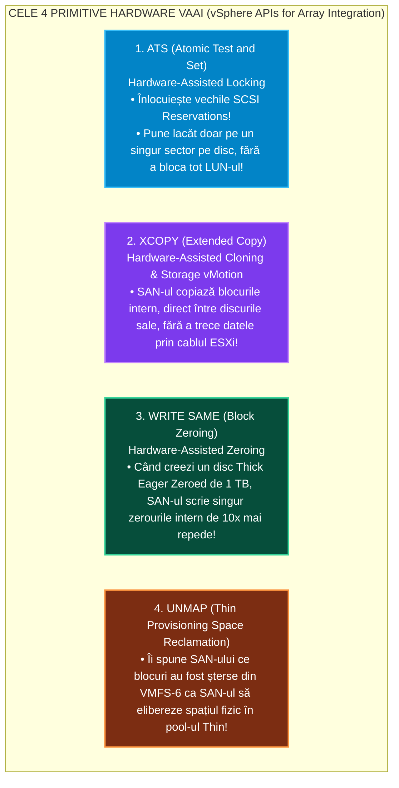
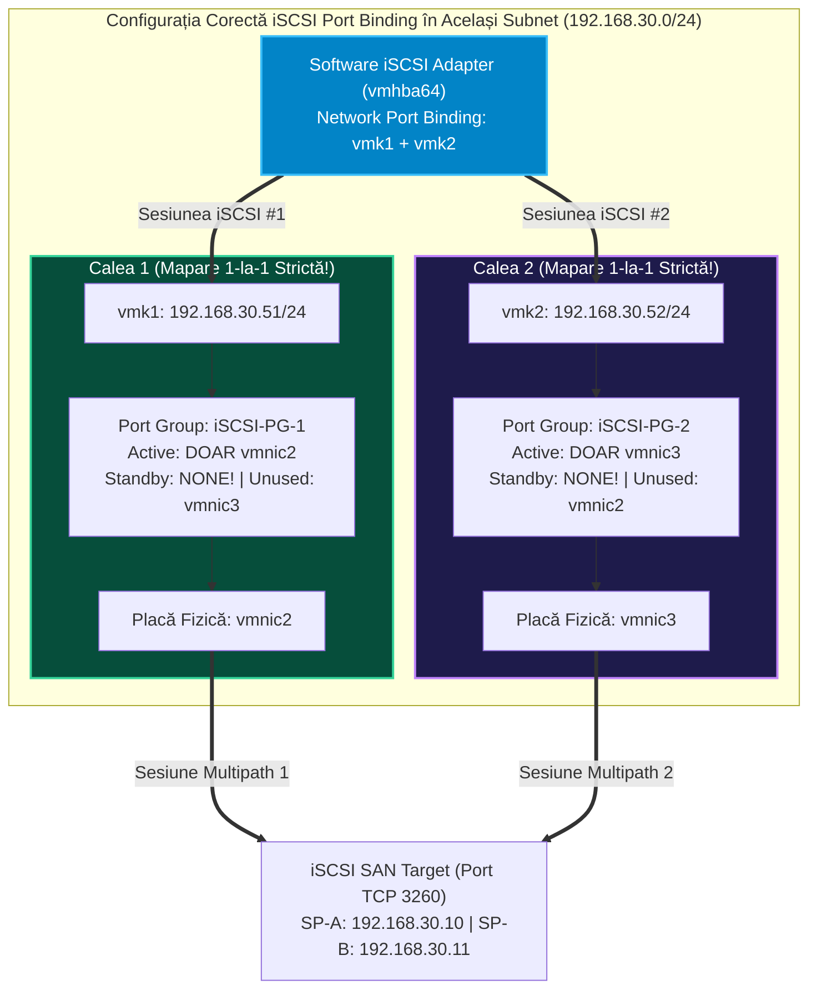
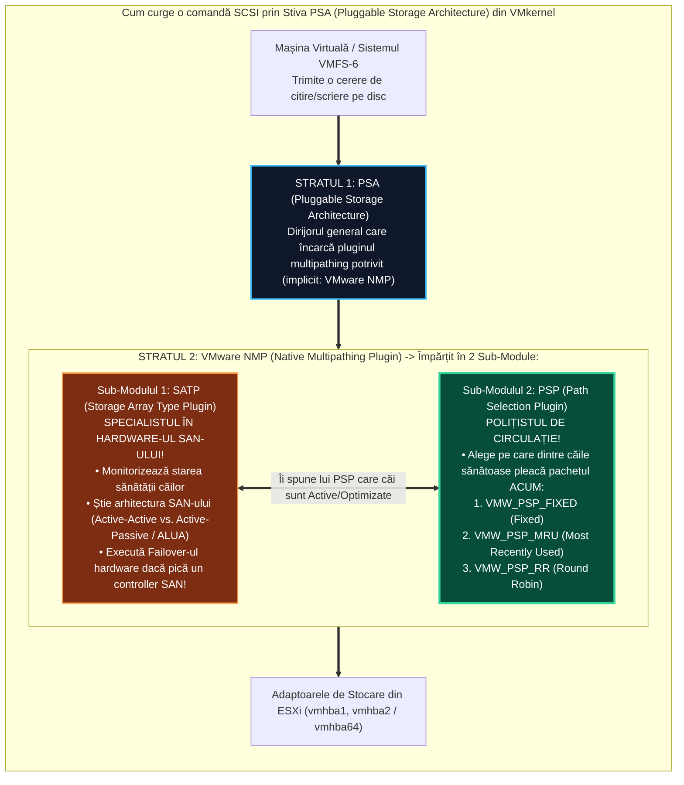
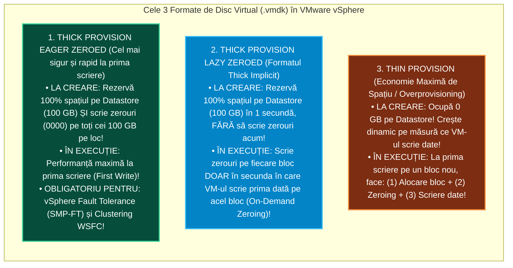

> **Obiectivul Capitolului:** Stăpânirea completă a arhitecturii de stocare partajată în `VMware vSphere`, înțelegerea funcționării interne a sistemului de fișiere de cluster **`VMFS-6`** (`ATS Locking`, `Automatic UNMAP`, `VAAI`), configurarea stocării block prin **`iSCSI`** (`Port Binding`, `Dynamic/Static Discovery`, `CHAP`), compararea arhitecturală **`NFS v3` vs. `NFS v4.1`** (`Session Trunking`, `Kerberos`), disecția arhitecturii de căi multiple **`PSA` (`Pluggable Storage Architecture`: `NMP`, `SATP`, `PSP`, `ALUA`, `Fixed`, `MRU`, `Round Robin`)** și stăpânirea conceptelor avansate (`Thin` vs. `Thick Lazy/Eager Zeroed`, `RDM`, `vVols` și `SIOC`).
>
> **Regula de Aur a acestui Capitol:** Fiecare acronim, protocol și politică de stocare (`VMFS`, `ATS`, `VAAI`, `UNMAP`, `iSCSI`, `IQN`, `CHAP`, `NFS`, `PSA`, `NMP`, `SATP`, `PSP`, `ALUA`, `MRU`, `RR`, `RDM`, `vVols`, `VASA`, `PE`, `SIOC`) este explicat integral: **(1) Numele complet**, **(2) Ce reprezintă** și **(3) Cum funcționează tehnic sub capotă**.

:::analogy
### De ce este Stocarea Partajată (`Shared Storage`) coloana vertebrală a oricărui Cluster VMware?

În Pilonul 1 am creat o mașină virtuală pe discul intern (`local datastore`) al serverului `esxi01`. Dar ce se întâmplă dacă mâine se arde placa de bază a lui `esxi01`? Mașina virtuală rămâne încuiată pe discul intern al serverului mort! Nici `vMotion` (în condiții clasice), nici `vSphere HA`, nici `vSphere DRS` nu pot funcționa la adevărata lor valoare fără **Stocare Partajată (`Shared Storage`)** — adică un volum de stocare la care **toate serverele ESXi din cluster sunt conectate simultan**!

Dar aici apar două probleme fundamentale de inginerie pe care le rezolvăm în acest capitol:

1. **Problema Lacătelor pe Disc:** Cum pot 32 de servere fizice `ESXi` să deschidă și să scrie simultan pe același disc fizic (`LUN`) fără să suprascrie datele unul peste celălalt? (Răspuns: **`VMFS-6` + `ATS Locking`**).
2. **Problema Supraviețuirii Căilor (`Multipathing`):** Dacă toate cele 500 de mașini virtuale ale companiei stau pe un echipament central `SAN`, ce ne facem dacă un cablu optic sau un switch dintre serverul `ESXi` și `SAN` este scos din priză din greșeală? Cum facem ca `ESXi`-ul să aibă **4 sau 8 drumuri independente (`Paths`)** până la același disc și să comute invizibil pe drumul de rezervă în mai puțin de o secundă? (Răspuns: **`PSA` – `Pluggable Storage Architecture`**).

### Analogia Profesorului: Biblioteca Națională (`VMFS-6`) și Cele 4 Autostrăzi de Acces (`Multipathing PSA`)

Gândește-te la stocarea dintr-un Data Center în felul următor:

* **`VMFS-6` (`Virtual Machine File System`) și Lacătul `ATS`:** Imaginează-ți o **Bibliotecă Uriașă** în care intră simultan **32 de cercetători (32 de servere ESXi)**. Dacă toți cei 32 ar încerca să scrie cu stiloul în același registru pe aceeași pagină în același timp, ar ieși o mâzgălitură ilizibilă!
  * În versiunile antice (`VMFS-3` cu *SCSI Reservations*), când un cercetător voia să treacă o carte nouă în catalog, **încuia cu cheia ușa întregii biblioteci timp de 2 secunde**, lăsându-i pe ceilalți 31 de cercetători să aștepte pe hol!
  * În **`VMFS-6` cu `ATS` (`Atomic Test and Set`)**, ușa bibliotecii nu se mai încuie niciodată! Fiecare cercetător pune un mic post-it („Rezervat de ESXi-01”) **strict pe raftul și pe cartea (`.vmdk`-ul) pe care o citește el**, lăsându-i pe ceilalți 31 să lucreze în paralel la viteză maximă!
* **`PSA` (`Multipathing` – `Fixed`, `MRU`, `Round Robin`):** Între serverul tău ESXi și Bibliotecă (SAN) ai construit **4 autostrăzi paralele**:
  * Politica **`Fixed`** înseamnă că ai o autostradă preferată (A1); mergi doar pe A1, treci pe A2 dacă A1 e în lucru, dar în secunda în care s-a reparat A1 te întorci imediat pe A1.
  * Politica **`MRU` (`Most Recently Used`)** înseamnă că dacă A1 s-a blocat și ai trecut pe A2, **rămâi pe A2** chiar și după ce s-a reparat A1 (pentru că pe unele echipamente SAN vechi, mutarea de pe un controller pe altul durează și deranjează discurile!).
  * Politica **`Round Robin` (`RR`)** înseamnă că trimiți câte un camion de marfă pe A1, următorul camion pe A2, următorul pe A3, următorul pe A4, **adunând viteza tuturor celor 4 autostrăzi simultan**!
:::

:::architecture
### 2.3.1. Sistemul de Fișiere `VMFS` (`VMFS-5` vs. `VMFS-6`), Lacătele `ATS` și Accelerarea Hardware `VAAI`

#### 1. Ce este `VMFS` (`Virtual Machine File System`) și de ce nu poți face upgrade direct de la `VMFS-5` la `VMFS-6`?

* **Ce reprezintă:** Este sistemul de fișiere de înaltă performanță creat de VMware special pentru stocarea mașinilor virtuale pe volume de tip **Block (`DAS`, `Fibre Channel`, `iSCSI`, `FCoE`)**. Permite ca până la **64 de servere `ESXi`** să acceseze concurent același volum `VMFS`.
* **Capcana de Examen #1 (Incompatibilitatea de Upgrade In-Place între `VMFS-5` și `VMFS-6`):**
  * În trecut, puteai apăsa un buton ca să convertești pe loc (*In-Place Upgrade*) un volum din `VMFS-3` în `VMFS-5`.
  * **Între `VMFS-5` și `VMFS-6` NU EXISTĂ UPGRADE DIRECT (IN-PLACE)!** De ce? Pentru că `VMFS-6` a schimbat complet structura internă a metadatelor pe disc (folosește blocuri de alocare dublă: *Small File Blocks - SFB* de $1\text{ MB}$ și *Large File Blocks - LFB* de $512\text{ MB}$, aliniate la sectoare de $4\text{ KB}$ – **`512e` / `4Kn`**)!
  * **Cum migrezi oficial de la `VMFS-5` la `VMFS-6` (întrebare clasică VCP-DCV)?** Creezi un `LUN` nou formatat cu `VMFS-6` și muți mașinile virtuale în mers cu **`Storage vMotion`** de pe vechiul datastore `VMFS-5` pe noul datastore `VMFS-6` (sau golești LUN-ul, îl ștergi și îl reformatezi cu `VMFS-6`)!
  * *Notă pentru vSphere 8.0:* `ESXi 8.0` a depreciat `VMFS-5`, dar încă poate citi/scrie pe volume `VMFS-5` existente pentru a-ți permite să migrezi mașinile pe `VMFS-6`. Nu mai poți crea însă volume noi `VMFS-5`!

#### 2. Tabel Comparativ: `VMFS-5` vs. `VMFS-6` (Ce trebuie să știi la Examen)

| Caracteristică Tehnică | `VMFS-5` (Legacy) | `VMFS-6` (Standardul în vSphere 7 & 8) | De ce este `VMFS-6` net superior în producție? |
| :--- | :--- | :--- | :--- |
| **Dimensiune Maximă Datastore / `.vmdk`** | $64\text{ TB}$ / $62\text{ TB}$ | $64\text{ TB}$ / $62\text{ TB}$ | Capacitate masivă pentru baze de date mari. |
| **Formatul Snapshot-urilor implicite** | `VMFSsparse` (`<2 TB`) / `SEsparse` (`>2 TB`) | **`SEsparse`** pentru **TOATE** discurile! | Snapshot-uri cu blocuri de $4\text{ KB}$ mult mai rapide și suport pt. ștergerea spațiului gol. |
| **Recuperarea Spațiului Șters (`UNMAP`)** | **Manuală** (prin CLI cu `esxcli storage vmfs unmap`) | **Automată și Asincronă în Fundal (`Automatic UNMAP`)!** | Când ștergi o mașină virtuală sau un fișier dintr-un disc Thin, `VMFS-6` eliberează singur spațiul pe SAN în câteva ore! |
| **Suport Discuri `4Kn` (*4K Native*)** | ❌ (Doar `512n` și `512e`) | ✅ (`512n`, `512e` și `4Kn` în mod emulat/nativ) | Compatibilitate cu SSD-urile și SAN-urile moderne cu sectoare fizice de $4096\text{ Bytes}$. |

#### 3. Ce este `VAAI` (`vSphere APIs for Array Integration` / `Hardware Acceleration`) și cele 4 Primitive ale sale?

*(Subiect de 5 stele pentru examenul VCP-DCV și interviurile de Senior!)*

* **Ce înseamnă `VAAI`?** *Interfețe de Programare pentru Integrarea cu Matricea de Stocare* (afișată în interfața vCenter în coloana **`Hardware Acceleration: Supported`**).
* **Problema fără `VAAI`:** Să zicem că vrei să clonezi o mașină virtuală de $500\text{ GB}$ pe același SAN. Fără `VAAI`, serverul `ESXi` trebuie să citească toți cei $500\text{ GB}$ din SAN prin cablul de fibră/iSCSI până în propria memorie RAM, și apoi să îi trimită înapoi pe cablu către SAN în noul folder! Asta îți sugrumă cablurile de rețea timp de 30 de minute!
* **Cum rezolvă `VAAI` problema:** `ESXi` deleagă (*offloads*) munca grea direct procesorului intern al echipamentului `SAN`! În loc să plimbe $500\text{ GB}$ pe cablu, `ESXi` îi trimite o singură comandă de câțiva octeți SAN-ului: *„Hei SAN, fă tu intern o copie a blocurilor de la adresa X la adresa Y și anunță-mă când ai terminat!”*. Clonarea se termină în **10 secunde** cu **0% trafic pe cablu**!

Iată cele **4 Primitive (Comenzi Hardware) `VAAI` pe Block Storage (`FC / iSCSI`)** pe care trebuie să le știi pe de rost:

### 2.3.2. Stocarea Block prin `iSCSI`: Tipuri de Adaptoare, `Discovery`, `CHAP` și Regula Strictă de `Port Binding`

În Capitolul 0.2 am învățat că protocolul **`iSCSI` (`Internet Small Computer System Interface`)** împachetează comenzile de disc `SCSI` în pachete `TCP/IP` pe **Portul `TCP 3260`**, folosind nume unice numite **`IQN` (`iSCSI Qualified Name`)**. Acum hai să vedem toate detaliile arhitecturale pe care le configurezi în `vSphere`:

#### 1. Cele 3 Tipuri de Adaptoare `iSCSI` (`Initiators`) în ESXi

1. **`Software iSCSI Adapter` (`vmhba64` – *Folosit în 95% din Data Centere și în Home Lab!*):**
   * Este un adaptor virtual inclus gratuit în kernelul `ESXi`. Folosește procesorul serverului ESXi pentru a împacheta comenzile SCSI în TCP/IP și trimite pachetele prin plăcile de rețea Ethernet normale (`vmnic`) folosind porturi **`VMkernel` (`vmk`)**.
2. **`Dependent Hardware iSCSI Adapter`:**
   * O placă fizică de rețea specială care preia pe cipul ei munca de împachetare iSCSI (pentru a nu consuma CPU-ul serverului), dar care **depinde în continuare de configurarea unui port `VMkernel` (`vmk`) în ESXi** pentru partea de adresare IP.
3. **`Independent Hardware iSCSI Adapter` (Placă `iSCSI HBA` dedicată):**
   * O placă fizică ce are propriul ei procesor, propriul ei TCP/IP stack și **propria ei adresă IP configurată direct în BIOS-ul plăcii**! **NU folosește niciun port `VMkernel` (`vmk`)** din ESXi!

#### 2.Cele 2 Metode de Descoperire a Discurilor (`Target Discovery`) și Cele 2 Metode `CHAP`

* **Cum află serverul ESXi ce ținte (`Targets`) și ce `LUN`-uri există pe SAN?**
  1. **`Dynamic Discovery` (`SendTargets`):** Tu scrii în ESXi doar **Adresa IP** și portul `3260` al portalului SAN. ESXi trimite o cerere `SendTargets`, iar SAN-ul îi răspunde automat cu lista completă a tuturor numelor `IQN` și a tuturor IP-urilor sale!
  2. **`Static Discovery`:** Tu trebuie să introduci manual atât Adresa IP, cât și numele lung **`IQN`** al țintei SAN.
* **Autentificarea `CHAP` (`Challenge-Handshake Authentication Protocol`):**
  1. **`Unidirectional CHAP` (One-Way CHAP):** `Target`-ul (SAN-ul) verifică parola `Initiator`-ului (serverului ESXi) înainte să îi dea acces la discuri.
  2. **`Bidirectional CHAP` (Mutual CHAP):** Autentificare în ambele sensuri — SAN-ul verifică parola serverului ESXi, iar serverul ESXi verifică la rândul lui că SAN-ul nu este un impostor! *(Notă de examen: `Bidirectional CHAP` nu poate fi activat decât dacă activezi și `Unidirectional CHAP`!).*

#### 3. Ce este `iSCSI Port Binding` (`Multipathing pentru Software iSCSI`) și CÂND este INTERZIS să îl folosești?

*(Aceasta este întrebarea capcană numărul 1 pe `iSCSI` la examenul VCP-DCV și în producție – VMware KB 2045040!)*

* **Problema fără `Port Binding`:** Dacă ai două plăci de rețea fizice pentru stocare (`vmnic2` și `vmnic3`) și două porturi VMkernel în **aceeași subrețea IP** (`vmk1 = 192.168.30.51` și `vmk2 = 192.168.30.52`), tabela de rutare TCP/IP standard din ESXi va trimite tot traficul iSCSI **doar pe primul port (`vmk1`)**, lăsând al doilea cablu (`vmk2`) complet nefolosit!
* **Cum rezolvă `iSCSI Port Binding` problema (Regula 1-la-1):**
  1. Creezi două Port Group-uri separate (`PG-iSCSI-1` cu `vmk1` și `PG-iSCSI-2` cu `vmk2`).
  2. **PASUL CRITIC:** În setările de *Teaming and Failover* ale lui `PG-iSCSI-1`, pui **`vmnic2` pe `Active`** și muti obligatoriu **`vmnic3` pe `Unused` (NU pe Standby!)**! Iar pe `PG-iSCSI-2`, pui **`vmnic3` pe `Active`** și **`vmnic2` pe `Unused`**! *(Fiecare port `vmk` are voie să aibă **UN SINGUR `vmnic` Active și ZERO `vmnic` Standby**!).*
  3. Apoi intri în setările lui `Software iSCSI Adapter` (`vmhba64`) $\rightarrow$ tab-ul **`Network Port Binding`** și adaugi `vmk1` și `vmk2`! Acum `vmhba64` deschide sesiuni TCP independente pe ambele cabluri simultan!
* **CÂND ESTE INTERZIS SĂ FOLOSEȘTI `Port Binding` (Regulă din KB 2045040)?**
  * Folosești `Port Binding` **DOAR atunci când toate porturile `vmk` și porturile SAN-ului se află în ACEEAȘI subrețea IP (același VLAN / Broadcast Domain)**!
  * Dacă arhitectul a pus Calea 1 în subrețeaua **`192.168.30.0/24`** și Calea 2 în altă subrețea, **`192.168.31.0/24`** (sau dacă traficul iSCSI este rutat printr-un router Layer 3), **NU se folosește `Port Binding`** (deoarece tabela normală de rutare IP știe deja să trimită `.30.x` pe `vmk1` și `.31.x` pe `vmk2`)!

### 2.3.3. Stocarea File prin `NFS`: `NFS v3` vs. `NFS v4.1` (Tabelul de Examen VCP!)

După cum am învățat în Capitolul 0.2, un datastore **`NFS` (`Network File System`)** nu folosește `VMFS` și nu apare ca un `LUN`, ci montează direct un folder partajat de un server `NAS` prin rețeaua TCP/IP (pe portul **`2049`**).
În `vSphere 7` și `vSphere 8`, când adaugi un datastore NFS, vrăjitorul te obligă să alegi între două versiuni de protocol: **`NFS 3`** sau **`NFS 4.1`**.

#### De ce este vital să nu amesteci versiunile pe același folder și care sunt diferențele?

* **Regula de Aur a Blocării Fișierelor (`Locking Incompatibility`):**
  * **`NFS v3`** folosește un mecanism proprietar VMware de fișiere de blocare pe disc numite **`.lck-XXXX`** (de aceea pe un datastore NFS v3 vezi fișiere `.lck` lângă mașinile virtuale pornite!).
  * **`NFS v4.1`** folosește mecanismul nativ de blocare din standardul protocolului NFSv4 (*Server-side native file locking*).
  * **CONSECINȚĂ DE EXAMEN:** Două servere `ESXi` **NU au voie să monteze același folder NAS folosind versiuni diferite de NFS** (unul cu `NFS v3` și celălalt cu `NFS v4.1`)! Pentru că cele două versiuni nu își văd lacătele una alteia, ambele servere ESXi ar putea deschide același `.vmdk` simultan și l-ar distruge!

| Caracteristică Arhitecturală | `NFS v3` | `NFS v4.1` | Ce trebuie să reții pentru Examenul VCP-DCV? |
| :--- | :--- | :--- | :--- |
| **Multipathing (Cum folosești 2 cabluri de rețea?)** | ❌ **NU suportă Session Trunking!** (Se bazează doar pe `NIC Teaming cu IP Hash / LBT` la nivel de rețea). | ✅ **Suportă nativ `Session Trunking` (Multipathing)!** Poți da mai multe adrese IP ale NAS-ului la montare! | La examen: Dacă ți se cere multipathing nativ în protocolul NFS fără LACP/EtherChannel, răspunsul este **`NFS v4.1`**! |
| **Securitate și Autentificare** | Doar **`AUTH_SYS`** (Verificare simplă pe bază de IP și `root` squash, fără criptare). | Suportă **`Kerberos` (`krb5` - autentificare și `krb5i` - integritate)** + utilizator non-root! | `NFS v4.1` elimină nevoia de a da drepturi de `root (no_root_squash)` pe NAS dacă folosești Kerberos. |
| **Mecanismul de Blocare (`File Locking`)** | Fișiere proprietare VMware **`.lck`** (*Client-side heartbeat*). | **Nativ în protocolul `NFS v4.1`** (*Server-side lease locking*). | Nu monta niciodată același share cu v3 de pe un host și cu v4.1 de pe alt host! |
| **Accelerare Hardware (`VAAI NAS`)** | ✅ Necesită instalarea unui plugin `VIB` de la producătorul NAS-ului. | ✅ Suportat. | Permiți NAS-ului să cloneze instantaneu `.vmdk`-urile intern (*Fast File Clone / Reserve Space*). |

### 2.3.4. `Multipathing` (`PSA` – `Pluggable Storage Architecture`): `NMP`, `SATP`, `PSP`, `ALUA` și Cele 3 Politici (`Fixed`, `MRU`, `Round Robin`)

*(Aceasta este bijuteria coroanei din Capitolul 2.3! Înțelege această schemă și nu vei greși nicio întrebare de stocare la VCP sau la interviu!)*

Când un server `ESXi` are 2 porturi Fibre Channel (sau 2 porturi iSCSI) conectate prin 2 switch-uri la un echipament `SAN` care are 2 controllere (**Storage Processors: `SP-A` și `SP-B`**), fiecare `LUN` poate fi atins pe **4 căi diferite (`2 Initiators x 2 Targets = 4 Paths`)**!
Cine gestionează aceste 4 căi în interiorul nucleului `VMkernel`? O arhitectură modulară numită **`PSA` (`Pluggable Storage Architecture` / Arhitectura Modulară de Stocare)**.

#### 1. Cum lucrează împreună `NMP`, `SATP` și `PSP`?

1. **`NMP` (`Native Multipathing Plugin`):** Este motorul implicit de multipathing creat de VMware (care poate fi înlocuit opțional de un plugin de la terți numit **`MPP` – `Multipathing Plugin`**, cum era *Dell EMC PowerPath*). `NMP`-ul nu muncește singur, ci deleagă munca către două sub-pluginuri:
2. **`SATP` (`Storage Array Type Plugin` – *Specialistul în Echipamentul SAN*):**
   * Fiecare model de SAN din lume (Dell EMC, Pure Storage, NetApp, HPE) are particularitățile lui hardware.
   * Există două mari familii de echipamente SAN:
     * **`Active-Active` Arrays:** Ambele controllere ale SAN-ului (`SP-A` și `SP-B`) pot citi și scrie pe același `LUN` simultan, cu viteză maximă, fără nicio penalizare.
     * **`Active-Passive` & `ALUA` (`Asymmetric Logical Unit Access`) Arrays:** La un moment dat, un `LUN` este deținut („owned”) de un singur controller (ex: **`SP-A`**). Căile care duc direct la `SP-A` se numesc **`Active Optimized (AO)`** (drumul scurt și rapid). Căile care duc la celălalt controller (`SP-B`) se numesc **`Active Non-Optimized (ANO)`** (deoarece dacă trimiți date pe `SP-B`, el trebuie să le paseze intern către `SP-A`, ceea ce scade performanța!).
   * **Rolul lui `SATP`** este să vorbească cu SAN-ul, să detecteze dacă un cablu s-a rupt și să îi spună lui `PSP` care căi sunt *Active Optimized*!
3. **`PSP` (`Path Selection Plugin` – *Polițistul care alege Calea pentru fiecare I/O*):**
   Primește de la `SATP` lista căilor funcționale și aplică una dintre **cele 3 Politici Oficiale de Selecție a Căii (`Path Selection Policies`)**:

| Politica `PSP` (Nume Oficial) | Codul Intern în ESXi | Cum funcționează și pe ce tip de SAN se folosește (Regulă de Examen!) |
| :--- | :--- | :--- |
| **`Fixed`** *(Fixed Path)* | `VMW_PSP_FIXED` | • Folosește o singură cale marcată ca **Preferred (`*`)**. • Dacă acea cale cade, trece pe altă cale; când calea preferată își revine, **face automat Failback pe ea**! • **Unde e folosită implicit?** Pe echipamente **`Active-Active`**! |
| **`MRU`** *(Most Recently Used)* | `VMW_PSP_MRU` | • Nu are cale preferată! Folosește prima cale disponibilă. • Dacă acea cale cade, comută pe o cale alternativă, iar când prima cale își revine, **NU face Failback (rămâne pe calea nouă)**! • **De ce și unde e folosită implicit?** Pe echipamente **`Active-Passive` și `ALUA`**, pentru a evita mutarea inutilă a proprietății LUN-ului (*LUN Thrashing / Trespassing*) între controllerele SAN-ului! |
| **`Round Robin`** *(Load Balancing)* | `VMW_PSP_RR` | • **Singura politică ce face Load Balancing (echilibrare a traficului) pe mai multe căi simultan!** • Trimite pachete pe rând pe toate căile *Active* (sau pe toate căile *Active Optimized* la SAN-urile ALUA!). • Implicit, schimbă calea la fiecare **`1000 IOPS`** (și în ESXi modern o poți regla la **`1 IOPS`** pentru latență minimă pe All-Flash/NVMe SAN: `esxcli storage nmp psp roundrobin deviceconfig set --type=iops --iops=1 -d naa.xxx`!). |

### 2.3.5. Concepte Avansate de Stocare: `Thin` vs. `Thick (Lazy / Eager Zeroed)`, `RDM`, `vVols` și `SIOC`

#### 1. Cele 3 Moduri de Alocare a unui Disc Virtual `.vmdk` (Subiect clasic la fiecare examen VCP!)

Când creezi un disc virtual (ex: de $100\text{ GB}$) pentru o mașină virtuală pe un datastore `VMFS`, trebuie să înțelegi două concepte: **(1) Alocarea Spațiului (`Space Allocation`)** și **(2) Ștergerea cu Zerouri a datelor vechi de pe sectorul fizic (`Zeroing`)** (pentru ca noua mașină virtuală să nu poată citi resturi de date vechi șterse de pe SAN!):

> **Sfat de Examen:** După ce un bloc a fost scris **prima dată** (*First Write Penalty*), toate cele 3 tipuri de discuri (`Thin`, `Lazy Zeroed` și `Eager Zeroed`) au **exact aceeași viteză de citire și rescriere**! Diferența de viteză există doar la **prima scriere a unui bloc nou**!

#### 2. Ce este `RDM` (`Raw Device Mapping`), ce sunt `vVols` (`Virtual Volumes`) și ce face `SIOC`?

* **`RDM` (`Raw Device Mapping` / Maparea Directă a Dispozitivului Brut):**
  * **Ce reprezintă:** În loc să pui un disc `.vmdk` pe un datastore `VMFS`, îi dai unei singure mașini virtuale **acces direct la un întreg `LUN` fizic din SAN**, printr-un mic fișier indicator (*Mapping File* `-rdm.vmdk` sau `-rdmp.vmdk`) stocat pe un datastore `VMFS`!
  * **Cele 2 Moduri de Compatibilitate `RDM`:**
    1. **`Virtual Compatibility Mode` (`-rdm.vmdk`):** Permite încă **folosirea de Snapshots VMware** peste acel LUN!
    2. **`Physical Compatibility Mode` (`-rdmp.vmdk`):** Trece comenzile SCSI direct la SAN fără nicio intervenție a lui ESXi (**NU suportă Snapshots VMware!**), fiind folosit istoric pentru clustere *Microsoft Windows Server Failover Clustering (WSFC)* sau aplicații de management SAN.
* **`vVols` (`vSphere Virtual Volumes` / Volume Virtuale):**
  * **De ce a fost inventat `vVols`?** Pe un datastore clasic `VMFS` de $10\text{ TB}$ unde stau 50 de mașini virtuale, SAN-ul vede doar **un singur LUN mare de $10\text{ TB}$**. Dacă vrei să faci replicare hardware din SAN doar pentru `VM-3`, nu poți, pentru că ești obligat să replici tot LUN-ul cu toate cele 50 de mașini!
  * **Cum funcționează `vVols`:** Elimină complet sistemul de fișiere `VMFS` și `LUN`-urile clasice! Prin protocolul **`VASA` (`vSphere APIs for Storage Awareness`)**, vCenter vorbește direct cu SAN-ul, iar **fiecare fișier al fiecărei mașini virtuale (`.vmx`, fiecare `.vmdk`, fiecare `Snapshot`, fiecare `.vswp`) devine un obiect individual separat pe SAN**, conectat printr-un punct de acces numit **`PE` (`Protocol Endpoint`)**! Astfel, poți aplica politici de stocare (`SPBM`) individual pe fiecare mașină virtuală, exact ca în `vSAN`!
* **`SIOC` (`Storage I/O Control` / Controlul I/O pe Stocare):**
  * Este echivalentul lui `NIOC` (de la rețea), dar pentru discurile partajate!
  * **Cum funcționează:** Dacă pe același datastore `VMFS` (sau `NFS`) ai o mașină virtuală de test care pornește o arhivare masivă pe disc (**Noisy Neighbor**) și fură toate operațiile `IOPS` ale SAN-ului, lăsând baza de date de producție de pe alt server ESXi să aștepte, în secunda în care latența discului depășește pragul implicit de **`30 milisecunde`** (sau $90\%$ din capacitatea vârfului pe SSD), **`SIOC` intră în acțiune și limitează automat coada de I/O (`Queue Depth`) a mașinii de test**, garantând prioritatea bazei de date conform cotelor **`Storage Shares`**!
:::

:::exam-alert
### Cele 2 Metode prin care poți Mări un Datastore `VMFS-6` în Producție (Întrebare Clasică VCP!)

Când un datastore `VMFS-6` de $2\text{ TB}$ se umple, cum îl mărești la $4\text{ TB}$ fără să oprești mașinile virtuale de pe el? În VMware există două metode, iar tu trebuie să știi care este **recomandată** și care este **nerecomandată**:

1. **Metoda #1 (Recomandată 100% în Producție): `Increase Datastore Capacity -> Expand an existing VMFS datastore extent` (Lun Expansion):**
   * Administratorul de SAN mărește același `LUN` de la $2\text{ TB}$ la $4\text{ TB}$ din consola SAN-ului. Apoi, în vCenter, tu dai *Rescan Storage*, apeși pe *Increase Capacity* și **extinzi partiția existentă pe același LUN**. Curat, sigur, pe un singur LUN!
2. **Metoda #2 (Periculoasă în Producție): `Add an Extent` (`Spanning` peste până la 32 de LUN-uri diferite):**
   * Îți permite să lipești un al doilea `LUN` separat în coada primului `LUN` (ca un *JBOD / Spanning*).
   * **De ce o evităm în producție?** Dacă primul `LUN` (Head Extent, care conține metadatele `VMFS`) este șters sau cade din SAN, **întregul Datastore devine inaccesibil și pierzi datele de pe toate celelalte LUN-uri lipite de el**!
:::

:::interview
### Întrebarea 1 (Nivel Mid / Senior – Arhitectura PSA și Alegerea Politicii de Multipathing)

> **Intervievator:** *„Am conectat un echipament SAN nou-nouț All-Flash (care folosește arhitectura ALUA) prin 4 căi Fibre Channel la clusterul nostru vSphere 8. Văd în vCenter că toate LUN-urile au primit automat politica de multipathing `Most Recently Used (MRU)`, și tot traficul fiecărui LUN merge pe un singur cablu. De ce a ales ESXi politica `MRU`, ce fac componentele `SATP` și `PSP` în spate și ce modificări faci ca să obții performanță maximă pe toate cablurile?”*

**Răspunsul Ideal:**
„În arhitectura `PSA` (*Pluggable Storage Architecture*), modulul `NMP` folosește două componente: **`SATP`** (*Storage Array Type Plugin*), care recunoaște modelul SAN-ului și starea controllerelor sale, și **`PSP`** (*Path Selection Plugin*), care decide pe ce cale trimite fiecare pachet I/O.
Deoarece echipamentul SAN folosește arhitectura **`ALUA` (`Asymmetric Logical Unit Access`)**, el are căi *Active Optimized* (către controllerul care deține LUN-ul) și căi *Active Non-Optimized*. Din fabrică, regula `SATP` pentru multe matrici ALUA setează ca politică implicită **`MRU` (`VMW_PSP_MRU`)** pentru a preveni fenomenul de *Path Thrashing*, ceea ce limitează însă traficul unui LUN la un singur port fizic.

Pentru a obține performanță maximă, voi face două optimizări conform Best Practices ale producătorului SAN:
1. Voi schimba politica `PSP` din `MRU` în **`Round Robin` (`VMW_PSP_RR`)**. Deoarece `SATP`-ul este conștient de `ALUA`, politica `Round Robin` este suficient de inteligentă încât să distribuie traficul în paralel **doar pe căile `Active Optimized`**, fără a atinge căile *Non-Optimized* decât în caz de avarie!
2. Voi crea o regulă globală de claimrule (`esxcli storage nmp satp rule add`) și voi ajusta parametrul de comutare `Round Robin` de la valoarea implicită de `1000 IOPS` la **`1 IOPS`** (`--iops=1`), astfel încât fiecare operație I/O să alterneze instantaneu între porturi, maximizând lățimea de bandă și reducând latența pe discurile All-Flash.”
:::

:::lab
> **Scenariul Laboratorului:** În acest laborator vom construi o infrastructură completă de **Shared Storage** în Data Centerul nostru! Vom configura atât un **SAN Block prin `iSCSI`** (folosind adaptorul `Software iSCSI` cu **2 căi Multipathing** și politica **`Round Robin`**), cât și un **NAS File prin `NFS v4.1`**, le vom monta simultan pe host-urile noastre `ESXi` (`esxi01`, `esxi02`, `esxi03`) și vom testa extinderea live a unui volum **`VMFS-6`**!
:::

:::quiz

:::

:::references
1. **VMware Official Docs:** *vSphere Storage Guide (vSphere 8.0) – VMFS-6, iSCSI SAN Configuration, NFS v3 vs. v4.1, and Pluggable Storage Architecture (PSA)* (`techdocs.broadcom.com`).
2. **Broadcom / VMware Knowledge Base (KB 2045040):** *Considerations for using software iSCSI port binding in ESX/ESXi*.
3. **Broadcom / VMware Knowledge Base (KB 1021976):** *Multipathing policies in ESXi (Fixed, MRU, and Round Robin)*.
4. **Broadcom / VMware Knowledge Base (KB 2069356):** *Adjusting Round Robin IOPS limit from default 1000 to 1 for All-Flash Storage Arrays*.
5. **Cormac Hogan (vExpert & Chief Technologist):** *vSphere Storage Deep Dives: VAAI Primitives, Automatic UNMAP in VMFS-6, and vVols Architecture* (`cormachogan.com`).
:::
