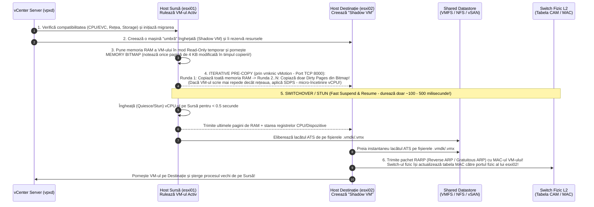
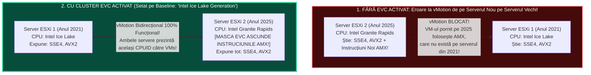
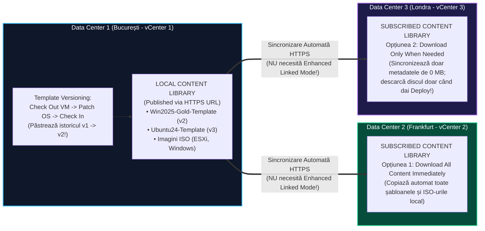

> **Obiectivul Capitolului:** Înțelegerea la nivel de milisecundă și pagină de memorie a arhitecturii interne **`vSphere vMotion`** (`Shadow VM`, `Memory Bitmap`, `Iterative Pre-Copy`, `SDPS`, `Fast Suspend and Resume / Stun`, `RARP`), rezolvarea incompatibilităților de procesor între generații diferite prin **`EVC` (`Enhanced vMotion Compatibility` & `CPUID Masking`)**, stăpânirea mecanismului **`Storage vMotion`** (`Mirror Driver` vs. `RoW`) și automatizarea livrării mașinilor virtuale prin **`VM Templates`**, **`Guest OS Customization Specifications` (`Sysprep` / `Cloud-Init`)** și **`Content Libraries`** (`Published` vs. `Subscribed`).
>
> **Regula de Aur a acestui Capitol:** Fiecare acronim, etapă internă și tehnologie (`vMotion`, `Memory Bitmap`, `SDPS`, `FSR`, `RARP`, `Encrypted vMotion`, `CPUID`, `EVC`, `Per-VM EVC`, `svMotion`, `XvMotion`, `Sysprep`, `SID`, `OVF`, `OVA`, `Content Library`) este explicată integral: **(1) Numele complet**, **(2) Ce reprezintă** și **(3) Cum funcționează tehnic sub capotă**.

:::analogy
### De ce a schimbat `vSphere vMotion` pentru totdeauna istoria IT-ului?

Înainte de anul 2003 (anul în care VMware a lansat `vMotion`), dacă trebuia să înlocuiești o plăcuță de memorie RAM defectă sau să faci un update de BIOS pe un server fizic, aveai o singură opțiune: trimiteai un e-mail întregii companii că sâmbătă noaptea la ora 02:00 oprești serverul, veneai noaptea la birou și aveai **Downtime (întrerupere a serviciului)**.

Cu **`vSphere vMotion` (`Live Migration` / Migrare în Timp Real)**, poți lua 50 de mașini virtuale de producție (baze de date bancare în plină zi la ora 12:00, servere web cu mii de clienți conectați, apeluri video active) și le poți muta **în mers** de pe Serverul Fizic 1 pe Serverul Fizic 2! După 2 minute, Serverul Fizic 1 rămâne complet gol, îl oprești în mijlocul zilei de marți, îi schimbi sursa sau RAM-ul, îl repornești și muți mașinile înapoi — fără ca vreun utilizator să fi pierdut măcar o conexiune!

### Analogia Profesorului: Transplantul de Creier în Mers (Fără ca Pacientul să clipească!)

Cum este posibil să muți un computer care rulează de pe o cutie de metal în altă cutie de metal aflată la 20 de metri distanță fără să se întrerupă? Gândește-te la un **Scriitor care scrie un roman într-un Caiet cu 1.000 de pagini (`Memoria RAM a mașinii virtuale`)**:

1. **Copierea Inițială (`Initial Pre-Copy`):** În timp ce Scriitorul continuă să scrie nestingherit în camera 1 (`ESXi-01`), un asistent invizibil (`VMkernel`) fotografiază toate cele 1.000 de pagini ale caietului și le trimite prin cablu în camera 2 (`ESXi-02`), unde construiește o clonă identică a camerei (**`Shadow VM`**).
2. **Problema Paginilor Modificate (`Dirty Pages` & `Memory Bitmap`):** Dar cât timp asistentul a trimis cele 1.000 de pagini (să zicem timp de 10 secunde), Scriitorul nu a stat degeaba — el a mai modificat între timp **50 de pagini** din caiet! Asistentul nu este prost să recopieze toate cele 1.000 de pagini de la zero; el și-a notat pe o foaie de evidență (**`Memory Bitmap` / `Trace Bitmap`**) exact numerele celor 50 de pagini modificate și, în runda a doua, trimite **doar acele 50 de pagini**!
3. **Runda a treia:** Cât a trimis cele 50 de pagini (în 1 secundă), Scriitorul a mai modificat doar **3 pagini**. Asistentul le trimite pe cele 3.
4. **Secunda Magică a Comutării (`Fast Suspend and Resume / Stun` < $0.5\text{ secunde}$):** Când a mai rămas o singură pagină nesincronizată, asistentul îi ține mâna Scriitorului pentru **o zecime de secundă**, copiază ultima pagină + poziția vârfului stiloului (**Registrele CPU**), îl teleportează în camera 2 (`ESXi-02`) și strigă pe hol la factorul poștal (**`RARP` – `Reverse ARP`** către switch-ul fizic): *„Atenție, de acum înainte livrați scrisorile la ușa camerei 2!”*.
:::

:::architecture
### 2.4.1. Anatomia Internă a `vSphere vMotion`: Cele 6 Etape Sub Capotă (`Bitmap`, `Pre-Copy`, `SDPS`, `FSR`, `RARP`)

*(Acesta este unul dintre cele mai populare subiecte de interviu tehnic la nivel Mid/Senior! Să știi cele 6 etape ale unui `vMotion` arată că înțelegi arhitectura `VMkernel` la perfecție!)*

Când dai click-dreapta pe o mașină virtuală $\rightarrow$ **Migrate** $\rightarrow$ **`Change compute resource only`** (numele oficial din interfața vCenter pentru un `vMotion` clasic, în care discurile `.vmdk` rămân pe loc pe stocarea comună `SAN/NAS/vSAN`, mutându-se doar execuția `CPU + RAM`), în spate au loc exact **6 etape secvențiale**:

Hai să explicăm termenii tehnici critici din această diagramă:

1. **`Shadow VM` (Mașina Virtuală Umbră):** Pe serverul destinație (`esxi02`) se creează un proces `VMX/VMM` gol și inactiv care așteaptă să primească memoria RAM copiată prin rețea pe portul **`TCP 8000`** (portul oficial al motorului `vMotion`). Dacă în timpul copierii se rupe cablul de rețea la $90\%$, `Shadow VM`-ul de pe destinație este pur și simplu șters, iar mașina originală de pe `esxi01` continuă să ruleze fără să fi pățit absolut nimic!
2. **`Memory Bitmap` (Harta de Biți a Paginilor Modificate / `Dirty Pages`):** Nu stochează datele în sine, ci doar adresele paginilor de memorie de $4\text{ KB}$ pe care mașina virtuală le-a modificat după ce a început copierea lor (*Pre-Copy Convergence*).
3. **Ce se întâmplă dacă o bază de date uriașă modifică memoria RAM mai repede decât poate copia cablul de rețea? Tehnologia `SDPS` (`Stun During Page Send`)!**
   * Imaginează-ți că ai o rețea de `vMotion` de $1\text{ Gbps}$ ($\sim 115\text{ MB/s}$), dar o mașină virtuală cu 32 vCPU scrie în propria memorie RAM cu $500\text{ MB/s}$! În acest caz, runda de *Pre-Copy* nu s-ar termina niciodată!
   * Pentru a garanta că `vMotion`-ul se finalizează întotdeauna, `VMkernel`-ul activează automat mecanismul **`SDPS` (`Stun During Page Send`)**: injectează micro-pauze invizibile de câteva microsecunde pe `vCPU`-urile mașinii virtuale ori de câte ori aceasta încearcă să murdărească pagini de memorie, încetinind viteza de scriere a mașinii exact sub viteza cablului de rețea până când copierea converge! *(Notă: În vSphere 7.0 și 8.0, motorul vMotion a fost rescris pentru a folosi *Page Tracing* hardware asistat fără a mai penaliza toate nucleele vCPU!).*
4. **`RARP` (`Reverse Address Resolution Protocol` / `Notify Switches`):**
   * În secunda în care mașina virtuală s-a trezit pe serverul `esxi02`, ea are **exact aceeași adresă `MAC` și aceeași adresă `IP`** pe care le avea pe `esxi01`.
   * Dar switch-ul fizic din dulapul Data Centerului încă ține minte în tabela lui internă (`CAM Table`) că adresa `MAC` a acelei mașini virtuale se află pe cablul serverului `esxi01`! Dacă switch-ul fizic nu ar fi anunțat, toate pachetele venite de la clienți s-ar duce în continuare către serverul vechi `esxi01`!
   * De aceea, în milisecunda comutării, serverul destinație `esxi02` trimite pe cablul fizic un cadru Ethernet special numit **`RARP` (`Reverse ARP`)** care are la *Source MAC* chiar adresa `MAC` a mașinii virtuale proaspăt sosite! În secunda în care switch-ul fizic vede acest cadru intrând pe portul lui `esxi02`, își actualizează instantaneu tabela MAC și redirecționează tot traficul către `esxi02`! *(Acesta este motivul pentru care politica **`Notify Switches`** din *Teaming and Failover* trebuie lăsată **ÎNTOTDEAUNA pe `Yes`**!).*

#### Ce este `Encrypted vMotion` (Criptarea Traficului de vMotion) și cele 3 opțiuni ale sale?
Deoarece în timpul unui `vMotion` întreaga memorie RAM a mașinii virtuale (inclusiv parolele în clar din memorie și datele clienților) circulă pe cablul de rețea, în vSphere poți seta pe fiecare mașină virtuală opțiunea **`Encrypted vMotion`** cu una dintre cele 3 stări (testate la examenul VCP!):
1. **`Disabled`:** Nu folosește niciodată criptare pentru `vMotion`.
2. **`Opportunistic` (Implicit pentru mașinile normale):** Folosește `Encrypted vMotion` dacă ambele servere ESXi (sursă și destinație) îl suportă (ESXi 6.5+); dacă nu, permite migrarea necriptată.
3. **`Required` (Obligatoriu automat pentru toate mașinile Virtuale Criptate / cu `vTPM`):** Traficul de `vMotion` este criptat obligatoriu în kernel cu o cheie unică generată de vCenter pe $256\text{ biți}$ (`AES-GCM`). Dacă unul dintre host-uri nu suportă criptarea, **operațiunea de `vMotion` este BLOCATĂ**!

---

### 2.4.2. Cerințele `vMotion`, Compatibilitatea CPU și Magia `EVC` (`Enhanced vMotion Compatibility`)

#### 1. De ce eșuează un `vMotion` între două servere cu generații diferite de procesor?
Pentru că în timpul unui `vMotion`, mașina virtuală **nu își dă restart**! Aplicația care rulează în interiorul mașinii virtuale și-a verificat tipul de procesor la momentul în care a pornit (*Power On*) citind un registru intern al procesorului numit **`CPUID` (`CPU Identification`)**, unde procesorul își declară lista de instrucțiuni matematice avansate pe care le știe (ex: `SSE4.2`, `AES-NI`, `AVX`, `AVX2`, `AVX-512`).

* **Scenariul de Conflict:**
  * Ai în cluster **Serverul 1** (cumpărat în 2021, cu procesor *Intel Xeon Ice Lake*) și **Serverul 2** (cumpărat în 2025, cu procesor *Intel Xeon Emerald Rapids / Granite Rapids*, care are instrucțiuni noi pe care procesorul din 2021 nu le are!).
  * Dacă pornești o mașină virtuală pe **Serverul 2 (cel nou din 2025)**, Windows-ul și baza de date SQL văd instrucțiunile noi din 2025 și încep să le folosească activ.
  * Când încerci să muți live cu `vMotion` acea mașină virtuală de pe **Serverul 2 (2025)** înapoi pe **Serverul 1 (2021)**, `vCenter`-ul oprește migrarea cu o eroare roșie: **`The target host does not support the virtual machine's current hardware requirements (CPUID incompatibility)`**! De ce? Pentru că dacă ar muta-o pe procesorul vechi din 2021, în secunda în care aplicația ar încerca să execute o instrucțiune din 2025 care nu există fizic în siliciul din 2021, **mașina virtuală ar crăpa instantaneu în Blue Screen (`BSOD: UNSUPPORTED_PROCESSOR`)!**

#### 2. Cum rezolvă `EVC` (`Enhanced vMotion Compatibility`) această problemă?
* **Ce înseamnă `EVC`?** *Compatibilitate Îmbunătățită pentru vMotion*. Este o funcție care se activează la nivel de **Cluster** (sau individual la nivel de mașină virtuală – **`Per-VM EVC`**).
* **Cum funcționează tehnic `EVC` (`CPUID Baseline Masking`):**
  * Tu alegi în setările Clusterului un nivel de bază numit **`EVC Mode / Baseline`**, care trebuie să fie egal cu **cea mai veche generație de procesor fizic existentă în acel cluster** (în exemplul nostru, alegem modul *Intel Ice Lake Generation* din 2021).
  * În acel moment, `EVC` aplică o **mască software/hardware (`CPUID Mask`)** peste **Serverul 2 (cel nou din 2025)**, ascunzând doar instrucțiunile noi apărute după 2021!
  * Astfel, toate mașinile virtuale din cluster văd o amprentă de procesor (`CPUID`) **100% identică pe toate serverele** și pot migra cu `vMotion` în orice direcție (2021 $\leftrightarrow$ 2025) fără nicio restricție! *(Notă: Frecvența în GHz, memoria cache și numărul de nuclee ale procesorului nou din 2025 NU sunt reduse de EVC — se ascund doar câteva seturi de instrucțiuni noi!).*

#### 3. Cele 3 Reguli de Fier ale lui `EVC` (Întrebări Garantate la Examenul VCP-DCV!):
1. **Regula #1 (Intel vs. AMD):** `EVC` funcționează **DOAR între procesoare de la ACELAȘI producător** (fie toate serverele din cluster sunt **Intel Xeon**, fie toate sunt **AMD EPYC**)! **NU poți face niciodată `vMotion` (cu mașina pornită) între un server cu procesor Intel și un server cu procesor AMD**, nici măcar cu `EVC`! Pentru a muta o mașină de pe Intel pe AMD, trebuie să o oprești (*Cold Migration*).
2. **Regula #2 (Ce faci când activezi `EVC` pe un cluster în care rulează deja mașini virtuale pe serverul mai nou?):**
   * Dacă pe Serverul 2 (2025) există deja mașini virtuale **pornite (`Powered On`)** care au apucat să vadă instrucțiunile din 2025 înainte să activezi `EVC` pe modul 2021, vCenter-ul nu îți va permite activarea EVC până când acele mașini de pe serverul mai nou nu sunt fie migrate pe serverul vechi, fie **oprite și repornite (`Power Off` $\rightarrow$ `Power On`, ATENȚIE: un simplu `Guest OS Restart` din Windows NU este suficient, trebuie `Power Off` complet și `Power On` ca procesul `VMX` să citească noua mască `CPUID`!)**.
3. **Regula #3 (Ce este `Per-VM EVC`?):**
   * Setat direct pe o singură mașină virtuală (necesită ca mașina să fie `Powered Off` la configurare și cel puțin *Virtual Hardware Version 14*).
   * **Avantajul major al `Per-VM EVC`:** Spre deosebire de *Cluster EVC*, nivelul `Per-VM EVC` este salvat direct în fișierul `.vmx` al mașinii virtuale și **călătorește împreună cu mașina virtuală** chiar și atunci când o migrezi în afara clusterului sau într-un alt vCenter Server (sau în Cloud)!

---

### 2.4.3. `Storage vMotion` (`Mirror Driver`) și `Shared-Nothing vMotion` (`XvMotion`)

#### 1. Cum funcționează `Storage vMotion` (`Change storage only`) sub capotă?
* **Ce reprezintă:** Mutarea în timp real (cu mașina virtuală **PORNITĂ** și zero downtime!) a fișierelor unei mașini virtuale (`.vmx`, `.vmdk`, `-flat.vmdk`) de pe un `Datastore` pe alt `Datastore` (de exemplu, de pe un SAN vechi `iSCSI` pe un cluster nou `vSAN` sau `NFS`), în timp ce mașina continuă să ruleze pe același server `ESXi`.
* **Cum se făcea în versiunile vechi vs. Cum funcționează astăzi cu `Mirror Driver` (Întrebare VCP!):**
  * *În trecut (ESXi 4.x):* Folosea un snapshot temporar pentru a reține modificările.
  * *Astăzi (ESXi 5.0 $\rightarrow$ 8.0/9.0):* **`Storage vMotion` NU MAI FOLOSEȘTE SNAPSHOT-URI!** În schimb, folosește un mecanism în `VMkernel` numit **`Mirror Mode` (`I/O Mirror Driver`)**, care finalizează copierea într-o **singură trecere (`Single-Pass Copy`)**!
  * **Cum funcționează `Mirror Driver`-ul:**
    1. ESXi creează folderul nou și discul nou pe Datastore-ul destinație și începe să copieze blocurile de la începutul discului (de la $0\%$ spre $100\%$).
    2. Dacă în timp ce copiatorul a ajuns la $50\%$, mașina virtuală modifică un bloc în zona de la $20\%$ (care fusese deja copiată!), **`Mirror Driver`-ul din `VMkernel` scrie acel bloc SIMULTAN (în oglindă) atât pe discul vechi, cât și pe discul nou**!
    3. Astfel, când copiatorul ajunge la $100\%$, ambele discuri sunt deja **100% sincronizate la secundă**, fără să fie nevoie de runde suplimentare de copiere!

#### 2. Ce este `Shared-Nothing vMotion` (`Unified / XvMotion` – `Change both compute resource and storage`)?
* **Ce reprezintă:** Îți permite să muți o mașină virtuală **PORNITĂ (Live)** de pe `esxi01` (care are doar un SSD local intern și **NICIUN SAN partajat**) pe `esxi02` (care are tot doar propriul său SSD local intern)!
* **Cum funcționează:** Combină într-o singură operațiune **și `Storage vMotion`, și `vMotion`** peste cablul de rețea! Mai întâi copiază întregul disc `.vmdk` prin rețea cu *Mirror Driver*-ul, iar la final copiază memoria RAM și comută execuția procesorului, totul cu **Zero Downtime**!

---

### 2.4.4. Automatizarea Livrării: `VM Templates`, `Clones`, `Guest OS Customization` (`Sysprep`) și `Content Libraries`

În producție, un inginer VMware **nu instalează niciodată Windows Server sau Linux de pe `.iso` de 50 de ori**! Instalezi sistemul de operare o singură dată, îi pui toate update-urile la zi, îi instalezi `VMware Tools` și îl transformi într-o „matriță de fabrică” numită **`Template` (Șablon)**.

#### 1. Diferența dintre o `Clone` (Clonă) și un `Template` (Șablon)
* **`Clone` (Clonă):** Este o copie exactă a unei mașini virtuale, care devine imediat o nouă mașină virtuală independentă pe care o poți porni. Poți clona o mașină virtuală atât când este oprită (*Cold Clone*), cât și când este pornită (*Hot Clone*).
* **`Template` (`Master Image` / Șablon):**
  * Este o mașină virtuală dezactivată special pentru a servi drept matriță (fișierul ei de configurare își schimbă extensia din **`.vmx`** în **`.vmtx`**!).
  * **De ce folosim un `Template` în loc de o simplă mașină oprită?** Pentru că un `Template` **NU poate fi pornit (`Powered On`) și nu poate fi modificat hardware din greșeală**! Astfel, ești sigur că niciun coleg nu pornește din greșeală matrița de fabrică și nu o infectează sau modifică!
  * **Cele două moduri de a crea un `Template`:**
    1. **`Convert to Template`:** Transformă mașina virtuală existentă direct în șablon (rapid, nu ocupă spațiu suplimentar pe disc, dar mașina originală nu mai există ca VM). *(Când vrei să faci update-uri de Windows lunare pe acest șablon, îi dai **`Convert to Virtual Machine`**, îl pornești, îi faci update-urile, îl oprești și îi dai înapoi **`Convert to Template`**!).*
    2. **`Clone to Template`:** Lasă mașina originală neatinsă și creează o copie separată pe disc în format șablon (`.vmtx`).

#### 2. De ce NU ai voie să clonezi două mașini Windows fără `Guest OS Customization Specification` (`Sysprep` & `SID`)?
*(Întrebare fundamentală la interviul de System Administrator Windows + VMware!)*

Dacă iei o mașină virtuală cu Windows Server și îi faci 5 clone simple, toate cele 5 clone vor porni în rețea având:
1. **Același `Hostname` (Nume de calculator)** $\rightarrow$ Conflict de nume pe rețea!
2. **Aceeași Adresă IP statică** (dacă șablonul avea IP static) $\rightarrow$ Conflict de IP!
3. **Același `SID` (`Security Identifier` / Identificatorul Criptografic Unic al instalării de Windows):**
   * La instalarea Windows-ului, sistemul își generează un cod unic intern numit **Machine `SID`**. Dacă încerci să bagi în **Active Directory** sau să folosești cu **WSUS / KMS** 5 servere Windows care au exact același `SID` clonat, autentificarea Kerberos, tichetele de domeniu și update-urile vor intra în coliziune gravă!

**Cum rezolvă vCenter această problemă automat în timpul clonării?**
În vCenter (`Menu -> Policies and Profiles -> VM Customization Specifications`), creezi un profil numit **`Guest OS Customization Specification`**. Când livrezi o mașină nouă din Template aplicând acest profil, la prima pornire a mașinii noi, vCenter (prin `VMware Tools`) rulează automat în interiorul Windows-ului utilitarul oficial Microsoft **`Sysprep.exe`** (sau pe Linux: **`Perl` / `Cloud-Init`**), care:
* Șterge vechiul `SID` și **generează un `SID` 100% nou și unic**!
* Schimbă automat **Hostname-ul** mașinii după numele pe care l-ai dat în vCenter!
* Îi configurează noua **Adresă IP, Subnet Mask, Gateway și DNS**!
* **O bagă automat în domeniul `Active Directory` (`lab.local`)** fără să apeși niciun buton în Windows!

#### 3. Ce este o `Content Library` (Biblioteca de Conținut din vSphere 7/8) și de ce a înlocuit vechile Template-uri clasice?

*(Subiect obligatoriu la examenul VCP-DCV 8.0!)*

* **Problema cu Template-urile clasice din inventar:** Un Template clasic (`.vmtx`) este legat de un singur server ESXi și de un singur vCenter. Dacă ai 3 vCenter-e în 3 țări diferite, nu le poți sincroniza automat, și dacă doi ingineri modifică șablonul, nu ai istoric de versiuni (*Versioning*)!
* **Ce este o `Content Library`:** Este un depozit centralizat (stocat pe un Datastore) care păstrează într-un singur loc: **Șabloane de Mașini Virtuale (`VM Templates` și `OVF Templates`)**, **Imagini `.iso` de instalare** și **Scripturi**.
* **Cele 2 Tipuri de Content Library (sincronizare automată între Data Centere):**
  1. **`Local Content Library` (cu opțiunea `Enable Publishing`):** Biblioteca principală („Master”) dintr-un vCenter, care poate publica conținutul său printr-un link HTTPS securizat cu parolă.
  2. **`Subscribed Content Library`:** O bibliotecă creată într-un alt vCenter (chiar și la $5.000\text{ km}$ distanță, **fără să aibă nevoie de `Enhanced Linked Mode`!**) care se abonează la URL-ul bibliotecii publicate și își descarcă automat toate șabloanele și imaginile `.iso` noi!
* **Cele 2 Tipuri de Șabloane într-o Content Library (și funcția `Check Out` / `Check In`):**
  1. **`OVF Template`:** Portabil pe oriunde, dar comprimat (mai lent la deploy).
  2. **`VM Template`:** Nativ vSphere, rapid și suportă **`Template Versioning` (`Check Out` $\rightarrow$ faci update la Windows $\rightarrow$ `Check In`)**: păstrează atât versiunea nouă a șablonului, cât și versiunea anterioară, permițându-ți să dai **`Revert` la versiunea veche a șablonului** dacă update-ul de Windows a avut o problemă!

:::

:::exam-alert
### Limitele Oficiale de Simultanitate pentru `vMotion` și `Storage vMotion` (Tabel de Memorat pentru VCP-DCV!)

Câte migrări `vMotion` poți rula în exact aceeași secundă pe un singur host ESXi? Dacă depășești limita, restul rămân în așteptare în coadă (`Queued` în vCenter). Iată tabelul oficial din *VMware Configuration Maximums*:

| Tipul Operațiunii de Migrare | Limită Maximă Simultană | De ce depinde această limită? |
| :--- | :--- | :--- |
| **`vMotion` pe rețea de `1 Gbps`** | Maximum **`4`** migrări simultane per host | Limitată de lățimea de bandă a rețelei de `1 Gbps`. |
| **`vMotion` pe rețea de `10 Gbps` (sau `25/100 Gbps`)** | Maximum **`8`** migrări simultane per host | Limita standard pentru rețele de mare viteză (`10GbE+`). |
| **`Storage vMotion` (Indiferent de viteza rețelei)** | Maximum **`2`** migrări simultane per host (`8` per Datastore) | Limitată intenționat pentru a nu sufoca SAN-ul cu trafic de copiere a discurilor! |
| **Operațiuni fără `vMotion` (*Cloning / Cold Migration / Deploy*)** | Maximum **`8`** operațiuni simultane per host | Folosesc rețeaua de *Provisioning / Management* (`NFC`). |

### Capcane de Examen (VCP Exam Traps)

1. **Capcana #1 (Viteza minimă a rețelei pentru `vMotion`):**
   * *Întrebare VCP:* Care este viteza minimă de rețea cerută oficial de VMware pentru un port VMkernel de `vMotion`?
   * *Răspuns:* Minimum **`1 Gbps` (`1000 Mbps`) dedicat** (recomandat `10 Gbps` sau `25 Gbps`), cu o latență maximă Round-Trip Time (`RTT`) de **`150 milisecunde`** pentru *Long-Distance vMotion*!
2. **Capcana #2 (Pot face `vMotion` unei mașini virtuale care are o imagine `.iso` montată de pe laptopul meu sau de pe un disc local al lui `esxi01`?):**
   * Dacă ai uitat bifată căsuța **`Connected`** la unitatea *CD/DVD Drive 1* a unei mașini virtuale, iar imaginea `.iso` se află pe discul local nepartajat al lui `esxi01`, când încerci să faci `vMotion` pe `esxi02`, **vCenter-ul îți va da eroare/avertisment că dispozitivul CD/DVD nu este accesibil de pe `esxi02`**! Trebuie să debifezi `Connected` pe unitatea CD/DVD înainte de migrare (sau să ții imaginile `.iso` pe un Datastore partajat / Content Library)!
:::

:::interview
### Întrebarea 1 (Nivel Junior / Mid – Ce se întâmplă în timpul unui vMotion și ce faci dacă pică rețeaua la 95%)
> **Intervievator:** *„Explică-mi pas cu pas ce se întâmplă în spate când dai un `vMotion` unei mașini virtuale cu $32\text{ GB RAM}$. Iar dacă în momentul în care bara de progres din vCenter este la $95\%$ cineva smulge din greșeală cablul de rețea de `vMotion`, ce pățește mașina virtuală de producție — crapă sau își pierde jumătate din memorie?”*

**Răspunsul Ideal:**
„În timpul unui `vMotion`, vCenter verifică mai întâi compatibilitatea și creează pe host-ul destinație un **Shadow VM** inactiv. Apoi, host-ul sursă marchează memoria mașinii virtuale, deschide o **Memory Bitmap** pentru a urmări paginile modificate în mers și începe procesul de **Iterative Pre-Copy** pe portul TCP 8000, copiind memoria RAM în runde succesive tot mai mici. Abia în ultima jumătate de secundă are loc faza de **Fast Suspend and Resume (Stun)**: procesorul pe sursă este înghețat pentru câteva sute de milisecunde, se trimite ultima pagină și starea CPU, host-ul destinație preia lacătul ATS pe fișierele `.vmdk`, trimite un pachet **RARP (Reverse ARP)** către switch-ul fizic pentru actualizarea tabelei MAC și pornește mașina pe destinație.

Dacă cineva smulge cablul de `vMotion` la $95\%$ (înainte de secunda finală de *Switchover*), **mașina virtuală de producție NU pățește absolut nimic și NU are nici măcar o milisecundă de întrerupere**! De ce? Pentru că pe tot parcursul copierii de la $1\%$ la $99\%$, mașina originală a rulat continuu pe host-ul sursă, iar pe destinație s-au trimis doar copii ale paginilor de memorie. Dacă rețeaua cade la $95\%$, procesul de migrare dă *Timeout*, `Shadow VM`-ul de pe destinație este pur și simplu distrus, iar mașina continuă să ruleze neatinsă pe host-ul sursă!”

### Întrebarea 2 (Nivel Senior – Integrarea unui Server Nou într-un Cluster Vechi cu EVC)
> **Intervievator:** *„Avem un cluster de producție cu 4 servere Dell din generația 2020 (procesoare Intel Cascade Lake), pe care colegul dinaintea ta a uitat să activeze `EVC` la instalare. Azi am cumpărat 2 servere Dell noi din generația 2025 (Intel Emerald Rapids) și vrem să le băgăm în același cluster fără niciun minut de downtime pentru cele 100 de mașini virtuale care rulează acum pe cele 4 servere vechi. Cum procedezi pas cu pas?”*

**Răspunsul Ideal:**
„Deoarece cele 100 de mașini virtuale existente rulează în acest moment exclusiv pe cele 4 servere **vechi (Intel Cascade Lake)**, putem rezolva această situație cu **Zero Downtime** dacă respectăm ordinea strictă a pașilor:
1. **Pasul 1 (Înainte de a introduce serverele noi în cluster!):** Intru în setările clusterului existent (care conține doar cele 4 servere Cascade Lake) și **activez Cluster EVC pe nivelul `Intel Cascade Lake Generation`**. Deoarece toate mașinile pornite rulează deja pe procesoare Cascade Lake, activarea `EVC` se va face pe loc, fără a cere oprirea niciunei mașini virtuale!
2. **Pasul 2:** Abia după ce `EVC` este activ pe cluster (sau punând noile servere în *Maintenance Mode* la adăugare), adaug în cluster cele 2 servere noi din 2025 (*Intel Emerald Rapids*). În secunda în care intră în cluster, masca `EVC Cascade Lake` se aplică automat peste procesoarele lor noi, coborându-le `CPUID`-ul la nivelul Cascade Lake.
3. **Pasul 3:** Scot cele 2 servere noi din *Maintenance Mode* și acum pot migra cu `vMotion` oricare dintre cele 100 de mașini virtuale în ambele sensuri fără nicio eroare!
*(Dacă aș fi făcut greșeala să bag întâi serverele noi în cluster fără EVC și să pornesc o mașină virtuală pe ele, acea mașină ar fi preluat instrucțiunile din 2025 și mi-ar fi blocat activarea EVC până la oprirea ei!).*”
:::

:::lab
> **Scenariul Laboratorului:** În acest laborator vom configura rețeaua dedicată de **`vMotion`** pe host-urile noastre `esxi01.lab.local` (`192.168.20.51`) și `esxi02.lab.local` (`192.168.20.52`), vom activa **`Cluster EVC`**, vom executa un **`vMotion` și un `Shared-Nothing vMotion` în timp real** urmărind un `ping -t` către mașina `web01`, iar la final vom construi o **`Content Library`** cu un șablon și o regulă de **`Guest OS Customization`**!
:::

:::quiz

:::

:::references
1. **VMware Official Docs:** *vCenter Server and Host Management – Migrating Virtual Machines (vMotion, Storage vMotion, XvMotion) & Enhanced vMotion Compatibility (EVC)* (`techdocs.broadcom.com`).
2. **VMware Technical White Paper:** *vSphere vMotion Architecture, Performance, and Best Practices in VMware vSphere 7 & 8* – Disecția mecanismelor *Pre-Copy*, *Memory Bitmap* și *SDPS*.
3. **Broadcom / VMware Knowledge Base (KB 1003212):** *Enhanced vMotion Compatibility (EVC) processor support and CPUID baseline matrix*.
4. **VMware Official Docs:** *vSphere Virtual Machine Administration – Using Content Libraries, VM Templates, Versioning (Check Out / Check In), and Guest OS Customization Specifications*.
:::
