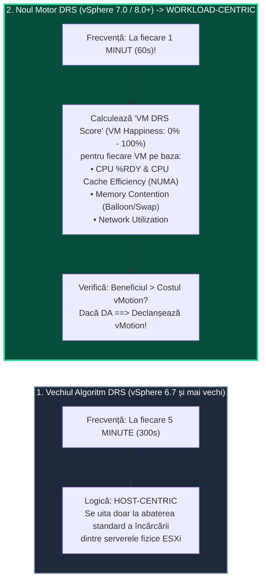
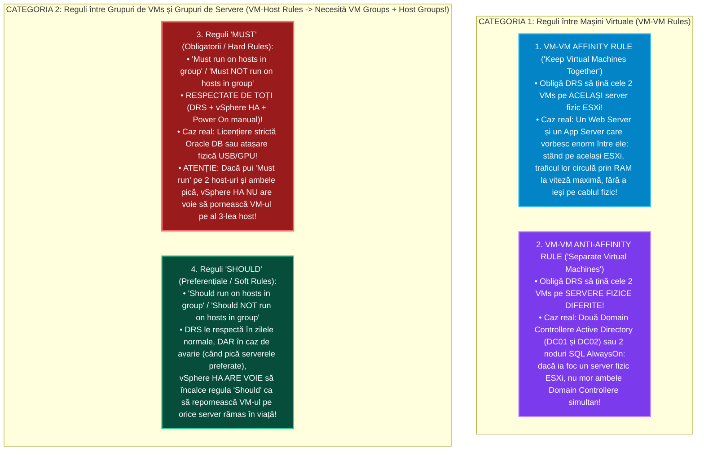

> **Obiectivul Capitolului:** Înțelegerea profundă a arhitecturii unui Cluster în `VMware vSphere`, stăpânirea algoritmului modern **`vSphere DRS` (`Distributed Resource Scheduler` – `VM Happiness`, ciclul de `60 de secunde` vs. `300 de secunde`)**, înțelegerea arhitecturii **`vCLS` (`vSphere Cluster Services` / `Embedded vCLS` & `Retreat Mode`)**, configurarea nivelurilor de automatizare (`Manual`, `Partially Automated`, `Fully Automated`) și a pragurilor de migrare (`Migration Threshold 1–5`), proiectarea regulilor **`Affinity & Anti-Affinity` (`VM-VM` și `VM-Host Must/Should`)**, stăpânirea matematicii **`Resource Pools` (`Expandable Reservation` & `Sibling Shares Trap`)** și înțelegerea **`Storage DRS` (`SDRS`)** și **`DPM` (`Distributed Power Management`)**.
>
> **Regula de Aur a acestui Capitol:** Fiecare acronim, serviciu și regulă matematică (`DRS`, `VM Happiness`, `vCLS`, `EAM`, `DPM`, `IPMI`, `WoL`, `SDRS`, `IOPS`, `Expandable Reservation`) este explicată integral: **(1) Numele complet**, **(2) Ce reprezintă** și **(3) Cum funcționează tehnic sub capotă**.

:::analogy
### De ce grupăm serverele ESXi într-un „Cluster” și ce problemă rezolvă `vSphere DRS`?

În Capitolul 2.4 am învățat să mutăm manual o mașină virtuală pornită de pe `esxi01` pe `esxi02` folosind **`vSphere vMotion`**.
Dar imaginează-ți că ai un Data Center cu **32 de servere fizice `ESXi`** și **1.200 de mașini virtuale**. La ora 09:00 dimineața, 300 de contabili deschid simultan aplicațiile financiare care se întâmplă să fie găzduite pe `esxi01` și `esxi02`. Cele două servere sar la **`99% CPU`** și **`95% RAM`**, în timp ce serverele `esxi15` și `esxi16` stau aproape goale la **`10% CPU`**!

Cine stă 24 de ore din 24 cu ochii pe 32 de grafice de CPU și RAM ca să facă manual `vMotion` ori de câte ori apare un vârf de încărcare la ora 03:00 noaptea? **Nimeni!**
Când adaugi cele 32 de servere `ESXi` într-un obiect logic numit **`vSphere Cluster`** și bifezi opțiunea **`vSphere DRS` (`Distributed Resource Scheduler` / Planificatorul Distribuit de Resurse)**, cele 32 de servere individuale încetează să mai fie 32 de insule separate și devin **un singur Super-Computer Gigantic**! Motorul `DRS` devine „pilotul automat” care apasă singur pe butonul de `vMotion` ori de câte ori o mașină virtuală nu primește resursele de care are nevoie!

### Analogia Profesorului: Dispecerul de Trafic al unui Supermarket cu 20 de Case de Marcat

Gândește-te la un **Cluster `vSphere DRS`** ca la un **Supermarket uriaș cu 20 de Case de Marcat (`20 de Host-uri ESXi`)**:

1. **`Initial Placement` (Plasarea Inițială la Power On):** Când un client nou (o mașină virtuală pe care tocmai ai apăsat *Power On*) vine cu coșul plin spre case, el nu se așază la întâmplare la Casa 1 (unde sunt deja 15 oameni la coadă!). Dispecerul **`DRS`** se uită instantaneu la toate cele 20 de case, vede că la Casa 14 nu este nimeni și îl trimite direct la Casa 14!
2. **`Load Balancing` & Scorul `VM Happiness` (Rebalansarea Dinamică în Mers):** Pe parcursul zilei, la Casa 3 s-au nimerit trei clienți cu cărucioare uriașe (3 baze de date care au început să facă rapoarte grele), iar oamenii din spatele lor au devenit nefericiți. Dispecerul **`DRS`** verifică la fiecare **60 de secunde** gradul de satisfacție al fiecărui client (**`VM Happiness`**) și mută din mers (`vMotion`) clienții care așteaptă de la Casa 3 la Casa 18!
3. **`DPM` (`Distributed Power Management` – Economisirea Curentului Noaptea):** La ora 23:00 noaptea, în tot supermarketul mai sunt doar 4 clienți. De ce să plătești salariu și lumină pentru 20 de casieri? Modulul **`DPM`** mută toți cei 4 clienți la Casele 1 și 2, iar pe celelalte 18 case **le închide automat (`Standby Mode / Power Off`)**! Dimineața la 07:30, când încep să vină clienții, `DPM` apasă automat pe butonul de pornire (prin `iLO / iDRAC / IPMI` sau `Wake-on-LAN`), trezește serverele fizice și redistribuie mașinile!
:::

:::architecture
### 2.5.1. Cum gândește `vSphere DRS`: De la Algoritmul Vechi (5 Minute) la Noul Motor `VM Happiness` (1 Minut) și `vCLS`

#### 1. Schimbarea Istorică din Algoritmul `DRS` (vSphere 6.x vs. vSphere 7.0 / 8.0 – *Întrebare VCP!*)

Dacă citești cărți vechi de VMware, vei vedea scris că *„DRS rulează la fiecare 5 minute și încearcă să egaleze procentul de CPU și RAM între host-urile ESXi”*. În **vSphere 7.0 și 8.0**, VMware a reproiectat complet creierul `DRS`! Iată diferența arhitecturală pe care trebuie să o știi la examen și la interviu:

* **Vechiul `DRS` (Până la vSphere 6.7 – *Host-Centric / Cluster Standard Deviation*):**
  * Rula o dată la **5 minute (`300 de secunde`)**.
  * Se uita la **media încărcării serverelor ESXi** (voia ca toate serverele să aibă aproximativ același procent de CPU/RAM ocupat).
* **Noul `DRS` (vSphere 7.0 și 8.0 – *Workload-Centric / `VM Happiness` Score*):**
  * Rulează de **5 ori mai des: la fiecare `1 minut` (`60 de secunde`)**!
  * Nu îi mai pasă doar ca serverele fizice să arate egal pe grafic, ci calculează pentru **fiecare mașină virtuală în parte** un scor de la `0%` la `100%` numit **`VM DRS Score` (`VM Happiness` / Fericirea Mașinii Virtuale)**!
  * **Din ce este calculat scorul `VM Happiness` al unei mașini virtuale?**
    * Cât timp așteaptă la coadă la procesor (**`%RDY` / CPU Ready** și eficiența **CPU Cache / NUMA**).
    * Cât timp așteaptă după memoria RAM (**Memory Swap Wait / Ballooning**).
    * Capacitatea de rețea disponibilă.
    * **Costul migrării (`vMotion Cost`):** Noul DRS calculează în avans: *„Dacă mut această mașină virtuală cu $64\text{ GB RAM}$ care scrie intens în memorie, cât procesor și câtă rețea voi consuma pentru însuși procesul de `vMotion`? Merită deranjul?”*. Dacă beneficiul adus fericirii mașinii este mai mare decât costul migrării, DRS execută `vMotion`-ul!

#### 2. Ce sunt acele 3 Mașini Virtuale Misterioase numite `vCLS` (`vSphere Cluster Services`) și ce este `Retreat Mode`?

*(Subiect critic introdus în vSphere 7.0 și modernizat în vSphere 8.0 Update 3! Orice admin care vede prima dată un cluster vSphere 7/8 se sperie când vede că au apărut singure 3 mașini virtuale mici pe care nu le poate șterge!)*

* **Ce înseamnă `vCLS` (`vSphere Cluster Services`)?**
  * În trecut, serviciul **`DRS`** depindea $100\%$ de baza de date a lui **`vCenter Server`**. Dacă `vCenter`-ul era oprit, `DRS` murea instantaneu.
  * Pentru a decupla serviciile de cluster de `vCenter`, începând cu **vSphere 7.0**, în secunda în care creezi un Cluster (chiar și înainte să bifezi DRS sau HA!), un agent din vCenter numit **`EAM` (`ESX Agent Manager`)** creează automat în cluster până la **3 mașini virtuale minuscule** (cu Photon OS, consumând doar `1 vCPU` și `128 MB RAM` fiecare!), numite **`vCLS-1`, `vCLS-2`, `vCLS-3`**!
  * **Rolul mașinilor `vCLS`:** Ele păstrează starea de sănătate și serviciile de quorum ale clusterului. **Dacă toate cele 3 mașini `vCLS` sunt oprite sau șterse, serviciul `vSphere DRS` SE OPREȘTE din funcționare** (până când agentul `EAM` le recreează automat după 60 de secunde)!
* **Evoluția majoră în `vSphere 8.0 Update 3`: `Embedded vCLS`!**
  * În primele versiuni (vSphere 7.0 – 8.0 U2), mașinile `vCLS` aveau discuri pe Datastore. În **vSphere 8.0 Update 3**, VMware a introdus **`Embedded vCLS`**: acum sunt doar **2 mașini `vCLS` per cluster**, care rulează **100% în memoria RAM a host-urilor ESXi (`CRX runtime` fără niciun disc pe Datastore!)**, eliminând complet blocarea Datastore-urilor când vrei să le demontezi!
* **Cum oprești legal mașinile `vCLS` când vrei să bagi tot clusterul în mentenanță? Funcția `Retreat Mode` (Întrebare VCP!):**
  * **NU ai voie** să dai manual *Power Off* sau *Delete* pe mașinile `vCLS` (pentru că agentul `EAM` crede că s-au stricat și le recreează în 30 de secunde!).
  * Dacă trebuie să oprești toate serverele ESXi din cluster (sau să demontezi singurul Datastore), activezi pe cluster modul special numit **`Retreat Mode` (Modul de Retragere)**:
    * În vSphere 7.0: din *vCenter Advanced Settings*, adaugi parametrul `config.vcls.clusters.domain-cXX.enabled = false`.
    * În **vSphere 8.0**: direct din interfața grafică a Clusterului $\rightarrow$ *Configure -> vSphere Cluster Services -> General -> Edit vCLS Mode -> **`Retreat Mode`***! Agentul `EAM` șterge curat mașinile `vCLS` și suspendă `DRS` până când îl treci înapoi pe *System Managed*!

---

### 2.5.2. Cele 3 Niveluri de Automatizare `DRS`, `Migration Threshold (1–5)`, `Predictive DRS` și `DPM`

#### 1. Cele 3 Niveluri de Automatizare în `vSphere DRS` (`Automation Levels`)

Când activezi `vSphere DRS` pe un cluster, acesta acționează în **două momente diferite**: (A) La pornirea unei mașini virtuale (**`Initial Placement`**) și (B) În timpul funcționării mașinii (**`Dynamic Load Balancing / vMotion`**). Iată cum se comportă cele 3 niveluri (tabel obligatoriu pentru examenul VCP-DCV):

| Nivel de Automatizare `DRS` | Ce face la `Initial Placement` (Când apeși *Power On* pe un VM) | Ce face la `Load Balancing` (Când clusterul este dezechilibrat) | Când îl folosim în Producție? |
| :--- | :--- | :--- | :--- |
| **1. `Manual`** | **Afișează o fereastră cu recomandări** (*„Îți recomand să pornești VM-ul pe esxi03”*) și așteaptă să apeși tu pe OK! | **NU mută nimic automat!** Doar afișează lista de recomandări `vMotion` în tab-ul *Monitor -> DRS -> Recommendations* și așteaptă să apeși tu pe **`Apply Recommendations`**! | Când testezi un cluster nou și vrei control uman 100% asupra fiecărei mutări. |
| **2. `Partially Automated`** | **ALEGE ȘI PORNEȘTE AUTOMAT** mașina virtuală pe cel mai liber server ESXi (fără să te mai întrebe!). | **NU mută nimic în mers!** Exact ca la *Manual*, doar afișează recomandările de `vMotion` în listă și așteaptă aprobarea ta! | Pentru medii unde vrei plasare inteligentă la boot, dar nu vrei migrări automate în timpul zilei. |
| **3. `Fully Automated`** *(Standardul în 99% din Data Centere!)* | **ALEGE ȘI PORNEȘTE AUTOMAT** mașina virtuală pe cel mai bun server ESXi! | **EXECUTĂ AUTOMAT `vMotion`** în fundal ori de câte ori scorul de fericire o cere (în funcție de *Migration Threshold*)! | Standardul în producție și **cerință obligatorie pentru a folosi `Resource Pools` sau `Predictive DRS`**! |

#### 2. Ce este `Migration Threshold` (Bara Glisantă de la `1 - Conservative` la `5 - Aggressive`)?

Atunci când `DRS` identifică o mutare posibilă a unei mașini virtuale, el îi atribuie acelei recomandări o **Prioritate de la `Priority 1` (Obligatorie) la `Priority 5` (Îmbunătățire minoră)**. Bara glisantă **`Migration Threshold`** din setările DRS decide care dintre aceste 5 priorități sunt executate automat în modul *Fully Automated*:

* **`Level 1 – Conservative` (Conservator):** Execută automat **DOAR recomandările de `Priority 1` (Mandatory)**!
  * *Când apare o recomandare de `Priority 1` (Întrebare VCP!)?* Doar în **2 situații stricte**: **(1)** Când bagi un host ESXi în **`Maintenance Mode`** (sau Standby Mode) și mașinile **trebuie** evacuate de pe el, sau **(2)** Când două mașini virtuale încalcă o **Regulă obligatorie de afinitate (`Must Affinity / Anti-Affinity Rule`)**! Pentru dezechilibru de CPU/RAM, nivelul *Conservative* nu mută nimic automat!
* **`Level 2`:** Execută automat `Priority 1` și `Priority 2` (promite o îmbunătățire semnificativă a clusterului).
* **`Level 3 – Default` (Valoarea Implicită):** Execută automat `Priority 1`, `Priority 2` și `Priority 3` (îmbunătățire bună a performanței – echilibrul ideal în producție!).
* **`Level 4`:** Execută până la `Priority 4` (îmbunătățire moderată).
* **`Level 5 – Aggressive` (Agresiv):** Execută absolut orice recomandare (`Priority 1..5`), chiar și dacă mutarea aduce un câștig infim de $1\%$! *(Nu este recomandat în producție deoarece provoacă `vMotion` inutil non-stop!).*

#### 3. Ce este `Predictive DRS` (Integrarea cu `VMware Aria Operations / vROps`)?

* **Problema cu `DRS`-ul normal (Reactiv):** În fiecare dimineață la ora 08:00 fix, serverul de raportare financiară sare de la $5\%$ la $100\%$ CPU. `DRS`-ul normal așteaptă să se facă ora 08:00, vede că serverul s-a sufocat (**după ce problema a apărut deja!**) și abia la 08:02 începe să mute mașina cu `vMotion`!
* **Cum funcționează `Predictive DRS` (Proactiv):**
  * Îl bifezi în setările `DRS` și îl conectezi la **`VMware Aria Operations` (fostul `vRealize Operations Manager - vROps`)**.
  * `Aria Operations` învață tiparele istorice din ultimele luni și îi spune lui `DRS` la ora **07:50**: *„Hei DRS, vezi că peste 10 minute, la ora 08:00 fix, această mașină virtuală va avea nevoie de $32\text{ GB RAM}$ și $100\%$ CPU!”*.
  * Atunci **`Predictive DRS` mută mașina virtuală cu `vMotion` pe un server liber la ora 07:55 (ÎNAINTE să înceapă vârful de trafic la 08:00!)**, prevenind complet orice secundă de contenție!

#### 4. Ce este `vSphere DPM` (`Distributed Power Management`) și cele 3 Protocoale de Trezire?

* **Rolul său:** Sub-componentă a `DRS` care reduce factura de curent electric a Data Centerului în orele cu trafic scăzut (noaptea și în weekend).
* **Cum funcționează:** Când încărcarea întregului cluster scade sub pragul setat (ex: sub $40\%$), `DPM` golește unul sau mai multe servere ESXi mutând mașinile cu `vMotion` pe celelalte servere, și apoi pune serverele goale în **`Standby Mode` (Oprire Fizică / Power Off)**.
* **Cele 3 protocoale prin care `DPM` poate porni de la distanță un server fizic oprit (Testate la VCP!):**
  1. **`IPMI` (`Intelligent Platform Management Interface` – pe placa BMC / iDRAC):** Trimite comanda de *Power On* pe portul `UDP 623`.
  2. **`HPE iLO` (`Integrated Lights-Out`):** Comunică direct cu cipul iLO al serverelor HPE.
  3. **`WoL` (`Wake-on-LAN` / Trezire prin Rețea):** Trimite un pachet special numit **`Magic Packet`** pe portul `vmk` de **`vMotion`** către placa de rețea fizică a serverului oprit (care rămâne alimentată cu curent de standby și apasă intern pe pornirea plăcii de bază!).

---

### 2.5.3. Regulile `Affinity` și `Anti-Affinity`: `VM-VM` vs. `VM-Host` (`Must` vs. `Should`)

*(Acesta este unul dintre cele mai testate subiecte din secțiunea de Clustering la examenul VCP-DCV!)*

În mod implicit, `DRS` mută mașinile virtuale pe oriunde consideră el că e mai bine. Dar în arhitectura de producție avem situații stricte în care **noi trebuie să îi impunem reguli lui `DRS`**. Există **4 tipuri de reguli DRS**:

#### Capcanele de Examen pe Regulile de Afinitate:
1. **Ce se întâmplă dacă creezi două reguli `VM-VM` care se bat cap în cap** (ex: Regula 1 spune să țină `VM-A` și `VM-B` împreună, iar Regula 2 spune să țină `VM-A` și `VM-B` separate)?
   * **Regula mai VECHE (prima creată cronologic) câștigă întotdeauna**, iar regula mai nouă este dezactivată automat de vCenter!
2. **Diferența critică dintre `Must` și `Should` în raport cu `vSphere HA`:**
   * **`vSphere HA` ignoră regulile `Should`** atunci când un server ia foc și trebuie să salveze mașinile virtuale repornindu-le pe serverele supraviețuitoare.
   * **`vSphere HA` NU încalcă NICIODATĂ o regulă `Must`!** Dacă ai pus o regulă `Must run on Host 1` (de exemplu, pentru că doar pe Host 1 ai plătit licența de procesor pentru Oracle Database, iar dacă Oracle ar porni pe Host 2 compania ar primi o amendă de audit de $500.000\text{ EUR}$!), și Host 1 ia foc, **`vSphere HA` lasă mașina virtuală OPRITĂ** mai degrabă decât să încalce regula `Must`!

---

### 2.5.4. `Resource Pools`: Ierarhie, `Expandable Reservation` și Capcana Mortală a `Sibling Shares`

#### 1. Ce este un `Resource Pool` (Bazin / Rezervor de Resurse)?

* **Ce reprezintă:** Un container logic creat în interiorul unui cluster `DRS` (necesită obligatoriu **`vSphere DRS` activat**!) care îți permite să feliezi puterea totală de `CPU (MHz)` și `RAM (MB)` a clusterului și să o împarți pe departamente (ex: *Resource Pool Producție* primește `Shares: High`, iar *Resource Pool Test/Dev* primește `Shares: Low` și o limită maximă de $32\text{ GB RAM}$).

#### 2. Cum funcționează bifa `Expandable Reservation` (Rezervare Extensibilă – *Matematică de Examen VCP!*):

Când creezi un `Resource Pool` (să-i zicem `RP-Financiar`) și îi setezi o rezervare fixă de **`10 GB RAM`**, în dreptul rezervării există o căsuță numită **`Expandable Reservation`** (implicit *Bifată*):

* **Cazul 1: `Expandable Reservation` este DEBIFATĂ (`Disabled`):**
  * Rezervorul `RP-Financiar` are o cotă rigidă de maximum **`10 GB RAM`** pentru rezervări.
  * În interiorul său pornești `VM 1` (cu rezervare de $6\text{ GB}$). Mai rămân liberi în rezervor $4\text{ GB}$ ($10 - 6 = 4$).
  * Când încerci să pornești în același rezervor `VM 2` (care cere și ea o rezervare de $6\text{ GB}$), chiar dacă întregul cluster fizic are **$500\text{ GB RAM}$ liberi**, **`VM 2` NU VA PORNI (`Admission Control Failed`)**, deoarece $6 + 6 = 12\text{ GB} > 10\text{ GB}$ și rezervorul nu are voie să împrumute de la părintele său!
* **Cazul 2: `Expandable Reservation` este BIFATĂ (`Enabled`):**
  * Când pornești `VM 2` (care mai are nevoie de încă $2\text{ GB}$ peste cei $4\text{ GB}$ rămași în `RP-Financiar`), rezervorul `RP-Financiar` **împrumută automat diferența de $2\text{ GB}$ de la părintele său (Clusterul rădăcină)**, iar `VM 2` pornește fără nicio problemă!

#### 3. Capcana Arhitecturală #1 în Producție: Nu pune niciodată Mașini Virtuale pe același nivel cu un `Resource Pool` (`Sibling Shares Trap`)!

*(Aceasta este greșeala clasică demascată de Frank Denneman și Duncan Epping în cartea „vSphere Clustering Deep Dive”!)*

Să zicem că sub rădăcina Clusterului ai un singur **`Resource Pool (RP-Test)`** (care are `Shares: Normal = 4000`, și înăuntrul căruia ai pus **20 de mașini virtuale de test**), și lângă `RP-Test`, pusă **direct sub Cluster**, lași o singură **Mașină Virtuală (`VM-Singura`)** (care are și ea `Shares: Normal = 4000`)!
În caz de bătaie pe procesor (*Contention*), cum împarte ESXi procesorul între cei doi „frați” (*Siblings*) aflați direct sub Cluster (`RP-Test` vs. `VM-Singura`)?
* Îi dă **$50\%$ din tot clusterul acelei singure mașini (`VM-Singura`)**, și celelalte **$50\%$ le dă întregului `RP-Test`**, unde cele 20 de mașini virtuale sunt forțate să împartă acele $50\%$ între ele (primind fiecare câte **$2.5\%$** din cluster)!
* **Regula de Aur:** Dacă creezi `Resource Pools` într-un cluster, **TOATE mașinile virtuale trebuie să stea în interiorul unor Resource Pools** — nu lăsa niciodată mașini virtuale „orfane” direct în rădăcina clusterului lângă un Resource Pool!

#### 4. Ce este un `Datastore Cluster` și `Storage DRS` (`SDRS`)?

* Exact așa cum un `Cluster DRS` grupează mai multe servere `ESXi` și echilibrează `CPU + RAM` folosind `vMotion`, un **`Datastore Cluster`** grupează mai multe **`Datastore`-uri (`LUN`-uri VMFS sau volume NFS)** într-un singur bazin de stocare și activează **`Storage DRS` (`SDRS`)**!
* **Cele 2 criterii pe care le echilibrează `Storage DRS` (folosind automat `Storage vMotion`):**
  1. **`Space Utilization` (Utilizarea Spațiului pe Disc):** Când un Datastore depășește pragul de **`80%` spațiu ocupat**, `SDRS` mută automat discurile unor mașini virtuale pe un alt Datastore mai gol!
  2. **`I/O Latency` (Latența I/O – folosește în spate motorul `SIOC`):** Când timpul de răspuns pe un Datastore depășește pragul implicit de **`15 milisecunde` (`15 ms`)**, `SDRS` mută automat mașinile cu trafic intens pe un Datastore mai puțin solicitat din punct de vedere IOPS!
:::

:::exam-alert
### Tabelul de Sinteză `vSphere DRS` vs. `Storage DRS` (Pentru Examenul VCP-DCV)

| Parametru Tehnic | `vSphere DRS` (Compute Cluster) | `Storage DRS` (`SDRS` - Datastore Cluster) |
| :--- | :--- | :--- |
| **Ce obiecte grupează?** | Servere fizice **`ESXi Hosts`** (până la **64** sau **96 hosts** per cluster în vSphere 8). | Volume de stocare **`Datastores`** (până la **64 datastores** per Datastore Cluster). |
| **Ce resurse echilibrează?** | **`CPU`** și **`Memory (RAM)`** (+ opțional Network). | **`Space Capacity (GB)`** (prag: `80%`) și **`I/O Latency (ms)`** (prag: `15 ms`). |
| **Ce tehnologie de migrare folosește?** | **`vSphere vMotion`** (mută execuția RAM/CPU). | **`Storage vMotion`** (mută fișierele `.vmdk`). |
| **Frecvența de evaluare** | La fiecare **`60 de secunde` (`1 minut`)** în vSphere 7/8. | La fiecare **`8 ore`** pentru I/O și ori de câte ori se depășește pragul de spațiu! |
| **Mod de Mentenanță dedicat?** | **`Host Maintenance Mode`** (evacuează toate VMs cu `vMotion`). | **`SDRS Maintenance Mode`** (evacuează toate discurile `.vmdk` de pe acel LUN cu `Storage vMotion`!). |
:::

:::interview
### Întrebarea 1 (Nivel Junior / Mid – Cum pui un server ESXi în Maintenance Mode și de ce rămâne blocat la 2%?)

> **Intervievator:** *„Trebuie să înlocuiești o sursă sau o memorie RAM pe serverul `esxi02` din clusterul de producție. Îi dai click-dreapta -> Enter Maintenance Mode, dar bara de progres rămâne blocată la $2\%$ ( sau la $19\%$) timp de 15 minute și serverul nu intră în Maintenance Mode. Care sunt cele mai frecvente 4 cauze pentru care un host ESXi refuză să intre în Maintenance Mode în producție?”*

**Răspunsul Ideal (Arată experiență practică reală din producție):**
„Pentru ca un host ESXi să finalizeze intrarea în *Maintenance Mode*, toate mașinile virtuale pornite de pe el trebuie să fie migrate pe celelalte host-uri din cluster (sau oprite). Când procesul rămâne blocat la $2\%$ sau $19\%$, înseamnă că cel puțin o mașină virtuală de pe acel host nu poate fi migrată cu `vMotion`. Cele 4 cauze clasice pe care le verific imediat în tab-ul *Monitor -> DRS -> Faults* sunt:
1. **`DRS` este pe modul `Manual` sau `Partially Automated` (sau este dezactivat):** În acest caz, vCenter nu are voie să mute singur mașinile virtuale și așteaptă ca eu să aprob recomandările de evacuare sau să mut manual mașinile!
2. **O regulă strictă `VM-Host Must Rule` sau `VM-VM Anti-Affinity`:** Există o mașină virtuală legată printr-o regulă obligatorie *Must run on host* de `esxi02` (sau avem un cluster de doar 2 host-uri cu 2 mașini legate printr-o regulă de *Anti-Affinity* care nu au voie să stea împreună pe singurul host rămas!).
3. **Dispozitive locale atașate la o mașină virtuală:** O mașină virtuală are o imagine `.iso` montată de pe un Datastore local nepartajat, are un dispozitiv `PCIe DirectPath I/O (Pass-through)` sau o cheie USB fizică mapată direct de pe `esxi02`.
4. **Mașinile virtuale sunt stocate pe un Datastore local al lui `esxi02`:** Cum un Datastore local nu este văzut de celelalte servere, `DRS` nu poate face un `vMotion` simplu pentru ele.”

### Întrebarea 2 (Nivel Senior – Arhitectura vCLS și De ce a dispărut DRS)

> **Intervievator:** *„Un coleg junior a văzut în vCenter 3 mașini virtuale mici numite `vCLS-xxxx`, a crezut că sunt mașini de test lăsate de un consultant și a încercat să le șteargă, iar când a vrut să demonteze un Datastore i-a dat eroare că `vCLS` îl ține ocupat. Explică-mi ce sunt mașinile `vCLS`, ce agent le controlează, cum s-a schimbat arhitectura lor în vSphere 8 Update 3 și cum le poți opri oficial când ai nevoie să golești tot clusterul.”*

**Răspunsul Ideal:**
„Mașinile `vCLS` (*vSphere Cluster Services*) au fost introduse în vSphere 7.0 pentru a asigura disponibilitatea serviciilor de cluster precum **DRS** și **vSphere HA**. Ele sunt gestionate automat de serviciul **`EAM` (`ESX Agent Manager`)**: dacă cineva încearcă să le oprească sau să le șteargă manual, `EAM` detectează dispariția lor și le recreează automat în câteva zeci de secunde, iar regulile interne de anti-afinitate le distribuie pe 3 host-uri diferite.

În **vSphere 8.0 Update 3**, VMware a introdus arhitectura **`Embedded vCLS`**: numărul lor a fost redus de la 3 la **maximum 2 per cluster**, iar ele rulează acum ca micro-containere direct în memoria RAM a host-urilor ESXi (*memory-backed CRX VMs*), fără să mai ocupe spațiu și fără să mai blocheze niciun Datastore!
Dacă pe o versiune anterioară (vSphere 7.0 – 8.0 U2) trebuie să oprim toate host-urile din cluster sau să demontăm Datastore-ul pe care stau discurile `vCLS`, singura metodă oficială este activarea **`Retreat Mode`** pe acel cluster (din *Configure -> vSphere Cluster Services -> Retreat Mode*), moment în care `EAM` șterge controlat mașinile `vCLS` și pune `DRS` în pauză până la dezactivarea *Retreat Mode*.”
:::

:::lab
> **Scenariul Laboratorului:** În acest laborator vom construi primul nostru **Cluster Enterprise (`Lab-Cluster-01`)** în `vCenter`, vom activa **`vSphere DRS`** în modul *Fully Automated*, vom observa cum agentul `EAM` lansează automat mașinile de sistem **`vCLS`**, vom crea o regulă de **`VM-VM Anti-Affinity`** între două mașini virtuale și vom testa evacuarea automată a unui server prin **`Enter Maintenance Mode`**!
:::

:::quiz

:::

:::references
1. **VMware Official Docs:** *vSphere Resource Management Guide (vSphere 8.0) – Creating DRS Clusters, VM DRS Score (VM Happiness), Affinity Rules, and Managing Resource Pools* (`techdocs.broadcom.com`).
2. **Duncan Epping, Frank Denneman & Niels Hagoort:** *vSphere Clustering Technical Deep Dive* – Biblia mondială pentru modul în care funcționează intern `DRS`, `Resource Pools` și `vCLS`.
3. **Broadcom / VMware Knowledge Base (KB 80472):** *vSphere Cluster Services (vCLS) in vSphere 7.0 and 8.0 (including Embedded vCLS in 8.0 U3 and Retreat Mode)*.
4. **VMware Technical Blog:** *Introducing the Redesigned vSphere DRS in vSphere 7 & 8: From Host-Centric to Workload-Centric VM Happiness*.
:::
