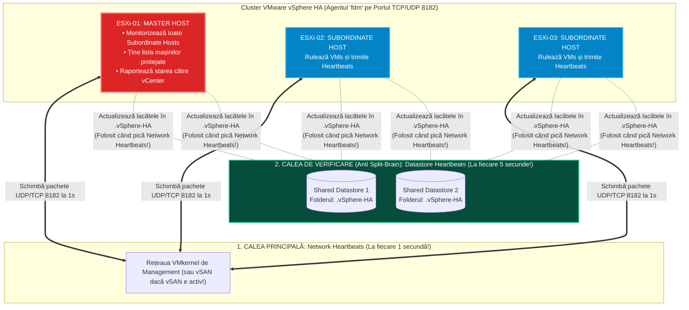
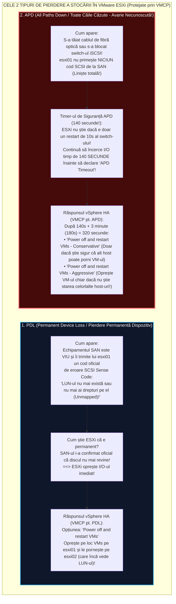
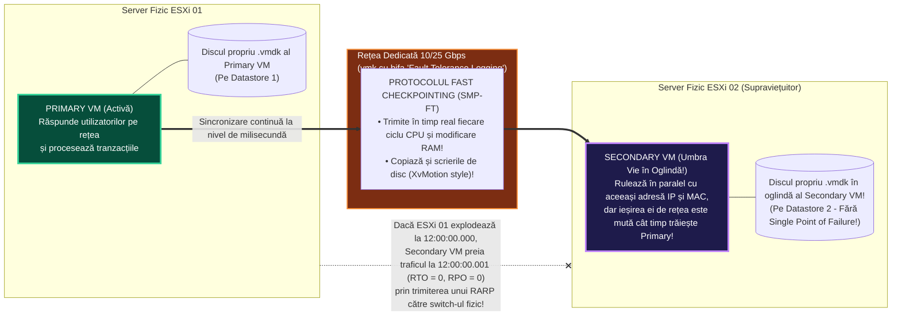

> **Obiectivul Capitolului:** Stăpânirea completă a arhitecturii **`vSphere HA` (`High Availability`)**: rolul agentului **`fdm` (`Fault Domain Manager`)**, algoritmul de alegere a procesului **`Master`** vs. **`Subordinate (Slave)`**, mecanismul dublu de verificare a vieții prin **`Network Heartbeats`** și **`Datastore Heartbeats`** (fișierele `.vSphere-HA`) pentru prevenirea fenomenului **`Split-Brain`**, diferențierea critică dintre un server mort (**`Failed Host`**) și un server izolat (**`Isolated Host`** + cele 3 politici `Isolation Response`), protecția la căderea stocării prin **`VMCP` (`PDL` – *Permanent Device Loss* vs. `APD` – *All Paths Down*)**, calculul matematic pentru **`Admission Control`** și diferența arhitecturală față de **`vSphere Fault Tolerance` (`SMP-FT`)**.
>
> **Regula de Aur a acestui Capitol:** Fiecare acronim, stare de avarie și algoritm (`HA`, `fdm`, `Master/Slave`, `Split-Brain`, `Isolation Response`, `VMCP`, `PDL`, `APD`, `Admission Control`, `Slot Size`, `Proactive HA`, `FT`, `SMP-FT`, `RTO`, `RPO`) este explicat integral: **(1) Numele complet**, **(2) Ce reprezintă** și **(3) Cum funcționează tehnic sub capotă**.

:::analogy
### Diferența critică dintre `vMotion / DRS` (Fără Downtime, Planificat) și `vSphere HA` (Cu Restart, la Dezastru Neplanificat)

Mulți candidați la început de drum confundă `vMotion` cu `vSphere HA`, crezând că atunci când se arde placa de bază a unui server fizic, `vSphere HA` face „un vMotion rapid” și mașinile virtuale nici nu se opresc! **FALS!**

Trebuie să înțelegi fizica din spatele unui dezastru:
* Pentru a face **`vMotion`** (fără downtime), ambele servere fizice (`esxi01` și `esxi02`) trebuie să fie **în viață și sănătoase**, ca `esxi01` să îi poată trimite prin cablu memoria sa `RAM` lui `esxi02`!
* Dar când la ora 03:00 noaptea explodează sursa de curent sau crapă placa de bază a serverului **`esxi01`**, acel server moare în **0,001 secunde**! Tot ce se afla în memoria `RAM` a lui `esxi01` s-a evaporat instantaneu în neant! Nu mai ai de unde să copiezi memoria RAM!
* **Ce face atunci `vSphere HA` (`High Availability`)?** Serverele supraviețuitoare din cluster (`esxi02` și `esxi03`) observă că `esxi01` a murit. Deoarece discurile mașinilor virtuale (`.vmx` și `-flat.vmdk`) nu stăteau pe discul intern al lui `esxi01`, ci stau intacte pe **Stocarea Partajată (`SAN / NAS / vSAN`)**, serverul `esxi02` preia fișierele `.vmx` ale mașinilor căzute și **le dă automat `Power On` (le repornește de la zero / Boot) pe propriul său procesor și RAM**!
  * Așadar, cu **`vSphere HA`** există o scurtă întrerupere (**Downtime / `RTO` – *Recovery Time Objective*** de aproximativ **1 – 3 minute**, cât durează detecția căderii + bootarea Windows/Linux-ului pe noul server), dar totul se repară **100% automat la ora 03:00 noaptea**, fără ca tu să fii trezit din somn!
* **Dar dacă am o aplicație bancară sau medicală care nu are voie să se întrerupă nici măcar acele 2 minute de restart?** Atunci folosim a doua tehnologie din acest capitol: **`vSphere Fault Tolerance` (`FT`)**, care ține o a doua mașină virtuală „umbră vie” (*Secondary VM*) pe `esxi02`, sincronizată la fiecare milisecundă cu prima, oferind **Zero Downtime (`RTO = 0 secunde`)**!

### Analogia Profesorului: Echipa de Salvamontiști și Stațiile Walkie-Talkie + Caietul din Cabană

Imaginează-ți un **Cluster `vSphere HA`** de 4 servere ca pe o **Echipă de 4 Salvamontiști (`esxi01`..`esxi04`)** pe munte:
1. **Alegerea Șefului de Echipă (`Master` vs. `Subordinates`):** În secunda în care bifezi `Turn ON vSphere HA`, cei 4 salvamontiști votează între ei și aleg **UN SINGUR Șef (`Master Host`)**, iar ceilalți 3 devin **Subordonați (`Subordinate / Slave Hosts`)**.
2. **Stațiile Walkie-Talkie (`Network Heartbeats`):** La fiecare **1 secundă**, cei 3 subordonați îi strigă prin stația radio (`Rețeaua de Management`) șefului `Master`: *„Sunt viu!”*.
3. **Ce se întâmplă dacă Șeful `Master` nu îl mai aude prin stație pe Salvamontistul 3 timp de 15 secunde?**
   * *Întrebarea de 1 milion de dolari:* De ce nu mai răspunde Salvamontistul 3 la stație? A căzut în prăpastie și a murit (**`Host Failure`**), SAU e viu și sănătos, își face treaba în continuare, dar **s-a stricat doar bateria stației lui radio (`Network Isolation`)**?!
   * Dacă Salvamontistul 3 este încă viu și conduce autobuzul cu turiști (rulează mașinile virtuale), iar Șeful `Master` crede greșit că a murit și pornește o copie a acelorași mașini virtuale pe alt server, **două servere vor scrie simultan în același disc `.vmdk` și îl vor distruge complet (fenomenul mortal numit `Split-Brain`)**!
4. **Soluția Genială a lui VMware (`Datastore Heartbeats` – Caietul din Cabana Comună):**
   * Când Șeful `Master` nu îl mai aude pe Salvamontistul 3 prin stația radio (**Rețea**), înainte să îl declare mort, **se uită în Cabana Comună de pe munte (`Shared Datastore SAN/vSAN`)**!
   * Cât timp Salvamontistul 3 este în viață, el lasă o semnătură proaspătă la fiecare 5 secunde pe o foaie din Cabana Comună (**`Datastore Heartbeat`**)!
   * Dacă Șeful `Master` vede că stația radio e mută, **DAR semnătura din Cabana Comună încă se mișcă**, Șeful spune: *„Aha! Serverul 3 NU a murit! I s-a scos doar cablul de rețea de management (**Network Partition / Isolated**)! Nu mă ating de mașinile lui!”*.
   * În schimb, dacă **ȘI stația radio e mută, ȘI semnătura pe disc s-a oprit**, înseamnă 100% că Serverul 3 a murit fizic (`Host Failure`), iar Șeful `Master` dă ordinul de repornire imediată a tuturor mașinilor virtuale pe serverele rămase!
:::

:::architecture
### 2.6.1. Arhitectura Internă `vSphere HA`: Agentul `fdm`, Alegerea `Master`-ului și Cele 2 Tipuri de `Heartbeats`

#### 1. Agentul `fdm` (`Fault Domain Manager`) și Independența față de `vCenter Server`
În Capitolul 1.1 și 2.1 am menționat că atunci când bifezi căsuța **`vSphere HA`** pe un cluster, `vCenter Server`-ul instalează pe fiecare server `ESXi` din cluster un pachet `VIB` care pornește serviciul **`fdm` (`Fault Domain Manager`)**, comunicând pe portul **`TCP/UDP 8182`**.
* **De ce a înlocuit VMware vechiul agent `aam` (din ESXi 4.x) cu `fdm`?**
  * Pentru a elimina orice punct unic de eșec și orice dependență de `DNS` sau de `vCenter`!
  * Odată ce `vSphere HA` a fost configurat, **poți opri sau șterge complet mașina virtuală `vCenter Server (VCSA)`**, iar agenții `fdm` de pe serverele `ESXi` vor continua să se monitorizeze între ei și să repornească mașinile virtuale în caz de incendiu! Singurul moment în care `HA` are nevoie de `vCenter` este atunci când adaugi un host nou sau modifici setările bifei de HA!

#### 2. Cum se alege singurul `Master Host` într-un Cluster `vSphere HA` (`Master Election Process`)?
*(Subiect clasic și obligatoriu la examenul VCP-DCV!)*

Într-un cluster `vSphere HA` (care poate avea între 2 și 64/96 de servere `ESXi`), există întotdeauna **EXACT UN SINGUR `Master Host`**, iar toate celelalte servere sunt **`Subordinate Hosts` (numite și `Slave Hosts`)**.
* **Cum aleg serverele `ESXi` cine devine `Master` (Procesul de `Election` care durează `15 secunde`)?**
  1. **Criteriul #1 (Numărul cel mai mare de Datastore-uri montate):** Câștigă serverul `ESXi` care este conectat la **cele mai multe Datastore-uri partajate**! (De exemplu, dacă `esxi01` vede 10 LUN-uri, iar `esxi02` vede doar 9 LUN-uri, `esxi01` devine garantat `Master`!).
  2. **Criteriul #2 (Departajarea la egalitate – `MOID` lexical):** În $99\%$ din cazuri în producție, toate serverele din cluster văd exact același număr de Datastore-uri (de exemplu, toate 3 văd aceleași 10 LUN-uri!). Cum se face departajarea la egalitate? Câștigă serverul care are cel mai mare **`MOID` (`Managed Object ID` – ID-ul intern alocat de vCenter, ex: `host-18`, `host-24`, `host-9`)**, comparat **lexical (caracter cu caracter, de la stânga la dreapta, în ordine ASCII inversă)**!
     * *Capcană celebră de Examen VCP:* Dacă ai trei servere cu ID-urile `host-9`, `host-18` și `host-25`, care câștigă comparat caracter cu caracter de la stânga la dreapta?! Câștigă **`host-9`**, deoarece primul caracter după liniuță este cifra **`9`**, iar `9` este mai mare decât `2` (din `25`) și decât `1` (din `18`)!

#### 3. Mecanismul Dublu de Heartbeat: `Network Heartbeats` vs. `Datastore Heartbeats`

* **`Network Heartbeats`:** Se trimit la fiecare **`1 secundă`** între `Master` și fiecare `Subordinate` pe rețeaua de **Management (`vmk0`)**. *(Atenție – Excepție de Examen pentru **VMware vSAN**: Dacă pe acel cluster activezi **`vSAN`**, traficul de `vSphere HA Heartbeats` se mută automat de pe rețeaua de Management pe **rețeaua dedicată `vSAN`**!).*
* **`Datastore Heartbeats`:**
  * Pentru a preveni `Split-Brain`-ul atunci când cade rețeaua, `vCenter` alege automat **2 Datastore-uri partajate** (poți schimba numărul între `2` și `5` din setările HA) și creează în rădăcina lor un folder ascuns numit **`.vSphere-HA`**.
  * Fiecare server `ESXi` își păstrează un fișier de puls în acest folder `.vSphere-HA`, pe care îl actualizează la fiecare **5 secunde**.

---

### 2.6.2. Cele 4 Scenarii de Avarie în `vSphere HA` (`Failure`, `Isolation`, `Partition`, `PDL vs. APD`)

La examenul VCP-DCV și la interviurile tehnice, ți se va cere să explici diferența exactă dintre cele **3 stări de avarie ale unui Host ESXi** și cele **2 stări de avarie ale Stocării**:

#### 1. Tabelul de Aur al Stărilor de Avarie ale unui Server ESXi în `vSphere HA`

| Starea Serverului ESXi | `Network Heartbeats` către Master? | `Datastore Heartbeats` pe SAN? | Poate da `ping` în Default Gateway (`Isolation Address`)? | Ce s-a întâmplat în realitate și ce face `vSphere HA`? |
| :--- | :--- | :--- | :--- | :--- |
| **1. `Failed Host`** *(Subordinate Down / Mort)* | ❌ **NU** | ❌ **NU** | ❌ **NU** | Serverul a suferit o pană de curent sau un ecran mov (`PSOD`). **`Master`-ul repornește imediat toate mașinile lui virtuale pe celelalte servere!** |
| **2. `Network Partitioned`** *(Rețea împărțită în două)* | ❌ **NU** (între cele 2 jumătăți) | ✅ **DA!** | ✅ **DA!** | S-a rupt cablul dintre Switch-ul 1 și Switch-ul 2, dar serverele văd încă SAN-ul. Se alege un al doilea `Master` pentru a doua grupă, dar **mașinile virtuale NU sunt oprite și NU sunt repornite în dublură!** |
| **3. `Network Isolated`** *(Host complet izolat de rețea!)* | ❌ **NU** (nu aude niciun alt ESXi) | ✅ **DA** (încă scrie pe SAN!) | ❌ **NU!** (Nu răspunde nici măcar Gateway-ul!) | S-au smuls cablurile de rețea ale acestui server ESXi! Serverul își dă singur seama că este **IZOLAT** și execută politica **`Host Isolation Response`**! |

#### 2. Cum își dă seama un Server ESXi că este `Isolated` (Izolat) și ce face `Host Isolation Response`?
Urmărește cronologia exactă a secundelor în interiorul unui server `esxi03` căruia cineva tocmai i-a smuls cablurile de rețea de management (dar cablurile de fibră optică spre SAN sunt încă conectate!):
1. **Secunda 0 – 15:** `esxi03` observă că nu mai primește niciun `Network Heartbeat` de la `Master` și nici de la vreun alt server ESXi.
2. **Secunda 15 (Testul de Izolare – `Ping Isolation Address`):** Înainte să intre în panică, `esxi03` încearcă să dea **`icmp ping`** în adresa IP numită **`Isolation Address`** (care, în mod implicit, este **adresa IP a `Default Gateway`-ului rețelei de Management**, ex: `192.168.10.1`! *Sfat Best Practice: În producție adăugăm parametrul avansat `das.isolationaddress0` și `das.isolationaddress1` pentru a verifica două switch-uri Core diferite!*).
3. **Dacă `ping`-ul către Default Gateway EȘUEAZĂ (timp de 5 secunde):**
   * Serverul `esxi03` trage concluzia: *„Nu mai aud niciun coleg ESXi ȘI nu mai aud nici măcar Routerul/Gateway-ul! Înseamnă că eu sunt cel orbit de rețea! Utilizatorii nu mai pot ajunge la mașinile mele virtuale! Mă declar oficial **`Network Isolated`**!”*.
   * În acea secundă, `esxi03` aplică asupra mașinilor virtuale de pe el politica pe care ai ales-o tu în setările clusterului la **`Response for Host Isolation`** (una dintre următoarele 3 opțiuni testate la VCP!):
     1. **`Disabled` (Implicit!):** Nu oprește mașinile virtuale! Le lasă pornite pe `esxi03` (deoarece poate placa de rețea a mașinilor virtuale este pe un alt switch fizic care încă merge!). Cum `esxi03` încă scrie *Datastore Heartbeats* pe SAN, `Master`-ul vede că `esxi03` e în viață și nu pornește dubluri.
     2. **`Shut Down and Restart VMs` (Recomandat când Managementul și VMs împart aceleași cabluri fizice!):** `esxi03` apelează **`VMware Tools`** și dă o **oprire curată (`Graceful Guest Shutdown`)** tuturor mașinilor virtuale de pe el (cu un timeout de `300 secunde` / 5 minute). În secunda în care mașina virtuală s-a oprit și `esxi03` a eliberat lacătul `ATS` de pe discul `.vmdk`, șeful **`Master` vede pe SAN că discul `.vmdk` a devenit liber și pornește imediat mașina virtuală pe `esxi01` sau `esxi02`**!
     3. **`Power Off and Restart VMs`:** `esxi03` smulge brutal cablul virtual (`Hard Power Off`) mașinilor de pe el, ca `Master`-ul să le poată reporni cu 2 minute mai repede pe alt host (dar cu risc de `Crash-Consistent` pentru bazele de date).

---

#### 3. Protecția la Căderea Stocării: `VMCP` (`VM Component Protection`) – Diferența dintre `PDL` și `APD`!
*(Acesta este subiectul de top introdus în vSphere 6.0+ și prezent garantat în întrebările de examen VCP-DCV 8.0!)*

Ce se întâmplă dacă serverul `esxi01` are rețea perfectă, are curent perfect, **DAR i s-au rupt cablurile de Fibră Optică / iSCSI către un Datastore `LUN`** (sau un admin de stocare a demontat din greșeală LUN-ul doar de pe `esxi01`, în timp ce `esxi02` și `esxi03` încă văd LUN-ul perfect)?!
Mașinile virtuale de pe `esxi01` rămân agățate în aer fără disc! Pentru a le salva automat, activezi în `vSphere HA` funcția **`VMCP` (`Virtual Machine Component Protection` / Protecția Componentelor Mașinii Virtuale)**, care distinge între două tipuri complet diferite de cădere a unui Datastore:

Hai să memorăm diferența esențială dintre **`PDL`** și **`APD`**:
1. **`PDL` (`Permanent Device Loss` / Pierdere Permanentă a Dispozitivului):**
   * **Ce este:** Conexiunea cu SAN-ul funcționează, dar controllerul SAN îi trimite serverului ESXi un cod oficial de respingere **`SCSI Sense Code`** (de exemplu: `LUN Not Supported` sau `Logical Unit Not Accessible` — pentru că cineva a scos LUN-ul din *Masking/Zoning*-ul acelui host).
   * **Cum reacționează ESXi și VMCP:** Deoarece SAN-ul a spus clar că discul nu mai este disponibil pentru acel host, ESXi **nu mai așteaptă nicio secundă**! Cu `VMCP` setat pe **`Power off and restart VMs`**, `vSphere HA` ucide imediat procesul mașinii pe `esxi01` și o repornește pe `esxi02` (care încă are acces la LUN)!
2. **`APD` (`All Paths Down` / Toate Căile Căzute – Starea Tranzitorie/Necunoscută):**
   * **Ce este:** Toate căile către LUN au murit brusc **fără niciun mesaj de adio (fără cod SCSI)** — de exemplu, cineva a scos cablurile din switch-ul SAN sau switch-ul SAN își dă reboot!
   * **De ce este `APD` mult mai periculos decât `PDL`?** Pentru că ESXi nu are de unde să știe dacă cablul a fost scos doar pentru 5 secunde (și își revine imediat) sau dacă s-a rupt definitiv! Până la vSphere 5.1, un `APD` bloca procesul `hostd` al serverului ESXi la infinit!
   * **Cum funcționează astăzi protecția `APD` (Timer-ul de `140 de secunde`):**
     * Când apare un `APD`, `VMkernel`-ul pornește un cronometru de exact **`140 de secunde`** în care ține comenzile mașinilor virtuale în așteptare.
     * Dacă stocarea nu revine după cele **`140 de secunde`**, `VMkernel` declară **`APD Timeout`** și oprește încercările lui `hostd` (salvând serverul ESXi de la îngheț!).
     * Apoi, dacă `VMCP` este activat pentru `APD`, `vSphere HA` mai așteaptă un timp de grație de **`3 minute` (`180 de secunde`)** și aplică fie politica **`Conservative`** (oprește mașina pe `esxi01` **doar dacă** a primit confirmarea prin rețea de la `Master` că există un alt host sănătos care vede LUN-ul și o poate porni), fie politica **`Aggressive`** (oprește mașina chiar dacă nu poate confirma cu `Master`-ul)!

---

### 2.6.3. `Admission Control` (Cum garantezi matematic că ai loc să repornești mașinile în caz de dezastru!)

Imaginează-ți că ai un cluster de **3 servere `ESXi`**, fiecare având **`100 GB RAM`**. Dacă încarci toate cele 3 servere la **`95% RAM`** (deci pe fiecare server mai sunt liberi doar `5 GB RAM`) și la noapte ia foc Serverul 1 (pe care rulau mașini de `95 GB RAM`), **unde va reporni `vSphere HA` acele mașini de `95 GB RAM`, când pe Serverul 2 și Serverul 3 mai sunt liberi în total doar `10 GB RAM` (`5 + 5`)?!**
Nu va avea unde să le pornească (sau le va înghesui în swap `.vswp` până crapă totul)!

Pentru a preveni această greșeală de dimensionare, există paznicul numit **`vSphere HA Admission Control`**: el îți păstrează în permanență o **capacitate de rezervă liberă în cluster** și **îți interzice să pornești mașini virtuale noi (`Power On`)** dacă pornirea lor ar consuma capacitatea de siguranță păstrată pentru un dezastru (**`Host Failures Cluster Tolerates = 1`**)!

Există **3 Politici de `Admission Control`** pe care trebuie să știi să le calculezi la examenul VCP-DCV:

#### 1. `Cluster Resource Percentage` (Procentaj din Resursele Clusterului – *Metoda Implicită și Recomandată în vSphere 7/8!*)
* **Cum funcționează:** Dacă ai **4 servere identice** în cluster și setezi că vrei să tolerezi căderea a **`1 host` (`FTT = 1`)**, vCenter calculează automat că 1 server din 4 reprezintă **`25%` din CPU și `25%` din RAM**! Dacă ai **3 servere**, 1 din 3 reprezintă **`33%`**!
* **Ce rezervă efectiv `Admission Control` din acele `25%`?**
  * *Capcană de Examen:* El nu se uită la cât RAM ai *alocat* pe hârtie mașinilor virtuale, ci adună **Rezervările explicite (`Memory/CPU Reservations`) + Overhead-ul `VMX`** al fiecărei mașini virtuale pornite! *(De aceea, dacă niciuna dintre mașinile tale virtuale nu are pusă o `Memory Reservation` în setări, HA crede că fiecare mașină are nevoie de $0\text{ MB} + \text{overhead}$ ca să pornească! Pentru a face calculul realist fără să pui rezervări pe VMs, poți bifa în Admission Control opțiunea `Override calculated failover capacity`!).*

#### 2. `Slot Policy (Powered-on VMs)` (Politica bazată pe „Cutii / Locuri de Parcare” – *Metoda Clasică*)
* **Cum funcționează în 3 pași:**
  1. `vSphere HA` se uită la toate mașinile virtuale pornite din cluster și caută **mașina cu cea mai mare `CPU Reservation`** și **mașina cu cea mai mare `Memory Reservation`**. Aceste două valori maxime definesc dimensiunea unei „cutii standard” numite **`Slot Size`**! *(Dacă nicio mașină nu are rezervare de CPU, folosește implicit `32 MHz` pentru CPU și cel mai mare overhead de RAM).*
  2. Apoi calculează câte astfel de „cutii (`Slots`)” încap în total în cluster (după ce scade cel mai mare server fizic ca rezervă de avarie).
  3. Dacă mai sunt cutii libere, îți dă voie să pornești mașini noi.
* **De ce are o problemă mare `Slot Policy` dacă ai o singură mașină „Monstru” în cluster (Întrebare VCP!)?**
  * Dacă ai 99 de mașini mici fără rezervare, și **o singură mașină mare de SQL căreia i-ai pus o rezervare de `64 GB RAM`**, atunci `vSphere HA` va decide că **DIMENSIUNEA FIECĂRUI SLOT DIN CLUSTER ESTE DE `64 GB RAM`** (chiar și pentru o mașină mică de Linux care are doar `1 GB RAM`)! Astfel, îți va bloca clusterul după doar câteva mașini!

#### 3. `Dedicated Failover Hosts` (Servere Fizice Dedicate Stând Goale în Rezervă / *Hot Spare*)
* Alegi unul sau mai multe servere ESXi din cluster ca *Failover Hosts*: `DRS` și tu **nu aveți voie să porniți sau să puneți nicio mașină virtuală pe acel server în zilele normale** — el stă $100\%$ gol, așteptând doar să preia mașinile dacă ia foc un alt server!

#### 4. Ce este `Proactive HA` (Disponibilitatea Proactivă – *Nu o confunda cu `vSphere HA`!*):
* **Diferența de Examen:** `Proactive HA` este de fapt o funcție integrată cu **`vSphere DRS`** și cu softul producătorului serverului (**Dell OpenManage / HPE OneView**)!
* **Cum funcționează:** Dacă pe serverul fizic `esxi01` se arde **una dintre cele două surse de curent** (sau unul dintre ventilatoare), serverul **nu a murit încă** (deci `vSphere HA` nu intră în acțiune!). Dar senzorul Dell/HPE îl anunță pe vCenter că `esxi01` este acum **`Moderately / Severely Degraded`**! Atunci **`Proactive HA` pune serverul în **`Quarantine Mode` (sau `Maintenance Mode`)** și îi ordonă lui `DRS` să evacueze preventiv toate mașinile virtuale cu **`vMotion` (Zero Downtime!)** de pe `esxi01` ÎNAINTE să se ardă și a doua sursă și să moară serverul!**

---

### 2.6.4. `vSphere Fault Tolerance` (`SMP-FT`): Zero Downtime, Zero Data Loss (`RTO = 0`, `RPO = 0`)

Când o aplicație critică nu își permite nici măcar cele 2 minute de restart oferite de `vSphere HA`, activăm **`vSphere Fault Tolerance` (`FT`)** direct pe acea mașină virtuală!

#### Limitele și Secretele Tehnice ale `SMP-FT` (Obligatorii pentru Examenul VCP-DCV!):
1. **De la `vLockstep` (1 vCPU) la `SMP-FT` (`Fast Checkpointing` – până la `8 vCPU`):**
   * În versiunile vechi (vSphere 5.x), `FT` suporta mașini cu **maximum `1 vCPU`** și ambele mașini împărțeau un singur fișier `.vmdk`!
   * Arhitectura modernă **`SMP-FT` (`Symmetric Multiprocessing Fault Tolerance`)** folosește tehnologia **`Fast Checkpointing`** și suportă mașini virtuale cu până la **maximum `8 vCPU`** și **`128 GB RAM`**!
2. **Eliminarea punctului unic de eșec pe Stocare (Două copii `.vmdk` separate!):**
   * În `SMP-FT` modern, când dai click-dreapta pe o mașină virtuală $\rightarrow$ **`Fault Tolerance -> Turn On Fault Tolerance`**, ESXi folosește `XvMotion` pentru a crea **un al doilea set complet și independent de fișiere `.vmdk`** pentru `Secondary VM` (pe care îl poți pune pe un **al doilea Datastore separat**)! Astfel, chiar dacă pică simultan și `esxi01`, și `Datastore 1`, mașina `Secondary VM` de pe `esxi02` continuă să meargă fără nicio secundă de întrerupere de pe `Datastore 2`!
3. **Cerințe și Restricții ale unei Mașini Virtuale cu `Fault Tolerance` activat:**
   * Necesită o rețea dedicată **`FT Logging`** de minimum **`10 Gbps`**!
   * Mașina virtuală primește automat o **Rezervare de Memorie de `100%` (`Memory Limit = Memory Reservation = Allocated RAM`)**!
   * Cât timp `FT` este activ pe o mașină virtuală, **NU poți face Snapshot-uri manuale** pe acea mașină și nu îi poți modifica numărul de `vCPU` sau `RAM` în mers (*Hot-Plug*)!
:::

:::exam-alert
### Tabelul Comparativ Suprem: `vMotion` vs. `vSphere HA` vs. `Proactive HA` vs. `Fault Tolerance (FT)`

| Criteriu Tehnic | `vSphere vMotion` / `DRS` | `Proactive HA` | `vSphere HA` | `vSphere Fault Tolerance (FT)` |
| :--- | :--- | :--- | :--- | :--- |
| **Când intervine?** | Mentenanță planificată sau rebalansare de resurse. | Când un senzor hardware raportează **degradare parțială** (ex: 1 din 2 surse arsă). | **După ce serverul fizic A CRĂPAT deja** (PSOD / Pană curent) sau la `PDL/APD`. | **Instantaneu** în secunda în care serverul `Primary` a crăpat! |
| **Downtime (`RTO`)** | **`0 secunde`** (Zero Downtime) | **`0 secunde`** (Evacuează cu `vMotion` înainte de crash!) | **`1 – 3 minute`** (Timpul de detecție + Reboot al OS-ului!) | **`0 secunde`** (Zero Downtime – `Secondary VM` e deja pornită!) |
| **Pierdere de date în RAM (`RPO`)** | `0` | `0` | Se pierde ce era nesalvat în RAM în secunda crash-ului. | **`0`** (RAM-ul este oglindit în timp real prin *Fast Checkpointing*). |
| **Consum de Resurse în Cluster** | Normal (1x VM) | Normal (1x VM) | Capacitate rezervată prin *Admission Control*. | **Dublu (2x CPU, 2x RAM 100% rezervat, 2x Disk `.vmdk`)**! |
| **Limita de `vCPU` per VM** | Până la `768 vCPU` | Până la `768 vCPU` | Până la `768 vCPU` | **Maximum `8 vCPU`** și `128 GB RAM`! |
:::

:::interview
### Întrebarea 1 (Nivel Mid / Senior – De ce repornește sau NU repornește o mașină în caz de izolare a rețelei?)
> **Intervievator:** *„Ai un cluster de 4 servere ESXi cu `vSphere HA` activat pe setările implicite din fabrică. Un tehnician din Data Center scoate din greșeală ambele cabluri de rețea din serverul `esxi04`, dar cablurile de Fibre Channel spre SAN rămân conectate. Explică-mi exact ce se întâmplă în următoarele 60 de secunde cu mașinile virtuale de pe `esxi04`: sunt ele repornite pe `esxi01..03` sau nu? Și de ce?”*

**Răspunsul Ideal:**
„Pe setările implicite din fabrică ale `vSphere HA`, mașinile virtuale de pe `esxi04` **NU vor fi oprite și NU vor fi repornite pe celelalte servere**, din două motive arhitecturale precise:
1. În primul rând, când `Master`-ul (`esxi01`) nu mai primește *Network Heartbeats* de la `esxi04` după 15 secunde, el verifică folderul `.vSphere-HA` de pe Datastore-urile Fibre Channel. Deoarece cablurile Fibre Channel ale lui `esxi04` sunt încă intacte, `Master`-ul vede că `esxi04` încă scrie **Datastore Heartbeats**, deci `Master`-ul știe că `esxi04` **nu a murit (`Failed`)**, ci este doar **izolat de rețea (`Isolated`)** și nu încearcă să îi fure mașinile (prevenind *Split-Brain*-ul).
2. În al doilea rând, pe partea lui `esxi04`, după ce acesta vede că nu mai aude niciun coleg și nu poate da `ping` nici în `Default Gateway` (*Isolation Address*), el se declară **Isolated** și verifică politica **`Host Isolation Response`**. Cum valoarea implicită din fabrică a acestei politici este **`Disabled` (Leave Powered On)**, `esxi04` își lasă mașinile pornite!
Pentru ca mașinile să fie mutate automat în acest scenariu, ar fi trebuit să schimbăm în prealabil politica *Host Isolation Response* din *Disabled* în **`Shut Down and Restart VMs`** (sau *Power Off and Restart VMs*).”

---

### Întrebarea 2 (Nivel Senior – Diferența dintre PDL și APD și de ce înghețau serverele ESXi)
> **Intervievator:** *„Care este diferența tehnică dintre o stare `PDL` și o stare `APD` pe un LUN, cum le detectează `VMkernel`-ul diferit și cum ne ajută `VMCP` să recuperăm mașinile virtuale?”*

**Răspunsul Ideal:**
„Diferența fundamentală stă în prezența sau absența unui cod de răspuns `SCSI` de la echipamentul de stocare:
* În **`PDL` (`Permanent Device Loss`)**, calea fizică până la SAN este funcțională, iar SAN-ul îi returnează explicit lui ESXi un **SCSI Sense Code** care confirmă că acel LUN a fost șters sau de-mapat permanent pentru acel inițiator. Știind sigur că discul nu va reveni pe acel host, `VMkernel`-ul oprește imediat toate operațiile I/O către el, iar dacă **`VMCP` (`VM Component Protection`)** este activat, `vSphere HA` oprește pe loc mașinile afectate și le repornește pe un alt host din cluster care încă are acces la LUN.
* În **`APD` (`All Paths Down`)**, comunicarea cu LUN-ul s-a întrerupt brusc fără niciun cod SCSI (de exemplu, s-a tăiat fibra sau a căzut switch-ul iSCSI). Deoarece ESXi nu știe dacă întreruperea este temporară, el pornește cronometrul de **`140 de secunde` (`APD Timeout`)** în care reîncearcă comenzile I/O. După 140 de secunde, declară *APD Timeout* pentru a proteja procesul `hostd` de blocare, iar dacă `VMCP` este configurat pentru APD, așteaptă încă 3 minute (180s) și apoi oprește și repornește mașinile pe un host sănătos (în mod *Conservative* sau *Aggressive*).”
:::

:::lab
> **Scenariul Laboratorului:** În acest laborator vom activa **`vSphere HA`** și **`VMCP`** pe clusterul nostru `Lab-Cluster-01`, vom inspecta cine a fost ales **`Master Host`** și cine este **`Subordinate`**, vom vedea cu ochii noștri folderul ascuns **`.vSphere-HA`** de pe Datastore, și apoi vom face **Crash-Testul Suprem**: vom smulge brutal „cablul de curent” al serverului `esxi02` (în timp ce pe el rulează mașina `web01`, dar **ATENȚIE**: mașina `vcsa01` trebuie să fie pe `esxi01`!) și vom cronometra cum `vSphere HA` detectează dezastrul și repornește automat `web01` pe serverul supraviețuitor `esxi01`!
:::

:::quiz

:::

:::references
1. **VMware Official Docs:** *vSphere Availability Guide (vSphere 8.0) – Creating and Using vSphere HA Clusters, Master/Subordinate Hosts, Heartbeating, VMCP (PDL/APD), Admission Control, and Fault Tolerance* (`techdocs.broadcom.com`).
2. **Duncan Epping (Chief Technologist VMware):** *vSphere HA Deep Dive & Everything you need to know about Admission Control and VMCP* (`yellow-bricks.com`).
3. **Broadcom / VMware Knowledge Base (KB 2004439):** *Understanding Permanent Device Loss (PDL) and All Paths Down (APD) in vSphere 6.x, 7.x, and 8.x*.
4. **Broadcom / VMware Knowledge Base (KB 1002117):** *Troubleshooting vSphere HA host isolation and configuring multiple Isolation Addresses (`das.isolationaddressX`)*.
:::
