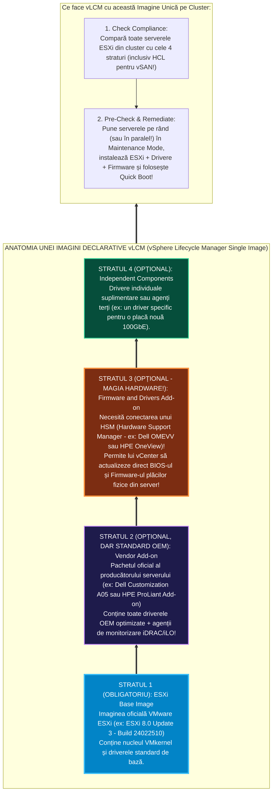
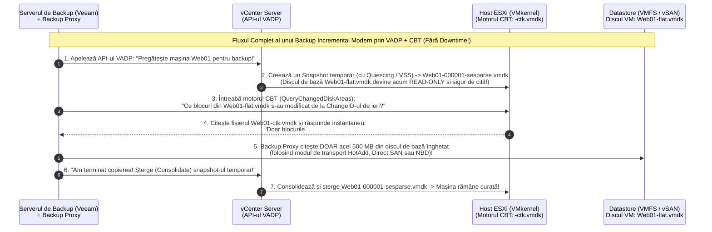

> **Obiectivul Capitolului:** Stăpânirea completă a arhitecturii moderne de actualizare **`vSphere Lifecycle Manager` (`vLCM`)**, diferențierea dintre modul vechi bazat pe **`Baselines` (`VUM`)** și noul model declarativ **`vLCM Single Image`** (`ESXi Base Image` + `Vendor Add-on` + `Firmware and Drivers Add-on` prin `HSM` + `Components`), înțelegerea tehnologiilor de accelerare a mentenanței (**`Quick Boot`** și **`Parallel Remediation`**), configurarea monitorizării proactive (**`vSphere Alarms`**, **`SNMP`**, **`Syslog`**) și disecția arhitecturii de backup în vSphere (**`VADP`**, **`CBT` – *Changed Block Tracking***, cele 3 moduri de transport `SAN / HotAdd / NBD` și **`VCSA Native File-Based Backup`**).
>
> **Regula de Aur a acestui Capitol:** Fiecare acronim, serviciu și mecanism (`vLCM`, `VUM`, `HSM`, `UMDS`, `Quick Boot`, `SNMP`, `MIB`, `Syslog`, `VADP`, `CBT`, `CTK`, `NBD`, `HotAdd`) este explicat integral: **(1) Numele complet**, **(2) Ce reprezintă** și **(3) Cum funcționează tehnic sub capotă**.

:::analogy
### Coșmarul Istoric al Patching-ului: De ce era actualizarea a 50 de servere fizice un chin de o lună?

Imaginează-ți că administrezi un cluster de **32 de servere fizice Dell PowerEdge (sau HPE ProLiant)** pe care rulează `VMware ESXi`.
Acum câțiva ani, pe vremea vechiului utilitar numit **`VUM` (`vSphere Update Manager` – bazat pe `Baselines`)**, ca să aduci la zi cele 32 de servere fără să îți crape producția în ecran mov (`PSOD`), trebuia să faci o muncă titanică în 3 locuri diferite:
1. Actualizai mai întâi **sistemul de operare `ESXi`** din vCenter.
2. Descărcai manual de pe site-ul Dell/HPE **driverele noi (`.vib`)** pentru plăcile de rețea și controllerele RAID/vSAN.
3. Intram separat pe consola `iDRAC / iLO` a fiecăruia dintre cele 32 de servere ca să le actualizezi **Firmware-ul și BIOS-ul fizic**!
Dacă după acest proces rămâneai cu **Driverul nou din 2026** în ESXi, dar uitai să actualizezi **Firmware-ul vechi din 2022** de pe placa fizică, serverul îngheța în mijlocul nopții din cauza incompatibilității dintre Driver și Firmware! Iar fiecare reboot al unui server fizic enterprise dura **10 – 15 minute** (pentru că BIOS-ul făcea teste lungi `POST` de memorie pe $1\text{ TB RAM}$!).

Pentru a elimina complet acest coșmar, VMware a introdus în vSphere 7.0 și a perfecționat în vSphere 8.0 arhitectura **`vLCM` (`vSphere Lifecycle Manager`) cu `Single Image` (Imagine Unică Declarativă)**: un singur buton din vCenter care verifică și actualizează **simultan și ESXi-ul, și Driverele OEM, și Firmware-ul/BIOS-ul fizic al serverului**, folosind în plus **`Quick Boot`** (care repornește doar nucleul `VMkernel` în 30 de secunde, sărind complet peste testele de BIOS ale serverului fizic!).

### Analogia Profesorului: Comanda „A La Carte” cu 50 de Bonuri (`Baselines`) vs. Meniul Complet la Cheie (`vLCM Single Image`)

* **Vechiul model `Baselines` (`VUM` – Imperativ):** Este ca și cum ai merge la un magazin de piese auto și ai cumpăra separat șuruburile, separat bujiile, separat uleiul, încercând să le potrivești tu acasă pe mașină. Tu îi spui sistemului *ce pachete individuale să instaleze peste ce există deja*, fără o garanție că piesele din ani diferiți se potrivesc perfect.
* **Noul model `vLCM Single Image` (Declarativ / *Desired State*):** Este ca și cum ai comanda direct din fabrică **modelul exact al mașinii gata asamblate și testate pe circuit**: tu îi declari clusterului **„Cum vreau să arate starea finală a tuturor serverelor mele la sfârșitul zilei” (`Desired State Image`)**, iar `vLCM` compară starea actuală a fiecărui server cu poza oficială, detectează orice abatere (**`Configuration Drift`**) și aduce toate serverele la exact aceeași versiune de ESXi + Driver + Firmware dintr-o singură lovitură!
:::

:::architecture
### 2.7.1. `vSphere Lifecycle Manager` (`vLCM`): `Baselines` vs. `Single Image`, `HSM`, `Quick Boot` și Ordinea de Upgrade

#### 1. Anatomia unei Imagini Unice `vLCM` (`Single Cluster Image` – Cele 4 Straturi)
*(Subiect obligatoriu și garantat la examenul VCP-DCV 8.0 și VCP-VCF!)*

Când configurezi un cluster în modul modern **`Manage all hosts in the cluster with a single image`**, acea imagine este compusă din **4 blocuri LEGO suprapuse** (dintre care doar primul este obligatoriu, iar celelalte 3 sunt opționale, dar esențiale în producție):

Hai să explicăm termenii cheie din această arhitectură:
1. **`ESXi Base Image` (Obligatoriu):** Versiunea exactă de `VMware ESXi` de la care pleacă imaginea.
2. **`Vendor Add-on` (Opțional):** Colecția de pachete `.vib` certificată de producătorul serverului tău fizic (Dell, HPE, Cisco, Lenovo, Fujitsu). Practic, este echivalentul celebrelor *Custom OEM ISOs* pe care le descărcai manual în trecut, dar acum integrat direct în depozitul (`Depot`) din vCenter!
3. **`Firmware and Drivers Add-on` + `HSM` (`Hardware Support Manager`):**
   * **Cum poate vCenter să rescrie BIOS-ul și Firmware-ul fizic al unui server Dell sau HPE?** Prin integrarea cu o mașină virtuală plugin furnizată de producătorul serverului, numită **`HSM` (`Hardware Support Manager`)** — la Dell se numește **OMEVV (*OpenManage Enterprise Integration for VMware vCenter*)**, la HPE se numește **HPE OneView for VMware vCenter**, iar la Lenovo **XClarity Integrator**!
   * Când `vLCM` pune serverul în *Maintenance Mode* pentru update, el îi dă comandă lui `HSM`, care se conectează la `iDRAC / iLO`, actualizează Firmware-ul plăcilor de rețea și al controllerului RAID, actualizează ESXi-ul și face **un singur reboot combinat** în loc de două!

#### 2. Cerințele Obligatorii pentru a trece un Cluster de la `Baselines` la `vLCM Single Image` (Întrebare VCP!)
Pentru a converti un cluster existent la modul `Single Image`, toate serverele din acel cluster trebuie să îndeplinească **3 condiții stricte**:
1. Toate host-urile din cluster trebuie să ruleze minimum **`ESXi 7.0` sau mai nou**.
2. Toate host-urile trebuie să fie **de la același producător hardware (`Same Hardware Vendor`)** și preferabil din aceeași familie (dacă vrei să folosești un singur *Vendor Add-on* și *Firmware Add-on*).
3. Toate host-urile trebuie să fie **`Stateful Installs`** (adică instalate pe un disc fizic SSD/NVMe/M.2; host-urile pornite fără disc prin *Stateless Auto Deploy* nu suportă `vLCM Single Image`).
* **ATENȚIE (Regulă ireversibilă la Examen):** Odată ce ai trecut un cluster pe **`vLCM Single Image`**, **NU te mai poți întoarce înapoi la vechiul mod `Baselines`!** *(Notă: În cele mai noi versiuni vSphere 8 Update 3 / VCF 9, vechiul mod `Baselines` este complet deprecat și eliminat!).*

#### 3. Cum reduci timpul de mentenanță de la 8 ore la 45 de minute: `Quick Boot`, `Stage` și `Parallel Remediation`
1. **`Quick Boot` (Repornire Rapidă fără ciclul BIOS/POST):**
   * Pe un server fizic cu $1\text{ TB RAM}$, un reboot complet durează 12 minute doar pentru că BIOS-ul fizic numără memoria și inițializează plăcile PCIe (*Power-On Self-Test - POST*).
   * Dacă update-ul de ESXi nu modifică Firmware-ul hardware (ci doar kernelul și driverele ESXi), funcția **`Quick Boot`** oprește mașinile virtuale/le migrează cu vMotion și **reîncarcă în memorie doar noul nucleu `VMkernel` în 20–30 de secunde**, fără a mai reporni placa de bază fizică a serverului!
2. **`Stage` (Pre-descărcarea pachetelor în timpul zilei, fără Maintenance Mode!):**
   * Înainte de fereastra de mentenanță de la ora 22:00, la ora 16:00 apeși pe butonul **`Stage All`**! `vLCM` copiază în fundal toate fișierele de update pe discurile serverelor ESXi **în timp ce mașinile virtuale de producție rulează normal**, astfel încât la ora 22:00 instalarea efectivă durează doar 2 minute!
3. **`Parallel Remediation` (Actualizarea mai multor servere ESXi simultan – introdus în vSphere 8.0!):**
   * În trecut, `vLCM` actualiza serverele strict unul câte unul (secvențial: dacă aveai 32 de servere $\times 15\text{ minute} = 8\text{ ore}$!).
   * În **vSphere 8.0**, poți permite lui `vLCM` să bage în *Maintenance Mode* și să actualizeze **mai multe host-uri ESXi în paralel (simultan)**, reducând timpul total al ferestrei de mentenanță de câteva ori!
4. **Ce faci dacă `vCenter`-ul tău din producție este izolat de Internet (`Air-Gapped / Dark Site`)? Utilitarul `UMDS` (`Update Manager Download Service`)!**
   * Într-o bancă sau instituție militară, `vCenter`-ul nu are voie să iasă pe Internet ca să descarce patch-uri de la Broadcom. În acest caz, instalezi pe o mașină Linux din DMZ utilitarul gratuit **`UMDS` (`Update Manager Download Service`)**, care descarcă patch-urile de pe Internet și le servește local prin HTTPS către `vLCM`-ul din `vCenter`!

#### 4. Ordinea Sacră de Upgrade într-un Data Center VMware (Întrebare Clasică la Examen și Interviu!)
Dacă trebuie să faci upgrade întregii tale infrastructuri de la **vSphere 7.0 la vSphere 8.0**, în ce ordine exactă actualizezi componentele ca să nu dărâmi Data Centerul?
> **REGULA DE FIER A ORDINII DE UPGRADE (De sus în jos!):**
> $$\mathbf{1.\text{ vCenter Server (VCSA)}} \longrightarrow \mathbf{2.\text{ Host-urile ESXi (prin vLCM)}} \longrightarrow \mathbf{3.\text{ VMware Tools (în VMs)}} \longrightarrow \mathbf{4.\text{ Virtual Hardware Version (VM Compatibility)}} \longrightarrow \mathbf{5.\text{ Formatul Stocării (VMFS / vSAN On-Disk Format)}}$$
* *De ce această ordine?* Un **`vCenter 8.0` nou** știe să administreze fără probleme atât host-uri `ESXi 7.0` vechi, cât și `ESXi 8.0` noi! Dar dacă ai face greșeala să actualizezi mai întâi un server la **`ESXi 8.0`** în timp ce ai încă un **`vCenter 7.0` vechi**, vCenter-ul 7.0 nu ar recunoaște noul ESXi 8.0 și l-ar deconecta imediat din inventar! *(Iar dacă ai și `NSX` / `Aria`, verifici întotdeauna **`VMware Product Interoperability Matrix`** înainte de primul click — de regulă `Aria` $\rightarrow$ `NSX` $\rightarrow$ `vCenter` $\rightarrow$ `ESXi`!).*

---

### 2.7.2. Monitorizare Proactivă: `vSphere Alarms`, `Events`, `Performance Charts`, `SNMP` și `Syslog`

#### 1. Cum funcționează Sistemul de Alarme în `vCenter Server` (`Condition` vs. `Event Triggers`)
Un inginer bun nu află că s-a umplut un Datastore de la clientul furios care sună că i-a crăpat baza de date, ci primește o alertă automată cu 3 zile înainte, când Datastore-ul a trecut de $80\%$!
În vCenter, o **`Alarm Definition`** poate fi declanșată de două tipuri de trăgaci (**Triggers**):
1. **`Condition / State Trigger` (Bazat pe un Prag Numeric continuu):**
   * Monitorizează starea actuală sau consumul unei resurse (ex: *VM CPU Usage is above `80%` for `5 minutes`* $\rightarrow$ arată **`Warning` Galben**; *is above `95%` for `10 minutes`* $\rightarrow$ arată **`Critical` Roșu**; *Datastore Disk Usage > `85%`*).
2. **`Event Trigger` (Bazat pe un Eveniment Punctual din sistem):**
   * Nu măsoară un procent, ci reacționează instantaneu în secunda în care se produce o acțiune specifică în vCenter (ex: *„O mașină virtuală a fost ștearsă”*, *„Un host ESXi a ieșit din Maintenance Mode”*, *„Cineva s-a logat pe SSH în ESXi”*).
* **Ce acțiuni automate poate executa o Alarmă în vCenter (`Alarm Actions`):**
  * Trimite un **E-mail** prin `SMTP` către echipa de administratori.
  * Trimite o capcană **`SNMP Trap`** (`Simple Network Management Protocol` pe portul **`UDP 162`**) către sistemul central de monitorizare al companiei (Zabbix, Nagios, SolarWinds, PRTG, Datadog).
  * **Rulează un Script** sau execută o **Acțiune Automată pe VM/Host** (ex: *Migrate VM*, *Reboot Guest OS*, *Enter Maintenance Mode*).

#### 2. De ce este obligatorie redirecționarea Jurnalelor către un Server `Syslog` Central (`UDP 514` / `TCP 514` / `SSL 1514`)?
* Toate jurnalele unui server `ESXi` (`vmkernel.log`, `hostd.log`, `vpxa.log`, `fdm.log`, `auth.log`) se află în `/var/log/`.
* Dar dacă un server `ESXi` suferă o avarie catastrofală a discului său de boot sau este compromis de un atacator care îi șterge logurile locale, pierzi toate dovezile!
* De aceea, din *Host -> Configure -> Advanced System Settings*, setezi parametrul **`Syslog.global.logHost`** (ex: `udp://192.168.10.20:514` sau `ssl://aria-logs.lab.local:1514`). În acel moment, fiecare linie scrisă în logul lui ESXi este trimisă în timp real prin rețea către serverul central de loguri (**`VMware Aria Operations for Logs`**, *Splunk*, *Graylog* sau *ELK Stack*)!

---

### 2.7.3. Arhitectura de Backup în vSphere: `VADP`, `CBT` (`Changed Block Tracking`), Modurile de Transport și Backup-ul Nativ `VCSA`

*(Acesta este subiectul care leagă VMware de toate soluțiile de Backup din lume: **Veeam**, **Commvault**, **Veritas**, **Rubrik**, **Cohesity**, **Nakivo**! Orice interviu tehnic te va întreba cum funcționează `VADP` și `CBT`!).*

#### 1. Cum făceau companiile backup în „Epoca de Piatră” vs. Cum funcționează `VADP` (`vSphere APIs for Data Protection`)?
* **În trecut (Backup cu Agent în interiorul fiecărui VM):** Trebuia să instalezi manual un program de backup în interiorul fiecărei mașini virtuale din cele 1.000! Asta consuma procesorul și RAM-ul mașinilor și era un coșmar de actualizat.
* **Astăzi (`VADP` – `vSphere APIs for Data Protection` / Backup fără Agenți – `Agentless Image-Level Backup`):**
  * Nu mai instalezi nimic în mașinile virtuale! Soluția de backup (ex: **Veeam Backup & Replication**) vorbește direct cu **`vCenter Server`** și cu **`ESXi`** prin interfața oficială **`VADP`**!

#### 2. Ce este `CBT` (`Changed Block Tracking`) și cum reduce timpul de backup de la 8 ore la 2 minute?
Imaginează-ți o mașină virtuală cu un disc de **`2 TB`** (`2.000 GB`). Luni noaptea îi faci primul backup complet (**Full Backup**), care copiază toți cei $2\text{ TB}$ în 4 ore.
Marți, în timpul zilei, utilizatorii au modificat în acea mașină virtuală doar **`5 GB`** de fișiere. Marți noaptea, când pornește **Backup-ul Incremental**, de unde știe Veeam-ul care sunt exact acei $5\text{ GB}$ modificați fără să fie nevoit să citească și să scaneze din nou toți cei $2.000\text{ GB}$ ai discului `.vmdk`?!

Răspunsul este o funcție nativă din kernelul `ESXi` numită **`CBT` (`Changed Block Tracking` / Urmărirea Blocurilor Modificate)**!
* **Cum funcționează tehnic `CBT` în spate:**
  1. Când soluția de backup activează `CBT` pe o mașină virtuală (adăugând în `.vmx` linia **`ctkEnabled = "TRUE"`**), `VMkernel`-ul creează în folderul mașinii virtuale un fișier mic de evidență cu extensia **`-ctk.vmdk`**!
  2. La fiecare scriere făcută de mașina virtuală pe disc, `VMkernel`-ul notează în fișierul `-ctk.vmdk` numărul blocului modificat (împreună cu un identificator de generație numit **`Change ID`**).
  3. Marți noaptea, când Veeam pornește backup-ul incremental, el nu mai scanează discul de $2\text{ TB}$! Îi cere lui ESXi prin `VADP`: *„Hei ESXi, dă-mi din fișierul `-ctk.vmdk` doar lista blocurilor care s-au schimbat după `Change ID`-ul de ieri noapte!”*.
  4. ESXi îi dă lista exactă a celor $5\text{ GB}$ în **o secundă**, Veeam citește doar acei $5\text{ GB}$ și termină backup-ul incremental în **2 minute**!

#### 3. Cele 3 Moduri de Transport `VADP` (Cum ajung datele de pe Datastore în Serverul de Backup – *Întrebare VCP!*)
La Pasul 5 din diagrama de mai sus, pe ce cale fizică sunt citite blocurile din `Web01-flat.vmdk` de către **Backup Proxy**? Există exact **3 Moduri de Transport VADP**:
1. **`NBD` / `NBDSSL` (`Network Block Device` / Transport prin Rețeaua LAN):**
   * Host-ul `ESXi` citește blocurile de pe disc și le trimite prin cablul de rețea de **Management (`vmk0`)** către serverul de backup.
   * *Avantaj:* Merge oriunde, fără configurări speciale. *Dezavantaj:* Este cel mai lent și încarcă rețeaua de Management!
2. **`Virtual Appliance` / `HotAdd` (Transport prin Atașare la Cald la un Proxy Virtual – *Cel mai popular în medii 100% virtuale!*):**
   * Serverul `Backup Proxy` este el însuși o mașină virtuală care rulează pe clusterul ESXi!
   * În momentul backup-ului, vCenter **atașează în mers (`HotAdd`) discul `Web01-flat.vmdk` ca un al doilea hard-disk direct la mașina `Backup Proxy`**! Proxy-ul citește datele direct de pe disc la viteza internă a stocării (fără a trece prin `vmk0`), iar la final detașează discul!
3. **`Direct SAN Access` (Transport Direct din SAN prin Fibre Channel / iSCSI):**
   * Serverul de backup fizic este conectat direct prin cabluri Fibre Channel sau iSCSI la LUN-urile din SAN și citește blocurile direct din SAN, cu **0% încărcare pe serverul ESXi și pe rețeaua LAN (`LAN-Free Backup`)**! *(Notă: Nu este suportat pentru discuri stocate pe `vSAN` sau `NFS`, unde se folosește `HotAdd` sau `NBD`!).*

#### 4. Cum se face Backup la însuși `vCenter Server Appliance` (`VCSA`)? Metoda Oficială: `File-Based Backup` din `VAMI (:5480)`!
*(Subiect critic la examenul VCP-DCV! Cum salvezi și cum restaurezi „Dirijorul” dacă se corupe baza lui de date PostgreSQL?)*
* Deși poți face backup mașinii virtuale `VCSA` și cu Veeam, **metoda numărul 1 recomandată oficial de VMware și testată la examenul VCP** este **`Native File-Based Backup`** configurat direct din interfața **`VAMI` (`https://<FQDN-VCSA>:5480` -> `Backup`)**!
* **Cum funcționează:**
  * Fără să oprească `vCenter`-ul și fără să facă snapshot întregii mașini virtuale, serviciul intern din `VAMI` extrage la cald o copie consistentă doar a **Bazei de Date PostgreSQL, a configurației `vSphere SSO / VMDIR` și a certificatelor `VMCA`** și o încarcă automat (conform unui program zilnic/săptămânal) pe un server extern folosind unul dintre cele 5 protocoale suportate: **`HTTPS`, `FTPS`, `FTP`, `SFTP (SSH)` sau `SMB` (Windows Share)**, cu opțiunea de a cripta arhiva cu o parolă!
* **Cum restaurezi un `VCSA` distrus din acest `File-Based Backup` (2 Etape din ISO!):**
  * Montezi din nou imaginea `.iso` de instalare `VCSA` pe laptopul tău, deschizi **`installer.exe`** și, în loc de *Install*, apeși pe butonul **`Restore`**!
  * În **Stage 1**, instalatorul creează o mașină virtuală `VCSA` nouă și goală pe ESXi; în **Stage 2**, îi dai adresa serverului `SFTP / SMB` unde se află backup-ul, iar noul `VCSA` își toarnă înapoi înăuntru toată baza de date, certificatele și identitatea în 15 minute!
:::

:::exam-alert
### Tabelul de Aur al Resetării `CBT` (`Changed Block Tracking` – VMware KB 2139574)
*În producție, uneori după o pană de curent a unui host ESXi sau după o extindere de disc, fișierul `-ctk.vmdk` se poate desincroniza, iar Veeam dă eroarea: `CBT data is invalid`. Cum resetezi de la zero `CBT`-ul pe o mașină virtuală fără să o ștergi (procedura oficială din KB 2139574)?*
1. Oprești mașina virtuală (*Power Off*) și te asiguri că **nu are niciun Snapshot activ**!
2. În *Edit Settings -> VM Options -> Advanced -> Configuration Parameters*, schimbi `ctkEnabled` pe **`false`** (și pentru fiecare disc `scsi0:x.ctkEnabled` pe **`false`**).
3. Intri pe Datastore și ștergi fișierele vechi **`*-ctk.vmdk`**.
4. Pornești mașina virtuală și rulezi un job de backup — acesta va recrea automat un fișier `-ctk.vmdk` curat și sănătos!
:::

:::interview
### Întrebarea 1 (Nivel Mid / Senior – Arhitectura vLCM Single Image vs. Baselines)
> **Intervievator:** *„De ce am migrat toate clusterele noastre de pe vechiul `Update Manager (Baselines)` pe `vSphere Lifecycle Manager (vLCM Single Image)`? Ce conține exact o imagine vLCM și cum reușește vCenter să actualizeze și BIOS-ul/Firmware-ul unui server fizic Dell sau HPE în același timp cu ESXi-ul?”*

**Răspunsul Ideal:**
„Trecerea de la *Baselines* la *vLCM Single Image* schimbă paradigma de la un model imperativ (aplicare de patch-uri individuale) la un model **declarativ (*Desired State*)** la nivel de cluster, eliminând *Configuration Drift*-ul dintre servere.
O imagine `vLCM` este compusă din 4 elemente: **(1) `ESXi Base Image`** (versiunea de bază ESXi), **(2) `Vendor Add-on`** (pachetul de drivere și utilitare specifice producătorului serverului, ex: Dell/HPE), **(3) `Firmware and Drivers Add-on`** și **(4) `Independent Components`**.

Capacitatea vCenter-ului de a actualiza simultan și Firmware-ul/BIOS-ul fizic al serverului este realizată prin integrarea `vLCM` cu un plugin numit **`HSM` (`Hardware Support Manager`)** — cum este *Dell OpenManage Enterprise (OMEVV)* sau *HPE OneView*. Când `vLCM` remediază un host, el verifică automat compatibilitatea dintre versiunea driverului din ESXi și versiunea firmware-ului de pe placa fizică în raport cu *VMware HCL* (esențial pentru clusterele `vSAN`!), comandă `HSM`-ului să scrie noul firmware prin `iDRAC / iLO` și actualizează ESXi-ul într-un singur ciclu de reboot, reducând masiv durata mentenanței și eliminând ecranele mov (`PSOD`) cauzate de nepotrivirea driver-firmware.”
:::

:::lab
> **Scenariul Laboratorului:** În acest laborator final al Pilonului 2 vom inspecta și configura **`vSphere Lifecycle Manager (vLCM)`** pe clusterul nostru `Lab-Cluster-01`, vom construi o **Alarmă Proactivă Customizată** în `vCenter` și vom executa un **Backup Complet Nativ (`File-Based Backup`) al `vCenter Server Appliance`-ului nostru (`vcsa01.lab.local`)** din consola `VAMI (:5480)`!
:::

:::quiz

:::

:::references
1. **VMware Official Docs:** *Managing Host and Cluster Lifecycle (vSphere 8.0) – Using vSphere Lifecycle Manager Single Images, HSM Firmware Updates, Quick Boot, and Parallel Remediation* (`techdocs.broadcom.com`).
2. **VMware Product Interoperability Matrix & Upgrade Path:** `interopmatrix.vmware.com` – Unealta oficială unde verifici ordinea de upgrade și compatibilitatea între versiuni.
3. **VMware Official Docs:** *vSphere Monitoring and Performance – Configuring Alarms, SNMP Traps, and Syslog Forwarding*.
4. **Broadcom / VMware Knowledge Base (KB 1020128 & KB 2139574):** *Changed Block Tracking (CBT) on virtual machines and resetting CBT*.
5. **VMware Official Docs:** *vCenter Server Installation and Setup – File-Based Backup and Restore of vCenter Server Appliance*.
:::
