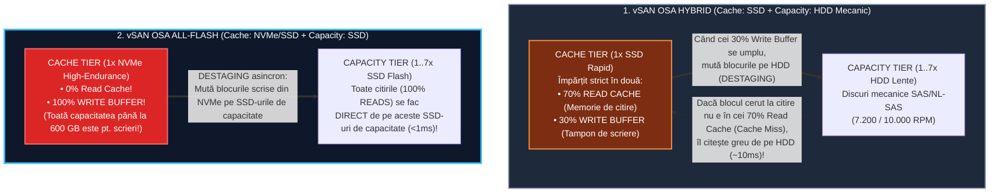
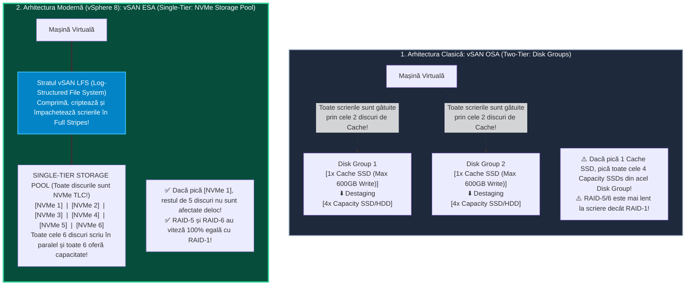

> **Obiectivul Capitolului:** Înțelegerea completă a paradigmei **`HCI` (`Hyper-Converged Infrastructure`)** și a modului în care **`VMware vSAN`** este integrat direct în nucleul **`VMkernel`** (fără mașini virtuale intermediare de tip `VSA`), disecția arhitecturii clasice **`vSAN OSA` (`Original Storage Architecture`)** bazată pe **`Disk Groups`** (`1 Cache Tier` + `1–7 Capacity Tier`, diferențele dintre *Hybrid* și *All-Flash* și mecanismul de *Destaging*), stăpânirea noii arhitecturi revoluționare **`vSAN ESA` (`Express Storage Architecture`)** bazată pe un **`Storage Pool`** unic de discuri **`NVMe`** și sistemul intern **`LFS` (`Log-Structured File System`)**, plus cerințele critice de hardware și rețea (`Pass-Through / HBA Controller Mode`, `Queue Depth`, `vSAN ReadyNodes`, `Unicast`).
>
> **Regula de Aur a acestui Capitol:** Fiecare acronim, arhitectură și concept de stocare (`HCI`, `SDS`, `VSA`, `OSA`, `ESA`, `Disk Group`, `Destaging`, `LFS`, `Pass-Through`, `HBA`, `JBOD`, `ReadyNode`, `RDT`) este explicat integral: **(1) Numele complet**, **(2) Ce reprezintă** și **(3) Cum funcționează tehnic sub capotă**.

:::analogy
### De ce renunță companiile la dulapurile SAN clasice în favoarea `HCI` (`VMware vSAN`)?

În Pilonul 2 am învățat arhitectura tradițională pe 3 niveluri (**`3-Tier Architecture`**) a unui Data Center:
1. Sus ai **Serverele de Calcul (`ESXi Compute Hosts`)** care au procesoare puternice și mult RAM, dar stau cu sloturile de discuri din față aproape goale!
2. La mijloc ai **Rețeaua de Stocare (`Fibre Channel Switches` sau `iSCSI Switches`)**.
3. Jos ai **Dulapul Centralizat de Stocare (`External SAN / NAS Storage Array`)** care costă $150.000\text{ EUR}$ și pe care doar o echipă separată de *Storage Admins* știe să îl configureze.

Această arhitectură clasică are două probleme uriașe: **(1)** Fiecare server `ESXi` pe care îl cumperi are în față între **8 și 24 de sertare goale pentru discuri (`Drive Bays`)** care stau nefolosite, și **(2)** când cumperi încă 10 servere `ESXi` pentru că ai nevoie de mai mult procesor, dulapul extern `SAN` se sufocă deoarece el a rămas cu aceleași două procesoare (controllere) din urmă cu 4 ani!

Așa a apărut revoluția numită **`HCI` (`Hyper-Converged Infrastructure` / Infrastructură Hiper-Convergentă)** prin **`VMware vSAN` (`Virtual Storage Area Network`)**:
* În loc să mai cumperi un dulap SAN extern, bagi SSD-uri / NVMe-uri direct în sertarele frontale ale fiecărui server `ESXi`!
* Bifezi un singur buton în `vCenter` (**`Turn ON vSAN`**), iar modulul `vSAN` din interiorul kernelului `ESXi` adună toate discurile locale din cele 3, 4, 16 sau 64 de servere și le transformă într-un **singur Datastore partajat gigantic (`vsanDatastore`)** văzut de toate serverele simultan!
* **Magia scalării liniare (`Scale-Out`):** Ori de câte ori adaugi un server nou `ESXi` în cluster, crești simultan **ȘI puterea de procesare (CPU/RAM), ȘI spațiul de stocare (TB), ȘI viteza stocării (IOPS)**!

### Analogia Profesorului: Restaurantul cu Bucătărie Centrală la 5 km (`SAN`) vs. Bucătarii din Fiecare Salon (`vSAN`) + Sistemul cu Două Mese (`OSA`) vs. Banda Rulantă Unică (`ESA`)

1. **De ce este `vSAN` în `VMkernel` mai rapid decât concurența bazată pe `VSA` (`Virtual Storage Appliance`)?**
   * Alte soluții HCI de pe piață instalează pe fiecare server ESXi o mașină virtuală greoaie numită **`VSA` (`Virtual Storage Appliance` / `CVM` – *Controller VM*)** care mănâncă `8–12 vCPU` și `32–64 GB RAM` pe fiecare server doar ca să gestioneze discurile!
   * **`VMware vSAN` NU folosește nicio mașină virtuală `VSA`!** `vSAN` este scris direct în codul nucleului **`VMkernel`** al lui `ESXi`: consumă sub `10%` CPU, nu îți blochează procesoarele și vorbește direct cu discurile pe calea cea mai scurtă posibilă!

2. **Diferența dintre cele două arhitecturi `vSAN`: `OSA` (2014) vs. `ESA` (2022 – vSphere 8):**
   * **`vSAN OSA` (`Original Storage Architecture` – Arhitectura pe două niveluri cu `Disk Groups`):** A fost inventată în anul 2014, când SSD-urile erau foarte scumpe și mici, iar discurile mari erau HDD-uri mecanice lente. De aceea, `OSA` funcționează ca o **Recepție de Hotel cu un Singur Recepționer Rapid (`1 Cache Disk` SSD)** în față și **7 Magazii Mari în spate (`1–7 Capacity Disks` HDD/SSD)**. Orice bagaj sosește este lăsat mai întâi la Recepționer (`Cache Tier`), iar noaptea Recepționerul îl cară în spate în cele 7 magazii (**`Destaging`**). Dar în anul 2026, când atât Recepționerul, cât și cele 7 magazii din spate sunt toate discuri **`NVMe` ultra-rapide**, să obligi toate cele 7 discuri NVMe să stea la coadă în spatele unui singur disc de Cache a devenit o **gâtuire (bottleneck)**!
   * **`vSAN ESA` (`Express Storage Architecture` – Noua arhitectură `Single-Tier` din vSphere 8):** A concediat „Recepționerul unic”! În `ESA`, **nu mai există `Disk Groups` și nu mai există disc dedicat de Cache**! Toate discurile `NVMe` din server sunt puse la egalitate într-un singur **`Storage Pool`**: toate discurile oferă **SIMULTAN și capacitate de stocare, și viteză de caching**, scriind cu viteza luminii!
:::

:::architecture
### 3.1.1. Arhitectura Clasică `vSAN OSA` (`Original Storage Architecture`): `Disk Groups`, `Hybrid` vs. `All-Flash` și `Destaging`

*(Chiar dacă vSphere 8 a introdus `ESA`, la examenul VCP și în 80% din companiile existente în producție te vei lovi zilnic de `vSAN OSA`! Trebuie să îi știi limitele matematice pe de rost!).*

#### 1. Ce este un `Disk Group` (Grup de Discuri) în `vSAN OSA`?
În arhitectura `vSAN OSA`, un server `ESXi` care contribuie cu stocare nu își aruncă discurile la grămadă, ci le organizează în containere logice stricte numite **`Disk Groups`**:
* **Câte `Disk Groups` poate avea un singur server `ESXi`?** Între **minimum `1`** și **maximum `5` Disk Groups per host**!
* **Ce conține obligatoriu fiecare `Disk Group`?**
  1. **EXACT `1` singur disc de `Cache Tier` (Nivelul de Accelerare):** Trebuie să fie **obligatoriu un disc Flash (`SSD` / `NVMe`)** cu rezistență mare la scriere (*High Write Endurance*). Acest disc de Cache **NU contribuie cu niciun megabyte la capacitatea totală în TB a Datastore-ului `vSAN`**! Rolul lui este 100% pentru viteză!
  2. **Între `1` și maximum `7` discuri de `Capacity Tier` (Nivelul de Capacitate):** Discurile pe care se stochează efectiv datele mașinilor virtuale (pot fi `HDD`-uri magnetice într-un cluster *Hybrid* sau `SSD/NVMe`-uri într-un cluster *All-Flash*).
* *Calcul rapid de Examen VCP:* Care este numărul maxim de discuri pe care le poate folosi `vSAN OSA` într-un singur server `ESXi`?
  $$\text{5 Disk Groups} \times (\text{1 Cache Disk} + \text{7 Capacity Disks}) = \text{5} \times \text{8} = \mathbf{40\text{ discuri maximum per host!}}$$

> **ATENȚIE – Domeniul de Avarie al unui `Disk Group` (Întrebare Garantată la Examen!):**
> Într-un `Disk Group`, ce se întâmplă dacă se arde unul dintre cele 7 discuri de Capacitate? Pierzi doar acel disc de capacitate.
> **Dar ce se întâmplă dacă se arde unicul disc de `Cache Tier` din capul acelui `Disk Group`?!**
> **ÎNTREGUL `DISK GROUP` (cu toate cele 7 discuri de capacitate din spatele lui) CADE INSTANTANEU OFFLINE!** De aceea, în producție, este o practică mult mai bună să creezi pe fiecare server **2 sau 3 `Disk Groups` mai mici** (de exemplu, 2 grupuri a câte 1 Cache + 4 Capacity) decât un singur `Disk Group` mare (1 Cache + 7 Capacity), pentru a înjumătăți impactul căderii unui disc de Cache!

#### 2. Diferența Critică în `vSAN OSA`: Cum funcționează Discul de Cache în `Hybrid` (`70% / 30%`) vs. `All-Flash` (`100% Write`)!
*(Aceasta este întrebarea favorită a examinatorilor VMware pe `vSAN OSA`!)*

Cum este împărțit discul SSD din `Cache Tier` în cele două variante ale arhitecturii `vSAN OSA`?

1. **În `vSAN OSA Hybrid` (`SSD Cache` + `HDD Capacity`):**
   * Pentru că discurile de capacitate sunt HDD-uri mecanice lente, avem mare nevoie de SSD-ul de Cache ca să accelereze **atât citirile, cât și scrierile**!
   * De aceea, `vSAN` împarte automat discul SSD din `Cache Tier` după regula fixă **`70% / 30%`**:
     * **`70% Read Cache`:** Păstrează blocurile cele mai des citite de mașinile virtuale, pentru a nu mai aștepta după brațul mecanic al HDD-ului.
     * **`30% Write Buffer`:** Preia instantaneu toate scrierile noi (`Writes`), confirmă mașinii virtuale că scrierea s-a terminat în sub $1\text{ ms}$, iar mai târziu, în fundal, un proces intern numit **Elevator Algorithm** coboară blocurile din `Write Buffer` pe HDD-urile mecanice (proces numit **`Destaging` / De-etajare**)!
2. **În `vSAN OSA All-Flash` (`NVMe/SSD Cache` + `SSD Capacity`):**
   * Aici, și discurile din `Capacity Tier` sunt tot **`SSD`-uri ultra-rapide** la citire! De ce am mai strica $70\%$ din discul scump de Cache pentru citiri, când putem citi direct de pe SSD-urile de capacitate în $0.5\text{ ms}$?!
   * Prin urmare, în **`vSAN OSA All-Flash`**, discul de Cache este alocat **`100% pentru WRITE BUFFER` (`0% Read Cache`)**, iar **toate citirile (`Reads`) merg direct pe SSD-urile din `Capacity Tier`** (dacă blocul nu se află încă în *Write Buffer* înainte de *Destaging*)!
   * **Limita fizică de Memorat pentru Examen (`600 GB` în `OSA`):** În `vSAN OSA`, indiferent dacă pui în `Cache Tier` un disc NVMe de $800\text{ GB}$, de $1.6\text{ TB}$ sau de $3.2\text{ TB}$, algoritmul `vSAN OSA` **folosește efectiv ca *Write Buffer* maximum `600 GB`**! *(De ce pun atunci unii arhitecți un disc de $1.6\text{ TB}$ în Cache Tier dacă vSAN folosește doar $600\text{ GB}$? Pentru **durata de viață / rezistența la uzură (`TBW` / `DWPD` – *Drive Writes Per Day*)**, deoarece controllerul SSD-ului rotește scrierile pe toate celulele de $1.6\text{ TB}$!).*

---

### 3.1.2. Revoluția `vSAN ESA` (`Express Storage Architecture` – vSphere 8.0+): `Storage Pools`, `LFS` și Performanță Nativă `NVMe`

În anul 2022, odată cu lansarea **vSphere 8.0**, VMware a construit de la zero o a doua arhitectură paralelă în interiorul `vSAN`, numită **`vSAN ESA` (`Express Storage Architecture`)**, proiectată exclusiv pentru epoca serverelor moderne echipate 100% cu discuri **`NVMe` (`TLC` – *Triple-Level Cell*)** și rețele de **`25 Gbps / 100 Gbps`**!

#### 1. Cum elimină `vSAN ESA` toate limitările vechiului `OSA`?
1. **Dispariția `Disk Groups` și apariția `Single-Tier Storage Pool`:**
   * În `vSAN ESA`, **NU MAI EXISTĂ `Disk Groups`** și nu mai irosești discuri dedicate doar pentru Cache!
   * Toate discurile `NVMe` din serverul ESXi sunt adăugate într-un singur **`Storage Pool`** pe acel host: **fiecare disc `NVMe` contribuie 100% la capacitatea de stocare a Datastore-ului ȘI participă simultan la preluarea scrierilor rapide**!
   * **Domeniu de avarie redus la un singur disc:** Dacă în `vSAN ESA` se arde un disc `NVMe`, **pierzi strict doar acel singur disc** — celelalte discuri din același server merg mai departe fără nicio întrerupere (spre deosebire de `OSA`, unde arderea discului de Cache dărâma toate cele 7 discuri din grup!).
2. **Motorul Intern `vSAN LFS` (`Log-Structured File System`) și `Log-Structured Object Manager`:**
   * În `vSAN OSA`, dacă foloseai politica `RAID-5` sau `RAID-6` (Erasure Coding), performanța la scriere scădea din cauza penalizării de paritate (*Write Penalty*), deoarece trebuia să citești și să rescrii bucăți mici pe mai multe servere.
   * În **`vSAN ESA`**, noul strat patentat numit **`vSAN LFS` (`Log-Structured File System`)** adună scrierile mici ale mașinii virtuale în memorie, le comprimă pe loc, le împachetează într-un **rând complet (`Full Stripe Write`)** și le scrie secvențial dintr-o singură mișcare pe toate serverele!
   * **Rezultatul Uluitor (Testat la Examenul VCP 8.0!):** În **`vSAN ESA`**, politica **`RAID-5 / RAID-6` (care economisește enorm de mult spațiu pe disc!) oferă ACUM PERFORMANȚĂ EGALĂ CU `RAID-1` (Mirroring)**, fără nicio penalizare de viteză!

#### 3. Tabelul Comparativ Oficial: `vSAN OSA` vs. `vSAN ESA` (De Memorat pentru VCP-DCV & vSAN Specialist!)

| Criteriu Arhitectural | `vSAN OSA` (*Original Storage Architecture*) | `vSAN ESA` (*Express Storage Architecture*) |
| :--- | :--- | :--- |
| **Structura Discurilor pe Host** | **2 Niveluri (`Disk Groups`):** `1 Cache` + `1–7 Capacity` (max 5 grupuri = 40 discuri). | **1 Singur Nivel (`Storage Pool`):** Fără disc dedicat de Cache! Toate discurile sunt egale. |
| **Tipuri de Discuri Suportate** | `HDD` (în Hybrid), `SATA SSD`, `SAS SSD`, `NVMe`. | **Exclusiv discuri `NVMe` (`PCIe`)** de înaltă performanță certificate pe HCL! |
| **Cerința de Rețea Fizică** | Minimum `1 Gbps` pentru Hybrid / **`10 Gbps`** pentru All-Flash. | Minimum **`25 Gbps`** (sau `10 Gbps` doar pe profilul mic `AF-0`)! |
| **Cum se cumpără Hardware-ul?** | Fie **`vSAN ReadyNodes`**, fie *Build-Your-Own (BYO)* din piese de pe HCL. | **Recomandat strict prin `vSAN ReadyNodes`** pre-validate (`vSAN-ESA-AF-0` ... `AF-8`). |
| **Performanța `RAID-5 / RAID-6`** | Mai lentă la scriere decât `RAID-1` din cauza *Read-Modify-Write*. | **Viteză 100% egală cu `RAID-1`** datorită motorului `vSAN LFS`! |
| **Unde se fac Compresia și Criptarea?** | Jos, la final, când datele coboară din Cache în Capacity (*Cold path*), **pe întregul Disk Group**. | Sus în **`LFS`** (*Upper stack*), o singură dată înainte de a trimite datele pe rețea, **activabilă per Mașină Virtuală (prin SPBM)**! |
| **Ce se întâmplă când pică 1 disc?** | Dacă pică discul de Cache, **cade tot Disk Group-ul (până la 8 discuri)**! | Cade **doar acel singur disc NVMe** din *Storage Pool*! |

---

### 3.1.3. Cerințele Critice de Hardware, Controllere (`Pass-Through / HBA` vs. `RAID-0`) și Rețea pentru `vSAN`

*(Aici greșesc 90% dintre inginerii care comandă servere pentru primul lor cluster `vSAN` în producție! Citește cu maximă atenție!)*

#### 1. Regula Nr. 1: Controllerul Fizic de Stocare TREBUIE să fie în modul `Pass-Through / HBA` (NU Hardware RAID!)
* Când cumperi un server Dell sau HPE clasic, acesta vine cu un controller **Hardware RAID** (ex: *Dell PERC H755*). Într-un server normal, creezi un volum `RAID-5` din BIOS-ul acelui controller.
* **ÎN `VMware vSAN`, HARDWARE RAID ESTE STRICT INTERZIS!** De ce?
  * Pentru că **`vSAN` însuși este cel care face RAID-ul în software, între servere diferite**, și are nevoie să vadă **fiecare disc fizic individual în mod direct** (să îi citească seria, temperatura S.M.A.R.T., erorile și să îi controleze direct coada de comenzi)!
  * Dacă ai face un `RAID-5` hardware din cele 6 SSD-uri ale serverului și l-ai prezenta lui ESXi ca un singur disc mare, `vSAN` ar fi complet orbit și nu ar ști când se arde un disc!
* **Prin urmare, pentru `vSAN` (`OSA`), controllerul fizic din server TREBUIE să fie un `HBA` (`Host Bus Adapter` – ex: *Dell HBA355i*) sau un controller configurat în modul `Pass-Through / JBOD` (`Just a Bunch Of Disks` / Fără RAID)**, astfel încât fiecare SSD fizic să apară direct și nefiltrat în ESXi! *(Iar în `vSAN ESA`, discurile fiind `NVMe`, ele sunt conectate direct la magistrala `PCIe` a procesorului, fără niciun controller RAID/SAS la mijloc!).*
* **Parametrul critic al Controllerului în `vSAN OSA`: `Queue Depth >= 256`!**
  * Conform **VMware vSAN HCL**, controllerul SAS/HBA folosit pentru `vSAN` trebuie să aibă o **Adâncime a Cozii (`Controller Queue Depth`) de minimum `256`**! Dacă folosești un controller ieftin care are `Queue Depth = 32` sau `64`, în momentul în care `vSAN` începe să reconstruiască un disc căzut (*Resync*), coada de 32 de comenzi se umple în o milisecundă, iar mașinile virtuale îngheață cu latențe de peste $100\text{ ms}$!

#### 2. Ce este un `vSAN ReadyNode`?
* În loc să stai 3 săptămâni cu lista `VMware HCL` în față ca să verifici manual dacă modelul de procesor, modelul de controller HBA, versiunea lui de driver, versiunea lui de firmware și modelul exact de SSD cu firmware-ul lui sunt compatibile între ele, poți cumpăra de la Dell, HPE, Lenovo sau Cisco un server pre-configurat și certificat din fabrică pentru vSAN numit **`vSAN ReadyNode`** (de exemplu: *Dell vSAN ReadyNode R760* sau *HPE ProLiant DL380 Gen11 vSAN ReadyNode*)!

#### 3. Cerințele de Rețea și Număr Minim de Host-uri pentru `vSAN`
1. **Numărul Minim și Maxim de Servere `ESXi` într-un Cluster `vSAN`:**
   * **Standard Cluster:** Minimum **`3` servere ESXi** care contribuie cu stocare (pentru a avea majoritate de voturi `2 din 3` la quorum!) și maximum **`64` de servere ESXi** per cluster!
   * *Excepție:* Există o configurație specială pentru sucursale mici numită **`2-Node vSAN Cluster` (Direct-Connect)**, unde ai doar **`2` servere ESXi** fizice în sucursală, dar ești obligat să instalezi în sediul central o mașină virtuală gratuită numită **`vSAN Witness Appliance`** care ține al treilea vot de departajare (*Witness*)!
   * **Un server fără discuri poate folosi `vsanDatastore`-ul? (`Compute-Only Node`):** **DA!** Într-un cluster `vSAN` de 4 servere, 3 servere pot avea discuri în vSAN, iar al 4-lea server poate să nu aibă niciun disc în vSAN (*Compute-Only*), dar își poate rula mașinile virtuale pe `vsanDatastore`-ul oferit de primele 3!
2. **Protocolul de Rețea `vSAN`: De la `Multicast` la `Unicast` și `RDT` (`Reliable Datagram Transport`):**
   * *Capcană Istorică de Examen:* În versiunile vechi (până la vSAN 6.5), `vSAN` cerea ca switch-urile fizice să fie configurate cu **IP Multicast (`IGMP Snooping` / `PIM`)**.
   * **Începând cu vSAN 6.6, 7.0 și 8.0, `vSAN` folosește EXCLUSIV `IP Unicast`!** Nu mai este nevoie de Multicast pe switch-urile fizice!
   * Tot traficul de date între host-urile `vSAN` circulă printr-un protocol proprietar VMware de mare viteză peste TCP numit **`RDT` (`Reliable Datagram Transport`)** (sau **`RDMA` – `Remote Direct Memory Access` / `RoCE v2`** în rețelele moderne de $25/100\text{ Gbps}$ fără pierderi!).
:::

:::exam-alert
### Trucul Suprem de Homelab (De la William Lam): Cum construiești `vSAN OSA` și `vSAN ESA` într-un Nested Lab fără discuri NVMe enterprise!
* **Problema 1 (Pentru `vSAN OSA` în Home Lab):** Când adaugi discuri virtuale noi pe mașinile tale `Nested ESXi`, uneori ESXi le vede ca `HDD` în loc de `SSD (Flash)`.
  * **Soluția din GUI/CLI:** În `vSphere Client` $\rightarrow$ *Host -> Configure -> Storage -> Storage Devices*, poți selecta orice disc virtual și poți apăsa pe butonul **`Mark as Flash`** (sau **`Mark as HDD`**)! Astfel, poți simula atât un cluster *vSAN Hybrid*, cât și unul *vSAN All-Flash* din câteva click-uri!
* **Problema 2 (Pentru `vSAN ESA` în Home Lab):** În mod normal, vrăjitorul `vSAN ESA` din vSphere 8 verifică dacă serverul tău este un *vSAN ReadyNode* oficial cu discuri NVMe pe HCL și placă de `25 Gbps`! Cum îl activezi în laboratorul tău de pe PC?
  * **Soluția lui William Lam:** Adaugi discurile suplimentare pe mașinile tale `Nested ESXi` atașate la un controller de tip **`Virtual NVMe Controller`**, iar în `vCenter` dezactivezi verificarea HCL sau rulezi scriptul de laborator care marchează discurile virtuale NVMe ca eligibile pentru `Storage Pool`-ul `vSAN ESA`!
:::

:::interview
### Întrebarea 1 (Nivel Mid / Senior – De ce alegem vSAN ESA în vSphere 8 față de vSAN OSA?)
> **Intervievator:** *„Cumpărăm 6 servere noi echipate 100% cu discuri NVMe și plăci de rețea de 25 Gbps pentru a instala vSphere 8 și vSAN. Un coleg vrea să le configureze pe arhitectura clasică `vSAN OSA` cu Disk Groups, pentru că pe aceea o știe din vSphere 7. Ce argumente tehnice îi aduci pentru a-l convinge că pe hardware NVMe nou trebuie să alegem `vSAN ESA`?”*

**Răspunsul Ideal:**
„Pe servere noi echipate cu discuri `NVMe` și rețea de `25 Gbps`, folosirea vechii arhitecturi `vSAN OSA` ar lăsa pe masă jumătate din performanța și capacitatea pe care am plătit-o, din 4 motive arhitecturale clare:
1. **Eliminarea gâtuirii și a taxei pe discul de Cache (`Single-Tier Storage Pool`):** În `OSA`, din 8 discuri NVMe per server, ar trebui să sacrificăm 1 sau 2 discuri NVMe exclusiv pentru *Cache Tier* (care sunt plafonate la $600\text{ GB}$ de *Write Buffer* și nu oferă capacitate de stocare), obligând celelalte 6-7 discuri NVMe să aștepte după ele. În **`vSAN ESA`**, toate cele 8 discuri NVMe intră într-un singur *Storage Pool*, oferind simultan atât capacitate utilă, cât și caching în paralel.
2. **Izolarea domeniului de avarie (*Blast Radius*):** În `OSA`, dacă se defectează discul de Cache, pierdem întregul *Disk Group* și declanșăm o reconstrucție masivă în rețea. În `ESA`, defectarea unui disc NVMe afectează strict doar acel disc individual.
3. **RAID-5/6 la viteză de RAID-1 (`vSAN LFS`):** Datorită noului *Log-Structured File System (`LFS`)* din `ESA`, putem folosi politica **RAID-5 sau RAID-6 (Erasure Coding)** — care ne economisește între $33\%$ și $50\%$ din spațiul pe disc față de RAID-1 — obținând **performanță 100% egală cu RAID-1**, fără penalizarea de scriere din `OSA`.
4. **Compresie nativă de 4 ori mai eficientă:** În `ESA`, compresia se face în partea superioară a stivei pe blocuri de $4\text{ KB}$, reducând inclusiv traficul trimis pe cablurile de rețea între host-uri.”
:::

:::lab
> **Scenariul Laboratorului:** În acest laborator ne pregătim cele **3 servere `Nested ESXi` (`esxi01`, `esxi02`, `esxi03`)** pentru construirea primului nostru cluster hiper-convergent **`VMware vSAN`**! Vom adăuga pe fiecare server câte două discuri virtuale noi (unul de $20\text{ GB}$ pentru Cache și unul de $100\text{ GB}$ pentru Capacity, în mod *Thin Provisioned*), vom configura rețeaua dedicată `VMkernel` pentru traficul `vSAN` (`192.168.30.51..53`) și vom activa clusterul `vSAN`!
:::

:::quiz

:::

:::references
1. **VMware Official Docs / vSAN Space (core.vmware.com):** *vSAN Planning and Deployment Guide & Introduction to the vSAN Express Storage Architecture (ESA) in vSphere 8* (`techdocs.broadcom.com`).
2. **Duncan Epping & Cormac Hogan:** *VMware vSAN Essential Reference & OSA vs. ESA Architectural Comparison* (`yellow-bricks.com` / `cormachogan.com`).
3. **Broadcom / VMware Compatibility Guide for vSAN:** `compatibilityguide.broadcom.com` – Secțiunea *vSAN ReadyNodes* și *Storage Controllers (Queue Depth >= 256)*.
4. **Broadcom / VMware Knowledge Base (KB 2150567):** *Understanding vSAN Cache Tier sizing (600 GB Write Buffer limit in OSA) and Endurance Classes*.
:::
