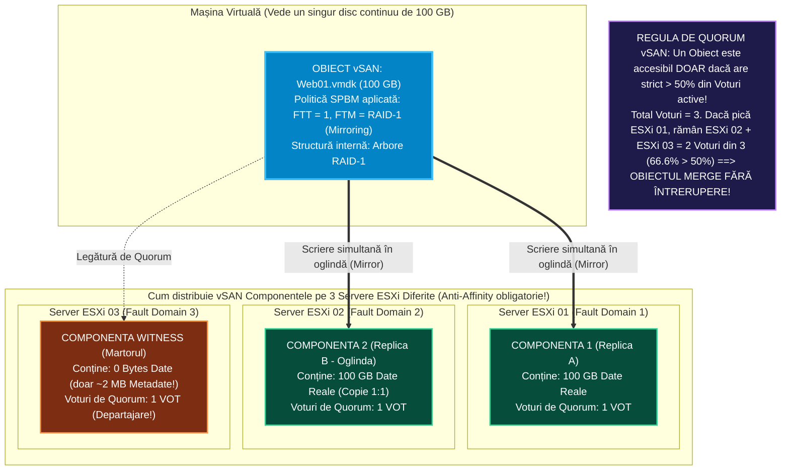

> **Obiectivul Capitolului:** Înțelegerea completă a faptului că `VMware vSAN` nu este un sistem de fișiere clasic, ci un **`Object-Based Storage System` (Sistem de Stocare Bazat pe Obiecte)**, disecția celor **5 tipuri de Obiecte `vSAN`**, diferențierea exactă între **`Object`**, **`Component`** (limita de `255 GB` în `OSA`) și **`Witness Component`** (mecanismul de vot și quorum împotriva `Split-Brain`), stăpânirea completă a **`SPBM` (`Storage Policy-Based Management`)** și calculul matematic la virgulă al numărului minim de servere ESXi și al consumului real de spațiu pe disc pentru **`FTT = 0, 1, 2, 3`** cu **`RAID-1 Mirroring`** vs. **`RAID-5 / RAID-6 Erasure Coding`** (atât în `vSAN OSA`, cât și regula adaptivă din `vSAN ESA`).
>
> **Regula de Aur a acestui Capitol:** Fiecare acronim, formulă matematică și parametru de politică (`Object`, `Component`, `Witness`, `Votes`, `CLOM`, `DOM`, `LSOM`, `CMMDS`, `SPBM`, `FTT`, `FTM`, `Erasure Coding`, `Stripe Width`, `OSR`, `IOPS Limit`) este explicat integral: **(1) Numele complet**, **(2) Ce reprezintă** și **(3) Cum funcționează tehnic și matematic în spate**.

:::analogy
### De ce este `vSAN` complet diferit de un SAN clasic unde setezi RAID-ul pe întregul LUN?

Într-un echipament `SAN` tradițional, administratorul de stocare ia 10 discuri fizice, le configurează în `RAID-5` din panoul SAN-ului și îți expune un singur `LUN` mare de $10\text{ TB}$ formatat cu `VMFS-6`.
Care este marea problemă cu acest `LUN` clasic? **Toate mașinile virtuale pe care le pui pe acel LUN sunt forțate să aibă exact același nivel de RAID și aceeași performanță!** Dacă pe același LUN pui și o bază de date bancară critică (care ar avea nevoie de viteza `RAID-10` și protecție dublă), și un server neimportant de test sau de printare (care ar putea sta fără probleme pe `RAID-5` sau chiar `RAID-0`), amândouă primesc exact același tratament rigid al LUN-ului!

**Cum a schimbat `VMware vSAN` și `SPBM` (`Storage Policy-Based Management`) regulile jocului?**
În `vSAN`, Datastore-ul `vsanDatastore` **NU are un nivel RAID fix pe tot volumul**! În schimb, **tu alegi nivelul de RAID (`RAID-0`, `RAID-1`, `RAID-5`, `RAID-6`), numărul de duble/triple copii (`FTT`) și viteza (`Stripes / IOPS`) INDIVIDUAL PENTRU FIECARE MAȘINĂ VIRTUALĂ ÎN PARTE (sau chiar diferit pentru fiecare disc `.vmdk` al aceleiași mașini virtuale!)** printr-o simplă politică software numită **`vSAN Storage Policy` (`SPBM`)**!
Mai mult: dacă mâine dimineață șeful îți spune că mașina `VM-Test` a devenit aplicație de producție, nu trebuie să o muți pe alt Datastore! Dai două click-uri pe ea, îi schimbi politica din `RAID-5` în `RAID-1 (FTT=2)`, apeși *Apply*, iar `vSAN` îi reorganizează blocurile în fundal în timp ce mașina merge la 100%!

### Analogia Profesorului: Valiza de Călătorie (`Object`), Cutiile de Carton de 255 kg (`Components`) și Notarul care Ține Votul de Departajare (`Witness`)

Pentru a înțelege cum păstrează `vSAN` datele tale fără să folosească `VMFS`, imaginează-ți următoarea scenă:

* **`Object` (Obiectul `vSAN` – Valiza Completă a Mașinii Virtuale):** O mașină virtuală are un disc virtual `Web01.vmdk` de **`400 GB`**. Pentru Windows-ul din mașină, acesta pare un singur disc întreg de $400\text{ GB}$ (un **Obiect**).
* **`Component` (Componenta `vSAN` – Cutiile în care este împărțită valiza pe servere):**
  * În arhitectura `vSAN OSA`, niciun pachet individual pus pe un disc fizic nu are voie să fie mai mare de **`255 GB`**!
  * Așadar, când creezi un disc `.vmdk` de **`400 GB`**, motorul `vSAN` îl taie automat în **2 cutii (`Components`)** lipite cap la cap (`RAID-0 Concatenation`): **Cutia 1 (de `200 GB`)** și **Cutia 2 (de `200 GB`)**.
  * Apoi, pentru că politica ta cere să supraviețuiești dacă ia foc un server fizic (**`FTT = 1, RAID-1 Mirroring`**), `vSAN` face o **clonă identică în oglindă** a acestor cutii și o trimite prin rețea pe un **al doilea server ESXi**!
* **`Witness` (Componenta Martor – Notarul cu `0 Bytes` de date, dar cu Drept de Vot!):**
  * Dar stai! Dacă Cutia Originală stă pe **Serverul 1**, iar Clona în Oglindă stă pe **Serverul 2**, și se rupe cablul de rețea dintre Serverul 1 și Serverul 2 (*Split-Brain*), fiecare server are câte 1 vot ($50\% \text{ vs. } 50\%$). Cine are dreptul să lase mașina virtuală să scrie pe disc?! Niciunul!
  * De aceea, `vSAN` plasează automat pe **Serverul 3** o cutiuță mică de doar **`2 MB` de metadate** (care nu conține niciun bit din datele tale!), numită **`Witness Component` (Martorul)**! Dacă Serverul 1 și Serverul 3 rămân împreună, ele adună **2 voturi din 3 (`66.6% > 50%` = Quorum / Majoritate!)** și mașina virtuală continuă să meargă fără nicio întrerupere!
:::

:::architecture
### 3.2.1. Ce este un `Object Store`: Cele 5 Tipuri de Obiecte `vSAN`, `Components`, `Witness` și Subsistema Internă (`CLOM`, `DOM`, `LSOM`, `CMMDS`)

#### 1. Cele 5 Tipuri de Obiecte pe care le creează o Mașină Virtuală pe `vsanDatastore`

*(Întrebare clasică la examenul VCP și vSAN Specialist!)*
Pe un Datastore `vSAN`, o mașină virtuală nu este o colecție de fișiere `-flat.vmdk`, ci o colecție de **până la 5 tipuri de Obiecte (`vSAN Objects`)**, fiecare având propriul său arbore RAID și propria sa politică de stocare:

1. **`VM Home Namespace` (Folderul „Casă” al Mașinii Virtuale):**
   * Este singurul obiect formatat intern cu un mic sistem de fișiere numit **`virsto` / `VMFS-L`**, creat special pentru a ține fișierele mici de text și configurare care au nevoie de o structură de director: `.vmx`, `.nvram`, `.vmsd`, `vmware.log` și descriptorii text `.vmdk` (care au doar 500 Bytes și conțin adresa UUID a obiectului VMDK!).
2. **`VMDK` (`Virtual Machine Disk Object`):**
   * Obiectul nativ care stochează blocurile hard-disk-ului virtual (pentru fiecare disc virtual adăugat mașinii se creează câte un obiect `VMDK` separat; în `vSAN` **NU există fișierul `-flat.vmdk`**!).
3. **`VM Swap Object` (`.vswp`):**
   * Obiectul creat doar atunci când mașina virtuală este **pornită (`Powered On`)**. *(În vSAN 6.7 / 7.0 / 8.0, acest obiect este creat automat în format **Thin Provisioned** și moștenește politica de stocare a mașinii virtuale).*
4. **`Snapshot Delta Disks` (`vsanSparse` Object):**
   * Creat pentru fiecare disc atunci când faci un Snapshot al mașinii virtuale.
5. **`Snapshot Memory Object` (`.vmsn` / `.vmem`):**
   * Creat atunci când faci un Snapshot cu opțiunea *Include virtual machine's memory* bifată (sau când pui mașina pe *Suspend*).

#### 2. Anatomia: `Object` vs. `Component` (`255 GB` Limit) vs. `Witness` și Regulile de `Quorum` (`> 50% Votes`)

Hai să înțelegem exact cum este construit în interior un Obiect `vSAN` (de exemplu un disc `VMDK` de $100\text{ GB}$ cu politica implicită `FTT = 1, RAID-1 Mirroring`) și cum îl împarte `vSAN` pe cele 3 servere `ESXi`:

* **Ce este o `Component` (Componentă / Frunză a arborelui RAID)?**
  * Este bucata fizică de date stocată pe un disc dintr-un anumit server `ESXi`.
  * **Limita de `255 GB` în `vSAN OSA`:** În arhitectura `OSA`, o singură componentă are dimensiunea maximă de **`255 GB`**. Dacă creezi un disc `.vmdk` de $600\text{ GB}$, `vSAN` îl împarte automat în 3 componente de câte $200\text{ GB}$ concatenate (iar în oglindă `RAID-1` mai creează încă 3 componente de $200\text{ GB}$ pe alt server = 6 componente de date + Witness!).
  * **Limita maximă de componente pe un host ESXi:** Un singur server `ESXi` poate găzdui maximum **`9.000 de componente`** în `vSAN OSA` (și până la **`27.000 de componente`** în `vSAN ESA`!).
* **Cum funcționează Voturile (`Votes`) și `Quorum`-ul în `vSAN`?**
  * Fiecare componentă a unui obiect primește **1 Vot** (sau mai multe voturi ponderate în configurații complexe).
  * **Regula de Fier a `vSAN`-ului:** Pentru ca o mașină virtuală să poată citi și scrie într-un Obiect `vSAN`, acel obiect trebuie să aibă online **strict mai mult de `50%` (`> 50%`) din totalul voturilor sale**! (La egalitate `50% vs. 50%`, obiectul devine *Inaccessible* pentru a preveni coruperea datelor prin *Split-Brain*!).
  * *Notă pentru **`vSAN ESA`** și **`RAID-5/6`**:* Când un obiect este deja împărțit pe 4 sau 6 servere diferite (cum este la `RAID-5` sau `RAID-6`), adesea nu mai este nevoie de o componentă `Witness` separată, deoarece voturile sunt deja distribuite pe suficiente servere încât majoritatea să fie decisă direct de componentele de date (sau prin voturi ponderate: o componentă primește 2 voturi, iar celelalte câte 1 vot, astfel încât suma totală de voturi să fie întotdeauna un **număr impar**!).

#### 3. Cele 4 Module Interne din `VMkernel` care conduc `vSAN` (`CLOM`, `DOM`, `LSOM`, `CMMDS`)

*(Dacă la un interviu de Senior pronunți și explici aceste 4 acronime din arhitectura internă `vSAN`, intervievatorul va ști pe loc că ești la nivel de arhitect!)*

1. **`CLOM` (`Cluster Level Object Manager` – „Arhitectul Șef”):**
   * Citește politica de stocare **`SPBM`** pe care ai ales-o în vCenter (ex: `FTT=1, RAID-5`), verifică dacă există suficient spațiu și suficiente servere în cluster și proiectează „schița” modului în care trebuie tăiat și plasat obiectul pe servere (și tot el declanșează reconstrucția după **timer-ul de 60 de minute** când cade un server!).
2. **`DOM` (`Distributed Object Manager` – „Dirijorul Traficului în Rețea”):**
   * Preia schița de la `CLOM`, creează arborele RAID distribuit și se ocupă de multiplicarea și trimiterea fiecărui bloc scris prin rețea către toate serverele care dețin replici ale acelui obiect.
3. **`LSOM` (`Local Log-Structured Object Manager` – „Muncitorul de pe Discul Fizic Local”):**
   * Rulează jos, pe fiecare server ESXi în parte, direct deasupra SSD-urilor fizice: primește blocurile de la `DOM` și le scrie efectiv pe discul local de Cache/Capacity, gestionând bufferul și *Destaging*-ul.
4. **`CMMDS` (`Cluster Monitoring, Membership, and Directory Service` – „Starea Civilă și Telefonul Clusterului”):**
   * Ține catalogul în timp real cu ce servere sunt vii în cluster, pe ce disc fizic se află fiecare componentă și cine are voturile de quorum.

---

### 3.2.2. Matematica Supremă `SPBM`: `FTT`, `RAID-1` vs. `RAID-5` vs. `RAID-6` (Calculul Serverelor și al Spațiului pe Disc!)

*(ATENȚIE MAXIMĂ: Această secțiune îți garantează rezolvarea a 3–5 întrebări de calcul matematic care pică la absolut fiecare examen **VCP-DCV**, **vSAN Specialist** și **VCP-VCF**!)*

În `SPBM` (`Storage Policy-Based Management`), cele două setări principale care dictează siguranța și consumul de spațiu sunt:
1. **`FTT` (`Failures to Tolerate` / Numărul de Defecțiuni Tolerate):** La câte servere fizice `ESXi` (sau discuri / rack-uri) arse simultan vrei să supraviețuiască mașina ta virtuală fără să piardă niciun bit de date? Poate avea valorile: **`0`, `1`, `2` sau `3`**.
2. **`FTM` (`Failure Tolerance Method` / Metoda de Protecție RAID):** Cum protejăm datele? Prin **`RAID-1 (Mirroring / Oglindire)`** sau prin **`RAID-5 / RAID-6 (Erasure Coding / Codare cu Paritate)`**?

#### 1. Tabelul Matematic de Aur pentru Examen: Câți Host-uri `ESXi` îți trebuie și Cât Spațiu Real pe Disc ocupă un `.vmdk` de `100 GB`!

Memorează acest tabel — îți oferă răspunsul instantaneu la orice întrebare de dimensionare `vSAN`:

| Politica SPBM (`FTT` + `FTM`) | Formula Numărului Minim de Servere ESXi | Număr Minim de Host-uri `ESXi` în Cluster | Multiplicatorul de Spațiu pe Disc | Cât spațiu real pe `vsanDatastore` ocupă un disc de **`100 GB`**? | Când se folosește? |
| :--- | :--- | :--- | :--- | :--- | :--- |
| **`FTT = 0` (`No data redundancy` / RAID-0)** | $1$ | **Minimum `1` Host** (într-un cluster de 3) | **$1.0\times$** ($100\%$) | **`100 GB`** | Doar pentru mașini de test temporare; dacă pică 1 disc, pierzi VM-ul! |
| **`FTT = 1` cu `RAID-1 (Mirroring)`** *(Politica Implicită în OSA!)* | **$2n + 1$** (unde $n = \text{FTT} = 1$) | **Minimum `3` Hosts** (2 copii de date + 1 Witness) | **$2.0\times$** ($200\%$) | **`200 GB`** ($100\text{ GB}$ pe Host 1 + $100\text{ GB}$ pe Host 2) | Standard pentru clustere mici de 3 host-uri sau aplicații grele în OSA. |
| **`FTT = 2` cu `RAID-1 (Mirroring)`** | **$2n + 1$** (unde $n = 2 \Rightarrow 2\times 2 + 1$) | **Minimum `5` Hosts** (3 copii de date + 2 Witnesses) | **$3.0\times$** ($300\%$) | **`300 GB`** (3 copii complete a câte $100\text{ GB}$!) | Protecție dublă în oglindă (dar consumă triplul spațiului!). |
| **`FTT = 3` cu `RAID-1 (Mirroring)`** | **$2n + 1$** (unde $n = 3 \Rightarrow 2\times 3 + 1$) | **Minimum `7` Hosts** (4 copii de date + Witnesses) | **$4.0\times$** ($400\%$) | **`400 GB`** (4 copii complete a câte $100\text{ GB}$!) | Misiuni ultra-critice (supraviețuiește chiar dacă iau foc 3 servere simultan!). |
| **`FTT = 1` cu `RAID-5 (Erasure Coding)` în `vSAN OSA` (și `ESA` pe 3–5 hosts: `2+1`)** | **$2\text{ Date} + 1\text{ Paritate}$** (în OSA cere $+1$ = `4` hosts; în ESA merge și pe `3` hosts!) | **`4` Hosts în OSA** *(sau **`3` Hosts în ESA** pt. regula 2+1!)* | **$1.33\times$** ($133.3\%$) *(în OSA: $4/3$)* *(în ESA 2+1: **$1.5\times$** = `150 GB`)* | **`133.33 GB`** în OSA (`3+1`) / **`150 GB`** în ESA pe 3-5 hosts (`2+1`) | Economisește masiv spațiu față de RAID-1 (`133 GB` în loc de `200 GB`)! |
| **`FTT = 1` cu `RAID-5` în `vSAN ESA` (pe 6+ hosts: schema `4+1`)** | **$4\text{ Date} + 1\text{ Paritate}$** (necesită $\ge 6$ hosts pt. auto-reparație) | **Minimum `6` Hosts** (pentru schema 4+1 în ESA) | **$1.25\times$** ($125\%$) ($5/4 = 1.25$) | **Doar `125 GB`!** (Cea mai mare economie de spațiu pentru FTT=1!) | Standardul de aur în **`vSAN ESA`** pe clustere de 6 sau mai multe servere! |
| **`FTT = 2` cu `RAID-6 (Erasure Coding)`** *(Paritate Dublă!)* | **$4\text{ Date} + 2\text{ Parități}$** ($4 + 2 = 6$) | **Minimum `6` Hosts** (atât în OSA, cât și în ESA!) | **$1.5\times$** ($150\%$) ($6/4 = 1.5$) | **Doar `150 GB`!** *(Față de `300 GB` cât ar mânca FTT=2 cu RAID-1!)* | Standardul suprem pentru clustere de $\ge 6$ host-uri: tolerează **2 servere arse simultan** cu doar $50\%$ overhead! |

---

#### 2. Explicația Vizuală a Inovației din `vSAN ESA`: Cum funcționează `RAID-5 Adaptiv` (`2+1` pe 3–5 Host-uri vs. `4+1` pe 6+ Host-uri)?

*(Aceasta este întrebarea nouă introdusă în examenele VCP-DCV 8.0 și VCP-VCF!)*

* **În vechiul `vSAN OSA`:** Politica `RAID-5` folosește întotdeauna o singură schemă fixă numită **`3+1`** ($3\text{ bucăți de date} + 1\text{ bucată de paritate} = 4\text{ componente}$). De aceea, în `vSAN OSA`, **NU poți activa `RAID-5` dacă ai doar 3 servere ESXi** — îți trebuie **minimum `4` servere ESXi** (și ocupă $1 + \frac{1}{3} = \mathbf{1.33\times}$, adică $133.3\text{ GB}$ pentru un disc de $100\text{ GB}$)!
* **În noul `vSAN ESA` (vSphere 8):** VMware a introdus **`Adaptive RAID-5` (RAID-5 Adaptiv)**, care își schimbă singur matematica în funcție de câte servere ai în cluster:
  1. **Dacă ai un cluster mic de `3`, `4` sau `5` servere ESXi:** `vSAN ESA` îți dă voie să folosești **`RAID-5` chiar și pe doar `3` servere ESXi**, aplicând schema **`2+1`** ($2\text{ bucăți de date} + 1\text{ bucată de paritate}$ pe 3 servere)! Consumul de spațiu este de $1 + \frac{1}{2} = \mathbf{1.5\times}$ ($150\text{ GB}$ pentru $100\text{ GB}$ de date — tot câștigi $50\text{ GB}$ față de `RAID-1` care ar mânca $200\text{ GB}$!).
  2. **Dacă ai un cluster de `6` sau mai multe servere ESXi:** `vSAN ESA` comută pe schema ultra-eficientă **`4+1`** ($4\text{ bucăți de date} + 1\text{ bucată de paritate}$ pe 5 servere, lăsând al 6-lea server ca spațiu liber de reconstrucție imediată dacă pică unul dintre primele 5)! Consumul de spațiu scade la doar $1 + \frac{1}{4} = \mathbf{1.25\times}$ (**doar `125 GB`** pe disc pentru un `.vmdk` de $100\text{ GB}$!).

```mermaid
flowchart TB
    subgraph RAID5_OSA ["1. RAID-5 în vSAN OSA (Schemă Fixă 3+1 -> Cere MINIM 4 Host-uri!)"]
        direction LR
        O_H1["Host 1: Date D1 (33.3 GB)"] --- O_H2["Host 2: Date D2 (33.3 GB)"] --- O_H3["Host 3: Date D3 (33.3 GB)"] --- O_H4["Host 4: Paritate P (33.3 GB)"]
        O_Calc["Total ocupat pt. 100 GB = 133.33 GB (1.33x)<br/>❌ NU funcționează pe 3 Host-uri!"]
    end

    subgraph RAID5_ESA_Small ["2. RAID-5 Adaptiv în vSAN ESA pe 3 - 5 Host-uri (Schemă 2+1 -> Merge chiar și pe 3 Host-uri!)"]
        direction LR
        ES_H1["Host 1: Date D1 (50 GB)"] --- ES_H2["Host 2: Date D2 (50 GB)"] --- ES_H3["Host 3: Paritate P (50 GB)"]
        ES_Calc["Total ocupat pt. 100 GB = 150 GB (1.50x)<br/>✅ Funcționează pe 3 Host-uri cu viteză de RAID-1!"]
    end

    subgraph RAID5_ESA_Large ["3. RAID-5 Adaptiv în vSAN ESA pe 6+ Host-uri (Schemă 4+1 -> Eficiență Maximă!)"]
        direction LR
        EL_H1["Host 1: D1 (25 GB)"] --- EL_H2["Host 2: D2 (25 GB)"] --- EL_H3["Host 3: D3 (25 GB)"] --- EL_H4["Host 4: D4 (25 GB)"] --- EL_H5["Host 5: Paritate P (25 GB)"] -.- EL_H6["Host 6: Rezervă pt. Rebuild"]
        EL_Calc["Total ocupat pt. 100 GB = DOAR 125 GB (1.25x)!"]
    end

    style RAID5_OSA fill:#1e293b,stroke:#94a3b8,stroke-width:2px,color:#fff
    style RAID5_ESA_Small fill:#0f172a,stroke:#38bdf8,stroke-width:2px,color:#fff
    style RAID5_ESA_Large fill:#064e3b,stroke:#34d399,stroke-width:3px,color:#fff
```

---

### 3.2.3. Celelalte Reguli din Politica de Stocare `SPBM`: `Stripe Width`, `OSR`, `IOPS Limit` și `Force Provisioning`

Pe lângă `FTT` și `FTM (RAID)`, atunci când creezi o politică `vSAN` în `Menu -> Policies and Profiles -> VM Storage Policies`, mai ai 4 parametri avansați pe care trebuie să îi stăpânești:

1. **`Number of disk stripes per object` (`Stripe Width` / Lățimea Benzii RAID-0 – valori de la `1` la `12`, implicit `1`):**
   * În mod implicit (`Stripe Width = 1`), o componentă de până la $255\text{ GB}$ este scrisă pe un singur disc de capacitate.
   * Dacă setezi **`Stripe Width = 2` (sau `4`)**, `vSAN` împarte fiecare copie în **2 (sau 4) bucăți mai mici (`RAID-0` sub fiecare ramură a oglinzii `RAID-1`, devenind practic un `RAID-10`!)** distribuite pe discuri fizice diferite!
   * *Sfat Best Practice VMware:* În majoritatea cazurilor în producție, lasă **`Stripe Width = 1`**, deoarece `vSAN` împarte deja singur discurile mari în componente de $255\text{ GB}$!
2. **`Object Space Reservation` (`OSR` – Rezervarea Spațiului Obiectului: `Thin Provisioning 0%` vs. `Thick 100%`):**
   * În mod implicit în `vSAN`, toate discurile sunt create **`Thin Provisioned` (`OSR = 0%`)** — nu ocupă spațiu pe SSD decât pe măsură ce scrii date în ele.
   * Dacă muți cursorul la **`100%` (*Thick Provisioned*)**, `vSAN` rezervă pe loc toți gigabyții pe discuri (înmulțiți cu factorul RAID: de exemplu, un disc de $100\text{ GB}$ cu `FTT=1 RAID-1` și `OSR=100%` îți blochează pe loc $200\text{ GB}$ din `vsanDatastore`!).
3. **`IOPS limit for object` (Limitarea artificială a vitezei unui disc – *Quality of Service / QoS*):**
   * Dacă ai o mașină virtuală de test sau de raportare („Noisy Neighbor”) care face $50.000\text{ IOPS}$ și încetinește baza de date de producție, poți crea o politică `SPBM` cu **`IOPS Limit = 1.000`** și să i-o aplici în mers acelei mașini gălăgioase! *(Notă tehnică de examen: `vSAN` numără `1 IOPS` ca fiind o operațiune de maximum **`32 KB`**; dacă o mașină face o scriere mare de `64 KB`, motorul de limitare o contorizează ca `2 IOPS`!).*
4. **`Force provisioning` (Aprovizionare Forțată – implicit *Disabled*):**
   * Dacă bifezi `Force provisioning: Yes`, îi spui lui `vSAN`: *„Chiar dacă în acest moment nu am destule servere pornite în cluster ca să respect politica `FTT=1`, lasă-mă totuși să creez mașina virtuală cu `FTT=0` temporar, și îi vei face oglinda mai târziu când adaug restul serverelor!”*.
:::

:::exam-alert
### Capcane de Examen (VCP-DCV & vSAN Specialist Exam Traps)

1. **Capcana #1 (De ce îmi trebuie `6` servere ESXi pentru `FTT=2 cu RAID-6`, dar doar `5` servere pentru `FTT=2 cu RAID-1`?):**
   * *Întrebare frecventă la examen:* Ai un cluster de exact **5 servere ESXi** și șeful îți cere să protejezi o mașină virtuală astfel încât să supraviețuiască căderii simultane a **2 servere fizice (`FTT = 2`)**. Ce politică poți folosi?
   * *Răspunsul Corect:* Pe 5 servere poți folosi **EXCLUSIV `FTT = 2 cu RAID-1 (Mirroring)`** (care cere $2n+1 = 2(2)+1 = \mathbf{5\text{ servere}}$, dar ocupă $300\%$ spațiu)! **NU poți folosi `FTT = 2 cu RAID-6 (Erasure Coding)`**, deoarece `RAID-6` împarte fiecare rând în $4\text{ blocuri de date} + 2\text{ blocuri de paritate} = \mathbf{6\text{ bucăți}}$, care trebuie să stea obligatoriu pe **minimum `6` servere ESXi diferite**!
2. **Capcana #2 (Pot folosi `RAID-5` sau `RAID-6` într-un cluster `vSAN OSA Hybrid` cu HDD-uri mecanice?):**
   * **NU! STRICT INTERZIS!** Politicile de *Erasure Coding* (**`RAID-5` și `RAID-6`**) sunt suportate **EXCLUSIV pe clustere `All-Flash` (atât în `OSA All-Flash`, cât și în `ESA`)**! Pe un cluster `vSAN Hybrid` (cu HDD-uri mecanice în *Capacity Tier*), singura metodă permisă este **`RAID-1 (Mirroring)`**, deoarece HDD-urile mecanice sunt mult prea lente pentru a face față operațiilor suplimentare de calcul al parității!
:::

:::interview
### Întrebarea 1 (Nivel Mid / Senior – Calcul de Dimensionare a Capacității pentru un Proiect vSAN)

> **Intervievator:** *„Trebuie să stocăm 50 de mașini virtuale care însumează în total exact **`10 TB`** de date utile pe un cluster nou `vSAN` de **6 servere ESXi** (echipate cu discuri All-Flash în arhitectura `OSA`). Clientul îți cere să îi calculezi pe loc cât spațiu fizic va fi consumat pe `vsanDatastore` pentru acești `10 TB` în trei scenarii diferite: (1) `FTT=1 RAID-1`, (2) `FTT=1 RAID-5` și (3) `FTT=2 RAID-6`. Care este calculul tău?”*

**Răspunsul Ideal (Care îl lasă fără cuvinte pe intervievator prin precizie):**
„Având un cluster de **6 host-uri ESXi All-Flash**, îndeplinim cerința minimă de host-uri pentru toate cele trei politici (3 host-uri pt. RAID-1, 4 pt. RAID-5 în OSA și 6 pt. RAID-6). Pentru cele **`10 TB`** de date utile ale mașinilor virtuale, consumul brut pe `vsanDatastore` va fi:
1. **Scenariul 1 (`FTT = 1, RAID-1 Mirroring`):** Datele sunt dublate în oglindă pe două host-uri (multiplicator **$2.0\times$**), deci cei $10\text{ TB}$ vor consuma **`20 TB`** pe disc.
2. **Scenariul 2 (`FTT = 1, RAID-5 Erasure Coding` în `OSA`):** Schema este `3+1` (3 părți date + 1 parte paritate pe 4 host-uri, multiplicator **$1.33\times$**), deci cei $10\text{ TB}$ vor consuma doar **`13.33 TB`** pe disc (economisim $6.67\text{ TB}$ față de RAID-1!). *(Iar dacă am fi pe noua arhitectură **`vSAN ESA`** cu 6 host-uri, schema `4+1` ar avea multiplicatorul **$1.25\times$**, consumând doar **`12.5 TB`**!).*
3. **Scenariul 3 (`FTT = 2, RAID-6 Erasure Coding`):** Schema este `4+2` (4 părți date + 2 părți paritate pe toate cele 6 host-uri, multiplicator **$1.5\times$**), deci cei $10\text{ TB}$ vor consuma **`15 TB`** pe disc!
   **Recomandarea mea de arhitect pentru client:** Pe acest cluster de 6 servere, **`FTT=2 cu RAID-6`** este alegerea genială, deoarece consumă cu $5\text{ TB}$ **mai puțin spațiu** decât `FTT=1 RAID-1` ($15\text{ TB}$ vs. $20\text{ TB}$), dar oferă **protecție dublă** (supraviețuiește căderii simultane a 2 servere întregi în loc de 1 singur server!).”
:::

:::lab
> **Scenariul Laboratorului:** În acest laborator vom muta mașina noastră virtuală **`web01`** pe **`vsanDatastore`** (creat în Capitolul 3.1 pe cele 3 servere `esxi01`, `esxi02` și `esxi03`), vom inspecta în interfața vCenter **plasarea fizică exactă (`Physical Placement`)** a celor două componente de date și a componentei **`Witness`** pe cele 3 servere, și apoi vom crea propriile noastre politici de stocare **`SPBM`** și le vom aplica în mers!
:::

:::quiz

:::

:::references
1. **VMware Official Docs / vSAN Space:** *vSAN Administration Guide – Understanding vSAN Objects, Components, Witnesses, and Storage Policy-Based Management (SPBM)* (`techdocs.broadcom.com`).
2. **Cormac Hogan (Chief Technologist VMware):** *vSAN Storage Policies Deep Dive: RAID-1 vs. RAID-5/6 Space Consumption and Adaptive RAID-5 in vSAN ESA* (`cormachogan.com`).
3. **Duncan Epping:** *Understanding vSAN Quorum, Votes, and the 255 GB Component Limit* (`yellow-bricks.com`).
4. **Broadcom / VMware Knowledge Base (KB 2145116):** *Using RAID-5 and RAID-6 Erasure Coding in VMware vSAN*.
:::
