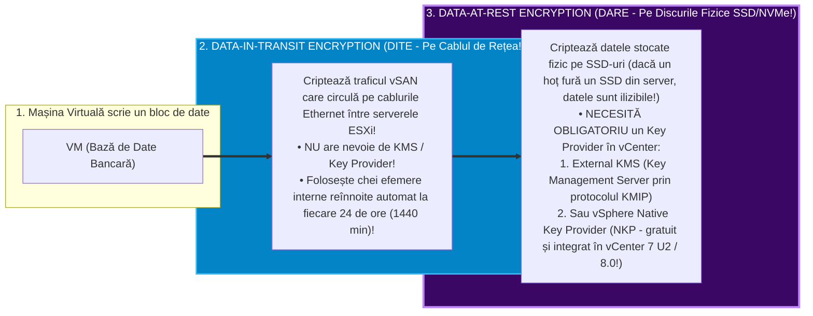
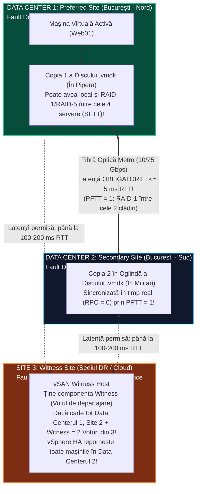
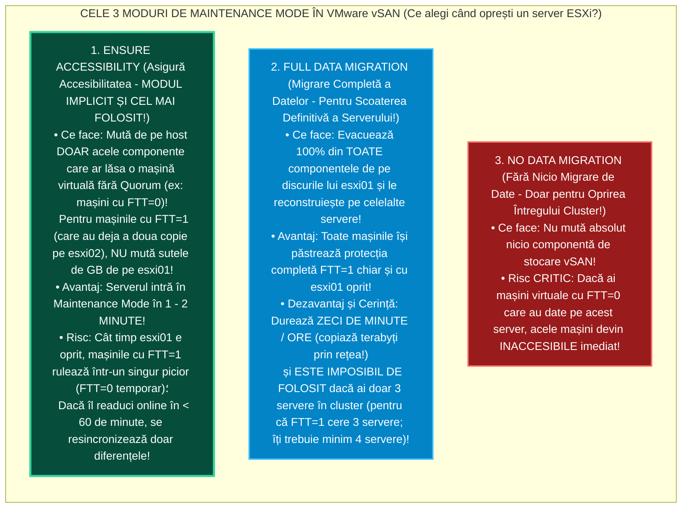

> **Obiectivul Capitolului:** Stăpânirea completă a serviciilor de eficiență și securitate din `VMware vSAN` (**`Deduplication and Compression`** în `OSA` vs. **`Compression-Only`** în `ESA`, **`Data-at-Rest Encryption`** vs. **`Data-in-Transit Encryption`** cu `KMS` / `NKP`), proiectarea arhitecturilor de înaltă reziliență prin **`Fault Domains`** (protecție la nivel de dulap/rack fizic) și **`vSAN Stretched Clusters`** (`PFTT` vs. `SFTT` și `Witness Appliance`), stăpânirea absolută a celor **3 moduri de `vSAN Maintenance Mode`** (`Ensure Accessibility`, `Full Data Migration`, `No Data Migration`), diferențierea critică dintre stările **`Degraded`** (reconstrucție la `0 secunde`) și **`Absent`** (cronometrul de `60 de minute` – `ClomRepairDelay`) și monitorizarea cu **`vSAN Skyline Health`**.
>
> **Regula de Aur a acestui Capitol:** Fiecare acronim, serviciu și cronometru intern (`Dedup`, `DARE`, `DITE`, `KMS`, `KMIP`, `NKP`, `DEK`, `KEK`, `FD`, `PFTT`, `SFTT`, `WTS`, `ClomRepairDelay`, `Absent`, `Degraded`, `Resync`) este explicat integral: **(1) Numele complet**, **(2) Ce reprezintă** și **(3) Cum funcționează tehnic sub capotă**.

:::analogy
### De ce se comportă `vSAN` diferit când scoți un disc cu mâna vs. când dai restart la un server?

Imaginează-ți că ai un cluster `vSAN` de 4 servere fizice, fiecare având câte $10\text{ TB}$ de date pe el.
Marți la prânz, trebuie să dai un simplu **Reboot** la serverul `esxi02` (un restart care durează doar **5 minute**).
Gândește-te ce s-ar întâmpla dacă `vSAN` ar intra în panică în secunda 1 în care `esxi02` s-a oprit pentru reboot și ar începe să copieze nebunește toți cei **$10\text{ TB}$ de date** prin rețea pe celelalte servere, ca să refacă oglinzile `RAID-1`! Ar inunda cablurile de rețea cu $10\text{ TB}$ de trafic inutil, iar peste 5 minute, când `esxi02` ar termina reboot-ul și s-ar întoarce online cu discurile lui intacte, toată munca de copiere ar fi fost făcută degeaba!

De aceea, inginerii care au creat `vSAN` au inventat două stări complet diferite pentru o componentă care nu mai răspunde (unul dintre cele mai importante subiecte de examen și interviu!):
* Starea **`Absent` (Componentă Absentă – Avarie posibil temporară):** Serverul `esxi02` nu mai răspunde pe rețea (sau cineva a smuls brusc un SSD fără ca controllerul să trimită cod de moarte definitivă). `vSAN` spune: *„Poate doar își dă reboot serverul! Pornesc un cronometru de exact **`60 de minute` (`ClomRepairDelay`)**! Dacă serverul se întoarce în aceste 60 de minute, îl sincronizez în câteva secunde doar cu ce s-a schimbat cât a lipsit! Abia dacă au trecut 60 de minute și tot nu s-a întors, încep să reconstruiesc toți cei $10\text{ TB}$ pe alte servere!”*.
* Starea **`Degraded` (Componentă Degradată – Moarte Hardware Confirmată!):** Un SSD a crăpat fizic și controllerul a raportat eroare permanentă irecuperabilă de citire/scriere. Aici `vSAN` știe 100% că un disc ars **nu învie singur după o oră**! Prin urmare, pentru starea **`Degraded`**, `vSAN` **NU așteaptă 60 de minute, ci începe reconstrucția datelor pe alte discuri în SECUNDA ZERO (`0 minute`)**!

### Analogia Profesorului: Dulapurile Fizice (`Fault Domains`) și Cele Două Orașe (`Stretched Cluster`)

* **Problema fără `Fault Domains`:** În Capitolul 3.2 am învățat că pentru `FTT = 1 (RAID-1)`, `vSAN` pune Copia A pe `esxi01`, Copia B pe `esxi02` și Witness-ul pe `esxi03`. Dar ce se întâmplă dacă ai 12 servere ESXi împărțite în **4 dulapuri metalice (`Racks`)** (câte 3 servere în fiecare dulap), și `vSAN` pune din întâmplare **ȘI Copia A (`esxi01`), ȘI Copia B (`esxi02`), ȘI Witness-ul (`esxi03`) în ACELAȘI Dulap #1**?! Dacă sare siguranța electrică a Dulapului #1 sau cade switch-ul din vârful Dulapului #1 (*Top-of-Rack Switch*), **mor toate cele 3 servere în aceeași secundă și îți cad toate mașinile virtuale**, deși celelalte 3 dulapuri din sală merg perfect!
* **Soluția (`vSAN Fault Domains`):** Îi spui lui `vSAN` care servere stau în Dulapul 1, care în Dulapul 2, Dulapul 3 și Dulapul 4. Din acea secundă, `vSAN` îți garantează că **nu va pune niciodată două bucăți ale aceluiași disc în același dulap fizic**! Acum poate să ia foc un dulap întreg cu 3 servere în el, că mașinile tale virtuale merg mai departe fără să piardă niciun bit!
:::

:::architecture
### 3.3.1. Servicii de Eficiență a Spațiului și Securitate: `Deduplication & Compression` (`OSA` vs. `ESA`) și `vSAN Encryption` (`DARE` vs. `DITE`)

#### 1. Cum funcționează `Deduplication` (Deduplicarea) și `Compression` (Compresia) în `vSAN OSA` vs. `vSAN ESA`?
*(Atenție: Aici există o diferență arhitecturală uriașă între `OSA` și `ESA`, testată masiv la examenele vSphere 8!)*

* **Ce înseamnă `Deduplication` (Deduplicarea)?** Eliminarea blocurilor de date duplicate (dacă 10 mașini virtuale au același fișier de $4\text{ KB}$, se păstrează o singură copie fizică pe SSD).
* **Ce înseamnă `Compression` (Compresia)?** Micșorarea matematică a unui bloc de date (de exemplu, comprimarea unui bloc de $4\text{ KB}$ la $2\text{ KB}$).

Hai să vedem cum au evoluat aceste două servicii de la `vSAN OSA` la `vSAN ESA`:

| Caracteristică Tehnică | În `vSAN OSA` (Arhitectura Clasică All-Flash) | În `vSAN ESA` (Noua Arhitectură din vSphere 8) |
| :--- | :--- | :--- |
| **Cum se activează în `OSA` vs `ESA`?** | În `OSA` (până la vSphere 7/8), poți alege fie **`Deduplication and Compression` împreună**, fie **`Compression Only`**, la nivel de **întreg Clusterul**! | În **`vSAN ESA`**, s-a renunțat la Deduplicare în favoarea unei **Compresii Ultra-Puternice**, care este activată **per Mașină Virtuală (prin politica `SPBM`)**! |
| **Unde se întâmplă în fluxul I/O?** | **Jos, la `Destaging` (*Cold Path*):** Datele intră necomprimate în discul de Cache și sunt deduplicate/comprimate **abia când coboară pe discurile de Capacitate**! | **Sus, la intrarea în `vSAN LFS` (*Hot Path*):** Datele sunt comprimate **direct în CPU înainte să atingă discul și ÎNAINTE să fie trimise pe cablul de rețea** către celelalte host-uri! |
| **Domeniul de Deduplicare în `OSA`** | **Per `Disk Group`!** (Nu deduplică între Disk Groups diferite sau între servere diferite!). | Nu se aplică (compresie nativă per bloc de $4\text{ KB}$ în până la 8 sectoare de $512\text{ Bytes}$!). |
| **Ce se întâmplă dacă o dezactivezi?** | În `OSA` (*Dedup & Compression*), activarea sau dezactivarea necesită **reformatarea secvențială (*Rolling Reformat*) a tuturor Disk Group-urilor**! | În **`vSAN ESA`**, este o simplă regulă în politica **`SPBM`**: o activezi sau o dezactivezi pe loc doar pentru mașinile dorite, fără nicio reformatare! |

#### 2. Cele 2 Tipuri de Criptare în `vSAN`: `Data-at-Rest` (`DARE`) vs. `Data-in-Transit` (`DITE`)
*(Subiect de 5 stele pentru examenul VCP-DCV și vSAN Specialist! Nu confunda cele două bife de criptare!)*

În setările serviciilor `vSAN`, ai două comutatoare de criptare complet independente, care protejează împotriva a două amenințări diferite:

1. **`vSAN Data-in-Transit Encryption` (`DITE` / Criptarea Datelor în Mișcare pe Rețea):**
   * **Ce protejează:** Criptează pachetele `vSAN` în timp ce călătoresc pe cablurile fizice de rețea și prin switch-uri de la `esxi01` la `esxi02` (folosind protocolul `IPsec` cu `AES-GCM-256`), împiedicând pe oricine ar intercepta traficul de pe switch-ul fizic să citească blocurile!
   * **Secretul de Examen:** `Data-in-Transit Encryption` **NU NECESITĂ un server extern de chei (`KMS`)**! Serverele ESXi își generează și își schimbă singure cheile simetrice de sesiune la fiecare **24 de ore**.
2. **`vSAN Data-at-Rest Encryption` (`DARE` / Criptarea Datelor în Repaus pe Disc):**
   * **Ce protejează:** Criptează toate datele scrise fizic pe discurile SSD/NVMe cu standardul `AES-256-XTS`. Dacă un tehnician rău-intenționat scoate un SSD din server în Data Center și fuge cu el acasă, fără cheie nu poate citi nici măcar un bit!
   * **Secretul de Examen:** `Data-at-Rest Encryption` **NECESITĂ OBLIGATORIU configurarea unui `Key Provider`** în `vCenter`:
     * Fie un cluster extern **`KMS` (`Key Management Server`)** care vorbește protocolul standard **`KMIP` (`Key Management Interoperability Protocol`)** (ex: Thales, HyTrust/Entrust, Fortanix).
     * Fie noul **`vSphere Native Key Provider` (`NKP`)** (introdus în vSphere 7.0 U2 și 8.0, care îți permite să activezi criptarea `vSAN` și `vTPM` în 30 de secunde direct din `vCenter`, fără să cumperi un server KMS extern scump!).
   * *Diferența dintre `OSA` și `ESA` la Criptarea pe Disc:* În `vSAN OSA`, criptarea se face la capătul de jos al stivei (după Deduplicare/Compresie, ca să poată deduplica datele înainte să devină texte criptate aleatorii!). În **`vSAN ESA`**, criptarea se face sus în **`LFS`** (imediat după compresie), astfel încât datele pleacă **deja criptate** chiar și pe rețea și sunt scrise o singură dată!

---

### 3.3.2. `vSAN Fault Domains` (Protecția la Nivel de Rack) și `vSAN Stretched Clusters` (`PFTT` & `SFTT`)

#### 1. Cum proiectezi `vSAN Fault Domains` (Domenii de Eroare / Dulapuri Fizice)?
* **Definiție:** Un **`Fault Domain` (`FD`)** este un grup de unul sau mai multe servere `ESXi` care împart un punct fizic comun de eșec — cum ar fi același dulap metalic (**Rack**), aceeași bară de alimentare electrică (**PDU**) sau același switch de rețea (**Top-of-Rack Switch**).
* **Cum se aplică matematica `2n + 1` la `Fault Domains` (Întrebare VCP!):**
  * În momentul în care creezi `Fault Domains` într-un cluster `vSAN`, regulile `FTT` din politica `SPBM` nu se mai numără în „servere individuale”, ci se numără în **număr de `Fault Domains` (Dulapuri)**!
  * **Exemplu de calcul pentru Examen:**
    * Dacă vrei să folosești politica **`FTT = 1 cu RAID-1 (Mirroring)`**, ai nevoie de **minimum `3 Fault Domains` (3 Dulapuri fizice separate)**! (`Dulapul 1` ține Copia A, `Dulapul 2` ține Copia B, iar `Dulapul 3` ține `Witness`-ul!).
    * Dacă vrei să folosești **`FTT = 1 cu RAID-5` în `OSA`**, ai nevoie de **minimum `4 Fault Domains` (4 Dulapuri fizice separate)**!
    * Dacă vrei să folosești **`FTT = 2 cu RAID-6`**, ai nevoie de **minimum `6 Fault Domains` (6 Dulapuri fizice separate)**!

#### 2. Arhitectura `vSAN Stretched Cluster` (Cluster Întins între 2 Clădiri / 2 Centre de Date + 1 Witness Site)
*(Aceasta este arhitectura vedetă folosită de bănci și spitale pentru **Zero Data Loss (`RPO = 0`)** atunci când ia foc o clădire întreagă sau cade curentul în tot cartierul!)*

* **Cum este construit un `vSAN Stretched Cluster` (`Active-Active Metro Cluster`):**
  1. **`Preferred Site` (Data Centerul 1 – ex: Clădirea din Pipera):** Conține până la **15 (în OSA) / 12 (în ESA) servere `ESXi`** (de exemplu, 4 servere ESXi).
  2. **`Secondary Site` (Data Centerul 2 – ex: Clădirea din Militari, aflată la 10 km distanță):** Conține un număr egal de servere `ESXi` (încă 4 servere ESXi).
     * **Cerința Critică de Rețea între Site 1 și Site 2 (De memorat pentru Examen!):** Latența dus-întors (**`RTT` – `Round-Trip Time`**) pe fibra optică dintre `Preferred Site` și `Secondary Site` trebuie să fie de **maximum `5 milisecunde` (`<= 5 ms RTT`)** cu o lățime de bandă de minimum `10 Gbps / 25 Gbps`! De ce maximum $5\text{ ms}$? Pentru că orice scriere făcută de o mașină virtuală în Pipera este trimisă **sincron** pe fibră până în Militari înainte ca mașina virtuală să primească confirmarea `Write ACK`!
  3. **`Witness Site` (Al treilea loc – ex: în Cloud, într-un al treilea birou din Brașov):**
     * Nu conține servere de producție! Conține o singură mașină virtuală specială numită **`vSAN Witness Host / Witness Appliance`**, care ține doar componentele `Witness` (de $\sim 2\text{ MB}$) pentru a vota cine rămâne în viață dacă cineva taie cu excavatorul fibra optică dintre Pipera și Militari!
     * **Cerința de Latență către `Witness Host`:** Poate fi mult mai mare — până la **`100 ms – 200 ms RTT`** (pentru că spre Witness nu circulă datele mașinilor virtuale, ci doar metadate mici de vot!).

#### 3. Ce înseamnă `PFTT` (`Primary level of failures to tolerate`) și `SFTT` (`Secondary level of failures to tolerate`) într-un `Stretched Cluster`?
*(Întrebare clasică de examen vSAN Specialist!)*
Într-un `Stretched Cluster`, ai două niveluri de protecție în politica de stocare `SPBM` (**Dual-Level Protection**):
1. **`PFTT` (`Primary level of failures to tolerate` – Protecția ÎNTRE cele două clădiri / Site-uri):**
   * Când setezi **`Site disaster tolerance: Dual site mirroring (Stretched cluster)`**, `PFTT` este setat pe **`1`**: asta face o oglindă **`RAID-1` între Clădirea 1 și Clădirea 2** (și garantează **`Local Read Locality`**, adică o mașină virtuală care rulează în Clădirea 1 își citește datele **100% local** din discurile Clădirii 1, fără să consume fibra dintre clădiri la citire!).
2. **`SFTT` (`Secondary level of failures to tolerate` – Protecția ÎN INTERIORUL fiecărei clădiri):**
   * Îți permite ca în interiorul Clădirii 1 (între cele 4 servere din Pipera) și în interiorul Clădirii 2 (între cele 4 servere din Militari) să ai **încă un nivel de RAID local** (`RAID-1` sau `RAID-5/6`)!
   * **De ce este genial `PFTT + SFTT`?** Dacă nu ai avea `SFTT`, ori de câte ori s-ar arde un simplu SSD într-un server din Pipera, serverele din Pipera ar trebui să citească toate datele peste fibra de $10\text{ km}$ tocmai din Militari! Cu `SFTT = 1`, dacă se arde un disc în Pipera, mașina virtuală își citește datele în continuare local de pe celelalte servere din Pipera!

---

### 3.3.3. Operațiuni de Zi cu Zi: Cele 3 Moduri de `Maintenance Mode` în `vSAN` și Stările `Absent` (`60 min`) vs. `Degraded` (`0 min`)

#### 1. Cele 3 Opțiuni Obligatorii când bagi un Server `ESXi` în `Maintenance Mode` într-un Cluster `vSAN`!
*(ATENȚIE: Aceasta este întrebarea practică numărul 1 atât la examenul VCP-DCV, cât și în viața reală a oricărui administrator VMware!)*

Într-un cluster clasic cu SAN extern (Capitolul 2.5), când dai click-dreapta pe un server `esxi01` $\rightarrow$ **`Enter Maintenance Mode`**, vCenter trebuie doar să mute mașinile virtuale pornite cu `vMotion`.
Dar într-un cluster **`vSAN`**, serverul `esxi01` **are în burta lui discuri fizice pe care stau bucăți (`Components`) din discurile tuturor mașinilor virtuale din cluster**!
De aceea, când apeși pe *Enter Maintenance Mode* într-un cluster `vSAN`, vCenter îți afișează o listă dropdown cu **3 opțiuni de evacuare a datelor vSAN (`vSAN Data Migration Mode`)**:

> **Capcana Clasică de Examen VCP pe `Maintenance Mode` în `vSAN`:**
> *Scenariu:* Ai un cluster `vSAN` format din **exact `3` servere ESXi** (`esxi01`, `esxi02`, `esxi03`), iar toate mașinile virtuale folosesc politica `FTT = 1 (RAID-1)`. Vrei să bagi serverul `esxi01` în *Maintenance Mode* pentru un update de 10 minute și selectezi din greșeală opțiunea **`Full Data Migration`**. Ce se întâmplă?
> **Operațiunea EȘUEAZĂ! Serverul NU poate intra în Maintenance Mode!** De ce? Pentru că `Full Data Migration` vrea să mute toate cele 3 piese ale fiecărei mașini (`Component 1`, `Component 2` și `Witness`) pe serverele rămase, dar după scoaterea lui `esxi01` mai rămân doar **2 servere**, iar regula `FTT = 1` cere matematic **minimum 3 servere**! Pe un cluster de 3 servere, singura opțiune validă pentru mentenanță fără pierdere de acces este **`Ensure Accessibility`**!

#### 2. Tabelul Comparativ: Starea `Absent` (`60 de minute`) vs. Starea `Degraded` (`0 minute`)

| Starea Componentei în `vSAN` | Cum ajunge o componentă în această stare? | După cât timp începe `vSAN` reconstrucția completă (`Resync / Rebuild`) pe alte discuri? | De ce are acest comportament? |
| :--- | :--- | :--- | :--- |
| **`Absent`** *(Absentă)* | • Un host ESXi își dă **Reboot** sau a intrat în *Maintenance Mode (`Ensure Accessibility`)*; • A căzut temporar placa de rețea vSAN; • Un disc a fost deconectat brusc fără cod de eroare permanentă. | **După `60 de minute`!** *(Controlat de parametrul avansat `VSAN.ClomRepairDelay = 60`)* | Pentru că în $90\%$ din cazuri, un server care își dă reboot pentru patching revine online în 10–15 minute! Așteptând 60 de minute, `vSAN` evită copierea inutilă a zeci de TB prin rețea! |
| **`Degraded`** *(Degradată)* | • Un disc SSD/NVMe sau controllerul a returnat un **cod hardware permanent de defecțiune** (*Permanent Unrecoverable Read/Write Error / PDL*). | **Imediat! În `0 secunde`!** | Pentru că `vSAN` știe cu certitudine că discul fizic este stricat definitiv și nu își va mai reveni niciodată, deci începe salvarea redundanței pe loc! |

#### 3. Pragurile de Umplere a Discurilor în `vSAN` (`80%` Rebalance & `30% Slack Space`) și `vSAN Skyline Health`
* **De ce îți recomandă VMware să păstrezi întotdeauna `25% – 30%` spațiu liber (`Slack Space / Operations Reserve`) într-un cluster `vSAN`?**
  * Dacă umpli un cluster `vSAN` la $90\%$ și mâine se arde un server fizic, **unde mai are loc `vSAN` să reconstruiască oglinzile componentelor care se aflau pe serverul ars?!** Nu mai are loc!
  * Mai mult: atunci când orice disc fizic individual din `vSAN` atinge pragul de **`80%` grad de ocupare**, serviciul `CLOM` declanșează automat un proces de **`Automatic Rebalance`**, mutând componente de pe acel disc plin pe alte discuri mai goale din cluster!
* **Unealta Supremă de Monitorizare: `vSAN Skyline Health` (`Cluster -> Monitor -> vSAN -> Skyline Health`):**
  * Verifică automat peste 100 de parametri vitali: dacă toți membrii clusterului pot da `ping` atât cu pachete mici, cât și cu **`Jumbo Frames` (`Large Ping Test - MTU 9000`)**, dacă există vreo partiționare a rețelei, dacă versiunea de Driver și Firmware a controllerului corespunde cu **vSAN HCL** și care este starea tuturor obiectelor (`Healthy`, `Reduced availability with no rebuild - delay timer`, `Inaccessible`).
* **Ce este `vSAN File Services` (introdus în vSAN 7/8)?**
  * Dacă pe lângă mașinile virtuale ai nevoie ca `vSAN` să îți ofere și **Foldere Partajate (`File Shares`)** prin protocoalele **`NFS v3 / v4.1`** și **`SMB` (Windows Shares)** (pentru containere Kubernetes sau aplicații care au nevoie de un share de rețea), activezi **`vSAN File Services`**, iar `EAM` lansează pe fiecare host câte un mic container/VM numit **`FSVM` (`File Services VM`)** care expune direct spațiul din `vsanDatastore` ca server NAS!
:::

:::exam-alert
### Ce faci când un update de BIOS/Firmware pe un server Dell/HPE știe că va dura 90 de minute (mai mult decât cele 60 de minute ale lui `ClomRepairDelay`)?!
*(Secret de Aur din Producție – VMware KB 2075456!)*
* Dacă știi că pui un server `esxi01` în *Maintenance Mode* cu `Ensure Accessibility` pentru o reparație hardware la fața locului care va dura **2 ore (`120 de minute`)**, după minutul 60 `vSAN` va crede că serverul nu se mai întoarce și va începe să copieze terabyți de date în tot clusterul!
* **Cum eviți asta ca un Senior:** Înainte de mentenanță, mărești temporar timer-ul `ClomRepairDelay` de la `60 de minute` la `180 de minute` direct din interfața grafică a clusterului (`Cluster -> Configure -> vSAN -> Services -> Advanced Options -> Object Repair Timer = 180 minutes`)!
:::

:::interview
### Întrebarea 1 (Nivel Mid / Senior – Ce opțiune de Maintenance Mode alegi în 3 scenarii diferite?)
> **Intervievator:** *„Ai un cluster `vSAN` de 4 servere ESXi. Explică-mi care sunt cele 3 opțiuni când bagi un host în Maintenance Mode și spune-mi exact pe care o alegi în următoarele două situații: (1) Vrei să aplici un patch rapid de ESXi care durează 15 minute; (2) Vrei să scoți definitiv serverul numărul 4 din rack ca să îl casezi.”*

**Răspunsul Ideal:**
„Cele trei opțiuni de migrare a datelor la intrarea unui host în *Maintenance Mode* într-un cluster `vSAN` sunt: **`Ensure Accessibility`**, **`Full Data Migration`** și **`No Data Migration`**.
1. **Pentru situația 1 (Patching rapid de 15 minute):** Aleg **`Ensure Accessibility`** (opțiunea implicită). În acest mod, `vSAN` evacuează doar mașinile virtuale pornite (prin `vMotion`) și eventualele componente cu `FTT=0`, lăsând pe loc componentele mașinilor cu `FTT=1` (deoarece acestea rămân perfect funcționale prin a doua lor copie aflată pe celelalte servere). Astfel, serverul intră în *Maintenance Mode* în 1–2 minute, își face reboot-ul în interiorul ferestrei de **`60 de minute` (`ClomRepairDelay`)**, iar la revenire resincronizează în câteva secunde doar blocurile modificate în cele 15 minute.
2. **Pentru situația 2 (Scoaterea definitivă / Decommissioning a serverului 4):** Aleg obligatoriu **`Full Data Migration`**. Deoarece serverul nu se va mai întoarce niciodată în cluster, iar noi mai avem încă 3 servere rămase (suficiente pentru `FTT=1 RAID-1`), `vSAN` va evacua 100% din toate componentele de pe discurile serverului 4 și le va reconstrui pe celelalte 3 servere înainte de a permite oprirea host-ului, garantând că nicio mașină virtuală nu își pierde redundanța.”
:::

:::lab
> **Scenariul Laboratorului:** În acest laborator vom verifica starea de sănătate a clusterului nostru cu **`vSAN Skyline Health`**, vom inspecta timer-ul de **`60 de minute` (`Object Repair Timer`)**, vom testa intrarea rapidă a serverului `esxi02` în **`Maintenance Mode` cu `Ensure Accessibility`** și vom urmări în timp real cum starea mașinii virtuale `web01` trece în **`Reduced availability with no rebuild - delay timer`**, revenind automat la **`Healthy`** în secunda în care scoatem serverul din *Maintenance Mode*!
:::

:::quiz

:::

:::references
1. **VMware Official Docs / vSAN Space:** *vSAN Administration Guide – Space Efficiency (Compression & Deduplication), vSAN Encryption, Fault Domains, Maintenance Mode Options, and Handling Disk Failures (Absent vs. Degraded)* (`techdocs.broadcom.com`).
2. **VMware vSAN Stretched Cluster Guide (core.vmware.com):** *Architecture, PFTT/SFTT Dual-Level Protection, and Network Latency Requirements (5ms Data / 200ms Witness)*.
3. **Broadcom / VMware Knowledge Base (KB 2075456):** *Changing the `ClomRepairDelay` (60-minute object repair timer) in VMware vSAN*.
4. **Cormac Hogan & Duncan Epping:** *vSAN Maintenance Mode Deep Dive & Stretched Clusters Failure Scenarios*.
:::
